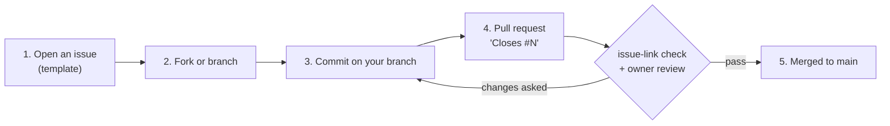

# Contributing

Thanks for helping. This project reverse-engineers the Yaesu FT-710's firmware: see the [illustrated guide](docs/guide/README.md) for the
big picture and [docs/getting-started.md](docs/getting-started.md) to set up a working copy.

## How changes get in



1. **Every change starts with an issue.** Open one with a template (correction, new analysis or tool, question) before you write code
   or docs. Say what you want to change and the evidence for it.
2. **Every commit goes through a pull request.** Nobody pushes to `main` directly, except the repository owner and admins. Work on a
   branch (or a fork) and open a pull request.
3. **Link the issue in the PR description** with a closing keyword: `Closes #12`, `Fixes #12` or `Resolves #12`. The `issue-link`
   check fails without it.
4. **Review.** The repository owner reviews every pull request (`.github/CODEOWNERS`). Answer the review on the same branch.

The repository owner and admins may commit to `main` directly (the branch ruleset lets them bypass it). That includes AI agents working
on the owner's behalf with the owner's credentials.

## Signed commits (please, but not required)

Please sign your commits so GitHub shows them as **Verified**. SSH signing is the simplest option:

```sh
git config gpg.format ssh
git config user.signingkey ~/.ssh/id_ed25519.pub   # any SSH key; add it on GitHub as a *signing* key
git config commit.gpgsign true
```

Add the same public key under GitHub → Settings → SSH and GPG keys → **New SSH key → Key type: Signing key**. GPG keys work too.
Unsigned commits are still accepted: the branch ruleset does not require signatures.

## What a good change looks like

Read [AGENTS.md](AGENTS.md): it is the rule book for humans and AI agents alike. In short:

- **Evidence tags.** Mark claims **[fact]** (seen in code or data, with the address), **[inference]** or **[guess]**.
- **Figures.** Use Mermaid in Markdown, about 25 nodes or fewer, and hand-written SVG in `docs/guide/img/` for the guide.
- **Ghidra names.** Keep the names files in `tools/ghidra/` as the source of truth, and re-export `decomp/<image>/` with
  `tools/ghidra/ExportDecomp.java` when names change.
- **What is in the repo.** The manuals (`Manuals/`) and the three canonical Ghidra projects (`ghidra/FT710_{MAIN,DISPLAY,IFDSP}`) are
  committed. The firmware download (`Firmware/`) and decoded images (`build/`) are not; [tools/bootstrap.sh](tools/bootstrap.sh) rebuilds
  them. Work in your own copy of a Ghidra project, and send name changes as `tools/ghidra/names_*.tsv` edits plus the `decomp/` re-export.
  The owner updates the committed projects, because Ghidra databases can't be merged.
- **Don't touch someone's radio without asking.** Anything that writes to a radio (flashing, EEPROM writes, untested CAT set-commands,
  JTAG loads) needs that radio owner's explicit approval each time. Read the risk ladder in chapter 8 of the guide first.
- **Licence conditions.** Changes that affect transmit (power, band limits, the TX path) must keep the radio within its operator's
  licence.
