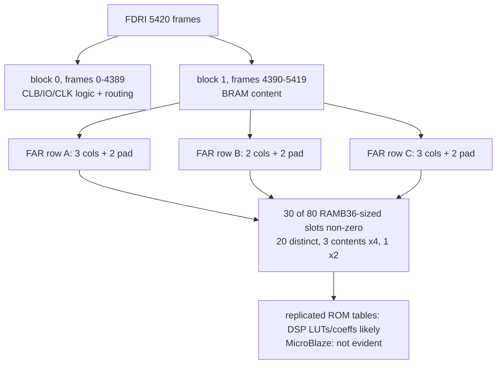
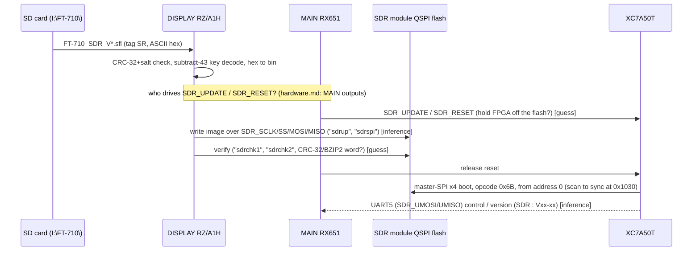

# decomp/sdr — SDR module image (`FT-710_SDR_V0104.SFL`, tag SR, V01-04)

**There is no CPU code to decompile.** The decoded image is a Xilinx Artix-7 **XC7A50T** configuration bitstream (a
standard, uncompressed, unencrypted Vivado `.bin`) behind a 4 KiB Yaesu header sector holding a CRC-32. No soft-CPU
firmware can be pulled out as code: the FPGA fabric is not disassembled, and the BRAM contents are bit-interleaved
across frames (see "Soft CPU?" below). This directory therefore has only this summary. The image layout table is in
[`docs/memory-maps.md` (SDR section)](../../docs/memory-maps.md). The analysis task is
[`docs/tasks/T08-decomp-sdr.md`](../../docs/tasks/T08-decomp-sdr.md).

Tool: `python3 -I tools/xbit_parse.py build/FT-710_SDR_V0104.bin` (packet log, register decode, CRC check),
`--lead` (leading word), `--frames` (FDRI statistics), `--bram` (BRAM content frames).

## Device

| Check | Result | Confidence |
|---|---|---|
| IDCODE register write | `0x0362C093` = XC7A50T, revision field 0 (UG470 Table 1-1) **[fact]** | High. The FPGA aborts configuration on an IDCODE mismatch, so the stream only loads on an XC7A50T. |
| Bitstream length (0x1000..EOF) | 2,192,012 bytes = 17,536,096 bits = the UG470 length for the XC7A35T/XC7A50T die **[fact]** | High (it confirms the die; the IDCODE separates the 50T from the 35T) |
| FDRI | 547,420 words = 5,420 frames x 101 words, no remainder **[fact]**. 4,390 block-0 frames + 1,030 BRAM-content frames **[inference]** | High that it is a full-device write. I had no offline Xilinx device database, so the XC7A50T frame count is confirmed only through the UG470 total length, not a frame table. |
| Package / speed grade | Not encoded in the bitstream | Unknown |

## Packet stream summary

All offsets are file offsets. Every packet is type 1 except the single type-2 FDRI write. Both CRC register writes match the
CRC-32C configuration CRC recomputed by `xbit_parse.py` **[fact]**.

| Offset | Packet | Meaning |
|---|---|---|
| 0x1038 | BSPI = 0x0000026B, CMD BSPI_READ (0x12) | Master-SPI read opcode **0x6B** (Quad Output Fast Read, 24-bit address), x4 bus. This is Vivado's `SPI_BUSWIDTH 4`. **The FPGA boots itself from a QSPI flash on the SDR module.** [fact for the values, inference for the meaning] |
| 0x104C | TIMER = 0, WBSTAR = 0, CMD NULL | No watchdog, no MultiBoot warm-boot address (golden image at flash 0) |
| 0x1068 | CMD RCRC | Reset CRC |
| 0x1078 | reg 0x13 (RBCRC_SW) = 0 | Readback-CRC software, off |
| 0x1080 | COR0 = 0x02423FE5 | GWE_CYCLE 5, GTS_CYCLE 4, LOCK/MATCH NoWait, DONE_CYCLE 3, OSCFSEL 33 (CCLK ConfigRate code), DONE_PIPE = 1 |
| 0x1088 | COR1 = 0 | Defaults (no readback CRC) |
| 0x1090 | IDCODE = 0x0362C093 | XC7A50T |
| 0x1098 | CMD SWITCH | Switch CCLK to the ConfigRate frequency |
| 0x10A4 | MASK 0x401 / CTL0 0x501 / MASK 0 / CTL1 0 | GTS_USR_B, GLUTMASK_B, ConfigFallback. **DEC = 0, so not encrypted**. There is no CBC (IV) write. |
| 0x10E4 | FAR = 0, CMD WCFG | Start the frame write at block 0 / row 0 / column 0 |
| 0x10F8 / 0x10FC | FDRI type 1 (0 words) + type 2 (547,420 words) | The whole configuration in one write. There are **no MFWR packets, so it is not compressed.** |
| 0x217A70 | CRC = 0x671F766B | Verified |
| 0x217A80 | CMD GRESTORE, CMD DGHIGH/LFRM, 100 x NOP, CMD START | Startup sequence |
| 0x217C30 | FAR = 0x03BE0000, MASK/CTL0 0x501 | Standard Vivado trailer |
| 0x217C48 | CRC = 0xE3AD7EA5 | Verified |
| 0x217C58 | CMD DESYNC, then 395 NOPs | End of stream |

## Leading word 0x993966C2

It is the big-endian **CRC-32/BZIP2** (poly 0x04C11DB7, MSB-first, init 0xFFFFFFFF, xorout 0xFFFFFFFF; equal to the bitwise
NOT of CRC-32/MPEG-2) over **file[0x1000:EOF]**, the complete Vivado `.bin` (2,192,012 bytes) **[fact]**, verified by
`xbit_parse.py --lead`. Rejected hypotheses: the byte-reversed sync (0x665599AA), the bit-reversed sync (0x66AA9955), lengths,
sum8/sum16/sum32, XOR32, CRC-32/ISO-HDLC (zlib), CRC-32 with the SFL salt, CRC-32C, and the CRC-16 variants over several spans.

None of the CPU images (DISPLAY, MAIN, IFDSP) contains an MSB-first CRC-32 table (`00000000 04C11DB7 09823B6E`) or the
0x04C11DB7 literal. So **who checks this CRC is still open**. It could be a bitwise or MOVW/MOVT routine in DISPLAY, or logic inside the
FPGA design (for example the `sdrchk` path) **[guess]**. The 4 KiB of FF padding makes the header exactly one SPI-flash sector, so the bitstream
starts at flash offset 0x1000 if the image is written verbatim **[inference]**. The 7-series master-SPI boot scans for the
sync word, so the header does not stop the FPGA from booting from flash address 0 **[inference]**.

## Soft CPU? (MicroBlaze)

- There are **no meaningful strings** in the FDRI payload, in either word byte order. The printable runs are LUT-INIT patterns like
  `UUff33ZZ` (0x55/0x66/0x33/0x5A). **[fact]** This is expected even with a soft CPU, because 7-series BRAM INIT bits are
  bit-interleaved across the 128 frames of a BRAM column, so strings would not survive anyway.
- BRAM content frames (block type 1, frames 4390-5419). Of the 80 BRAM-sized slots (8 column segments x 10 RAMB36, assuming 10 words per RAMB36
  per frame), **30 hold non-zero data, but only 20 distinct contents**. Three contents each appear **4 times** and one appears **twice**.
  One whole column segment is empty. **[fact for the counts, inference for the slot to RAMB36 mapping]**
- Interpretation: replicated BRAM contents are typical of **DSP ROM tables** (NCO sine/cosine, FIR/CIC coefficients, a window
  table for the FFT/scope path) instantiated per channel. MicroBlaze local memory would show as one group of *unique*
  BRAMs. 13 slots are unique, so a small MicroBlaze/MCS **cannot be ruled out** from the bitstream alone. **Verdict: a soft CPU is
  not evident and is unlikely, but unproven [inference, medium].** A soft core would make the `SDR_DBG_IN/OUT` ("UART DBG RX/TX")
  pins on J2002 more plausible, but a plain register-file UART also explains them.

## How the bitstream reaches the FPGA (leads)

- **[fact]** The bitstream configures the FPGA for **master SPI x4** (BSPI 0x26B). It is not loaded by an external host at
  each power-up (slave serial/SelectMAP) but read from a QSPI flash on the SDR module. So an "SDR update" means **reprogramming that flash**.
- **[fact]** DISPLAY V01-08 holds the SD-card name `FT-710_SDR_V` (VMA 0x2010DFA4) and the SFL decoder (docs/sfl-format.md). Next to its debug
  commands (`dsp1up`, `rom_writer.dat`, `uptest`, `mrst`) it has an SDR set at VMA 0x20110DEC..0x20110E4C:
  `sdrup`, `sdr1up`, `sdr2up`, `sdrchk1`, `sdrup/g`, `sdr1up/g`, `sdr2up/g`, `sdrchk1/g`, `sdrchk2/g`, `sdrspi`, `sdrfile`.
  It also has SPI link counters `CS_POLL=%u MOSI_OK=%u MOSI_NG=%u FRAMES =%u MISO_OK=%u MISO_NG=%u` (VMA ~0x201126F4).
  None of these strings has a direct 32-bit literal-pool reference, so they are probably reached by ADR/base+offset. Left for the DISPLAY
  decompile (T06).
- **[fact]** In docs/hardware.md, `SDR_SCLK/SS/MOSI/MISO` are DISPLAY RZ/A1H P8_3..P8_6, while `SDR_UPDATE`/`SDR_RESET` are
  MAIN RX651 outputs and `SDR_UMOSI/UMISO` is MAIN SCI5. MAIN V01-12 has only the "SCOPE SDR REF" calibration item and the
  "SDR : V00-00" version line as SDR text.
- **[inference, medium]** DISPLAY writes the decoded bitstream into the module's flash over the SDR SPI bus, while MAIN
  (asked by DISPLAY over the DISP UART) holds the FPGA in reset/update with `SDR_UPDATE`, so that the flash is reachable
  (a mux, or FPGA PROGRAM_B held low so its config pins tri-state). `sdr1up`/`sdr2up` and `sdrchk1`/`sdrchk2` hint at two
  steps or two regions (for example the header sector + bitstream, or golden + update) **[guess]**.
- Alternative **[guess, lower]**: the payload stays ASCII hex in the SFL and is streamed as text to a loader. That would
  need a CPU on the module, and the bitstream shows none.
