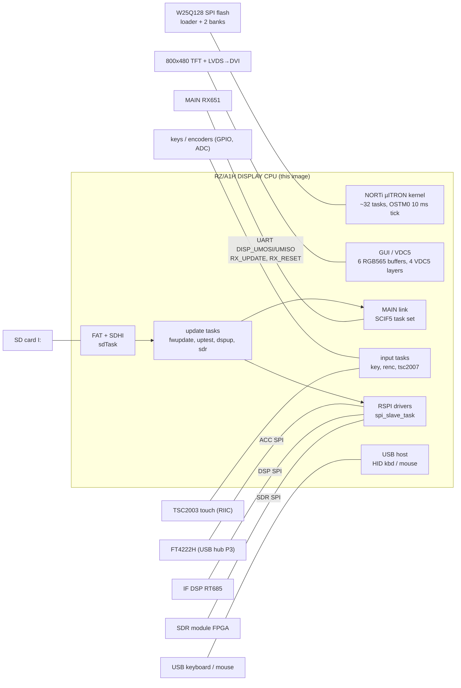
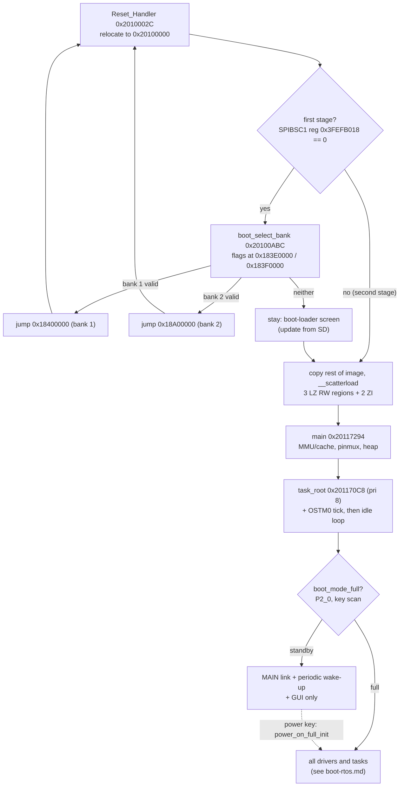

# DISPLAY image (PC, `FT-710_DISPLAY_V0108`): code documentation

The DISPLAY firmware runs on the front-panel **Renesas RZ/A1H** (Cortex-A9, 10 MB on-chip SRAM, no SDRAM) (docs/hardware.md, service manual p62/p67).
It is a single armcc C/C++ image of 3.3 MB (405 KB code, 2.8 MB GUI bitmaps) with the **NORTi** µITRON 4.0 kernel from MiSPO (string `NORTi(c)MiSPO` at 0x20156290 **[fact]**), 29 static task descriptors and a few tasks built at run time. The same binary works both as the
**SPI-flash boot loader** and as the **application** in one of two flash banks. Besides the touch-screen GUI it owns the **SD card**, so it is the CPU that
**updates all the others**: MAIN (RX651 boot mode over its UART), IFDSP, the SDR FPGA flash, and itself.

Sources: `decomp/display/` (Ghidra export, names from `tools/ghidra/names_display.tsv`), `decomp/display/INDEX.md`, `docs/memory-maps.md` (DISPLAY),
`docs/tasks/T06-decomp-display.md`, `docs/tasks/T11-docs-display.md` and its sub-tasks. All addresses are CPU addresses in the image (base 0x20100000).

## Block diagram

Wiring is from docs/hardware.md (service manual p62, p17) **[fact for the wiring]**; the task-to-bus mapping is detailed on each subsystem page.

## Boot and control flow

The reset and bank path is **[fact]** (T06, `boot_select_bank`); "stay in the loader when no bank is valid" is **[inference]** from the
`BOOT LOADER V01-02` / `FIRMWARE BOOT ERROR` strings. The standby/full split is in `task_root` **[fact]**; the meaning "radio off vs on" is **[inference]**
(details in [boot-rtos.md](boot-rtos.md)).

## Memory map summary

Full table: `docs/memory-maps.md` → DISPLAY.

| Range | Use |
|---|---|
| 0x18000000–0x18FFFFFF | SPI flash window (SPIBSC0): loader at 0, bank flags 0x3E0000 / 0x3F0000, bank 1 at 0x400000, bank 2 at 0xA00000 **[fact]** |
| 0x20000000–0x2000005F | boot-info block (magic 0xBBBB, bank table), pointer kept in SPIBSC1 reg 0x3FEFB018 **[fact]** |
| 0x20100000–0x20165177 | `.text` (A32, Thumb-2 only in the armcc runtime) |
| 0x20165178–0x204286A7 | `.rodata`: task/ISR descriptors (0x201651A8–0x20165A6C), GUI bitmaps, UI strings |
| 0x2042BC10–0x2044BFFF | mode stacks (SP 0x2044C000) |
| 0x20450000 / 0x20800000 | `.data` / `.data2` (RW, LZ-initialised), followed by `.bss` / `.bss2` (kernel TCBs at 0x208DBBA0, UART objects) |
| 0x20980000 | base of the NORTi kernel pool (`kernel_heap_init`); in effect it runs to the end of RAM, 0x209FFFFF (#119) **[fact]** |
| 0x60000000–0x609FFFFF | uncached RAM mirror: frame buffers, `.data_nc` (0x60500000) |
| 0xE8000000 / 0xFCFE0000 | peripherals: SCIF, RSPI, USB, SDHI, DMAC, GIC / CPG, GPIO, OSTM, RIIC, INTC, VDC5 |

## Task structure

`main` creates only `task_root`, starts the OSTM0 tick and becomes the idle loop. `task_root` creates everything else. The 29 static task descriptors
(T_CTSK `{attr, exinf, entry, prio, stksz, stk, name}`) are listed in [boot-rtos.md](boot-rtos.md#tasks). Lower number = higher priority **[inference from
µITRON convention]**: the update writers (`uptest`, `dspup`), `powon` and the MAIN-link `cmd_interval` run at 3, the GUI-side workers at 5–8.

## Subsystems

| Page | Sub-task | Contents | Status |
|---|---|---|---|
| [boot-rtos.md](boot-rtos.md) | T11a | Reset path, dual-bank loader, scatter-load, main, root task, boot modes, kernel objects, ISRs, task table | done |
| [mainlink.md](mainlink.md) | T11b | SCIF5 UART link to MAIN: frame format, command table at 0x20450074, TX/RX tasks | done |
| [update.md](update.md) | T11c | SD/FAT, SFL decode/CRC, updates of DISPLAY, MAIN, IFDSP and SDR; the USB-keyboard debug console | done |
| [spi-links.md](spi-links.md) | T11d | RSPI0–4, SDR and DSP SPI data, FT4222H | done |
| [gui.md](gui.md) | T11e | VDC5, layers, draw primitives, bitmap descriptors, screens, screen capture | done |
| [input.md](input.md) | T11f | Touch, keys, encoders, USB HID | done |
| [peripherals.md](peripherals.md) | T11g | RTC, timers, GPIO, backlight, DVI, user files on SD | done |

## Key findings so far

- **Hidden debug console, disabled in V01-08** **[fact]**. A USB keyboard's typed lines (`hid_line_edit` 0x20112E5C works on raw HID usages) are
  passed to the debug handler chain `hid_chain1_dispatch` (table 0x208DC1BC, 9 slots). Six slots are registered (0, 1, 3, 5, 7, 8): the
  self-update commands `fw1up`/`fw1chk`/`up0`/`up1`/`up2`, `uptest` (MAIN update), `cli` (a memory peek/poke monitor that can also run
  `I:\NAME.txt` scripts), `keycode`, the SDR commands (`sdr_debug_cmd`) and the keyboard test (`kbdtest_line`). The DSP commands are not
  registered (`dspup_init` has no caller), and the console's only output is the keyboard LEDs ([input.md](input.md), [update.md](update.md)). The chain
  only runs when `debug_enabled()` sees 0xA0B9C8E7 at 0x20450000. The shipped `.data` value is 0, and the only writer, `debug_unlock` 0x20107E68
  (P4_3 and P8_3 low + Ctrl+Backspace), has **no caller** (checked by a full B/BL/literal scan and by REA's independent import). See [boot-rtos.md](boot-rtos.md#usb-keyboard-handler-chains).
- **MAIN link** (T11b) **[fact]**: stop-and-wait over SCIF5 at 345600 baud 8N2. Frames are `cmd + payload + sum8`, with the lengths from the
  43-entry table at 0x20450074. After 3 failed retries the DISPLAY shows an error box or resets MAIN and then itself through the watchdog ([mainlink.md](mainlink.md)).
- **Updates** (T11c) **[fact]**: an SFL file is accepted on its salted CRC alone (tag and length are not checked). The SDR bitstream goes over
  RSPI2 while MAIN bridges the FPGA register commands. `loader_selfinstall` is a JTAG/`BKPT` factory path ([update.md](update.md)).
- **SPI links** (T11d) **[fact]**: the PC gets the scope, the AF-FFT and a status block over the FT4222H (RSPI0, DISPLAY is the slave).
  DSP REC/PLAY is 16 kHz stereo PCM over RSPI4 ([spi-links.md](spi-links.md)).
- **GUI** (T11e) **[fact]**: the GUI is driven by MAIN screen packets. Packet 0x64 is an LCD test-pattern screen, and the power-on key
  combinations 4 (SDR-SPI test counters) and 6 (service/update screen) change the GUI ([gui.md](gui.md), [input.md](input.md#boot-key-combinations)).
- 14 task entries were missing or mis-bounded in the T06 project. `tools/ghidra/FixFuncEntries.java` + `entries_display.tsv` fix them, and
  `task_root` (the whole init sequence) is now in the decomp.
