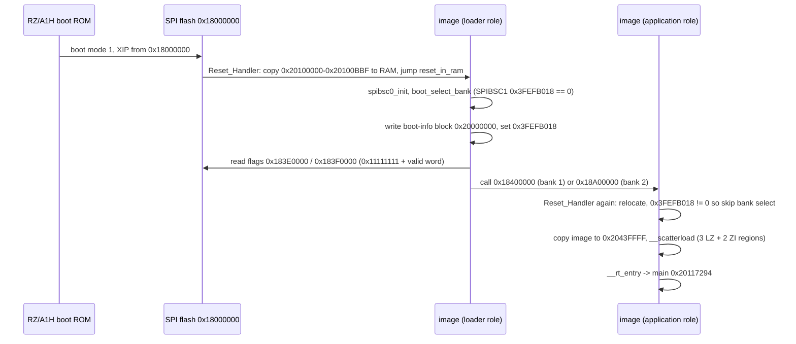
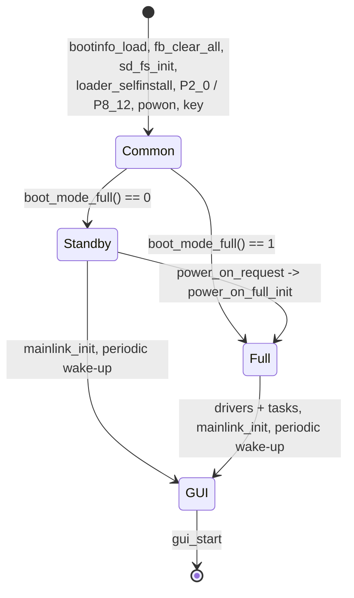
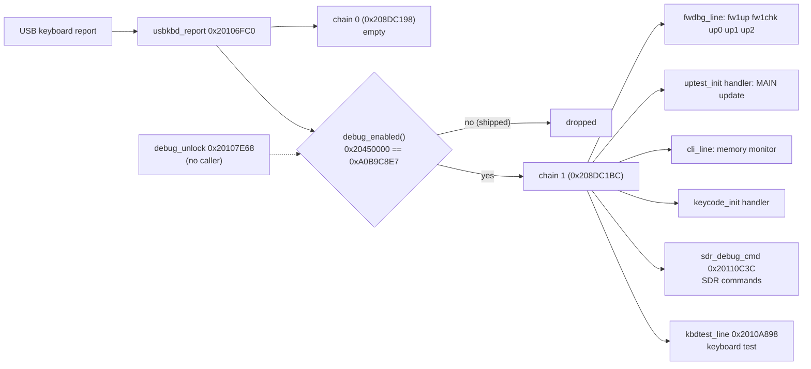

# DISPLAY: boot, start-up and RTOS (T11a)

Back to the [DISPLAY overview](README.md). Addresses are CPU addresses (image base 0x20100000). Names are from `tools/ghidra/names_display.tsv`. Function
bodies are in `decomp/display/` (look them up in `functions.tsv`).

## 1. Reset to `main`

**[fact]** for the code path (T06; `Reset_Handler` 0x2010002C, `reset_in_ram` 0x20100080, `boot_select_bank` 0x20100ABC). Boot mode 1 is
**[inference]** (hardware.md). If neither bank flag is valid the loader keeps running its own copy, which shows `YAESU FT-710 BOOT LOADER V01-02`
(`bootloader_screen` 0x2015938C) **[inference]**.

`bootinfo_load` (0x20116C4C, called first in `task_root`) copies the 0x60-byte boot-info block from the address kept in SPIBSC1 reg 0x3FEFB018 into
0x208DBB44, or builds the default table (bank 1: flag 0x3E0000, image 0x400000; bank 2: flag 0x3F0000, image 0xA00000) when the register is 0 **[fact]**.
Its first word is stored in 0x20800398 (the running bank, used by the update code) **[inference]**.

## 2. `main` (0x20117294)

| Step | Function | What it does |
|---|---|---|
| 1 | `mmu_cache_enable` 0x20116D84 | Writes CP15 and sets SCTLR bits 0xD (MMU, D-cache, write buffer) **[fact for the bits]** |
| 2 | `pinmux_init` 0x20101190 | PFC/GPIO mode for every pin (2.5 KB of per-pin calls) **[fact]** |
| 3 | `gpio_p7_9_11(1)` 0x20100480 | Drives P7_11 and P7_9 high through PSR7 (0xFCFE311C) **[fact]**. Pin meaning unknown |
| 4 | `kernel_heap_init` 0x201562B4 | Kernel start-up: memory pool from **0x20980000** (base, `*(0x2010022C)` rounded to 8) via 0x201530FC; its size SP − 0x400 − base is negative (SP is below the base), so allocations are unbounded up to the end of RAM 0x209FFFFF ([memory-maps.md](../../memory-maps.md) `ram_hi`, #119) **[fact]** |
| 5 | `itron_acre_tsk(0, 0x20165A44)` | Creates `task_root` (pri 8, 8 KB stack) |
| 6 | `ostm_init` 0x201177E4 | OSTM0 compare 319999, ISR `ostm0_tick_isr` on GIC ID 0x86. The ISR adds 10000 µs to the system time, so the **tick is 10 ms** **[fact]** |
| 7 | idle loop | Spins on the scheduler counters 0x208003DB–0x208003DD and counts idle passes in 0x208003C4/0x208003C8 (CPU-load measure) **[inference]** |

## 3. `task_root` (0x201170C8): boot modes

`task_root` registers the two USB-keyboard handler chains (section 6), then reads the inputs that pick the mode:

- `DAT_208003A1/A2 = gpio_p2_0_debounced()`: P2_0, 3 equal samples 10 ms apart. P2_0 is also the IRQ5 pin watched by `powon` **[fact]**. It is
  probably the power switch / `RX_PWR_ON` line **[guess]**.
- `DAT_208003A3 = gpio_read_bit(8, 12)` (P8_12) **[fact]**, meaning unknown.
- `powon_init` and `key_init` start the power-switch and key tasks.
- `boot_mode_full()` (0x20116E84) returns 0 (standby) only when the first active key line from `key_scan_first` is not 6, the force flag 0x208003A4 is
  clear and P2_0 reads 1; otherwise 1 (full) **[fact]**. n = 6 is boot key combination 6 = **DNR + A/B + QMB**, so holding those keys at power-up
  forces the full start (a service/update mode, see [input.md](input.md#boot-key-combinations)) **[fact for the keys, inference for the purpose]**.

Both paths end in `gui_start` (0x20132CCC, VDC5 layers). `power_on_full_init` (0x20116EC8) repeats the full-path init list once (guarded by 0x208003A5),
so the standby → on transition does not reboot the CPU **[fact for the code, inference for "radio switched on"]**.

### Common part
| Order | Function | Notes |
|---|---|---|
| 1 | `bootinfo_load` 0x20116C4C | see section 1 |
| 2 | `fb_clear_all` 0x20132F84 | clears 0x60000000 + 0x2FF300 and the layer at 0x605048A0 |
| 3 | `rtc_init` | creates a kernel object from {2,0,0} (event flag or mailbox) into 0x20800368, after `rtc_port_idle`/`rtc_write_reg` port set-up |
| 4 | `sd_fs_init` 0x201039B0 | FAT volume (`fs_init` 0x2014A4D0: drive and file tables, pools, semaphores), SDHI driver registration (`sd_drive_register`, callback `sdhi_drv_init`), `sd_task_create` |
| 5 | `fwdbg_init` 0x20111064 | self-update debug task (`fwdbg_task_create`) + `fwdbg_line` handler |
| 6 | `loader_selfinstall` 0x20110F0C | only when 0xFCFF400C holds 0xAABBCCDD: erases flash 0..0x340000 and the two flag sectors, then writes this running image (from `vec_reset`) to flash 0 and new flags. This is how a new **loader** gets installed **[fact for the code, inference for the purpose]**. No code writes 0xFCFF400C; a JTAG factory script sets it ([update.md](update.md) §6) **[inference]** |
| 7 | `gpio_p2_0_debounced`, `gpio_read_bit(8,12)` | mode inputs |
| 8 | `powon_init` 0x20114028, `key_init` 0x20113C84 | tasks `powon`, `key` |
| 9 | `boot_mode_full` | mode decision |
| 10 | `cpg_set_clock_profile(0)` 0x201020A0 | STBCR2 0xFCFE0024 and STBCR3..12 (0xFCFE0420–0x444) from a 2-entry table at 0x2016517C; profile 1 is used by `power_on_full_init` **[fact]** ([peripherals.md](peripherals.md)) |
| 11 | `gpio_rx_reset(1)` 0x20101C5C | sets P7_10 = `RX_RESET` (hardware.md) **[fact for the pin write, inference for the net]** |

### Full path (in order)
`gpio_p8_14(1)`, `full_mode_set(1)` (force flag), `dimmer_init`, `backlight_enable`(0)`, `backlight_init`, `usbkbd_init`, `mouse_cursor_init`, USB host
(`usbh_ports_init`, `usbh_hid_class_init`, `usbh_hw_init`), `adc_start_scan`, `uptest_init`, `cli_init`, `touch_init`, `keycode_init`, `kbdtest_init`,
`mainlink_init`, `renc_init`, `link_ss_irq_init`, `sdr_debug_init`, `spi_slave_init`, `fwupdate_init`, `sdmenu_init`, `periodic_wakeup_register(self, 0)`,
`periodic_wakeup_start`, `touch_cal_init`, `audio_codec_init`, `gui_start` **[fact]**. The unnamed ones are for the subsystem sub-tasks.

The standby path only runs `gpio_p8_14(0)`, `mainlink_init`, the periodic wake-up and `gui_start`.

## 4. Kernel

**NORTi**, the µITRON 4.0 kernel from MiSPO: the string `NORTi(c)MiSPO` is at 0x20156290 **[fact]**. Service-call names are inferred from ITRON error codes (E_ID −18, E_NOID −34, E_NOEXS −42) and
descriptor layouts **[inference]**.

| Address | Name | Notes |
|---|---|---|
| 0x201500F4 | `itron_acre_tsk` | T_CTSK `{attr, exinf, entry, prio, stksz, stk, name}` (0x1C bytes), ID auto-assigned; TCBs at 0x208DBBA0 |
| 0x20151768 | `itron_sta_tsk` | |
| 0x20150740 | `itron_dly_tsk` | ms argument **[inference: 10 ms debounce loops use 10]** |
| 0x20152FAC | `itron_iwup_tsk` | called from `periodic_wakeup_isr` **[inference]** |
| 0x2014FF2C / 0x2014E584 | `itron_acre_sem` / `os_create_sem_named` | |
| 0x2014EFFC / 0x20150F00 / 0x20152988 | `itron_acre_flg` / `itron_set_flg` / `itron_twai_flg` | |
| 0x201525F8 | `itron_tslp_tsk` | (tmout); E_CTX outside a task; TMO_FEVR at 40 call sites (T23e) |
| 0x201511E8 / 0x20152BB0 | `itron_sig_sem` / `itron_twai_sem` | semaphore table 0x208DBCA4, IDs 1..0x40 (T23e) |
| 0x2014EB94 | `itron_clr_flg` | flag table 0x208DBDA4; callers pass `~ptn` (T23e) |
| 0x20150DCC / 0x2014E884 | `itron_rot_rdq` / `itron_chg_pri` | ready queues 0x208DC18C per priority 1..8 (T23e) |
| 0x20151C3C / 0x20152DF4 | `itron_tloc_mtx` / `itron_unl_mtx` | mutex table 0x208DBFC4 (IDs 1..0x20, E_ILUSE); the RTC I2C lock (T23e) |
| 0x20151AA4 / 0x20150C70 | `itron_tget_mpf` / `itron_rel_mpf` | fixed-size pools 0x208DBF24 (IDs 1..0x10); the FS work buffers (T23e) |
| 0x20150BA0 | `itron_get_tid` | **[inference]** (T23e) |
| 0x2014F1A8 | `itron_acre_isr` | T_CISR `{attr, exinf, intno, isr}`; IDs count down from 0x40 |
| 0x2011775C | `gic_enable_irq` | enables one GIC interrupt ID |
| 0x201176B4 | `gic_dispatch` | `IRQ_Handler` → handler table 0x208DC1E0 (one entry per GIC ID, default `gic_default_handler`) |
| 0x20162D04 | `cpp_task_thunk` | task entry for C++ objects: `exinf` = object, calls `obj->vtbl[0]` (tasks `uart`, `uart4`, `mouse_cursor`) |

### ISRs created with `itron_acre_isr`
| Descriptor | GIC ID | ISR | Source |
|---|---|---|---|
| 0x20165A60 | 0x86 (134, OSTM0) | `ostm0_tick_isr` 0x20117838 | 10 ms system tick |
| 0x20165954 | 0x87 (135, OSTM1) | `periodic_wakeup_isr` 0x2011678C | OSTM1 compare 31999 = 1 ms |
| 0x20165744 | 0x25 (37, IRQ5) | `powon_isr` 0x20113FDC | P2_0 edge → `powon` task |
| (`touch_init`) | 0x23 (35, IRQ3) | `tsc2007_tint_isr` 0x201033E8 | touch TINT on P1_3 → `tsc2007` IRQ task. Earlier named `intc_irq_setup`; it is the ISR, not a set-up function ([input.md](input.md)) |

### Periodic wake-up service
`periodic_wakeup_isr` runs every 1 ms over 5 slots at 0x208DBAD0 (16 bytes each: task ID, ?, period, count). When `count` reaches `period` it wakes
the task and wraps the count **[fact]**. Periods from `.data2` 0x20800374: **33, 1, 8, 1, 1 ms** **[fact]**. `task_root` takes slot 0 (33 ms) and
`key_init` slot 4 (1 ms) **[fact]**; the other slots belong to tasks for later sub-tasks.

## Tasks

All descriptors are in `.rodata` 0x201651A8–0x20165A44 (plus `test_disp` at 0x20420088). Creators are the functions that call `itron_acre_tsk`.

| Descriptor | Task name | Entry | Pri | Stack | Created by | Sub-task |
|---|---|---|---|---|---|---|
| 0x20165A44 | root | `task_root` 0x201170C8 | 8 | 0x2000 | `main` | T11a |
| 0x2016571C | powon | `task_powon` 0x20113F88 | 3 | 0x400 | `powon_init` | T11a/T11f |
| 0x2016589C | cmd_interval | `task_cmd_interval` 0x2011509C | 3 | 0x100 | `mainlink_init` | T11b |
| 0x20165880 | uart | `cpp_task_thunk` | 7 | 0x2000 | `mainlink_init` | T11b |
| 0x201658D8 | retry | `task_mainlink_retry` 0x201161BC | 4 | 0x2000 | `mainlink_init` | T11b |
| 0x20165900 / 0x2016591C / 0x20165938 | uart (x3) | `cpp_task_thunk` → RX `task_mainlink_rx` 0x2015EC40 / dispatcher `task_mainlink_dispatch` 0x201600A8 / TX `task_mainlink_tx` 0x201586AC | 3 / 4 / 4 | 0x2000 | `mainlink_obj_run` | T11b |
| 0x201657DC | uart4 | `cpp_task_thunk` | 7 | 0x400 | `uart4_link_init` 0x20114F4C (**no caller**, SCIF4 never started) | T11b |
| 0x2016583C / 0x20165820 / 0x20165804 | uart4 (x3) | `cpp_task_thunk` | 4 | 0x400 | `uart4_obj_run` | T11b |
| 0x201654A0 | fwupdate | `task_fwupdate` 0x2010E1F8 | 8 | 0x2400 | `fwupdate_init` | T11c |
| 0x201654C8 | uptest | `update_main_cpu` 0x2010EA90 | 3 | 0x2000 | `uptest_init` | T11c |
| 0x20165478 | dspup | `update_dsp` 0x2010D92C | 3 | 0x800 | `dspup_init` | T11c |
| 0x201654F8 | sdmenu | `task_sdmenu` 0x2011010C | 8 | 0x2000 | `sdmenu_init` | T11c |
| 0x20165968 | cli | `task_cli` 0x20116AB0 | 5 | 0x2000 | `cli_init` | T11c |
| 0x20165554 | spi_slave_task | `task_spi_slave` 0x20112288 | 5 | 0x100 | `spi_slave_init` | T11d |
| 0x20420088 | test_disp | `task_test_disp` 0x2013512C | 5 | 0x2400 | `test_disp_init` | T11e |
| 0x201656E4 / 0x20165700 | mouse_cursor | `cpp_task_thunk` | 7 | 0x400 | `mouse_cursor_init`, `mouse_cursor_task_create` | T11f |
| 0x201656A8 | key | `task_key` 0x201137F8 | 5 | 0x400 | `key_init` | T11f |
| 0x2016552C | keycode | `task_keycode` 0x20111794 | 5 | 0x800 | `keycode_init` | T11f |
| 0x201655CC | renc | `task_renc` 0x20112774 | 5 | 0x400 | `renc_init` | T11f |
| 0x20165594 | ad renc | `task_ad_renc` 0x201128F4 | 5 | 0x400 | `renc_init` | T11f |
| 0x201655B0 | detect renc | `task_detect_renc` 0x20112AD4 | 5 | 0x400 | `renc_init` | T11f |
| 0x201651C4 | tsc2007 | `task_tsc2007_irq` 0x20103804 | 4 | 0x100 | `touch_init` | T11f |
| 0x201651A8 | tsc2007 | `task_tsc2007` 0x20103464 | 5 | 0x100 | `touch_init` | T11f |
| 0x20165314 | audio_codec | `task_audio_codec` 0x201065C4 | 5 | 0x2400 | `audio_codec_init` | T11g |

Plus `sdTask` (`sd_task_create` 0x20103B68), the USB-host tasks `udevtsk%d` (`usbh_create_objects`) and the self-update debug task from `fwdbg_task_create`
(entry `task_fwdbg` 0x2015F0E0, pri 5, 0x2000 stack),
which build their descriptors on the stack **[fact]**. The task names say `tsc2007`, while the parts list has a TSC2003 (the two are register-compatible
**[inference]**).

## USB-keyboard handler chains

`usbkbd_report` (0x20106FC0) gets every USB keyboard HID report. It toggles the NumLock (usage 0x53) and ScrollLock (0x47) LEDs, then calls
`hid_chain0_dispatch` (handler table 0x208DC198, nothing registered in V01-08) and, **only if `debug_enabled()`**, `hid_chain1_dispatch`
(table 0x208DC1BC) **[fact]**.

- Slots 0, 1, 3, 5, 7 and 8 are registered, 2, 4 and 6 stay empty. H7 (`sdr_debug_cmd`, registered by `sdr_debug_init`) parses the SDR
  commands `sdrup`/`sdr1up`/`sdr2up`/`sdrchk1`/…, but no task waits on its event flag 0x208001B8, so they are dead. H8 (`kbdtest_line`, registered by
  `kbdtest_init`) is the keyboard-layout test behind the F12 overlay **[fact]** ([input.md](input.md), [update.md](update.md)).
- Handlers collect a line with `hid_line_edit` (0x20112E5C), which works on raw HID usage IDs: 0x28/0x58 Enter, 0x29 Esc (clear), 0x2A Backspace,
  31 characters max **[fact]**.
- `cli` (`task_cli` 0x20116AB0, `cli_exec_line` 0x20116848): `ADDR` reads a word, `ADDR VAL` writes a word, `b ADDR VAL` / `h ADDR VAL` write a byte /
  halfword (hex parser `hex_parse`). A line ending in `.txt` runs `I:\<line>` from the SD card line by line (`cli_run_file`) **[fact]**.
- `debug_enabled()` (0x20111098) compares 0x20450000 with 0xA0B9C8E7. `.data` initialises that word to 0 **[fact, decompressed region]**. The only
  writer is `debug_unlock` (0x20107E68): when `debug_unlock_check` sees P4_3 and P8_3 low (P4_2 is also sampled) and, after 30 ms, a report with a
  Ctrl modifier (mask 0x11) and Backspace (0x2A) **[fact]**. `debug_unlock` has **no caller**: no B/BL, no literal pointer in `.text`, and REA's
  `xrefs` on an independent import returns none **[fact]**. So in V01-08 the debug commands cannot be reached without patching the image or
  writing that RAM word, for example over JTAG (J6003) **[inference]**. P4_3 is `RX_UPDATE` in hardware.md, so the pin check may have been a factory
  jig condition **[guess]**.

## Functions named in T11a

| Address | Ghidra name | Purpose |
|---|---|---|
| 0x201170C8 | `task_root` | init sequence, mode select |
| 0x20116EC8 / 0x2012FFCC | `power_on_full_init` / `power_on_request` | standby → full |
| 0x20116C4C | `bootinfo_load` | boot-info block |
| 0x20110F0C | `loader_selfinstall` | write the running image as loader |
| 0x20116E84 / 0x201130C8 | `boot_mode_full` / `key_scan_first` | mode decision |
| 0x20116E30 / 0x201008AC | `gpio_p2_0_debounced` / `gpio_read_bit` | GPIO reads (PPRn 0xFCFE3200+4n) |
| 0x20101C5C / 0x20101BA4 / 0x20100480 | `gpio_rx_reset` / `gpio_p8_14` / `gpio_p7_9_11` | GPIO writes (PSRn 0xFCFE3100+4n) |
| 0x201020A0 | `cpg_set_clock_profile` | STBCR2..12 |
| 0x20116D84 / 0x20101190 / 0x201562B4 | `mmu_cache_enable` / `pinmux_init` / `kernel_heap_init` | `main` set-up |
| 0x20116768 / 0x201167D8 / 0x2011678C | `periodic_wakeup_register` / `periodic_wakeup_start` / `periodic_wakeup_isr` | 1 ms wake-up service |
| 0x20117838 / 0x20113FDC | `ostm0_tick_isr` / `powon_isr` | ISRs |
| 0x20114028 / 0x20113F88 | `powon_init` / `task_powon` | power-switch task |
| 0x20106FC0 / 0x20116DF4 / 0x20116DB8 | `usbkbd_report` / `hid_chain0_dispatch` / `hid_chain1_dispatch` | keyboard chains |
| 0x20111098 / 0x20107E68 / 0x20107DC0 | `debug_enabled` / `debug_unlock` / `debug_unlock_check` | debug gate |
| 0x20112E5C | `hid_line_edit` | line editor |
| 0x20111064 / 0x20110ED4 / 0x2015F0EC | `fwdbg_init` / `fwdbg_line` / `fwdbg_cmd` | self-update commands |
| 0x20116B30 / 0x20116B00 / 0x20116AB0 / 0x201169D0 / 0x20116848 | `cli_init` / `cli_line` / `task_cli` / `cli_run_file` / `cli_exec_line` | memory monitor |
| task entries and creators | see the task table | |

## Globals

| Address | Meaning |
|---|---|
| 0x20450000 | debug-enable word (0xA0B9C8E7 = on), `.data` initial 0 |
| 0x208003A0 | full-mode flag (0 = standby) |
| 0x208003A1 / A2 / A3 | P2_0 level (two copies), P8_12 level at boot |
| 0x208003A4 / A5 | force-full flag / full init already done |
| 0x20800398 | first word of the boot-info block (running bank) |
| 0x208DBB44 | copy of the 0x60-byte boot-info block |
| 0x208DBAD0 | periodic wake-up slots (5 × 16 B), periods at 0x20800374 |
| 0x208DC198 / 0x208DC1BC | USB-keyboard handler chains 0 / 1 (9 entries each) |
| 0x208DC1E0 | GIC handler table |
| 0x20800110 / 0x20800114 | pointers to the two chain dispatchers |
| 0x20800408 | system time in µs (+10000 per tick) |

## Further functions (T23g)

Named functions of this subsystem that the tables above did not list yet, one row each (T23g, found with `tools/doc_table_gaps.py`). The purpose is the plate comment of the name in `tools/ghidra/names_*.tsv` (or the `Ifdsp*Names.java` / `*.lib.tsv` entry); rows marked *code shape* have no comment there and give what the decompile shows: the direct callees, the first string, the size and the caller count. Tags as in the names files; a comment without a tag is an inference from the code.

| Address | Ghidra name | Purpose |
|---|---|---|
| 0x2010002C | `Reset_Handler` | vector 0; copies image to 0x20100000 if not running there **[inference]** |
| 0x20100080 | `reset_in_ram` | SPIBSC init, boot-bank select, copies rest of image **[inference]** |
| 0x20100194 | `SVC_Handler` | names-file group "startup / armcc runtime"; no direct calls; 68 B, callers: 2 **[fact]** (code shape) |
| 0x201001D8 | `IRQ_Handler` | GIC dispatch via 0x201176b4 **[inference]** |
| 0x2010021C | `FIQ_Handler` | no direct calls; 4 B, callers: 3 **[fact]** (code shape) |
| 0x20100220 | `Undef_Handler` | no direct calls; 4 B, callers: 3 **[fact]** (code shape) |
| 0x20100224 | `PAbort_Handler` | no direct calls; 4 B, callers: 3 **[fact]** (code shape) |
| 0x20100228 | `DAbort_Handler` | no direct calls; 4 B, callers: 3 **[fact]** (code shape) |
| 0x20100828 | `spibsc0_init` | writes SPIBSC0 regs 0x3FEFA0xx **[inference]** |
| 0x20100ABC | `boot_select_bank` | first boot: checks 0x183E0000/0x183F0000 flags, jumps to 0x18400000 or 0x18A00000 **[inference]** |
| 0x20100BC0 | `__main` | names-file group "startup / armcc runtime"; calls `__decompress`, `__rt_entry`, `__scatterload`; 8 B, callers: 2 **[fact]** (code shape) |
| 0x20100BC8 | `__scatterload` | names-file group "startup / armcc runtime"; calls `__decompress`; 44 B, callers: 1 **[fact]** (code shape) |
| 0x20100BFC | `__decompress` | armcc LZ decompressor for RW regions **[inference]** |
| 0x20100C60 | `__scatterload_zeroinit` | names-file group "startup / armcc runtime"; no direct calls; 28 B, callers: 0 **[fact]** (code shape) |
| 0x20100CB4 | `__rt_lib_init` | armcc C library function, matched by idiom (score 0.850, T23d): called by __rt_entry after __user_setup_stackheap: __rt_locale, two clock/time inits, __cpp_initialize__aeabi_ **[inference]** |
| 0x20100CD8 | `__rt_lib_shutdown` | armcc C library function, matched by idiom (score 0.800, T23d): empty push/pop; called on the exit path before _sys_exit **[inference]** |
| 0x20100CDC | `__rt_entry` | names-file group "startup / armcc runtime"; calls `__rt_lib_init`, `__rt_lib_shutdown`, `__user_setup_stackheap`, `_sys_exit` and 2 more; 48 B, callers: 2 **[fact]** (code shape) |
| 0x20101030 | `dcache_clean_range` | (addr, len): CP15 clean D-cache line by MVA over the range (line size from CTR), then DSB **[fact]** |
| 0x20110388 | `sdmenu_init` | task "sdmenu" **[inference]** |
| 0x20117294 | `main` | called from __rt_entry; creates tasks then idles **[inference]** |
| 0x201172EC | `__user_initial_stackheap` | armcc C library function, matched by idiom (score 0.850, T23d): retarget hook: r0 = heap base (two literals), r2 = r3; called by __user_setup_stackheap **[inference]** |
| 0x2011758C | `knl_addr_in_image` | 1 if p is within __main .. 0x20428834 (the code and rodata image) ; check of entry/name pointers in acre_* **[fact]** |
| 0x201175B4 | `isr_desc_check` | intno < 0x24B, prio < 0x20 **[inference]** |
| 0x2011761C | `gic_get_handler` | no direct calls; 16 B, callers: 2 **[fact]** (code shape) |
| 0x201177E4 | `ostm_init` | OSTM 0xFCFEC000 (system tick) **[inference]** |
| 0x2013B5BC | `usbh_create_objects` | m596* / udevtsk%d names **[inference]** |
| 0x2014E2A4 | `strncmp` | names-file group "startup / armcc runtime"; no direct calls; 64 B, callers: 7 **[fact]** (code shape) |
| 0x2014E5B0 | `os_create_tsk_named` | NORTi uITRON 4.0 library function, matched by wrapper (score 0.850, T23d): copies a 6-word T_CTSK and appends the name, then itron_acre_tsk(0, ..); same shape as os_create_sem_named **[inference]** |
| 0x2014E5E4 | `os_create_flg_named` | NORTi uITRON 4.0 library function, matched by wrapper (score 0.850, T23d): same wrapper around itron_acre_flg **[inference]** |
| 0x2014E610 | `os_create_mbf_named` | NORTi uITRON 4.0 library function, matched by wrapper (score 0.850, T23d): same wrapper around itron_acre_mbf **[inference]** |
| 0x2014E638 | `os_create_mbx_named` | NORTi uITRON 4.0 library function, matched by wrapper (score 0.850, T23d): same wrapper around itron_acre_mbx **[inference]** |
| 0x2014E664 | `os_create_mtx_named` | NORTi uITRON 4.0 library function, matched by wrapper (score 0.850, T23d): same wrapper around itron_acre_mtx **[inference]** |
| 0x2014E690 | `os_create_mpf_named` | NORTi uITRON 4.0 library function, matched by wrapper (score 0.850, T23d): same wrapper around itron_acre_mpf **[inference]** |
| 0x2014E6B8 | `os_create_mpl_named` | NORTi uITRON 4.0 library function, matched by wrapper (score 0.850, T23d): same wrapper around itron_acre_mpl **[inference]** |
| 0x2014E6E4 | `os_create_dtq_named` | NORTi uITRON 4.0 library function, matched by wrapper (score 0.850, T23d): same wrapper around itron_acre_dtq **[inference]** |
| 0x2014E73C | `itron_act_tsk` | NORTi uITRON 4.0 library function, matched by uitron_api_shape (score 0.900, T23d): TCB table 0x208DBBA0, id 0 = self; dormant -> start like sta_tsk with exinf, else activation count +0x26 ++ (E_QOVR) **[inference]** |
| 0x2014EC30 | `itron_acre_cyc` | NORTi uITRON 4.0 library function, matched by uitron_api_shape (score 0.900, T23d): object table 0x208DBF64, max id 8; 0x20-byte block, cycatr/exinf/cychdr/cyctim/cycphs, TA_STA starts it on timer queue 0x208003C4; id 0 = auto … **[inference]** |
| 0x2014EDF4 | `itron_acre_dtq` | NORTi uITRON 4.0 library function, matched by uitron_api_shape (score 0.850, T23d): object table 0x208DBFA4, max id 8; id 0 = auto (E_NOID); same table as tsnd_dtq/trcv_dtq **[inference]** |
| 0x2014F3E4 | `itron_acre_mbf` | NORTi uITRON 4.0 library function, matched by uitron_api_shape (score 0.850, T23d): object table 0x208DBEC4, max id 8; allocates the buffer (E_NOMEM); same table as tsnd_mbf/trcv_mbf **[inference]** |
| 0x2014F67C | `itron_acre_mbx` | NORTi uITRON 4.0 library function, matched by uitron_api_shape (score 0.850, T23d): object table 0x208DBEA4, max id 8; same table as snd_mbx/trcv_mbx **[inference]** |
| 0x2014F8B8 | `itron_acre_mpf` | NORTi uITRON 4.0 library function, matched by uitron_api_shape (score 0.850, T23d): object table 0x208DBF24, max id 16; E_PAR on block count/size, E_NOMEM; same table as tget_mpf/rel_mpf **[inference]** |
| 0x2014FB04 | `itron_acre_mpl` | NORTi uITRON 4.0 library function, matched by uitron_api_shape (score 0.800, T23d): object table 0x208DBF04, max id 8; pool memory from pk+8 or the kernel heap (E_NOMEM); id 0 = auto **[inference]** |
| 0x2014FD24 | `itron_acre_mtx` | NORTi uITRON 4.0 library function, matched by uitron_api_shape (score 0.850, T23d): object table 0x208DBFC4, max id 32; E_RSATR, ceiling priority; same table as tloc_mtx/unl_mtx **[inference]** |
| 0x201502F4 | `itron_del_mpf` | NORTi uITRON 4.0 library function, matched by uitron_api_shape (score 0.800, T23d): mpf table 0x208DBF24: releases waiting tasks with E_DLT, frees the block and the pool **[inference]** |
| 0x201504D0 | `itron_del_sem` | NORTi uITRON 4.0 library function, matched by uitron_api_shape (score 0.850, T23d): sem table 0x208DBCA4: releases waiting tasks with E_DLT, frees the block **[inference]** |
| 0x20150678 | `itron_dis_dsp` | NORTi uITRON 4.0 library function, matched by uitron_api_shape (score 0.900, T23d): E_CTX in ISR/CPU-locked; sets the dispatch-disabled bits (\|= 9) of 0x208003DB **[inference]** |
| 0x2015080C | `itron_ena_dsp` | NORTi uITRON 4.0 library function, matched by uitron_api_shape (score 0.900, T23d): clears the dispatch-disabled bits of 0x208003DB, dispatches when a switch is pending (0x208003D9) **[inference]** |
| 0x201508EC | `itron_ext_tsk` | NORTi uITRON 4.0 library function, matched by uitron_api_shape (score 0.900, T23d): current task: back to the initial priority, unlocks its mutexes, dormant or restarts when the activation count +0x26 > 0 **[inference]** |
| 0x20150AAC | `itron_get_pri` | NORTi uITRON 4.0 library function, matched by uitron_api_shape (score 0.950, T23d): (tskid, p_tskpri): id 0 = self, E_OBJ when dormant, *p = TCB+4 **[inference]** |
| 0x20150BD4 | `itron_get_tim` | NORTi uITRON 4.0 library function, matched by uitron_api_shape (score 0.900, T23d): (p_systim): SYSTIM {H utime, UW ltime} from 0x208003BC..C8 with carry **[inference]** |
| 0x20150C3C | `itron_loc_cpu` | NORTi uITRON 4.0 library function, matched by uitron_api_shape (score 0.850, T23d): masks interrupts and sets the CPU-locked state 0x13/0x1B in 0x208003DB **[inference]** |
| 0x20151308 | `itron_tsnd_dtq` | NORTi uITRON 4.0 library function, matched by uitron_api_shape (score 0.900, T23d): (dtqid, data, tmout): dtq table 0x208DBFA4, hands data to a receiver or the ring buffer, E_TMOUT on polling, waits otherwise **[inference]** |
| 0x20151520 | `itron_snd_mbx` | NORTi uITRON 4.0 library function, matched by uitron_api_shape (score 0.900, T23d): (mbxid, pk_msg): mbx table 0x208DBEA4, priority queues by msgpri (E_PAR), or wakes a receiver **[inference]** |
| 0x20151680 | `itron_sta_cyc` | NORTi uITRON 4.0 library function, matched by uitron_api_shape (score 0.900, T23d): cyc table 0x208DBF64: (re)inserts the handler into timer queue 0x208003C4, sets TCYC_STA **[inference]** |
| 0x20151878 | `itron_stp_cyc` | NORTi uITRON 4.0 library function, matched by uitron_api_shape (score 0.900, T23d): cyc table 0x208DBF64: removes it from the timer queue, clears TCYC_STA **[inference]** |
| 0x20151934 | `itron_sus_tsk` | NORTi uITRON 4.0 library function, matched by uitron_api_shape (score 0.900, T23d): id 0 = self, E_OBJ dormant, suspend count TCB+9 ++ (E_QOVR at 255), E_CTX for self with dispatch disabled **[inference]** |
| 0x20151E68 | `itron_trcv_dtq` | NORTi uITRON 4.0 library function, matched by uitron_api_shape (score 0.900, T23d): (dtqid, p_data, tmout): dtq table 0x208DBFA4, takes from the ring buffer or a sender, E_TMOUT **[inference]** |
| 0x201521A8 | `itron_trcv_mbf` | NORTi uITRON 4.0 library function, matched by uitron_api_shape (score 0.850, T23d): (mbfid, msg, tmout): mbf table 0x208DBEC4, copies a message out of the ring (0x201520B0), returns its size **[inference]** |
| 0x20152434 | `itron_trcv_mbx` | NORTi uITRON 4.0 library function, matched by uitron_api_shape (score 0.900, T23d): (mbxid, ppk_msg, tmout): mbx table 0x208DBEA4, takes the first queued message, E_TMOUT **[inference]** |
| 0x201526F4 | `itron_tsnd_mbf` | NORTi uITRON 4.0 library function, matched by uitron_api_shape (score 0.850, T23d): (mbfid, msg, msgsz, tmout): mbf table 0x208DBEC4, E_PAR when msgsz > maxmsz, copies to a receiver or the ring **[inference]** |
| 0x20152D28 | `itron_unl_cpu` | NORTi uITRON 4.0 library function, matched by uitron_api_shape (score 0.850, T23d): clears the CPU-locked state of 0x208003DB and dispatches when pending **[inference]** |
| 0x20153AD4 | `knl_timeout_remove` | (tcb, tskid): unlinks the TCB from its timer-wheel slot **[fact]** |
| 0x20154498 | `knl_timeout_add` | (tmout, tcb, tskid): due time = tmout + system time 0x208003C8, links the TCB into the timer wheel 0x20800400 (mask 0x208003E0) **[fact]** |
| 0x201545F0 | `knl_memcpy` | Byte copy used by the acre_* calls to copy the creation packet **[fact]** |
| 0x20154974 | `__rt_ctype_table` | armcc C library function, matched by idiom (score 0.850, T23d): returns __rt_locale()+4; tolower indexes the table it points to **[inference]** |
| 0x20154984 | `__aeabi_ldivmod` | armcc C library function, matched by idiom (score 0.950, T23d): A32: takes signs of r1/r3, negates 64-bit pairs (rsbs/rsc), bl __aeabi_uldivmod, fixes quotient and remainder signs **[inference]** |
| 0x201549E4 | `tolower` | armcc C library function, matched by idiom (score 0.900, T23d): ctype bit 0x10 (upper) -> c+32 **[inference]** |
| 0x20154A00 | `sprintf_veneer` | armcc C library function, matched by veneer_pattern (score 1.000, T23d): A32 add ip,pc,#1; bx ip -> Thumb sprintf 0x20154A08 **[inference]** |
| 0x20154A08 | `sprintf` | names-file group "startup / armcc runtime"; calls `_sprintf_body`, `_sputc`; 34 B, callers: 71 **[fact]** (code shape) |
| 0x20154A30 | `snprintf` | armcc C library function, matched by idiom (score 0.900, T23d): (buf, n, fmt, ...): end = buf+n-1, output fn _snputc 0x20155FA3, NUL-terminates when n != 0 **[inference]** |
| 0x20154A64 | `_printf_pre_padding` | armcc C library function, matched by idiom (score 0.800, T23d): emits width-1.. pad chars (0x30 if the 0 flag, else 0x20) unless the - flag (bit 0), counts in +0x20 **[inference]** |
| 0x20154A90 | `_printf_post_padding` | armcc C library function, matched by idiom (score 0.800, T23d): emits trailing spaces when the - flag (bit 0) is set **[inference]** |
| 0x20155058 | `strstr` | armcc C library function, matched by idiom (score 0.850, T23d): restarting byte compare of needle against haystack, returns start or 0 **[inference]** |
| 0x2015507C | `memcmp` | (a, b, n): word compare when both are aligned, byte compare otherwise, returns the difference ; T23d armcc C library RVCT/ARM Compiler 5 (idiom 0.900): word compare when both aligned (rev for ordering), then byte compare, returns … **[fact]** |
| 0x201550D4 | `strcpy_veneer` | armcc C library function, matched by veneer_pattern (score 1.000, T23d): A32 add ip,pc,#1; bx ip -> Thumb strcpy 0x201550DC **[inference]** |
| 0x201550DC | `strcpy` | (dst, src): word copy while aligned, then bytes up to the NUL ; T23d armcc C library RVCT/ARM Compiler 5 (idiom 0.900): word copy while no zero byte (uqsub8 test), then byte tail; returns nothing used **[inference]** |
| 0x20155122 | `strlen` | Word-at-a-time string length ; T23d armcc C library RVCT/ARM Compiler 5 (idiom 0.900): byte loop to alignment, word loop with uqsub8 zero test, position of the zero byte **[fact]** |
| 0x2015515C | `strcat` | armcc C library function, matched by idiom (score 0.900, T23d): scan dst to NUL, copy src including NUL **[inference]** |
| 0x20155180 | `memcpy` | names-file group "startup / armcc runtime"; no direct calls; 212 B, callers: 168 **[fact]** (code shape) |
| 0x20155254 | `__aeabi_memset_veneer` | armcc C library function, matched by veneer_pattern (score 1.000, T23d): A32 add ip,pc,#1; bx ip -> Thumb __aeabi_memset 0x2015525C **[inference]** |
| 0x2015525C | `__aeabi_memset` | (dst, n, c): replicates c into a word and joins the fill loop of __aeabi_memclr ; armcc argument order ; T23d armcc C library RVCT/ARM Compiler 5 (idiom 0.950): (dst, n, c): replicates c (and #0xff, orr lsl 8/16) then joins … **[fact]** |
| 0x2015526C | `__aeabi_memclr_veneer` | armcc C library function, matched by veneer_pattern (score 1.000, T23d): A32 add ip,pc,#1; bx ip -> Thumb __aeabi_memclr 0x20155274 **[inference]** |
| 0x20155274 | `__aeabi_memclr` | (dst, n): zero fill with alignment fix-up, 32-byte blocks ; T23d armcc C library RVCT/ARM Compiler 5 (idiom 0.950): mov.w r2,#0 then _memset: byte/halfword head, word fill, tail via lsls #31 flags **[fact]** |
| 0x201552B8 | `__aeabi_memclr4_veneer` | armcc C library function, matched by veneer_pattern (score 1.000, T23d): A32 add ip,pc,#1; bx ip -> Thumb __aeabi_memclr4 0x201552C0 **[inference]** |
| 0x201552C0 | `__aeabi_memclr4` | armcc C library function, matched by idiom (score 0.950, T23d): renamed; r2=0, 32-byte stmia loop of {r2,r3,ip,lr}, tail by lsls #28/#2 flags (rt_memclr_w); aliases __aeabi_memclr8, __rt_memclr_w **[inference]** |
| 0x20155310 | `__aeabi_memcpy4` | (dst, src, n): word copy in 32-byte blocks with preload, no alignment check ; the aligned memcpy entry ; T23d armcc C library RVCT/ARM Compiler 5 (idiom 0.900): aligned path of memcpy 0x20155180 (beq when src word aligned): pld + … **[fact]** |
| 0x2015538C | `strcmp` | names-file group "startup / armcc runtime"; no direct calls; 240 B, callers: 42 **[fact]** (code shape) |
| 0x20155480 | `__aeabi_idivmod` | Signed divide: negates negative operands ((a \| b) < 0), then the shared unsigned loop ; was named __aeabi_uidivmod, which is the unsigned entry 0x20156260 ; T23d armcc C library RVCT/ARM Compiler 5 (idiom 0.950): orrs r3,r0,r1; … **[fact]** |
| 0x201556AC | `__cpp_initialize__aeabi_` | armcc C library function, matched by idiom (score 0.900, T23d): walks a table of self-relative offsets and calls each (C++ static constructors); called by __rt_lib_init **[inference]** |
| 0x201556D0 | `__rt_locale` | armcc C library function, matched by idiom (score 0.800, T23d): returns 0x2091D530 (C library libspace); used by __rt_ctype_table and __rt_lib_init **[inference]** |
| 0x201556E0 | `__aeabi_uldivmod` | armcc C library function, matched by idiom (score 0.850, T23d): (u64 n in r0:r1, u64 d in r2:r3) -> quotient r0:r1, remainder r2:r3; called by __aeabi_ldivmod **[inference]** |
| 0x20155F98 | `_sputc` | armcc C library function, matched by idiom (score 0.850, T23d): *(*p)++ = c; the sprintf output function **[inference]** |
| 0x20155FA2 | `_snputc` | armcc C library function, matched by idiom (score 0.850, T23d): stores c only while p < end; the snprintf output function **[inference]** |
| 0x20155FDE | `__cxa_pure_virtual` | armcc C library function, matched by idiom (score 0.800, T23d): __rt_SIGPVFN, then _sys_exit **[inference]** |
| 0x20155FEC | `__rt_udiv10` | armcc C library function, matched by idiom (score 0.900, T23d): n - n/4, +>>4, +>>8, +>>16, >>3, remainder fix-up: quotient and remainder of n/10 **[inference]** |
| 0x20156018 | `__user_perproc_libspace` | armcc C library function, matched by idiom (score 0.800, T23d): returns 0x2091D510; called by __user_setup_stackheap **[inference]** |
| 0x20156020 | `_printf_infnan` | armcc C library function, matched by idiom (score 0.900, T23d): prints inf/INF/nan/NAN with padding **[inference]** |
| 0x20156184 | `__rt_SIGPVFN` | armcc C library function, matched by idiom (score 0.850, T23d): shows "SIGPVFN: Pure virtual fn called" and returns 1 **[inference]** |
| 0x201561B4 | `_sys_exit` | armcc C library function, matched by idiom (score 0.850, T23d): semihosting svc 0xAB then b . (no return) **[inference]** |
| 0x201561C0 | `__user_setup_stackheap` | armcc C library function, matched by idiom (score 0.900, T23d): gets __user_perproc_libspace, calls __user_initial_stackheap (0x201172EC), zeroes 64 B of libspace; first call of __rt_entry **[inference]** |
| 0x2015620A | `exit` | armcc C library function, matched by idiom (score 0.800, T23d): called by __rt_entry with main()s result (blx main; bl exit) **[inference]** |
| 0x2015621C | `__default_signal_display` | armcc C library function, matched by idiom (score 0.800, T23d): writes a newline, the message and the extra string with _ttywrch **[inference]** |
| 0x2015624E | `_ttywrch` | armcc C library function, matched by idiom (score 0.800, T23d): semihosting SYS_WRITEC (r0=3, svc 0xAB) of one character **[inference]** |
| 0x20156260 | `__aeabi_uidivmod` | Unsigned 32-bit divide returning quotient and remainder (r0:r1): shift-subtract that joins the shared loop at 0x201554DC ; the 71-caller divide ; T23d armcc C library RVCT/ARM Compiler 5 (idiom 0.950): movs r2,#0 then the rsbs … **[fact]** |
| 0x20164D54 | `__aeabi_i2d` | int -> IEEE double (sign, exponent 0x41D - clz, mantissa) **[fact]** |
| 0x20164D82 | `__aeabi_ui2d` | unsigned int -> IEEE double **[fact]** |

### C library string helpers (T23e round 2)

From the names-file section header (`tools/ghidra/names_display.T23e2.tsv`): C library string helpers (armcc) **[fact per the names file]**.

| Address | Ghidra name | Purpose |
|---|---|---|
| 0x2014E208 | `strcasecmp` | Case-insensitive compare with tolower; cli_run_file, wav_list_dir **[fact]** |
| 0x2014E250 | `strncasecmp` | Length-limited strcasecmp; fwname_pattern_match **[fact]** |
| 0x2014E2E4 | `strncpy` | Copies up to n bytes and pads with 0 **[fact]** |
| 0x2014E320 | `strtok_r` | (s, delims, &save): next token, 0 at the end; sfl_read_header, sdmenu_load_file, task_keycode **[fact]** |
| 0x2014E3C4 | `str_to_long` | strtol/strtoul body: skips ctype spaces (__rt_ctype_table), sign, base 0 or 2..36 **[fact]** |
| 0x2014E710 | `knl_current_task_id` | Running task id 0x208DC18C, 0 when it is the idle task (0x201659D0 + 1); task_root **[inference]** |

### NORTi kernel internals (T23e round 2)

From the names-file section header (`tools/ghidra/names_display.T23e2.tsv`): NORTi kernel internals **[fact per the names file]**.

| Address | Ghidra name | Purpose |
|---|---|---|
| 0x201539EC | `knl_queue_remove` | Unlinks TCB param_1 (id param_2) from its ring (+6/+7 links, head at +0x10), the first half of knl_queue_move **[fact]** |
| 0x20153A38 | `knl_queue_move` | Unlinks TCB param_2 (id param_3) from the id-linked ring it is in (+6 prev / +7 next, head byte at +0x10) and appends it to ring head param_1; TCB table 0x208DBBA0; used by the wait and ready paths of itron_* **[fact]** |
| 0x20153B34 | `knl_freelist_alloc` | First-fit allocator on a free list {next, size}: rounds the size up to 8, splits or unlinks the block **[fact]** |
| 0x20154524 | `knl_release_suspended` | Unlinks the woken task from the wait queue and returns without dispatch; itron_sig_sem takes this path when TCB +9 (suspend count) is non-zero **[fact]** |
| 0x20154580 | `knl_make_ready` | Appends the TCB to ready queue 0x208DC18C + priority (TCB +4) and returns the dispatcher 0x2015655C if it beats the running priority 0x208003DF, else the plain return 0x201567F4; called by itron_sig_sem/set_flg/snd_mbx when a … **[fact]** |
| 0x201545DC | `knl_wait_enter` | Moves the running task into an object's wait queue (knl_queue_move) and returns through 0x201566F0; the tail of every blocking itron_t* call (twai_sem, twai_flg, trcv_*, tsnd_*, tget_mpf, tloc_mtx) **[fact]** |
| 0x2015476C | `knl_sys_alloc` | knl_freelist_alloc on the kernel's system pool 0x208003FC; the 11 itron_acre_* calls get their control blocks here **[fact]** |
| 0x2015655C | `knl_dispatch` | Scheduler: if dispatch is enabled (0x208003D8, not CPU-locked 0x208003CC bit 7) picks the first non-empty ready queue 0x208DC18C.. and switches the saved context of the TCBs **[fact]** |
| 0x201567F4 | `knl_svc_return` | Returns from a service call with the saved PSR bits restored (0x208003CC \| spsr & ~0xC0); the no-dispatch exit of the itron_* calls **[fact]** |
| 0x2015686C | `knl_int_disable` | Service call return that sets the I bit in the saved PSR (0x20156878); gic_enable_irq / gic_disable_irq / gic_def_inh wrap their register writes with it **[inference]** |
| 0x2015688C | `knl_int_restore` | Service call return through 0x2015689C, which clears the I/F bits again **[inference]** |

### armcc soft-float (T23e round 2)

From the names-file section header (`tools/ghidra/names_display.T23e2.tsv`): armcc soft-float (double); operations from the constants in tsc2007_pressure (Rtouch = 400 * X/4096 * (Z2/Z1 - 1)) and touch_cal_fit (sum of 5 / 5.0) **[fact per the names file]**.

| Address | Ghidra name | Purpose |
|---|---|---|
| 0x20164888 | `__aeabi_dadd` | Double add: start + span*fraction in progress_scale, + 0.5 (0x3FE00000) rounding in touch_cal_apply **[inference]** |
| 0x201649D8 | `__aeabi_ddiv` | Double divide: Z2/Z1 and X/4096.0 (0x40B00000) in tsc2007_pressure, sum/5.0 (0x40140000) in touch_cal_fit **[inference]** |
| 0x20164C90 | `__aeabi_d2iz` | Double to signed int, truncating with saturation (0x7FFFFFFF ^ sign); follows "+ 0.5" in touch_cal_apply **[fact]** |
| 0x20164CF0 | `__aeabi_d2uiz` | Double to unsigned int: negative gives 0, overflow 0xFFFFFFFF; tsc2007_pressure result **[fact]** |
| 0x20164DA8 | `__aeabi_dmul` | Double multiply: 400.0 (0x40790000) * x in tsc2007_pressure, span * fraction in progress_scale, x * 100.0 in sd_format_request **[inference]** |
| 0x20164EFC | `fp_nan_handler` | Shared NaN/Inf path of the double routines: picks the result by a 3-bit code table after the caller's return address; armcc fplib internal **[fact]** |
| 0x20164F98 | `fp_exception_stub` | Empty 12-byte routine the NaN path calls (fplib exception hook, no handler installed) **[inference]** |
| 0x20164FA4 | `__aeabi_dsub` | Double subtract: Z2/Z1 - 1.0 (0x3FF00000) in tsc2007_pressure **[inference]** |

### Boot / MMU (boot-rtos.md) (T23e round 3)

| Address | Ghidra name | Purpose |
|---|---|---|
| 0x20100D48 | `mmu_l1_table_init` | Fills the 4096-entry L1 table 0x2044C000 with flat 1-MB sections (VA = PA, attributes 0x10C02) **[fact]**; called from Reset_Handler and reset_in_ram |
| 0x20100E24 | `mmu_set_cacheable` | (addr, size): sets the section attributes of the range to 0xC0C (AP = 3, C = B = 1: cacheable) in 0x2044C000, then invalidates the TLB and the I-cache **[fact]** |

### NORTi / armcc helpers (T23e round 3)

| Address | Ghidra name | Purpose |
|---|---|---|
| 0x2015689C | `knl_psr_clear_if` | Service-call return helper: saved PSR with the I and F bits cleared (boot-rtos.md knl_int_restore) **[fact]** |
| 0x20156878 | `knl_psr_set_i` | Service-call return helper: saved PSR with bit 7 (I) set (boot-rtos.md knl_int_disable) **[fact]** |
| 0x201566F0 | `knl_resched` | Dispatcher tail of the blocking service calls: picks the highest ready queue (knl_rdq), saves the running SP into its TCB and returns the new task's context (boot-rtos.md knl_wait_enter) **[fact]** |
| 0x20162D10 | `os_mbx_create_fifo` | itron_acre_mbx with a zeroed T_CMBX (mbxatr 0, maxmpri 1); used by mainlink_tx_init, uart4_tx_init, mainlink_disp_init, mouse_cursor_obj_init **[fact]** |
| 0x20162D3C | `os_mbx_send` | (this, mbxid, msg): itron_snd_mbx(mbxid, msg) **[fact]** |
| 0x20158618 | `msgbuf_init` | (obj): clears the two u16 indices +4/+6 and the 0x80-byte buffer at +8; used by the same TX objects **[fact]** |

### MMU (T23e round 3)

| Address | Ghidra name | Purpose |
|---|---|---|
| 0x20100E8C | `mmu_map_range` | (va, pa, size): rewrites the section base addresses of the L1 table 0x2044C000 for the range, keeping the attribute bits **[fact]** |

### Kernel start-up and armcc printf internals (T23e round 3)

| Address | Ghidra name | Purpose |
|---|---|---|
| 0x201530FC | `knl_sys_init` | Kernel start-up called by kernel_heap_init: sets the NORTi system variables 0x208003A8.. (structs_display.h knl_sys: all set by knl_sys_init) and ends with svc 0 **[fact]** |
| 0x20100C7C | `_printf_fp_dec` | %e/%f/%g conversion of the armcc printf core: inf/nan (_printf_infnan), decimal digits (_fp_digits, __rt_udiv10), padding (_printf_pre_padding / _printf_post_padding), locale point (__rt_locale) **[inference: armcc C library _printf_fp_dec_real, from these callees]** |
| 0x20154C48 | `_printf_core` | Format loop called by the sprintf family (through 0x20155F72): reads the format string and dispatches conversions, floating point through _printf_fp_dec **[inference: armcc C library __printf]** |
| 0x20155F72 | `_sprintf_body` | Builds the string-output descriptor with the _sputc callback 0x20155F69 and runs _printf_core; sprintf, sprintf_veneer and snprintf call it **[fact]** |
| 0x20155A10 | `_ll_udiv10` | 64-bit unsigned divide by 10 by shifts and adds (quotient in r0:r1) **[fact for the arithmetic]** |
| 0x20155B5C | `_fp_digits` | (out, buf, *exp, ...): decimal digit generation for _printf_fp_dec using the soft-float helpers and _ll_udiv10 **[inference: callers and callees]** |

### NORTi message buffer ring and armcc qsort (T23e round 3)

| Address | Ghidra name | Purpose |
|---|---|---|
| 0x201520B0 | `knl_mbf_get` | (mbf, buf): copies the next message out of the message-buffer ring (16-bit length prefix, wrap at the ring size) and returns its size; itron_trcv_mbf calls it (boot-rtos.md) **[fact]** |
| 0x20153CD4 | `knl_mbf_put` | (mbf, msg, size): puts a message into the message-buffer ring: one byte when the maximum message size is 1, else a 16-bit length and the bytes with wrap-around; 0 when there is no room **[fact]** |
| 0x20154FCA | `qsort` | (base, n, size, cmp): insertion sort, with a quicksort pass (qsort_partition) first when n > 10; wav_list_dir and sdmenu_list_files sort file names with strcasecmp through it **[fact for the code; the C library name is an inference from the signature]** |
| 0x20154DEA | `qsort_partition` | (base, n, size, cmp): the quicksort stage of qsort for n > 10 **[inference: only caller qsort, swaps elements by size around a pivot]** |
