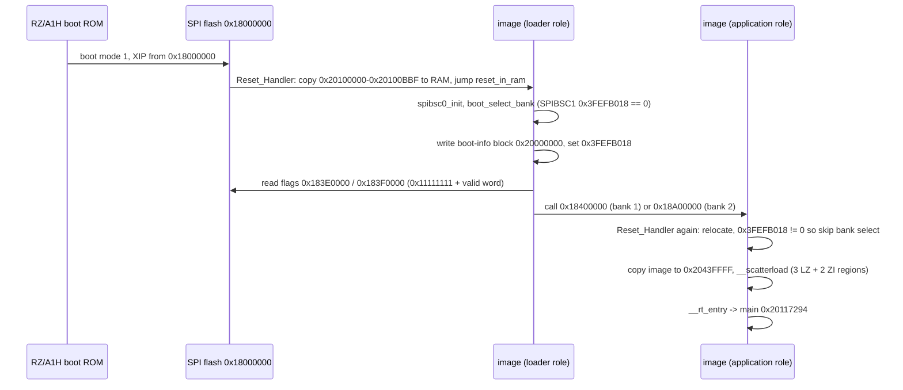
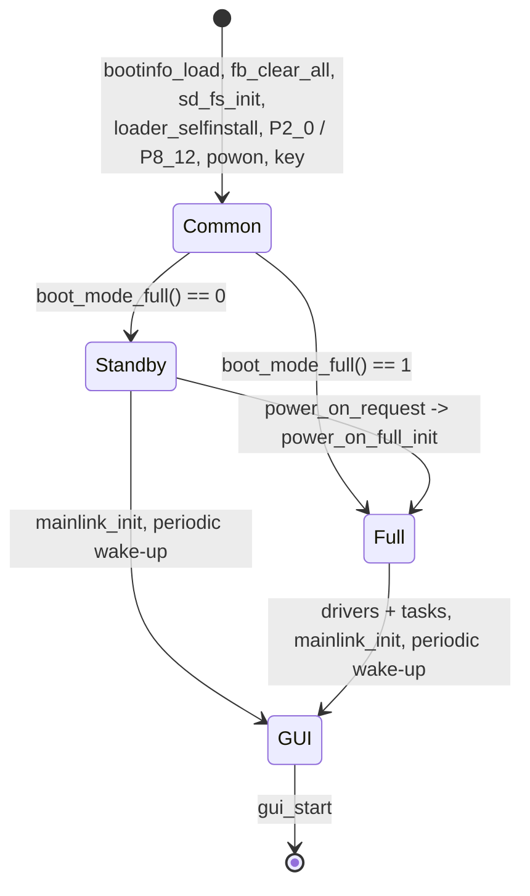

# DISPLAY: boot, start-up and RTOS (T11a)

Back to the [DISPLAY overview](README.md). Addresses are CPU addresses (image base 0x20100000). Names are from `tools/ghidra/names_display.tsv`. Function
bodies are in `decomp/display/` (look them up in `functions.tsv`).

## 1. Reset to `main`



**[fact]** for the code path (T06; `Reset_Handler` 0x2010002C, `reset_in_ram` 0x20100080, `boot_select_bank` 0x20100ABC). Boot mode 1 is
**[inference]** (hardware.md). If neither bank flag is valid the loader keeps running its own copy, which shows `YAESU FT-710 BOOT LOADER V01-02`
(`bootloader_screen` 0x2015938C) **[inference]**.

`bootinfo_load` (0x20116C4C, called first in `task_root`) copies the 0x60-byte boot-info block from the address kept in SPIBSC1 reg 0x3FEFB018 into
0x208DBB44, or builds the default table (bank 1: flag 0x3E0000, image 0x400000; bank 2: flag 0x3F0000, image 0xA00000) when the register is 0 **[fact]**.
Its first word is stored in 0x20800398 (the running bank, used by the update code) **[inference]**.

## 2. `main` (0x20117294)

| Step | Function | What it does |
|---|---|---|
| 1 | `mmu_cache_enable` 0x20116D84 | Writes CP15 and sets SCTLR bits 0xD (MMU, D-cache, write buffer) **[fact for the bits]** |
| 2 | `pinmux_init` 0x20101190 | PFC/GPIO mode for every pin (2.5 KB of per-pin calls) **[fact]** |
| 3 | `gpio_p7_9_11(1)` 0x20100480 | Drives P7_11 and P7_9 high through PSR7 (0xFCFE311C) **[fact]**. Pin meaning unknown |
| 4 | `kernel_heap_init` 0x201562B4 | Kernel start-up, memory pool up to 0x20980000 **[fact for the limit]** |
| 5 | `itron_acre_tsk(0, 0x20165A44)` | Creates `task_root` (pri 8, 8 KB stack) |
| 6 | `ostm_init` 0x201177E4 | OSTM0 compare 319999, ISR `ostm0_tick_isr` on GIC ID 0x86. The ISR adds 10000 µs to the system time, so the **tick is 10 ms** **[fact]** |
| 7 | idle loop | Spins on the scheduler counters 0x208003DB–0x208003DD and counts idle passes in 0x208003C4/0x208003C8 (CPU-load measure) **[inference]** |

## 3. `task_root` (0x201170C8): boot modes

`task_root` registers the two USB-keyboard handler chains (section 6), then reads the inputs that pick the mode:

- `DAT_208003A1/A2 = gpio_p2_0_debounced()`: P2_0, 3 equal samples 10 ms apart. P2_0 is also the IRQ5 pin watched by `powon` **[fact]**. It is
  probably the power switch / `RX_PWR_ON` line **[guess]**.
- `DAT_208003A3 = gpio_read_bit(8, 12)` (P8_12) **[fact]**, meaning unknown.
- `powon_init` and `key_init` start the power-switch and key tasks.
- `boot_mode_full()` (0x20116E84) returns 0 (standby) only when the first active key line from `key_scan_first` is not 6, the force flag 0x208003A4 is
  clear and P2_0 reads 1; otherwise 1 (full) **[fact]**. So holding key line 6 at power-up forces the full start **[inference]**.



Both paths end in `gui_start` (0x20132CCC, VDC5 layers). `power_on_full_init` (0x20116EC8) repeats the full-path init list once (guarded by 0x208003A5),
so the standby → on transition does not reboot the CPU **[fact for the code, inference for "radio switched on"]**.

### Common part
| Order | Function | Notes |
|---|---|---|
| 1 | `bootinfo_load` 0x20116C4C | see section 1 |
| 2 | `fb_clear_all` 0x20132F84 | clears 0x60000000 + 0x2FF300 and the layer at 0x605048A0 |
| 3 | `rtc_init` | creates a kernel object from {2,0,0} (event flag or mailbox) into 0x20800368, after `rtc_port_idle`/`rtc_write_reg` port set-up |
| 4 | `sd_fs_init` 0x201039B0 | FAT volume (`FUN_2014a4d0`), SDHI driver registration (`FUN_20103934`, callback `FUN_2013fd98`), `sd_task_create` |
| 5 | `fwdbg_init` 0x20111064 | self-update debug task (`fwdbg_task_create`) + `fwdbg_line` handler |
| 6 | `loader_selfinstall` 0x20110F0C | only when 0xFCFF400C holds 0xAABBCCDD: erases flash 0..0x340000 and the two flag sectors, then writes this running image (from `vec_reset`) to flash 0 and new flags. This is how a new **loader** gets installed **[fact for the code, inference for the purpose]**. Who sets 0xFCFF400C is for T11c |
| 7 | `gpio_p2_0_debounced`, `gpio_read_bit(8,12)` | mode inputs |
| 8 | `powon_init` 0x20114028, `key_init` 0x20113C84 | tasks `powon`, `key` |
| 9 | `boot_mode_full` | mode decision |
| 10 | `cpg_set_clock_profile(0)` 0x201020A0 | FRQCR 0xFCFE0024 and STBCR1..11 (0xFCFE0420–0x444) from a 2-entry table at 0x2016517C; profile 1 is used by `power_on_full_init` **[fact]** |
| 11 | `gpio_rx_reset(1)` 0x20101C5C | sets P7_10 = `RX_RESET` (hardware.md) **[fact for the pin write, inference for the net]** |

### Full path (in order)
`gpio_p8_14(1)`, `FUN_20116da0(1)` (force flag), `dimmer_init`, `backlight_enable`(0)`, `backlight_init`, `FUN_20107e9c`, `mouse_cursor_init`, USB host
(`FUN_201385b4`, `FUN_2013b97c`, `FUN_2013b4cc`), `adc_start_scan`, `uptest_init`, `cli_init`, `touch_init`, `keycode_init`, `kbdtest_init`,
`mainlink_init`, `renc_init`, `link_ss_irq_init`, `sdr_debug_init`, `spi_slave_init`, `fwupdate_init`, `sdmenu_init`, `periodic_wakeup_register(self, 0)`,
`periodic_wakeup_start`, `touch_cal_init`, `audio_codec_init`, `gui_start` **[fact]**. The unnamed ones are for the subsystem sub-tasks.

The standby path only runs `gpio_p8_14(0)`, `mainlink_init`, the periodic wake-up and `gui_start`.

## 4. Kernel

A µITRON 4.0-style kernel (vendor not identified). Service-call names are inferred from ITRON error codes (E_ID −18, E_NOID −34, E_NOEXS −42) and
descriptor layouts **[inference]**.

| Address | Name | Notes |
|---|---|---|
| 0x201500F4 | `itron_acre_tsk` | T_CTSK `{attr, exinf, entry, prio, stksz, stk, name}` (0x1C bytes), ID auto-assigned; TCBs at 0x208DBBA0 |
| 0x20151768 | `itron_sta_tsk` | |
| 0x20150740 | `itron_dly_tsk` | ms argument **[inference: 10 ms debounce loops use 10]** |
| 0x20152FAC | `itron_iwup_tsk` | called from `periodic_wakeup_isr` **[inference]** |
| 0x2014FF2C / 0x2014E584 | `itron_acre_sem` / `os_create_sem_named` | |
| 0x2014EFFC / 0x20150F00 / 0x20152988 | `itron_acre_flg` / `itron_set_flg` / `itron_twai_flg` | |
| 0x2014F1A8 | `itron_acre_isr` | T_CISR `{attr, exinf, intno, isr}`; IDs count down from 0x40 |
| 0x2011775C | `gic_enable_irq` | enables one GIC interrupt ID |
| 0x201176B4 | `gic_dispatch` | `IRQ_Handler` → handler table 0x208DC1E0 (one entry per GIC ID, default `gic_default_handler`) |
| 0x20162D04 | `cpp_task_thunk` | task entry for C++ objects: `exinf` = object, calls `obj->vtbl[0]` (tasks `uart`, `uart4`, `mouse_cursor`) |

### ISRs created with `itron_acre_isr`
| Descriptor | GIC ID | ISR | Source |
|---|---|---|---|
| 0x20165A60 | 0x86 (134, OSTM0) | `ostm0_tick_isr` 0x20117838 | 10 ms system tick |
| 0x20165954 | 0x87 (135, OSTM1) | `periodic_wakeup_isr` 0x2011678C | OSTM1 compare 31999 = 1 ms |
| 0x20165744 | 0x25 (37, IRQ5) | `powon_isr` 0x20113FDC | P2_0 edge → `powon` task |

### Periodic wake-up service
`periodic_wakeup_isr` runs every 1 ms over 5 slots at 0x208DBAD0 (16 bytes each: task ID, ?, period, count). When `count` reaches `period` it wakes
the task and wraps the count **[fact]**. Periods from `.data2` 0x20800374: **33, 1, 8, 1, 1 ms** **[fact]**. `task_root` takes slot 0 (33 ms) and
`key_init` slot 4 (1 ms) **[fact]**; the other slots belong to tasks for later sub-tasks.

## Tasks

All descriptors are in `.rodata` 0x201651A8–0x20165A44 (plus `test_disp` at 0x20420088). Creators are the functions that call `itron_acre_tsk`.

| Descriptor | Task name | Entry | Pri | Stack | Created by | Sub-task |
|---|---|---|---|---|---|---|
| 0x20165A44 | root | `task_root` 0x201170C8 | 8 | 0x2000 | `main` | T11a |
| 0x2016571C | powon | `task_powon` 0x20113F88 | 3 | 0x400 | `powon_init` | T11a/T11f |
| 0x2016589C | cmd_interval | `task_cmd_interval` 0x2011509C | 3 | 0x100 | `mainlink_init` | T11b |
| 0x20165880 | uart | `cpp_task_thunk` | 7 | 0x2000 | `mainlink_init` | T11b |
| 0x201658D8 | retry | `task_mainlink_retry` 0x201161BC | 4 | 0x2000 | `mainlink_init` | T11b |
| 0x20165900 / 0x2016591C / 0x20165938 | uart (x3) | `cpp_task_thunk` | 3 / 4 / 4 | 0x2000 | `mainlink_obj_run` | T11b |
| 0x201657DC | uart4 | `cpp_task_thunk` | 7 | 0x400 | `uart4_link_init` | T11b |
| 0x2016583C / 0x20165820 / 0x20165804 | uart4 (x3) | `cpp_task_thunk` | 4 | 0x400 | `uart4_obj_run` | T11b |
| 0x201654A0 | fwupdate | `task_fwupdate` 0x2010E1F8 | 8 | 0x2400 | `fwupdate_init` | T11c |
| 0x201654C8 | uptest | `update_main_cpu` 0x2010EA90 | 3 | 0x2000 | `uptest_init` | T11c |
| 0x20165478 | dspup | `update_dsp` 0x2010D92C | 3 | 0x800 | `dspup_init` | T11c |
| 0x201654F8 | sdmenu | `task_sdmenu` 0x2011010C | 8 | 0x2000 | `sdmenu_init` | T11c |
| 0x20165968 | cli | `task_cli` 0x20116AB0 | 5 | 0x2000 | `cli_init` | T11c |
| 0x20165554 | spi_slave_task | `task_spi_slave` 0x20112288 | 5 | 0x100 | `spi_slave_init` | T11d |
| 0x20420088 | test_disp | `task_test_disp` 0x2013512C | 5 | 0x2400 | `test_disp_init` | T11e |
| 0x201656E4 / 0x20165700 | mouse_cursor | `cpp_task_thunk` | 7 | 0x400 | `mouse_cursor_init`, `mouse_cursor_task_create` | T11f |
| 0x201656A8 | key | `task_key` 0x201137F8 | 5 | 0x400 | `key_init` | T11f |
| 0x2016552C | keycode | `task_keycode` 0x20111794 | 5 | 0x800 | `keycode_init` | T11f |
| 0x201655CC | renc | `task_renc` 0x20112774 | 5 | 0x400 | `renc_init` | T11f |
| 0x20165594 | ad renc | `task_ad_renc` 0x201128F4 | 5 | 0x400 | `renc_init` | T11f |
| 0x201655B0 | detect renc | `task_detect_renc` 0x20112AD4 | 5 | 0x400 | `renc_init` | T11f |
| 0x201651C4 | tsc2007 | `task_tsc2007_irq` 0x20103804 | 4 | 0x100 | `touch_init` | T11f |
| 0x201651A8 | tsc2007 | `task_tsc2007` 0x20103464 | 5 | 0x100 | `touch_init` | T11f |
| 0x20165314 | audio_codec | `task_audio_codec` 0x201065C4 | 5 | 0x2400 | `audio_codec_init` | T11g |

Plus `sdTask` (`sd_task_create` 0x20103B68), the USB-host tasks `udevtsk%d` (`usbh_create_objects`) and the self-update debug task from `fwdbg_task_create`,
which build their descriptors on the stack **[fact]**. The task names say `tsc2007`, while the parts list has a TSC2003 (the two are register-compatible
**[inference]**).

## USB-keyboard handler chains

`usbkbd_report` (0x20106FC0) gets every USB keyboard HID report. It toggles the NumLock (usage 0x53) and ScrollLock (0x47) LEDs, then calls
`hid_chain0_dispatch` (handler table 0x208DC198, nothing registered in V01-08) and, **only if `debug_enabled()`**, `hid_chain1_dispatch`
(table 0x208DC1BC) **[fact]**.

```mermaid
flowchart LR
  KB["USB keyboard report"] --> R["usbkbd_report 0x20106FC0"]
  R --> C0["chain 0 (0x208DC198)<br/>empty"]
  R --> G{"debug_enabled()<br/>0x20450000 == 0xA0B9C8E7"}
  G -- "no (shipped)" --> X["dropped"]
  G -- yes --> C1["chain 1 (0x208DC1BC)"]
  C1 --> H0["fwdbg_line: fw1up fw1chk up0 up1 up2"]
  C1 --> H1["uptest_init handler: MAIN update"]
  C1 --> H3["cli_line: memory monitor"]
  C1 --> H5["keycode_init handler"]
  C1 --> H7["`sdr_debug_init` handler<br/>(SDR cmds? guess)"]
  C1 --> H8["`kbdtest_init` handler"]
  U["debug_unlock 0x20107E68<br/>(no caller)"] -.-> G
```

- Handlers collect a line with `hid_line_edit` (0x20112E5C), which works on raw HID usage IDs: 0x28/0x58 Enter, 0x29 Esc (clear), 0x2A Backspace,
  31 characters max **[fact]**.
- `cli` (`task_cli` 0x20116AB0, `cli_exec_line` 0x20116848): `ADDR` reads a word, `ADDR VAL` writes a word, `b ADDR VAL` / `h ADDR VAL` write a byte /
  halfword (hex parser `hex_parse`). A line ending in `.txt` runs `I:\<line>` from the SD card line by line (`cli_run_file`) **[fact]**.
- `debug_enabled()` (0x20111098) compares 0x20450000 with 0xA0B9C8E7. `.data` initialises that word to 0 **[fact, decompressed region]**. The only
  writer is `debug_unlock` (0x20107E68): when `debug_unlock_check` sees P4_3 and P8_3 low (P4_2 is also sampled) and, after 30 ms, a report with a
  Ctrl modifier (mask 0x11) and Backspace (0x2A) **[fact]**. `debug_unlock` has **no caller**: no B/BL, no literal pointer in `.text`, and REA's
  `xrefs` on an independent import returns none **[fact]**. So in V01-08 the debug commands cannot be reached without patching the image or
  writing that RAM word, for example over JTAG (J6003) **[inference]**. P4_3 is `RX_UPDATE` in hardware.md, so the pin check may have been a factory
  jig condition **[guess]**.

## Functions named in T11a

| Address | Ghidra name | Purpose |
|---|---|---|
| 0x201170C8 | `task_root` | init sequence, mode select |
| 0x20116EC8 / 0x2012FFCC | `power_on_full_init` / `power_on_request` | standby → full |
| 0x20116C4C | `bootinfo_load` | boot-info block |
| 0x20110F0C | `loader_selfinstall` | write the running image as loader |
| 0x20116E84 / 0x201130C8 | `boot_mode_full` / `key_scan_first` | mode decision |
| 0x20116E30 / 0x201008AC | `gpio_p2_0_debounced` / `gpio_read_bit` | GPIO reads (PPRn 0xFCFE3200+4n) |
| 0x20101C5C / 0x20101BA4 / 0x20100480 | `gpio_rx_reset` / `gpio_p8_14` / `gpio_p7_9_11` | GPIO writes (PSRn 0xFCFE3100+4n) |
| 0x201020A0 | `cpg_set_clock_profile` | FRQCR + STBCR |
| 0x20116D84 / 0x20101190 / 0x201562B4 | `mmu_cache_enable` / `pinmux_init` / `kernel_heap_init` | `main` set-up |
| 0x20116768 / 0x201167D8 / 0x2011678C | `periodic_wakeup_register` / `periodic_wakeup_start` / `periodic_wakeup_isr` | 1 ms wake-up service |
| 0x20117838 / 0x20113FDC | `ostm0_tick_isr` / `powon_isr` | ISRs |
| 0x20114028 / 0x20113F88 | `powon_init` / `task_powon` | power-switch task |
| 0x20106FC0 / 0x20116DF4 / 0x20116DB8 | `usbkbd_report` / `hid_chain0_dispatch` / `hid_chain1_dispatch` | keyboard chains |
| 0x20111098 / 0x20107E68 / 0x20107DC0 | `debug_enabled` / `debug_unlock` / `debug_unlock_check` | debug gate |
| 0x20112E5C | `hid_line_edit` | line editor |
| 0x20111064 / 0x20110ED4 / 0x2015F0EC | `fwdbg_init` / `fwdbg_line` / `fwdbg_cmd` | self-update commands |
| 0x20116B30 / 0x20116B00 / 0x20116AB0 / 0x201169D0 / 0x20116848 | `cli_init` / `cli_line` / `task_cli` / `cli_run_file` / `cli_exec_line` | memory monitor |
| task entries and creators | see the task table | |

## Globals

| Address | Meaning |
|---|---|
| 0x20450000 | debug-enable word (0xA0B9C8E7 = on), `.data` initial 0 |
| 0x208003A0 | full-mode flag (0 = standby) |
| 0x208003A1 / A2 / A3 | P2_0 level (two copies), P8_12 level at boot |
| 0x208003A4 / A5 | force-full flag / full init already done |
| 0x20800398 | first word of the boot-info block (running bank) |
| 0x208DBB44 | copy of the 0x60-byte boot-info block |
| 0x208DBAD0 | periodic wake-up slots (5 × 16 B), periods at 0x20800374 |
| 0x208DC198 / 0x208DC1BC | USB-keyboard handler chains 0 / 1 (9 entries each) |
| 0x208DC1E0 | GIC handler table |
| 0x20800110 / 0x20800114 | pointers to the two chain dispatchers |
| 0x20800408 | system time in µs (+10000 per tick) |
