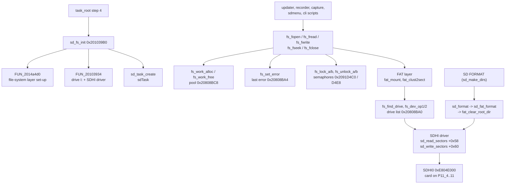

# DISPLAY: SD card, SDHI driver and FAT file system

The DISPLAY CPU owns the SD card (drive `I:`, SDHI0 on P11_4..P11_11, see [peripherals.md](peripherals.md#6-sd-card-user-files)).
This page lists the code between the application and the card: the start-up (`sd_fs_init`, `sdTask`), the file API that the
updater, the voice recorder, the screen capture and the MemList/Menu backups call (`fs_fopen` ... `fs_fseek`), the locking and
work-buffer helpers of the file-system layer, the FAT volume code (`fat_mount`, FAT12/16/32/exFAT) and the SDHI card driver.
What the files are is on [peripherals.md](peripherals.md#6-sd-card-user-files) (user files) and [update.md](update.md) (SFL images).

Sources: `decomp/display/` (addresses 0x2013DFF0..0x2014E14C, plus `sd_fs_init` / `sd_task_create` near 0x201039B0), the plate
comments in `tools/ghidra/names_display.tsv` and `names_display.T11c.tsv` / `T11g.tsv`. Claims are tagged **[fact]** (seen in the
code), **[inference]** or **[guess]**.

## Overview

- **Start-up.** `task_root` step 4 calls `sd_fs_init` 0x201039B0: `FUN_2014a4d0(&DAT_20808c4c, 2)` sets up the file-system layer,
  then `FUN_20103934(&DAT_20809984, 0x49 = 'I', FUN_2013fd98, ...)` registers drive `I:` with the SDHI driver; only when both return
  0 does it call `sd_task_create` 0x20103B68, which creates and starts the task `sdTask` (`os_create_tsk_named`, `itron_act_tsk`)
  **[fact]**. A card-state word `DAT_20800094` is polled by the card monitor (`FUN_20103adc`, 10 ms sleeps); `sd_state_bit7` /
  `sd_state_bit6` return its bits 7 / 6 and the update screens wait on them **[fact]**, meaning "card present / ready"
  **[inference]** ([update.md](update.md#2-sd-card-and-file-system-summary)).
- **File API.** `fs_fopen`, `fs_fread`, `fs_fwrite`, `fs_fseek` and `fs_fclose` all have the same shape: take a work buffer from
  the fixed-size pool 0x20808BC8 (`fs_work_alloc`, `itron_tget_mpf`), call the core routine, store the error with `fs_set_error` /
  `fs_set_error_ret` (last error at 0x20808BA4), release the buffer (`fs_work_free`) **[fact]**. They have 8 (`fs_fseek`) to 35 (`fs_fclose`) callers.
- **Drives and devices.** `fs_find_drive` walks the drive list 0x20808BA0 for the drive letter (+0x11); `fs_dev_op1` / `fs_dev_op2`
  call the device's operation at +0x18 with command 1 / 2 between the device locks; `fs_check_ready` returns -18 when the layer is
  not initialised (0x20808B90) and -17 without a drive list **[fact]**. Per-task contexts are at 0x2091D0BC[tskid]
  (`fs_task_ctx_get`) and two semaphore tables at 0x2091D4C0 / 0x2091D4E8 serialise access (`fs_lock_a/b`, `fs_unlock_a/b`,
  `itron_twai_sem` with 300 ms) **[fact]**.
- **FAT.** `fat_mount` recognises FAT12/16/32 and exFAT (names at 0x20148F20) and reads the on-disk fields with `fat_ld_word` /
  `fat_ld_dword`; `fat_clust2sect` maps a cluster to its first sector; `sjis_is_lead` handles Shift-JIS file names **[fact]**.
- **SDHI driver.** `sdhi_init` / `sdhi0_clock_on` (STBCR12 bits 2–3) bring up SDHI0, `sd_card_identify` resets and identifies the
  card, `sd_read_sectors` / `sd_write_sectors` are the driver operations at +0x58 / +0x60 (-7 = write-protected) **[fact]**.
  `sd_format` → `sd_fat_format` → `fat_clear_root_dir` is the SD **FORMAT** of the menu (#83), reached only from `sd_make_dirs`
  **[fact: write calls; inference: format]**.

## Functions

The block from 0x2013DFF0 (`sd_card_identify`) to 0x2014E14C (`fs_work_free`) holds 345 functions in the current export; after
T23e round 2 (2026-10-30) 94 of them are still `FUN_` **[fact]**. The names from before T23e are below; the round-2 names (SDHI0
driver, FAT file and drive calls, the FAT and directory sector caches, string/byte helpers, OS glue) are in
[Further functions](#further-functions-t23g), grouped as in `tools/ghidra/names_display.T23e2.tsv`. That the unnamed ones belong
to the same driver / FAT library is an **[inference]** from the address range and their callers.

| Address | Ghidra name | Inferred name | Purpose |
|---|---|---|---|
| 0x201039B0 | `sd_fs_init` |  | FAT volume + SDHI driver registration, then sd_task_create **[inference]** |
| 0x20103B68 | `sd_task_create` |  | "sdTask" **[inference]** |
| 0x20103BA0 | `sd_state_bit6` |  | Bit 6 of the SD state 0x20800094; 0 is used as "no SD card" (error -1)  (update.md, display-link.md) **[fact]** |
| 0x20103BB0 | `sd_state_bit7` |  | Bit 7 of the SD state 0x20800094 (cleared by the SD task on a card change) ; card ready  (update.md) **[fact]** |
| 0x2010FB90 | `sd_make_dirs` |  | I:\FT-710\Capture, MemList, Menu, PlayList **[inference]** |
| 0x2010FCF0 | `fmt_size_str` |  | "%.2f KB" ... "%d TB" **[inference]** |
| 0x20110034 | `sd_info_screen` |  | FREE SPACE / CAPACITY **[inference]** |
| 0x2013DFF0 | `sd_card_identify` |  | card reset/identify, card-type flags at +0x2C0/+0x2C2 **[inference]** |
| 0x2013E230 | `sd_read_sectors` |  | driver op +0x58 **[inference]** |
| 0x2013E2B4 | `sd_write_sectors` |  | driver op +0x60; -7 = write-protected **[inference]** |
| 0x2013F79C | `fat_clear_root_dir` |  | zero the root-directory sectors (FAT12/16: 32, FAT32: 1 cluster) **[inference]** |
| 0x2013F83C | `sd_fat_format` |  | card init (3 tries), then fat_clear_root_dir **[inference]** |
| 0x2013F984 | `sd_format` |  | drive letter; -> sd_fat_format (inference: format, #83) **[inference]** |
| 0x2013FE50 | `sdhi0_clock_on` |  | STBCR12 &= 0xF3 **[inference]** |
| 0x201400D4 | `sdhi_init` |  | SDINT_INI **[inference]** |
| 0x20141ABC | `fs_fopen` |  | names-file group "SD card / file system"; calls `FUN_201418b8`, `fs_set_error_ret`, `fs_work_alloc`, `fs_work_free`; 76 B, callers: 24 **[fact]** (code shape) |
| 0x20141FF0 | `fs_fclose` |  | (fd): work buffer, FUN_20141f44(fd, buf), free; error -31 without a buffer ; close (update.md) **[fact]** |
| 0x20142A58 | `fs_fread` |  | names-file group "SD card / file system"; calls `FUN_20142980`, `fs_set_error`, `fs_work_alloc`, `fs_work_free`; 96 B, callers: 21 **[fact]** (code shape) |
| 0x2014367C | `fs_fwrite` |  | names-file group "SD card / file system"; calls `FUN_2014358c`, `fs_set_error`, `fs_work_alloc`, `fs_work_free`; 96 B, callers: 20 **[fact]** (code shape) |
| 0x20143750 | `fs_fseek` |  | names-file group "SD card / file system"; calls `FUN_201436dc`, `fs_set_error`, `fs_work_alloc`, `fs_work_free`; 84 B, callers: 8 **[fact]** (code shape) |
| 0x20144800 | `fs_set_error` |  | (err, file): last error 0x20808BA4 = err, FUN_2014d98c(err), file+0x10 = err; returns -1 for err < 0 **[fact]** |
| 0x2014485C | `fs_set_error_ret` |  | (err, ret): last error 0x20808BA4 = err, returns ret **[fact]** |
| 0x20144918 | `fs_find_drive` |  | (letter, *drv): walks the drive list 0x20808BA0 for +0x11 == letter; -12 when missing **[fact]** |
| 0x20144980 | `fat_clust2sect` |  | (vol, cluster): 0 for cluster < 2, else data start + (cluster - 2) * sectors per cluster **[fact]** |
| 0x20144A10 | `fs_dev_op1` |  | (drv, ...): device op +0x18 with command 1 between the device locks of drv+0x70; -46 / -47 on lock errors **[fact]** |
| 0x20144AC0 | `fs_dev_op2` |  | Same with command 2 **[fact]** |
| 0x20148FCC | `fat_mount` |  | FAT12/16/32/EXFAT detection **[inference]** |
| 0x2014A4A4 | `fs_check_ready` |  | -18 when the FS is not initialised (0x20808B90), -17 without a drive list (0x20808BA0), else 0 **[fact]** |
| 0x2014CA90 | `sjis_is_lead` |  | 1 for Shift-JIS lead bytes 0x81..0x9F and 0xE0..0xFC **[fact]** |
| 0x2014D128 | `fs_memcpy` |  | (dst, src, n): byte copy **[fact]** |
| 0x2014D148 | `fs_memset` |  | (dst, c, n): word fill for aligned 0x200-byte blocks, else bytes **[fact]** |
| 0x2014D220 | `fs_strlen` |  | Byte-wise string length **[fact]** |
| 0x2014D35C | `fs_toupper` |  | 'a'..'z' -> 'A'..'Z' **[fact]** |
| 0x2014D900 | `fat_ld_word` |  | 16-bit field read from an on-disk structure (fat_mount) **[fact]** |
| 0x2014D93C | `fat_ld_dword` |  | 32-bit field read from an on-disk structure (fat_mount) **[fact]** |
| 0x2014D95C | `fs_task_ctx_get` |  | Per-task FS context 0x2091D0BC[tskid] (itron_get_tid), -72 for an ID out of range **[fact]** |
| 0x2014D9C0 | `fs_lock_a` |  | Locks the per-drive semaphore of table 0x2091D4C0 (itron_twai_sem, 300 ms); -37 without one **[fact]** |
| 0x2014DA64 | `fs_unlock_a` |  | Releases it (itron_sig_sem); -38 without one **[fact]** |
| 0x2014DB6C | `fs_lock_b` |  | Same for the second table 0x2091D4E8 (-34) **[fact]** |
| 0x2014DC10 | `fs_unlock_b` |  | Same release for 0x2091D4E8 (-35) **[fact]** |
| 0x2014E000 | `fsys_init_sem` |  | fsys_sem **[inference]** |
| 0x2014E118 | `fs_work_alloc` |  | itron_tget_mpf from pool 0x20808BC8, 0 on failure **[fact]** |
| 0x2014E14C | `fs_work_free` |  | itron_rel_mpf to pool 0x20808BC8 **[fact]** |

## Data structures and globals

| Address | Meaning |
|---|---|
| 0x20800094 | card state word: bit 7 / bit 6 read by `sd_state_bit7` / `sd_state_bit6` **[fact]**, "present / ready" **[inference]** |
| 0x20800098 | card-monitor request flag: while set the monitor clears bit 7 and calls `FUN_2013fd50` **[fact]** |
| 0x20808B90 | file-system layer initialised (`fs_check_ready`) **[fact]** |
| 0x20808BA0 | drive list head (`fs_find_drive`, letter at +0x11) **[fact]** |
| 0x20808BA4 | last file-system error (`fs_set_error`) **[fact]** |
| 0x20808BC8 | fixed-size memory pool of work buffers (`fs_work_alloc` / `fs_work_free`) **[fact]** |
| 0x20808C4C | argument of the layer set-up `FUN_2014a4d0` in `sd_fs_init` **[fact]** |
| 0x20809984 | drive `I:` registration record (0x74 bytes per drive, `FUN_20103a4c`) **[fact]** |
| 0x2091D0BC | per-task file-system contexts, indexed by task ID (`fs_task_ctx_get`) **[fact]** |
| 0x2091D4C0 / 0x2091D4E8 | per-drive semaphore tables (`fs_lock_a` / `fs_lock_b`) **[fact]** |

## Open questions

- The library behind the FAT layer (the error codes -12 ... -72 and the exFAT support suggest a commercial embedded FAT; MiSPO
  ships one with NORTi) **[guess]**.
- The 94 functions of the block still unnamed after T23e round 2 (directory and cluster-chain code mostly); the round-2 names
  describe what the code does, so the layer's own API names stay open until the library is identified.

## Further functions (T23g)

Named functions of this subsystem that the tables above did not list yet, one row each (T23g, found with `tools/doc_table_gaps.py`). The purpose is the plate comment of the name in `tools/ghidra/names_*.tsv` (or the `Ifdsp*Names.java` / `*.lib.tsv` entry); rows marked *code shape* have no comment there and give what the decompile shows: the direct callees, the first string, the size and the caller count. Tags as in the names files; a comment without a tag is an inference from the code.

### SDHI0 driver (T23e round 2)

From the names-file section header (`tools/ghidra/names_display.T23e2.tsv`): SDHI0 driver (SD card on drive I:, register names from sfr_rza1h.tsv) **[fact per the names file]**.

| Address | Ghidra name | Inferred name | Purpose |
|---|---|---|---|
| 0x20140148 | `sdhi_flag_set` |  | itron_set_flg on the SDHI event flag 0x20808B74 **[fact]** |
| 0x20140158 | `sdhi_flag_wait` |  | (pattern, ms): itron_twai_flg on 0x20808B74 for ms/10 ticks, then clears the pattern **[fact]** |
| 0x201401AC | `sdhi_card_absent` |  | Samples sd_card_detect (P11_4 SD_CD) 32 times; true when any sample is high **[fact]** |
| 0x201401DC | `sdhi_write_protected` |  | SD_INFO1 bit 7 (WP) clear; -7 = write-protected in 0x2014040C **[fact]** |
| 0x20140210 | `sdhi_read_block` |  | Reads one 512-byte block through a 32-byte aligned bounce buffer 0x2091CEC0 (cache maintenance around the transfer), waits for access end **[fact]** |
| 0x20140298 | `sdhi_write_block` |  | Writes one 512-byte block through the bounce buffer (dcache_clean_range first), -16 on timeout **[fact]** |
| 0x2014030C | `sdhi_flag_set_4` |  | Sets event bit 4, the bit the sector transfers wait for (sdhi_flag_wait(4, 500)) **[fact]** |
| 0x20140320 | `sdhi_check_card` |  | -6 when sdhi_card_absent, else 0 **[fact]** |
| 0x20140334 | `sdhi_wait_idle` |  | Polls SD_INFO2 until not CBSY (bit 14) and SCLKDIVEN (bit 13); -9 on an error bit, card check, -1 after 0x900000 tries **[fact]** |
| 0x201403E8 | `sdhi_set_block_size` |  | SD_SIZE = n **[fact]** |
| 0x201403F4 | `sdhi_set_sector_count` |  | SD_SECCNT = n **[fact]** |
| 0x20140400 | `sdhi_set_stop` |  | SD_STOP = value (0x100 = auto CMD12 for multi-block) **[fact]** |
| 0x2014040C | `sdhi_check_wp` |  | -7 when sdhi_write_protected (the sd_write_sectors error) **[fact]** |
| 0x20140440 | `sdhi_soft_reset` |  | SOFT_RST 0 then 1 **[fact]** |
| 0x2014045C | `sdhi_power_on` |  | sd_power(1) **[fact]** |
| 0x20140474 | `sdhi_set_bus_width` |  | SD_OPTION = 0x40EE for 4-bit (mode 2), 0xC0EE for 1-bit (WIDTH bit 15) **[fact]** |
| 0x201404A4 | `sdhi_wait_info` |  | (1 response end, 2 access end, 3 buffer read ready, 4 buffer write ready): polls SD_INFO1 / SD_INFO2 for the bit **[fact]** |
| 0x20140538 | `sdhi_send_cmd` |  | Clears SD_INFO1/2, writes SD_ARG1/ARG0 and the command code (table 0x204205FC, CMD7 0x307/0x507) to SD_CMD **[fact]** |
| 0x201405E4 | `sdhi_cmd` |  | sdhi_send_cmd, waits for response end; returns the SD_INFO2 error bits (& 0x807F) or -1 **[fact]** |
| 0x201405F4 | `sdhi_read_response` |  | Copies the response registers SD_RSP07..RSP00 into ctx +0x2B0 (long R2 for CMD2/9/10, else 32 bits) **[fact]** |
| 0x201406B4 | `sd_cmd16_set_blocklen` |  | Sets SD_SIZE/SECCNT/STOP and sends CMD16 (SET_BLOCKLEN), 3 tries, -9 on failure **[inference]** |
| 0x2014074C | `sd_cmd12_stop` |  | Sends CMD12 (STOP_TRANSMISSION), 3 tries, checks the R1 error bits with mask table 0x20420234 **[inference]** |

### FAT layer: file and drive calls (T23e round 2)

From the names-file section header (`tools/ghidra/names_display.T23e2.tsv`): FAT layer: file and drive calls (file handle: +0 drive, +4 sector buffer, +0x2C size, +0x442 open mode 1 = read, 0x10/0x11/0x20/0x21 = write modes) **[fact per the names file]**.

| Address | Ghidra name | Inferred name | Purpose |
|---|---|---|---|
| 0x20140F94 | `file_open_core` |  | The open/create body behind fs_fopen: path lookup, directory entry creation, truncation for write modes (2180 bytes) **[inference]** |
| 0x20141824 | `fs_fopen_locked` |  | Opens/creates the file (0x20140F94) under the drive lock fs_lock_a; result and per-task error via fs_set_error_ret **[fact]** |
| 0x201418B8 | `fs_fopen_work` |  | fs_fopen body with a work buffer: checks the path (fs_path_validate) and mode, finds the drive, opens through fs_fopen_locked **[fact]** |
| 0x20141B08 | `file_sync_shared` |  | When a file is open more than once, copies the first cluster and dirty state of this handle to the other open handles of the same entry **[fact]** |
| 0x20141C6C | `file_dirent_update` |  | Writes size, attribute, write time and first cluster of an open file back to its directory entry (root or subdirectory sector) and marks it dirty **[fact]** |
| 0x20141DF8 | `file_dirent_update_locked` |  | file_dirent_update under fs_lock_a **[fact]** |
| 0x20141E38 | `file_flush` |  | Writes the file's dirty sector buffer (fs_dev_op2), updates the directory entry for write modes and the other handles (file_sync_shared) **[fact]** |
| 0x20141F44 | `fs_fclose_work` |  | fs_fclose body: file_flush, FAT32 FSInfo update and fs_flush for write modes, frees the buffer, clears the open mode **[fact]** |
| 0x20142034 | `file_getc` |  | Next byte of a file, reloading the sector buffer and following the cluster chain (fat_next_sector); -1 at the end **[fact]** |
| 0x201421C0 | `fs_fgetc_work` |  | Checked file_getc (-5 for a write-only handle) **[fact]** |
| 0x20142228 | `fs_fgetc` |  | fs_fgetc_work with a work buffer **[fact]** |
| 0x20142300 | `fs_fgets_work` |  | Reads up to n-1 bytes or through '\\n' with file_getc and 0-terminates **[fact]** |
| 0x20142390 | `fs_fgets` |  | (buf, n, fd): fgets; sfl_stream_gets, sfl_read_header and cli_run_file read text lines with it **[fact]** |
| 0x201423E4 | `file_read_core` |  | Sector-wise read body behind fs_fread **[inference]** |
| 0x201425C4 | `file_read_locked` |  | Read under the drive lock **[inference]** |
| 0x20142980 | `fs_fread_work` |  | fs_fread body: handle checks, then file_read_locked **[inference]** |
| 0x20142AB8 | `file_write_core` |  | Sector-wise write body behind fs_fwrite (allocates clusters, 2496 bytes) **[inference]** |
| 0x20143478 | `file_write_locked` |  | Write under the drive lock **[inference]** |
| 0x2014358C | `fs_fwrite_work` |  | fs_fwrite body: handle checks (fs_file_check, write-protect) then file_write_locked **[inference]** |
| 0x201436DC | `fs_fseek_work` |  | fs_fseek body with the handle check **[inference]** |
| 0x201437A4 | `file_remove_core` |  | Removes a directory entry and frees its clusters **[inference]** |
| 0x20143A58 | `fs_remove_work` |  | Validates and normalises the path, file_remove_core, fs_flush **[fact]** |
| 0x20143B20 | `fs_remove` |  | (path): deletes a file; wav_delete, rec_close_abort and rec_open_wav call it on WAV files **[fact]** |
| 0x20143B70 | `fs_fatcache_setup` |  | (drive, buffer, size, sectors per slot): FAT cache in a caller buffer (0x206 bytes per sector slot, 4-byte aligned), -24 when too small **[fact]** |
| 0x20143C1C | `fs_fatcache_setup_a` |  | fs_fatcache_setup and fs_set_error **[fact]** |
| 0x20143C34 | `fs_fatcache_setup_b` |  | Second identical wrapper **[fact]** |
| 0x20143EAC | `fs_dircache_setup` |  | (drive, buffer, size, sectors per slot): directory cache (0x208 bytes per sector, at least 3 slots), -28 otherwise **[fact]** |
| 0x2014440C | `dircache_flush` |  | Writes every dirty directory cache slot back (fs_dev_op2) and clears the dirty bit **[fact]** |
| 0x2014455C | `fatcache_flush` |  | Writes every dirty FAT cache slot back, also to the second FAT for single-sector slots **[fact]** |
| 0x20144654 | `fatcache_flush_locked` |  | fatcache_flush under fs_lock_b **[fact]** |
| 0x20144688 | `fs_flush` |  | fatcache_flush, then dircache_flush under fs_lock_a; fclose, remove and mkdir end with it **[fact]** |
| 0x201446BC | `fs_sync` |  | fs_flush with fs_set_error **[fact]** |
| 0x201446D0 | `fs_cache_invalidate` |  | Clears the FAT cache, the cluster bitmap (clusters 0, 1 and the FAT32 root kept) and the directory cache of a drive **[fact]** |
| 0x2014B93C | `dir_init_dot_entries` |  | Writes the "." and ".." entries (attribute 0x10) into a new directory cluster and zeroes the other sectors **[fact]** |
| 0x2014BA68 | `dir_create_core` |  | Directory creation body behind fs_mkdir_work **[inference]** |
| 0x2014BE24 | `fs_mkdir_work` |  | Validates and normalises the path, creates the directory (0x2014BA68), fs_flush **[fact]** |
| 0x2014BEEC | `fs_mkdir` |  | (path): creates a directory; sd_make_dirs makes the FT-710 folders with it **[fact]** |
| 0x2014BF30 | `dir_open_core` |  | Opens a directory by path for fs_opendir_work **[inference]** |
| 0x2014C31C | `fs_opendir_work` |  | fs_opendir body: copies and normalises the path, opens the root or a subdirectory (0x2014BF30) **[fact]** |
| 0x2014C410 | `fs_opendir` |  | (path): directory handle, 0 on error; wav_list_dir, fwfile_status_text, sdmenu_save_file, screen_capture_bmp **[fact]** |
| 0x2014C454 | `dir_close` |  | Clears the handle's open flag +4, -13 when it was not open **[fact]** |
| 0x2014C474 | `fs_closedir` |  | Checked dir_close **[fact]** |
| 0x2014C4BC | `dirent_read` |  | Copies 32-byte entry n of a directory sector (dir_sector_get) **[fact]** |
| 0x2014C50C | `dir_next_entry` |  | Advances a directory handle (+0xC sector, +6 index) to the next 32-byte entry, through the cluster chain **[inference]** |
| 0x2014C688 | `dir_read_core` |  | readdir body: next used entry, long name (UTF-16 to 8-bit by 0x2014CC1C) **[inference]** |
| 0x2014CA08 | `fs_readdir_work` |  | Checked readdir under fs_lock_a **[fact]** |
| 0x2014CA4C | `fs_readdir` |  | (dir): next directory entry or 0 at the end; callers read the attribute at entry +0x0B **[fact]** |
| 0x2014CAB8 | `sjis_to_ucs2_char` |  | Shift-JIS character to UTF-16 (byte-swapped) via the tables 0x20420756 (0x81..0x9F) and 0x204244D0 (0xE0..0xFC); ASCII and half-width kana directly **[fact]** |
| 0x2014CB84 | `sjis_to_ucs2_str` |  | Shift-JIS string to UTF-16, returns the length, sets *flag when there is a double-byte character **[fact]** |
| 0x2014CC1C | `ucs2_to_ascii_char` |  | One UTF-16 character to 8 bits, same mapping as fs_ucs2_to_ascii_upper without upper-casing **[fact]** |
| 0x2014CD68 | `sjis_map_ext_chars` |  | Rewrites NEC/IBM extension codes in a path (0xED40.., 0x8790..) to one form before a lookup **[inference]** |

### FAT layer: sector caches (T23e round 2)

From the names-file section header (`tools/ghidra/names_display.T23e2.tsv`): FAT layer: sector caches (FAT cache: slots +0x44, count +0x48, sectors per slot +0x4A; directory/data cache: +0x4C, +0x50, +0x52; per slot a start sector, bit 31 or 15 = dirty, and an LRU age) **[fact per the names file]**.

| Address | Ghidra name | Inferred name | Purpose |
|---|---|---|---|
| 0x20143C48 | `fatcache_lookup` |  | Slot number (1-based) of the FAT cache slot holding a sector, 0 for a miss **[fact]** |
| 0x20143CBC | `fatcache_load` |  | Evicts the oldest FAT cache slot (writes it back when dirty, also to the second FAT when there are two and a slot is one sector) and reads the slot's sectors (fs_dev_op1) **[fact]** |
| 0x20143E10 | `fatcache_touch` |  | Ages the FAT cache slots and makes the given one the newest **[fact]** |
| 0x20143F78 | `dircache_lookup` |  | Slot number of the directory/data cache slot holding a sector, 0 for a miss **[fact]** |
| 0x20144000 | `dircache_load` |  | Evicts the oldest directory cache slot (write back when dirty) and reads the sectors, clipped to the fixed root directory for FAT12/16 **[fact]** |
| 0x20144268 | `dircache_touch` |  | Ages the directory cache slots and makes the given one the newest **[fact]** |
| 0x20144834 | `fs_set_error_m2` |  | Last error 0x20808BA4 and per-task error = err, returns -2 for err < 0 else 0 **[fact]** |
| 0x20144878 | `fs_file_check` |  | -13 for a null file, -6 when the open flag +0x442 is clear, else 0; used by the file calls (fclose, fread, fwrite, fseek, fs_fsize) **[fact]** |
| 0x20144898 | `fs_dir_check` |  | -13 for a null handle, -6 when its open flag +4 is clear (directory handles) **[inference]** |
| 0x201448B8 | `fat_sector_is_cluster_first` |  | 1 when a data sector is the first sector of its cluster (sectors per cluster > 1) **[fact]** |
| 0x20144950 | `fs_drive_check_mounted` |  | -19 for a removable drive (+0x68 bit 0) that is not mounted (bit 7), else 0 **[fact]** |
| 0x20144970 | `fs_drive_check_writable` |  | -58 when the drive is write-protected (+0x68 bit 5) **[fact]** |
| 0x201449CC | `fat_sect2clust` |  | Cluster number of a data sector: (sector - data start) / sectors per cluster + 2 (inverse of fat_clust2sect) **[fact]** |
| 0x20144B74 | `dir_sector_dirty` |  | Marks a directory/data sector dirty in the directory cache, or writes it (fs_dev_op2) when there is none; -0x45 when not cached **[fact]** |
| 0x20144C04 | `root_sector_dirty` |  | dir_sector_dirty for sector n of the FAT12/16 root directory, -11 past its end **[fact]** |
| 0x20144C5C | `dir_sector_get` |  | (vol, sector, *ptr): pointer to a directory/data sector through the directory cache, direct read when there is none **[fact]** |
| 0x20144D04 | `root_sector_get` |  | (vol, n, *ptr): sector n of the fixed FAT12/16 root directory (after reserved + FATs), -11 past its end **[fact]** |
| 0x20144EB8 | `lfn_checksum` |  | Checksum of an 11-byte 8.3 name (rotate right and add), the value long-name entries carry **[fact]** |
| 0x201450A4 | `sfn_from_dotted` |  | "NAME.EXT" to the 11-byte space-padded 8.3 form; -1 for a base longer than 8 **[fact]** |
| 0x20145120 | `fs_char_lfn_only` |  | 1 for the characters "+,;=[]" that a long name may hold but an 8.3 name may not **[fact]** |
| 0x2014518C | `sjis_fold_case_pair` |  | Byte-pair version of sjis_fold_case **[fact]** |
| 0x20145578 | `fs_utoa6` |  | Decimal digits of a number <= 999999 without leading zeros (numeric tail "~N") **[fact]** |
| 0x201455F8 | `root_dirent_delete` |  | Marks a root-directory entry and the long-name entries before it deleted (0xE5) **[fact]** |
| 0x2014570C | `sfn_match_dotted` |  | 0 when an 11-byte 8.3 name equals sfn_from_dotted of a dotted name, -99 otherwise **[fact]** |
| 0x20145764 | `sfn_numtail_match` |  | Compares two 8.3 names whose base ends in a "~N" tail (same extension, same base before '~') **[fact]** |
| 0x20145AFC | `lfn_entry_get_chars` |  | Copies the 13 UTF-16 characters of a long-name entry (offsets 1, 0x0E, 0x1C) until a 0 **[fact]** |
| 0x20145BE4 | `root_lfn_collect` |  | Gathers the long name stored before a root-directory entry **[inference]** |
| 0x20145DF0 | `root_dir_find` |  | Searches the fixed FAT12/16 root directory for a name (long or 8.3) **[inference]** |
| 0x20146338 | `root_dir_find_locked` |  | root_dir_find under fs_lock_a (-37 on lock failure) **[fact]** |
| 0x20146884 | `dirent_get_cluster` |  | First cluster of an entry (+0x1A, \| +0x14 << 16 except FAT12/16) **[fact]** |
| 0x201468C0 | `subdir_find` |  | Searches a directory cluster chain for a name: builds the 8.3 form, compares long-name entries (lfn checksum), follows the FAT (fat_entry_rw_locked), returns the entry and its position **[inference]** |
| 0x201471CC | `subdir_find_locked` |  | subdir_find under fs_lock_a **[fact]** |
| 0x20147248 | `path_next_component` |  | (p, out): copies the "\\name" component at p (Shift-JIS aware) to out and returns the pointer after it, 0 when p does not start with '\\' **[fact]** |
| 0x201472A8 | `path_components_len` |  | Length of a path rebuilt from its components plus separators and the 3-byte "X:\\" **[fact]** |
| 0x20147314 | `fs_name_check` |  | -1 when a path component has a character of the invalid list 0x20808BA8 (outside Shift-JIS pairs), is all spaces, or ends in '.' or ' ' **[fact]** |
| 0x201473C4 | `fs_path_validate` |  | -12 without a drive letter, -1 without ":\\", for more than 0x102 characters or a bad component (fs_name_check) **[fact]** |
| 0x201474A4 | `dirent_set_time` |  | Writes the FAT date/time from fs_get_time_tm into an entry: mask 1 = created (+0xE/+0x10), 2 = written (+0x16/+0x18, also file +0x234), 4 = accessed date (+0x12) **[fact]** |
| 0x20147588 | `dirent_set_cluster` |  | Stores the first cluster in an entry (+0x1A, high word +0x14 except FAT12/16) **[fact]** |
| 0x201475D0 | `fat_time_to_tm` |  | FAT date/time words to struct tm (sec*2, min, hour, mday, mon-1, year+80) **[fact]** |
| 0x20147640 | `dirent_name_to_str` |  | 8.3 name of an entry to "NAME.EXT"; NT case flags 0x08 / 0x10 lower-case base / extension **[fact]** |
| 0x201476F0 | `fs_attr_check` |  | -99 when the attribute mask has bits outside the allowed set **[fact]** |
| 0x201476FC | `sjis_fold_case` |  | Full-width Shift-JIS lower-case Latin/Greek/Cyrillic to upper case, and 0xFA40.. to the 0x8754.. range **[fact]** |
| 0x20147774 | `fs_stricmp_sjis_fold` |  | Case-insensitive compare that also folds full-width Shift-JIS letters (sjis_fold_case) **[fact]** |
| 0x2014919C | `fat_table_sector_get` |  | (vol, FAT sector, *ptr): pointer to a sector of the FAT through the FAT cache (or a direct read without cache), -11 beyond the FAT size **[fact]** |
| 0x20149278 | `fat_table_sector_dirty` |  | After a FAT change: sets the dirty bit of the FAT cache slot, or without cache writes the sector (fs_dev_op2) to the first and, with two FATs, the second FAT; -0x45 when the sector is not cached **[fact]** |
| 0x2014933C | `fat32_entry_get` |  | FAT32 entry: FAT sector cluster/(bps/4) via fat_table_sector_get, fat_ld_dword **[fact]** |
| 0x201493B4 | `fat32_entry_set` |  | FAT32 entry store and fat_table_sector_dirty **[fact]** |
| 0x20149420 | `fat_entry_rw` |  | (vol, cluster, value, 'r'/'w'): reads or writes a FAT12 (packed 12-bit, may cross a sector), FAT16 or FAT32 entry; >= 0xFF8 / 0xFFF8 return 0x0FFFFFFF (end of chain) **[fact]** |
| 0x2014969C | `clmap_clear` |  | Clears a cluster's bit in the volume's cluster-use bitmap +0x58 (bit masks 0x20808BAC) **[fact]** |
| 0x201496BC | `fat_chain_free` |  | Frees a cluster chain: writes 0 to each entry, clears the cluster-map bit, FAT32 free count +0x3C ++, keeps the first freed cluster as hint +0x2C; -61 on a bad chain **[fact]** |
| 0x20149788 | `fat_chain_free_locked` |  | fat_chain_free under fs_lock_b (-34 on lock failure) **[fact]** |
| 0x201497CC | `fat_entry_rw_locked` |  | fat_entry_rw under fs_lock_b, result to *out **[fact]** |
| 0x20149824 | `clmap_set` |  | Sets a cluster's bit in the bitmap +0x58 **[fact]** |
| 0x20149844 | `clmap_test` |  | Tests a cluster's bit in the bitmap +0x58 **[fact]** |
| 0x20149860 | `clmap_find_free` |  | First clear bitmap bit from the hint +0x28 (or the freed hint +0x2C), wraps to cluster 2; sets the bit and the next hint; -99 when full **[fact]** |
| 0x20149940 | `fat32_find_free` |  | Scans the FAT32 table from hint +0x28 to the last cluster for a 0 entry **[fact]** |
| 0x20149A80 | `fat32_alloc_cluster` |  | Finds a free cluster (bitmap or FAT scan), marks it end-of-chain 0x0FFFFFFF, links it from the previous cluster, free count +0x3C -- **[fact]** |
| 0x20149B8C | `fat_alloc_cluster` |  | (vol, previous cluster): allocates a cluster on FAT12/16 (end mark 0xFFFF, links the previous one), FAT32 through fat32_alloc_cluster; 0 when the disk is full **[fact]** |
| 0x20149DEC | `fat_alloc_cluster_locked` |  | fat_alloc_cluster under fs_lock_b **[fact]** |
| 0x20149E48 | `fat_next_cluster` |  | fat_entry_rw(vol, cluster, 0, 'r') under fs_lock_b; end-of-chain values give 0 **[fact]** |
| 0x20149EB0 | `fat_next_sector_alloc` |  | Like fat_next_sector, but at the end of the chain allocates and links a new cluster (fat_alloc_cluster_locked); used when writing **[fact]** |
| 0x20149F68 | `fat_next_sector` |  | Next sector of a cluster chain: sector + 1 inside the cluster, else the first sector of the next cluster (0 at the end) **[fact]** |
| 0x2014A020 | `fat32_fsinfo_write` |  | FAT32: reads the FSInfo sector (+0x3A), stores free count (+0x3C) at 0x1E8 and next-free hint (+0x28) at 0x1EC, writes it back **[fact]** |
| 0x2014A0A4 | `fat32_fsinfo_write_locked` |  | fat32_fsinfo_write under fs_lock_b **[fact]** |
| 0x2014A0E0 | `fs_clmap_attach` |  | (drive, buffer, size, work, scan): gives a drive a cluster-use bitmap (+0x58/+0x5C, clusters covered +0x60, FAT entries +0x64) and optionally fills it from the FAT **[fact]** |
| 0x2014A304 | `fs_clmap_attach_scan` |  | fs_clmap_attach with a work buffer and scan = 1 **[fact]** |
| 0x2014A360 | `fs_clmap_size` |  | Bytes a drive's cluster bitmap needs: (clusters + 7) / 8, clusters = min(FAT entries, data clusters + 2) **[fact]** |
| 0x2014A4D0 | `fs_init` |  | (drive table, n, file table, m): clears the 0x450-byte drive and 0x24C-byte file tables (0x20808B90..9C), creates the pools and semaphores; errors -30/-36/-33/-39/-42 **[fact]** |
| 0x2014A5DC | `fs_drive_attach` |  | (drv, letter, driver fn, ctx, no_mount, sector size): links a drive into the list 0x20808BA0, calls the driver (op 5 init, op 7 mount), sets up the caches **[fact]** |
| 0x2014A818 | `fs_drive_attach_thunk` |  | Tail call to fs_drive_attach **[fact]** |
| 0x2014A83C | `fs_exit` |  | Reverse of fs_init: clears the tables, deletes the drive semaphores, pools and semaphores (errors -53..-48) **[fact]** |
| 0x2014A99C | `fs_vol_clear_geometry` |  | Zeroes the BPB fields of a drive (type, sectors/cluster, reserved, FATs, root entries, sizes, root cluster, FSInfo) **[fact]** |
| 0x2014A9D4 | `fs_drive_mount` |  | Driver op 7 (mount) on a drive, re-reads the geometry, FAT32 free count via 0x2014B730 when unknown, sets mounted bit 0x80 of +0x68; -16 for clusters > 128 KB **[fact]** |
| 0x2014AAF0 | `fs_drive_unmount` |  | Removable drive (+0x68 bit 0): driver op 8, clears the mounted bit; -16 when not removable **[fact]** |
| 0x2014AB74 | `fs_drive_detach` |  | Unlinks a removable drive from the drive list 0x20808BA0 and deletes its semaphore **[fact]** |
| 0x2014AC30 | `fs_path_lookup` |  | Resolves "X:\\dir\\..\\name" component by component from the root (FAT12/16 root area or FAT32 root cluster +0x34) to its directory entry **[fact]** |
| 0x2014AE1C | `fs_stat_work` |  | fs_stat with a caller work buffer: copies and normalises the path (0x2014CD68), fs_path_lookup **[fact]** |
| 0x2014AEC8 | `fs_stat` |  | (path, *entry): directory entry of a path, 0 when it exists; sdmenu_load_file checks a size there before fs_fopen, update_display_self waits for the loader file with it **[fact]** |
| 0x2014AF14 | `fs_get_attr` |  | Attribute byte (entry byte 11) of a path from fs_stat; sdmenu_file_exists **[fact]** |
| 0x2014AF44 | `fs_file_size_copy` |  | Copies the 4-byte size at file +0x2C **[fact]** |
| 0x2014AF64 | `fs_fsize` |  | (fd, *size): file size; the firmware loaders compare it with image sizes (0x43075A in fwobj_sdr_run, < 0x242 in fwobj_display_run) **[fact]** |
| 0x2014AFCC | `fs_split_sectors` |  | Splits a sector count into whole 8 MB units and a byte remainder for a sector size **[fact]** |
| 0x2014B020 | `fs_disk_total_calc` |  | Total data size of a drive: (clusters - 2) * sectors per cluster, split by fs_split_sectors; -17 for an unknown drive **[fact]** |
| 0x2014B140 | `fs_disk_size` |  | (letter, *hi, *lo): checked wrapper of fs_disk_total_calc; sd_info_screen **[fact]** |
| 0x2014B1E0 | `fat32_count_free` |  | Counts the zero FAT32 entries (free clusters) **[inference]** |
| 0x2014B394 | `fat32_count_free_locked` |  | fat32_count_free under fs_lock_b **[fact]** |
| 0x2014B3E8 | `fat16_count_free` |  | Counts the zero FAT16 entries over the FAT sectors, split into size units **[fact]** |
| 0x2014B500 | `fat16_count_free_locked` |  | fat16_count_free under fs_lock_b **[fact]** |
| 0x2014B54C | `fat12_count_free` |  | FAT12 version of the free-cluster count **[inference]** |
| 0x2014B6E4 | `fat12_count_free_locked` |  | fat12_count_free under fs_lock_b **[fact]** |
| 0x2014B730 | `fs_count_free` |  | Free space of a drive by FAT type (FAT12/16/32 counters); fs_drive_mount uses it for an unknown FAT32 free count **[fact]** |
| 0x2014B7DC | `fs_disk_free_work` |  | Checked wrapper of fs_count_free with a work buffer **[fact]** |
| 0x2014B880 | `fs_disk_free` |  | (letter, *hi, *lo): free space; sd_is_full, sd_info_screen, screen_capture_bmp **[fact]** |
| 0x2014B8D4 | `dirent_init` |  | Builds a 32-byte directory entry: 8.3 name, attribute, time stamps (dirent_set_time mask 7), first cluster, size 0 **[fact]** |

### FAT layer: string and byte helpers (T23e round 2)

From the names-file section header (`tools/ghidra/names_display.T23e2.tsv`): FAT layer: string and byte helpers (volume fields from fat_mount: +4 sectors/cluster, +6 reserved, +8 FAT count, +0xA root entries, +0xC FAT size, +0x10 type 12/16/32, +0x6C bytes/sector) **[fact per the names file]**.

| Address | Ghidra name | Inferred name | Purpose |
|---|---|---|---|
| 0x2014CFF4 | `fs_wstrcpy_len` |  | Copies a 0-terminated UTF-16 string, returns its length in characters, sets *flag = 1 **[fact]** |
| 0x2014D050 | `fs_ucs2_to_ascii_upper` |  | UTF-16 name to 8-bit upper case: 0x00A5 -> '\\', 0x203E -> '~', U+FF61..FF9F -> half-width kana 0xA1..0xDF, 0 for any other character outside 0x20..0x7E **[fact]** |
| 0x2014D1C4 | `fs_memmove` |  | Byte copy that copies backwards when the areas overlap **[fact]** |
| 0x2014D248 | `fs_wstrlen_bytes` |  | Length of a UTF-16 string in bytes **[fact]** |
| 0x2014D270 | `fs_strcpy` |  | Byte string copy including the terminator **[fact]** |
| 0x2014D288 | `fs_strncpy` |  | Copies up to n bytes, pads with 0 after the terminator **[fact]** |
| 0x2014D2CC | `fs_wstrncpy` |  | UTF-16 version of fs_strncpy **[fact]** |
| 0x2014D338 | `fs_strchr` |  | First occurrence of a character, 0 when missing **[fact]** |
| 0x2014D374 | `fs_tolower` |  | 'A'..'Z' -> 'a'..'z' (pair of fs_toupper) **[fact]** |
| 0x2014D38C | `fs_stricmp` |  | Case-insensitive string compare (fs_toupper on both) **[fact]** |
| 0x2014D3F8 | `fs_wstricmp` |  | Case-insensitive compare of UTF-16 strings (folds only characters < 0x100) **[fact]** |
| 0x2014D48C | `fs_strnicmp` |  | Case-insensitive compare of at most n bytes **[fact]** |
| 0x2014D508 | `fs_wstrnicmp` |  | UTF-16 version of fs_strnicmp **[fact]** |
| 0x2014D5B4 | `fs_strlwr_sjis` |  | Lower-cases a string in place, skipping Shift-JIS pairs **[fact]** |
| 0x2014D600 | `fs_atoi` |  | Decimal digits to int (no sign, no checks) **[fact]** |
| 0x2014D630 | `fs_utoa_digits` |  | Recursive digit writer for radix 2..36 ('a'.. for 10+), returns the end pointer **[fact]** |
| 0x2014D678 | `fs_itoa` |  | (value, buf, radix 2..36): '-' for negative decimal, 0-terminated; empty for a bad radix **[fact]** |
| 0x2014D6C8 | `fs_stricmp_sjis` |  | Case-insensitive compare that compares the trail byte of a Shift-JIS pair exactly (sjis_is_lead) **[fact]** |
| 0x2014D770 | `fs_strnicmp_sjis` |  | Length-limited version of fs_stricmp_sjis **[fact]** |
| 0x2014D834 | `fs_atoi_2` |  | Second identical copy of fs_atoi **[fact]** |
| 0x2014D864 | `fs_itoa_2` |  | Second identical copy of fs_itoa **[fact]** |
| 0x2014D8C8 | `fs_wstr_store_le` |  | Copies a 0-terminated UTF-16 string to bytes, little-endian, including the terminator **[fact]** |
| 0x2014D8EC | `fat_st_word` |  | Stores a 16-bit value little-endian at an unaligned address (pair of fat_ld_word) **[fact]** |
| 0x2014D918 | `fat_st_dword` |  | Stores a 32-bit value little-endian at an unaligned address (pair of fat_ld_dword) **[fact]** |

### FAT layer: OS glue (T23e round 2)

From the names-file section header (`tools/ghidra/names_display.T23e2.tsv`): FAT layer: OS glue (semaphores, pools, time) **[fact per the names file]**.

| Address | Ghidra name | Inferred name | Purpose |
|---|---|---|---|
| 0x2014D98C | `fs_task_err_set` |  | Stores the last error of the calling task in 0x2091D0BC[tskid] (itron_get_tid, ids 1..256); fs_set_error calls it **[fact]** |
| 0x2014DAD0 | `fs_sem_a_create` |  | Creates the five semaphores of table 0x2091D4C0 (os_create_sem_named, signalled once) used by fs_lock_a **[fact]** |
| 0x2014DB2C | `fs_sem_a_delete` |  | Deletes them (itron_del_sem) **[fact]** |
| 0x2014DC7C | `fs_sem_b_create` |  | Same for table 0x2091D4E8 (fs_lock_b) **[fact]** |
| 0x2014DCD8 | `fs_sem_b_delete` |  | Deletes them **[fact]** |
| 0x2014DD18 | `fs_sem_wait_1s` |  | itron_twai_sem(id, 1000), E_NOEXS (-42) for id <= 0 **[fact]** |
| 0x2014DD34 | `fs_sem_signal` |  | itron_sig_sem(id), E_NOEXS (-42) for id <= 0 **[fact]** |
| 0x2014DD4C | `fs_drive_sem_create` |  | Gives the drive (+0x70) the semaphore of another drive on the same device (+0x18) or creates one **[fact]** |
| 0x2014DDD0 | `fs_drive_sem_delete` |  | Deletes the drive semaphore and clears it in the drives that share the device **[fact]** |
| 0x2014DE30 | `fs_sem1_wait` |  | itron_twai_sem(0x20808BB4, 300) **[fact]** |
| 0x2014DE5C | `fs_sem1_signal` |  | itron_sig_sem(0x20808BB4) **[fact]** |
| 0x2014DE84 | `fs_sem1_create` |  | Creates semaphore 0x20808BB4 (os_create_sem_named) **[fact]** |
| 0x2014DECC | `fs_sem1_delete` |  | itron_del_sem(0x20808BB4) **[fact]** |
| 0x2014DEF4 | `fs_sem2_wait` |  | itron_twai_sem(0x20808BB8, 300) **[fact]** |
| 0x2014DF20 | `fs_sem2_signal` |  | itron_sig_sem(0x20808BB8) **[fact]** |
| 0x2014DF48 | `fs_sem2_create` |  | Creates semaphore 0x20808BB8 **[fact]** |
| 0x2014DF8C | `fs_sem2_delete` |  | itron_del_sem(0x20808BB8) **[fact]** |
| 0x2014DFB4 | `fsys_sem_wait` |  | itron_twai_sem on the fsys semaphore 0x20808BBC (fsys_init_sem), result in 0x20808BC0 **[fact]** |
| 0x2014DFDC | `fsys_sem_signal` |  | itron_sig_sem on 0x20808BBC, result in 0x20808BC0 **[fact]** |
| 0x2014E044 | `fsys_sem_delete` |  | itron_del_sem(0x20808BBC) **[fact]** |
| 0x2014E06C | `fs_mpf_alloc` |  | Block from pool 0x20808BC4 (itron_tget_mpf, no wait) for sizes <= 0x10000, 0 otherwise **[fact]** |
| 0x2014E0AC | `fs_mpf_free` |  | itron_rel_mpf to pool 0x20808BC4 **[fact]** |
| 0x2014E0C8 | `fs_mpf_create` |  | Creates the "fsys_mpf" fixed pool 0x20808BC4 **[fact]** |
| 0x2014E100 | `fs_mpf_delete` |  | itron_del_mpf of pool 0x20808BC4 **[fact]** |
| 0x2014E178 | `fs_work_pool_create` |  | Creates the "FSYS Work" pool 0x20808BC8 used by fs_work_alloc **[fact]** |
| 0x2014E1B4 | `fs_work_pool_delete` |  | itron_del_mpf of pool 0x20808BC8 **[fact]** |
| 0x2014E1DC | `fs_get_time_tm` |  | rtc_get_tm into the caller's struct tm, returns 1 (time stamps of FAT entries) **[fact]** |
| 0x2014E1EC | `fs_get_tick` |  | Low word of itron_get_tim **[fact]** |
