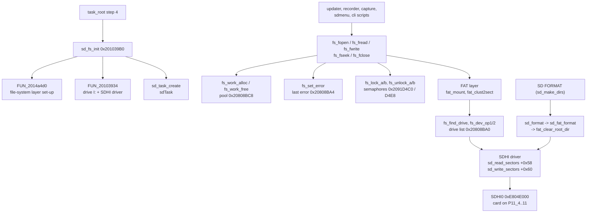

# DISPLAY: SD card, SDHI driver and FAT file system

The DISPLAY CPU owns the SD card (drive `I:`, SDHI0 on P11_4..P11_11, see [peripherals.md](peripherals.md#6-sd-card-user-files)).
This page lists the code between the application and the card: the start-up (`sd_fs_init`, `sdTask`), the file API that the
updater, the voice recorder, the screen capture and the MemList/Menu backups call (`fs_fopen` ... `fs_fseek`), the locking and
work-buffer helpers of the file-system layer, the FAT volume code (`fat_mount`, FAT12/16/32/exFAT) and the SDHI card driver.
What the files are is on [peripherals.md](peripherals.md#6-sd-card-user-files) (user files) and [update.md](update.md) (SFL images).

Sources: `decomp/display/` (addresses 0x2013DFF0..0x2014E14C, plus `sd_fs_init` / `sd_task_create` near 0x201039B0), the plate
comments in `tools/ghidra/names_display.tsv` and `names_display.T11c.tsv` / `T11g.tsv`. Claims are tagged **[fact]** (seen in the
code), **[inference]** or **[guess]**.

## Overview

- **Start-up.** `task_root` step 4 calls `sd_fs_init` 0x201039B0: `FUN_2014a4d0(&DAT_20808c4c, 2)` sets up the file-system layer,
  then `FUN_20103934(&DAT_20809984, 0x49 = 'I', FUN_2013fd98, ...)` registers drive `I:` with the SDHI driver; only when both return
  0 does it call `sd_task_create` 0x20103B68, which creates and starts the task `sdTask` (`os_create_tsk_named`, `itron_act_tsk`)
  **[fact]**. A card-state word `DAT_20800094` is polled by the card monitor (`FUN_20103adc`, 10 ms sleeps); `sd_state_bit7` /
  `sd_state_bit6` return its bits 7 / 6 and the update screens wait on them **[fact]**, meaning "card present / ready"
  **[inference]** ([update.md](update.md#2-sd-card-and-file-system-summary)).
- **File API.** `fs_fopen`, `fs_fread`, `fs_fwrite`, `fs_fseek` and `fs_fclose` all have the same shape: take a work buffer from
  the fixed-size pool 0x20808BC8 (`fs_work_alloc`, `itron_tget_mpf`), call the core routine, store the error with `fs_set_error` /
  `fs_set_error_ret` (last error at 0x20808BA4), release the buffer (`fs_work_free`) **[fact]**. They have 8 (`fs_fseek`) to 35 (`fs_fclose`) callers.
- **Drives and devices.** `fs_find_drive` walks the drive list 0x20808BA0 for the drive letter (+0x11); `fs_dev_op1` / `fs_dev_op2`
  call the device's operation at +0x18 with command 1 / 2 between the device locks; `fs_check_ready` returns -18 when the layer is
  not initialised (0x20808B90) and -17 without a drive list **[fact]**. Per-task contexts are at 0x2091D0BC[tskid]
  (`fs_task_ctx_get`) and two semaphore tables at 0x2091D4C0 / 0x2091D4E8 serialise access (`fs_lock_a/b`, `fs_unlock_a/b`,
  `itron_twai_sem` with 300 ms) **[fact]**.
- **FAT.** `fat_mount` recognises FAT12/16/32 and exFAT (names at 0x20148F20) and reads the on-disk fields with `fat_ld_word` /
  `fat_ld_dword`; `fat_clust2sect` maps a cluster to its first sector; `sjis_is_lead` handles Shift-JIS file names **[fact]**.
- **SDHI driver.** `sdhi_init` / `sdhi0_clock_on` (STBCR12 bits 2–3) bring up SDHI0, `sd_card_identify` resets and identifies the
  card, `sd_read_sectors` / `sd_write_sectors` are the driver operations at +0x58 / +0x60 (-7 = write-protected) **[fact]**.
  `sd_format` → `sd_fat_format` → `fat_clear_root_dir` is the SD **FORMAT** of the menu (#83), reached only from `sd_make_dirs`
  **[fact: write calls; inference: format]**.

## Functions

The block from 0x2013DFF0 (`sd_card_identify`) to 0x2014E14C (`fs_work_free`) holds 364 functions, 328 of them still `FUN_`; the
named ones are below **[fact]**. That the unnamed ones belong to the same driver / FAT library is an **[inference]** from the
address range and their callers.

| Address | Ghidra name | Inferred name | Purpose |
|---|---|---|---|
| 0x201039B0 | `sd_fs_init` |  | FAT volume + SDHI driver registration, then sd_task_create **[inference]** |
| 0x20103B68 | `sd_task_create` |  | "sdTask" **[inference]** |
| 0x20103BA0 | `sd_state_bit6` |  | Bit 6 of the SD state 0x20800094; 0 is used as "no SD card" (error -1)  (update.md, display-link.md) **[fact]** |
| 0x20103BB0 | `sd_state_bit7` |  | Bit 7 of the SD state 0x20800094 (cleared by the SD task on a card change) ; card ready  (update.md) **[fact]** |
| 0x2010FB90 | `sd_make_dirs` |  | I:\FT-710\Capture, MemList, Menu, PlayList **[inference]** |
| 0x2010FCF0 | `fmt_size_str` |  | "%.2f KB" ... "%d TB" **[inference]** |
| 0x20110034 | `sd_info_screen` |  | FREE SPACE / CAPACITY **[inference]** |
| 0x2013DFF0 | `sd_card_identify` |  | card reset/identify, card-type flags at +0x2C0/+0x2C2 **[inference]** |
| 0x2013E230 | `sd_read_sectors` |  | driver op +0x58 **[inference]** |
| 0x2013E2B4 | `sd_write_sectors` |  | driver op +0x60; -7 = write-protected **[inference]** |
| 0x2013F79C | `fat_clear_root_dir` |  | zero the root-directory sectors (FAT12/16: 32, FAT32: 1 cluster) **[inference]** |
| 0x2013F83C | `sd_fat_format` |  | card init (3 tries), then fat_clear_root_dir **[inference]** |
| 0x2013F984 | `sd_format` |  | drive letter; -> sd_fat_format (inference: format, #83) **[inference]** |
| 0x2013FE50 | `sdhi0_clock_on` |  | STBCR12 &= 0xF3 **[inference]** |
| 0x201400D4 | `sdhi_init` |  | SDINT_INI **[inference]** |
| 0x20141ABC | `fs_fopen` |  | names-file group "SD card / file system"; calls `FUN_201418b8`, `fs_set_error_ret`, `fs_work_alloc`, `fs_work_free`; 76 B, callers: 24 **[fact]** (code shape) |
| 0x20141FF0 | `fs_fclose` |  | (fd): work buffer, FUN_20141f44(fd, buf), free; error -31 without a buffer ; close (update.md) **[fact]** |
| 0x20142A58 | `fs_fread` |  | names-file group "SD card / file system"; calls `FUN_20142980`, `fs_set_error`, `fs_work_alloc`, `fs_work_free`; 96 B, callers: 21 **[fact]** (code shape) |
| 0x2014367C | `fs_fwrite` |  | names-file group "SD card / file system"; calls `FUN_2014358c`, `fs_set_error`, `fs_work_alloc`, `fs_work_free`; 96 B, callers: 20 **[fact]** (code shape) |
| 0x20143750 | `fs_fseek` |  | names-file group "SD card / file system"; calls `FUN_201436dc`, `fs_set_error`, `fs_work_alloc`, `fs_work_free`; 84 B, callers: 8 **[fact]** (code shape) |
| 0x20144800 | `fs_set_error` |  | (err, file): last error 0x20808BA4 = err, FUN_2014d98c(err), file+0x10 = err; returns -1 for err < 0 **[fact]** |
| 0x2014485C | `fs_set_error_ret` |  | (err, ret): last error 0x20808BA4 = err, returns ret **[fact]** |
| 0x20144918 | `fs_find_drive` |  | (letter, *drv): walks the drive list 0x20808BA0 for +0x11 == letter; -12 when missing **[fact]** |
| 0x20144980 | `fat_clust2sect` |  | (vol, cluster): 0 for cluster < 2, else data start + (cluster - 2) * sectors per cluster **[fact]** |
| 0x20144A10 | `fs_dev_op1` |  | (drv, ...): device op +0x18 with command 1 between the device locks of drv+0x70; -46 / -47 on lock errors **[fact]** |
| 0x20144AC0 | `fs_dev_op2` |  | Same with command 2 **[fact]** |
| 0x20148FCC | `fat_mount` |  | FAT12/16/32/EXFAT detection **[inference]** |
| 0x2014A4A4 | `fs_check_ready` |  | -18 when the FS is not initialised (0x20808B90), -17 without a drive list (0x20808BA0), else 0 **[fact]** |
| 0x2014CA90 | `sjis_is_lead` |  | 1 for Shift-JIS lead bytes 0x81..0x9F and 0xE0..0xFC **[fact]** |
| 0x2014D128 | `fs_memcpy` |  | (dst, src, n): byte copy **[fact]** |
| 0x2014D148 | `fs_memset` |  | (dst, c, n): word fill for aligned 0x200-byte blocks, else bytes **[fact]** |
| 0x2014D220 | `fs_strlen` |  | Byte-wise string length **[fact]** |
| 0x2014D35C | `fs_toupper` |  | 'a'..'z' -> 'A'..'Z' **[fact]** |
| 0x2014D900 | `fat_ld_word` |  | 16-bit field read from an on-disk structure (fat_mount) **[fact]** |
| 0x2014D93C | `fat_ld_dword` |  | 32-bit field read from an on-disk structure (fat_mount) **[fact]** |
| 0x2014D95C | `fs_task_ctx_get` |  | Per-task FS context 0x2091D0BC[tskid] (itron_get_tid), -72 for an ID out of range **[fact]** |
| 0x2014D9C0 | `fs_lock_a` |  | Locks the per-drive semaphore of table 0x2091D4C0 (itron_twai_sem, 300 ms); -37 without one **[fact]** |
| 0x2014DA64 | `fs_unlock_a` |  | Releases it (itron_sig_sem); -38 without one **[fact]** |
| 0x2014DB6C | `fs_lock_b` |  | Same for the second table 0x2091D4E8 (-34) **[fact]** |
| 0x2014DC10 | `fs_unlock_b` |  | Same release for 0x2091D4E8 (-35) **[fact]** |
| 0x2014E000 | `fsys_init_sem` |  | fsys_sem **[inference]** |
| 0x2014E118 | `fs_work_alloc` |  | itron_tget_mpf from pool 0x20808BC8, 0 on failure **[fact]** |
| 0x2014E14C | `fs_work_free` |  | itron_rel_mpf to pool 0x20808BC8 **[fact]** |

## Data structures and globals

| Address | Meaning |
|---|---|
| 0x20800094 | card state word: bit 7 / bit 6 read by `sd_state_bit7` / `sd_state_bit6` **[fact]**, "present / ready" **[inference]** |
| 0x20800098 | card-monitor request flag: while set the monitor clears bit 7 and calls `FUN_2013fd50` **[fact]** |
| 0x20808B90 | file-system layer initialised (`fs_check_ready`) **[fact]** |
| 0x20808BA0 | drive list head (`fs_find_drive`, letter at +0x11) **[fact]** |
| 0x20808BA4 | last file-system error (`fs_set_error`) **[fact]** |
| 0x20808BC8 | fixed-size memory pool of work buffers (`fs_work_alloc` / `fs_work_free`) **[fact]** |
| 0x20808C4C | argument of the layer set-up `FUN_2014a4d0` in `sd_fs_init` **[fact]** |
| 0x20809984 | drive `I:` registration record (0x74 bytes per drive, `FUN_20103a4c`) **[fact]** |
| 0x2091D0BC | per-task file-system contexts, indexed by task ID (`fs_task_ctx_get`) **[fact]** |
| 0x2091D4C0 / 0x2091D4E8 | per-drive semaphore tables (`fs_lock_a` / `fs_lock_b`) **[fact]** |

## Open questions

- The library behind the FAT layer (the error codes -12 ... -72 and the exFAT support suggest a commercial embedded FAT; MiSPO
  ships one with NORTi) **[guess]**.
- The 328 unnamed functions of the block: directory, cluster-chain and cache code, not traced yet.
