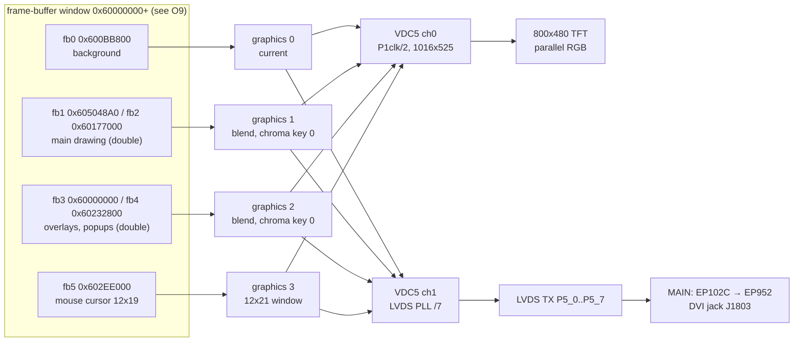
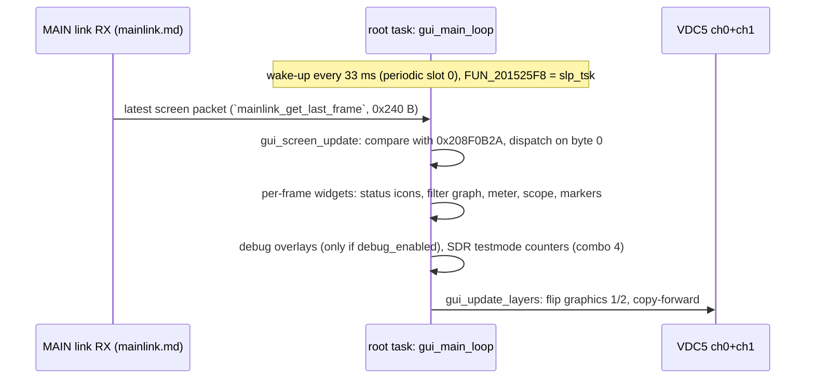
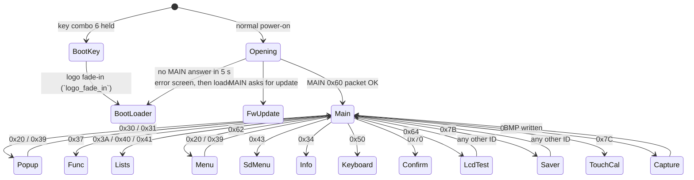
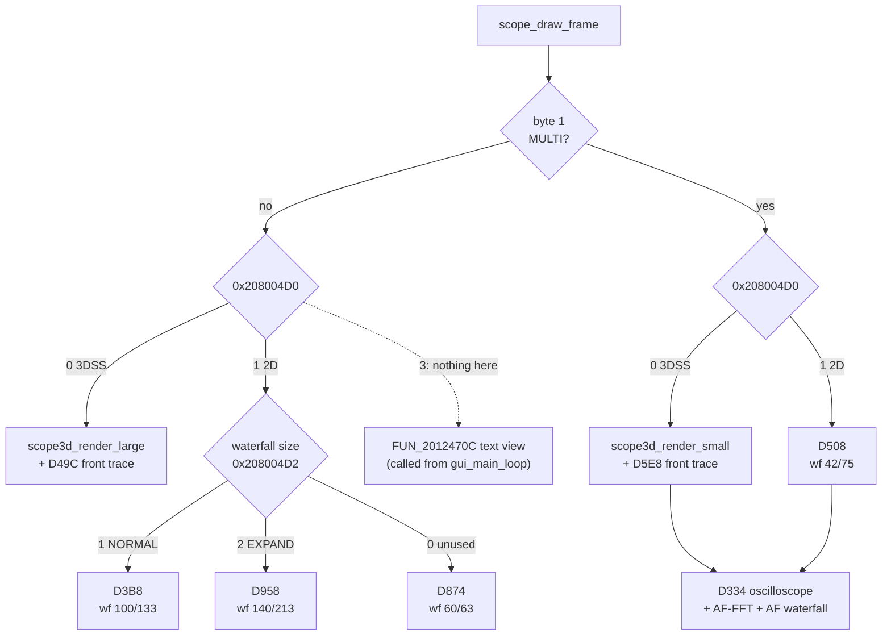
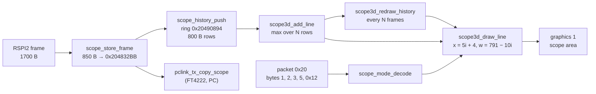

# DISPLAY: GUI, VDC5 and LCD/DVI output (T11e)

Back to the [DISPLAY overview](README.md). Addresses are CPU addresses (image base 0x20100000). Function names are the names applied in Ghidra (`tools/ghidra/names_display.tsv`, merged by T17) and match `decomp/display/`; a name still in *italics* is a description that was not applied as a Ghidra name. Function bodies are in `decomp/display/` (look them up in `functions.tsv`). Asset lister: `tools/display_assets.py`.

## Summary

- The GUI is a **thin renderer**. The MAIN CPU owns the radio state and the screen logic. It sends "screen packets" over the UART link; byte 0 is the
  screen ID and the rest is the content (text, values, cursor positions). The DISPLAY compares each new packet with the previous one and redraws what
  changed **[fact: `gui_screen_update`]**. Most menu and list text therefore lives in the MAIN firmware, not here **[inference]**.
- **VDC5 channel 0** drives the 800×480 parallel-RGB TFT; **VDC5 channel 1** drives the **LVDS** transmitter, which feeds the DVI chain on the MAIN
  board (EP102C → EP952). Both channels read the **same frame buffers**, so the DVI jack mirrors the panel at 800×480 or 800×600 **[fact for the
  register set-up, inference for "mirror"]**.
- Four graphics layers (VDC5 graphics 0–3, RGB565, 800×480): a static background, two double-buffered drawing layers with black as the chroma key,
  and a 12×21 mouse-cursor layer **[fact]**.
- Graphics are **run-length "run sprites"** in `.rodata` (2240 of them, about 2 MB of RGB565 pixels). Fonts are tables of pre-coloured run sprites
  indexed through one character map **[fact]**.
- The GUI runs in the `root` task: `gui_start` sets up VDC5, then `gui_main_loop` draws one frame per 33 ms wake-up and never
  returns **[fact]**.
- Hidden / service screens found: an **LCD test-pattern screen** (packet 0x64), **key combinations at power-on** (combo 6 → boot-loader / firmware
  update screen, combo 4 → SDR SPI "testmode" counters), the **debug overlays** on F1–F12 of a USB keyboard (only after the debug unlock), and
  the `test_disp` task that **replays MAIN packets from `I:\FT-710\DEBUG_RECV_CMD\SEND_CMD.TXT`** (also behind the debug unlock).

## Display pipeline



The layer stack is built twice, once per channel, from the same buffer addresses (`vdc5_layers_setup` is called with ch 0 and
ch 1, and every buffer flip calls `r_vdc5_change_read_process` for both channels) **[fact]**.

## VDC5 set-up

The firmware links the **Renesas RZ/A1H `r_vdc5` sample driver** (0x201179C0–0x2011D9xx). The API shape, the resource checks and the error
codes match it (9 = `ERR_RESOURCE_CLK`, 10 = `VSYNC`, 12 = `OUTPUT`, 13 = `LVDS_CLK`, 14 = `LAYER`); the parameter checks are compiled out
**[inference]**. The 45 small 80-byte functions at 0x20118548–0x20119370 are the driver's per-interrupt ISR stubs **[inference]**.

`gui_start` (0x20132CCC) runs, in order **[fact]**:

1. `FUN_201340A4`, `FUN_201342B4` (scope/waterfall objects, see [spi-links.md](spi-links.md)), `FUN_20120D38`, `FUN_20133620` (scope scale
   tables), `dmac8_m2m_init`, `sdr_dsp_link_init` (RSPI2/RSPI4 DMA set-up for scope data).
2. `vdc5_isr_create`: `itron_acre_isr` with descriptor 0x203A706C → GIC ID **78** (VDC5 ch0 GR3_VLINE), handler 0x20118638.
3. **Channel 0** (TFT): `r_vdc5_initialize`(0, {icksel = 4 = peripheral clock, dcdr = 1 = ÷2, no LVDS}, `vdc5_module_start`) →
   `vdc5_sync_setup`(0) → `vdc5_output_setup`(0) → `vdc5_vline_int_setup`(0).
4. **Channel 1** (LVDS/DVI): `r_vdc5_initialize`(1, {icksel = 6 = LVDS PLL ÷7, dcdr = 0, lvds = `lvds_pll_cfg`(1, 0)}) → sync and output set-up
   for 800×480 → `gpio_dvr`(0, 1) → `vdc5_layers_setup` for ch 0 and ch 1.
5. `gui_main_loop`, then `vdc5_channel_shutdown` for both channels if the loop ever returned.

### Timings

| | ch0 TFT | ch1 DVI, 800×480 | ch1 DVI, 800×600 |
|---|---|---|---|
| Active | 800×480 | 800×480 | 800×600 |
| Total (res_fh+1 × res_fv+1) | 1016 × 525 | 1088 × 517 | 1056 × 628 (VESA SVGA) |
| Window start (hs, vs) | 88, 32 | 224, 31 | 216, 27 |
| Dot clock | P1φ ÷ 2 | 27 MHz × 176 / 5 / 4 / 7 = 33.9 MHz | 27 MHz × 208 / 5 / 4 / 7 = 40.1 MHz |
| Frame rate | ≈62 Hz if P1φ = 66.7 MHz | 60.3 Hz | 60.5 Hz |

Totals and windows are from `vdc5_sync_setup` and `vdc5_layers_setup` **[fact]**. The LVDS PLL fields are from `lvds_pll_cfg`
(`lvds_pll_cfg`): input = video clock (27 MHz crystal X6002), IDIV 1, FD 175 or 207, RD 4, OD 2, output to VDC5 ch1 **[fact for the values]**.
The clock formula and P1φ = 66.7 MHz are **[inference]**; that both DVI modes come out at 60 Hz supports the formula.

`dvi_set_resolution` (`dvi_set_resolution`, caller `gui_apply_display_cfg`) stops ch1, re-runs the ch1 initialise/sync/output/layer set-up with the other
timing, and drives **P5_8** through `gpio_dvr` (`gpio_dvr`, PSR5 0xFCFE3114): 1 for 800×480, 0 for 800×600. P5_8 is probably a mode line
to the DVI-side controller (EPF021M) **[inference]**.

### Layers

`vdc5_layers_setup` calls `r_vdc5_read_data_control`, `r_vdc5_chromakey` and `layer_alpha_rect_reapply` for layer IDs 3–6 (= graphics 0–3, driver enum
`VDC5_LAYER_ID_0_RD`…`3_RD`; `vdc5_layer_to_gr` maps 3..8 → 0..5) **[fact]**:

| Graphics | Buffer(s) | Display mode | Use |
|---|---|---|---|
| 0 | fb0 0x600BB800 | current (2) | static background: meter scale, scope frame (`meter_draw_scale`, `gui_screen_update`) |
| 1 | fb1 / fb2, index in 0x208085B8 | blend (3), chroma key 0x0000 | main screen content, drawn every frame |
| 2 | fb3 / fb4, index in 0x208085BC | blend (3), chroma key 0x0000 | popups, menus, lists, overlays |
| 3 | fb5 0x602EE000, window 12×21 at (400, 240) | blend, started on demand | mouse cursor (`fb_blit_raw`(fb5, 0, 0, 0x2016E860, 12, 19)` in the main loop) |

Read set-up per layer: RGB565, line offset 0x640 (800 × 2 B), 32/16-bit swap 6, window = active area **[fact for the values, inference for the
enum meaning]**. Black (0x0000) is the chroma key, so drawing 0 makes a layer transparent; `fb_clear_rect` really **clears** a rectangle to 0
(`fb_clear_rect`) **[fact]**.

`fb_get_layer_addr` (0x201326FC) maps the buffer *index* 0–5 to {0x600BB800, 0x605048A0, 0x60177000, 0x60000000, 0x60232800, 0x602EE000};
`fb_get_front_addr` returns the buffer that is on screen for a given back index (1↔2, 3↔4) **[fact]**.
These buffers cannot sit in a plain mirror of 0x20000000: `fb_clear_all` zeroes 0x60000000–0x602FF2FF while the code runs from 0x20100000+, and the
MMU map is flat. What memory 0x60000000 really is stays open ([system.md O9](../system.md#8-contradictions-and-open-questions), T19h).

**Buffer flip** (`gui_update_layers` 0x20133A8C, 57 callers): point graphics 1 and 2 of both channels at the current back buffers, swap the
indices, then copy the buffer just shown into the new back buffer (graphics 1 by `dmac8_m2m_start` = DMAC ch0 memory copy, graphics 2 by `memcpy`),
so drawing is always incremental **[fact]**. `gui_flip_one` flips only one layer and brackets the screen capture.

Alpha windows and fades use `r_vdc5_alpha_blending_rect` through `layer_alpha_rect_set` (`layer_alpha_rect_set`, state cached at 0x209080E4
[ch][layer], 0x24 B each). `layer_fade` ramps a layer by ±5 per frame (screen saver, logo fade-in) **[fact]**.

The VLINE interrupt callback `vdc5_vline_cb` counts frames in 0x208085A4 and decrements 0x2080859C; `vdc5_wait_frames`
(`vdc5_wait_frames`) waits on it **[fact]**.

LCD contrast: packet 0x24 byte 5 (0–20) becomes VDC5 ch0 `r_vdc5_display_calibration` contrast values (10·n + 0x1C, 10·n + 0x11) **[fact for the
call, inference that it is the CONTRAST setting]**. DVI on/off: packet 0x24 byte 0 bit 0 switches P5_0–P5_7 between the LVDS function and GPIO
(`lvds_pins_enable`, `lvds_pins_enable`) **[fact for the pins, inference for the meaning]**. Backlight dimmer: packet 0x21 → `led_set_one`
(table of 9 levels, `gpio_cfg_out_low`(6, …)`), see [peripherals.md](peripherals.md) **[inference]**.

## Frame loop



Per frame, `gui_main_loop` calls `gui_screen_update` (screen update), then `FUN_2012470C` / `FUN_20124528` + `FUN_201244D8` (RX/TX markers),
`FUN_201233D4` or `main_filter_graph` (filter graph), `main_status_icons` (status icons), `meter_draw` (meter), `mainlink_send_rtc`, `mainlink_send_sd_state`,
`FUN_201217B0`, `FUN_201218A4` or `scr_screen_saver` (screen saver), `FUN_20131638`, `pclink_stats_print`, `debug_overlay_draw` (debug overlay) and
`gui_update_layers` **[fact]**. Before the loop it handles the power-on cases (next section).

## Screen state machine



Every arrow out of `Main` is "MAIN sends a packet whose byte 0 is this ID"; the DISPLAY never changes screen on its own except for the power-on
cases, the capture and the boot-loader path **[fact for the dispatch, inference for the arrows back, which depend on MAIN]**.

### Screen packets (byte 0 of the MAIN → DISPLAY packet)

Lengths are from the 26-entry {u16 id, u16 length} table at 0x2080893C (`.data2`; the first 15 entries equal the MAIN-link table at 0x20450074,
see [mainlink.md](mainlink.md)). Identification is from the handler code and from rendering the sprites each handler uses **[inference]** unless
marked.

| ID | Len | Handler | Screen |
|---|---|---|---|
| 0x20 ` ` | 0x97 | `scr_main_layout`, `audio_error_check` | main operating screen (scope/3DSS, mode, filter, status) |
| 0x21 `!` | 3 | `led_set_one` | backlight / dimmer level (no redraw) |
| 0x23 `#` | 0x35 | `FUN_20131354` | TX text line (bytes 4…) of the scope-area text view, see [Scope drawing](#scope-drawing-83) **[fact for the buffer, inference for the use]** |
| 0x24 `$` | 0x9D | `gui_apply_display_cfg`, `backlight_set`, `dimmer_set`, `gpio_ft4222_reset` | display settings: DVI on/off and 800×480/800×600, contrast; byte 0 bit 2 drives P2_7 (`FT4222_RESET`) **[fact for the pins]** |
| 0x30 `0` | 0x9E | `scr_select_popup` | METER / MODE selection popups (PO, COMP, ALC, VDD, ID, SWR; LSB … DATA-L) |
| 0x31 `1` | 0xA1 | `scr_value_popup` | big value popup: one of 45 setting names (LEVEL, CONTRAST, MIC GAIN, RF POWER, …, LOCK, TUNE, SCREEN SHOT) + value; tables at 0x208026DC–0x20802CE4 |
| 0x34 `4` | — | `scr_info` | information screen with `CERTIFICATIONS` and `FCC ID : K6620801X50` **[fact for the strings]** |
| 0x37 `7` | 0x23E | `scr_func_panel` | FUNC panel: CONTRAST, DIMMER, M-GROUP, MIC GAIN/EQ, PROC/AMC LEVEL, VOX, RF POWER, MONI, KEYER, BK-IN, CW SPEED/PITCH, AESS, MESSAGE, RECORD, PLAY |
| 0x39 `9` | 0xE7 | `scr_vfo`, `vfo_audio_status_draw` | frequency display (large green/white/red digit sprites) |
| 0x3A `:` | 0xA0 | `scr_playlist` | PLAY LIST / voice messages (`%02d:%02d:%02d`, RX LEVEL, DELETE) |
| 0x3F `?` | 3 | `rec_start_stop` | start/stop recording to SD, file name `20YYMMDD_HHMMSS` (no screen) |
| 0x40 `@` | 0x1F9 | `scr_text_list` | text list with LF/CR glyphs, DONE/BACK (30-char rows) **[guess: RTTY/PSK text memories or decode]** |
| 0x41 `A` | 0x144 | `scr_memory_list` | MEMORY CH LIST (NAME, MODE, SCAN, TYPE, ERASE, RESTORE) |
| 0x43 `C` | 0x21 | `scr_sd_menu` | SD card: MEM LIST LOAD/SAVE, MENU LOAD/SAVE, INFORMATIONS, FORMAT, `FREE SPACE`/`CAPACITY` (shares code with [update.md](update.md)) |
| 0x50 `P` | 0xF3 | `scr_keyboard` | on-screen keyboard (Caps, Space, ENT, ←/→, ABC, #%^, End) |
| 0x60 `` ` `` | 0xB4 | `opening_check_main` (opening only) | power-on status from MAIN; also carries an error code |
| 0x62 `b` | 0x195 | `scr_setup_menu` | MENU list: 8 rows × {5, 20, 3} chars at +0x9A, cursor row at +0x98 |
| 0x64 `d` | 1 | `scr_lcd_test` | **LCD test pattern** (hidden): byte 1 = 0 black, 1 white, 2 red, 3 green, 4 blue, 5 eight colour bars (white, yellow, cyan, green, magenta, red, blue, black); hides the cursor layer **[fact]** |
| 0x65 `e` | 7 | `rtc_set_from_main` | set the RTC from MAIN (BCD YY MM DD hh mm, clamped) **[fact]** |
| 0x70 `p` | 0xE1 | `scr_confirm` | OK / CANCEL dialog |
| 0x7A `z` | 3 | `screen_capture_bmp` | screen capture (below) |
| 0x7B `{` | 3 | `scr_screen_saver` | screen saver: graphics 0/1/3 hidden, YAESU logo (486×56) moves between 3 places every 180 frames and fades out after 91 |
| 0x7C `\|` | 3 | `touch_calibration` | `TOUCH THE CROSS` calibration ([input.md](input.md)) |
| 0x42, 0x44, 0x45, 0x71 | | not in the GUI dispatcher | handled by the MAIN-link RX side ([mainlink.md](mainlink.md)) |

The dispatcher keeps the previous packet at 0x208F0B2A (0x240 B) and the previous ID in 0x2080049E. Flags at 0x208F4630–0x208F463C select
overlay modes (scope expanded, popup open) **[fact for the variables, inference for their meaning]**.

### Power-on and boot-loader path (in `gui_main_loop`)

- **Key combination 6** held at power-on (`key_scan_first() == 6`, the same check that forces the full start in [boot-rtos.md](boot-rtos.md)):
  `logo_fade_in` fades the YAESU logo in, then `FUN_201322E4` → `FUN_20159058`: it shows the boot-loader screen if the boot-info status is 2, else
  `FIRMWARE BOOT ERROR` forever **[fact]**. Combination 6 is key codes {0x304, 0x30A, 0x30E} all held (table 0x20165678, 3 codes per combo) **[fact]**.
- **Normal**: `opening_screen` fades the logo in on graphics 1 and waits up to about 5 s (`4999 < n·33`) for MAIN's 0x60 packet;
  if MAIN asks for an update it calls `fwupdate_screen`. On a timeout it calls `fwupdate_insert_sd_screen_thunk` 0x201322AC → `fwupdate_insert_sd_screen` 0x2015AFB0, which shows `INSERT FIRMWARE SD CARD.` /
  `TOUCH THE SCREEN TO CONTINUE.` / `ERROR CODE : %03d` and then the boot-loader screen **[fact]**. The update screens belong to [update.md](update.md).
- **Key combination 4** ({0x30C, 0x305}) held at power-on: each frame calls `pclink_set_testmode`(1)` (`pclink_set_testmode`), and `pclink_stats_print`
  draws a box with `testmode`, `CS_POLL`, `MOSI_OK/NG`, `FRAMES`, `MISO_OK/NG` and `msec` at (y 0x104, x 600). The box is red (0xC800) when any
  counter shows a fault **[fact]**. This is a service screen that needs **no** debug unlock. Which front-panel keys the codes are is in
  [input.md](input.md).

## Screen layout (`.data2` coordinate words, #83)

Widget positions are not immediates in the drawing code: each screen handler reads its origins and sizes from initialised **u16 words in
`.data2`**, one variable per number (0x208004A4–0x20800660), plus per-slot arrays for the value popup (0x208026DC–0x20802D00)
**[fact]**. `tools/display_layout.py` joins the initial values (LZ-unpacked image) with the role each word plays in the decompiled draw calls
(`gui_draw_runs(fb, y, x, …)`, `fb_fill_rect(fb, colour, y, x, w, h)`, …) and prints one line per word:

```sh
python3 -I tools/display_layout.py build/FT-710_DISPLAY_V0108.bin            # both ranges, ~1000 lines, reads decomp/display/
```

The roles are **[fact: argument position in the call]**; the screen names come from the packet table above. All values are pixels on the 800 × 480
panel, origin top left, as in the drawing primitives. Main results:

| Screen (handler) | Words | Layout **[fact: values and roles]** |
|---|---|---|
| Main screen status row (`main_status_icons`) | 0x208004A8–0x208004BE, 0x2080065C/5E | 12 icon slots at x = 2, 58, 125, 175, 230, 285, 314, 357, 512, 592, 662, 718; one more widget at (x 282, y 64) |
| Main screen parts (`scr_main_layout` → `FUN_2012D8BC`, `FUN_2012E27C`) | 0x208004C0, 0x20800508–0x2080051A | y 113 for one strip; two groups at (x 59, y 93) and (x 231, y 93) with a 4 × 8 cell box repeated every 6 px (+8, +6 offsets): a bar-graph style widget **[inference]** |
| Frequency display (`scr_vfo` → `FUN_20129CF0`) | 0x2080051C–0x2080052E | fields at (x 398, y 86), (x 544, y 73) and (x 650, y 86); text pitch 21; one 142-px wide clear |
| FUNC panel (`scr_func_panel`, 0x37) | 0x20800530–0x20800542 | origin (x 59, y 17) added to the per-cell table at 0x208019D6; cells offset (x 2, y 29) and (x 2, y 17) with a 5 / 55 px grid |
| Setup menu (`scr_setup_menu`, 0x62) | 0x208004A4–0x208004A6, 0x208004DC–0x208004F2 | 8 rows at y = 173 + row · **35**; columns at x = 9 (number), 24, 144, 489; the cursor line at x 4, y 200 + row · 35, 792 × 1; list height 161 |
| Selection popup (`scr_select_popup`, 0x30) | 0x208004C2–0x208004C4, 0x208004F8–0x20800506, 0x20800658/5A | box origin (x 137 + 0xDA, y 8 + 0xA1), item cells 349 × 23; items placed from the per-item tables 0x2016D358 / 0x2016DFFC / 0x2016E01A / 0x2016E038 / 0x2016DD44 / 0x2016ED68 plus (x 10, y 14) |
| On-screen keyboard (`scr_keyboard`, 0x50; keys `keyboard_draw_keys`) | 0x20800544–0x2080058A | whole layer 800 × 454 at (0, 26); key grid from (x 25, y 45) with 15-px text pitch; input line (x 7, y 34) 786 × 42; caret 2 × 24; three buttons at y 2 (x 80, 400, 635); key labels at x 20, 9, 15, 10, 17, 7, 75, 39 + row/column table |
| Memory list (`scr_memory_list`, 0x41) | 0x2080058C–0x208005C2 | list area (1, 184) 798 × 296; row bar (4, 187) 792 × 22; scroll arrows at x 665 and 739, y 190; five columns at x 5, 28, 112, 271, 385 (row y from the table 0x2016DB9A); side buttons at x 8 + 0x244 / 0x2B4, y 22 + 0xD3 / 0x15D / 0x1A2 |
| Text list (`scr_text_list`, 0x40; `text_list_draw` → `FUN_20128E94`, `FUN_201281C0`, `FUN_20128860`, `FUN_20128D00`, row helpers `FUN_201283FC` / `FUN_20128564` / `FUN_20128704`) | 0x208005C4–0x2080064E | title centred at x 400, y 4; left pane (2, 28) 260 × 452, right pane (280, 28) 518 × 450; rows every **75** px (0x2080064E) from y 36 / 56 / 103; `BACK` / `DONE` buttons at (698, 31), (733, 55), (698, 416), (733, 438) |
| Information screen (`scr_info`, 0x34) | 0x208005F0–0x20800606 (shared with the text list) | same button positions; text block (700, 96) 94 × 315 **[inference: last four words are not in a draw call]** |
| Confirm dialog (`scr_confirm` → `confirm_dialog_draw`, also `update_error_screen`) | 0x20800650, 0x20800654 | dialog anchored at x 258 / 770 **[inference]** |
| Opening screen (`opening_screen`, `logo_fade_in`) | 0x208004D4–0x208004DA | logo at (x 157, y 213); status text centred at x 400, y 351 |

**Value popup slots** (0x31, `scr_value_popup`; 65 slots, arrays of {x, y} or pointers indexed by slot) **[fact: values]**:

| Array | Contents |
|---|---|
| 0x208026DC | popup position: (x 154, y 184) for most slots; (154, 90) for slots 38, 39, 55; (280, 184) for 37, 41–43 |
| 0x208027E0 / 0x208028E4 | title offset (10, 30) and value offset (20, 26) inside the box; the text-only slots use (50, 26), (16, 26), (58, 26) |
| 0x208029E8 | title sprite (28 px high, 91–263 px wide) for slots 0, 1, 4–15, 17–21, 26–28, 34–36, 38–40, 55, 58; 0 for the others, slot 64 included |
| 0x20802BF0 | u8 title-text length: 3, 4, 6, 4, 11 for slots 37, 41–44, else 0 |
| 0x20802AEC | title **text** for slots without a sprite: 37 (`QMB`), 41 `LOCK`, 42 `UNLOCK`, 43 `TUNE`, 44 `SCREEN SHOT` |
| 0x20802C34 | box sprite: 0x2016E248 (492 × 88) or 0x202D0468 (240 × 88, the short popups 37, 41–43) |

So the popup box is 492 × 88 at (154, 184), centred horizontally (154 + 246 = 400), or 240 × 88 at (280, 184) **[inference]**. Slots 2, 3, 16, 22–25,
29–33 and 45–63 except 55 and 58 are empty in V01-08 **[fact]**.

**Which slot is which setting (#178).** The slot is byte **0x98** of packet 0x31 (`scr_value_popup` 0x2012ADE0 reads `pkt[0x98]`), and the
value text is the 9 characters at 0x99 **[fact]**. MAIN fills it in `displink_build_31` (0xFFF99297) as `frame[0x98] = popup_id − 0x1E`.
`popup_id` is the UI byte +0x1C2 (0x20CC6). `displink_tx_30_31` (0xFFF98ECB) sends 0x30 for ids < 0x1E (or 0xFF) and 0x31 for ids 0x1E–0x5E, so
the 65 slots are exactly ids 0x1E–0x5E **[fact]**. The setting comes from the MAIN code that stores the id, and from the formatter that
`displink_build_31` picks for that id:

| Slot | id | Stored by (MAIN) | Value text (formatter) | Setting | Title (DISPLAY, rendered) |
|---|---|---|---|---|---|
| 0 | 0x1E | FUNC-knob step `FUN_fffc6ffe` → `FUN_fffc7016` (0..120) | `FUN_fff99475` (`….0dB`) | **SCOPE LEVEL** **[inference: −30…+30 dB in 0.5 dB steps, as in `SS` sel 4]** | LEVEL |
| 1 | 0x1F | `FUN_fffc7053` (0x9BE6, 0..4) | `FUN_fff9959f` | **PEAK** (`SS` sel 1) **[fact: variable]** | PEAK |
| 4 | 0x22 | `FUN_fffc70db` (0x9BE9, 0..20) | `FUN_fff99e15` | **CONTRAST** **[inference: `DA` byte, FUNC order of `SF`]** | CONTRAST |
| 5 | 0x23 | `FUN_fffc7145` (0x9BEA, 0..20) | `FUN_fff9a00f` | **DIMMER** **[inference, as above]** | DIMMER |
| 6 | 0x24 | `FUN_fffc71af` (steps the memory channel, `eeprom_save_memch`) | `FUN_fff99abf` | **M-GROUP** **[inference]** | M-GROUP |
| 7 | 0x25 | `FUN_fffc74ee`, `cat_MG` | `FUN_fff99837` | **MIC GAIN** **[fact]** | MIC GAIN |
| 8 | 0x26 | `FUN_fffc754b` (0x9BF0 on/off) | `FUN_fff99ddb` (OFF/ON) | **MIC EQ** on/off: 0x9BF0 is the parametric EQ flag (`PR1`, #157), not the processor **[fact: title and variable]** | MIC EQ |
| 9 | 0x27 | `FUN_fffc75bc`, `cat_PL` | `FUN_fff997df` | **PROC LEVEL** (0x9BF1) **[fact]** | PROC LEVEL |
| 10 | 0x28 | `FUN_fffc7619`, `cat_AO` | `FUN_fff99a8a` | **AMC LEVEL** (0x9BF2) **[fact]** | AMC LEVEL |
| 11 | 0x29 | `FUN_fffc7674`, `cat_VG` | `FUN_fff996e2` | **VOX GAIN** (0x9BF3) **[fact]** | VOX GAIN |
| 12 | 0x2A | `FUN_fffc76d1`, `cat_VD` | `FUN_fff99717` | **VOX DELAY** (0x9BF4) **[fact]** | VOX DELAY |
| 13 | 0x2B | `FUN_fffc774c`, `cat_AV` | `FUN_fff9978c` | **ANTI VOX** (0x9BF6) **[fact]** | ANTI VOX |
| 14 | 0x2C | `FUN_fffc77c7`, `cat_PC` | `FUN_fff995cc` | **RF POWER** **[fact]** | RF POWER |
| 15 | 0x2D | `FUN_fffc790b`, `cat_ML` | `FUN_fff9960e` | **MONI LEVEL** **[fact]** | MONI LEVEL |
| 17 | 0x2F | `FUN_fffc79b8` (BI bit of the TX VFO's per-mode block) | `FUN_fff99d82` (OFF/ON) | **BK-IN** on/off **[fact: variable, see [radio-control.md](../main/radio-control.md)]** | BK-IN |
| 18 | 0x30 | `FUN_fffc7a8f`, `cat_KS` | `FUN_fff998e2` | **CW SPEED** (0x9C03, 4..60) **[fact]** | CW SPEED |
| 19 | 0x31 | `FUN_fffc7aea`, `cat_KP` | `FUN_fff9992a` | **CW PITCH** (0x9C04) **[fact]** | CW PITCH |
| 20 | 0x32 | `FUN_fffc7b47`, `cat_SD` | `FUN_fff99989` | **BK-DELAY** (0x9C05) **[fact]** | BK-DELAY |
| 21 | 0x33 | `FUN_fffc7ba4` (0..20), `cat_AS` P1 = 1 | `FUN_fff999e3` | **AESS** level **[fact]** | AESS |
| 26 | 0x38 | `cat_NL`, `key_nb_long` | `FUN_fff99b70` | **NB LEVEL** **[fact]** | NB LEVEL |
| 27 | 0x39 | `cat_RL`, `key_dnr_long` | `FUN_fff99ba5` | **DNR LEVEL** **[fact]** | DNR LEVEL |
| 28 | 0x3A | none in V01-12 | `FUN_fff99d42` (empty) | **DEC LVL**: the level of the DISPLAY's RTTY/PSK text decoder (`decode_text_rx`, third scope view) **[fact: title; inference: meaning]** | DEC LVL |
| 34 | 0x40 | none in V01-12 | none | **RX LEVEL**: SD-card playback volume of the PLAY screen (manual: touch RX LEVEL, turn FUNC) **[fact: title; inference: meaning]** | RX LEVEL |
| 35 | 0x41 | none in V01-12 | none | **TX LEVEL**: output level of the voice message memory (MESSAGE screen) **[fact: title; inference: meaning]** | TX LEVEL |
| 36 | 0x42 | none in V01-12 | none | **S.SPEED**: scope sweep speed (manual: touching the scope sets "level and sweep speed", next to slot 0 LEVEL). The only title drawn in white, all others are orange **[fact: title and colour; inference: meaning]** | S.SPEED |
| 37 | 0x43 | `FUN_fffc33ef` | `FUN_fff99bfe` (channel number from 0x901F / 0x9021) | **QMB** (DISPLAY title text `QMB`) **[fact]** | text `QMB` |
| 38 | 0x44 | `FUN_fffc224e` (memory-list button 2) | `FUN_fff99ca2`: `SCAN` / `SKIP` (memory byte +1 bit 7) | memory **SCAN** **[fact]** | SCAN MEMORY |
| 39 | 0x45 | `FUN_fffc2296` (memory-list button 3) | `FUN_fff99cf2`: `FREQ` / `NAME` (memory byte +5 bit 7) | memory **TYPE** **[fact]** | DISPLAY TYPE |
| 40 | 0x46 | `FUN_fffc7975` (0x9C02 on/off) | `FUN_fff99d48` (OFF/ON) | **KEYER** on/off **[fact]** | KEYER |
| 41 / 42 | 0x47 / 0x48 | `cat_LK`, `key_lock_pwr_short`, `enc3_step`, `key_event_filter` | none | **LOCK** / **UNLOCK** (DISPLAY title text) **[fact]** | text `LOCK` / `UNLOCK` |
| 43 | 0x49 | `FUN_fffec493` (saves the meter 0x9C5B and sets it to 5 = SWR) | none | **TUNE** (tuner start) **[fact]** | text `TUNE` |
| 44 | (0x4A) | never stored by MAIN | | **SCREEN SHOT**, drawn by the DISPLAY itself (`screenshot_popup` 0x2013059C reads the slot-44 entries 0x2080278C / 0x20802CE4) **[fact]** | text `SCREEN SHOT` |
| 55 | 0x55 | `FUN_fffc21e8` (memory-list button 1) | `FUN_fff99c58`: mode name from ROM 0xFFF803F4 | memory **MODE** **[fact]** | MODE |
| 58 | 0x58 | FUNC code `:` → `FUN_fffc7bfd` (0..1), `cat_AS` P1 = 2 | `FUN_fff99a29` | **AESS-CF** (700 / 1000 Hz) **[fact]** | AESS-CF |
| 64 | 0x5E | `FUN_fffc4cc5`, `FUN_fffc89ef`, `FUN_fffc8a90`, `FUN_fffe56e4` | `FUN_fff9a044`: 9 characters from UI +0x427 | **free-text popup**: the DISPLAY has no title (sprite 0, text 0, length 0) but a full entry otherwise: big box 0x2016E248 at (154, 184), title offset (10, 30), value offset (20, 26), so it shows only the 9-character text **[fact: entries; inference: use]** | none (no sprite, no text) |

The memory-list buttons are 0 NAME (keyboard), 1 MODE, 2 SCAN, 3 TYPE, 4 `FUN_fffc22de`, 5 close (`FUN_fffc20dd`), which matches the labels of
the 0x41 screen **[fact for the dispatch, inference for the label order]**. That is why slots 38, 39 and 55 sit higher on the screen, at (154, 90), above the list.
`FUN_fffc8cbb(id)` is not a store: it returns the display time of popup *id* for POP-UP TIME (0x9B0E). It is also called with 0x56 / 0x57 by
`FUN_fffc6b34` / `FUN_fffc6b86`, which step the same SCAN / TYPE bits **[fact]**.

**Titles from the image (#178).** The "Title" column is the sprite 0x208029E8[slot] (or the text 0x20802AEC[slot]) rendered from the
decoded V01-08 image with `display_assets.Mem` **[fact]**. All 31 slots mapped from MAIN agree with their titles except slot 8: its title is
`MIC EQ` and its variable 0x9BF0 is the parametric-EQ flag, so the earlier "PROC on/off" was wrong (the processor is slot 9, PROC LEVEL
0x9BF1, where 0 shows OFF). Slots 20 and 21 are titled `BK-DELAY` and `AESS`. The FUNC panel labels agree: function id 8 there is `MIC EQ`
too ([display-link.md](../main/display-link.md#0x37-func-panel-0x240-bytes-display-scr_func_panel)) **[fact]**.
Slots **28** (`DEC LVL`) and **34–36** (`RX LEVEL`, `TX LEVEL`, `S.SPEED`) have titles, but MAIN V01-12 never sends them. No code stores
0x3A or 0x40–0x42 into UI +0x1C2 **[fact: grep of `decomp/main` for `[0x1c2] =`]**, and `displink_build_31` has no formatter for 0x40–0x42
and an empty one for 0x3A **[fact: 0xFFF99297]**. So they are popups that the DISPLAY GUI (shared with other Yaesu sets, or from earlier
firmware) still carries **[inference]**. Only a store through a computed pointer could still reach them, which a Ghidra xref on 0x20CC6
would show; this is not needed to name them. Slot 64 has no title at all (above).

## Scope drawing (#83)

The scope area of the main screen is drawn by `scope_draw_frame` (`FUN_20124528`, every GUI frame from `gui_main_loop`) from the **scope
record** 0x204832BB (850 B, [spi-links.md](spi-links.md#link-1-sdr-module-scope-data-rspi2)) and the **history ring** 0x20490894 **[fact]**.

**Mode bytes of packet 0x20** (`scope_area_setup` `FUN_2012D52C` → `scope_mode_decode` `FUN_2012D4A4`, redrawn only when bytes 1, 2 or byte 3
bits 0–2 change) **[fact: code]**:

| Field | Global | Meaning |
|---|---|---|
| byte 1 = 1 | 0x20800482 = 1 | small scope (the 3DSS uses 14 lines) plus the oscilloscope / AF-FFT panel (`FUN_2015D334`, below); otherwise large (29 lines). This is **MULTI** **[inference: the manual's MULTI key adds the oscilloscope and AF-FFT; MAIN sends 0x9C37]** |
| byte 2 (0–11) → `scope_mode_is_2d` (`FUN_2012D458`) | 0x208004D0 | 0 for values 0–2 = **3DSS**, 1 for 3–11 = **2D spectrum / waterfall** |
| byte 2 → `scope_mode_sub` (`FUN_2012D404`) | 0x208004D1 | 0 for {0, 3, 4, 5}, 1 for {1, 6, 7, 8}, 2 for {2, 9, 10, 11}: **CENTER / CURSOR / FIX** |
| byte 2 → `scope_mode_split` (`FUN_2012D3B8`) | 0x208004D2 | 0 for {3, 6, 9}, 2 for {5, 8, 11}, 1 otherwise; the small layout forces 1. This is the **waterfall size** (MAIN 0x9C38: 1 NORMAL, 2 EXPAND; 0 is never written) |
| byte 3 bit 2 | 0x208004D0 = 3 | a third view, the scope-area text terminal (below); `FUN_2012470C` returns early unless 0x208004D0 = 3 |
| byte 5 bit 5 | expanded | scope area starts at y 0x80 (128) and is 0x124 (292) high, else y 0xB4 (180) and 0xF0 (240) high for the 3DSS, y 0xC9 (201) and 0xDB (219) for 2D. MAIN sends the EXPAND flag 0x9C3D |
| byte 7 bit 7 | | resets the 3D engine object (`FUN_201342D0`(0)) |
| byte 0x10 bits 0–2 (clamped to 4) | | **PEAK** LV1–LV5 (MAIN 0x9BE6), passed to the two 3D objects 0x20470294 / 0x20474C68 by `FUN_20133DEC` |
| byte 0x12 bits 0–3 (clamped to 10) | 0x208084CC | **COLOR** 1–11 (MAIN 0x9BE8, `FUN_2012E3C8`): the 3D palette (`FUN_201342DC`) and the 2D spectrum fill colour (`FUN_2015D2A8`: 0xB5BF for 0, 1, 4; 0xFFFF for 2, 8; 0xFEF0 for 3, 10; 0xFDB6, 0xE71F, 0xFE1F, 0x6FED for 5, 6, 7, 9) |
| byte 0x12 bits 4–7 (clamped to 5) | 0x208085B0, 0x208084CE / D2 | **SPEED** SLOW1, SLOW2, FAST1, FAST2, FAST3, STOP (MAIN 0x9C5A; 0x50 for STOP). 3DSS: a new line every N GUI frames, N = {20, 17, 13, 9, 5, 0} from 0x203A70A8. 2D: `FUN_2015D1C4` (below) |

MAIN builds byte 2 in `FUN_fff96dde`: 3DSS (0x9C36 = 1) → 0x9C35 (0–2); waterfall → 3 + 3 · 0x9C35 + 0x9C38. During TX (UI +0x67) CURSOR and
FIX are sent as CENTER **[fact]**. That is the `SS` sel 6 coding: 0–2 3DSS CENTER / CURSOR / FIX, then W/F CENTER, CURSOR, FIX, each NORMAL (4, 7, A) or EXPAND (5, 8, B as
sent; the manual lists 3/6/9 as EXPAND, see [cat-commands-primary.md](../../cat-commands-primary.md#ss)) **[fact]**. The front-panel EXPAND key
flips 0x9C38 and 0x9C3D together, so in practice NORMAL comes with the normal area and EXPAND with the expanded area **[fact, MAIN]**. The
STOP value 5 is also what sets 0x20800498 (the frozen 0x2048360D copy), so "hold" = SPEED STOP **[fact: manual SPEED list and code]**.

**3DSS renderer** (`FUN_201335D8` → `scope3d_render_large` `FUN_2015B9CC`, mode 8; `FUN_201335F8` → `scope3d_render_small` `FUN_2015BB7C`,
mode 9) **[fact: code]**:

1. `scope_history_push` copies the 800 points of the record (+0x19) into the next 800-byte row of the ring 0x20490894, with 4 bytes of per-row
   marker info at 0x20494718 (count 0x20494714, capped at N).
2. `scope3d_add_line` (`FUN_20134328`) builds the newest 3D line in 0x2048A0F8 as the **per-point maximum of the last N rows** (peak hold
   over one history step) and copies the row markers (0x54 bytes per line: count + up to 20 entries).
3. Every N frames (`frame % N == 0`) `scope3d_redraw_history` (`FUN_20134318`) re-projects the older lines 29 … 2 (mode 8) or 14 … 2
   (mode 9) one step further back.
4. Line *i* is drawn by `scope3d_draw_line` (`FUN_2015BC6C`) at x = 5 · *i* + 4 with width **791 − 10 · *i*** (0x317 − 10 · *i*), so each older
   line is 10 px narrower and shifted 5 px right: the perspective of the 3DSS. The y of each line comes from the object's per-line table;
   the vertical scaling from `FUN_20134358` (tables at 0x20450278 for mode 8, 0x2045027C for mode 9).
5. The finished image (0xDE = 222 or 0x112 = 274 rows for mode 8, 0x68 = 104 or 0x9C = 156 rows for mode 9) is copied into graphics 1
   at the scope origin.

While the GUI freezes the scope (0x204832B8–BA, 0x208004A0) the record holds 0xFF and nothing is pushed **[fact]**. The 0x2048360D copy of the
record is used instead of the live one when packet byte 0x12 bits 4–7 = 5 (0x20800498), which is SPEED **STOP** **[fact]**.

**The other renderers (#178).** `scope_draw_frame` calls seven more renderers through thunks. Their bodies are all in the export, in
`decomp/display/2015c2d4_2015f1f0.c` **[fact]**. All draw into graphics 1 (`fb_get_layer_addr(0x208085B8)`) at x 4 with width 0x317 (791). `exp` is
byte 5 bit 5 (expanded area), and `range` is the {u16 x, u16 width} pair at 0x208007D4, which `FUN_201244D8` (the scope marker code, red 0xF800
marks; its body is at 0x20123EC4) clears and nothing sets (details after the 3DSS front trace below) **[fact]**:

| Renderer | Called when | Draws **[fact: code]** |
|---|---|---|
| `FUN_2015D49C` | large, 3DSS (after `scope3d_render_large`) | **3DSS front trace**: `FUN_2015D70C`, mode 8, height 0xBA (186) or 0xF0 (240) if `exp`, bottom at y 0x192 (402), colour stride 30 |
| `FUN_2015D5E8` | MULTI, 3DSS (after `scope3d_render_small`) | the same with mode 9, height 0x50 (80) or 0x90 (144), bottom at y 0x11C (284), stride 15 |
| `FUN_2015D3B8` | large, 2D, waterfall size 1 (NORMAL) | spectrum (layout index 0 / 3 if `exp`) above a **waterfall of 100 / 133 px**, bottom at y 402 |
| `FUN_2015D874` | large, 2D, size 0 (never sent) | index 1 / 4, waterfall 60 / 63 px |
| `FUN_2015D958` | large, 2D, size 2 (EXPAND) | index 2 / 5, waterfall 140 / 213 px |
| `FUN_2015D508` | MULTI, 2D | index 6 / 7, waterfall 42 / 75 px, bottom at y 284 |
| `FUN_2015D334` | MULTI, 3DSS or 2D | the **oscilloscope / AF-FFT panel** at y 0x145 (325): see below |

`scope_draw_frame` calls `thunk_FUN_2015D3B8()` without arguments in the decompile, but the target takes the same (exp, range) pair as its siblings. The arguments are presumably still in r0/r1 from the earlier code **[inference]**.

The 2D renderers share one body. With waterfall height *h* and spectrum height *s* = u16 table **0x203A1EE0**[index]:

**Spectrum height table 0x203A1EE0** (#178). The table is in the flash image, not in a scatter-loaded region, so it is read at file offset
0x2A1EE0 **[fact]**. Only the four 2D renderers reference it (literal-pool words at 0x2015D490, 0x2015D5DC, 0x2015D94C, 0x2015DA30; no other
word in the image holds 0x203A1EE0..0x203A1EF7) **[fact]**. The index is also the level-object mode passed to `FUN_2013437C`:

| Index | Renderer, layout | Spectrum *s* | Waterfall *h* | *s* + *h* | Spectrum top (bottom − *h* − *s* − 1) |
|---|---|---|---|---|---|
| 0 | `FUN_2015D3B8`, large, NORMAL | 100 | 100 | 200 | 201 |
| 1 | `FUN_2015D874`, large, size 0 | 140 | 60 | 200 | 201 |
| 2 | `FUN_2015D958`, large, EXPAND | 60 | 140 | 200 | 201 |
| 3 | `FUN_2015D3B8`, large, NORMAL, `exp` | 140 | 133 | 273 | 128 |
| 4 | `FUN_2015D874`, large, size 0, `exp` | 210 | 63 | 273 | 128 |
| 5 | `FUN_2015D958`, large, EXPAND, `exp` | 60 | 213 | 273 | 128 |
| 6 | `FUN_2015D508`, MULTI | 40 | 42 | 82 | 201 |
| 7 | `FUN_2015D508`, MULTI, `exp` | 80 | 75 | 155 | 128 |
| 8–11 | (not read through this table) | 186, 80, 240, 144 | | | |

**[fact: values from the image, *h* and bottoms (402 large, 284 MULTI) from the code]**. So the 2D area always starts at y 201, or at y 128
when expanded, in both layouts. The waterfall size only moves the split between spectrum and waterfall: NORMAL 100/100, size 0 140/60,
EXPAND 60/140 (expanded 140/133, 210/63, 60/213) **[fact: arithmetic]**. Entries 8–11 are the 3DSS heights of modes 8 (large 186, `exp` 240)
and 9 (MULTI 80, `exp` 144), which `FUN_2015D49C` / `FUN_2015D5E8` hard-code instead **[fact: values; inference: that they belong to modes 8, 9]**.

1. `FUN_2015DB80` draws the **spectrum** as a filled graph at y = bottom − *h* − *s* − 1. For each of the 791 columns, the level comes from
   `FUN_2013437C`(index) (the 3D object 0x2047963C, `FUN_20157C50`). Pixels up to the level get the COLOR fill 0x208084CC, the rest get 0 (black).
   The code has an "inside `range`" and an "outside" branch, but they are identical, so `range` has no visible effect in 2D.
2. `scope_history_push`(depth 0x208084D2) adds the record to the history ring. If the frame flag `0x208F463E[phase]` is set, `FUN_20134414`
   (`FUN_20157D3C` on the same object) adds a **waterfall row**. Then phase = (phase + 1) mod 0x208084CE, with `FUN_20156260` as the divmod
   helper.
3. `FUN_2015DA9C` draws the **waterfall** at y = bottom − *h*: a black line at y − 1, then *h* / 2 rows from the row ring, each drawn **twice**
   (2 px per row), plus one more if *h* is odd. Row *i* comes from `FUN_20134434`(i) = 0x2049476C + 0x20450280 · 0x33F40 + slot · 0x640, so
   there are two banks of 133 rows × 800 RGB565 pixels.

**Waterfall speed** (`FUN_2015D1C4`, from `FUN_2012C6C4` when byte 0x12 bits 4–7 change): SPEED 0–4 set the period 0x208084CE = 600, 450, 300,
150, 30 GUI frames and the history depth 0x208084D2 = 20, 15, 10, 5, 1. STOP falls to the last case (30 / 1). The flag table
0x208F463E[i] = (⌊100 · i / P⌋ > ⌊100 · (i − 1) / P⌋), so **exactly 100 waterfall rows are added per period** **[fact]**. At about 30 GUI frames
a second, that is 100 rows per 20 s (SLOW1) … 100 rows per second (FAST3) **[inference: frame time from the 33 ms count in `opening_screen`]**.

**3DSS front trace** (`FUN_2015D70C`): it takes the per-column levels for mode 8 / 9 from `FUN_2013437C` and two per-row colour ramps: one from the
same call, and one from `FUN_20134398`(mode), the objects 0x20474D04 / 0x20478550. It fills each column from its level down to the bottom with
the ramp, using the second ramp inside `range`. Nothing above the level is cleared, so it is painted over the 3D image **[fact]**. So it is the
newest, nearest line of the 3DSS drawn as a solid gradient trace **[inference]**.

**`range` (0x208007D4) is always zero in V01-08 (#178).** It is in `.data2`, and its initial value from the image is {0, 0} **[fact]**. The
only word in the whole image that holds 0x208007D4 is the literal-pool entry at 0x201244B4. Its one load (0x20124184, `ldr r1`) is followed by
`mov r0, #0; strh r0, [r1]; strh r0, [r1, #2]` **[fact: disassembly]**. That code is the body at **0x20123EC4**, which Ghidra has not made a
function of its own. `FUN_201244D8` is only a 0x4C-byte wrapper: it checks 0x20800482 / 0x208004D0 and tail-branches (`b 0x20123EC4`) with
r0 = 1 for MULTI or 0 for large, so the decompile shows the body under the wrapper's name **[fact]**. `scope_draw_frame` passes &range to the
renderers, and `scope3d_render_large` / `_small` only read it (they push it to the history only when x > 3) **[fact]**. No neighbouring word
(0x208007BC/C0, 0x208007A0–B8) is used as a base for it **[fact: literal search, the 0x208007BC pair is a sprite position]**. So no writer
stores a non-zero value, the "inside `range`" branches never run, and the second colour ramp is never used **[inference: only a pointer
computed at run time could still reach it]**. It looks like a passband/marker zone that this firmware leaves off **[guess]**.

**Oscilloscope / AF-FFT panel** (`FUN_2015D334`, MULTI only), fed by the IF DSP's 600-byte record 0x208DD73C
([spi-links.md](spi-links.md)) **[fact: code]**:

| Part | Function | Position | Content |
|---|---|---|---|
| oscilloscope | `FUN_2015D650` | (x 4, y 325), 391 × 79 | per column a {max, min} pair from the 400-byte half at 0x208DD804 (`FUN_20120DA4`), drawn as a vertical bar in 0x065F (cyan). This is a min/max waveform envelope **[inference]** |
| AF-FFT spectrum | `FUN_2015DC90` | (x 405, y 325), 391 × 39 | the 200 AF-FFT bins stretched to 391 columns (`FUN_20120D60`, height 0x27), filled in 0x529B |
| AF-FFT waterfall | `FUN_20120D90` + `FUN_2015DA3C` | (x 405, y 365), 391 × 39 | `FUN_20120D90` writes one colour-mapped row (0x208DD53C palette) into the ring 0x208DD99C (0x30E B per row). `FUN_2015DA3C` blits the 39 newest rows (`FUN_20120D98`), 1 px each |

So the panel's left half is the **oscilloscope** and its right half is the **AF-FFT** with its own waterfall. This matches the manual's MULTI
description and `SS` sel 7 (AF-FFT ATT, OSC level / time) **[inference]**.

**The third view** (0x208004D0 = 3, packet 0x20 byte 3 bit 2; `FUN_2012470C`, called every frame from `gui_main_loop`). It clears two rectangles (words
0x208084E8–0x208084FA) and draws **text lines in the scope area** **[fact]**. The text comes from two places:

- **RX line** 0x208F48C8 (length 0x208F489A, up to 39 characters; LF or the limit scrolls it into a 16-line history of 0x29-byte lines at
  0x208F48F1, newest at 0x208F4B58; line count 0x208F4899, capped at 16). It is filled by `FUN_20131154` from `task_uart4_rx` (0x20158930). That filter keeps only characters found in 47-entry character
  sets at 0x20801DE0–0x20801EFA, chosen by 0x208084D9 = packet byte 0x70 low nibble (1: two sets, 4: two other sets, else three), and
  turns the rest into spaces **[fact]**.
- **TX line** 0x208F489F (length 0x208F489B) from packet **0x23** (`FUN_20131354`, bytes 4…). It is drawn in two colours split at the send
  position 0x208F4BAB, which the send code advances one character at a time (`0x1D` + character) **[fact]**.

So this is a scope-area **decoder / keyboard-text terminal** (RTTY or PSK text, judging by the restricted character sets) **[inference]**. It
is dormant in this firmware pair: the SCIF4 link that `task_uart4_rx` reads is never started (`uart4_link_init` has no caller,
[mainlink.md](mainlink.md#10-the-unused-scif4-link-fact)). MAIN's byte-3 builder `FUN_fff96f3e` sets only bits 4–7, and the Japanese
operating manual describes no decoder screen. Ghidra reports one removed unreachable block at 0xFFF96F69, so a listing check of `FUN_fff96f3e` would confirm
that bit 2 is never sent **[fact for the code read; inference that the view is unreachable]**.

Its layout words (`.data2`, values from the image via `tools/display_layout.py … --range 208084E8 2080850C`) **[fact: values and uses]**:
RX area (x 4, y 212) 688 × 170 and TX area (4, 385) 688 × 30, both cleared each frame. `FUN_20131F74` works from (x − 3, y − 3) with a height of 170 + 30 + 3, so it spans both areas **[fact: operands; inference: a frame]**. RX text starts at
(10, 215) with a line pitch of 28 px (0x2080850A), so about 6 of the 16 history lines fit **[inference]**. The TX text is at (10, 388) with a
17-px character step (0x20808508). Four more words, (35, 23) and (94, 78) at 0x20808500–06, are offsets that `FUN_20131F74` combines with
0x20808518–0x2080851E **[fact]**; what they place is not traced. The popup slot 28 `DEC LVL` title (above) belongs to this decoder
**[inference]**.





## Drawing primitives

All take a frame-buffer pointer and **(y, x)** in that order; stride is 800 pixels **[fact]**.

| Address | Ghidra name | Purpose |
|---|---|---|
| 0x201355BC | `fb_clear_rect` | `fb_clear_rect`(fb, y, x, w, h): fill with 0 (transparent) |
| 0x20135658 | `fb_fill_rect` | (fb, color, y, x, w, h); color 0 → `fb_clear_rect` |
| 0x20135AA4 / 0x20135AD8 | `fb_fill_box` / `fb_fill_box_t` | `fb_fill_box` (fb, y, x, w, h, color) / same with w, h swapped |
| 0x20135534 | `fb_blit_raw` | `fb_blit_raw`(fb, y, x, src, w, h): raw RGB565 |
| 0x2013573C / 0x20136290 | `fb_draw_frame` / `fb_draw_round_frame` | rectangle outline / outline with cut corners |
| 0x201358D0 | `gui_draw_runs` | draw a run sprite at (y, x) (294 callers) |
| 0x201359BC | `gui_draw_runs32` | run sprite with u32 runs (`gui_draw_runs32`) |
| 0x20135B0C | `sprite_unpack` | `sprite_unpack` to a w×h buffer |
| 0x20135DD4 | `gui_draw_text` | `gui_draw_text`(fb, str, y, x, pitch, font) |
| 0x20135EC0 / 0x20135FF0 | `gui_draw_text_words` / `gui_draw_text_centered` | text with half-width spaces / centred on x |
| 0x20135B6C / 0x20135C14 / 0x20135CE8 | `gui_draw_hex` / `gui_draw_dec` / `gui_draw_hex_color` | hex / decimal / recoloured hex numbers in the 10×15 font |
| 0x201378B0 | `dmac8_m2m_start` | `dmac8_m2m_start`: DMAC ch0 (0xE8200400) memory copy |

There is no widget object model: each screen handler draws its own sprites and text at coordinates from `.data2` tables (for example the
popup tables 0x208026DC position, 0x20802C34 frame sprite, 0x208029E8 title sprite, 0x20802AEC/0x20802BF0 title text and length) **[fact]**.

## Asset formats

`tools/display_assets.py` lists them (`summary`, `sprites`, `tables`, `fonts`, `strings`, `--render ADDR` for an ASCII preview). It unpacks the
LZ-compressed RW regions in memory so tables in `.data2` resolve; it writes nothing. Run with `python3 -I tools/display_assets.py
build/FT-710_DISPLAY_V0108.bin summary`.

**Run sprite** (16-byte descriptor, drawn by `gui_draw_runs`) **[fact]**:

| Offset | Type | Field |
|---|---|---|
| 0 | u16 | width |
| 2 | u16 | height |
| 4 | u32 | number of runs |
| 8 | ptr | runs: {u16 start, u16 count}, start = y·width + x |
| 12 | ptr | pixels: Σcount RGB565 words, stored right after the runs (pixels = runs + 4·n) |

Pixels outside the runs are not written (transparent). A full rectangle is one run. Counts in V01-08: **2243 sprites** (2240 in `.rodata`, 3 in
`.data2`), 1,048,639 pixels = 2.0 MB of pixel data; 7 use the u32-run variant; 180 are single-run rectangles **[fact, tool output]**.
The T06 note "0x2016DD04 = {w, h, n, ptr[14]}" was a run sprite followed by more descriptors.

**Fonts** are tables of pointers to run sprites, one table per size *and* colour (glyphs are pre-coloured). A string is drawn with a fixed pitch
given by the caller; each byte maps through the 256-byte table at **0x2080173C**: `\n` → 0, `\r` → 1, space and unknown → 2, 0x21–0x7E →
char − 0x1E (except `` ` `` → 2), 0x7F → 99, 0x80 → 96, 0xFE → 97, 0xFF → 98 **[fact]**. Tables found (base = entry 0):

| Table | Glyph size | Glyphs | Use |
|---|---|---|---|
| 0x20800B1C | 15×24 | 95 | general UI text (45 call sites) |
| 0x20800CAC | 15×24 | 97, with LF/CR glyphs | menu and text-list rows |
| 0x20800E34 / 0x20800FB4 | 15×24 | 92 / 94 | other colours (0xFB4: `BACK` buttons) |
| 0x20803030 | 15×24 | 45 | partial set |
| 0x208012AC | 24×36 | 97, with LF/CR | large text |
| 0x208015BC | 38×42 | 93 | value popup text |
| 0x208031C0 | 12×19 | 94 | small text |
| 0x208038C0 / 0x20803A40 / 0x20803BC0 | 12×18 | 92 each | three colours; boot-loader and update screens |
| 0x20803730 | 10×15 | 93 | debug overlay and numbers |
| 0x2080099C / 0x20802394 | various / 26×32 | 12 / 16 | digit sets |

Other sprite tables: big frequency digits (`scr_vfo`), meter bar frames (187 × 280×46/280×80 at 0x20808644), popup titles
(0x208029E8), scope labels, 70 tables in all (`display_assets.py … tables`). **String tables** are few, because most text comes from MAIN:
USB keyboard layouts (0x20800134: JPN, US, UK, FRA(AZ), FRA(QW), DEU, …), popup titles (0x20802AEC), update-screen texts (0x20808538) and the
SD menu (0x20808600) **[fact]**. Single strings for the boot loader are at 0x20427ED4–0x204286A0 (memory-maps.md).

## Screen capture

Packet 0x7A → `screen_capture_bmp` (0x20134644): needs ≥ 0x119436 B free on `I:` (54 + 800·480·3), shows the `SCREEN SHOT` popup
(`screenshot_popup` 0x2013059C, popup slot 44), freezes graphics 1, creates `I:\FT-710\Capture` if needed and writes
`I:\FT-710\Capture\20YYMMDD_HHMMSS.bmp` from the RTC **[fact]**. `bmp_write_screen` writes the 54-byte header at 0x208085C4 and
480 rows bottom-up as 24-bit BGR; each row is graphics 0, overlaid by the **front** buffers of graphics 1 and 2 where the pixel is non-zero or
inside an opaque alpha window (`capture_merge_row`, `layer_alpha_rect_hit`). The cursor layer is not captured **[fact]**.

## Debug and test features

**Debug overlays (F-keys).** `keycode_line` is the `keycode` handler in debug chain 1 ([boot-rtos.md](boot-rtos.md#usb-keyboard-handler-chains)),
so it only runs after the (unreachable) debug unlock. HID usages 0x3A–0x45 (**F1–F12**) toggle bits 0–11 of **0x20808A84**; typed `date`,
`time`, `dsp `, `reset`, `wdr` and `sndc` are commands **[fact]**. GUI effects **[fact]**:

| Bit (key) | Effect |
|---|---|
| 0 (F1) | `debug_overlay_draw` read-out row: firmware `0108`, build word of the running bank (0x183E0010/0x183F0010/0x183C0010), `CPU` load, `M`, `S`, `D`, `t`, `n`, `b` (boot bank/state), `d`, `Ton`/`Toff`, `irq`, touch `x`/`y`, `p`; also the meter's raw value |
| 1 (F2) | dumps changes of two RX buffers (0x2045F260, 0x2045F4A0) on screen |
| 4 (F5) | copies a scope byte into two other slots of the scope line (`sdr_rx_done_cb`) |
| 5, 6 (F6, F7) | `F6`/`F7` markers; F6 also changes the graphics-1 flip to `memcpy` |
| 9 (F10) | on change, `debug_screenshot_root` saves a screenshot to `I:\20YYMMDD_HHMMSS.bmp` |
| 10 (F11) | `RF` marker; replaces the scope line with the test pattern at 0x203D9B14 (`scope_store_frame`) |

**`test_disp` task** (`test_disp_init` 0x20134E0C, `task_test_disp` 0x2013512C, pri 5). The task waits on its event flag. `sndc` (debug only)
toggles it through `test_disp_start` / `test_disp_stop`. When started, `debug_replay_send_cmd` (0x20134FDC; really `debug_replay_send_cmd`) opens
**`I:\FT-710\DEBUG_RECV_CMD\SEND_CMD.TXT`** and, per line, `debug_cmd_line_read` parses `NNN` (byte count), the bytes as hex pairs, and a 4-digit delay in
ms (default 1000). If the first byte is one of the 26 screen IDs (0x2080893C) it injects the packet with `mainlink_set_last_frame` as if MAIN had sent it,
then sleeps the delay. So the screens can be driven from an SD card without MAIN, once debug mode is on **[fact for the code, inference for the
purpose]**. The T06 name is misleading: the function reads `SEND_CMD.TXT`, it does not log `RECV_CMD.TXT`.

## Functions

| Address | Ghidra name | Purpose |
|---|---|---|
| 0x20132CCC | `gui_start` | VDC5 ch0/ch1 set-up, then the GUI loop |
| 0x20130188 | `gui_main_loop` | `gui_main_loop` |
| 0x2012EBB8 | `gui_screen_update` | `gui_screen_update`: packet compare and dispatch |
| 0x201179C0 / 0x20117B0C / 0x20117BA8 | `r_vdc5_initialize` / `r_vdc5_sync_control` / `r_vdc5_display_output` | `r_vdc5_initialize` / `r_vdc5_sync_control` / `r_vdc5_display_output` |
| 0x20117DEC / 0x20117E5C | `r_vdc5_read_data_control` / `r_vdc5_change_read_process` | `r_vdc5_read_data_control` / `r_vdc5_change_read_process` |
| 0x20117EBC / 0x20117F00 | `r_vdc5_start_process` / `r_vdc5_stop_process` | `r_vdc5_start_process` / `r_vdc5_stop_process` |
| 0x2011819C / 0x20118214 / 0x201182D4 / 0x201183B0 | `r_vdc5_alpha_blending_rect` … | `r_vdc5_alpha_blending_rect` / `r_vdc5_chromakey` / `r_vdc5_display_calibration` / `r_vdc5_callback_isr` |
| 0x2011A394 | `vdc5_config` | driver-internal register writer for ch0 (T06 name) |
| 0x20132320 / 0x20132398 | `vdc5_module_start` / `vdc5_module_stop` | `vdc5_module_start` / `vdc5_module_stop` (STBCR9 0xFCFE0438) |
| 0x2013249C | `lvds_pll_cfg` | `lvds_pll_cfg` |
| 0x20132504 / 0x201325E8 | `vdc5_sync_setup` / `vdc5_output_setup` | `vdc5_sync_setup` / `vdc5_output_setup` |
| 0x2013276C | `vdc5_layers_setup` | `vdc5_layers_setup` |
| 0x20132BC0 | `dvi_set_resolution` | `dvi_set_resolution` |
| 0x201330A8 / 0x20133014 / 0x20133090 | `vdc5_isr_create` / `vdc5_vline_cb` / `vdc5_wait_frames` | `vdc5_isr_create` / `vdc5_vline_cb` / `vdc5_wait_frames` |
| 0x201326FC / 0x20132E78 | `fb_get_layer_addr` / `fb_get_front_addr` | buffer index → address / front buffer |
| 0x20133A8C | `gui_update_layers` | flip graphics 1/2 on both channels, copy-forward |
| 0x20132F84 | `fb_clear_all` | clears all frame buffers (T11a) |
| 0x20133658 / 0x2013396C | `layer_alpha_rect_set` / `layer_fade` | `layer_alpha_rect_set` / `layer_fade` |
| 0x20133A0C / 0x20133A38 | `layer_hide` / `layer_show` | `layer_hide` / `layer_show` (both channels) |
| 0x20101DC4 / 0x20101DEC | `gpio_dvr` / `lvds_pins_enable` | `gpio_dvr` (P5_8/P5_9) / `lvds_pins_enable` |
| 0x2012F8D4 / 0x2012F734 / 0x2012FD94 | `opening_screen` / `opening_check_main` / `logo_fade_in` | `opening_screen` / `opening_check_main` / `logo_fade_in` |
| 0x20134ABC / 0x20134D24 | `meter_draw` / `meter_draw_scale` | `meter_draw` (181-step bar, peak hold) / `meter_draw_scale` |
| 0x20125E78 | `touch_calibration` | `TOUCH THE CROSS` |
| 0x20134644 / 0x2013456C | `screen_capture_bmp` / `bmp_write_screen` | capture / `bmp_write_screen` |
| 0x2013059C | `screenshot_popup` | `screenshot_popup` |
| 0x201367B4 / 0x20134854 | `debug_overlay_draw` / `debug_screenshot_root` | `debug_overlay_draw` / `debug_screenshot_root` |
| 0x20134E0C / 0x2013512C | `test_disp_init` / `task_test_disp` | replay task |
| 0x20134FDC / 0x20134E70 | `debug_replay_send_cmd` / `debug_cmd_line_read` | `debug_replay_send_cmd` / `debug_cmd_line_read` |
| 0x2015D49C / 0x2015D5E8 / 0x2015D70C | `scope3d_front_large` / `scope3d_front_small` / `scope_front_trace_draw` | 3DSS front trace (#178; names pending re-export) |
| 0x2015D3B8 / 0x2015D874 / 0x2015D958 / 0x2015D508 | `scope2d_draw_normal` / `scope2d_draw_size0` / `scope2d_draw_expand` / `scope2d_draw_multi` | 2D spectrum + waterfall per layout (#178) |
| 0x2015DB80 / 0x2015DA9C / 0x2015D1C4 / 0x2015D2A8 | `scope2d_spectrum_fill` / `scope2d_waterfall_blit` / `scope2d_set_speed` / `scope2d_set_color` | 2D parts (#178) |
| 0x2015D334 / 0x2015D650 / 0x2015DC90 / 0x2015DA3C | `multi_panel_draw` / `osc_draw` / `affft_spectrum_draw` / `affft_waterfall_blit` | MULTI oscilloscope / AF-FFT panel (#178) |
| 0x2012470C / 0x20131154 / 0x20131354 | `scope_text_view_draw` / `decode_text_rx` / `pkt23_tx_text` | third scope view: text terminal (#178) |

The screen handlers are in the packet table above; all names are in `tools/ghidra/names_display.T11e.tsv` (105 entries).

## Globals

| Address | Meaning |
|---|---|
| 0x208085B8 / 0x208085BC | back-buffer index of graphics 1 (1/2) and graphics 2 (3/4) |
| 0x208F4D50 / 0x208F4D60 / 0x208F4D70 | `vdc5_read_chg` structs (buffer address first) for graphics 1, 2, 3 |
| 0x20808574–0x20808580 | ch0 / ch1 window start (hs, vs), used for the cursor window |
| 0x20808584–0x2080858A | cursor window {vs, vw, hs, hw} |
| 0x2080859C / 0x208085A4 | frame wait counter / frame counter (VLINE callback) |
| 0x209080E4 | alpha-rect cache [2 ch][9 layers] × 0x24 B |
| 0x208F0B2A | previous screen packet (0x240 B), byte 0 = current screen ID |
| 0x2080049E | previous screen ID |
| 0x2080893C | 26 × {u16 id, u16 length, …} screen-packet table (12 B each) |
| 0x2080173C | character → glyph-index map (256 B) |
| 0x20808A84 / 0x20808A88 | debug display flags (F1–F12) / previous value |
| 0x20450004 | SDR testmode overlay on (key combo 4) |
| 0x208004A2 | key combination held at power-on |
| 0x208007E8–0x208007EC | last display-settings bytes from packet 0x24 (DVI, contrast) |
| 0x208085C4 | 54-byte BMP header |
| 0x20808931 / 0x20808934 | test_disp state (1 run, 2 idle) / event flag ID |

## Open points

- Which physical keys the codes 0x303–0x311 are (combos 4 and 6): [input.md](input.md) (T11f).
- What the MAIN firmware does to send packet 0x64 (LCD test) or 0x34: a MAIN-side menu or service key sequence (T10).
- Done (#83): the `.data2` coordinate words are decoded by `tools/display_layout.py` ([Screen layout](#screen-layout-data2-coordinate-words-83)). Done (#178): the value-popup slots are mapped from MAIN's popup id (slot = id − 0x1E, [table](#screen-layout-data2-coordinate-words-83)); the 2D / 3DSS-front / oscilloscope / AF-FFT renderers and the third (text) view are decoded ([Scope drawing](#scope-drawing-83)).
- Done (#178, from the decoded image): every value-popup title is rendered and named, slot 8 corrected to MIC EQ, slots 28 / 34–36 named (DEC LVL, RX LEVEL, TX LEVEL, S.SPEED; never sent by MAIN V01-12) and slot 64's entries read (no title). The spectrum height table 0x203A1EE0 and the text-view layout words are decoded. `range` 0x208007D4 starts at 0 and only zero is ever stored (one literal, body 0x20123EC4).
- Optional Ghidra checks (no longer needed to settle #178): an xref on MAIN 0x20CC6, to rule out a computed-pointer store of the popup ids 0x3A / 0x40–0x42; creating the function at 0x20123EC4 (`names_display.tsv`) so that the next re-export shows it apart from its wrapper `FUN_201244D8`.
- Whether MAIN can ever set packet 0x20 byte 3 bit 2 (the dormant decoder view) needs a listing check of the unreachable block at 0xFFF96F69.
