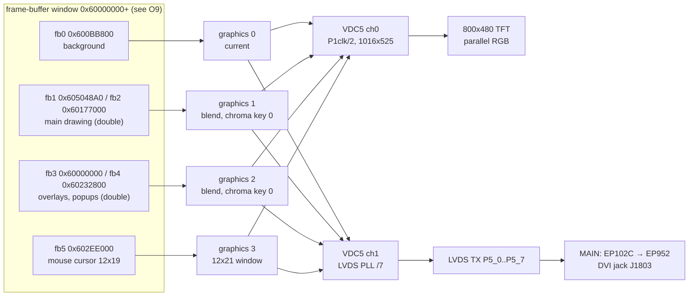
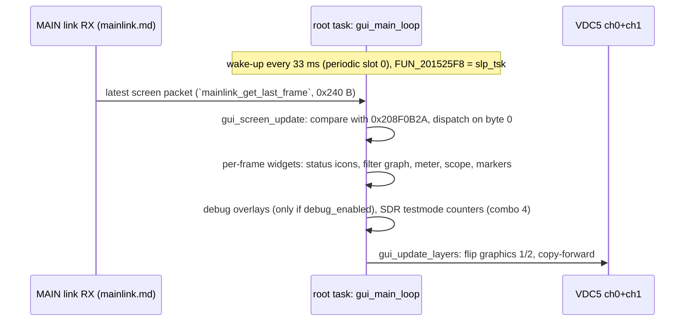
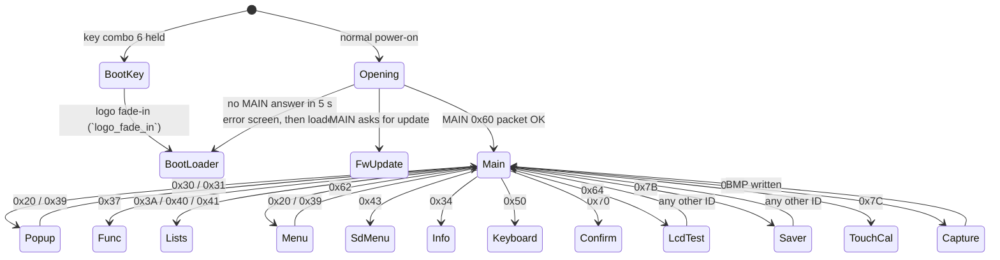

# DISPLAY: GUI, VDC5 and LCD/DVI output (T11e)

Back to the [DISPLAY overview](README.md). Addresses are CPU addresses (image base 0x20100000). Function names are the names applied in Ghidra (`tools/ghidra/names_display.tsv`, merged by T17) and match `decomp/display/`; a name still in *italics* is a description that was not applied as a Ghidra name. Function bodies are in `decomp/display/` (look them up in `functions.tsv`). Asset lister: `tools/display_assets.py`.

## Summary

- The GUI is a **thin renderer**. The MAIN CPU owns the radio state and the screen logic. It sends "screen packets" over the UART link; byte 0 is the
  screen ID and the rest is the content (text, values, cursor positions). The DISPLAY compares each new packet with the previous one and redraws what
  changed **[fact: `gui_screen_update`]**. Most menu and list text therefore lives in the MAIN firmware, not here **[inference]**.
- **VDC5 channel 0** drives the 800×480 parallel-RGB TFT; **VDC5 channel 1** drives the **LVDS** transmitter, which feeds the DVI chain on the MAIN
  board (EP102C → EP952). Both channels read the **same frame buffers**, so the DVI jack mirrors the panel at 800×480 or 800×600 **[fact for the
  register set-up, inference for "mirror"]**.
- Four graphics layers (VDC5 graphics 0–3, RGB565, 800×480): a static background, two double-buffered drawing layers with black as the chroma key,
  and a 12×21 mouse-cursor layer **[fact]**.
- Graphics are **run-length "run sprites"** in `.rodata` (2240 of them, about 2 MB of RGB565 pixels). Fonts are tables of pre-coloured run sprites
  indexed through one character map **[fact]**.
- The GUI runs in the `root` task: `gui_start` sets up VDC5, then `gui_main_loop` draws one frame per 33 ms wake-up and never
  returns **[fact]**.
- Hidden / service screens found: an **LCD test-pattern screen** (packet 0x64), **key combinations at power-on** (combo 6 → boot-loader / firmware
  update screen, combo 4 → SDR SPI "testmode" counters), the **debug overlays** on F1–F12 of a USB keyboard (only after the debug unlock), and
  the `test_disp` task that **replays MAIN packets from `I:\FT-710\DEBUG_RECV_CMD\SEND_CMD.TXT`** (also behind the debug unlock).

## Display pipeline

The layer stack is built twice, once per channel, from the same buffer addresses (`vdc5_layers_setup` is called with ch 0 and
ch 1, and every buffer flip calls `r_vdc5_change_read_process` for both channels) **[fact]**.

## VDC5 set-up

The firmware links the **Renesas RZ/A1H `r_vdc5` sample driver** (0x201179C0–0x2011D9xx). The API shape, the resource checks and the error
codes match it (9 = `ERR_RESOURCE_CLK`, 10 = `VSYNC`, 12 = `OUTPUT`, 13 = `LVDS_CLK`, 14 = `LAYER`); the parameter checks are compiled out
**[inference]**. The 45 small 80-byte functions at 0x20118548–0x20119370 are the driver's per-interrupt ISR stubs **[inference]**.

`gui_start` (0x20132CCC) runs, in order **[fact]**:

1. `FUN_201340A4`, `FUN_201342B4` (scope/waterfall objects, see [spi-links.md](spi-links.md)), `FUN_20120D38`, `FUN_20133620` (scope scale
   tables), `dmac8_m2m_init`, `sdr_dsp_link_init` (RSPI2/RSPI4 DMA set-up for scope data).
2. `vdc5_isr_create`: `itron_acre_isr` with descriptor 0x203A706C → GIC ID **78** (VDC5 ch0 GR3_VLINE), handler 0x20118638.
3. **Channel 0** (TFT): `r_vdc5_initialize`(0, {icksel = 4 = peripheral clock, dcdr = 1 = ÷2, no LVDS}, `vdc5_module_start`) →
   `vdc5_sync_setup`(0) → `vdc5_output_setup`(0) → `vdc5_vline_int_setup`(0).
4. **Channel 1** (LVDS/DVI): `r_vdc5_initialize`(1, {icksel = 6 = LVDS PLL ÷7, dcdr = 0, lvds = `lvds_pll_cfg`(1, 0)}) → sync and output set-up
   for 800×480 → `gpio_dvr`(0, 1) → `vdc5_layers_setup` for ch 0 and ch 1.
5. `gui_main_loop`, then `vdc5_channel_shutdown` for both channels if the loop ever returned.

### Timings

| | ch0 TFT | ch1 DVI, 800×480 | ch1 DVI, 800×600 |
|---|---|---|---|
| Active | 800×480 | 800×480 | 800×600 |
| Total (res_fh+1 × res_fv+1) | 1016 × 525 | 1088 × 517 | 1056 × 628 (VESA SVGA) |
| Window start (hs, vs) | 88, 32 | 224, 31 | 216, 27 |
| Dot clock | P1φ ÷ 2 | 27 MHz × 176 / 5 / 4 / 7 = 33.9 MHz | 27 MHz × 208 / 5 / 4 / 7 = 40.1 MHz |
| Frame rate | ≈62 Hz if P1φ = 66.7 MHz | 60.3 Hz | 60.5 Hz |

Totals and windows are from `vdc5_sync_setup` and `vdc5_layers_setup` **[fact]**. The LVDS PLL fields are from `lvds_pll_cfg`
(`lvds_pll_cfg`): input = video clock (27 MHz crystal X6002), IDIV 1, FD 175 or 207, RD 4, OD 2, output to VDC5 ch1 **[fact for the values]**.
The clock formula and P1φ = 66.7 MHz are **[inference]**; that both DVI modes come out at 60 Hz supports the formula.

`dvi_set_resolution` (`dvi_set_resolution`, caller `gui_apply_display_cfg`) stops ch1, re-runs the ch1 initialise/sync/output/layer set-up with the other
timing, and drives **P5_8** through `gpio_dvr` (`gpio_dvr`, PSR5 0xFCFE3114): 1 for 800×480, 0 for 800×600. P5_8 is probably a mode line
to the DVI-side controller (EPF021M) **[inference]**.

### Layers

`vdc5_layers_setup` calls `r_vdc5_read_data_control`, `r_vdc5_chromakey` and `layer_alpha_rect_reapply` for layer IDs 3–6 (= graphics 0–3, driver enum
`VDC5_LAYER_ID_0_RD`…`3_RD`; `vdc5_layer_to_gr` maps 3..8 → 0..5) **[fact]**:

| Graphics | Buffer(s) | Display mode | Use |
|---|---|---|---|
| 0 | fb0 0x600BB800 | current (2) | static background: meter scale, scope frame (`meter_draw_scale`, `gui_screen_update`) |
| 1 | fb1 / fb2, index in 0x208085B8 | blend (3), chroma key 0x0000 | main screen content, drawn every frame |
| 2 | fb3 / fb4, index in 0x208085BC | blend (3), chroma key 0x0000 | popups, menus, lists, overlays |
| 3 | fb5 0x602EE000, window 12×21 at (400, 240) | blend, started on demand | mouse cursor (`fb_blit_raw`(fb5, 0, 0, 0x2016E860, 12, 19)` in the main loop) |

Read set-up per layer: RGB565, line offset 0x640 (800 × 2 B), 32/16-bit swap 6, window = active area **[fact for the values, inference for the
enum meaning]**. Black (0x0000) is the chroma key, so drawing 0 makes a layer transparent; `fb_clear_rect` really **clears** a rectangle to 0
(`fb_clear_rect`) **[fact]**.

`fb_get_layer_addr` (0x201326FC) maps the buffer *index* 0–5 to {0x600BB800, 0x605048A0, 0x60177000, 0x60000000, 0x60232800, 0x602EE000};
`fb_get_front_addr` returns the buffer that is on screen for a given back index (1↔2, 3↔4) **[fact]**.
These buffers cannot sit in a plain mirror of 0x20000000: `fb_clear_all` zeroes 0x60000000–0x602FF2FF while the code runs from 0x20100000+, and the
MMU map is flat. What memory 0x60000000 really is stays open ([system.md O9](../system.md#8-contradictions-and-open-questions), T19h).

**Buffer flip** (`gui_update_layers` 0x20133A8C, 57 callers): point graphics 1 and 2 of both channels at the current back buffers, swap the
indices, then copy the buffer just shown into the new back buffer (graphics 1 by `dmac8_m2m_start` = DMAC ch0 memory copy, graphics 2 by `memcpy`),
so drawing is always incremental **[fact]**. `gui_flip_one` flips only one layer and brackets the screen capture.

Alpha windows and fades use `r_vdc5_alpha_blending_rect` through `layer_alpha_rect_set` (`layer_alpha_rect_set`, state cached at 0x209080E4
[ch][layer], 0x24 B each). `layer_fade` ramps a layer by ±5 per frame (screen saver, logo fade-in) **[fact]**.

The VLINE interrupt callback `vdc5_vline_cb` counts frames in 0x208085A4 and decrements 0x2080859C; `vdc5_wait_frames`
(`vdc5_wait_frames`) waits on it **[fact]**.

LCD contrast: packet 0x24 byte 5 (0–20) becomes VDC5 ch0 `r_vdc5_display_calibration` contrast values (10·n + 0x1C, 10·n + 0x11) **[fact for the
call, inference that it is the CONTRAST setting]**. DVI on/off: packet 0x24 byte 0 bit 0 switches P5_0–P5_7 between the LVDS function and GPIO
(`lvds_pins_enable`, `lvds_pins_enable`) **[fact for the pins, inference for the meaning]**. Backlight dimmer: packet 0x21 → `led_set_one`
(table of 9 levels, `gpio_cfg_out_low`(6, …)`), see [peripherals.md](peripherals.md) **[inference]**.

## Frame loop

Per frame, `gui_main_loop` calls `gui_screen_update` (screen update), then `FUN_2012470C` / `FUN_20124528` + `FUN_201244D8` (RX/TX markers),
`FUN_201233D4` or `main_filter_graph` (filter graph), `main_status_icons` (status icons), `meter_draw` (meter), `mainlink_send_rtc`, `mainlink_send_sd_state`,
`FUN_201217B0`, `FUN_201218A4` or `scr_screen_saver` (screen saver), `FUN_20131638`, `pclink_stats_print`, `debug_overlay_draw` (debug overlay) and
`gui_update_layers` **[fact]**. Before the loop it handles the power-on cases (next section).

## Screen state machine

Every arrow out of `Main` is "MAIN sends a packet whose byte 0 is this ID"; the DISPLAY never changes screen on its own except for the power-on
cases, the capture and the boot-loader path **[fact for the dispatch, inference for the arrows back, which depend on MAIN]**.

### Screen packets (byte 0 of the MAIN → DISPLAY packet)

Lengths are from the 26-entry {u16 id, u16 length} table at 0x2080893C (`.data2`; the first 15 entries equal the MAIN-link table at 0x20450074,
see [mainlink.md](mainlink.md)). Identification is from the handler code and from rendering the sprites each handler uses **[inference]** unless
marked.

| ID | Len | Handler | Screen |
|---|---|---|---|
| 0x20 ` ` | 0x97 | `scr_main_layout`, `FUN_2012C4A0` | main operating screen (scope/3DSS, mode, filter, status) |
| 0x21 `!` | 3 | `led_set_one` | backlight / dimmer level (no redraw) |
| 0x23 `#` | 0x35 | `FUN_20131354` | decoder text stream, feeds the 0x40 text screen **[guess]** |
| 0x24 `$` | 0x9D | `gui_apply_display_cfg`, `backlight_set`, `dimmer_set`, `gpio_ft4222_reset` | display settings: DVI on/off and 800×480/800×600, contrast; byte 0 bit 2 drives P2_7 (`FT4222_RESET`) **[fact for the pins]** |
| 0x30 `0` | 0x9E | `scr_select_popup` | METER / MODE selection popups (PO, COMP, ALC, VDD, ID, SWR; LSB … DATA-L) |
| 0x31 `1` | 0xA1 | `scr_value_popup` | big value popup: one of 45 setting names (LEVEL, CONTRAST, MIC GAIN, RF POWER, …, LOCK, TUNE, SCREEN SHOT) + value; tables at 0x208026DC–0x20802CE4 |
| 0x34 `4` | — | `scr_info` | information screen with `CERTIFICATIONS` and `FCC ID : K6620801X50` **[fact for the strings]** |
| 0x37 `7` | 0x23E | `scr_func_panel` | FUNC panel: CONTRAST, DIMMER, M-GROUP, MIC GAIN/EQ, PROC/AMC LEVEL, VOX, RF POWER, MONI, KEYER, BK-IN, CW SPEED/PITCH, AESS, MESSAGE, RECORD, PLAY |
| 0x39 `9` | 0xE7 | `scr_vfo`, `FUN_201293F8` | frequency display (large green/white/red digit sprites) |
| 0x3A `:` | 0xA0 | `scr_playlist` | PLAY LIST / voice messages (`%02d:%02d:%02d`, RX LEVEL, DELETE) |
| 0x3F `?` | 3 | `rec_start_stop` | start/stop recording to SD, file name `20YYMMDD_HHMMSS` (no screen) |
| 0x40 `@` | 0x1F9 | `scr_text_list` | text list with LF/CR glyphs, DONE/BACK (30-char rows) **[guess: RTTY/PSK text memories or decode]** |
| 0x41 `A` | 0x144 | `scr_memory_list` | MEMORY CH LIST (NAME, MODE, SCAN, TYPE, ERASE, RESTORE) |
| 0x43 `C` | 0x21 | `scr_sd_menu` | SD card: MEM LIST LOAD/SAVE, MENU LOAD/SAVE, INFORMATIONS, FORMAT, `FREE SPACE`/`CAPACITY` (shares code with [update.md](update.md)) |
| 0x50 `P` | 0xF3 | `scr_keyboard` | on-screen keyboard (Caps, Space, ENT, ←/→, ABC, #%^, End) |
| 0x60 `` ` `` | 0xB4 | `opening_check_main` (opening only) | power-on status from MAIN; also carries an error code |
| 0x62 `b` | 0x195 | `scr_setup_menu` | MENU list: 8 rows × {5, 20, 3} chars at +0x9A, cursor row at +0x98 |
| 0x64 `d` | 1 | `scr_lcd_test` | **LCD test pattern** (hidden): byte 1 = 0 black, 1 white, 2 red, 3 green, 4 blue, 5 eight colour bars (white, yellow, cyan, green, magenta, red, blue, black); hides the cursor layer **[fact]** |
| 0x65 `e` | 7 | `rtc_set_from_main` | set the RTC from MAIN (BCD YY MM DD hh mm, clamped) **[fact]** |
| 0x70 `p` | 0xE1 | `scr_confirm` | OK / CANCEL dialog |
| 0x7A `z` | 3 | `screen_capture_bmp` | screen capture (below) |
| 0x7B `{` | 3 | `scr_screen_saver` | screen saver: graphics 0/1/3 hidden, YAESU logo (486×56) moves between 3 places every 180 frames and fades out after 91 |
| 0x7C `\|` | 3 | `touch_calibration` | `TOUCH THE CROSS` calibration ([input.md](input.md)) |
| 0x42, 0x44, 0x45, 0x71 | | not in the GUI dispatcher | handled by the MAIN-link RX side ([mainlink.md](mainlink.md)) |

The dispatcher keeps the previous packet at 0x208F0B2A (0x240 B) and the previous ID in 0x2080049E. Flags at 0x208F4630–0x208F463C select
overlay modes (scope expanded, popup open) **[fact for the variables, inference for their meaning]**.

### Power-on and boot-loader path (in `gui_main_loop`)

- **Key combination 6** held at power-on (`key_scan_first() == 6`, the same check that forces the full start in [boot-rtos.md](boot-rtos.md)):
  `logo_fade_in` fades the YAESU logo in, then `FUN_201322E4` → `FUN_20159058`: it shows the boot-loader screen if the boot-info status is 2, else
  `FIRMWARE BOOT ERROR` forever **[fact]**. Combination 6 is key codes {0x304, 0x30A, 0x30E} all held (table 0x20165678, 3 codes per combo) **[fact]**.
- **Normal**: `opening_screen` fades the logo in on graphics 1 and waits up to about 5 s (`4999 < n·33`) for MAIN's 0x60 packet;
  if MAIN asks for an update it calls `fwupdate_screen`. On a timeout it calls `fwupdate_insert_sd_screen_thunk` 0x201322AC → `fwupdate_insert_sd_screen` 0x2015AFB0, which shows `INSERT FIRMWARE SD CARD.` /
  `TOUCH THE SCREEN TO CONTINUE.` / `ERROR CODE : %03d` and then the boot-loader screen **[fact]**. The update screens belong to [update.md](update.md).
- **Key combination 4** ({0x30C, 0x305}) held at power-on: each frame calls `pclink_set_testmode`(1)` (`pclink_set_testmode`), and `pclink_stats_print`
  draws a box with `testmode`, `CS_POLL`, `MOSI_OK/NG`, `FRAMES`, `MISO_OK/NG` and `msec` at (y 0x104, x 600). The box is red (0xC800) when any
  counter shows a fault **[fact]**. This is a service screen that needs **no** debug unlock. Which front-panel keys the codes are is in
  [input.md](input.md).

## Drawing primitives

All take a frame-buffer pointer and **(y, x)** in that order; stride is 800 pixels **[fact]**.

| Address | Ghidra name | Purpose |
|---|---|---|
| 0x201355BC | `fb_clear_rect` | `fb_clear_rect`(fb, y, x, w, h): fill with 0 (transparent) |
| 0x20135658 | `fb_fill_rect` | (fb, color, y, x, w, h); color 0 → `fb_clear_rect` |
| 0x20135AA4 / 0x20135AD8 | `fb_fill_box` / `fb_fill_box_t` | `fb_fill_box` (fb, y, x, w, h, color) / same with w, h swapped |
| 0x20135534 | `fb_blit_raw` | `fb_blit_raw`(fb, y, x, src, w, h): raw RGB565 |
| 0x2013573C / 0x20136290 | `fb_draw_frame` / `fb_draw_round_frame` | rectangle outline / outline with cut corners |
| 0x201358D0 | `gui_draw_runs` | draw a run sprite at (y, x) (294 callers) |
| 0x201359BC | `gui_draw_runs32` | run sprite with u32 runs (`gui_draw_runs32`) |
| 0x20135B0C | `sprite_unpack` | `sprite_unpack` to a w×h buffer |
| 0x20135DD4 | `gui_draw_text` | `gui_draw_text`(fb, str, y, x, pitch, font) |
| 0x20135EC0 / 0x20135FF0 | `gui_draw_text_words` / `gui_draw_text_centered` | text with half-width spaces / centred on x |
| 0x20135B6C / 0x20135C14 / 0x20135CE8 | `gui_draw_hex` / `gui_draw_dec` / `gui_draw_hex_color` | hex / decimal / recoloured hex numbers in the 10×15 font |
| 0x201378B0 | `dmac8_m2m_start` | `dmac8_m2m_start`: DMAC ch0 (0xE8200400) memory copy |

There is no widget object model: each screen handler draws its own sprites and text at coordinates from `.data2` tables (for example the
popup tables 0x208026DC position, 0x20802C34 frame sprite, 0x208029E8 title sprite, 0x20802AEC/0x20802BF0 title text and length) **[fact]**.

## Asset formats

`tools/display_assets.py` lists them (`summary`, `sprites`, `tables`, `fonts`, `strings`, `--render ADDR` for an ASCII preview). It unpacks the
LZ-compressed RW regions in memory so tables in `.data2` resolve; it writes nothing. Run with `python3 -I tools/display_assets.py
build/FT-710_DISPLAY_V0108.bin summary`.

**Run sprite** (16-byte descriptor, drawn by `gui_draw_runs`) **[fact]**:

| Offset | Type | Field |
|---|---|---|
| 0 | u16 | width |
| 2 | u16 | height |
| 4 | u32 | number of runs |
| 8 | ptr | runs: {u16 start, u16 count}, start = y·width + x |
| 12 | ptr | pixels: Σcount RGB565 words, stored right after the runs (pixels = runs + 4·n) |

Pixels outside the runs are not written (transparent). A full rectangle is one run. Counts in V01-08: **2243 sprites** (2240 in `.rodata`, 3 in
`.data2`), 1,048,639 pixels = 2.0 MB of pixel data; 7 use the u32-run variant; 180 are single-run rectangles **[fact, tool output]**.
The T06 note "0x2016DD04 = {w, h, n, ptr[14]}" was a run sprite followed by more descriptors.

**Fonts** are tables of pointers to run sprites, one table per size *and* colour (glyphs are pre-coloured). A string is drawn with a fixed pitch
given by the caller; each byte maps through the 256-byte table at **0x2080173C**: `\n` → 0, `\r` → 1, space and unknown → 2, 0x21–0x7E →
char − 0x1E (except `` ` `` → 2), 0x7F → 99, 0x80 → 96, 0xFE → 97, 0xFF → 98 **[fact]**. Tables found (base = entry 0):

| Table | Glyph size | Glyphs | Use |
|---|---|---|---|
| 0x20800B1C | 15×24 | 95 | general UI text (45 call sites) |
| 0x20800CAC | 15×24 | 97, with LF/CR glyphs | menu and text-list rows |
| 0x20800E34 / 0x20800FB4 | 15×24 | 92 / 94 | other colours (0xFB4: `BACK` buttons) |
| 0x20803030 | 15×24 | 45 | partial set |
| 0x208012AC | 24×36 | 97, with LF/CR | large text |
| 0x208015BC | 38×42 | 93 | value popup text |
| 0x208031C0 | 12×19 | 94 | small text |
| 0x208038C0 / 0x20803A40 / 0x20803BC0 | 12×18 | 92 each | three colours; boot-loader and update screens |
| 0x20803730 | 10×15 | 93 | debug overlay and numbers |
| 0x2080099C / 0x20802394 | various / 26×32 | 12 / 16 | digit sets |

Other sprite tables: big frequency digits (`scr_vfo`), meter bar frames (187 × 280×46/280×80 at 0x20808644), popup titles
(0x208029E8), scope labels, 70 tables in all (`display_assets.py … tables`). **String tables** are few, because most text comes from MAIN:
USB keyboard layouts (0x20800134: JPN, US, UK, FRA(AZ), FRA(QW), DEU, …), popup titles (0x20802AEC), update-screen texts (0x20808538) and the
SD menu (0x20808600) **[fact]**. Single strings for the boot loader are at 0x20427ED4–0x204286A0 (memory-maps.md).

## Screen capture

Packet 0x7A → `screen_capture_bmp` (0x20134644): needs ≥ 0x119436 B free on `I:` (54 + 800·480·3), shows the `SCREEN SHOT` popup
(`screenshot_popup` 0x2013059C, popup slot 44), freezes graphics 1, creates `I:\FT-710\Capture` if needed and writes
`I:\FT-710\Capture\20YYMMDD_HHMMSS.bmp` from the RTC **[fact]**. `bmp_write_screen` writes the 54-byte header at 0x208085C4 and
480 rows bottom-up as 24-bit BGR; each row is graphics 0, overlaid by the **front** buffers of graphics 1 and 2 where the pixel is non-zero or
inside an opaque alpha window (`capture_merge_row`, `layer_alpha_rect_hit`). The cursor layer is not captured **[fact]**.

## Debug and test features

**Debug overlays (F-keys).** `keycode_line` is the `keycode` handler in debug chain 1 ([boot-rtos.md](boot-rtos.md#usb-keyboard-handler-chains)),
so it only runs after the (unreachable) debug unlock. HID usages 0x3A–0x45 (**F1–F12**) toggle bits 0–11 of **0x20808A84**; typed `date`,
`time`, `dsp `, `reset`, `wdr` and `sndc` are commands **[fact]**. GUI effects **[fact]**:

| Bit (key) | Effect |
|---|---|
| 0 (F1) | `debug_overlay_draw` read-out row: firmware `0108`, build word of the running bank (0x183E0010/0x183F0010/0x183C0010), `CPU` load, `M`, `S`, `D`, `t`, `n`, `b` (boot bank/state), `d`, `Ton`/`Toff`, `irq`, touch `x`/`y`, `p`; also the meter's raw value |
| 1 (F2) | dumps changes of two RX buffers (0x2045F260, 0x2045F4A0) on screen |
| 4 (F5) | copies a scope byte into two other slots of the scope line (`sdr_rx_done_cb`) |
| 5, 6 (F6, F7) | `F6`/`F7` markers; F6 also changes the graphics-1 flip to `memcpy` |
| 9 (F10) | on change, `debug_screenshot_root` saves a screenshot to `I:\20YYMMDD_HHMMSS.bmp` |
| 10 (F11) | `RF` marker; replaces the scope line with the test pattern at 0x203D9B14 (`scope_store_frame`) |

**`test_disp` task** (`test_disp_init` 0x20134E0C, `task_test_disp` 0x2013512C, pri 5). The task waits on its event flag. `sndc` (debug only)
toggles it through `test_disp_start` / `test_disp_stop`. When started, `debug_replay_send_cmd` (0x20134FDC; really `debug_replay_send_cmd`) opens
**`I:\FT-710\DEBUG_RECV_CMD\SEND_CMD.TXT`** and, per line, `debug_cmd_line_read` parses `NNN` (byte count), the bytes as hex pairs, and a 4-digit delay in
ms (default 1000). If the first byte is one of the 26 screen IDs (0x2080893C) it injects the packet with `mainlink_set_last_frame` as if MAIN had sent it,
then sleeps the delay. So the screens can be driven from an SD card without MAIN, once debug mode is on **[fact for the code, inference for the
purpose]**. The T06 name is misleading: the function reads `SEND_CMD.TXT`, it does not log `RECV_CMD.TXT`.

## Functions

| Address | Ghidra name | Purpose |
|---|---|---|
| 0x20132CCC | `gui_start` | VDC5 ch0/ch1 set-up, then the GUI loop |
| 0x20130188 | `gui_main_loop` | `gui_main_loop` |
| 0x2012EBB8 | `gui_screen_update` | `gui_screen_update`: packet compare and dispatch |
| 0x201179C0 / 0x20117B0C / 0x20117BA8 | `r_vdc5_initialize` / `r_vdc5_sync_control` / `r_vdc5_display_output` | `r_vdc5_initialize` / `r_vdc5_sync_control` / `r_vdc5_display_output` |
| 0x20117DEC / 0x20117E5C | `r_vdc5_read_data_control` / `r_vdc5_change_read_process` | `r_vdc5_read_data_control` / `r_vdc5_change_read_process` |
| 0x20117EBC / 0x20117F00 | `r_vdc5_start_process` / `r_vdc5_stop_process` | `r_vdc5_start_process` / `r_vdc5_stop_process` |
| 0x2011819C / 0x20118214 / 0x201182D4 / 0x201183B0 | `r_vdc5_alpha_blending_rect` … | `r_vdc5_alpha_blending_rect` / `r_vdc5_chromakey` / `r_vdc5_display_calibration` / `r_vdc5_callback_isr` |
| 0x2011A394 | `vdc5_config` | driver-internal register writer for ch0 (T06 name) |
| 0x20132320 / 0x20132398 | `vdc5_module_start` / `vdc5_module_stop` | `vdc5_module_start` / `vdc5_module_stop` (STBCR9 0xFCFE0438) |
| 0x2013249C | `lvds_pll_cfg` | `lvds_pll_cfg` |
| 0x20132504 / 0x201325E8 | `vdc5_sync_setup` / `vdc5_output_setup` | `vdc5_sync_setup` / `vdc5_output_setup` |
| 0x2013276C | `vdc5_layers_setup` | `vdc5_layers_setup` |
| 0x20132BC0 | `dvi_set_resolution` | `dvi_set_resolution` |
| 0x201330A8 / 0x20133014 / 0x20133090 | `vdc5_isr_create` / `vdc5_vline_cb` / `vdc5_wait_frames` | `vdc5_isr_create` / `vdc5_vline_cb` / `vdc5_wait_frames` |
| 0x201326FC / 0x20132E78 | `fb_get_layer_addr` / `fb_get_front_addr` | buffer index → address / front buffer |
| 0x20133A8C | `gui_update_layers` | flip graphics 1/2 on both channels, copy-forward |
| 0x20132F84 | `fb_clear_all` | clears all frame buffers (T11a) |
| 0x20133658 / 0x2013396C | `layer_alpha_rect_set` / `layer_fade` | `layer_alpha_rect_set` / `layer_fade` |
| 0x20133A0C / 0x20133A38 | `layer_hide` / `layer_show` | `layer_hide` / `layer_show` (both channels) |
| 0x20101DC4 / 0x20101DEC | `gpio_dvr` / `lvds_pins_enable` | `gpio_dvr` (P5_8/P5_9) / `lvds_pins_enable` |
| 0x2012F8D4 / 0x2012F734 / 0x2012FD94 | `opening_screen` / `opening_check_main` / `logo_fade_in` | `opening_screen` / `opening_check_main` / `logo_fade_in` |
| 0x20134ABC / 0x20134D24 | `meter_draw` / `meter_draw_scale` | `meter_draw` (181-step bar, peak hold) / `meter_draw_scale` |
| 0x20125E78 | `touch_calibration` | `TOUCH THE CROSS` |
| 0x20134644 / 0x2013456C | `screen_capture_bmp` / `bmp_write_screen` | capture / `bmp_write_screen` |
| 0x2013059C | `screenshot_popup` | `screenshot_popup` |
| 0x201367B4 / 0x20134854 | `debug_overlay_draw` / `debug_screenshot_root` | `debug_overlay_draw` / `debug_screenshot_root` |
| 0x20134E0C / 0x2013512C | `test_disp_init` / `task_test_disp` | replay task |
| 0x20134FDC / 0x20134E70 | `debug_replay_send_cmd` / `debug_cmd_line_read` | `debug_replay_send_cmd` / `debug_cmd_line_read` |

The screen handlers are in the packet table above; all names are in `tools/ghidra/names_display.T11e.tsv` (105 entries).

## Globals

| Address | Meaning |
|---|---|
| 0x208085B8 / 0x208085BC | back-buffer index of graphics 1 (1/2) and graphics 2 (3/4) |
| 0x208F4D50 / 0x208F4D60 / 0x208F4D70 | `vdc5_read_chg` structs (buffer address first) for graphics 1, 2, 3 |
| 0x20808574–0x20808580 | ch0 / ch1 window start (hs, vs), used for the cursor window |
| 0x20808584–0x2080858A | cursor window {vs, vw, hs, hw} |
| 0x2080859C / 0x208085A4 | frame wait counter / frame counter (VLINE callback) |
| 0x209080E4 | alpha-rect cache [2 ch][9 layers] × 0x24 B |
| 0x208F0B2A | previous screen packet (0x240 B), byte 0 = current screen ID |
| 0x2080049E | previous screen ID |
| 0x2080893C | 26 × {u16 id, u16 length, …} screen-packet table (12 B each) |
| 0x2080173C | character → glyph-index map (256 B) |
| 0x20808A84 / 0x20808A88 | debug display flags (F1–F12) / previous value |
| 0x20450004 | SDR testmode overlay on (key combo 4) |
| 0x208004A2 | key combination held at power-on |
| 0x208007E8–0x208007EC | last display-settings bytes from packet 0x24 (DVI, contrast) |
| 0x208085C4 | 54-byte BMP header |
| 0x20808931 / 0x20808934 | test_disp state (1 run, 2 idle) / event flag ID |

## Open points

- Which physical keys the codes 0x303–0x311 are (combos 4 and 6): [input.md](input.md) (T11f).
- What the MAIN firmware does to send packet 0x64 (LCD test) or 0x34: a MAIN-side menu or service key sequence (T10).
- The `.data2` coordinate tables (0x208004A4–0x20800650 and 0x208026DC–0x20802D00) could be decoded into a full screen layout.
