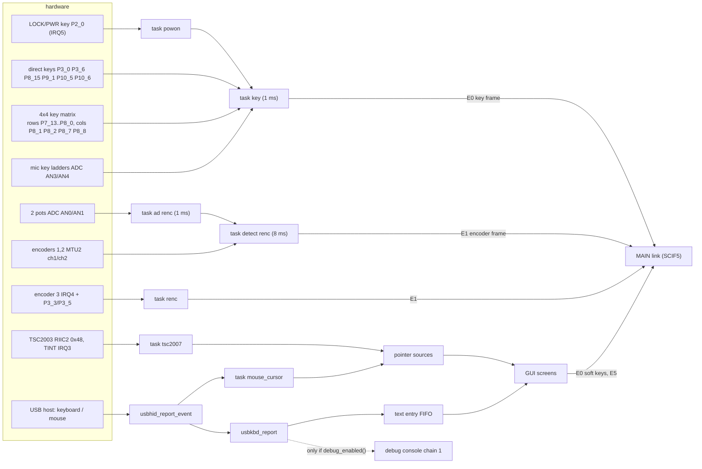
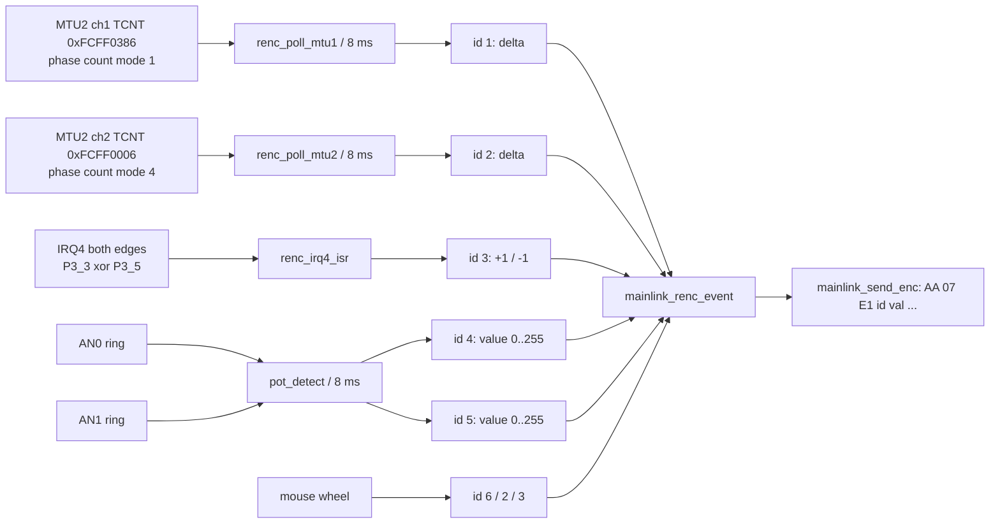
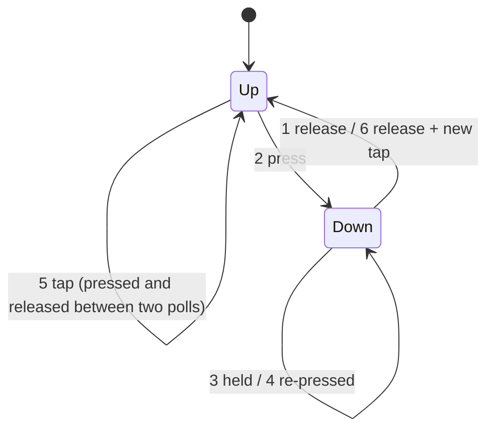
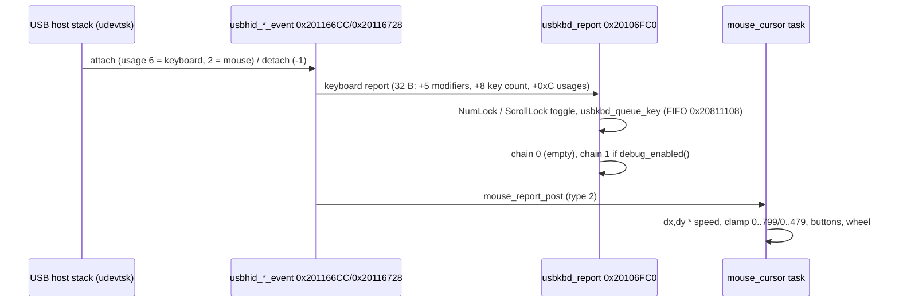
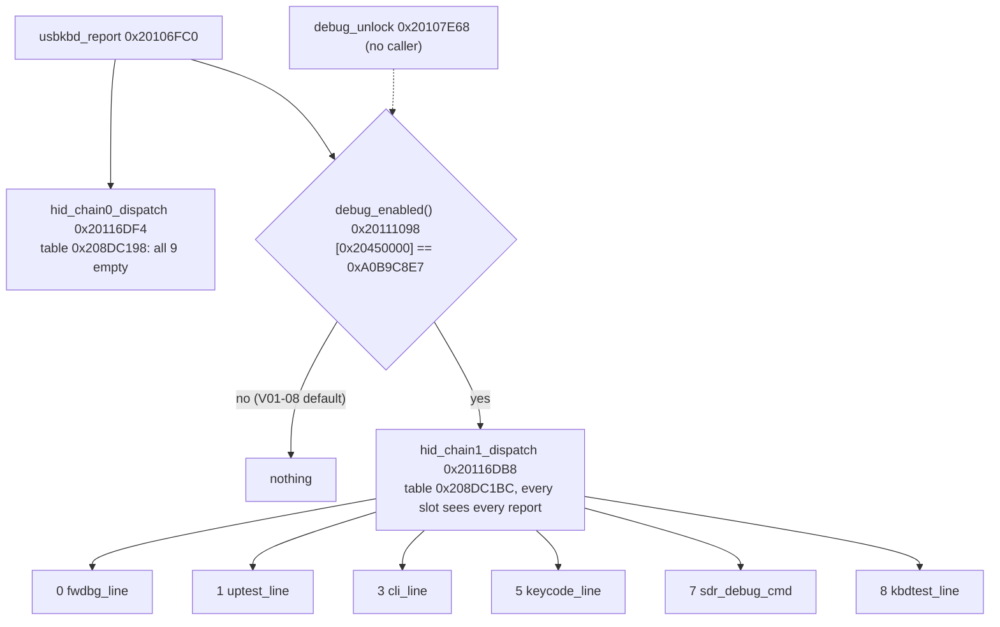

# DISPLAY input: keys, encoders, touch panel, USB HID and the hidden debug console

Back to the [DISPLAY overview](README.md). Addresses are CPU addresses (image base 0x20100000, file offset = address − 0x20100000). Ghidra names
are from `tools/ghidra/names_display.tsv`. Function names are the names applied in Ghidra (`tools/ghidra/names_display.tsv`, merged by T17) and match `decomp/display/`; a name still in *italics* is a description that was not applied as a Ghidra name. Initialised `.data`/`.data2` values were read from the
decompressed scatter-load regions (same LZ decoder as `DisplaySetup.java`). Key names come from the MAIN image's key-name table at 0xFFF883C4
(`FT-710_MAIN_V0112.bin`, 12-byte entries `{u16 code, char name[10]}`) **[fact]**.

The DISPLAY CPU owns every operator input. It scans keys, knobs and the touch panel, hosts the USB keyboard and mouse, and forwards everything to
MAIN over the SCIF5 link ([mainlink.md](mainlink.md), MAIN side in T10b). It never acts on a key itself. The only exceptions are the power key
(standby → full start), the boot key combinations, the touch calibration and the debug console.

## Overview

All of this is **[fact]** from the code cited in the sections below, except the hardware names of the knobs (see [Encoders](#rotary-encoders-and-pots)).

## Tasks and timing

| Task (descriptor) | Entry | Pri | Wake-up | Role |
|---|---|---|---|---|
| powon (0x2016571C) | `task_powon` 0x20113F88 | 3 | event flag from `powon_isr` (IRQ5, P2_0 both edges) | copies the P2_0 level into direct key 0 (`key_set_power_level` 0x201131A8) and re-enables IRQ5 |
| key (0x201656A8) | `task_key` 0x201137F8 | 5 | periodic slot 4, 1 ms | scan, debounce, hold timing, send key events |
| ad renc (0x20165594) | `task_ad_renc` 0x201128F4 | 5 | periodic slot 1, 1 ms | AN0/AN1 into two 32-sample rings |
| detect renc (0x201655B0) | `task_detect_renc` 0x20112AD4 | 5 | periodic slot 2, 8 ms | pots and the two MTU2 encoders |
| renc (0x201655CC) | `task_renc` 0x20112774 | 5 | event flag from `renc_irq4_isr` | sends encoder 3 |
| tsc2007 (0x201651A8) | `task_tsc2007` 0x20103464 | 5 | woken by `tsc2007_tint_isr` (IRQ3) | touch sampling |
| tsc2007 (0x201651C4) | `task_tsc2007_irq` 0x20103804 | 4 | slp_tsk; checks a RIIC status twice 100 ms apart, then sets 0x20800090 and signals sem 0x20800088 | touch bus watchdog **[inference]** |
| mouse_cursor (0x201656E4/0x20165700) | `cpp_task_thunk` → `mouse_cursor_run` 0x2015FD60 | 7 | message box | mouse reports, cursor |
| keycode (0x2016552C) | `task_keycode` 0x20111794 | 5 | event flag 0x208001D0 | debug commands `date`/`time`/`dsp` and F6–F8 |
| cli (0x20165968) | `task_cli` 0x20116AB0 | 5 | event flag 0x20800394 | memory monitor |

The periodic wake-up service (`periodic_wakeup_isr`, 1 ms) uses the periods at 0x20800374 = {33, 1, 8, 1, 1} ms for slots 0–4 **[fact]**.
Event priorities follow the µITRON convention (lower = higher) **[inference]**. IRQ sense is set in INTC ICR1 (0xFCFEF802): IRQ3 = 01 (falling
edge), IRQ4 = 11 and IRQ5 = 11 (both edges) **[fact]**. GIC IDs: IRQ3 = 0x23, IRQ4 = 0x24, IRQ5 = 0x25.

## Front-panel keys

### Scan

Each 1 ms tick, `task_key` calls `key_sample_all` (0x20113558) and `key_debounce_all` (0x20113614) **[fact]**:

1. **Direct keys 1–5** from the table at 0x208002A4 (`.data2`, 16-byte entries `{port, bit, last level, code}`), read with
   `gpio_read_port_bit` (0x201131E8, PPRn = 0xFCFE3200 + 4n). Key 0 (P2_0) is not read here. The `powon` task writes its level on every edge.
2. **MIC PTT** (entry 0x20800304: P10_5, code 0x340) is sampled and handled separately, so PTT is reported even while another key is held.
3. **4×4 matrix**: for each column c, `key_matrix_drive_col` (0x201134D0) drives one of P8_1, P8_2, P8_7, P8_8 low and the other three high
   (`gpio_cfg_out_low` / `gpio_cfg_out_high` write Pn and clear PMn). It then reads the rows P7_13, P7_14, P7_15 and P8_0 (table 0x20800244, 24-byte rows).
   The codes come from the `.rodata` table 0x20165626 (`u16 [row][col]`).
4. **ADC keys**: `adc_read_all` reads ADDRA–ADDRH (0xE8005800–0E, 12-bit). AN3 and AN4 are reduced to 8 bits and turned into a level 0–5 by
   `adc_key_level` (0x201131B4: the number of thresholds ≤ value). The thresholds are {22, 71, 123, 174, 226} (0x20800314) and
   {27, 77, 126, 178, 229} (0x2080031E). The pair (level AN3, level AN4) is looked up in the 25 pairs at 0x201655F4. Pair *i* gives the code
   0x20165644[i+1]. A pair that is not listed (for example 5/5, nothing pressed) gives no key.

A level change is accepted after **3 equal samples** (counters 0x208D9BA8 / 0x208D9BC0 / 0x20800238), so about 3 ms. An ADC code must stay the
same for 3 polls (0x2080021C reaches 2) **[fact]**. A level of 0 means pressed (active low) **[fact for the code; inference for the wiring]**.

### Events

`mainlink_send_key` (0x20113294) `(code, state)` builds the 5-byte MAIN-link payload **`E0 state code_hi code_lo 00`** and passes it to
`mainlink_queue_frame` **[fact]**:

| state | When |
|---|---|
| 1 | press (level went low) |
| 0 | release |
| 2 | still held after 1000 ticks (≈1 s) of the 1 ms task, sent once |

- **One key at a time:** the flag 0x20800214 allows only one press until that key is released. The first four held codes are kept in
  0x2080023C (`key_held_list_update` 0x20112F3C), and these feed the boot key combinations **[fact]**.
- The matrix and ADC keys are only scanned when the full-mode flag 0x208003A4 (`full_mode_get`) or 0x2080049B is set. Direct keys are always
  scanned **[fact]**.
- `mainlink_send_key` drops everything while 0x208003A4 is 0, that is in standby. Before the GUI link is up (0x20800495 = 0) it only lets through
  LOCK/PWR (press, hold) and FUNC (press, hold, release), and those only when 0x20450026 is set (`mainlink_got_frame60`) **[fact]**.
- **Screen saver:** while the current screen id (first byte of the 0x240-byte screen state at 0x208F0B2A, received from MAIN) is 0x7B and
  0x208F0B2B is set, the first key or knob action only sends the one-byte frame **E4** (wake up) and is otherwise swallowed **[fact; "screen saver"
  is an inference]**.
- **Power key:** state 2 of 0x300 calls `power_key_on`. In standby that sets 0x208003A0 = 1 (full mode), which `task_root` turns into
  `power_on_full_init` ([boot-rtos.md](boot-rtos.md)). In full mode it sets 0x20800493, the shutdown flag that the GUI waits on. So holding
  LOCK/PWR for about 1 s switches the radio on or off, and a short press is a normal key event (LOCK) **[fact for the code; inference for the
  meaning]**.
- During a firmware update (0x20800494/0x20800496) `mainlink_queue_frame` only passes 0x300 events with state ≤ 2 and the E6 frames. On the
  menu screen 0x40, a FUNC press while the `FIRMWARE UPDATE      ` item is selected starts the SD update mode (details in [update.md](update.md))
  **[fact]**.

### Key table (every key → code)

| Code | MAIN name | Source | Pin / position |
|---|---|---|---|
| 0x300 | LOCK/PWR | direct key 0 (via `powon`) | P2_0, IRQ5 |
| 0x301 | TUNE | direct key 1 | P3_0 |
| 0x302 | MOX/VOX | direct key 2 | P3_6 |
| 0x30F | FUNC | direct key 3 | P8_15 |
| 0x312 | DSP | direct key 4 | P9_1 |
| 0x341 | MIC FAST | direct key 5 | P10_6 |
| 0x340 | MIC PTT | separate entry 0x20800304 | P10_5 |
| 0x30C | MODE | matrix row 0 col 0 | P7_13 × P8_1 |
| 0x307 | ZIN/SPOT | matrix row 0 col 1 | P7_13 × P8_2 |
| 0x305 | SPLIT | matrix row 0 col 2 | P7_13 × P8_7 |
| 0x306 | CLAR | matrix row 0 col 3 | P7_13 × P8_8 |
| 0x303 | NB | matrix row 1 col 0 | P7_14 × P8_1 |
| 0x308 | M>V | matrix row 1 col 1 | P7_14 × P8_2 |
| 0x309 | V/M W | matrix row 1 col 2 | P7_14 × P8_7 |
| 0x30A | A/B | matrix row 1 col 3 | P7_14 × P8_8 |
| 0x30B | BAND | matrix row 2 col 0 | P7_15 × P8_1 |
| 0x30E | QMB | matrix row 2 col 1 | P7_15 × P8_2 |
| 0x304 | DNR | matrix row 2 col 2 | P7_15 × P8_7 |
| 0x30D | NAR | matrix row 2 col 3 | P7_15 × P8_8 |
| 0x310 | STEP/MCH | matrix row 3 col 0 | P8_0 × P8_1 |
| 0x311 | FINE/FAST | matrix row 3 col 1 | P8_0 × P8_2 |
| — | (unused) | matrix row 3 cols 2–3 | code 0 |

The pin/code mapping is **[fact]** (tables above). The names come from the MAIN table **[fact]**. "Direct key = push of a knob" (FUNC, DSP) is
**[inference]** from the names and the operating manual ("[FUNC] knob", "[STEP/MCH (DSP)] knob"). The service manual lists 17 tact switches
(S6001–S6017) and 2 EC12D encoders (S6018/S6019) on the DISPLAY unit, plus a REL20-50LD rotary encoder (main dial) **[fact, SM parts list]**. That
matches 13 matrix keys + 4 front direct keys (LOCK/PWR, TUNE, MOX/VOX, and FUNC or DSP as encoder push switches) **[inference]**.

**ADC keys (mic connector, AN3 × AN4):**

| Pair (AN3, AN4) | Code | MAIN name |
|---|---|---|
| (1,0), (0,5) | 0x348 | MIC UP |
| (2,0), (5,0) | 0x34E | MIC DOWN |
| (4,0) | 0x35A | MIC MUTE |
| (4,1) / (4,2) / (4,3) / (4,4) | 0x35B / 0x35C / 0x35D / 0x35E | MIC P1 / P2 / P3 / P4 |
| (0,1) (0,2) (0,3) (0,4) | 0x343 0x344 0x345 0x346 | — |
| (1,1) (1,2) (1,3) (1,4) | 0x349 0x34A 0x34B 0x34C | — |
| (2,1) (2,2) (2,3) (2,4) | 0x34F 0x350 0x351 0x352 | — |
| (3,1) (3,2) (3,3) (3,4) | 0x355 0x356 0x357 0x358 | — |

**[fact]** for the table. The 6 named codes are the SSM-75E keys (UP/DWN, P1–P4, MUTE). MAIN remaps 0x348, 0x34E and 0x35B–0x35E through its
"MIC P1–P4 / MIC UP / MIC DOWN" settings (`key_event_filter` 0xFFFB44F7, bytes 0x9AC8–0x9ACD) **[fact in MAIN]**. The 16 unnamed codes form a
4×4 grid (AN3 level 0–3 × AN4 level 1–4), which looks like a 16-key DTMF keypad microphone **[guess]**. That the two ADC channels are the mic
jack's key lines is **[inference]**.

### Boot key combinations

`key_scan_first` (0x201130C8) returns the first combination n = 1..7 (table 0x20165678, `u16 [8][3]`) whose keys are all in the held list
(`key_combo_match` 0x20112FE0: combos 2 and 6 need all 3 keys, the others 2) **[fact]**:

| n | Keys | Effect on DISPLAY |
|---|---|---|
| 1 | FINE/FAST + STEP/MCH | sent to MAIN: **settings reset** (`settings_defaults(0)`) |
| 2 | QMB + NAR + BAND | sent to MAIN: **factory alignment mode** (as `ZZPE071000`) |
| 3 | MODE + ZIN/SPOT | sent to MAIN, which has no case for 3 (normal power-on) |
| 4 | MODE + SPLIT | also `pclink_set_testmode`(1) (0x201121A8) every GUI frame: SDR-SPI test statistics on screen (`pclink_stats_print`, [spi-links.md](spi-links.md)) |
| 5 | MODE + NB | sent to MAIN: toggles the **TTBF unlock** flag 0x4760 |
| 6 | DNR + A/B + QMB | `boot_mode_full` forces the full start. The GUI then sets boot-info word 0x208DBB4C = 2, draws a fixed screen and loops (`logo_fade_in`), a service/update mode **[inference]**, see [update.md](update.md) |
| 7 | FINE/FAST + MODE | sent to MAIN: **region swap** (destination code, then restart) |

`mainlink_hello_poweron` (0x201165F4) sends the power-up frame **`F0 01 08 20 23 06 29 n 00`** (`mainlink_send_hello` 0x201162A4) up to 30 times,
5 ms apart, until MAIN answers (0x20450028). n is the combination, or 0x10 for a second power-up without a combination **[fact]**. MAIN's reaction to each n is in
[main/display-link.md](../main/display-link.md#f0-boot-codes) (#75). The operating manual documents no power-on key combinations, so these are hidden service
functions **[inference]**.

## Rotary encoders and pots

- `renc_mtu2_init` (0x20112AEC): TMDR_1 (0xFCFF0381) = 4 (phase counting mode 1), TMDR_2 (0xFCFF0001) = 7 (phase counting mode 4), both counters
  cleared and started (TSTR 0xFCFF0280 bits 1, 2) **[fact]**.
- `task_detect_renc` (every 8 ms) calls `pot_detect`, `renc_poll_mtu1` (0x201127D4) and `renc_poll_mtu2` (0x20112830). The pollers send
  the 8-bit signed difference of the 16-bit counter since the last poll (records `{id, delta}` at 0x208D99A4 + 5·id) **[fact]**. The two
  pollers start with an `ldr` before the `push`, so Ghidra's `FUN_201127d8` / `FUN_20112834` start 4 bytes late (fixed in
  `entries_display.T11f.tsv`).
- `renc_irq4_isr` (0x20112B40, GIC 0x24) compares P3_3 with P3_5 (PPR3 0xFCFE320C). It adds ±1 to the position 0x208001E4, sets record id 3 to
  ±1, masks IRQ4 and sets the `renc` flag. `task_renc` sends the record and unmasks IRQ4, so encoder 3 sends at most one step per send
  **[fact]**.
- **Pots:** `task_ad_renc` fills rings at 0x208D9A08 (AN0) and 0x208D99C8 (AN1). `pot_detect` (0x2011296C) averages the samples since the last
  call, rounds and shifts to 8 bits. A new value must differ on 2 polls in a row. AN1 becomes id 4 and AN0 id 5. `mainlink_renc_event` only lets
  a pot value through when its 4-sample history spans more than 2 and the value is 3..252 (`pot4_filter`/`pot5_filter`) **[fact]**.
  `pot_resend_all` (0x20112CC4) re-sends both pots when the GUI link comes up, so MAIN learns their positions **[fact]**.
- **No acceleration and no resolution scaling on the DISPLAY side:** raw counter deltas go to MAIN every 8 ms **[fact]**. Dial acceleration,
  FINE/FAST and step size must be in MAIN (T10b/T10g) **[inference]**.
- **Frame:** `mainlink_send_enc` (0x20115780) builds a buffer `AA 00 | 07 00 | E1 id val b2 b3 b4 | checksum` (16-bit marker and length, then the 5-byte
  record and a byte sum). The marker and length are only the in-memory buffer header; the wire carries the 7 bytes `E1 id val b2 b3 b4 sum`
  ([mainlink.md](mainlink.md#1-summary)) **[fact]** (wording clarified by T19h). Only one E1 frame is in flight (0x2045002A). Up to 10 records per id are queued in the meantime (0x2045F0C5,
  counts 0x2045F224). Deltas of ids 1–3 merge into the last slot, clamped to ±127, and ids 4–5 keep the latest value **[fact]**. The ack that
  clears 0x2045002A is in the RX side ([mainlink.md](mainlink.md)).
- **Which knob is which [inference]:** id 1 (hardware quadrature counter, ×4 mode) = main dial (REL20-50LD). id 2 = [FUNC] (MULTI) knob, because
  the mouse wheel sends id 2 on the menu-type screens. id 3 = [STEP/MCH (DSP)] knob. ids 4/5 = the two front pots VR6001/VR6002 (AF gain and
  RF/SQL) **[guess for which is which]**. id 6 = mouse wheel on the main screen: `mouse_wheel_event` 0x2015FAC4 sends id 6 when the
  screen id 0x208F0B2A is 0x20, id 2 or 3 on other screens **[fact]**.

## Touch panel (TSC2003, driver named "tsc2007")

| Item | Value |
|---|---|
| Bus | RIIC channel 2 (`R_RIIC_Init(2)` init), slave 0x48 (write 0x90 / read 0x91) **[fact]** |
| Pen IRQ | TINT on P1_3 = IRQ3, falling edge. `tsc2007_tint_isr` (0x201033E8, Ghidra `tsc2007_tint_isr`) wakes the task and counts 0x20800074 ("irq" in the debug overlay) **[fact]** |
| Setup | command 0xB0 once at start (TSC2007 "setup" command; reserved on TSC2003) **[fact for the byte; inference for the meaning]** |
| Conversions | 0xD4 (Y), 0xC4 (X), 0xE4 (Z1), 0xF4 (Z2): 12-bit, ADC on and pen IRQ off during the conversion (`tsc2007_read12` 0x201031F8: write the command, 1 ms, read 2 bytes, `(b0<<4)|(b1>>4)`) **[fact]** |
| Raw → pixel | x = (X − 3900)·800 / (−3720), y = 480 − (Y − 350)·480 / 3250 (constants in `task_tsc2007`), out-of-range samples dropped **[fact]** |
| Pressure | `tsc2007_pressure` (0x201032F0): R = 400·(X/4096)·(Z2/Z1 − 1). The sample is used only if 0 < R < 1300 (0x514) **[fact]** |
| Delivery | `touch_set_down` (0x201022C8) stores (x, y) at 0x20808BD4/D8 when the GUI link or update mode is up. `touch_set_up` (0x2010231C) runs when TINT goes high again **[fact]** |

Loop of `task_tsc2007` **[fact]**: wait until TINT is high (pen up, then `touch_set_up`), unmask IRQ3 and sleep. On a pen-down IRQ it takes up
to 2 tries of Y, X, Z1, Z2. A bus error waits 10 ms; `tsc2007_read12` resets RIIC2 on error −2.

**Calibration** (the affine correction on top of the fixed mapping above):

- Record in SPI flash at **0x3D0000** (0x183D0000): `u32 0xA5C30001`, pad, 6 doubles {a, b, c, d, e, f}, and the inverted CRC-32 of those 48 bytes
  at word 14 (0x40 bytes). `touch_cal_load` (0x20102708) / `touch_cal_save` (0x20102774) **[fact]**.
- `touch_cal_apply` (0x20103060): x' = a·x + b·y + c, y' = d·x + e·y + f, rounded and clamped to 0..799 / 0..479. The GUI applies it to every
  touch event it reads with `pointer_get_event` **[fact]**.
- MAIN opens the calibration screen with screen id **0x7C**, which draws the first cross (`touch_calibration` 0x20125E78, "TOUCH THE CROSS").
  `touch_cal_step` (0x20130768) accepts a touch inside the 70 × 70 window around cross n (`touch_cal_hit`, positions at 0x2016D61C), 5 times.
  It then stores the reference points (50,50), (750,50), (50,430), (750,430) (0x2016D638) and the 4 measured corners
  (`touch_cal_store_points`). The centre (399,239) stays fixed in both sets. It fits by least squares (`touch_cal_fit` 0x201027F8), saves to
  flash and sends **E5** to MAIN **[fact]**.
- At boot `touch_cal_init` (0x20102F34) starts from the defaults (20,460) (780,460) (20,20) (780,20) (399,239) at 0x20800060 and loads the
  flash record **[fact]**.

## Pointer events (touch and mouse)

Four latched sources feed the GUI **[fact]**: touch (flags 0x20800030/34/38, position 0x20808BD4), mouse left button (0x2080003C/40/44,
position 0x20808BE0), mouse right button (0x20800048/4C/50) and mouse middle button (0x20800054/58/5C). A source can only become active while
the others are idle. `pointer_get_event` (0x20102138, src 1 = touch, 0 = mouse) and `mouse_right_get_event` / `mouse_middle_get_event`
return:

Touch soft keys and mouse buttons become key events through `mainlink_send_touch_key` (0x20120E9C): `E0 1|0 code_hi code_lo 00`, the same frame as the
hardware keys. Counters 0x20800474 / 0x20800478 are shown as "Ton"/"Toff" in the debug overlay **[fact]**. The right button sends a
screen-dependent "back/close" code (`gui_right_key` 0x20121160, for example 0x310 or 0x130F on the main screen). The middle button sends 0x30F
(FUNC) on menu-type screens (`gui_middle_key` 0x20120FE4) **[fact for the codes; "back" is an inference]**. The GUI side is documented in
[gui.md](gui.md).

### Touch hit tables (#212)

`touch_key_poll` (0x201214B0) reads the touch source, applies the calibration and calls `touch_hit_test` (0x2015C048, through a thunk) with
the calibrated (x, y). The hit test picks the tables by the open screen (0x208F0B2A: 0x30 menus by 0x208F0BC2, 0x34, 0x37, 0x39, 0x3A,
0x40, 0x41, 0x43, 0x50, 0x70) and otherwise tests the main screen. Each table is an array of 10-byte entries `u16 x, y, w, h, code`,
searched by `touch_hit_table` (0x2015BF88, first rectangle that contains the point, else 0x1FF); single rectangles go through
`touch_hit_rect` (0x2015C6FC) **[fact]**. A touch is only sent when the code has bit 12 set; `mainlink_send_touch_key` then clears bit
12 in the E0 frame, so table code 0x10nn reaches MAIN as soft key 0x0nn **[fact]**.

Main-screen tables, in test order **[fact for rectangles and codes; area names from the drawers that fill the same rectangles]**:

| Table | Rectangle(s) x, y, w, h | Code(s) → MAIN key | Area |
|---|---|---|---|
| 0x20192748 (skipped when 0x208F0B2F bit 5 is set or screen 0x37 is open) | 443, 109, 356, 69 | 0x1011 → **0x011** | **filter graph** (`main_filter_graph` clears and frames exactly this box: `fb_fill_rect(…, y 0x6D, x 0x1BB, w 0x164, h 0x45)`; manual item ⑧, digital filter passband display) |
| 0x2042007C | 0, 10, 280, 80 | 0x1010 → 0x010 | top left (main band frequency area) **[inference]** |
| 0x20350AC8 | 282, 10, 96, 50 | 0x1015 → 0x015 | top, right of it |
| 0x2021CC58 | 382 / 491 / 648, 10, 104 / 152 / 152, 50 | 0x1012..0x1014 | top right row |
| 0x2016E15C (bit 5 clear) | 1 + 110·n, 109, 110, 79 | 0x101A..0x101D | four boxes left of the filter graph |
| 0x201AC45C (0x208F0B4D bit 7) | 443 + 89·n, 278, 88, 49; 759, 209, 30, 60 | 0x10C0..0x10C3, 0x10C5 (0x10C3 → 0x10C4 when 0x208F0B4D bit 2) | row under the filter graph |
| `touch_hit_scope` (by 0x208F0B2B/2C/2D) | scope area 4, 128, 792, 157..275 etc. | 0x1016..0x1019 | scope (0x1016 = touch tuning, sent as E0 0x40/0x41) |
| 0x2016E304 | 133·n, 420, 133, 60 | 0x1000 (→ 0x1000 + (0x208F0B4F & 0x7F), 0x1008 for 0x0B), 0x1003..0x1007 (0x1003 → 0x1009 when 0x208F0B50 & 0x7F = 0x0C) | bottom row of six |

So **soft key 0x011 is a touch on the filter graph** of the main screen: a short touch toggles MAIN UI +0x70 (status byte 35 bit 7) and a long touch toggles
0x9C5C, which the DISPLAY reads back as the AF-FFT overlay of that same graph (status byte 9 bit 3, `filter_graph_affft_overlay`)
**[fact for the path; the overlay meaning is an inference]**. The operating manual does not describe touching the filter display
**[fact for the Japanese OM, item ⑧]**.

## USB keyboard and mouse

- **Keyboard (normal use)** **[fact]**: up to 2 keyboards (0xD0-byte state at 0x20811080). `usbkbd_queue_key` (0x20106F58) queues
  `(modifier, first usage)` of each single-key report. `usbkbd_get_char` (0x20107210) converts it with the **KEYBOARD LANGUAGE** layout
  0x2080010E (`usbkbd_set_layout`, 0..10 = JPN, US, UK, FRA(AZ), FRA(QW), DEU, POR, POR(BR), ESP, ESP(LA), ITA, names at 0x20800134). The GUI
  text editors (callsign, memory names, CW text, per the manual) use the 64-character buffer 0x20811240 (`kbd_text_append` / *`_backspace`* /
  *`_clear`*). `usbkbd_capslock_for_mode` (0x201073A4) turns CapsLock on for text modes 0, 3, 5, 8 and 10. Usage 0x53 toggles NumLock and
  0x47 toggles ScrollLock; `usbkbd_set_leds` (0x2013BAAC) sends the LED report as HID SET_REPORT (0x21, 9, wValue 0x0200, 1 byte) **[fact]**.
- **Mouse** **[fact]**: `mouse_cursor_run` (0x2015FD60). Type 1 (attach) shows the cursor (layer 6) at (400,240). Type 0 hides it. Type 2 moves
  it by dx·(s+150)/100, where s is a speed value **[inference: the MOUSE POINTER SPEED setting, 0–20]**. Button bit 0 = left (pointer source
  "mouse", like touch), bit 1 = right, bit 2 = middle. The wheel (+0x22, when flag 0x100 is set) goes to `mouse_wheel_event` (0x2015FAC4).
  On the main screen 0x20 it becomes encoder id 6, on the menu-type screens id 2 (negated), on 0x41 id 3 (negated), and on screen 0x30 it scrolls
  local lists. Cursor and wheel are only processed while the GUI link or update mode is up.

## Hidden USB-keyboard debug console

### Gate

- The word 0x20450000 is the first word of `.data`, initialised to 0 **[fact]**. Its only writer is `debug_unlock` (0x20107E68), which sets
  0xA0B9C8E7 if `debug_unlock_check` (0x20107DC0) returns non-zero. That needs P4_3 (`RX_UPDATE`) and P8_3 (`SDR_SCLK`) low. P4_2 is sampled
  but not required. After 30 ms it also needs a keyboard report with Ctrl (modifier mask 0x11) and usage 0x2A (Backspace) **[fact]**. A full
  scan of `.text` finds no BL/B and no literal pointer to 0x20107E68 **[fact]**, so the console cannot be enabled in V01-08 without changing code
  or RAM **[inference]**.
- `debug_enabled()` has exactly two callers: `usbkbd_report` and `debug_overlay_draw` (0x201367B4) **[fact]**.
- Slots are filled by `task_root` **[fact]**: slot 0 = `fwdbg_init()` (always, also in standby). In full mode only: slot 1 = `uptest_init()`,
  3 = `cli_init()`, 5 = `keycode_init()`, 7 = `sdr_debug_init`() (0x20110DA8), 8 = `kbdtest_init`() (0x2010A8F8). Slots 2, 4 and 6 stay empty.
  `dspup_init` (0x2010DCBC), which would return `dsp_debug_cmd` (`dsp1up`…), has **no caller** (no BL, no literal), so the DSP update commands
  are unreachable even with the gate open **[fact]**.
- `hid_chain*_dispatch` first calls `kbd_set_current` (0x20111218), which remembers the keyboard. The console has **no text output**. Commands
  report their progress on the keyboard's **Num/Caps/Scroll LEDs** through `kbd_led_status` (0x20111224, a 3-bit value) **[fact]**.

### Reachability (#80)

**The USB keyboard is the only input path, and `debug_enabled()` gates all of it** **[fact]**:

- `task_root` stores `hid_chain0_dispatch` / `hid_chain1_dispatch` as function pointers at 0x20800110 / 0x20800114. Their only reader is
  `usbkbd_report` (the USB-host keyboard report), which calls chain 1 only when `debug_enabled()` is true.
- No other code calls `hid_line_edit` or any slot handler (`fwdbg_line`, `uptest_line`, `cli_line`, `keycode_line`, `sdr_debug_cmd`,
  `kbdtest_line`). The FT4222 PC link, the MAIN link and the touch/key scan have no path to them.
- **Trace and replay are gated too.** Every write to the debug word 0x20808A84 and every set of the `keycode` event flag 0x208001D0 is in
  `keycode_line`. `task_keycode` is the only caller of `mainlink_trace_toggle` and `mainlink_trace_dump`. `mainlink_trace` (called by
  `mainlink_rx_deliver` and `task_mainlink_tx` for every frame) records only after the toggle has allocated the ring (0x208001D8) and
  set 0x208001D5. The replay task `test_disp` (`debug_replay_send_cmd`) is started only by `sndc` in `keycode_line`.
- So with the shipped gate word (0 at 0x20450000) none of these commands, F-key overlays, traces or replays can run. Opening the gate
  needs one of the changes under [Enabling it](#enabling-it-input-for-t16-docscustom-firmwaremd).

### Line editor

`hid_line_edit` (0x20112E5C) gives every handler its own line buffer. It ignores reports with more than one key down. Enter = usage 0x28 or 0x58
(keypad), Esc 0x29 clears, Backspace 0x2A deletes, 31 characters at most. `hid_usage_to_ascii` (0x20112DA4) maps a–z (lowercase only), 0–9 and
keypad digits, space, `-` (Shift `=`, Japanese layout), `.`/`>`, `/`/`?`, and usage 0x87 `\`/`_` **[fact]**. So commands are lowercase and hex
digits must be typed as `a`–`f`.

### Commands

| Slot / handler | Command | Action | Tag |
|---|---|---|---|
| 0 `fwdbg_line` 0x20110ED4 → `fwdbg_cmd` 0x2015F0EC (flag → `task_fwdbg` 0x2015F0E0 → `update_display_self` 0x2015F62C) | `up0` | write `I:\AH068_DISPLAY_Loader.bin` to flash 0 (**loader**), no bank flag | fact |
| | `up1` | write `I:\AH076H_DISPLAY.bin` to bank 1 (0x400000), flag sector 0x3E0000 `{0x11111111, size, 0, 0, ~crc}` | fact |
| | `up2` | the same for bank 2 (0xA00000), flag 0x3F0000 | fact |
| | `fw1up` | `fwdbg_write_other_bank` 0x2015F348: write `AH076H_DISPLAY.bin` to the bank that is **not** running (boot-info 0x208DBB44), set its flag, erase the other flag | fact |
| | `fw1chk` | `fwdbg_verify_bank1` 0x2015F1F0 (Ghidra `fwdbg_verify_bank1`): compare the file with flash 0x18400000, repeated forever every 50 ms | fact |
| 1 `uptest_line` 0x2010EC44 | `uptest` / `uptest2` | flag 1 / 2 to task `uptest`: MAIN CPU update (`update_main_cpu`, [update.md](update.md)) | fact |
| | `mrst` | `gpio_p7_9_11(1)`, pulse `RX_RESET` (P7_10) 1 ms: reset MAIN | fact |
| | `rf0` / `rf1` | set 0x20800194 = 1 and clear 0x20800198 / toggle 0x20800198 (used by the uptest task) | fact; meaning T11c |
| 3 `cli_line` 0x20116B00 → `task_cli` | `ADDR` | read a word at hex ADDR into 0x20800390 (LEDs flash 7). Address 0 is refused | fact |
| | `ADDR VAL` | write word | fact |
| | `h ADDR VAL` / `b ADDR VAL` | write halfword / byte (`h ADDR`, `b ADDR` read, LEDs flash 2) | fact |
| | `NAME.txt` | run `I:\NAME.txt` from the SD card line by line through the same parser (`cli_run_file`) | fact |
| 5 `keycode_line` 0x20111AB0 (+ `task_keycode`) | F1 … F12 (raw usages 0x3A–0x45) | toggle bits 0–11 of the debug word 0x20808A84 (see below) | fact |
| | `date` / `date YYMMDD` | read / set the RTC date (hex digits) | fact |
| | `time` / `time HHMMSS` | read / set the RTC time | fact |
| | `dsp XX YYYY` | `uart4_send` 0x20114E88: queue a 3-byte AA frame `{XX, YYYY lo, hi}` on the queue at 0x20450020+0x938 | fact; which link is T11b/T11d |
| | `reset` | `system_reboot` 0x20114DF4: power/reset sequence of the other units (RX_RESET etc.), then `wdt_system_reset` | fact |
| | `wdr` | `wdt_system_reset` 0x20100268: WDT reset of the DISPLAY CPU | fact |
| | `sndc` | start/stop task `test_disp` (`debug_replay_send_cmd`): replays MAIN commands recorded on SD into the RX dispatcher | fact; details T11b |
| 7 `sdr_debug_cmd` 0x20110C3C | `sdrup` `sdr1up` `sdr2up` `sdrchk1`, `…/g` variants, `sdrchk2/g`, `sdrspi…`, `sdrfile`, `delta` | flags 3, 1, 2, 0x1001, 0x103/0x101/0x102/0x1101, 0x3101, 0x8000 (line copied), 0x1101, 0x10000 to the SDR worker ([update.md](update.md), [spi-links.md](spi-links.md)) | fact |
| 8 `kbdtest_line` 0x2010A898 | any key | record usage, modifier class (0 none, 1 Shift, 2 AltGr, 0xFF other) and VK name for the F12 overlay | fact |

**Debug word 0x20808A84** (F-keys, read by the GUI; the drawing in `debug_overlay_draw` also needs `debug_enabled()`) **[fact for the
users; the meanings are inferences from what they draw]**:

| Bit (key) | Effect |
|---|---|
| 0 (F1) | overlay: CPU load, bank and version words, boot-info, touch IRQ count, raw and pixel X/Y, touch count, pressure "p", Ton/Toff. Also ends a wait loop at 0x2011446C |
| 1 (F2) | hex dump of the MAIN-link RX buffers (0x2045F260, 0x2045F4A0) |
| 4 (F5) | copies byte 0 of a GUI record into bytes 0x1A8/0x1A9 (function around 0x20131xxx, file `2012d000_201322c8.c`); purpose unknown |
| 5 (F6) | log capture: `mainlink_trace_toggle` uses frame-buffer layer 4 as a 2048 × 256-byte ring that `mainlink_trace` (0x20111480) fills with link frames (µs time + 252 bytes), "F6" marker |
| 6 (F7) | `mainlink_trace_pause`: recording on/off, "F7" marker |
| 7 (F8) | `mainlink_trace_dump`: write the ring to `I:\debug_1.log` |
| 9 (F10) | re-init of a GUI layer (`debug_screenshot_root`) |
| 10 (F11) | test data: fixed scope/spectrum tables instead of the live data, "RF" marker |
| 11 (F12) | USB keyboard test: layout name, last usage `%02X`, VK name (`kbdtest_draw` 0x2010A79C) |

### Enabling it (input for T16, `docs/custom-firmware.md`)

| Option | Change | Notes |
|---|---|---|
| A. patch the gate | `debug_enabled` at 0x20111098: change the `movne r0,#0` at **0x201110AC** (file offset 0x110AC, bytes `00 00 a0 13`) to `movne r0,#1` (`01 00 a0 13`) | 1-byte change in `.text` (not compressed). The image must then be re-packed as an SFL with a valid CRC (docs/sfl-format.md) and flashed. All slots, F-key overlays and the self-flash commands become active **[inference]** |
| B. patch `.data` | make the initial value of 0x20450000 (the first 4 bytes of the LZ-compressed `.data` stream at 0x2042886C) 0xA0B9C8E7 | harder: the stream must be re-encoded and must still end where the next one starts **[inference]** |
| C. RAM write | write 0xA0B9C8E7 to 0x20450000 at run time (JTAG J6003, or the `cli` monitor itself once it is reachable) | no flash change, lost at reset **[inference]** |
| D. call `debug_unlock` | add a BL to 0x20107E68 (for example from `usbkbd_report`) | still needs P4_3 and P8_3 low, which collides with `RX_UPDATE` and `SDR_SCLK` **[inference]** |

Risks: `up0`/`up1`/`up2`/`fw1up` rewrite the DISPLAY flash, and `uptest`/`mrst`/`reset` and the SDR commands drive the other CPUs. A cli write to a
wrong address can crash the CPU. Per AGENTS.md, nothing of this may be tried on the radio without the owner's explicit approval.

## Function tables

### Keys and power

| Address | Ghidra name | Purpose |
|---|---|---|
| 0x20113C84 | `key_init` | `key_set_power_level(1)`, create task `key`, periodic slot 4 |
| 0x201137F8 | `task_key` | 1 ms scan / debounce / event loop |
| 0x20113558 / 0x20113614 | `key_sample_all` / `key_debounce_all` | sample and debounce |
| 0x201131E8 / 0x201134D0 / 0x201131B4 | `gpio_read_port_bit` / `key_matrix_drive_col` / `adc_key_level` | scan helpers |
| 0x20113294 | `mainlink_send_key` | E0 frame, power-key long press |
| 0x20112F3C / 0x20112FE0 / 0x201130C8 | `key_held_list_update` / `key_combo_match` / `key_scan_first` | held list, boot combinations |
| 0x20113104 | `key_matrix_press_check` | matrix press pass (one caller) |
| 0x20113C6C | `key_func_is_held` | direct key 3 (FUNC) hold phase |
| 0x20113D00 / 0x20113D10 | `key_task_pause` / `key_task_resume` | 0x20800217 |
| 0x201131A8 | `key_set_power_level` | P2_0 level → direct key 0 |
| 0x20114028 / 0x20113F88 / 0x20113FDC | `powon_init` / `task_powon` / `powon_isr` | IRQ5 power key |
| 0x201165F4 / 0x201162A4 | `mainlink_hello_poweron` / `mainlink_send_hello` | F0 power-up frame with combination |
| 0x201121A8 | `pclink_set_testmode` | boot combo 4 |

### Encoders and pots

| Address | Ghidra name | Purpose |
|---|---|---|
| 0x20112BB8 | `renc_init` | flags, 3 tasks, slots 1/2, IRQ4 both edges, ISR |
| 0x20112AEC | `renc_mtu2_init` | MTU2 ch1/ch2 phase counting |
| 0x20112774 / 0x201128F4 / 0x20112AD4 | `task_renc` / `task_ad_renc` / `task_detect_renc` | tasks |
| 0x20112B40 | `renc_irq4_isr` | encoder 3 |
| 0x201127D4 / 0x20112830 | `renc_poll_mtu1` / `renc_poll_mtu2` (missed entries) | encoders 1/2 |
| 0x2011296C / 0x20112894 / 0x201128D8 | `pot_detect` / `adc_ring_average` / `adc_hysteresis` | pots |
| 0x2011275C / 0x20112CC4 | `renc_rec_set` / `pot_resend_all` | records |
| 0x20115B04 / 0x20115780 | `mainlink_renc_event` / `mainlink_send_enc` | E1 frames |
| 0x20115A48 / 0x2011598C | `pot4_filter` / `pot5_filter` | jitter filters |

### Touch and pointer

| Address | Ghidra name | Purpose |
|---|---|---|
| 0x20103858 | `touch_init` | 2 tasks |
| 0x20103464 / 0x20103804 | `task_tsc2007` / `task_tsc2007_irq` | sampling / bus watchdog |
| 0x201033E8 | `tsc2007_tint_isr` → `tsc2007_tint_isr` | IRQ3 ISR (misnamed in names_display.tsv) |
| 0x20103198 / 0x201031F8 / 0x201032F0 | `tsc2007_write_cmd` / `tsc2007_read12` / `tsc2007_pressure` | chip access |
| 0x201037EC | `tsc2007_irq_flag` | 20 ms delay, returns 0x20800090 |
| 0x20120224 | `userdef_riic0_wait_bus_master` | RIIC ch0 bus-busy wait (was `riic_init`; the RIIC driver is in [peripherals.md](peripherals.md)) |
| 0x20102F34 / 0x20102708 / 0x20102774 | `touch_cal_init` / `touch_cal_load` / `touch_cal_save` | calibration record |
| 0x201027F8 / 0x20102FD0 / 0x20102F8C / 0x20103060 / 0x20103164 | `touch_cal_fit` / `touch_cal_store_points` / `touch_cal_set_point` / `touch_cal_apply` / `touch_cal_selftest` | calibration math |
| 0x20125E78 / 0x20130768 / 0x2013071C | `touch_calibration` / `touch_cal_step` / `touch_cal_hit` | calibration screen 0x7C |
| 0x201022C8 / 0x2010231C | `touch_set_down` / `touch_set_up` | touch source |
| 0x20102348 / 0x2010239C / 0x20102478 / 0x201024B4 / 0x2010256C / 0x201025B4 | `mouse_set_down` / `mouse_set_up` / `mouse_right_down` / *`_up`* / `mouse_middle_down` / *`_up`* | mouse sources |
| 0x20102138 / 0x201023BC / 0x201024C4 / 0x201025C4 | `pointer_get_event` / `mouse_right_get_event` / `mouse_middle_get_event` / `mouse_middle_is_func` | event readers |
| 0x20120E9C / 0x20120FE4 / 0x20121160 | `mainlink_send_touch_key` / `gui_middle_key` / `gui_right_key` | soft keys → E0 |
| 0x201214B0 / 0x2015C048 / 0x2015BF88 / 0x2015C6FC | `FUN_201214b0` / `FUN_2015c048` / `FUN_2015bf88` / `FUN_2015c6fc` → `touch_key_poll` / `touch_hit_test` / `touch_hit_table` / `touch_hit_rect` | touch → soft key code (#212; new rows in `names_display.tsv`, shown as `FUN_` until the next re-export) |

### USB HID

| Address | Ghidra name | Purpose |
|---|---|---|
| 0x201166CC / 0x20116728 | `usbhid_attach_event` / `usbhid_report_event` | USB host → keyboard/mouse |
| 0x20106FC0 | `usbkbd_report` | keyboard report |
| 0x20106E0C / 0x20106EB4 / 0x20106F58 | `usbkbd_attach` / `usbkbd_detach` / `usbkbd_queue_key` | keyboard state, FIFO |
| 0x2010709C / 0x201070E0 / 0x2010713C / 0x201071C8 / 0x2010738C | `usbkbd_active` / `usbkbd_get_device` / `usbkbd_pop_key` / `usbkbd_flush_all` / `usbkbd_reset` | FIFO API |
| 0x20107210 / 0x20107378 / 0x201073A4 | `usbkbd_get_char` / `usbkbd_set_layout` / `usbkbd_capslock_for_mode` | layouts, CapsLock |
| 0x201072D8 / 0x201072FC / 0x20107324 | `kbd_text_append` / `kbd_text_backspace` / `kbd_text_clear` | text buffer |
| 0x20107EFC / 0x2010A630 / 0x2010A758 | `vk_key_name` / `kbd_layout_tables_init` / `vk_name_lookup` | VK name and layout tables |
| 0x20113DF8 / 0x2015EFF4 / 0x2015FCC4 / 0x2015FD60 | `mouse_cursor_init` / `mouse_cursor_task_create` / `mouse_cursor_obj_init` / `mouse_cursor_run` | mouse task |
| 0x20113E4C / 0x20113EA0 / 0x20113EF0 | `mouse_attach_post` / `mouse_detach_post` / `mouse_report_post` | messages |
| 0x20113F38 / 0x20113F50 / 0x20113F60 / 0x2015FA54 | `mouse_cursor_set_pos` / `mouse_cursor_visible` / `mouse_cursor_get_pos` / `mouse_cursor_move` | cursor |
| 0x2015FAC4 | `mouse_wheel_event` | wheel |

### Debug console

| Address | Ghidra name | Purpose |
|---|---|---|
| 0x20116DF4 / 0x20116DB8 | `hid_chain0_dispatch` / `hid_chain1_dispatch` | chains |
| 0x20111098 / 0x20107E68 / 0x20107DC0 | `debug_enabled` / `debug_unlock` / `debug_unlock_check` | gate |
| 0x20112E5C / 0x20112DA4 / 0x201112B4 | `hid_line_edit` / `hid_usage_to_ascii` / `hex_parse` | line input |
| 0x20111218 / 0x20111224 | `kbd_set_current` / `kbd_led_status` | LED status output |
| 0x20111064 / 0x20110ED4 / 0x2015F0EC | `fwdbg_init` / `fwdbg_line` / `fwdbg_cmd` | slot 0 |
| 0x2015F55C / 0x2015F0E0 / 0x2015F62C | `fwdbg_task_create` / `task_fwdbg` (missed entry) / `update_display_self` | self-update worker |
| 0x2015F348 / 0x2015F1F0 | `fwdbg_write_other_bank` / `fwdbg_verify_bank1` → `fwdbg_verify_bank1` | `fw1up` / `fw1chk` |
| 0x2010ED80 / 0x2010EC44 | `uptest_init` / `uptest_line` | slot 1 |
| 0x20116B30 / 0x20116B00 / 0x20116AB0 / 0x201169D0 / 0x20116848 | `cli_init` / `cli_line` / `task_cli` / `cli_run_file` / `cli_exec_line` | slot 3 |
| 0x2011203C / 0x20111AB0 / 0x20111794 | `keycode_init` / `keycode_line` / `task_keycode` | slot 5 |
| 0x20111410 / 0x20111468 / 0x20111480 / 0x2011158C | `mainlink_trace_toggle` / `mainlink_trace_pause` / `mainlink_trace` / `mainlink_trace_dump` | F6–F8 log |
| 0x20114E88 / 0x20114DF4 / 0x20100268 | `uart4_send` / `system_reboot` / `wdt_system_reset` | `dsp`, `reset`, `wdr` |
| 0x20110DA8 / 0x20110C3C | `sdr_debug_init` / `sdr_debug_cmd` | slot 7 |
| 0x2010A8F8 / 0x2010A898 / 0x2010A864 / 0x2010A79C | `kbdtest_init` / `kbdtest_line` / `kbdtest_record` / `kbdtest_draw` | slot 8, F12 |
| 0x201367B4 | `debug_overlay_draw` | F-key overlays |
| 0x2010DCBC | `dspup_init` | would register `dsp_debug_cmd`; no caller |

## Globals

| Address | Meaning |
|---|---|
| 0x208002A4 | direct keys 0–5 `{port, bit, last, code}` × 16 B (`.data2`) |
| 0x20800304 | MIC PTT entry (P10_5, 0x340) |
| 0x20800244 | matrix rows `{port, bit, last[4]}` × 24 B |
| 0x20800314 / 0x2080031E | ADC key thresholds AN3 / AN4 (5 × u16) |
| 0x20165626 / 0x201655F4 / 0x20165644 / 0x20165678 | matrix codes / ADC pairs / ADC codes / boot combinations (`.rodata`) |
| 0x208D9AF8 / 0x208D9B10 | direct-key / matrix levels (0x208D9AF8[0] = P2_0 from `powon`) |
| 0x2080023C | held-key list (4 × u16) |
| 0x20800214 | "no key pressed" lock (one key at a time) |
| 0x2080021A / 1B / 1C | ADC key index, candidate, stable count |
| 0x208003A4 | full-mode flag (key events enabled) |
| 0x20800493 / 0x20800495 / 0x20800496 / 0x20800494 | shutdown requested / GUI link up / update mode / update entered |
| 0x208F0B2A / 0x208F0B2B | current screen id (from MAIN) / screen-saver wake pending (screen 0x7B) |
| 0x208D99A4 | encoder/pot records (5 B × id 0..5); mouse wheel records at 0x208D9C00 |
| 0x208001E4 | encoder 3 position |
| 0x208001FC/FE, 0x20800202/04 | MTU2 ch1 / ch2 last counts |
| 0x20800208 / 0x2080020E | pot ids 4 / 5 (8-bit) |
| 0x2045002A / 0x2045F0C5 / 0x2045F224 | E1 in-flight flag / per-id queue / queue counts |
| 0x2080007A / 7C / 76 / 78 | touch raw X / raw Y / pixel x / pixel y |
| 0x20800080 / 0x20800074 / 0x20800084 | touch pressure / TINT IRQ count / accepted samples |
| 0x20808C10–0x20808C3F | touch calibration coefficients (6 doubles) |
| 0x20800060 / 0x20808BF8 | calibration reference / measured points (5 × (x,y)) |
| 0x20800030–0x2080005C | pointer source flags (touch, mouse L, R, M) |
| 0x20808BD4 / 0x20808BE0 | touch / mouse position |
| 0x20811080 | USB keyboard state (2 × 0xD0), FIFO at +0x88 |
| 0x2080010C / 0x2080010E | keyboard LED byte / layout index |
| 0x20811240 | keyboard text buffer (64) |
| 0x20811220 | copy of the last keyboard report (32 B) |
| 0x20450000 | debug gate word (0xA0B9C8E7 = on, 0 shipped) |
| 0x208DC198 / 0x208DC1BC | keyboard handler chains 0 / 1 (9 slots each) |
| 0x20808A84 | debug F-key bit word |
| 0x208001D8 / DC / E0 | debug log ring base (layer 4) / index / count |
| 0x20800388 / 0x2080038C / 0x20800390 | cli last address / write value / read value |

## Open points

- MAIN-side meaning of the E0/E1/E4/E5/F0 frames and of the boot combinations 1–7 (T10b, [mainlink.md](mainlink.md)).
- Which pot is AF and which RF/SQL, and the exact knob ↔ encoder id mapping (needs MAIN's E1 handler or a schematic read of p62/p63).
- What `task_tsc2007_irq` really guards (0x20800090 is read by `tsc2007_irq_flag`, whose caller was not traced).
- The 16 unnamed ADC codes 0x343–0x358.

## Further functions (T23g)

Named functions of this subsystem that the tables above did not list yet, one row each (T23g, found with `tools/doc_table_gaps.py`). The purpose is the plate comment of the name in `tools/ghidra/names_*.tsv` (or the `Ifdsp*Names.java` / `*.lib.tsv` entry); rows marked *code shape* have no comment there and give what the decompile shows: the direct callees, the first string, the size and the caller count. Tags as in the names files; a comment without a tag is an inference from the code.

| Address | Ghidra name | Purpose |
|---|---|---|
| 0x2011593C | `minmax4` | min or max of 4 bytes **[inference]** |
| 0x2013B928 | `usbh_hid_init` | UHHID **[inference]** |

### USB host requests (T23e round 2)

From the names-file section header (`tools/ghidra/names_display.T23e2.tsv`): USB host requests (standard SETUP packets: bmRequestType, bRequest, wValue, wIndex, wLength) **[fact per the names file]**.

| Address | Ghidra name | Purpose |
|---|---|---|
| 0x20138CF0 | `usbh_control_transfer` | Control transfer on a pipe object under its semaphore (+0x4A8, TMO_FEVR): SETUP, data and status stages **[inference]** |
| 0x20138F00 | `usbh_control_req` | Thin wrapper of usbh_control_transfer used by every request helper **[fact]** |
| 0x2013B2F8 | `usbh_pipe_mark_done` | Sets +0x30 = 1 in the pipe slot (0x2091C220, 0x34 each) whose +0x2C matches **[fact]** |
| 0x2013B35C | `usbh_get_device_descriptor` | SETUP 0x80, 6 (GET_DESCRIPTOR), wValue 0x0100 (device), length n **[fact]** |
| 0x2013B3A8 | `usbh_get_config_descriptor` | SETUP 0x80, 6, wValue 0x0200 (configuration) **[fact]** |
| 0x2013B3F4 | `usbh_set_address` | SETUP 0x00, 5 (SET_ADDRESS), wValue = address **[fact]** |
| 0x2013B43C | `usbh_set_configuration` | SETUP 0x00, 9 (SET_CONFIGURATION), wValue = configuration **[fact]** |
| 0x2013B484 | `usbh_get_hub_descriptor` | SETUP 0xA0 (class, device), 6 (GET_DESCRIPTOR) **[fact]** |
| 0x2013B524 | `usbh_loc_cpu` | itron_loc_cpu, returns 0 (critical section of the USB host stack) **[fact]** |
| 0x2013BAAC | `usbkbd_set_leds` | Builds the HID output report from the NumLock/CapsLock/ScrollLock state (report fields 1/2/3) and sends it with usbh_class_request (SET_REPORT 0x21, 9, wValue 0x0200, 1 byte); input.md: sends the LED report **[fact]** |
| 0x2013C710 | `usbh_class_request` | (device, bmRequestType, bRequest, wValue, wIndex, data, length) on device table 0x2091CB78 **[fact]** |

### Other input helpers (T23e round 2)

Single helpers from the "misc" section of `tools/ghidra/names_display.T23e2.tsv`.

| Address | Ghidra name | Purpose |
|---|---|---|
| 0x20159320 | `pointer_touch_poll` | pointer_get_event(evt, 1 = touch) with the event dropped (clears a pending touch before a dialog) **[inference]** |

### USB host (T23e round 3)

| Address | Ghidra name | Purpose |
|---|---|---|
| 0x2013B97C | `usbh_hid_class_init` | Clears the 0x610-byte HID work area 0x2091C568, usbh_hid_init and usbhid_class_register; -1 on error (boot-rtos.md init list) **[fact]** |
| 0x2013B58C | `usbh0_isr` | USB0 interrupt (GIC 73, peripherals.md): reads and clears INTSTS0/INTSTS1, counts the causes in 0x2090BB0C.., masks BRDY/NRDY/BEMP, and sets the port event flags 0x2090B674/680/67C **[fact]** |
| 0x2013B598 | `usbh1_isr` | USB1 interrupt (GIC 74): the same handler for port 1 (peripherals.md) **[fact for the vector]** |
| 0x2013A394 | `usbh_brdy_handler` | (port): BRDYSTS (+0x46) per pipe 0..9: a pipe with a buffer goes to FUN_20139f6c (read) or FUN_2013a198 (write); then re-enables BRDYE in INTENB0 **[fact]** |
| 0x201385B4 | `usbh_ports_init` | For USB ports 0/1: usbh_create_objects (0x2090B660 + 0x4D8*port), pipe buffers 0x20909FD0.., starts the two port tasks and FUN_2013b2b4 (boot-rtos.md init list) **[fact]** |
| 0x2013B4CC | `usbh_hw_init` | Registers the USBI0/USBI1 handlers (GIC 73/74) and calls FUN_2013ab9c for USB0 (SYSCFG0 0xE8010000) and USB1 (peripherals.md: host mode on both ports) **[fact]** |
| 0x20107E9C | `usbkbd_init` | Creates the keyboard mutex 0x20800118, initialises the two 0xD0-byte keyboard objects 0x20811080 and the layout tables (kbd_layout_tables_init) **[fact]** |
| 0x201090A0 | `kbd_layout_jpn_init` | kbd_layout_base_fill(0) only: table 0 is JPN in the usbkbd_set_layout list (input.md); called from kbd_layout_tables_init **[fact]** |

### Power / mode flags (T23e round 3)

| Address | Ghidra name | Purpose |
|---|---|---|
| 0x20117288 | `radio_on_flag_set` | (v): 0x208003A0 = v; task_mainlink_dispatch sets 1 for CAT PS1 (mainlink.md 0x60) **[fact]** |
| 0x2011722C | `power_key_on` | Power key: in standby sets 0x208003A0 = 1 (full mode) and clears 0x208003A1, else sets 0x20800493 (input.md) **[fact]** |
| 0x20116DAC | `full_mode_get` | Returns the full-mode flag 0x208003A4 (input.md: matrix and ADC keys scanned only while set) **[fact]** |
| 0x20116DA0 | `full_mode_set` | (v): 0x208003A4 = v (boot-rtos.md: force flag) **[fact]** |

### USB host HID class driver ("UHHID", input.md) (T23e round 3)

| Address | Ghidra name | Purpose |
|---|---|---|
| 0x2013C32C | `usbhid_device_task` | Per-device HID task: GET_DESCRIPTOR configuration (0x80/6/0x200), SET_PROTOCOL (0x21/0x0B), GET_DESCRIPTOR report (0x81/6/0x2200), hid_report_desc_parse, SET_IDLE (0x21/0x0A), usbhid_attach_event, then reads interrupt reports and passes the extracted fields to usbhid_report_event; detach event and itron_ext_tsk at the end **[fact]** |
| 0x2013BD20 | `hid_report_desc_parse` | (dev, desc): walks a HID report descriptor item by item (hid_item_data) and records the report id, usage and the bit offsets and sizes of the fields the driver uses (buttons, X/Y, wheel, keys) **[fact for the item walk; inference for the field roles from usbhid_device_task]** |
| 0x2013BC30 | `hid_item_data` | (*pos, *out, signed): reads the data of one short HID item (size code 0/1/2/4 bytes from the low two bits of the prefix), sign-extends when asked, advances the pointer **[fact]** |
| 0x2013BBB4 | `hid_report_bits_get` | (report, bit offset, bit count): little-endian bit-field extract from a HID report **[fact]** |
| 0x2013C76C | `usbhid_pipe_read` | (dev, pipe slot): starts a read on the device's interrupt pipe (usbh_pipe_xfer) **[fact]** |
| 0x2013C6BC | `usbhid_class_register` | Clears the two HID device slots 0x2091CB78.. and registers the class table 0x204201FC with the host stack (thunk_FUN_201384d4) **[fact]** |
| 0x2013C860 | `usbhid_class_attach` | Class attach/detach callback (port, address, config): detach stops the device (usbhid_device_stop); attach finds the interrupt-IN endpoint (usbhid_find_int_in), fills a free slot (max 2) and starts usbhid_device_task, waiting up to 1 s for it **[fact]** |
| 0x2013C7C4 | `usbhid_find_int_in` | (slot, config): first interrupt (type 3) IN endpoint with max packet 1..256; -1 if none **[fact]** |
| 0x2013BA44 | `usbhid_device_stop` | (slot): stops a running HID device: clears its run flag, cancels the pipe (usbh_pipe_cancel) and waits up to 1 s for the task to end **[fact]** |
| 0x2013C798 | `usbh_pipe_cancel` | (port, pipe): with the CPU locked, waits for the pipe to go idle (about 50 ticks), clears it in the controller and signals the port flag and semaphore **[fact for the calls]** |

### USB host pipes (T23e round 3)

| Address | Ghidra name | Purpose |
|---|---|---|
| 0x20139624 | `usbh_pipe_xfer` | (port, pipe, buf, len): pipe +0x18 = 0 -> usbh_pipe_write, else usbh_pipe_read; usbhid_pipe_read uses it **[fact]** |
| 0x20139344 | `usbh_pipe_write` | (pipe, buf, len): when the buffer needs a bounce (FUN_20139330) copies it in 0x2000-byte pieces into the pipe buffer +0x48 and sends each with usbh_pipe_write_buf **[fact]** |
| 0x20139590 | `usbh_pipe_read` | (pipe, buf, len): receives into the bounce buffer +0x48 in 0x2000-byte pieces (usbh_pipe_read_buf) and copies out, stopping at a short packet **[fact]** |
| 0x2013927C | `usbh_pipe_write_buf` | (pipe, buf, len): sends the buffer packet by packet with FUN_20138fdc, then a zero-length packet when needed **[fact for the calls]** |
| 0x201393D4 | `usbh_pipe_read_buf` | (pipe, buf, len): reads up to len bytes (packet count from the max packet size +0x2C), waits on the port event flag, under the port semaphore **[fact for the calls]** |
| 0x20137FAC | `usbh_enumerate_config` | Reads the configuration descriptor (usbh_get_config_descriptor, 0x7FF bytes), sets the configuration and walks its interfaces and endpoints to set up pipes and the class driver (FUN_20137eac, FUN_2013a90c) **[fact for the calls]** |

### USB keyboard layout tables (T23e round 3)

| Address | Ghidra name | Purpose |
|---|---|---|
| 0x20108BC8 | `kbd_layout_base_fill` | (layout): fills layout table 0x20450290 + 0x600*layout with the common entries (digits usage 0x1E.. -> '1'.., letters usage 4.. -> 'A'.., Enter, Esc, Backspace, Tab, Space, arrows) that the per-layout builders then override **[fact]** |
| 0x201090A8 | `kbd_layout_us_init` | kbd_layout_base_fill(1) plus the overrides of table 1; id 1 is US in the usbkbd_set_layout list (input.md) and kbd_char_lookup indexes the table by that id **[fact]** |
| 0x20109258 | `kbd_layout_uk_init` | kbd_layout_base_fill(2) plus the overrides of table 2 (UK in the usbkbd_set_layout list) **[fact]** |
| 0x2010940C | `kbd_layout_fra_azerty_init` | kbd_layout_base_fill(3) plus the overrides of table 3 (FRA(AZ)) **[fact]** |
| 0x2010973C | `kbd_layout_fra_qwerty_init` | kbd_layout_base_fill(4) plus the overrides of table 4 (FRA(QW)) **[fact]** |
| 0x20109944 | `kbd_layout_fra_qwerty_init_alt` | Second builder of table 4 with no caller in the image: kbd_layout_base_fill(4) and a different override set **[fact]** |
| 0x20109B14 | `kbd_layout_deu_init` | kbd_layout_base_fill(5) plus the overrides of table 5 (DEU) **[fact]** |
| 0x20109D24 | `kbd_layout_por_init` | kbd_layout_base_fill(6) plus the overrides of table 6 (POR) **[fact]** |
| 0x20109EF4 | `kbd_layout_por_br_init` | kbd_layout_base_fill(7) plus the overrides of table 7 (POR(BR)) **[fact]** |
| 0x2010A08C | `kbd_layout_esp_init` | kbd_layout_base_fill(8) plus the overrides of table 8 (ESP) **[fact]** |
| 0x2010A274 | `kbd_layout_esp_la_init` | kbd_layout_base_fill(9) plus the overrides of table 9 (ESP(LA)) **[fact]** |
| 0x2010A438 | `kbd_layout_ita_init` | kbd_layout_base_fill(10) plus the overrides of table 10 (ITA) **[fact]** |
| 0x2010A684 | `kbd_char_lookup` | (usage, modifier, layout): searches the 12-byte entries of layout table 0x20450290 + 0x600*layout, letters also match with the shift state, modifier 0xFE matches any; returns the character; usbkbd_get_char (layout 0x2080010E) and kbdtest_record call it **[fact]** |

### Touch hit tests per screen (T23e round 3)

| Address | Ghidra name | Purpose |
|---|---|---|
| 0x2015C34C | `touch_hit_text_list` | touch_hit_test for screen 0x40 (text list): soft key of the touched row or button (rows through touch_hit_text_list_rows) **[fact for the dispatch]** |
| 0x2015CDD4 | `touch_hit_text_list_rows` | (x, y): row index from (y - 0x2080060A) / row pitch 0x2080064E in the right pane; a "DONE" row (0x208F0C5B + 0x2D*row) gives its own code **[fact]** |
| 0x2015C43C | `touch_hit_select_popup` | touch_hit_test for screen 0x30 (selection popup, payload byte 0 = popup type) **[fact for the dispatch]** |
| 0x2015C750 | `touch_hit_sd_menu` | touch_hit_test for screen 0x43 (SD-card menu) **[fact for the dispatch]** |
| 0x2015CA14 | `touch_hit_dialog` | touch_hit_test for screen 0x70 (dialog / confirm screen) **[fact for the dispatch]** |
| 0x2015C81C | `touch_hit_scope_drag` | (x, y, table, n): scope-area touch with drag handling: sends E6 frames (mainlink_send_e6 0 / 2 / step) while the finger moves; called by touch_hit_scope **[fact for the calls]** |
