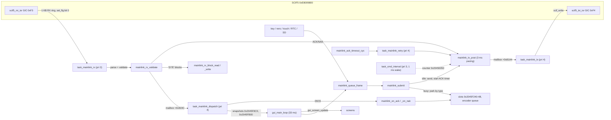
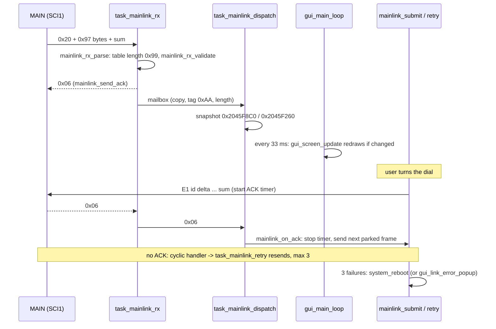
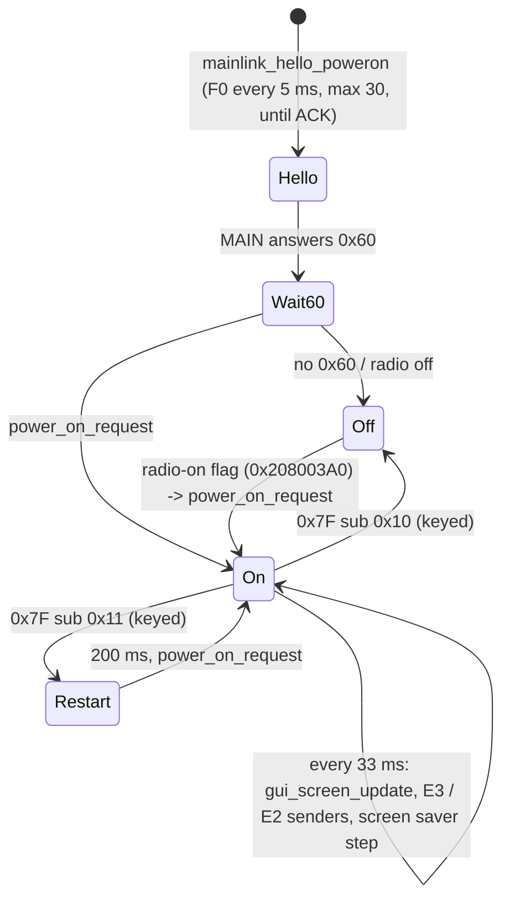

Back to the [DISPLAY overview](README.md).

# DISPLAY: the UART link to MAIN (T11b)

The DISPLAY CPU (RZ/A1H) talks to the MAIN CPU (RX651 SCI1) over one UART, SCIF5 (0xE8009800). MAIN owns the radio state. It streams
**status frames** that tell the DISPLAY what to draw, and the DISPLAY sends back **events** (keys, touch, encoders, RTC, SD card). This page
covers the driver, the frame format, every command in both directions, the tasks, the ACK/retry rules and how the GUI uses the frames.
The MAIN side is in [../main/display-link.md](../main/display-link.md) (T10b). Where this page cites MAIN code, the addresses are from `decomp/main/`.

Addresses are CPU addresses (image base 0x20100000). Names in `code` are the current Ghidra names. Function names are the names applied in Ghidra (`tools/ghidra/names_display.tsv`, merged by T17) and match `decomp/display/`; a name still in *italics* is a description that was not applied as a Ghidra name. Both were applied to a private
copy of the project to check them: 13 entries created, 1 late start fixed, 110 names applied, 0 failures.

## 1. Summary

- **Wire format [fact]:** `cmd, payload[n], sum8`. There is no start byte and no length on the wire. The receiver gets `n` from the command
  byte through a 43-entry table (0x20450074). `sum8` is the 8-bit sum of `cmd` and the payload. ACK (0x06), NAK (0x15) and ESC (0x1B) are
  single bytes with no checksum. The 0xAA "marker" is only a tag in the in-memory buffer header (`buf+4`). It is never transmitted:
  `task_mainlink_tx` writes from `buf+8`.
- **Line [fact]:** 345600 baud nominal, 8 data bits, no parity, 2 stop bits. MAIN's SCI1 setting gives 340 909 bit/s, 1.4 % below nominal, which is within UART tolerance **[inference]** ([system.md C1](../system.md#8-contradictions-and-open-questions)). DISPLAY: `scif_open(0x54600, 8, 0, 2)`, SCBRR 0x16 with SEMR
  0x81. MAIN: `R_SCI1_Create` 0xFFF9354E sets SMR 0x08 (STOP = 1) and BRR 10.
- **Every table frame is acknowledged [fact].** Each side sends one frame and waits for 0x06 before it sends the next. The DISPLAY retries 3
  times. If all 3 fail it either shows an error box or resets MAIN and then itself through the watchdog.
- **The GUI is driven by snapshots [fact].** The dispatcher copies every MAIN frame into 0x2045F8C0. The GUI loop (every 33 ms) compares the
  snapshot with the frame it last drew (0x208F0B2A) and redraws by command byte.

## 2. Block and task structure



### Tasks and kernel objects (created by `mainlink_init` 0x201163A0) [fact]

| Task / object | Descriptor | Entry | Pri | Role |
|---|---|---|---|---|
| `cmd_interval_sem` | 0x20165860 | | | Protects the pacing counter 0x20450050 (ID in 0x20450054) |
| cmd_interval | 0x2016589C | `task_cmd_interval` 0x2011509C | 3 | Woken every 1 ms by periodic-wakeup slot 3. Decrements 0x20450050 |
| `cmd_waiting_sem` | 0x20165870 | | | Protects the encoder queue (ID in 0x20450058) |
| uart | 0x20165880 | `cpp_task_thunk` → `mainlink_obj_run` 0x20158B10 | 7 | Binds SCIF5, starts the 3 sub-tasks, opens the port, then sleeps |
| uart | 0x20165938 | → `task_mainlink_tx` 0x201586AC | 4 | TX mailbox → `scif_write`, then `mainlink_trace` |
| uart | 0x2016591C | → `task_mainlink_dispatch` 0x201600A8 | 4 | Handles received frames. **New entry** (Ghidra had it 4 bytes late as FUN_201600ac) |
| uart | 0x20165900 | → `task_mainlink_rx` 0x2015EC40 | 3 | Reads SCIF5 and re-assembles frames |
| event flag | 0x201658B8 | | | RX event flag (obj+0x14). The RXI ISR sets bit 0, `mainlink_rx_ctrl` sets bits 0x4000/0x8000 |
| event flag | 0x201658F4 | | | Retry flag 0x2045004C |
| retry | 0x201658D8 | `task_mainlink_retry` 0x201161BC | 4 | Resends on ACK timeout |
| cyclic handler | 0x201658C4 | `mainlink_ack_timeout_cyc` 0x20116390 | | cyctim 5, created by kernel call `FUN_2014ec30` (acre_cyc). Started by `FUN_20151680`, stopped by `FUN_20151878`. ID in 0x20450064 |

`mainlink_init` runs in both the standby and the full boot paths (boot-rtos.md §3), so the link is up even when the radio is "off".

### The C++ link object (0x2045FD40, 0x103C0 bytes, vtbl 0x20427FD0) [fact]

`mainlink_init` clears it and calls `mainlink_obj_ctor` 0x20158C10. Pointer in 0x20450060.

| Offset | Sub-object | vtbl (run method) | Contents |
|---|---|---|---|
| +0x10 | | | UART object pointer (`scif5_get` → 0x208DB280) |
| +0x14 | | | RX event flag ID |
| +0x18 | RX | 0x20427FF8 (`task_mainlink_rx`) | +0x10 uart, +0x14 TX, +0x18 dispatcher, counters +0x1C reads, +0x20 resyncs, +0x28 frames, +0x2C ACKs sent, +0x30 NAKs sent, +0x38 overflow length |
| +0x58 | dispatcher | 0x20428030 (`task_mainlink_dispatch`) | 32 × 0x408-byte buffers, free list at +0x8114, mailbox at +0x819C (obj+0x81F4), counters +0x81A0.. |
| +0x8218 | TX | 0x20427FAC (`task_mainlink_tx`) | 32 × 0x408-byte buffers, free list at +0x811C, mailbox at +0x81A4 |

Buffer header (all pools): `+4 u16 = 0xAA` (tag), `+6 u16 = length on the wire`, `+8` bytes to send / bytes received **[fact]**.

## 3. SCIF driver [fact]

`scif5_get(flag)` calls `uart_obj_init(0x208DB280, 0xE8009800, rxi_desc 0x201657C8, txi_desc 0x201657B4, flag)`. This creates both ISRs the
first time and re-binds the RX event flag on later calls (the update code uses this to take over the port). The objects for SCIF3/4/5 are at
0x208DA1E0 / 0x208DAA30 / 0x208DB280 and share the vtbl 0x2042803C:

| Address | Ghidra name | Purpose |
|---|---|---|
| 0x201630CC | `scif_open` | `(baud, bits, parity, stop)`: SCSMR (bits 7 → CHR, parity 1/2 → PE/PM, stop ≠ 1 → STOP). Below 345600 baud SCBRR = 64 MHz/(32·baud) − 1, at 345600 SCBRR = 0x16 and SEMR \|= 0x81. Resets FIFOs and counters |
| 0x20163098 | `scif_start` | vtbl+4: `scif_open`, then enables the RXI/TXI GIC lines |
| 0x20163014 | `scif_irq_off` | vtbl+8 |
| 0x20163654 | `scif_has_flag` | vtbl+0xC: true when an RX flag is bound (the TX task waits for this) |
| 0x20163038 | `scif_read` | vtbl+0x10: non-blocking copy out of the 1 KB RX ring (obj+0xC, indices +8/+0xA) |
| 0x20163218 | `scif_read_timeout` | vtbl+0x18: retries `scif_read` every 1 ms, up to n times |
| 0x201632D8 | `scif_write` | vtbl+0x24 (**new entry**): copies into the 1 KB TX ring (obj+0x410), sets SCSCR.TIE. Returns 0 if it does not fit |
| 0x20163280 | `scif_flush` | vtbl+0x28: empties both rings |
| 0x20162DD8 | `scif_rxi_isr` | one byte per interrupt into the RX ring. Counts errors and overflows. Masks RXI and `set_flg(obj+0x818, 1)` |
| 0x20162F10 | `scif_txi_isr` | (**new entry**, Ghidra had merged it into the RXI handler) one byte from the TX ring to SCFTDR. Clears TIE when the ring is empty |
| 0x201148A4 / 0x201148AC | `scif5_rxi_isr` / `scif5_txi_isr` | GIC 0xF3 / 0xF4 stubs: `r0 = 0x208DB280`, branch to the common handler (**new entries**) |
| 0x20114894 / 0x2011489C | `scif4_rxi_isr` / `scif4_txi_isr` | GIC 0xEF / 0xF0 |
| 0x20114884 / 0x2011488C | `scif3_rxi_isr` / `scif3_txi_isr` | |

## 4. Frame format and the command table

```
wire:    | cmd | payload (table length n) | sum8 |      sum8 = (cmd + payload bytes) & 0xFF
ACK/NAK: | 0x06 |  or  | 0x15 |                     (1 byte, no checksum; 0x1B ESC also 1 byte)
memory:  +0 link | +4 u16 0xAA | +6 u16 n+2 | +8 cmd payload sum8
```

**[fact]** DISPLAY: `mainlink_submit` 0x201150F8 and `mainlink_tx_raw` 0x20115BE0 sum `buf[8 .. 8+len-2]` into the last byte. MAIN:
`FUN_fff9c5d8` sums `buf[0 .. len-2]` into the last byte, and `FUN_fff95277` gives the expected RX length (cmd + payload + sum) of each
DISPLAY command. **MAIN checks the checksum** (`FUN_fff9c60f`, NAK on mismatch). **The DISPLAY does not**: `mainlink_rx_validate` only
range-checks fields **[fact: no sum loop in the RX path; inference that a bad sum is accepted when the fields are in range]**.

The table at 0x20450074 (`.data`, 43 × 12 bytes) is `{u16 cmd, u16 n, u8 no_ack, u8 pad[3], u32 rx_count}`. All `no_ack` bytes are 0, so
every table frame is ACKed. `rx_count` is incremented for each valid frame **[fact]**. A second copy of the first 26 entries (only the MAIN →
DISPLAY commands) is at 0x2080893C, used by the debug replay (§9).

### MAIN → DISPLAY

Senders are MAIN functions (all end in `FUN_fff9c5b2(len)`, buffer 0x1456). They are picked by MAIN's scheduler `FUN_fff95f58`, which
falls back to 0x20 when nothing else is pending. The validation column refers to `mainlink_rx_validate` 0x2015E6F4 / `mainlink_status_valid`
0x2015E354. The DISPLAY use column refers to `task_mainlink_dispatch` and `gui_screen_update` 0x2012EBB8.

| cmd | n | MAIN sender | DISPLAY use | Meaning |
|---|---|---|---|---|
| 0x20 ' ' | 0x97 | `FUN_fff9c42a` (default) | redraw of the main screen | Base **radio status block** (0x97 bytes, range-checked by `mainlink_status_valid`). Every status frame below starts with it, and the command-specific part starts at offset 0x98 **[fact for the layout]** |
| 0x21 '!' | 3 | not found in MAIN V01-12 | copy into 0x20450035, `led_set_one`(b1, b2)` (P6 pin from a table) | **[guess]** LED / output select |
| 0x23 '#' | 0x35 | `FUN_fff98e39/58/77` | `FUN_20131354` text line (bit 7 of byte 1 = flag), 0x208084D4 = 1 | **[guess]** text/message line (decoder or memo) |
| 0x24 '$' | 0x9D | `FUN_fff9a17d` | copy of the tail into 0x2045006D. Backlight `backlight_set` (PWM 0xFCFF022A, 0..100 %), `dimmer_set`, `gui_apply_display_cfg` | **Display settings**: EXT DISPLAY / PIXEL / SCU-LAN10 bits, keyboard language, mouse speed, TFT brightness, LED dimmer, contrast **[fact, MAIN `displink_build_24`]**; [layout](../main/display-link.md#0x24-display-settings-0x9f-bytes-display-mainlink_get_settings24-gui_apply_display_cfg) (#179) |
| 0x30 '0' | 0x9E | `FUN_fff98ecb` | `scr_select_popup` | status + pop-up code at +0x98 (0 METER, 1 ATT, 2 IPO, 3 DNF, 4 AGC, 5 MODE, 6 SPAN, 9/0xA scope audio, 0xB COLOR, 0xC BAND, 0xD SPEED; 0xFF none) and its values; [layout](../main/display-link.md#0x30-select-pop-up-and-0x31-value-pop-up) (#179) |
| 0x31 '1' | 0xA1 | `FUN_fff98ecb`, `FUN_fff98f7c` | `scr_value_popup` | status + function id at +0x98 (pop-up code − 0x1E, the `0x37` id space) and a 9-character value text at +0x99; [layout](../main/display-link.md#0x30-select-pop-up-and-0x31-value-pop-up) (#179) |
| 0x34 '4' | 0xA1 | `FUN_fff98ecb`, `FUN_fff98f7c` | `scr_info` | status + 2 small fields |
| 0x37 '7' | 0x23E | `FUN_fff9ab2a` | `scr_func_panel` | largest status frame (574 B): **FUNC panel**, 41 slots of {flag, function id, 8-character value} from +0x9B (the GUI draws 33); [layout](../main/display-link.md#0x37-func-panel-0x240-bytes-display-scr_func_panel) (#179) |
| 0x39 '9' | 0xE7 | `FUN_fff9b69e` | `scr_vfo`, `FUN_201293f8` | status + **message-memory screen** (voice / CW / text memories: title, state, channel, volumes, 5 slot labels); [layout](../main/display-link.md#0x39-message-memory-screen-0xe9-bytes-display-scr_vfo--fun_201293f8) (#179) |
| 0x3A ':' | 0xA0 | `FUN_fff9a8e3` | (special paths in `gui_screen_update`) | status + **PlayList** sub-state at +0x98 (0 open, 1 list, 2 command, 3 delete, 4 volume) with list position, cursor and command; [layout](../main/display-link.md#0x3a-playlist-0xa2-bytes-display-scr_playlist) (#179) |
| 0x3F '?' | 3 | `FUN_fff9a89b` | `rec_start_stop` | short frame, byte 1 < 2 |
| 0x40 '@' | 0x1F9 | `FUN_fff9aaad` | main screen. Five 0x2D-byte text slots at +0x11A. Slot text "FIRMWARE UPDATE" + SD card + touch → firmware-update mode (0x20800494) | status + **menu page** from MAIN `menu_page_serialize` (title, 8 tabs, 5 rows of 45 bytes from +0x119) **[fact]**; [layout](../main/display-link.md#0x40-menu-page-0x1fb-bytes-display-main-screen-scr_text_list) (#179) |
| 0x41 'A' | 0x144 | `FUN_fff9bb23` | status redraw | status + **MEMORY CH LIST** (header, group, 4 rows of 36 bytes from +0xB5); [layout](../main/display-link.md#0x41-memory-ch-list-0x146-bytes-display-scr_memory_list) (#179) |
| 0x42 'B' | 0xFD | not found | accepted, stored only | **[unknown]** |
| 0x43 'C' | 0x21 | `FUN_fff98bcd` (variable length) **[inference]** | `scr_sd_menu` overlay with 0x21 bytes | **[guess]** pop-up text |
| 0x44 'D' | 5 | (block-transfer code) | `mainlink_rx_block_read` 0x2010EEB4 → reply C4 | **MAIN reads** a block of the 32000-byte buffer 0x208116A6: `id, off u16 BE, len u16 BE` |
| 0x45 'E' | 0x105 | (block-transfer code) | `mainlink_rx_block_write` 0x2010EDE8 → reply C5 | **MAIN writes** up to 0xFF bytes into 0x208116A6: `id, off, len, data` |
| 0x50 'P' | 0xF3 | `FUN_fff9a2d1` | status redraw | status + **on-screen keyboard** (layout byte, cursor, title, text); [layout](../main/display-link.md#0x50-on-screen-keyboard-0xf5-bytes-display-scr_keyboard) (#179) |
| 0x60 '`' | 0xB4 | `FUN_fff96225`, sent after the F0 hello | copy into 0x2045FB00 + flag 0x20450026. Byte 0xE = 1/2/3 (MAIN boot error: 2 = DSP, 3 = SDR) shows the `ERROR CODE : 00n` screen (`FUN_201322AC`), #60. u16 at +0xD = 0xDB sets 0x20450029 ("show error box instead of reset") | **Power-up / identity frame** (status block at +0xF) |
| 0x62 'b' | 0x195 | `FUN_fff9c46d` (after F0 key code 2) | status redraw | status + **alignment menu** (cursor row, 9 lines of 25-character label + 3-character value); [layout](../main/display-link.md#0x62-alignment-menu-0x197-bytes-display-scr_setup_menu) (#179) |
| 0x64 'd' | 1 | `FUN_fff986e0` | `scr_lcd_test` 0x20125F6C: black, white, red, green, blue, colour bars | **LCD test pattern** (service) **[fact for the drawing]** |
| 0x65 'e' | 7 | `FUN_fff9a0cc` | `rtc_set_from_main` 0x2012E8F4 (BCD YY MM DD hh mm, clamped) | **set the DISPLAY RTC** from MAIN **[inference]** |
| 0x70 'p' | 0xE1 | `FUN_fff98925` | status redraw (special overlay rules) | status + **dialog** (style, buttons, selected button, x/y, ROM text); [layout](../main/display-link.md#0x70-dialog-0xe3-bytes-display-scr_confirm--confirm_dialog_draw) (#179) |
| 0x71 'q' | 6 | not found | byte 1 must be 0x81..0x82 or < 3 (checked), stored only | **[unknown]** |
| 0x7A 'z' | 3 | `FUN_fff988f2` | `screen_capture_bmp`, then replays the saved frame | **take a screenshot** to SD **[fact for the call]** |
| 0x7B '{' | 3 | `FUN_fff9889c` (toggles MAIN flag +0x82) | sets 0x208F0B2B = byte 1, `scr_screen_saver` every GUI pass | **screen saver on/off** **[inference]**. A key/touch/encoder then sends E4 |
| 0x7C '\|' | 3 | `FUN_fff98869` | `touch_calibration(1)` | **touch calibration screen**. Leaving it sends E5 |
| 0x7F | 9 | `FUN_fff98797` | sub 0..2 / 0x80: accepted. Sub 0x10 / 0x11 need the 8-byte key `9B BA F6 38 FF 25 73 1F` (0x20450285): link frozen (0x2080049C = 1), TX state reset, 0x20800492 = sub | **Power down (0x10) / restart (0x11)** of the GUI **[inference]**: `gui_main_loop` leaves its loop and waits for power-on |
| 0x1B ESC | 0 | | 0x2045005C = 1 | **[unknown]** |

### DISPLAY → MAIN

All go through `mainlink_queue_frame` 0x20115494 → `mainlink_submit`. The MAIN handler is reached from `FUN_fff95331`.

| cmd | n | DISPLAY sender | MAIN handler | Meaning |
|---|---|---|---|---|
| 0xE0 | 4 | `mainlink_send_key` 0x20113294, `mainlink_send_touch_key` 0x20120E9C, `mainlink_send_e0` 0x20121858 | `FUN_fff95829` → `key_event_filter(code, flags)` | **Key / soft-key event**: `flags` (bit 0 = release, 0x40/0x41 for code 0x1016), `code` u16 BE. The DISPLAY treats codes 0x0300 / 0x030F specially (power-key path **[guess]**) |
| 0xE1 | 5 | `mainlink_send_enc` 0x20115780 (from `mainlink_renc_event` 0x20115B04) | `FUN_fff9588b` | **Encoder**: `id, delta s8, …`. id 1/6 = main dial (0xFF0), 2 → 0xFF1, 3 → 0xFF2, 4/5 = ADC knobs |
| 0xE2 | 5 | `mainlink_send_sd_state` 0x20121D00, `mainlink_send_ui_e2`, `mainlink_send_sd_absent` 0x20160ED8 (byte 1 = 0 when the SD menu finds no card) | `FUN_fff95bf4` (+0xA6) | **SD card present** (byte 1), on change |
| 0xE3 | 7 | `mainlink_send_rtc` 0x20121D90 | `FUN_fff95ed3` (+0xAD..+0xB1) | **RTC date/time** (S-35190A read), when the minute changes |
| 0xE4 | 3 | `mainlink_queue_frame` (while 0x7B is shown), `mainlink_renc_event`, `FUN_201217b0` | `FUN_fff95c6a` (clears +0x82) | **leave the screen saver** |
| 0xE5 | 3 | `mainlink_send_key` (after 0x7C), `FUN_20121318`, `touch_cal_step` | `FUN_fff95c74` (clears +0x80) | **leave touch calibration / a modal screen** **[inference]** |
| 0xE6 | 3 | `mainlink_send_e6` 0x20121830 | `FUN_fff95c8a` → `FUN_fffb2da6(1..3)` | **beep request**: MAIN calls `beep_request`(1..3) **[inference from the MAIN handler]** |
| 0xE7 / 0xE8 | 8 | `FUN_20124744`, `FUN_20124848`, `FUN_201248a4`, `FUN_20124adc`, `FUN_20124bc0` | `FUN_fff95cbc` / `FUN_fff95dad` (+0x488 / +0x48C states 1..5) | **audio status** of the PlayList (E7) and voice-message (E8) screens: b1 = 0 file count, 1 state (0 stopped, 1 playing, 2 recording), 0xFF error index **[fact]**; MAIN's per-code actions in [E7 / E8 result codes](../main/display-link.md#e7--e8-result-codes-179) (#179) |
| 0xC3 | 0x21 | `FUN_20134978`..`FUN_20134a08`, `mainlink_send_ui_c3` | `FUN_fff95e65` (copies into +0x2ED) | 0x21-byte settings/name record **[guess]** |
| 0xC4 | 0x105 | `mainlink_rx_block_read` | `FUN_fff95e97` | reply to 'D': `id, off, len, data` |
| 0xC5 | 5 | `mainlink_rx_block_write` | `FUN_fff95e97` | reply to 'E': `id, off, len` |
| 0xF0 | 8 | `mainlink_send_hello` 0x201162A4 | `FUN_fff9546a` | **Hello**: `01 08` (version V01-08), `20 23 06 29` (date), key code at power-up. MAIN stores the version/date text and answers with 0x60. Key code 1 = `settings_defaults(0)` (**reset**), 7 = `dest_code_set` (swap destination code), 2 = start 0x62 page, 4/5 = other start modes, 6 = sent only by `mainlink_hello_key6` 0x2011668C from `logo_fade_in` (boot combination 6, maintenance/loader screen) and by the MAIN-update writer to the new MAIN; MAIN then marks the link down and stays off **[fact for the call path; T14]** |
| 0xF1 | 6 | update code (`0x2010dcbc…` / `0x201090a0…` files, T11c). `mainlink_send_f1` has no caller | `FUN_fff957e6`: sub 1 → `FUN_fffa1576`, 2 → `FUN_fff9d94d`, 3, 0x83 | **Bridge / update control**: switches MAIN into the 'Z'-frame tunnel used to update other CPUs (MAIN `FUN_fffa0c79`, ended by F1 82) **[inference]** |
| 0xFA | 1 | none found | none (MAIN `FUN_fff95277` has no 0xFA, so a frame would be NAKed) | **[unknown]**, unused |
| 0xB3 | 0 | `FUN_20131638` (cmd + sum only) | in `FUN_fff95331` (`FUN_fff95ec9`) but `FUN_fff95277` returns length 0 → NAK | not in the DISPLAY table. Probably dead in this firmware pair **[inference]** |
| 0x06 / 0x15 | — | `mainlink_send_ack` 0x2015EE40 / `mainlink_send_nak` 0x2015EE84 | `FUN_fff9541e` / nothing | ACK / NAK |

MAIN's RX length table (`FUN_fff95277`) and the DISPLAY table agree for every command they share (C3 0x23, C4 0x107, C5 7, E0 6, E1 7, E2 7,
E3 9, E4–E6 5, E7/E8 10, F0 10, F1 8) **[fact]**. MAIN also knows 0xFD (length 0xB), which the DISPLAY never sends.

### Where the DISPLAY's own version comes from and where it shows (#85) [fact]
The DISPLAY image holds its version and date as **4 + 2 BCD bytes in `.rodata`**, not as text: 0x20165A3C–0x20165A3D = `01 08`
(V01-08) and 0x20165A3E–0x20165A41 = `20 23 06 29` (2023-06-29); file offsets 0x65A3C–0x65A41. There is no `"V01-08"` string in the
image. Two functions copy these bytes into a frame 0xF0 (literal pools 0x20116324–0x20116330 and 0x2010DBD0–0x2010DBDC; no other
literal points at them):
- `mainlink_send_hello` 0x201162A4, at power-up: `F0 01 08 20 23 06 29 <key code>`;
- `rx_boot_program` 0x2010D50C, after it has reprogrammed MAIN over the RX boot interface (0x2010D83C–0x2010D88C builds the same frame).

MAIN (`displink_rx_F0_hello` 0xFFF9546A) turns b1, b2 into the text `"Vxx-yy"` at 0x1436 (`ver_display`) and b4..b6 into
`"yy-mm-dd"`. From there it shows up in two places:
- **CAT `VE1;`** (`cat_ext_VE` 0xFFFA54B3) → `VE10108;` (confirmed on the radio, [cat-commands.md](../../cat-commands.md));
- **frame 0x60** (`displink_build_60` 0xFFF96241): MAIN sends all four versions back as BCD pairs, and the DISPLAY keeps them at
  0x208F4BF4..0x208F4BFA (`fw_installed_versions_set`), which the firmware-update menu shows as the installed version and compares
  with the file versions to pre-mark newer files ([update.md](update.md)).

So a normal-mode version marker for a modified DISPLAY image is the two bytes at file offset 0x65A3C (and, if wanted, the date at
0x65A3F–0x65A41; MAIN ignores the century byte 0x65A3E): CAT `VE1;` and the update menu then report it. A value above the next real release would stop that release from being
pre-marked in the update menu (it can still be ticked by hand) **[inference from the compare]**.

## 5. One exchange



## 6. TX path, ACK and retries [fact unless tagged]

1. `mainlink_queue_frame` 0x20115494 filters by mode. In firmware-update mode (0x20800494/0x20800496) only E6 and selected E0 codes pass.
   On the '{' screen a key becomes E4. The "FIRMWARE UPDATE" menu entry with the power-key code arms update mode.
2. `mainlink_submit` 0x201150F8: F0/F1 are sent at once with no ACK wait. In maintenance mode (0x2080049C) everything else is dropped.
   If no ACK is pending (0x2045002A == 0), the frame is copied to 0x2045EFC0 (for resend), its cmd is stored (0x2045002D), it is posted, and
   the ACK timer starts. Otherwise the frame is **parked**: one slot per type (E3, E4, E5, F1, E2, E6, E7, E8, C3, C4, C5 at 0x20470100..
   with flags 0x2045F240..0x2045F24B), plus a 10-entry ring for E0 (0x20470117). Any other command arriving while busy is dropped.
3. E1 encoders (`mainlink_send_enc`): while an ACK is pending the event is merged into a per-encoder queue (7 × 10 × 5 bytes at
   0x2045F0C5, counts 0x2045F224, mask 0x2045002B). When the queue is full, the deltas of ids 1–3 are summed (clamped to ±127) and ids 4–5
   keep the newest value. So fast dial turns are never lost, only coalesced.
4. `mainlink_tx_post` 0x20158744 waits until the pacing counter 0x20450050 is 0, posts to the TX mailbox and sets the counter to 3.
   `task_cmd_interval` counts it down once per 1 ms wake-up, so **frames are at least ~3 ms apart** **[inference: slot-3 period 1 ms, boot-rtos.md]**.
5. ACK (0x06) → `mainlink_on_ack` 0x2011606C: clear the retry flag, stop the cyclic handler, clear "pending", send the next parked frame
   (`mainlink_flush_parked` 0x20115CFC, in the order above), then the oldest queued encoder (`mainlink_flush_enc` 0x20115F5C).
6. NAK (0x15) → `mainlink_on_nak` 0x201160B4: resend at once (E1 from 0x20450068, others from 0x2045EFC0), up to 3 times.
7. No answer: `mainlink_ack_timeout_cyc` (cyctim 5; at the 10 ms tick ≈ 10 ms **[inference]**) sets flag 0x2045004C bit 0.
   `task_mainlink_retry` then resends, up to 3 times (0x2045002C).
8. After 3 failures: if the 0x60 frame had 0xDB at +0xD (0x20450029), `gui_link_error_popup` 0x201309C0 shows the unanswered command in hex.
   Otherwise `system_reboot` 0x20114DF4 drives the MAIN reset / boot pins (`gpio_rx_reset`, P4_3, P8_5, P11_2, P10_4) and then
   resets the DISPLAY itself with `wdt_system_reset` 0x20100268 (WTCSR/WRCSR sequence at 0xFCFE0000).

MAIN mirrors this **[fact, `FUN_fff94d6f` / `FUN_fff951ff`]**. It sends ACK or NAK for each DISPLAY frame (NAK on bad length or checksum),
waits for 0x06 after each of its own frames, and resends up to 3 times on its retry timer.

## 7. RX path [fact]

`task_mainlink_rx` 0x2015EC40 waits on the RX flag (bits 0x0001 data, 0x4000/0x8000 reset). Normally it waits forever, but with a partial
frame it waits only 2 ms. It reads up to 256 bytes into a 1 KB re-assembly buffer, and `mainlink_rx_parse` 0x2015EB90 looks at the first byte:

- 0x06 sets 0x20450028 (hello acknowledged), then 0x06 / 0x15 / 0x1B are delivered as 1-byte frames.
- a table command: `mainlink_rx_frame` 0x2015EEC8 waits for `n + 2` bytes, runs `mainlink_rx_validate`, bumps the table counter,
  sends 0x06 and calls `mainlink_rx_deliver` 0x2015E9B8. A frame that fails validation is consumed without an ACK, so MAIN times out and resends.
- an unknown byte: the whole buffer is dropped.
- 3 timeouts with a partial frame, or more than 600 bytes pending: NAK and resync.

`mainlink_rx_deliver` logs the frame (`mainlink_trace`), keeps the cmd (RX obj+0x24), handles 'D' and 'E' itself and posts everything else
to the dispatcher. `task_mainlink_dispatch` 0x201600A8 (r7 = 0x2045006D, r6 = 0x20450024):

| cmd | Action |
|---|---|
| 0x06 / 0x15 | `FUN_20130968`, then `mainlink_on_ack` / `mainlink_on_nak` |
| 0x1B | 0x2045005C = 1 |
| 0x20 / 0x43 | counters only |
| 0x21 | payload → 0x20450035, flag 0x20450025 |
| 0x23 | 0x208084D4 = 1 |
| 0x24 | 6 bytes from +0x98 → 0x2045006D, flag 0x20450024 |
| 0x60 | flag 0x20450026, copy → 0x2045FB00. On the 2nd and later 0x60 with byte 0xB3 = 1 and the radio off, `FUN_20117288(1)` (radio-on flag 0x208003A0). Byte 0xB3 is MAIN's 0x9DC5, which `PS1;` sets before it sends this frame: this is how CAT `PS1;` powers the radio on (#57) |
| all but 06/15/1B | copy → 0x2045F260 and **0x2045F8C0** (the GUI snapshot, 0x240 bytes) |

## 8. How the GUI is driven

`gui_start` ends in `gui_main_loop` 0x20130188, which runs in `task_root`. That task holds periodic-wakeup slot 0 (33 ms).



`gui_screen_update` 0x2012EBB8 calls `mainlink_get_last_frame`, compares the snapshot with the frame on screen (0x208F0B2A, 0x240 bytes, the
GUI's "current screen" — its first byte is the command, used all over the GUI code), and dispatches on the new command (table in §4). Then it
copies the new frame over 0x208F0B2A. When the GUI has set 0x20800488 (after 0x7A or E4), it first calls `mainlink_inject_rx` 0x20116560 with
the saved frame at 0x208F0FCB. That function looks up the length in the command table and **posts the frame to the dispatcher mailbox as if
MAIN had sent it**, which redraws the previous screen. It does not transmit anything, so the old name `mainlink_inject_rx` is misleading
**[fact]**.

## 9. Debug aids [fact]

- **Frame trace**: `mainlink_trace` 0x20111480 stores every sent and received frame (timestamp 0x208001CC + up to 252 bytes) in a
  2048 × 256-byte ring in frame-buffer layer 4. `mainlink_trace_toggle`, `mainlink_trace_pause` and `mainlink_trace_dump`
  (→ `I:\debug_1.log`, "`%-6d: ` + hex") are called from `task_keycode` (USB keyboard, see input.md/T11f). Whether that path is behind
  `debug_enabled` is not checked here.
- **Replay**: `debug_replay_send_cmd` 0x20134FDC (old name `debug_replay_send_cmd`) runs in task `test_disp` when its flag is set
  (`test_disp_start`, from `keycode_line`). It reads `I:\FT-710\DEBUG_RECV_CMD\SEND_CMD.TXT`, lines `NNN:hh hh … hh:DDDD` (length, bytes,
  delay in ms), keeps only MAIN commands (table 0x2080893C), and writes each one into the GUI snapshot with `mainlink_set_last_frame`. This
  is a "fake MAIN" for testing screens without a radio. The matching writer `debug_log_recv_cmd` 0x201352E8 (→ `RECV_CMD.TXT`) has no caller.

## 10. The unused SCIF4 link [fact]

`uart4_link_init` 0x20114F4C would build a second link object (0x2045D4E0, vtbl 0x20427FE4, tasks `uart4`) on SCIF4 at 38400 baud.
`uart4_obj_run` 0x20158C44 probes with 0xF0 bytes (5 two-byte answers), sets 0x2045001C, then sends `1E 00 31` and `1F 00 32`. It has **no
caller** (B/BL/literal scan of the whole image), so in V01-08 SCIF4 is never started, and `uart4_send` (used by `task_keycode`, `FUN_20130c90`,
`FUN_20131638`) would use a null object pointer **[inference: those paths must not be reached]**. `update_dsp` waits on 0x2045001C/0x2045001D
for it (T11c). The SCIF4 pins probably go to the unpopulated `ACC_UMOSI/UMISO` accessory bus **[guess]**.

## 11. Functions

| Address | Ghidra name | Purpose |
|---|---|---|
| 0x201163A0 | `mainlink_init` | semaphores, cmd_interval task, link object, uart task, retry flag/task, cyclic handler |
| 0x20158C10 | `mainlink_obj_ctor` | link object constructor |
| 0x20158B10 | `mainlink_obj_run` | uart task: sub-objects, 3 tasks, `scif_open(345600, 8, 0, 2)` |
| 0x201586AC | `task_mainlink_tx` | TX task |
| 0x20158630 / 0x20158744 | `mainlink_tx_alloc` / `mainlink_tx_post` | TX buffer pool, paced post |
| 0x2015EC40 | `task_mainlink_rx` | RX task |
| 0x2015EB90 / 0x2015EEC8 | `mainlink_rx_parse` / `mainlink_rx_frame` | framing by table length |
| 0x2015E6F4 / 0x2015E354 | `mainlink_rx_validate` / `mainlink_status_valid` | field range checks, 0x7F key |
| 0x2015E9B8 | `mainlink_rx_deliver` | trace, D/E, post to the dispatcher |
| 0x2015EE40 / 0x2015EE84 | `mainlink_send_ack` / `mainlink_send_nak` | |
| 0x201600A8 | `task_mainlink_dispatch` | received-frame actions and GUI snapshots |
| 0x20160278 | `mainlink_disp_post` | post to the dispatcher mailbox |
| 0x20115494 | `mainlink_queue_frame` | public send API, mode filters |
| 0x201150F8 | `mainlink_submit` | checksum, send-or-park |
| 0x20115BE0 / 0x20115C74 | `mainlink_tx_raw` / `mainlink_tx_e1_raw` | resends |
| 0x20115780 / 0x20115B04 | `mainlink_send_enc` / `mainlink_renc_event` | encoder events |
| 0x2011598C / 0x20115A48 | `pot5_filter` / `pot4_filter` | ADC-knob change filters |
| 0x20115CFC / 0x20115F5C | `mainlink_flush_parked` / `mainlink_flush_enc` | after an ACK |
| 0x2011606C / 0x201160B4 | `mainlink_on_ack` / `mainlink_on_nak` | |
| 0x20116140 | `mainlink_tx_reset` | clears all TX state |
| 0x2011509C | `task_cmd_interval` | 3 ms pacing |
| 0x201161BC | `task_mainlink_retry` | timeout resends |
| 0x20116390 | `mainlink_ack_timeout_cyc` | cyclic handler |
| 0x20114DF4 | `system_reboot` | resets MAIN, then the DISPLAY via WDT |
| 0x201162A4 / 0x201165F4 / 0x2011668C | `mainlink_send_hello` / `mainlink_hello_poweron` / `mainlink_hello_key6` | F0 hello |
| 0x20116518 | `mainlink_rx_ctrl` | used by the update code to take over / give back SCIF5 |
| 0x2010EDE8 / 0x2010EEB4 | `mainlink_rx_block_write` / `mainlink_rx_block_read` | 'E' / 'D' block transfer |
| 0x20116560 | `mainlink_inject_rx` → `mainlink_inject_rx` | local replay into the dispatcher |
| 0x20115000..0x201150EC | `mainlink_get_last_frame`, `mainlink_get_frame60`, `mainlink_set_last_frame`, … | snapshot accessors (see TSV) |
| 0x20111480 | `mainlink_trace` | frame trace ring |
| 0x20134FDC | `debug_replay_send_cmd` → `debug_replay_send_cmd` | SEND_CMD.TXT replay |
| 0x20130188 / 0x2012EBB8 | `gui_main_loop` / `gui_screen_update` | GUI side |
| 0x201148B4 | `scif5_get` | SCIF5 UART object |
| 0x20162FAC | `uart_obj_init` | binds registers, ISRs, RX flag |

The full list (110 names, with the SCIF driver, the senders and the SCIF4 object) is in `tools/ghidra/names_display.T11b.tsv`.

## 12. Globals

| Address | Meaning |
|---|---|
| 0x20450074 | command table, 43 × `{u16 cmd, u16 n, u8 no_ack, pad, u32 rx_count}` |
| 0x20450285 | 8-byte key for 0x7F sub 0x10/0x11: `9B BA F6 38 FF 25 73 1F` |
| 0x20450024 / 25 / 26 | "new 0x24 / 0x21 / 0x60 frame" flags |
| 0x20450027 | firmware-update menu armed |
| 0x20450028 | hello (F0) acknowledged |
| 0x20450029 | on link failure show an error box instead of resetting (0x60 frame +0xD = 0xDB) |
| 0x2045002A / 2B / 2C / 2D | ACK pending / encoder-queue mask / retry count / cmd waiting for ACK |
| 0x2045002E / 2F | E0 ring write / read index |
| 0x20450035 | payload of the last 0x21 frame |
| 0x20450038 | length of the frame kept for resend |
| 0x2045004C | retry event flag ID |
| 0x20450050 / 54 | pacing counter / its semaphore |
| 0x20450058 | encoder-queue semaphore |
| 0x2045005C | 0x1B (ESC) received |
| 0x20450060 | pointer to the link object 0x2045FD40 |
| 0x20450064 | ACK-timeout cyclic handler ID |
| 0x20450068 | last E1 frame (resend copy) |
| 0x2045006D | settings from the last 0x24 frame |
| 0x2045EFC0 | last non-E1 frame (resend copy, 0x105 B) |
| 0x2045F0C5 / 0x2045F224 | encoder queue / per-encoder counts |
| 0x2045F240..0x2045F24B, 0x20470100..0x20470292 | parked-frame flags and buffers |
| 0x2045F260, 0x2045F8C0 | latest MAIN frame (0x240 B), the second one is the GUI snapshot |
| 0x2045FB00 | latest 0x60 frame |
| 0x208F0B2A | frame currently shown by the GUI (0x208F0B2B = screen-saver flag of a 0x7B frame) |
| 0x208F0FCB | saved frame that `mainlink_inject_rx` replays |
| 0x208116A0 / A2 / A4 / A6 | block transfer: id ('A'/'C' save, 'B'/'D' load), size, position, 32000-byte buffer |
| 0x20800492 | 0x7F sub-command for `gui_main_loop` |
| 0x20800494 / 0x20800496 | firmware-update modes (filter in `mainlink_queue_frame`) |
| 0x20800495 | link in normal operation (encoders are sent only then) |
| 0x2080049C | maintenance mode after a keyed 0x7F (only F0/F1 are sent) |
| 0x208001D4..0x208001E0 | trace ring state |

## Further functions (T23g)

Named functions of this subsystem that the tables above did not list yet, one row each (T23g, found with `tools/doc_table_gaps.py`). The purpose is the plate comment of the name in `tools/ghidra/names_*.tsv` (or the `Ifdsp*Names.java` / `*.lib.tsv` entry); rows marked *code shape* have no comment there and give what the decompile shows: the direct callees, the first string, the size and the caller count. Tags as in the names files; a comment without a tag is an inference from the code.

| Address | Ghidra name | Purpose |
|---|---|---|
| 0x201148D8 | `scif4_get` | UART object on SCIF4 (0xE8009000) **[inference]** |
| 0x201148FC | `scif3_get` | UART object on SCIF3 (0xE8008800) **[inference]** |
| 0x20114EDC | `uart4_wait_ready` | waits for 0x2045001C; no caller **[inference]** |
| 0x20114F4C | `uart4_link_init` | creates the SCIF4 object 0x2045D4E0 and task "uart4"; no caller **[inference]** |
| 0x20116334 | `mainlink_send_f1` | F1 frame with one sub-command byte; no caller in V01-08 **[inference]** |
| 0x20116368 | `mainlink_stat_rx_resync` | RX task resync counter (obj+0x38) **[inference]** |
| 0x2011637C | `mainlink_stat_nak_sent` | RX task NAK counter (obj+0x48) **[inference]** |
| 0x20116660 | `mainlink_clear_status` | clears the 0x60 snapshot and the 0x24 settings copy **[inference]** |
| 0x20121830 | `mainlink_send_e6` | calls `mainlink_queue_frame`; 40 B, callers: 13 **[fact]** (code shape) |
| 0x20121858 | `mainlink_send_e0` | E0 with a given flag byte and 16-bit code **[inference]** |
| 0x20121C3C | `scr_screen_saver` | packet 0x7B: YAESU logo hopping between 3 places every 180 frames **[inference]** |
| 0x20121D00 | `mainlink_send_sd_state` | E2 SD card present, on change **[inference]** |
| 0x20121D90 | `mainlink_send_rtc` | E3 RTC date/time, every 10th GUI pass when the minute changed **[inference]** |
| 0x20125F6C | `scr_lcd_test` | packet 0x64: full-screen test colours and 8 colour bars **[inference]** |
| 0x2012E8F4 | `rtc_set_from_main` | packet 0x65: BCD date/time -> RTC **[inference]** |
| 0x201309C0 | `gui_link_error_popup` | draws the link error box with the unanswered command as hex **[inference]** |
| 0x20130C40 | `mainlink_set_power_cmd` | 0x20800492 = 0x7F sub-command (0x10 / 0x11 end the GUI loop) **[inference]** |
| 0x201351B8 | `debug_cmd_line_write` | writes one such line **[inference]** |
| 0x201352E8 | `debug_log_recv_cmd` | appends a frame to RECV_CMD.TXT; no caller in V01-08 **[inference]** |
| 0x2015863C | `mainlink_tx_init` | 32 x 0x408 B buffer pool + mailbox **[inference]** |
| 0x2015869C | `mainlink_tx_clear_stats` | no direct calls; 16 B, callers: 1 **[fact]** (code shape) |
| 0x201587AC | `mainlink_tx_ctor` | vtbl 0x20427FAC **[inference]** |
| 0x20158930 | `task_uart4_rx` | passes raw bytes to FUN_20131154 **[inference]** |
| 0x201589F4 | `uart4_tx_alloc` | calls `FUN_201644ac`; 12 B, callers: 3 **[fact]** (code shape) |
| 0x20158A00 | `uart4_tx_init` | calls `FUN_20158618`, `FUN_20162d10`, `FUN_20164460`, `FUN_201644a0`; 96 B, callers: 1 **[fact]** (code shape) |
| 0x20158A70 | `task_uart4_tx` | calls `FUN_20158a60`, `itron_dly_tsk`, `itron_trcv_mbx`; 108 B, callers: 0 **[fact]** (code shape) |
| 0x20158ADC | `uart4_tx_post` | calls `FUN_20162d3c`; 16 B, callers: 3 **[fact]** (code shape) |
| 0x20158C44 | `uart4_obj_run` | 38400 baud; probes with 0xF0 bytes, then sends 1E 00 31 / 1F 00 32 **[inference]** |
| 0x20158E8C | `uart4_obj_ctor` | vtbl 0x20427FE4 **[inference]** |
| 0x2015E16C | `mainlink_valid_7f` | byte & 0x7F <= 12 or == 0x7F **[inference]** |
| 0x2015EB3C | `mainlink_valid_code` | small code-set check used by mainlink_status_valid **[inference]** |
| 0x2015EB74 | `mainlink_rx_bind` | (uart, tx, dispatcher) **[inference]** |
| 0x2015EB80 | `mainlink_rx_clear_stats` | no direct calls; 16 B, callers: 1 **[fact]** (code shape) |
| 0x2015EFE4 | `mainlink_rx_ctor` | vtbl 0x20427FF8 **[inference]** |
| 0x2015FFF0 | `task_uart4_dispatch` | only counts **[inference]** |
| 0x2016003C | `mainlink_disp_alloc` | calls `FUN_201644ac`; 12 B, callers: 2 **[fact]** (code shape) |
| 0x20160048 | `mainlink_disp_init` | 32 x 0x408 B pool + mailbox **[inference]** |
| 0x20160288 | `mainlink_disp_ctor` | vtbl 0x20428030 **[inference]** |
