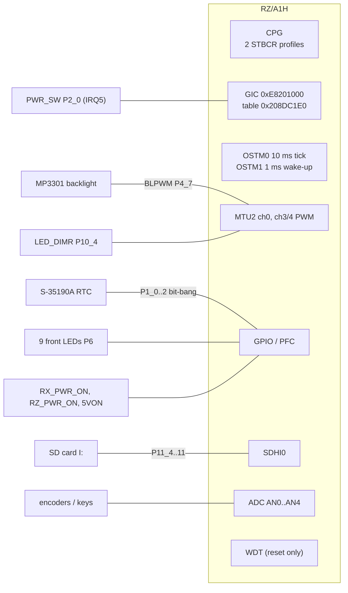
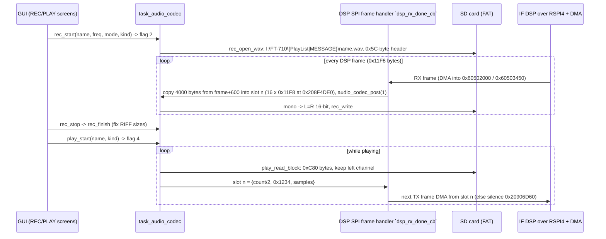

# DISPLAY: clocks, pins, interrupts, RTC, recorder and other peripherals (T11g)

Back to the [DISPLAY overview](README.md). Addresses are CPU addresses (image base 0x20100000). Names in backticks are current Ghidra names.
Function names are the names applied in Ghidra (`tools/ghidra/names_display.tsv`, merged by T17) and match `decomp/display/`; a name still in *italics* is a description that was not applied as a Ghidra name. Function entries the project
is missing are listed in `tools/ghidra/entries_display.T11g.tsv`. Register names are from the RZ/A1H hardware manual. The STBCR bits, the GIC
IDs, the TINT pins, the RSPI pin functions and the TCLK pins were checked against **R01UH0403EJ0700 Rev.7.00** (#82; table numbers
below); other bit meanings from that manual are still tagged **[inference]**.

## Summary

| Area | What the firmware does | Key functions |
|---|---|---|
| Kernel | **NORTi** µITRON 4.0 kernel from MiSPO: the string `NORTi(c)MiSPO` is at 0x20156290 **[fact]**. The file system (`fsys_sem`, `fsys_mpf`, `FSYS Work`, `fat_sem`) and the USB host (`udevtsk%d`, `UHHID`) look like the matching MiSPO middleware **[inference]** | see [boot-rtos.md](boot-rtos.md) |
| Clocks | Clock mode 1 from the 48 MHz USB_X1 crystal. FRQCR 0x0035; P0φ = 32 MHz (the OSTM periods prove this); two module-stop profiles (standby / full) | `cpg_set_clock_profile`, `cpg_early_init` |
| Pins | `pinmux_init` sets up 159 pins. The decoded table and schematic nets are below | `pinmux_init`, `gpio_cfg_alt` |
| Interrupts | GIC with 587 IDs, a handler table at 0x208DC1E0 and 39 registered sources | `gic_init`, `gic_dispatch` |
| RTC | External ABLIC **S-35190A**, bit-banged over P1_0..P1_2. The on-chip RTC is unused (RTC_X1 is grounded) | `rtc_init`, `rtc_get_datetime` |
| "audio_codec" | **No codec on DISPLAY** (AUDIO_X1 grounded, no SSIF/SCUX register access). The task is a **WAV recorder/player** for SD files. Audio samples travel inside the DSP SPI frames | `task_audio_codec`, `rec_start`, `play_start` |
| SD user files | `I:\FT-710\{Capture, MemList, Menu, PlayList, MESSAGE}`: BMP screenshots, memory-channel and menu backups (`.dat`), WAV recordings | `task_sdmenu`, `sdmenu_save_file` |
| Backlight / LEDs | MTU2 PWM for the TFT backlight (BLPWM) and the LED dimmer, 9 front-panel LEDs on P6 | `backlight_set`, `dimmer_set`, `led_set_mask` |
| Watchdog | Not used as a watchdog. The WDT is only used to **reset the chip** (WTCNT = 0xFF in reset mode) | `wdt_system_reset` |
| USB | USB0 and USB1 in **host** mode only. The only class driver is HID (`UHHID`); details are in [input.md](input.md) | `usbh_hw_init` |

## 1. Clocks (CPG)

`cpg_early_init` (0x20116CCC) runs from `Reset_Handler`, before `main` **[fact]**. It writes:

| Register | Value | Meaning |
|---|---|---|
| PL310 0x3FFFFF80 | 1 | L2 cache power control (standby enable) **[inference]** |
| FRQCR 0xFCFE0010 | 0x0035 | Same divider field as Renesas' reference value 0x1035, without CKOEN. Gives I : G : B : P1 : P0 = 1 : 2/3 : 1/3 : 1/6 : 1/12 **[inference]** |
| FRQCR2 0xFCFE0014 | 0x0001 | |
| SYSCR3 0xFCFE0408 | 0x0F | on-chip RAM pages 0–3 writable **[inference]** |
| STBCR2..STBCR12 | as profile 1 below | |

OSTM0 counts 320000 per 10 ms and OSTM1 32000 per 1 ms (`ostm_init`, `periodic_wakeup_start`), so **P0φ = 32 MHz** **[fact from the code]**. With the
1/12 ratio this gives a PLL of 384 MHz = 48 MHz × 8, a CPU clock of **384 MHz**, B = 128 MHz and P1 = 64 MHz **[inference]**. The hardware strap note
"MD_CLK:1" (USB_X1 as source) fits this (docs/hardware.md).

`cpg_set_clock_profile(n)` (0x201020A0) writes **STBCR2 (0xFCFE0024) and STBCR3..STBCR12 (0xFCFE0420–0xFCFE0444)** from a byte-pair table at
0x2016517C. Each register has two entries, one for profile 0 and one for profile 1 **[fact]**. Bit meanings checked against R01UH0403EJ0700 section 55.2 (STBCR2..STBCR13); the ADC needs both MSTP31 (analog supply, STBCR3) and MSTP67 (clock, STBCR6) **[fact, #82]**. (boot-rtos.md calls the first one FRQCR. It is STBCR2.) A 1 bit stops a module.

| Register | Profile 0 (standby, `task_root`) | Profile 1 (full, `power_on_full_init`, also `cpg_early_init`) | Running in profile 0 **[inference: RZ/A1H bit map]** |
|---|---|---|---|
| STBCR2 | 0x6A | 0x6A | |
| STBCR3 | 0xF4 | 0x00 | MTU2 (bit 3), ADC analog supply (bit 1, MSTP31), motor-control PWM timer (bit 0, MSTP30) |
| STBCR4 | 0xDB | 0x00 | SCIF2, **SCIF5** (MAIN link) |
| STBCR5 | 0xFC | 0x00 | **OSTM0, OSTM1** |
| STBCR6 | 0x7E | 0x00 | ADC (bit 7), RTC (bit 0) |
| STBCR7 | 0xFC | 0x24 | USB0, USB1 (bits 1–0); profile 1 sets the reserved bits 5 and 2 |
| STBCR8 | 0xFF | 0x05 | none (profile 1 stops EthernetAVB, bit 2, and reserved bit 0) |
| STBCR9 | 0xFF | 0x00 | none (RIIC0–3, SPIBSC, VDC5 stopped) |
| STBCR10 | 0x57 | 0x00 | RSPI0, RSPI2, RSPI4 |
| STBCR11 | 0xFF | 0xC0 | none |
| STBCR12 | 0xF7 | 0xF0 | SDHI00 (bit 3) |

Other CPG users: `userdef_riic0_init`/`fd1c`/`fdac`/`fe34` clear the RIIC0..3 bits in STBCR9 (bits 7..4) before they open the bus. `vdc5_module_start` /
`vdc5_module_stop` (0x20132320 / 0x20132398) use STBREQ2 (0xFCFE0034) / STBACK2 (0xFCFE0044) and STBCR9 bits 1–0 for the VDC5. `sdhi0_clock_on`
(0x2013FE50) clears STBCR12 bits 3–2 **[fact for the register writes]**.

## 2. Pin multiplexing

`pinmux_init` (0x20101190) is a flat list of calls to five per-pin helpers. Ghidra drops the repeated register arguments, so the table was decoded from the
instructions with `tools/t11g_pinmux_decode.py` **[fact]**. The helpers use a table of port base pointers at 0x20800000 (Pn); the other registers sit
at fixed offsets from it: PM +0x300, PMC +0x400, PFC +0x500, PFCE +0x600, PFCAE +0xA00, PIBC +0x4000, PBDC +0x4100, PIPC +0x4200.

| Helper | Effect |
|---|---|
| `gpio_cfg_input` `gpio_cfg_input` | port mode, input buffer on |
| `gpio_cfg_out_low` `gpio_cfg_out_low` / `gpio_cfg_out_high` `gpio_cfg_out_high` | port mode, output, initial level |
| `gpio_cfg_alt` `gpio_cfg_alt`(port, pin, func, mode)` | PMC = 1, alternative function `func` (PFCAE:PFCE:PFC = func−1); mode 0 = PIPC (peripheral sets the direction), 1 = in, 2 = out, 3 = bidirectional |
| `gpio_cfg_reset` `gpio_cfg_reset` | back to the reset state |

Nets are from the DISPLAY schematic (service manual p62, read at 500 dpi). "alt n" is the PFC function number. The peripheral column is **[inference]**
when it comes from the alt number, and **[fact]** when the driver code uses that block.

| Port.pin | Setting | Net (p62) | Peripheral / use |
|---|---|---|---|
| P0_0..P0_5 | in, in, out, out, in, in | BOOT0, BOOT1, MD_CLK, MD_CLKS, GND, GND | mode straps |
| P1_0 / P1_1 / P1_2 | out low | RTC_DT / RTC_CK / RTC_CS | S-35190A bit-bang **[fact]** |
| P1_3 | alt 4 | TINT | IRQ3 = GIC 35 (touch) **[inference]** |
| P1_4 / P1_5 | alt 1 bidir | TSCL / TSDA | RIIC (TSC2003), see [input.md](input.md) |
| P1_8, P1_9, P1_11, P1_12, P1_14 | alt 1 | AN0, AN1, AN3, AN4, AN6 (TP6009) | ADC **[fact: `adc_read_all`]** |
| P1_10, P1_13, P1_15 | in | AN2, –, – | |
| P2_0 | alt 6 | PWR_SW | **IRQ5** = GIC 37, `powon_isr` **[fact]** |
| P2_1..P2_6 | in | – | |
| P2_7 | out low | FT4222_RESET | `gpio_ft4222_reset` |
| P2_8..P2_11 | alt 8 | DSP_SCLK / SS / MOSI / MISO | **RSPI4**: RSPCK4 / SSL40 / MOSI4 / MISO4 (DSP link); P2_9 is also TINT33 **[fact, manual]**, see [spi-links.md](spi-links.md) |
| P2_12..P2_15 | alt 2 | ACC_FS / SCLK / MISO / MOSI | RSPI from the FT4222H |
| P3_0, P3_6 | in | KEY1, KEY2 | keys |
| P3_1 / P3_3 | alt 3 | ENC3_A / ENC2_A | P3_3 = IRQ4 edge input of firmware encoder **id 3** (`renc_irq4_isr` compares PPR3 bits 3 and 5) **[fact]**. P3_1 (ENC3_A): no ISR or reader found, so ENC3 is unused or unfitted **[inference]**. See the note below the table |
| P3_2 / P3_5 | in | ENC3_B / ENC2_B | P3_5 = B phase of encoder id 3, read in `renc_irq4_isr` **[fact]** |
| P3_4 | alt 1 | LCD_DEN | VDC5 (`lcd_pins_enable`) |
| P3_8..P3_15 | alt 1 | R0..R7 | VDC5 RGB |
| P4_0 / P4_1 | alt 1 | G0 / G1 | VDC5 RGB |
| P4_2, P4_4, P4_5 | in | – | |
| P4_3 | out low | RX_UPDATE | MAIN boot mode (`gpio_rx_update`) |
| P4_6 | out low | LCD_STBY | `lcd_power` |
| P4_7 | alt 3, out | BLPWM | MTU2 TIOC4D backlight PWM **[inference]** |
| P4_8..P4_15 | alt 1 | B0..B7 | VDC5 RGB |
| P5_0..P5_7 | (not in `pinmux_init`) | RA±, RB±, RC±, RCK± | LVDS, `lvds_pins_enable` sets alt 1 |
| P5_8 / P5_9 | out low | DVR1 / DVR0 | `gpio_dvr`, to the MAIN DVI chain |
| P5_10 | in | – | |
| P6_0 / P6_1 | in | – | |
| P6_2 / P6_3 | alt 7 | ACC_UMISO / ACC_UMOSI | SCIF (accessory UART, test points) |
| P6_4, P6_5, P6_8, P6_9 | out low | LED_D_BLUE, LED_D_GREEN, LED_D_RED, LED_D_WHITE | LEDs |
| P6_6 / P6_7 | alt 5 | DISP_UMISO / DISP_UMOSI | **SCIF5** MAIN link **[fact]** |
| P6_10..P6_14 | out low | LED_POWER, LED_STEPCH, LED_TX, LED_VOX, LED_RXBUSY | LEDs |
| P6_15 | in | – | |
| P7_0..P7_8 | in | BOOT2, – | |
| P7_9 / P7_11 | out low, then high in `main` | RX_PWR_ON / RZ_PWR_ON | power latch (`gpio_p7_9_11`) **[inference]** |
| P7_10 | out low | RX_RESET | `gpio_rx_reset` |
| P7_12 | out low | SDPWS | SD power switch, `sd_power` |
| P7_13..P7_15, P8_0, P8_9 | in | KDAT0..KDAT3, KDAT4 | key matrix inputs |
| P8_1, P8_2, P8_7, P8_8 | out low | KSCAN0..KSCAN3 | key matrix scan |
| P8_3..P8_6 | alt 3 | SDR_SCLK / SS / MOSI / MISO | **RSPI2**: RSPCK2 / SSL20 / MOSI2 / MISO2 (SDR link); P8_4 is also TINT119 **[fact, manual]** |
| P8_10 | out low | USB0_EN | `gpio_usb0_en` (0x20101DA4) |
| P8_11 / P8_12 / P8_13 | in | USB0_PG / USB_DET / USB1_PG | |
| P8_14 | out low | 5VON | `gpio_p8_14` (1 on the full path) |
| P8_15, P9_1 | in | ENC1_S, ENC2_S | encoder push switches |
| P9_0 | alt 4 | ENC1_A | MTU2 phase-counting clock input of encoder id 2 (MTU2 ch2) **[inference]**, see the note below |
| P9_2..P9_7 | alt 2 | QF_CLK, QF_CSn, QF_DAT0..3 | SPIBSC0 (`spibsc0_pins_init` does them again) |
| P10_0 / P10_1 / P10_3 | alt 2 | ENC0_A / ENC0_B / ENC1_B | MTU2 phase-counting clock inputs: ENC0 = encoder id 1 (main dial, MTU2 ch1), ENC1_B = encoder id 2 (MTU2 ch2) **[inference]**, see the note below |
| P10_4 | alt 2, out | LED_DIMR | MTU2 TIOC0A dimmer PWM **[inference]** |
| P10_5 / P10_6 | in | KEY_PTT / KEY_FAST | |
| P10_8..P10_13 | alt 5 | G7..G2 | VDC5 RGB |
| P10_14 | out low | LCD_PWR_EN | `lcd_power` |
| P11_2 | out high | QF_RESETn | `gpio_qf_reset` |
| P11_4..P11_11 | alt 2 | SD_CD, SD_WP, SD_DAT1, SD_DAT0, SD_CLK, SD_CMD, SD_DAT3, SD_DAT2 | **SDHI0** **[fact: driver uses 0xE804E000]** |
| P11_13 / P11_14 | in | VSYNC / HSYNC (pulled down) | unused |
| P11_15 | (not in `pinmux_init`) | LCD_CLK | `lcd_pins_enable` sets alt 5 |

**Encoder pins vs. [input.md](input.md#rotary-encoders-and-pots) (T14).** The two pages describe two layers of the same thing, so they do not contradict each other. input.md gives the counters: encoders 1 and 2 are MTU2 ch1/ch2 in phase-counting mode (`renc_mtu2_init` 0x20112AEC) and encoder 3 is IRQ4 with P3_3/P3_5 **[fact]**. This table gives the pins. The schematic numbers the encoders from 0, so schematic ENC*n* is firmware id *n*+1: ENC2 on P3_3/P3_5 is id 3 **[fact: `renc_irq4_isr` reads PPR3 bits 3 and 5]**. ENC0 (P10_0/P10_1) and ENC1 (P9_0/P10_3) are the only other encoder pins put in a peripheral function (`pinmux_init`: `gpio_cfg_alt(10,0,2)`, `(10,1,2)`, `(10,3,2)`, `(9,0,4)`), so they must be the MTU2 TCLK inputs of ch1 and ch2 **[inference]**. **Settled (#82, R01UH0403EJ0700 pin-function table and MTU2 pin table) [fact]:** P10_0 alt 2 = TCLKA, P10_1 alt 2 = TCLKB, P9_0 alt 4 =
TCLKC, P10_3 alt 2 = TCLKD; TCLKA/TCLKB are channel 1's phase-counting A/B inputs and TCLKC/TCLKD channel 2's. So **ENC0 (P10_0/P10_1)
is MTU2 ch1 = encoder id 1 (main dial)** and ENC1 (P9_0/P10_3) is ch2 = id 2.

Cross-check against docs/hardware.md: everything listed there matches (RTC P1_0..2, TINT/TSCL/TSDA P1_3..5, DSP P2_8..11, ACC P2_12..15, FT4222_RESET
P2_7, RX_UPDATE P4_3, DISP UART P6_6/7, RX_RESET P7_10, SDR P8_3..6, QF P9_2..7, QF_RESETn P11_2). The power latch nets RX_PWR_ON / RZ_PWR_ON on P7_9 / P7_11, 5VON on P8_14,
SDPWS, the LED pins and the key matrix are new and could go into hardware.md (see the T11g task file).

### GPIO wrappers used at run time
| Address | Ghidra name | Purpose |
|---|---|---|
| 0x20101C10 | `lcd_power` | LCD_DEN/LCD_CLK alt, LCD_STBY, LCD_PWR_EN |
| 0x20101DEC | `lvds_pins_enable` | P5_0..7 LVDS on/off |
| 0x20101B60 | `backlight_enable` | P4_7 BLPWM alt 3 + P10_4 |
| 0x20101FA4 / 0x20102040 | `led_set_one` / `led_set_mask` (`led_set_one` / `led_set_mask`) | front LEDs. Mask bit 0..7 = D_RED, D_GREEN, D_WHITE, D_BLUE, RXBUSY, TX, STEPCH, VOX **[fact for the pin table, schematic for the names]** |
| 0x20101D70 / 0x20101D94 | `sd_power` / `sd_card_detect` (`sd_power` / `sd_card_detect`) | P7_12 / P11_4 |
| 0x20101DC4 | `gpio_dvr` | DVR0/DVR1 |
| 0x20101C74, 0x20101CA4, 0x20101CBC, 0x20101F8C | `gpio_rx_update`, `gpio_rx_update_b`, `gpio_qf_reset`, `gpio_ft4222_reset` | single pins |
| 0x20114DF4 | `system_reboot` | FS off, LCD/LVDS off, RX_RESET pulse, QF reset, then `wdt_system_reset` |

## 3. Interrupts (GIC)

`gic_init` disables everything, sets ICFGR (edge/level) from constants, gives IDs 0–15 their own priorities and every other ID
0xF8, targets CPU 0, fills the 587-entry handler table 0x208DC1E0 with `gic_default_handler`, sets PMR = 0xF8 and enables the
distributor **[fact]**. `IRQ_Handler` → `gic_dispatch` reads IAR, pushes ID and running priority on a 32-deep nesting stack (0x208DCB8C / 0x208DCB0C),
raises PMR and returns the handler. `gic_irq_exit` writes EOIR and restores PMR **[fact]**.

There are two ways to register a handler:
- `itron_acre_isr(T_CISR {attr, exinf, intno, isr, prio})`: copies a 0x58-byte stub (`gic_install_isr_stub` `gic_install_isr_stub`) into the handler
  slot and sets GICD_IPRIORITYR = prio << 3 **[fact]**.
- `gic_def_inh` (`gic_def_inh`(intno, {attr, handler, prio})`): stores the handler directly **[fact]**.

Then `gic_enable_irq` sets the enable bit, and `gic_disable_irq` clears it.

The complete set of sources found (all static descriptors, the three SCIF objects of `uart_obj_init`, and the three `def_inh` calls). The ID → source
mapping was checked row by row against the RZ/A1H interrupt-ID table (R01UH0403EJ0700 section 7.5) **[fact, #82]**; the TINT
rows also against its TINT pin table (TINT33 = P2_9, TINT119 = P8_4).

| GIC ID | Source | ISR (entry) | Pri | Registered by | Page |
|---|---|---|---|---|---|
| 35 (0x23) | IRQ3, touch TINT P1_3 | `tsc2007_tint_isr` 0x201033E8 (it is the ISR, not a set-up function) | 5 | `touch_init` | [input.md](input.md) |
| 36 (0x24) | IRQ4, encoder pin | `renc_irq4_isr` | 5 | `renc_init` | [input.md](input.md) |
| 37 (0x25) | IRQ5, PWR_SW P2_0 | `powon_isr` 0x20113FDC | 5 | `powon_init` | [boot-rtos.md](boot-rtos.md) |
| 44 / 45 / 46 (0x2C–0x2E) | DMAC ch3 / ch4 / ch5 end | 0x20137490 (sets a flag) / 0x201376C4 / 0x201374A0 (callback pointers) | 5 | `dmac4_rspi4_rx_setup`… (DMA set-up) | [spi-links.md](spi-links.md) |
| 50 / 51 (0x32, 0x33) | DMAC ch9 / ch10 end | 0x20137AEC / 0x20137D1C (callbacks) | 5 | `dmac9_rspi_tx_setup` | [spi-links.md](spi-links.md) |
| 73 / 74 (0x49, 0x4A) | USBI0 / USBI1 | 0x2013B58C / 0x2013B598 → `FUN_201396b0(port)` | 8 | `gic_def_inh` in `usbh_brdy_handler` area | [input.md](input.md) |
| 78 (0x4E) | VDC5 ch0 **GR3_VLINE0** (graphics 3 line interrupt) | `FUN_20118638` | 5 | `textterm_clear` area | [gui.md](gui.md) |
| 134 (0x86) | OSTM0 | `ostm0_tick_isr` (10 ms tick) | 5 | `ostm_init` | [boot-rtos.md](boot-rtos.md) |
| 135 (0x87) | OSTM1 | `periodic_wakeup_isr` (1 ms) | 5 | `periodic_wakeup_start` | [boot-rtos.md](boot-rtos.md) |
| 189 / 190 / 191 | RIIC0 TEI / RI / TI | 0x201203E4 / 0x201203D4 / 0x201203DC → 0x20120CB0 / 0x20120C04 / 0x20120C54 (ch 0) | 9 | `userdef_riic0_init` | [input.md](input.md) |
| 197 / 198 / 199 | RIIC1 TEI / RI / TI | 0x201203FC / 0x201203EC / 0x201203F4 (ch 1) | 9 | `userdef_riic1_init` | |
| 205 / 206 / 207 | RIIC2 TEI / RI / TI | 0x20120414 / 0x20120404 / 0x2012040C (ch 2) | 9 | `userdef_riic2_init` | |
| 213 / 214 / 215 | RIIC3 TEI / RI / TI | 0x2012042C / 0x2012041C / 0x20120424 (ch 3) | 9 | `userdef_riic3_init` | |
| 235 / 236 | SCIF3 RXI / TXI | 0x20114884 / 0x2011488C | 10 | `uart_obj_init` (0x208DA1E0) | [mainlink.md](mainlink.md) |
| 239 / 240 | SCIF4 RXI / TXI | 0x20114894 / 0x2011489C | 10 | `uart_obj_init` (0x208DAA30) | [mainlink.md](mainlink.md) |
| 243 / 244 | SCIF5 RXI / TXI (MAIN link) | 0x201148A4 / 0x201148AC | 10 | `uart_obj_init` (0x208DB280) | [mainlink.md](mainlink.md) |
| 271 / 272 | RSPI0 SPRI / SPTI | 0x2011ECDC / 0x2011ECD4 → 0x2011F840 / 0x2011F89C (ch 0) | 10 | RSPI open (`FUN_2011d25c` file) | [spi-links.md](spi-links.md) |
| 274 / 275 | RSPI1 SPRI / SPTI | 0x2011ECEC / 0x2011ECE4 | 10 | | |
| 277 / 278 | RSPI2 SPRI / SPTI | 0x2011ECFC / 0x2011ECF4 | 10 | | |
| 279 / 280 / 281 | RSPI3 SPEI / SPRI / SPTI | 0x2011ED0C (SPRI) / 0x2011ED04 (SPTI); 279 is enabled with no handler of its own | 10 | | |
| 283 / 284 | RSPI4 SPRI / SPTI | 0x2011ED1C / 0x2011ED14 | 10 | | |
| 303 (0x12F) | SDHI0 **SDHI0_0** (302 = SDHI0_3, 304 = SDHI0_1) | 0x2013FDE0 → `sdhi0_buf_isr` | 7 | `gic_def_inh` in `sdhi0_irq_enable` area | [update.md](update.md) |
| 449 (0x1C1) | TINT33 = **P2_9**, the DSP link's SS pin (SSL40) | 0x20133418 → `rspi_start`(4)`, frame counter 0x208085AC | 5 | `link_ss_irq_init` | [spi-links.md](spi-links.md) |
| 535 (0x217) | TINT119 = **P8_4**, the SDR link's SS pin (SSL20) | 0x201333F0 → `rspi_start`(2)`, frame counter 0x208085A8 | 5 | `link_ss_irq_init` | [spi-links.md](spi-links.md) |

The two TINT rows: the TINT numbers follow from IDs 416 + n **[inference]**. The DSP/SDR assignment rests on the RSPI channel the ISR serves: RSPI4 carries
the DSP audio frames (DMA to/from 0xE800E804, section 5) and RSPI2 is then the SDR link **[inference]**. Which pin of the group it is (most likely SS, the end-of-frame
edge) is **[guess]**. Most ISR entries above are not functions in the current project; `entries_display.T11g.tsv` adds them.

## 4. RTC: S-35190A on P1_0..P1_2

The chip is driven by bit-banging PSR1 (0xFCFE3104): P1_0 = DT, P1_1 = CK, P1_2 = CS. Data goes LSB first, about 20 spin loops per half-clock (`rtc_delay`), and the
DT pin is switched to input for reads (`rtc_dt_input` / `rtc_dt_output`) **[fact]**. Every transfer holds the mutex created by `rtc_init`
(0x20800368) **[fact]**. The command byte is `0110 C2 C1 C0 R/W` sent LSB first, so the code's constants are bit-reversed: 0x26/0xA6 = real-time data 1 write/read
(7 BCD bytes y m d w h m s), 0x66/0xE6 = real-time data 2 (h m s), 0x86|reg / 0x06|reg = status 1, status 2, INT1, INT2 **[inference from the
datasheet layout, fits the byte counts]**.

| Address | Ghidra name | Purpose |
|---|---|---|
| 0x201147D4 | `rtc_init` | idle port, status1 = 2 (24-hour), status2 = 0; called in `task_root` common part (step 3 in boot-rtos.md) |
| 0x20114400 / 0x20114340 | `rtc_read_datetime_raw` / `rtc_write_datetime_raw` | 7 BCD bytes; hour bit 6 (AM/PM) masked on read |
| 0x2011446C / 0x201143A0 | `rtc_read_time_raw` / `rtc_write_time_raw` | 3 bytes |
| 0x20114658 / 0x20114608 | `rtc_get_datetime` / `rtc_set_datetime` | GUI clock and MAIN messages |
| 0x20114528 / 0x20114564, 0x2011459C / 0x201145D8 | `rtc_get_date` / `rtc_set_date`, `rtc_get_time` / `rtc_set_time` | BCD fields; used by the GUI, screen-capture and backup file names, and the debug `date` command |
| 0x201146B4 | `rtc_get_tm` | `struct tm` for FAT time stamps (called from the FS layer at 0x2014E14C..) |
| 0x201144D8 | `rtc_minutes_of_day` | h·60 + m |
| 0x20114778 / 0x201147B4 | `rtc_read_status` / `rtc_int_setup` | status/INT registers; `rtc_int_setup` runs on MAIN message 0x62 |
| 0x20114168 / 0x201141E4 / 0x20114268 / 0x201142CC | `rtc_send_byte` / `rtc_recv_byte` / `rtc_read_reg` / `rtc_write_reg` | low level |

## 5. Voice recorder / player (task "audio_codec")

The DISPLAY board has no audio hardware (AUDIO_X1 is grounded on p62; no SSIF, SCUX or SPDIF register is touched). The `audio_codec` task (`task_audio_codec`
0x201065C4, pri 5, created by `audio_codec_init` with event flag 0x208000C8 and mailbox 0x208000C4) records and plays **WAV files on the SD card**. The audio
samples travel inside the **DSP SPI frames** **[fact]**:

- **File format** **[fact]** (`rec_open_wav` 0x20106248): RIFF/WAVE, `fmt ` PCM, **2 channels, 16000 Hz, 16 bit** (64000 B/s), a `LIST` chunk of 0x28 bytes
  with an `ICMT` comment of 0x20 bytes, then `data`. The recorder writes each mono sample twice, so L = R. `rec_finish` pads to 4 bytes and rewrites the sizes.
- **Two kinds** **[fact]**. Kind 1 = `I:\FT-710\PlayList` (receive-audio recordings). Their comment is "`<frequency>,<mode>`": the frequency comes from 8 digits
  formatted `%c%c.%c%c%c.%c%c%c`, the mode from the table at 0x20165274 (LSB, USB, CW-L, CW-U, AM, AM-N, FM, FM-N, DATA-L, DATA-U, DATA-FM, D-FM-N, RTTY-L,
  RTTY-U, PSK). Kind 2 = `I:\FT-710\MESSAGE` (voice messages), named after the file. They stop at **0x57E400 bytes = 90 s**, both when recording and when
  playing. A new MESSAGE file first deletes the old file of the same name.
- **Playback**: 0xC80-byte blocks (25 ms), fast forward / rewind ±320000 bytes = **5 s**, progress text `%02d:%02d:%02d` + percent (`play_progress`) **[fact]**.
- **Guards**: recording is refused when drive I: has no free space (`sd_is_full`, error −2) or the card is missing (`FUN_20103ba0`, error −1) **[fact]**. The
  flags 0x208000B1 (playing) and 0x208000B2 (recording) are read by the GUI (0x20129F64 file) and by two other checks (0x2011446C and
  0x201587FC files), which skip an action while recording **[fact for the reads, inference for the purpose]**.

| Address | Ghidra name | Purpose |
|---|---|---|
| 0x20105C78 / 0x201065C4 | `audio_codec_init` / `task_audio_codec` | task; flag 2 = record, flag 4 = play |
| 0x201058DC / 0x20105A20 | `rec_start` / `rec_stop` | GUI API |
| 0x20105A54, 0x20105AE8, 0x20105B28, 0x20105B68, 0x20105BA8, 0x2010579C | `play_start`, `play_resume`, `play_pause`, `play_ffwd`, `play_rewind`, `play_stop` | GUI API (set 0x208000D4 = 1..4 and wait for the state) |
| 0x20105790 / 0x201058C0 | `audio_state` / `audio_error` | state 0/2/4/8/0x10/0x20, error code |
| 0x20105550 / 0x201057D8 | `wav_list_dir` / `wav_delete` | ≤ 255 files, name ≤ 20 chars, 0x34-byte entries, sorted |
| 0x20106248, 0x201061C8, 0x20106060, 0x20106018 | `rec_open_wav`, `rec_write`, `rec_finish`, `rec_close_abort` | writer |
| 0x201052B0, 0x20105158, 0x20105D24, 0x20105F2C, 0x2010508C | `wav_open_read`, `wav_check_header`, `play_read_block`, `play_seek`, `play_close` | reader |
| 0x20106DC8 | `audio_codec_post` | mailbox send from the frame handler |
| 0x201331DC | `dsp_rx_done_cb` | DSP SPI DMA frame-end handler: swaps RX buffers, feeds recorder/player (owned by T11d) |

## 6. SD card user files

Drive `I:` is the SD card on SDHI0 (driver `sdhi_*` 0x20140148–`sdhi0_buf_isr`, T23e round 2, power `sd_power`, detect `sd_card_detect`). The FAT layer (FAT12/16/32
and exFAT names at 0x20148F20, the `fsys_*` semaphores and `fs_fopen`/`fs_fread`/`fs_fwrite`/`fs_fseek`) is summarised in [update.md](update.md) **[fact for the
strings]**. Files and folders the DISPLAY reads or writes:

| Path | Written by | Format |
|---|---|---|
| `I:\FT-710\` + `Capture`, `MemList`, `Menu`, `PlayList` | `sd_make_dirs` 0x2010FB90 | created after `sd_format`('I') (`FUN_2013F984` → `sd_fat_format` `FUN_2013F83C`): card init and identify (3 tries), then `fat_clear_root_dir` (`FUN_2013F79C`) writes zeroed sectors over the root directory (32 sectors for FAT12/16, one cluster for FAT32) with `sd_write_sectors` (`FUN_2013E2B4`, −7 = write-protected). Only caller: `sd_make_dirs`, request 3 of `task_sdmenu`. So it is the SD **FORMAT**, not a mount (#83) **[fact: write calls; inference: format]** |
| `I:\FT-710\Capture\20YYMMDD_HHMMSS.bmp` (fallback `I:\20YYMMDD_HHMMSS.bmp`) | `screen_capture_bmp` (MAIN message 0x7A) | BMP screenshot, see [gui.md](gui.md) |
| `I:\FT-710\MemList\<name>.dat`, `I:\FT-710\Menu\<name>.dat` | `sdmenu_save_file` 0x2010F60C, read by `sdmenu_load_file` 0x2010F81C (now `sdmenu_load_file`) | below |
| `I:\FT-710\PlayList\*.wav`, `I:\FT-710\MESSAGE\*.wav` | recorder | section 5 |
| `I:\FT-710\DEBUG_RECV_CMD\RECV_CMD.TXT`, `SEND_CMD.TXT` | MAIN-link debug log | see [mainlink.md](mainlink.md) |
| `I:\debug_1.log` | debug console | |
| `I:\*.SFL`, `I:\rom_writer.dat`, `I:\AH076H_*.dat/.mot`, `I:\AH068_*.dat`, `I:\AH076H_DISPLAY.bin` | updater | see [update.md](update.md) |
| `I:\<NAME>.txt` | `cli` scripts | see [boot-rtos.md](boot-rtos.md) |

### MemList / Menu backup (`.dat`, 0x7F50 = 32592 bytes) **[fact]**
The default name is `20YY_MM_DD_NN` (date from the RTC, NN = next free number, max 99; `sdmenu_default_name`).

| Offset | Size | Content |
|---|---|---|
| 0x000 | 8 × 64 | blank lines (62 spaces + CR LF) |
| 0x200 | 64 | `MemList  <n>  <CRC>` or `Menu  <n>  <CRC>`, padded, CR LF. `<n>` is a model/format word that must match on load; `<CRC>` = `~CRC-32(encoded block ‖ 0x139EECA6 LE)` in %08X |
| 0x240 | 0x7D10 | block encoded with `sfl_encode` (the SFL 43-byte key, added): u32 type (0 MemList, 1 Menu), u32 `<n>`, 8 bytes 0, **32000 bytes** of radio data |

Load checks size, CRC, type and `<n>`. Errors: 1 = bad file/CRC, 2 = `<n>` mismatch, 4 = no file. The 32000 bytes are copied to 0x208116A6 and
exchanged with MAIN over the link with transfer codes 0x41/0x43 (save MemList/Menu) and 0x42/0x44 (load) (`sdmenu_req_save` / `sdmenu_req_load`)
**[fact for the codes, inference for the direction]**. So a memory or menu backup is the MAIN CPU's settings block, obfuscated the same way as the
firmware files. It is not a plain-text format.

The `sdmenu` task (`task_sdmenu`) serves three event-flag requests: 1 = save, 2 = load, 3 = format + make folders **[fact]**.

## 7. Backlight, LED dimmer, settings sector

| Address | Ghidra name | Purpose |
|---|---|---|
| 0x2010261C | `backlight_pwm_init` | MTU2 ch3/ch4 reset-synchronised PWM (TMDR_3 = 0x38), period 320 counts, output enable TOER bit 5 (TIOC4D on P4_7 BLPWM) **[fact for the registers, inference for the pin]** |
| 0x20102698 | (`backlight_set_pct`, new entry) | TGRD_4 = pct × 320 / 100 − 1 |
| 0x201026E0 / 0x201026E8 | `backlight_set` / `backlight_init` | brightness from MAIN message 0x24 byte & 0x7F; 60 % at start-up, 100 % on some screens |
| 0x20113D20 | `dimmer_pwm_init` | MTU2 ch0 PWM mode 1, P0φ/16, period 20000 = **100 Hz**, TIOC0A (P10_4 LED_DIMR) |
| 0x20113D6C / 0x20113DB8 / 0x20113DC0 | `dimmer_set_pct` (new entry) / `dimmer_set` / `dimmer_init` | LED/key dimmer from message 0x24 (second byte & 0x7F); 60 % at start-up |
| 0x20102708 / 0x20102774 | `touch_cal_load` / `touch_cal_save` | 48-byte record in SPI flash at 0x183D0000 (magic 0xA5C30001, 6 doubles, CRC-32): the **touch-screen calibration** (affine a…f), loaded by `touch_cal_init` and saved by `touch_cal_step`, see [input.md](input.md) **[fact, #83]** |

The LED bits for `led_set_mask` are byte 8 of the status block that every "status + …" frame from MAIN carries (`gui_screen_update` 0x2012EBB8 passes it on; MAIN UI +0x34, [main/display-link.md](../main/display-link.md#the-0x97-byte-radio-status-block-0x20-72) (#179)); MAIN message 0x24 carries the FT4222 reset bit (bit 2 of its first data byte) **[fact]**.

## 8. Other blocks

- **OSTM** **[fact]**: OSTM0 is the 10 ms kernel tick and OSTM1 the 1 ms periodic wake-up (boot-rtos.md). `ostm_time_us` (0x20117860) interpolates the system time
  from the OSTM0 counter (320000 counts per tick). `delay_us` busy-waits on it. Its wrap correction tests bit 6 of 0xE8205580, which is not a register in the manual (offset 0x580 of the PFV0 window); bit 6 matches OSTM0TINT (ID 134, `INTC_ICDISPR4` 0xE8201210 bit 6), so it is most likely meant as "OSTM0 tick pending" **[inference]** ([T23b](../../tasks/T23-readability.md)).
- **WDT** **[fact]**: the only access is `wdt_system_reset` (0x20100268): WRCSR = 0xA500, 0x5A5F (reset enable), WTCNT = 0x5AFF, WTCSR = 0xA578
  (watchdog mode, start). It resets the chip within a few counts. Callers: `system_reboot` and the debug `reset` command (`keycode_line`). Nothing
  refreshes the WDT, so there is no watchdog supervision.
- **ADC** **[fact]**: `adc_start_scan` (ADCSR 0xE8005860 = 0x20FF) and `adc_read_all` (ADDRA..H >> 4, 12-bit). Used by the `ad renc` task and a GUI test
  screen ([input.md](input.md)).
- **USB**: `usbh_hw_init` touches both USB0 (0xE8010000) and USB1 (0xE8207000), and the ISRs for IDs 73/74 go to one host-controller handler. The only class string is `UHHID`, so there is **no USB device mode and no mass-storage host** **[inference]**.
  USB0 VBUS is switched by `gpio_usb0_en` (P8_10) **[fact for the pin write]**.
- **LVDS / DVI**: `vdc5_reg_initialize` programs the LVDS PLL (LCLKSELR/LPLLSETR 0xFCFF7A50/54). `lvds_pins_enable` switches P5_0..7, and `gpio_dvr` drives DVR0/DVR1
  towards the DVI encoder on MAIN. The VDC5 side is in [gui.md](gui.md).
- **System control** 0xFCFF400C: used only by `loader_selfinstall` (magic 0xAABBCCDD, see [update.md](update.md)).
- **Not used** **[fact: no register references]**: on-chip RTC (RTC_X1 grounded), SSIF, SCUX, SPDIF, CEU, JCU, Ethernet, MMC, PWM (0xFCFF50xx), deep standby.

## Globals

| Address | Meaning |
|---|---|
| 0x2016517C | CPG profile table (11 byte pairs) |
| 0x20800000 | GPIO port base pointer table (Pn) |
| 0x208DC1E0 | GIC handler table, 587 entries |
| 0x208DCB0C / 0x208DCB8C | GIC nesting stack: saved PMR / interrupt ID; depth in 0x20800404 |
| 0x20800368 | RTC mutex (from `rtc_init`) |
| 0x208000C4 / 0x208000C8 | audio mailbox / audio event flag |
| 0x208000B0 | audio slot index (0..15); slots at 0x208F4DE0, 0x11F8 bytes each |
| 0x208000B1 / B2 / B3 | playing / recording / kind (1 PlayList, 2 MESSAGE) |
| 0x208000CC / D0 / D4 / D8 | audio state / record request / play command / error |
| 0x208000DC / E0 | WAV write / read file handle |
| 0x208000E4 / EC / F0 | data length / read position / play position (bytes) |
| 0x20810FCC | current WAV path (0x80 bytes) |
| 0x2081104C / 5C / 67 | record name (16) / frequency text / mode text |
| 0x208116A6 | 32000-byte MemList/Menu data exchanged with MAIN |
| 0x208001A8 | sdmenu event flag; results 0x2080019F–0x208001A2 |
| 0x208001AC | folder pointer table for the sdmenu kinds (MemList, Menu) |
| 0x20819524..40 | last ADC results AN0..AN7 |

## Further functions (T23g)

Named functions of this subsystem that the tables above did not list yet, one row each (T23g, found with `tools/doc_table_gaps.py`). The purpose is the plate comment of the name in `tools/ghidra/names_*.tsv` (or the `Ifdsp*Names.java` / `*.lib.tsv` entry); rows marked *code shape* have no comment there and give what the decompile shows: the direct callees, the first string, the size and the caller count. Tags as in the names files; a comment without a tag is an inference from the code.

| Address | Ghidra name | Purpose |
|---|---|---|
| 0x201002AC | `gpio_cfg_mask` | (Pn ptr, mask\|value<<16, flag): bulk port-mode pin set-up **[inference]** |
| 0x20100348 | `system_reset_select` | 1: WDT reset; 2: P0 pin set-up then WDT reset **[inference]** |
| 0x20100458 | `gpio_early_init` | from cpg_early_init: P7_11 (RZ_PWR_ON) output low **[inference]** |
| 0x20100534 | `gpio_set_alt_func` | (port,pin,func 1..8): PFC/PFCE/PFCAE bits = func-1 **[inference]** |
| 0x2010079C | `spibsc0_pins_init` | P9_2..P9_7 alt 2 (QF_CLK/CSn/DAT0..3) **[inference]** |
| 0x20101BBC | `lcd_pins_enable` | P3_4 LCD_DEN alt1, P11_15 LCD_CLK alt5 (or inputs) **[inference]** |
| 0x20101CD4 | `gpio_p2_4_5_select` | 3-way select on P2_4/P2_5/P10_1 **[inference]** |
| 0x20101D14 | `gpio_p2_4_5_clear` | P2_4, P2_5 and P10_1 low **[inference]** |
| 0x20101DA4 | `gpio_usb0_en` | (port, on): P8_10 USB0_EN **[inference]** |
| 0x20101F44 | `rtc_dt_output` | P1_0 (RTC_DT) back to output **[inference]** |
| 0x20101F50 | `rtc_dt_input` | P1_0 (RTC_DT) as input for reading **[inference]** |
| 0x20101F5C | `gpio_p2_15` | P2_15 (ACC_MOSI) port level **[inference]** |
| 0x201058CC | `audio_clear_error` | no direct calls; 16 B, callers: 8 **[fact]** (code shape) |
| 0x20105BE8 | `play_progress` | "%02d:%02d:%02d" + percent **[inference]** |
| 0x20105EE0 | `play_advance` | no direct calls; 76 B, callers: 2 **[fact]** (code shape) |
| 0x20105FA0 | `play_prime` | calls `dcache_clean_range`, `play_advance`, `play_read_block`; 120 B, callers: 1 **[fact]** (code shape) |
| 0x20106588 | `sd_is_full` | drive 'I' free space == 0 **[inference]** |
| 0x2010F0DC | `sdmenu_default_name` | "20YY_MM_DD_NN" from the RTC date **[inference]** |
| 0x2010F1E0 | `sdmenu_file_exists` | calls `FUN_201476f0`, `FUN_2014af14`, `sprintf`; string "%s\\%s.dat"; 84 B, callers: 2 **[fact]** (code shape) |
| 0x2010F240 | `sdmenu_req_save` | MAIN transfer code 0x41 (MemList) / 0x43 (Menu) **[inference]** |
| 0x2010F284 | `sdmenu_req_load` | MAIN transfer code 0x42 (MemList) / 0x44 (Menu) **[inference]** |
| 0x2010F2C8 | `sdmenu_xfer_len` | no direct calls; 32 B, callers: 4 **[fact]** (code shape) |
| 0x2010F2E8 | `sdmenu_select` | calls `memcpy`; 24 B, callers: 1 **[fact]** (code shape) |
| 0x2010F300 | `sdmenu_select_load` | calls `memcpy`; 92 B, callers: 1 **[fact]** (code shape) |
| 0x2010F35C | `sd_present` | calls `sd_drive_flag5`; 20 B, callers: 2 **[fact]** (code shape) |
| 0x201101E8 | `sdmenu_request` | starts save (flag 1) or load (flag 2), polls result **[inference]** |
| 0x20110278 | `sd_format_request` | flag 3 (sd_make_dirs), progress percent **[inference]** |
| 0x20110368 | `sd_format_done` | calls `itron_chg_pri`; 32 B, callers: 1 **[fact]** (code shape) |
| 0x201110CC | `adc_read_all` | ADDRA..ADDRH (AN0..AN7) >> 4 **[inference]** |
| 0x2011115C | `adc_start_scan` | ADCSR = 0x20FF (start, continuous scan) **[inference]** |
| 0x20114144 | `rtc_delay` | ~20-loop spin **[inference]** |
| 0x201141C0 | `rtc_send_bytes` | calls `rtc_send_byte`; 36 B, callers: 3 **[fact]** (code shape) |
| 0x20114244 | `rtc_recv_bytes` | calls `rtc_recv_byte`; 36 B, callers: 2 **[fact]** (code shape) |
| 0x20114328 | `rtc_port_idle` | CK high, CS low **[inference]** |
| 0x20116CCC | `cpg_early_init` | Reset_Handler: PL310 power ctrl, FRQCR 0x0035, FRQCR2 1, SYSCR3 0x0F, STBCR2..12 **[inference]** |
| 0x20117300 | `gic_set_priority` | GICD_IPRIORITYR byte = prio << 3 **[inference]** |
| 0x2011733C | `gic_init` | distributor/CPU interface set-up, 587 handler slots = gic_default_handler **[inference]** |
| 0x201175DC | `gic_install_isr_stub` | copies a 0x58-byte ISR stub, sets priority and handler slot **[inference]** |
| 0x2011762C | `gic_def_inh` | (intno, {attr, handler, prio}) direct handler, no stub **[inference]** |
| 0x20117728 | `gic_irq_exit` | pops nesting stack, EOIR + PMR restore **[inference]** |
| 0x201177A0 | `gic_disable_irq` | GICD_ICENABLER bit **[inference]** |
| 0x20117860 | `ostm_time_us` | system time (us) interpolated from the OSTM0 counter **[inference]** |
| 0x201178F4 | `delay_us` | busy-wait on ostm_time_us **[inference]** |
| 0x201204A4 | `riic_base` | (ch 0..3): RIIC register base 0xFCFEE000 + 0x400*ch (docs/memory-maps.md) **[fact]** |
| 0x20138740 | `reg_wait_bits27` | (base, off, val): cpu_delay_cycles4, then waits until (*(base->regs + off) & 0x27) == (val & 0x27) **[fact]** |
| 0x2013B54C | `cpu_delay_cycles4` | Spins on the CP15 cycle counter until 4 counts have passed **[fact]** |
| 0x201568E0 | `gic_default_handler` | unregistered interrupt IDs **[inference]** |

### Rename (T23e round 3)

| Address | Ghidra name | Purpose |
|---|---|---|
| 0x20120224 | `userdef_riic0_wait_bus_master` | (mode): spins on RIIC0CR2 bit 7 (BBSY) until set (mode 1) or clear (mode 0) **[fact]**; was riic_init, but it opens nothing (the channel open is userdef_riic0_init 0x2011FC8C); Renesas RZ/A1H RIIC sample riic_userdef.c **[inference: same call structure, per-channel flag bytes and mode arguments]** |

### RIIC driver (T23e round 3)

The channel numbers, flag bytes and mode arguments match the Renesas RZ/A1H RIIC sample driver (`riic.c` / `riic_userdef.c`) one for one, so the rows use its function names **[inference: same call structure, per-channel flag bytes and mode arguments]**. The flags are bytes: receive-full 0x20800454 + ch, transmit-empty 0x20800458 + ch, transmit-end 0x2080045C + ch.

| Address | Ghidra name | Purpose |
|---|---|---|
| 0x2011FEBC | `userdef_riic0_init_rx_full` | Clears the ch0 receive-full flag 0x20800454 **[fact]** (Renesas sample name **[inference]**) |
| 0x2011FEFC | `userdef_riic0_init_tx_empty` | Clears the ch0 transmit-empty flag 0x20800458 **[fact]** (Renesas sample name **[inference]**) |
| 0x2011FECC | `userdef_riic1_init_rx_full` | Clears the ch1 receive-full flag 0x20800455 **[fact]** (Renesas sample name **[inference]**) |
| 0x2011FF0C | `userdef_riic1_init_tx_empty` | Clears the ch1 transmit-empty flag 0x20800459 **[fact]** (Renesas sample name **[inference]**) |
| 0x2011FEDC | `userdef_riic2_init_rx_full` | Clears the ch2 receive-full flag 0x20800456 **[fact]** (Renesas sample name **[inference]**) |
| 0x2011FF1C | `userdef_riic2_init_tx_empty` | Clears the ch2 transmit-empty flag 0x2080045A **[fact]** (Renesas sample name **[inference]**) |
| 0x2011FEEC | `userdef_riic3_init_rx_full` | Clears the ch3 receive-full flag 0x20800457 **[fact]** (Renesas sample name **[inference]**) |
| 0x2011FF2C | `userdef_riic3_init_tx_empty` | Clears the ch3 transmit-empty flag 0x2080045B **[fact]** (Renesas sample name **[inference]**) |
| 0x2011FF3C | `userdef_riic0_init_tx_end` | (mode): clears the ch0 transmit-end flag 0x2080045C (mode 0) or receive-full flag 0x20800454 (mode 1) **[fact]** (Renesas sample name **[inference]**) |
| 0x2011FF54 | `userdef_riic1_init_tx_end` | (mode): clears the ch1 transmit-end flag 0x2080045D (mode 0) or receive-full flag 0x20800455 (mode 1) **[fact]** (Renesas sample name **[inference]**) |
| 0x2011FF6C | `userdef_riic2_init_tx_end` | (mode): clears the ch2 transmit-end flag 0x2080045E (mode 0) or receive-full flag 0x20800456 (mode 1) **[fact]** (Renesas sample name **[inference]**) |
| 0x2011FF84 | `userdef_riic3_init_tx_end` | (mode): clears the ch3 transmit-end flag 0x2080045F (mode 0) or receive-full flag 0x20800457 (mode 1) **[fact]** (Renesas sample name **[inference]**) |
| 0x2011FF9C | `userdef_riic0_set_rx_full` | Sets the ch0 receive-full flag 0x20800454; called from the RI interrupt dispatcher R_RIIC_RiInterrupt **[fact]** |
| 0x2011FFAC | `userdef_riic1_set_rx_full` | Sets the ch1 receive-full flag 0x20800455; called from the RI interrupt dispatcher R_RIIC_RiInterrupt **[fact]** |
| 0x2011FFBC | `userdef_riic2_set_rx_full` | Sets the ch2 receive-full flag 0x20800456; called from the RI interrupt dispatcher R_RIIC_RiInterrupt **[fact]** |
| 0x2011FFCC | `userdef_riic3_set_rx_full` | Sets the ch3 receive-full flag 0x20800457; called from the RI interrupt dispatcher R_RIIC_RiInterrupt **[fact]** |
| 0x2011FFDC | `userdef_riic0_set_tx_empty` | Sets the ch0 transmit-empty flag 0x20800458; called from R_RIIC_TiInterrupt **[fact]** |
| 0x2011FFEC | `userdef_riic1_set_tx_empty` | Sets the ch1 transmit-empty flag 0x20800459; called from R_RIIC_TiInterrupt **[fact]** |
| 0x2011FFFC | `userdef_riic2_set_tx_empty` | Sets the ch2 transmit-empty flag 0x2080045A and counts it in 0x20800462 (read by userdef_riic2_tx_count for task_tsc2007_irq); called from R_RIIC_TiInterrupt **[fact]** |
| 0x20120028 | `userdef_riic3_set_tx_empty` | Sets the ch3 transmit-empty flag 0x2080045B; called from R_RIIC_TiInterrupt **[fact]** |
| 0x2012001C | `userdef_riic2_tx_count` | Returns the byte counter 0x20800462 that userdef_riic2_set_tx_empty increments (RIIC2 = touch controller bus, input.md) **[fact]** |
| 0x20120038 | `userdef_riic0_set_tx_end` | Sets the ch0 transmit-end flag 0x2080045C; called from R_RIIC_TeiInterrupt **[fact]** |
| 0x20120048 | `userdef_riic1_set_tx_end` | Sets the ch1 transmit-end flag 0x2080045D; called from R_RIIC_TeiInterrupt **[fact]** |
| 0x20120058 | `userdef_riic2_set_tx_end` | Sets the ch2 transmit-end flag 0x2080045E; called from R_RIIC_TeiInterrupt **[fact]** |
| 0x20120068 | `userdef_riic3_set_tx_end` | Sets the ch3 transmit-end flag 0x2080045F; called from R_RIIC_TeiInterrupt **[fact]** |
| 0x20120078 | `userdef_riic0_wait_rx_full` | Spins until the ch0 receive-full flag 0x20800454 is set **[fact]** (Renesas sample name **[inference]**) |
| 0x2012008C | `userdef_riic1_wait_rx_full` | Spins until the ch1 receive-full flag 0x20800455 is set **[fact]** (Renesas sample name **[inference]**) |
| 0x201200A0 | `userdef_riic2_wait_rx_full` | Spins until the ch2 receive-full flag 0x20800456 is set **[fact]** (Renesas sample name **[inference]**) |
| 0x201200B4 | `userdef_riic3_wait_rx_full` | Spins until the ch3 receive-full flag 0x20800457 is set **[fact]** (Renesas sample name **[inference]**) |
| 0x201200C8 | `userdef_riic0_wait_tx_empty` | Spins until the ch0 transmit-empty flag 0x20800458 is set **[fact]** (Renesas sample name **[inference]**) |
| 0x201200DC | `userdef_riic1_wait_tx_empty` | Spins until the ch1 transmit-empty flag 0x20800459 is set **[fact]** (Renesas sample name **[inference]**) |
| 0x201200F0 | `userdef_riic2_wait_tx_empty` | Spins until the ch2 transmit-empty flag 0x2080045A is set **[fact]** (Renesas sample name **[inference]**) |
| 0x20120104 | `userdef_riic3_wait_tx_empty` | Spins until the ch3 transmit-empty flag 0x2080045B is set **[fact]** (Renesas sample name **[inference]**) |
| 0x20120118 | `userdef_riic0_wait_tx_end` | (mode): spins until the ch0 transmit-end flag (mode 0) or receive-full flag (mode 1) is set **[fact]** (Renesas sample name **[inference]**) |
| 0x20120148 | `userdef_riic1_wait_tx_end` | (mode): spins until the ch1 transmit-end flag (mode 0) or receive-full flag (mode 1) is set **[fact]** (Renesas sample name **[inference]**) |
| 0x201201C4 | `userdef_riic2_wait_tx_end` | (mode): spins until the ch2 transmit-end flag (mode 0) or receive-full flag (mode 1) is set **[fact]** (Renesas sample name **[inference]**) |
| 0x201201F4 | `userdef_riic3_wait_tx_end` | (mode): spins until the ch3 transmit-end flag (mode 0) or receive-full flag (mode 1) is set **[fact]** (Renesas sample name **[inference]**) |
| 0x2012026C | `userdef_riic1_wait_bus_master` | (mode): spins on RIIC1CR2 bit 7 (BBSY) until set (mode 1) or clear (mode 0) **[fact]** (Renesas sample name **[inference]**) |
| 0x201202B4 | `userdef_riic2_wait_bus_master` | (mode): spins on RIIC2CR2 bit 7 (BBSY) until set (mode 1) or clear (mode 0) **[fact]** (Renesas sample name **[inference]**) |
| 0x201202FC | `userdef_riic3_wait_bus_master` | (mode): spins on RIIC3CR2 bit 7 (BBSY) until set (mode 1) or clear (mode 0) **[fact]** (Renesas sample name **[inference]**) |
| 0x20120344 | `userdef_riic0_wait_stop` | Spins until RIIC0SR2 bit 3 (STOP) is set **[fact]** (Renesas sample name **[inference]**) |
| 0x20120368 | `userdef_riic1_wait_stop` | Spins until RIIC1SR2 bit 3 (STOP) is set **[fact]** (Renesas sample name **[inference]**) |
| 0x2012038C | `userdef_riic2_wait_stop` | Spins until RIIC2SR2 bit 3 (STOP) is set **[fact]** (Renesas sample name **[inference]**) |
| 0x201203B0 | `userdef_riic3_wait_stop` | Spins until RIIC3SR2 bit 3 (STOP) is set **[fact]** (Renesas sample name **[inference]**) |
| 0x2011FC8C | `userdef_riic0_init` | RIIC0 open: clears STBCR9 bit 7 (module clock on) and the P1 pin functions (riic_port_init), riic_regs_init(0), creates the TEI/RI/TI ISRs with itron_acre_isr and enables their GIC ids **[fact]** (Renesas sample name **[inference]**) |
| 0x2011FD1C | `userdef_riic1_init` | RIIC1 open: clears STBCR9 bit 6 (module clock on) and the P1 pin functions (riic_port_init), riic_regs_init(1), creates the TEI/RI/TI ISRs with itron_acre_isr and enables their GIC ids **[fact]** (Renesas sample name **[inference]**) |
| 0x2011FDAC | `userdef_riic2_init` | RIIC2 open: clears STBCR9 bit 5 (module clock on), riic_regs_init(2), creates the TEI/RI/TI ISRs with itron_acre_isr and enables their GIC ids **[fact]** (Renesas sample name **[inference]**) |
| 0x2011FE34 | `userdef_riic3_init` | RIIC3 open: clears STBCR9 bit 4 (module clock on), riic_regs_init(3), creates the TEI/RI/TI ISRs with itron_acre_isr and enables their GIC ids **[fact]** (Renesas sample name **[inference]**) |
| 0x2011F970 | `riic_regs_init` | (ch 0..3): RIIC register set-up from the per-channel pointer table 0x20166D18 (0x24 B each): ICCR1 ICE/IICRST sequence, ICMR1 CKS, ICBRL/ICBRH, ICMR3, ICFER, ICIER TIE/RIE/TEIE **[fact for the stores]** |
| 0x2011FA90 | `riic_port_init` | (ch 0/1 only): P1_0 and P1_1 to alternative function 1 with bidirectional mode (PIBC/PBDC/PM/PMC/PIPC/PFC/PFCE/PFCAE of port 1) **[fact]**; RZ/A1H RIIC0/1 SCL/SDA pins **[inference]** |
| 0x20120454 | `R_RIIC_Init` | (ch 0..3): calls userdef_riic{ch}_init, returns 0, or -1 for ch > 3; task_tsc2007 opens ch 2 (input.md) **[fact]**; Renesas sample R_RIIC_Init **[inference]** |
| 0x201204D4 | `riic_transmit_stop` | (ch): clears ICSR2 STOP (bit 3), sets ICCR2 SP (bit 3) **[fact]**; Renesas sample riic_transmit_stop **[inference]** |
| 0x2012050C | `riic_transmit_restart` | (ch): waits for bus busy, clears the flags, sets ICCR2 RS (bit 2) **[fact]**; Renesas sample riic_transmit_restart **[inference]** |
| 0x201205C0 | `riic_transmit_start` | (ch): waits for bus free, clears the flags, sets ICCR2 ST (bit 1) **[fact]**; Renesas sample riic_transmit_start **[inference]** |
| 0x20120674 | `R_RIIC_SendCond` | (ch, cond): 0 start, 1 restart, 2 stop condition; -1 for a bad argument **[fact]**; Renesas sample R_RIIC_SendCond **[inference]** |
| 0x201206C0 | `riic_transmit` | (ch, byte): returns -2 on NACK (ICSR2 bit 4), else waits for transmit-empty and writes ICDRT (+0x3C) **[fact]** |
| 0x20120750 | `R_RIIC_WriteSlaveAddr` | (ch, addr byte, mode): riic_transmit then waits for transmit end (mode 0) or receive full (mode 1); -2 on NACK **[fact]**; tsc2007_write_cmd / tsc2007_read12 call it **[fact]**; Renesas sample name **[inference]** |
| 0x2012081C | `R_RIIC_Write` | (ch, buf, n): riic_transmit per byte, then waits for transmit end; -2 on NACK **[fact]**; Renesas sample name **[inference]** |
| 0x20120904 | `riic_clear_nack` | (base): clears ICSR2 NACKF (bit 4) **[fact]** |
| 0x20120918 | `riic_detect_stop` | (ch): waits for the STOP flag, clears NACKF and STOP **[fact]**; Renesas sample riic_detect_stop **[inference]** |
| 0x2012097C | `riic_receive` | (ch, mode, *out): waits for receive full; mode 1/2/3 set ICMR3 ACKBT/WAIT bits, 4 issues the stop condition; reads ICDRR (+0x40) **[fact]** |
| 0x20120A88 | `riic_receive_dummy` | (ch): only computes the channel base in this build (the dummy ICDRR read is gone in the decompile) **[fact]** |
| 0x20120A9C | `R_RIIC_Read` | (ch, buf, n): n-byte master receive with ICMR3 WAIT/ACKBT handling for the last two bytes, then stop and riic_detect_stop **[fact]**; Renesas sample name **[inference]** |
| 0x20120BAC | `R_RIIC_ReadDummy` | (ch): riic_receive_dummy; -1 for ch > 3 **[fact]** |
| 0x20120BC8 | `R_RIIC_DetectStop` | (ch): riic_detect_stop; -1 for ch > 3 **[fact]** |
| 0x20120BE4 | `R_RIIC_ClearNack` | (ch): riic_clear_nack; -1 for ch > 3 **[fact]** |
| 0x20120C04 | `R_RIIC_RiInterrupt` | (ch): userdef_riic{ch}_set_rx_full; target of the RI ISR stubs (GIC 190/198/206/214, peripherals.md) **[fact]** |
| 0x20120C54 | `R_RIIC_TiInterrupt` | (ch): userdef_riic{ch}_set_tx_empty; target of the TI ISR stubs (GIC 191/199/207/215) **[fact]** |
| 0x20120CB0 | `R_RIIC_TeiInterrupt` | (ch): userdef_riic{ch}_set_tx_end, then clears ICSR2 TEND (bit 6) **[fact]**; target of the TEI ISR stubs (GIC 189/197/205/213) |
| 0x201203D4 | `riic0_ri_isr` | ISR stub: R_RIIC_RiInterrupt(0); RIIC0 RI vector per peripherals.md **[fact]** |
| 0x201203DC | `riic0_ti_isr` | ISR stub: R_RIIC_TiInterrupt(0); RIIC0 TI vector **[fact]** |
| 0x201203E4 | `riic0_tei_isr` | ISR stub: R_RIIC_TeiInterrupt(0) (inlined); RIIC0 TEI vector **[fact]** |
| 0x201203EC | `riic1_ri_isr` | ISR stub: R_RIIC_RiInterrupt(1); RIIC1 RI vector per peripherals.md **[fact]** |
| 0x201203F4 | `riic1_ti_isr` | ISR stub: R_RIIC_TiInterrupt(1); RIIC1 TI vector **[fact]** |
| 0x201203FC | `riic1_tei_isr` | ISR stub: R_RIIC_TeiInterrupt(1) (inlined); RIIC1 TEI vector **[fact]** |
| 0x20120404 | `riic2_ri_isr` | ISR stub: R_RIIC_RiInterrupt(2); RIIC2 RI vector per peripherals.md **[fact]** |
| 0x2012040C | `riic2_ti_isr` | ISR stub: R_RIIC_TiInterrupt(2); RIIC2 TI vector **[fact]** |
| 0x20120414 | `riic2_tei_isr` | ISR stub: R_RIIC_TeiInterrupt(2) (inlined); RIIC2 TEI vector **[fact]** |
| 0x2012041C | `riic3_ri_isr` | ISR stub: R_RIIC_RiInterrupt(3); RIIC3 RI vector per peripherals.md **[fact]** |
| 0x20120424 | `riic3_ti_isr` | ISR stub: R_RIIC_TiInterrupt(3); RIIC3 TI vector **[fact]** |
| 0x2012042C | `riic3_tei_isr` | ISR stub: R_RIIC_TeiInterrupt(3) (inlined); RIIC3 TEI vector **[fact]** |
