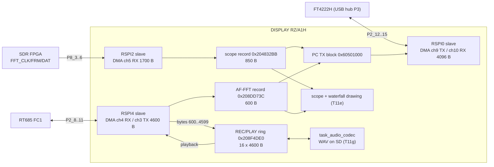
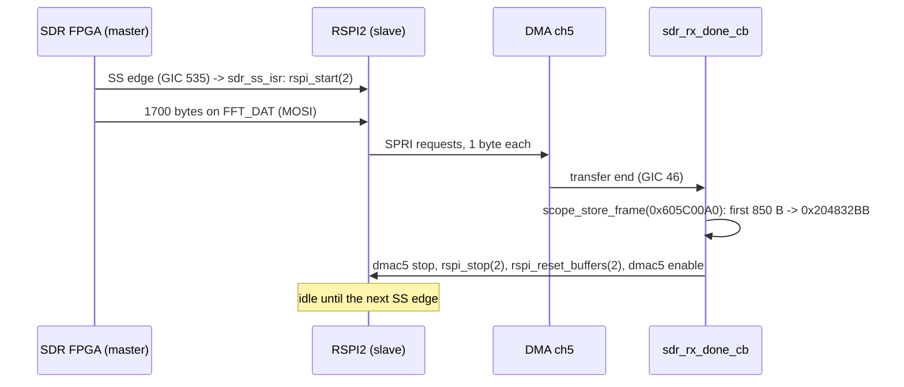

# DISPLAY: SPI links to the SDR module, the IF DSP and the FT4222H (T11d)

Back to the [DISPLAY overview](README.md). Addresses are CPU addresses (image base 0x20100000). Function bodies are in `decomp/display/` (look them
up in `functions.tsv`). Names in *italics* are proposed in `tools/ghidra/names_display.T11d.tsv` and are still `FUN_<address>` in the current
export. Entry points that Ghidra missed are in `tools/ghidra/entries_display.T11d.tsv`. Some RSPI helpers use `ldr pc, [pc, r0, lsl #2]` jump
tables that the decompiler drops (it shows only the `if (4 < ch)` range check), so their bodies here come from the disassembly.

## Summary

The DISPLAY CPU has three SPI links in use. In normal operation it is the **SPI slave** on all three: the other side drives the clock and the
frame select, and the DISPLAY moves each frame with a DMA channel.

| Link | RSPI | Pins (pinmux) | Role / mode | Frame | DMA | Consumer |
|---|---|---|---|---|---|---|
| SDR module scope data (`SDR_SCLK/SS/MOSI/MISO`) | RSPI2 | P8_3..P8_6, alt 3 | slave, receive only; **master** while updating the SDR | 1700 B in (0x6A4) | ch5 RX | spectrum scope / waterfall (850-byte record, 800 points) |
| IF DSP FC1 "FFT/REC/PLAY" (`DSP_SCLK/SS/MOSI/MISO`) | RSPI4 | P2_8..P2_11, alt 8 | slave, full duplex | 4600 B each way (0x11F8) | ch4 RX, ch3 TX | AF-FFT scope (600 B) + 4000 B of 16 kHz stereo PCM for recording; TX carries playback PCM |
| FT4222H USB bridge (`ACC_SCLK/FS/MOSI/MISO`) | RSPI0 | P2_12..P2_15, alt 2 | slave, TX always, RX only in test mode | 4096 B each way (0x1000) | ch9 TX, ch10 RX | the PC: copies of the scope and AF-FFT records and a 151-byte status block |

RSPI1 and RSPI3 are not used (`rspi_open` is only called for channels 2 and 4, and `rspi_hw_config` only for 0, 2 and 4) **[fact]**. The
SPI data mode is the same on every channel: **8-bit, MSB first, CPOL 0, CPHA 1 (SPI mode 1)** **[fact: SPCMD0 written by `rspi_hw_config`
0x2011D9A8]**.

How the channels map to the pins is **[inference]**. RSPI2 is the channel that the SDR update code switches to master mode, and the debug overlay
labels its frame counter "S". RSPI4 carries the DSP's REC/PLAY audio, and its counter is labelled "D". The RSPI0 test screen polls P2_13, which is
in the FT4222H pin group (docs/hardware.md, service manual p62). The pin-to-function table of the RZ/A1H is not in the repo, so the alt-function
numbers have not been checked against the datasheet.

## RSPI driver (generic, 5 channels)

This is a table-driven driver in the Renesas sample-code style. `rspi_hw_config` gets the register addresses for channel *n* from an 11-word
table at **0x20166B4C + n·0x2C**: SPCR, SPPCR, SPBR, SPDCR, SPCKD, SSLND, SPND, SPSCR, SPCMD0, SPBFCR, SSLP **[fact]**. The bases are
RSPI0..4 = 0xE800C800, 0xE800D000, 0xE800D800, 0xE800E000, 0xE800E800. The bit-field helpers are `FUN_20157138` (8-bit RMW
`(reg, val, shift, mask)`), `FUN_2015714c` (16-bit), `FUN_20157160` (32-bit), `FUN_20157174` / `FUN_20157184` (8/16-bit field read
`(reg, shift, mask)`) **[fact]**.

`rspi_hw_config(ch, mode)` 0x2011D9A8 **[fact]**:

| Field | mode 0 (master) | mode 1 (slave) |
|---|---|---|
| SPCR | MSTR=1, SPTIE=1, SPRIE=0, MODFEN=0 (SPE left 0) | MSTR=0, SPTIE=1, SPRIE=1 |
| SPBR / SPCMD0.BRDV | SPBR=1, BRDV=3 → P1φ/16, about **2 MHz** (P1φ ≈ 64–67 MHz **[inference]**) | not used (the master clocks) |
| SPCMD0 | SCKDEN=SLNDEN=SPNDEN=1, SPB=7 (8 bit), SSLKP=1, LSBF=0, CPOL=0, CPHA=1 | SPB=7, LSBF=0, CPOL=0, CPHA=1, rest 0 |
| SPDCR | TXDMY=0, SPLW=1 (byte access to SPDR) | same |
| SPBFCR | TXTRG=2, RXTRG=5 | TXTRG=3, RXTRG=0 |
| SPPCR / SSLP | loopback off, MOIFE=0 / SSL0P=0 (active low) | same |

`rspi_hw_config_master` 0x2011ED24 is the same master set-up with SPBR, BRDV and the loopback bit as parameters. Nothing calls it **[fact]**.

| Address | Ghidra name | Purpose |
|---|---|---|
| 0x2011D9A8 | *`rspi_hw_config`* | Programs one channel as master (mode 0) or slave (mode 1), see the table above **[fact]** |
| 0x2011DEA4 / 0x2011DF20 / 0x2011DF9C / 0x2011E018 / 0x2011E09C | *`rspi0_open`* … *`rspi4_open`* | Clears the STBCR10 module-stop bit (bit 7-n), creates the SPTI/SPRI ISRs, enables the GIC IDs, then calls `rspi_hw_config`: ch0, 2, 3, 4 as slave, ch1 as master **[fact]** |
| 0x2011EFC8 / 0x2011F040 | *`rspi0_open_irq_only`* / *`rspi1_open_irq_only`* | Like the open calls but without `rspi_hw_config`. No callers **[fact]** |
| 0x2011F0CC | *`rspi_open`* | `rspi_open(ch)`: jump table to `rspiN_open` **[fact: disassembly]** |
| 0x2011F138 / 0x2011F128 | *`rspi_start`* / *`rspi_spe_set`* | Sets SPCR.SPE **[fact]** |
| 0x2011F1AC / 0x2011F19C | *`rspi_stop`* / *`rspi_spe_clear`* | Clears SPCR.SPE, then a 10-iteration delay loop (`rspiN_delay` 0x2011EC0C–0x2011ECAC) **[fact]** |
| 0x2011F7B4 / 0x2011F758 | *`rspi_reset_buffers`* / *`rspi_fifo_reset`* | Clears the driver's TX/RX-done flags and pulses SPBFCR.TXRST/RXRST **[fact]** |
| 0x2011F8F8 | *`rspi_wait_tx_end`* | Spins on SPSR.TEND (bit 6) through `rspiN_wait_tend` 0x2011EB58–0x2011EBE8 **[fact]** |
| 0x2011F230 | *`rspi_base`* | Channel → register base **[fact]** |
| 0x2011F278 | *`rspi_read`* | `(ch, buf, count, rxtrg)`: PIO read in chunks of the RX trigger level (table 0x20800434). Clocks dummy 0xFF bytes through `rspiN_read_burst` 0x2011E3FC/E570/E6DC/E850/E9BC. No callers **[fact]** |
| 0x2011F718 | *`rspi_write`* | `(ch, buf, count, txtrg)`: PIO write by TX trigger level (table 0x20800424). It waits on the TX-empty flag (`rspiN_tx_wait` 0x2011E3D0/E544/E6B0/E824/E990) **[fact]** |
| 0x2011F840 | *`rspi_rx_isr`* | SPRI dispatch → `rspiN_rx_isr` 0x2011E1F0/E240/E290/E2B8/E2E0. Ch0/1 reset the RX buffer and count RX-full events (0x208DCE28/0x208DCE2C). Ch2–4 clear SPRIE. All set the RX flag 0x20800418+n **[fact]** |
| 0x2011F89C | *`rspi_tx_isr`* | SPTI dispatch → `rspiN_tx_isr` 0x2011E308–0x2011E3A8: clear SPTIE, set the TX flag 0x2080041D+n **[fact]** |
| 0x2011ECD4–0x2011ED1C | *`rspiN_spti_isr`* / *`rspiN_spri_isr`* | Ten 2-instruction stubs (`mov r0,#n; b …`) that the ISR descriptors 0x20166A84–0x20166B38 point to **[fact]** |
| 0x2011E118–0x2011E1E0 | *`rspiN_clear_rx_flag`* / *`rspiN_clear_tx_flag`* | Clear the flags above **[fact]** |

GIC IDs: RSPIn SPEI/SPRI/SPTI = 270+3n / 271+3n / 272+3n. For example, ch0 enables 0x10F/0x110 and ch3 also enables SPEI 0x117 **[fact for
the IDs that are enabled; the SPEI/SPRI/SPTI naming is an inference from the RZ/A1H numbering]**.

## DMA channels

All the DMA set-ups are in 0x20137080–0x20137E88. Each one writes the channel's N0SA/N0DA/N0TB, CHCFG and DMARS, registers an ISR, and enables
the GIC ID 41+ch. The DMARS value is MID·4+RID: MID 0x48/0x4A/0x4C = RSPI0/2/4, RID 1 = TX, RID 2 = RX **[fact for the values; the MID
names are an inference from the code: the MID matches the SPDR address each channel uses]**.

| DMA ch | Set-up | Direction | DMARS | Size / data width | ISR stub → callback |
|---|---|---|---|---|---|
| 3 | *`dmac3_rspi4_tx_setup`* 0x20137080 | mem 0x208F4DE0 / 0x20906D60 → RSPI4 SPDR | 0x131 | 0x11F8 B, 16-bit src / 8-bit dst | *`dmac3_isr`* 0x20137490: sets 0x20808A8C = 1 |
| 4 | *`dmac4_rspi4_rx_setup`* 0x201374AC | RSPI4 SPDR → 0x60502000 / 0x60503450 | 0x132 | 0x11F8 B, 8-bit src / 16-bit dst | *`dmac4_isr`* 0x201376C4 → [0x20808AA4] = *`dsp_rx_done_cb`* |
| 5 | *`dmac5_rspi2_rx_setup`* 0x20137278 | RSPI2 SPDR → 0x605C00A0 | 0x12A | 0x6A4 B, 8-bit | *`dmac5_isr`* 0x201374A0 → [0x20808AA8] = *`sdr_rx_done_cb`* |
| 9 | *`dmac9_rspi_tx_setup`* 0x20137910 (arg 1: RSPI0, 0: RSPI1) | 0x60501000 → RSPI0 SPDR | 0x121 | 0x1000 B, 8-bit | *`dmac9_isr`* 0x20137AEC → [0x20808AAC] = *`pclink_tx_done_cb`* |
| 10 | *`dmac10_rspi_rx_setup`* 0x20137B04 (arg 1: RSPI0) | RSPI0 SPDR → 0x60500000 | 0x122 | 0x1000 B, 8-bit | *`dmac10_isr`* 0x20137D1C → [0x20808AB0] = *`pclink_rx_done_cb`* |
| 8 | *`dmac8_m2m_init`* 0x201376D0 / *`dmac8_m2m_start`* 0x201378B0 | memory → memory, 0xBB800 B (one 800×480 RGB565 frame) | (none) | 128-byte units | GUI frame-buffer copy, not SPI (T11e) |

The small helpers are `dmacN_enable` (CHCTRL.SETEN), `dmacN_stop` (CHCTRL.CLREN), `dmacN_set_callback`, and `dmac9_register_isr` /
`dmac10_register_isr`. They are listed in the TSV. `dmac3_disable`, `dmac4_disable` and `dmac5_disable` (0x20137D64/0x20137DCC/0x20137D98) write 0
to CHCTRL.SETEN, which does nothing on a write-1-to-act register **[inference]**. The links work anyway, because each DMA transfer ends by
itself after N0TB bytes.

## Link 1: SDR module scope data (RSPI2)

**Wiring.** `SDR_SCLK/SS/MOSI` land on the SDR module's `FFT_CLK/FFT_FRM/FFT_DAT` pins 23/25/27, and `SDR_MISO` on `FRM_DAT` pin 42
([sdr/interfaces.md](../sdr/interfaces.md)). The FPGA is the master and pushes scope frames into the DISPLAY.

**Set-up** (`sdr_dsp_link_init` 0x20133484, called from `gui_start` 0x20132CCC) **[fact]**: DMA ch5 RX 0x6A4 bytes into **0x605C00A0** (an
uncached mirror), callback `sdr_rx_done_cb`, `rspi_open(2)` (slave), `rspi_reset_buffers(2)`, DMA ch5 enable, `rspi_start(2)`.
`link_ss_irq_init` 0x20133440 (in `task_root`'s full path) registers two more interrupts. GIC ID **0x217 (535)** → `sdr_ss_isr` 0x201333F0
and **0x1C1 (449)** → `dsp_ss_isr` 0x20133418 **[fact]**. Each ISR stamps the cycle counter, counts (0x208085A8 / 0x208085AC) and calls
`rspi_start` for its channel **[fact]**. These are most likely port (TINT) interrupts on the SS lines, so that each frame re-arms the slave
at a frame boundary **[inference]**. Which pins they are cannot be checked without the RZ/A1H interrupt table **[guess: TINT119 / TINT33 if
TINT0 = ID 416]**.

**Frame format.** The DMA takes 1700 bytes. Only the first **0x352 = 850 bytes** are kept: `scope_store_frame` 0x201342EC copies them into the
scope record **0x204832BB** **[fact]**. When debug flag 0x400 in 0x20808A84 is set, the 800 bytes at record offset **+0x19** are replaced with
the test pattern at 0x203D9B14. So the record is a **25-byte header + 800 one-byte points** (one per screen column of the 800-pixel display) +
25 more bytes **[fact for the offsets, inference for the meaning]**. With debug flag 0x10, byte 0 is copied into frame bytes 0x1A8/0x1A9
**[fact; purpose unknown]**. The second 850 bytes of each DMA frame are never read **[fact: no other reference to 0x605C03F2..]**. While the
GUI freezes the scope (0x204832B8/B9/BA set, or 0x208004A0), the record is filled with 0xFF instead **[fact]**.

**Consumers.** *`scope_history_push`* 0x20134348 copies the 800 points (+0x19) into a ring of 800-byte rows at 0x20490894, the waterfall/3D
history, with 4 bytes of per-line info **[fact for the copy, inference for the use]**. 0x20134318/0x20134328 redraw the history for display
modes 8 and 9 (GUI, T11e). *`scope_frame_buf`* 0x201344A0 returns the record pointer for the PC link **[fact]**.

**Errors.** *`sdr_link_recover`* 0x20133140 stops and restarts the channel and counts SPSR bit 0 in 0x208F4DAC/0x20808590 and SPSR bit 2 in
0x208F4DA8. It has no callers in V01-08 **[fact]**. Bit 0 = OVRF (overrun) and bit 2 = MODF (mode fault) **[inference from the RZ/A1H
register layout]**.

**Master mode for the SDR update.** *`sdr_spi_master_write`* 0x201107C0, called from `sdr_spi_xfer_block` 0x20110834, switches RSPI2 to
master once (`rspi_hw_config(2, 0)`, flag 0x208001B4, about 2 MHz, mode 1). It then sends 0x1000-byte blocks with `rspi_write` +
`rspi_wait_tx_end` **[fact]**. So the FPGA image goes into the module over the same FFT/FRM pins. The block commands and status of the update
go another way (`FUN_2011064C`/`FUN_20110584` → `FUN_20110548`, see [update.md](update.md), T11c). After the update the channel stays in master
mode until the next reset **[inference: nothing switches it back]**.

**Rate.** The DISPLAY does not set the slave clock, and nothing in this image fixes the frame rate. 1700 B per frame is about 13.6 kbit, so 30
frames/s would need only about 0.4 Mbit/s **[inference]**. The debug overlay (`FUN_201367B4`, only with `debug_enabled`) shows the SS-IRQ
counters as "S" (SDR) and "D" (DSP) **[fact: labels at 0x20136C48/0x20136C50]**, so the rate can be read on a debug-enabled unit.

## Link 2: IF DSP FFT/REC/PLAY (RSPI4)

**Wiring.** `DSP_SCLK/SS/MOSI/MISO` go to the RT685 FLEXCOMM1 SPI, "FFT/REC/PLAY data" (service manual p19,
[ifdsp/README.md](../ifdsp/README.md): `Thread_Spi` on the HiFi4). The RT685 is the master. The link is full duplex.

**Set-up** (`sdr_dsp_link_init`) **[fact]**: DMA ch4 RX 0x11F8 into **0x60502000**, DMA ch3 TX 0x11F8 from the ring 0x208F4DE0, the silence
buffer 0x20906D60 (0x11F8 bytes of 0xF0 with the first two bytes 0), callback `dsp_rx_done_cb`, then `rspi_open(4)` (slave) and the channel
enabled. Each SS edge (GIC 449) calls `rspi_start(4)`.

**Per frame** (`dsp_rx_done_cb` 0x201331DC) **[fact]**:
1. The two RX buffers **0x60502000 / 0x60503450** (0x1450 apart) work as a ping-pong pair. `afscope_store_frame` 0x20120D40 parses the
   finished one, and its first 4 bytes are copied to the header copy 0x605C0780.
2. `dsp_set_audio_ptr(buf + 600)` stores the audio pointer (0x20808598) and the halfword at buf+602 (0x2080858E).
3. DMA ch4 stops, then `rspi_stop(4)`. SPSR.OVRF and MODF are counted (0x20808594/0x208F4DB4 and 0x208F4DB0) and cleared, then the buffers
   are reset.
4. The ping-pong flips: DMA ch4's N0DA moves to the other buffer.
5. **REC** (0x208000B2 set by `task_audio_codec`): 4000 bytes from buf+600 go into the next slot of the 16-slot ring **0x208F4DE0**
   (slot = 0x11F8 B), and a message `{1, slot}` goes to the `task_audio_codec` mailbox (`audio_codec_post` 0x20106DC8 → `FUN_201526F4`).
6. **PLAY** (0x208000B1): DMA ch3's N0SA is set to the current ring slot, the message `{2}` is posted and event flag 0x208000C8 bit 2 is
   set. Without PLAY, N0SA is set to the silence buffer 0x20906D60.
7. DMA ch3 and ch4 are re-enabled.

**Frame format (DSP → DISPLAY, 4600 bytes)** **[fact for the offsets]**:

| Offset | Size | Contents |
|---|---|---|
| 0 | 1 | type: `afscope_store_frame` keeps the scope part only when byte 0 == 1 |
| 0..599 | 600 | AF-FFT / audio-scope record, copied to **0x208DD73C**. Bytes 0–1 are then overwritten with 0xFF. Its first 200 bytes are the AF-FFT bins (`FUN_20120D60`/`FUN_20120D84`/`FUN_20120D90` stretch 200 points to 391 pixels through the colour tables at 0x208DCE3C) **[inference for "AF-FFT"]**. The debug test pattern is 200 B (0x20166DE8) + 400 B (0x20166EB0) |
| 602 | 2 | halfword stored at 0x2080858E (purpose unknown) |
| 600..4599 | 4000 | audio PCM. `task_audio_codec` writes it as a WAV with **fmt 1 (PCM), 2 channels, 16000 Hz, 16 bit** (`FUN_20106248`, RIFF/WAVE/LIST/ICMT header) |

At 16 kHz × 2 ch × 2 B = 64000 B/s, 4000 bytes is 62.5 ms, so the DSP has to send **16 frames/s**. That is 4600 B × 16 ≈ 0.59 Mbit/s each way
**[inference from the WAV parameters]**. Recording stops at 0x57E400 = 5,760,000 bytes (90 s at that rate) in mode 2 (0x208000B3)
**[fact for the limit]**.

**Frame format (DISPLAY → DSP, 4600 bytes).** During PLAY each ring slot is filled by `task_audio_codec` from a WAV file
(`I:\FT-710\PlayList`, `.wav`; `FUN_20105D24`, `FUN_20101030`). Otherwise the frame is the silence buffer **[fact]**. The playback slot has
byte 0 = 0 (`FUN_2015525C(…, 0xF0)` then `slot[0] = 0`) **[fact]**. The rest of the slot layout is decided in `task_audio_codec` (T11g).

## Link 3: FT4222H USB-to-SPI bridge (RSPI0)

**Wiring.** The FT4222HQ on the DISPLAY unit sits on USB hub port 3 (docs/hardware.md). It is an SPI master: `ACC_SCLK/FS/MOSI/MISO`
go to P2_12..P2_15, and the RZ drives `FT4222_RESET` on P2_7. *`gpio_ft4222_reset`* 0x20101F8C writes PSR2 bit 7 **[fact]**.
`task_root` writes 0 there, which holds the bridge in reset **[fact for the write, inference that the reset is active-low]**. The MAIN-link
settings handler `FUN_2012EBB8` then copies **bit 2 of the settings byte at 0x208007E8** to the pin, so the PC bridge is switched on and off by
a MAIN-side setting **[fact for the code path, inference for the meaning]**.

**Task.** `spi_slave_init` 0x20112450 creates `spi_slave_task` (`task_spi_slave` 0x20112288, priority 5, 0x100 stack) **[fact]**. The task:

1. registers the DMA ch9 ISR, stops ch9, sets it up for RSPI0 TX and installs `pclink_tx_done_cb`. It calls `rspi_hw_config(0, 1)` (slave)
   directly without `rspi0_open`, so no RSPI0 interrupts are registered. It then resets the buffers, starts RSPI0, starts the TX DMA
   (`pclink_tx_dma_start`: 0x60501000 → SPDR, 0x1000 B) and writes the trailer `0x01EE01FF` ×4 at 0x60501FF0 **[fact]**;
2. loops every 1 ms (`itron_dly_tsk(1)`). Every 4th pass it refreshes the TX block: `pclink_tx_copy_afscope` (600 B from the AF-FFT record) and
   `pclink_tx_copy_scope` (850 B from the scope record) **[fact]**;
3. every 50 passes it checks whether a TX frame has completed (counter 0x20450014). After a quiet 50 ms following activity it stops and
   re-arms RSPI0 and the DMA once, which re-synchronises to the next frame **[fact for the logic, inference for the purpose]**;
4. in **test mode** (0x20450004 ≠ 0) it also sets up RX DMA ch10 (RSPI0 → 0x60500000, 0x1000 B, `pclink_rx_done_cb`) and clears the counters
   **[fact]**.

**DISPLAY → PC frame (4096 bytes, 0x60501000)** **[fact for the offsets]**:

| Offset | Size | Contents |
|---|---|---|
| 0x000 | 850 (0x352) | SDR scope record (25-byte header + 800 points + 25) |
| 0x6A4 | 600 | DSP AF-FFT record (via the pointer in 0x208DD998) |
| 0xB64 | 151 (0x97) | status block from the MAIN link (`pclink_tx_set_status` 0x201120FC, called from `FUN_2012EBB8`/`FUN_2012F8D4` with the data at 0x208F0B2B) |
| 0xFF0 | 16 | trailer: four words `0x01EE01FF` |

So the PC can draw the radio's spectrum scope and AF-FFT and see the radio status over USB, without going through the CAT ports
**[inference]**. The TX block is refreshed every 4 ms while the DMA keeps sending it, so a PC frame can mix two refreshes
(there is no double buffer) **[inference]**. The PC-side software is not known (Yaesu's PC scope / SCU-LAN10-type remote software is a **[guess]**).

**PC → DISPLAY frame (test mode only, 0x60500000)** **[fact]**: `pclink_rx_parse` 0x201121B4 checks the magic **0xEEAFCCBA** at offset 0
(`MOSI_NG` +1 if it is wrong, `MOSI_OK` +1 if it matches) and copies 11 words: +0x04 `FRAMES`, +0x08 `MISO_OK`, +0x0C `MISO_NG`, +0x10..+0x28
(not shown). So in test mode the PC reports how many DISPLAY frames it received intact.

**Test mode.** It is entered when `key_scan_first()` returned **4** at start-up (0x208004A2, `FUN_20130188`), so a front-panel key is held
at power-on **[fact for the code, inference that it is a held key; which key is in T11f]**. `pclink_stats_print` 0x2011249C (now named
`sdr_spi_stats_print`) then draws a box with `testmode`, `CS_POLL` (how often **P2_13**, the FT4222H frame select, had changed level between two redraws), `MOSI_OK/NG`,
`FRAMES`, `MISO_OK/NG` and `msec` (TX frame period = PMCCNTR delta·1000/6,000,000) **[fact]**. The box is green (0x0400) when all counters
look sane and red (0xC800) otherwise **[fact for the colours]**. The current name `sdr_spi_stats_print` is wrong: this is the FT4222H link,
not the SDR.

## Function table: link code

| Address | Ghidra name | Purpose |
|---|---|---|
| 0x20112450 | `spi_slave_init` | Creates `spi_slave_task` (descriptor 0x20165554) **[fact]** |
| 0x20112288 | `task_spi_slave` | PC link task, see above **[fact]** |
| 0x20112158 | *`pclink_tx_dma_start`* | DMA ch9 N0SA/N0DA/N0TB = 0x60501000 / SPDR0 / 0x1000, SETEN **[fact]** |
| 0x20112144 | *`pclink_tx_trailer_init`* | `0x01EE01FF` ×4 at 0x60501FF0 **[fact]** |
| 0x20112128 / 0x2011210C / 0x201120FC | *`pclink_tx_copy_scope`* / *`pclink_tx_copy_afscope`* / *`pclink_tx_set_status`* | Fill the TX block at +0x000 / +0x6A4 / +0xB64 **[fact]** |
| 0x20112180 | *`pclink_tx_done_cb`* | Stamps the period (0x2045D490), counts 0x20450014, re-arms TX **[fact]** |
| 0x201121A8 | *`pclink_set_testmode`* | 0x20450004 = arg **[fact]** |
| 0x201121B4 / 0x20112264 | *`pclink_rx_parse`* / *`pclink_rx_done_cb`* | RX frame check and re-arm (test mode) **[fact]** |
| 0x2011249C | *`pclink_stats_print`* (now `sdr_spi_stats_print`) | Test-mode statistics box **[fact]** |
| 0x201120C8 / 0x20132FE0 | *`cycle_delta`* / *`cycle_delta_2`* | `{delta, last}` from CP15 PMCCNTR (c9,c13) **[fact]** |
| 0x20101F8C | *`gpio_ft4222_reset`* | P2_7 through PSR2 **[fact]** |
| 0x20133484 | *`sdr_dsp_link_init`* | Sets up RSPI2 + DMA ch5 and RSPI4 + DMA ch3/ch4 **[fact]** |
| 0x20133440 | *`link_ss_irq_init`* | ISRs for GIC 535 (SDR) and 449 (DSP) **[fact]** |
| 0x201333F0 / 0x20133418 | *`sdr_ss_isr`* / *`dsp_ss_isr`* | Frame-start ISRs: `rspi_start(2)` / `rspi_start(4)`. Ghidra starts them 4 bytes late (`FUN_201333F4`/`FUN_2013341C`) **[fact]** |
| 0x201330D4 | *`sdr_rx_done_cb`* | SDR frame complete **[fact]** |
| 0x20133140 | *`sdr_link_recover`* | Error recovery, unreferenced **[fact]** |
| 0x201331DC | *`dsp_rx_done_cb`* | DSP frame complete, REC/PLAY switch **[fact]** |
| 0x201331C8 | *`dsp_set_audio_ptr`* | 0x20808598 = audio pointer, 0x2080858E = halfword at +2 **[fact]** |
| 0x20132F74 / 0x20132F7C | *`sdr_rx_buf`* / *`dsp_hdr_buf`* | Return 0x605C00A0 / 0x605C0780 **[fact]** |
| 0x201342EC / 0x201344A0 | *`scope_store_frame`* / *`scope_frame_buf`* | 850-byte scope record 0x204832BB **[fact]** |
| 0x20134348 | *`scope_history_push`* | Appends the 800 points to the waterfall/3D history ring 0x20490894 **[inference]** |
| 0x20120D40 / 0x20120DC8 | *`afscope_store_frame`* / *`afscope_buf_ptr`* | 600-byte AF-FFT record 0x208DD73C **[fact]** |
| 0x201107C0 | *`sdr_spi_master_write`* | RSPI2 in master mode for the SDR image **[fact]** |
| 0x20106DC8 | *`audio_codec_post`* | 8-byte message to the `task_audio_codec` mailbox (0x208000C4) **[fact]** |

## Globals

| Address | Meaning |
|---|---|
| 0x60500000 / 0x60501000 | PC link RX / TX DMA blocks (0x1000 each, uncached) **[fact]** |
| 0x60502000 / 0x60503450 | DSP RX ping-pong buffers **[fact]** |
| 0x605C00A0 / 0x605C0780 | SDR RX DMA buffer (0x6A4) / DSP header copy (4 B) **[fact]** |
| 0x204832BB (+0x19 points) | SDR scope record, 850 B; 0x204832B8/B9/BA = freeze flags **[fact]** |
| 0x208DD73C | DSP AF-FFT record, 600 B; 0x208DD994/95 = freeze flags; 0x208DD998 = pointer used by the PC link **[fact]** |
| 0x208F4DE0 | REC/PLAY ring, 16 × 0x11F8 B; 0x208000B0 = slot index **[fact]** |
| 0x20906D60 | Silence TX frame for the DSP **[fact]** |
| 0x208000B1 / 0x208000B2 / 0x208000B3 | PLAY active / REC active / record mode (`task_audio_codec`) **[fact]** |
| 0x208000C4 / 0x208000C8 | `task_audio_codec` mailbox / event flag **[fact]** |
| 0x2080858C | DSP ping-pong selector **[fact]** |
| 0x208085A4 / 0x208085A0 | SDR frames (also incremented by the GUI callback `FUN_20133014`) / DSP frames **[fact]** |
| 0x208085A8 / 0x208085AC | SDR / DSP SS-IRQ counts (overlay "S"/"D") **[fact]** |
| 0x208F4DA8 / 0x208F4DAC / 0x20808590 | SDR MODF / OVRF counts (recovery path only) **[fact]** |
| 0x208F4DB0 / 0x208F4DB4 / 0x20808594 | DSP MODF / OVRF counts **[fact]** |
| 0x208F4DB8 / 0x208F4DC0 / 0x208F4DC8 | PMCCNTR stamp blocks: GUI callback `FUN_20133014`, SDR frame, DSP frame **[fact]** |
| 0x20450004 / 0x20450014 / 0x20450018 | PC link test mode / TX frames / RX frames **[fact]** |
| 0x2045D490 / 0x2045D498 / 0x2045D4A0 | PMCCNTR stamps: TX frame, 4-ms refresh, 50-ms check **[fact]** |
| 0x2045D4A8 / 0x2045D4AC / 0x2045D4B0 | `MOSI_OK` / `MOSI_NG` / `CS_POLL` **[fact]** |
| 0x2045D4B4–0x2045D4DC | Copy of PC RX words 0..10 (`FRAMES` +4, `MISO_OK` +8, `MISO_NG` +0xC) **[fact]** |
| 0x20800418–0x2080041C / 0x2080041D–0x20800421 | RSPI0–4 RX-done / TX-done flags **[fact]** |
| 0x20800424 / 0x20800434 | TX / RX trigger-level byte counts per SPBFCR code (`.data2`) **[fact]** |
| 0x208001B4 | RSPI2 switched to master (SDR update) **[fact]** |
| 0x208007E8 | MAIN settings byte; bit 2 = FT4222H out of reset **[fact for the use]** |
| 0x20808A84 | Debug flags: 0x400 = scope/AF-FFT test pattern, 0x10 = SDR byte-0 copy, 0x1 = overlay **[fact]** |
| 0x20808AA4 / 0x20808AA8 / 0x20808AAC / 0x20808AB0 | DMA ch4 / ch5 / ch9 / ch10 callbacks **[fact]** |

## Open points

- The RZ/A1H pin-function and TINT tables are needed to confirm the RSPI2/4/0 ↔ P8/P2 mapping and the pins behind GIC 535/449.
- The SDR scope header (25 bytes), the meaning of the second 850 bytes of each SDR DMA frame, and DSP frame bytes 1–3 and 602–603 need the
  FPGA (T13/T15) or HiFi4 `Thread_Spi` side (T12).
- The SDR frame rate could be measured from the overlay counters on a debug-enabled unit (do not touch the radio without approval).
