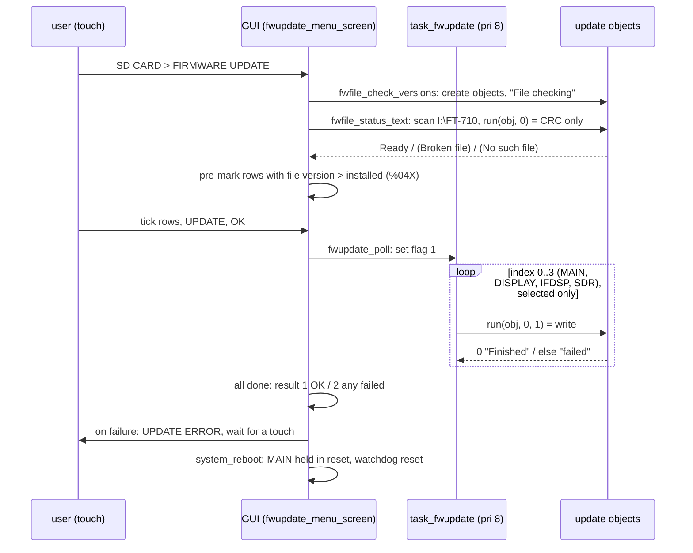
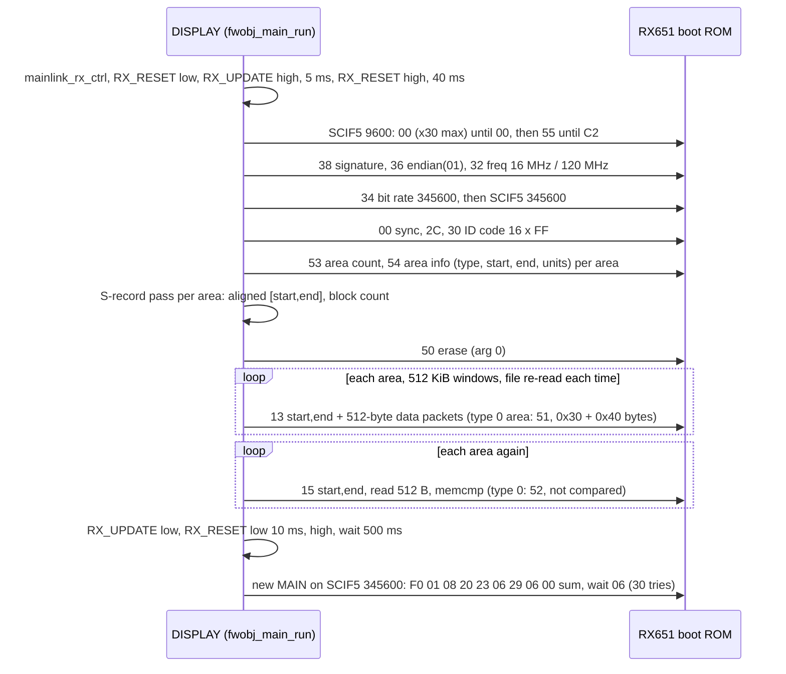
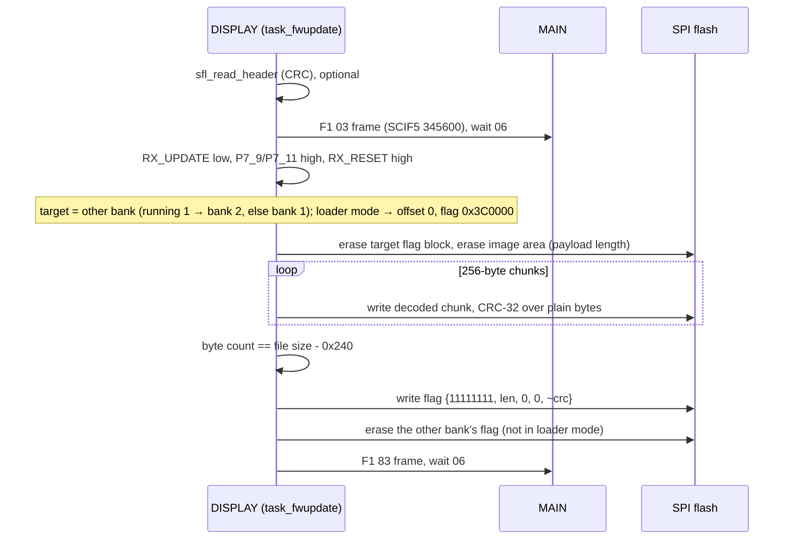
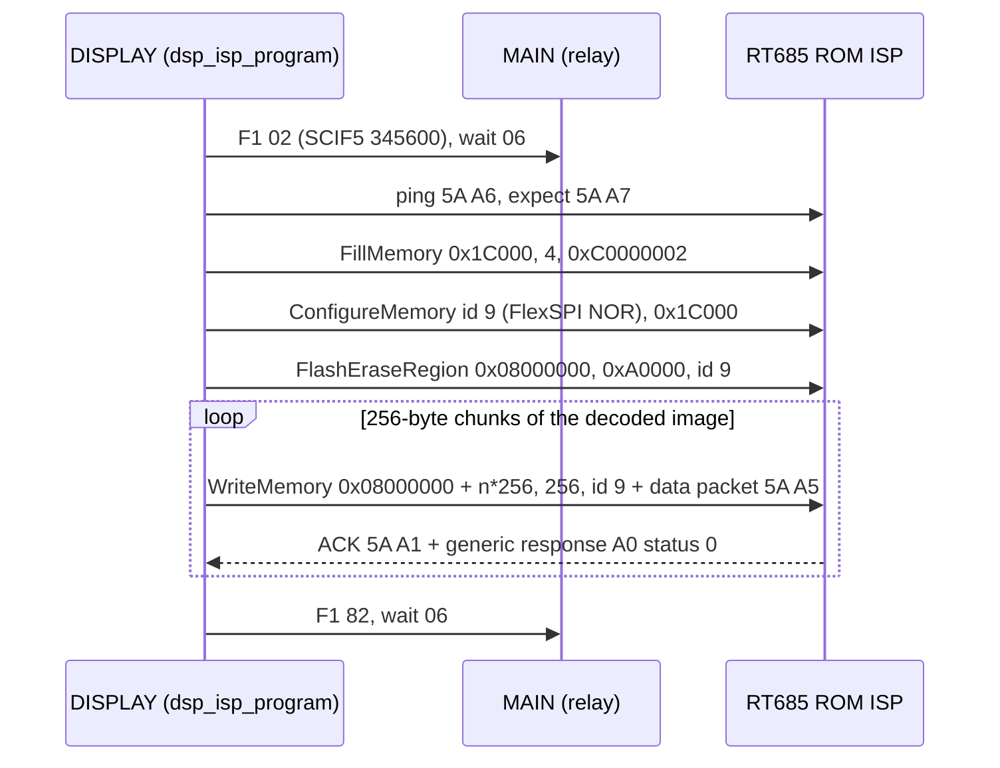
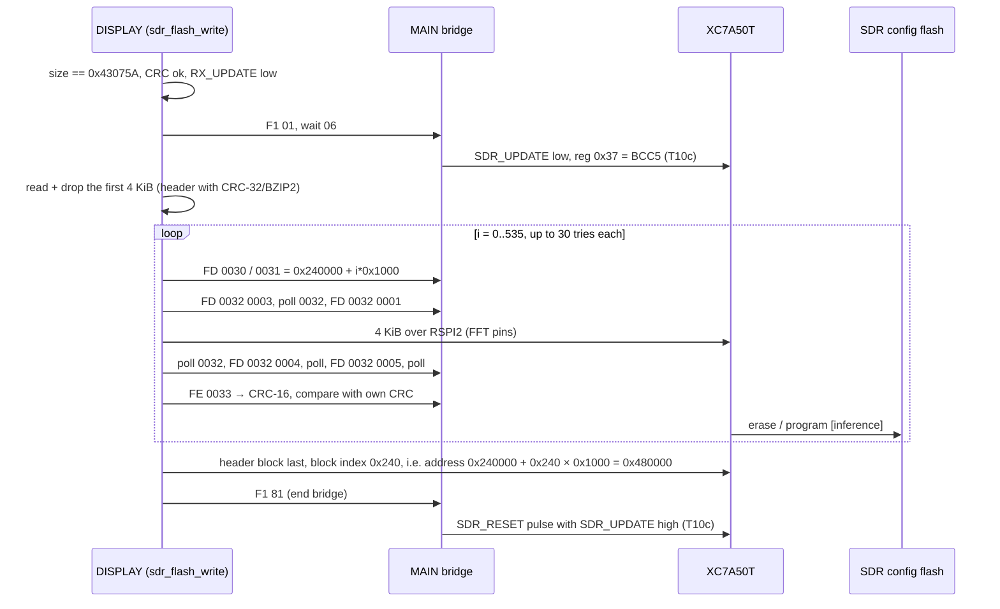

Back to the [DISPLAY overview](README.md)

# DISPLAY: SD card and firmware update paths (T11c)

The DISPLAY CPU owns the SD card, so it updates all four images: itself (SPI-flash banks), MAIN (RX651 serial boot mode), IFDSP
(RT685 ROM ISP through MAIN) and the SDR FPGA (register commands through MAIN, data over the DISPLAY SDR SPI). This page covers the
user path (menu **SD CARD → FIRMWARE UPDATE**), the power-on maintenance and loader modes, the hidden USB-keyboard debug commands, and
every check a file has to pass. It is a key input for custom-firmware work ([custom-firmware.md](../../custom-firmware.md), T16).

Addresses are CPU addresses (image base 0x20100000). Names are the current Ghidra names. Function names are the names applied in Ghidra (`tools/ghidra/names_display.tsv`, merged by T17) and match `decomp/display/`; a name still in *italics* is a description that was not applied as a Ghidra name. Code is in `decomp/display/` (see `functions.tsv`). Claims are tagged
**[fact]** (seen in code, address given) or **[inference]** (evidence and reasoning given); anything not supported is an open question.

## 1. Summary for custom firmware

| Check / behaviour | Where | Consequence |
|---|---|---|
| File must be in `I:\FT-710\`, name = `FT-710__V` + **4 any chars** + `.sfl` (case-insensitive, exact length), FAT **ARCHIVE** attribute set; the lexicographically highest name wins | `fwfile_status_text` 0x2010DFD0, `fwname_pattern_match` 0x20163600, `fwobj_match_name` 0x20160418 | [fact]. A file copied by a PC has the archive bit set. The 4 chars become the shown version ("0108" → "01-08") |
| Header: 9 × 64-byte blocks read; the tag line (block 8) must be exactly 64 chars with no NUL; it is split on spaces; the **3rd token** parsed as hex (≤ 8 digits) must equal the salted CRC-32 of bytes 0x240..EOF | `sfl_read_header` 0x20114CA0, `sfl_crc` 0x20114A64 | [fact]. The **tag (`MC`/`PC`/`ID`/`SR`) and the length field are not checked**. Only the CRC matters ("Ready" vs "(Broken file)") |
| Comment box: not checked, except block 3 (`[PRODUCT NAME]`) in the DISPLAY file: `" : "` followed by `"#UP0    "` turns the update into a **loader** write — only when F1 is held on a USB keyboard | `fwobj_display_run` 0x201607E8 (*name*), `DAT_20800181` | [fact] (F1 = HID usage 0x3A) |
| Version: shown, and rows whose file version is higher than the installed one (from MAIN's 0x60 status frame) are pre-marked; any "Ready" row can be ticked | `fwupdate_menu_screen` 0x2015A500 (*name*), format `%04X` | [fact for the pre-mark]; downgrades are allowed **[inference]** (only the Ready bit gates the tick box, `FUN_2015a910`) |
| **SDR**: SFL file size must be exactly **0x43075A = 4 392 794** bytes; 536 bitstream blocks of 4 KiB are written, then the 4 KiB header block (537 block writes) | `fwobj_sdr_run` 0x201602AC, `sdr_flash_write` 0x20110AB8 | [fact]. A custom bitstream must be padded/fitted to the same size |
| **DISPLAY**: file size ≥ 0x242; decoded byte count must equal size − 0x240; no upper limit vs. the 6 MiB bank | `fwobj_display_run` | [fact]. A payload over 6 MiB would run into the next region **[inference]** |
| **IFDSP**: erase region fixed at 0x08000000 + 0xA0000 (640 KiB) | `dsp_isp_erase_region` 0x2010B0F4 | [fact]. A larger image would be written into unerased flash **[inference]** |
| **MAIN**: S-records must have valid record checksums; each area is written and **read back and compared** | `srec_parse_line` 0x2010E670, `rx_boot_verify_areas` 0x2010BCA0 | [fact]. Option-setting area (type `0`) is read back but not compared |
| Boot never checks the image CRC: a bank flag `{0x11111111, len≠0}` is enough; bank 1 is preferred | `boot_select_bank` 0x20100ABC | [fact] |
| No signature, model, destination or serial check anywhere | whole path | [fact for the code read] |

## 2. SD card and file system (summary)

`sd_fs_init` (0x201039B0, from `task_root`) mounts the FAT volume and registers the SDHI driver, then `sd_task_create` starts `sdTask`
**[fact, T11a]**. The update code uses the ordinary file API: `fs_fopen` 0x20141ABC, `fs_fread` 0x20142A58, `fs_fseek` 0x20143750,
`fs_fclose` 0x20141FF0, `fs_fsize` 0x2014AF64 (file size), `fs_stat` 0x2014AEC8, `fs_opendir` 0x2014C410 / `fs_readdir` 0x2014CA4C /
`fs_closedir` 0x2014C474 **[inference from use]**. Drive letter is `I:`.

The FAT layer underneath (T23e round 2 names, **[fact]** for the code unless the TSV says otherwise): each call has a `fs_*_work` body
that takes a buffer from the "FSYS Work" pool; files and directories are found by `fs_path_lookup` (`root_dir_find` for the FAT12/16
root area, `subdir_find` for cluster chains, long names by `lfn_checksum`); sectors go through two caches per drive (FAT cache
`fatcache_*` at drive +0x44, directory cache `dircache_*` at +0x4C, dirty bits written back by `fs_flush`); `fat_entry_rw` reads and
writes FAT12/16/32 entries, `fat_alloc_cluster` / `fat_chain_free` allocate and free, and an optional cluster bitmap (`clmap_*`, drive
+0x58) speeds up the search. Shift-JIS names are converted with `sjis_to_ucs2_char` (tables 0x20420756 / 0x204244D0). The SDHI0 driver
below it is `sdhi_*` (0x20140148..), with `sdhi_check_wp` giving the -7 (write-protected) error of `sd_write_sectors`. `FUN_20103bb0`/`FUN_20103ba0` return bits 7/6 of
`DAT_20800094` (card state); the update screens wait on them **[fact]**, meaning "card present / ready" **[inference]**.

The same SFL container is used for the user's **MemList / Menu backups** (`task_sdmenu` 0x2011010C, `sdmenu_load_file` 0x2010F81C,
`sdmenu_save_file` 0x2010F60C, `sdmenu_write_dat` 0x2010F370). The radio writes a blank comment box, then the tag line
`"MemList  <n>  <CRC>"` / `"Menu  <n>  <CRC>"`, then the payload encoded with `sfl_encode` 0x201149E0 **[fact]**. On load it checks file size
0x7F50, the salted CRC and two words (kind, slot) at the start of the decoded payload **[fact]**. `sdmenu_write_dat` is therefore a
reference encoder already inside the radio (useful for the T16 round-trip test).

## 3. SFL reading

| Address | Ghidra name | Purpose |
|---|---|---|
| 0x20114CA0 | `sfl_read_header` | header check (section 1); with a buffer argument also copies block 3 |
| 0x20114A64 | `sfl_crc` | CRC-32 (table 0x20100A14 / update 0x20100A5C) from the current position to EOF, then the salt 0x139EECA6 |
| 0x20114A44 | `sfl_stream_init` | stream `{file, buf, pos, chunk/decode, fill, keypos}`; decode is on when word 3 ≠ 0 |
| 0x20114BFC | `sfl_stream_read` | `fread` + `sfl_decode` (key phase continues across calls) |
| 0x20114B3C / 0x20114AE0 | `sfl_stream_gets` / `sfl_stream_getc` | decoded line reader (S-records) |
| 0x2011497C / 0x201149E0 | `sfl_decode` / `sfl_encode` | key subtract / add (docs/sfl-format.md) |

Every `vtbl[0]` "run" method calls `sfl_read_header` first, which reads the whole file once for the CRC, rewinds and leaves the file at
0x240, so streaming starts at payload offset 0 with key phase 0 **[fact]**. The CRC over the encoded payload matches docs/sfl-format.md;
the DISPLAY bank flag stores a second CRC-32 over the **decoded** bytes (section 6) **[fact]**.

## 4. User path: update objects and tasks

`fwfile_check_versions` calls `fwobj_create_all`, which builds four C++ objects; pointers are at 0x2081166C..0x20811678
**[fact]**. Each has a name pattern, status text and a `run(obj, path, do_write)` method at `vtbl[0]`.

| Index | Object | ctor | vtable | `vtbl[0]` run | Writer |
|---|---|---|---|---|---|
| 0 | MAIN (`FT-710_MAIN_V`) | `fwobj_main_ctor` | 0x20428088 | `fwobj_main_run` | `rx_boot_program` |
| 1 | DISPLAY (`FT-710_DISPLAY_V`) | `fwobj_display_ctor` | 0x204280A0 | `fwobj_display_run` | itself (SPI flash) |
| 2 | IFDSP (`FT-710_IFDSP_V`, label "DSP") | `fwobj_ifdsp_ctor(…, 1)` | 0x20428094 | `fwobj_ifdsp_run` | `dsp_isp_program` |
| 3 | SDR (`FT-710_SDR_V`) | `fwobj_sdr_ctor(…, 1)` | 0x20428070 | `fwobj_sdr_run` | `sdr_flash_write` |

Return codes of `run`: 0 OK, 1 cannot open, 2 bad header/CRC (check mode), 3 write failed **[fact]**.

All **[fact]** (`task_fwupdate` 0x2010E1F8, `fwupdate_poll` 0x2010E2D4, `fwupdate_progress_screen` 0x2015B134, `update_error_screen`
0x20159158, `system_reboot` 0x20114DF4). The GUI also mirrors its state to MAIN in 0xC3 (34-byte) and 0xE2 (6-byte) frames
(`mainlink_send_ui_c3`, `mainlink_send_ui_e2`) **[fact]**; MAIN's use of them is a MAIN-side question. The manual's "the power is automatically turned
OFF" is this reset: `system_reboot` sets RX_UPDATE low, pulses P7_9/P7_11, P8_5, **asserts RX_RESET** (P7_10 low), sets
`QF_RESETn` (P11_2) and triggers a watchdog reset (`wdt_system_reset`, WTCSR 0xFCFE0000) **[fact]**; the radio then comes back in standby
**[inference]**. There is no rollback: a failed target stays as written, and the user retries **[fact for the code]**.

### Other entry points
- **Power-on with key line 6 held** (`power_on_request` 0x2012FFCC, `gui_main_loop`): boot-info word +8 = 2, then `FUN_201322e4` →
  `FUN_20159058` → `bootloader_screen` 0x2015938C **[fact]**. On that screen, more than 4 net steps of the encoder on P3_3/P3_5
  (ISR `renc_irq4_isr` → `DAT_208001e4`) make `bootloader_unlock_wait` return 1: the title becomes
  `YAESU FT-710 BOOT LOADER V01-02`, boot-info word 0 = 0xBBBB and word +8 stays 2, so a DISPLAY update then goes to the **loader**
  region (section 6). Otherwise word +8 is reset to 1 and it is a normal update screen **[fact]**. Which physical key is line 6 is for T11f.
- **Update-UI thunks [fact]** (#81): 0x201322AC..0x201322F0 are seven 8-12-byte thunks `[mov r1, r0;] ldr r0, =0x208F4BF4; b method`
  that call a method of the update-UI object at 0x208F4BF4: `fwupdate_insert_sd_screen` 0x2015AFB0, `fwupdate_screen` 0x20159714,
  `fw_installed_versions_set` 0x201595F0, `fwupdate_menu_screen` 0x2015A500, 0x2015A8DC, 0x20159058 and 0x20159D98 (the last one,
  through 0x201322F0, is the `YAESU FT-710 FIRMWARE UPDATE` screen).
- **MAIN asks for update mode**: at power-on `opening_check_main` reads MAIN's 0x60 status frame; if byte 1 has 0xF0 set it opens
  `YAESU FT-710 FIRMWARE UPDATE` (`FUN_201322f0`), else it stores the installed versions (`fw_installed_versions_set` 0x201595F0, through the thunk 0x201322BC:
  BE16 at +0, +2, +4, +10 → 0x208F4BF4..0x208F4BFA) **[fact]**.
- **MAIN not answering** (`DAT_2045005c` set, `mainlink_got_esc`): `fwupdate_screen` 0x20159714 (called through the thunk 0x201322B4), the 2-step recovery screen. It requires
  both the MAIN and the DISPLAY files to be Ready ("MAIN FIRMWARE FILE [ OK ]", "DISPLAY FIRMWARE FILE"), then runs MAIN first
  ("STEP 1 of 2") and DISPLAY second ("STEP 2 of 2") **[fact for the code; the trigger meaning is inference]**.

## 5. MAIN update (RX651 serial boot mode)

DISPLAY drives `RX_RESET` (P7_10, `gpio_rx_reset`, 0 = reset asserted) and `RX_UPDATE` (P4_3, `gpio_rx_update_b`,
high = boot mode, hardware.md p17), and talks over SCIF5, the normal MAIN-link UART wired to the RX651 SCI1 (hardware.md) **[fact for the
code, inference for the nets]**. The commands follow the Renesas RX "SOD 01 / 81" boot protocol: `01 LNH LNL CMD data SUM 03`, replies
start `81`, data packets end in `17` (more) or `03` (last) **[fact for the bytes; command meanings fact: RX651 HWM r01uh0590 §59.13 pp2577–2612, T18]**.
Commands, in the order the manual requires: `38` device type, `36` endian, `32` frequency, `34` bit rate, `00` sync, `2C` ID mode, `30` ID check,
`53`/`54` area count/info, `50` area erase, `13` program, `15` read, `51`/`52` configuration (option-setting memory) program/read.

All steps **[fact]** (`fwobj_main_run` → `rx_boot_program` and the `rx_boot_*` proposals in the table below). The 16 MHz / 120 MHz values are
the clock arguments of command 0x32 (0x00F42400, 0x07270E00) **[fact]**. The ID code sent is 16 × 0xFF, which matches the all-0xFF
option-setting memory in the MAIN image (custom-firmware.md) **[fact]**. Area type `' '` (0x20) is skipped when writing, `'@'` when
sizing **[fact]**. They are the boot ROM's area kinds (KOA, HWM p2610): 0x20 = data flash (absent on this part), 0x40 = the Trusted Memory window,
which lies inside code flash; `'0'` (0x30) is the option-setting memory, written with `51`, and 0x00 is code flash **[fact, T18]**. Any failure returns 3 ("failed"); MAIN is then left in boot
mode until `system_reboot`, and the update can be repeated **[inference]**.

## 6. DISPLAY self-update (SPI flash banks)

### Flash layout (W25Q128, window 0x18000000)

| Offset | Size | Content |
|---|---|---|
| 0x000000 | 0x340000 | boot loader (this image as loader, written by `loader_selfinstall` or a loader-mode update) |
| 0x3C0000 | 0x14 (64 KiB block) | loader flag (written only by a loader-mode update) **[fact]**; nothing reads it in V01-08 **[fact for this image]** |
| 0x3E0000 | 0x14 (64 KiB block) | bank 1 flag |
| 0x3F0000 | 0x14 (64 KiB block) | bank 2 flag |
| 0x400000 | 6 MiB | bank 1 image |
| 0xA00000 | 6 MiB | bank 2 image |

Flag record (20 bytes) **[fact]**: `+0 0x11111111`, `+4 length`, `+8 0`, `+0xC 0`, `+0x10 ~CRC-32` of the **decoded** image (no salt).
`boot_select_bank` only checks `+0 == 0x11111111` and `+4 != 0`, bank 1 first **[fact]**. `spiflash_erase` (*name*, 0x20103E74) erases
64 KiB blocks; `spiflash_write` (0x20103DD0) writes and then compares a checksum of the data with the XIP window 0x18000000 + offset
**[fact]**. Underneath is a small SPIBSC0 flash driver (T23e round 2): `spibsc_enter_spi_mode` switches CMNCR to SPI mode,
`sflash_erase_block` sends WREN + 0xD8, `sflash_page_program` WREN + 0x02 in 256-byte pages, `sflash_fast_read` 0x0B, and
`spibsc_exit_spi_mode` restores XIP mode and flushes the read cache; the device object 0x20810D90 takes `r`/`e` commands
(`sflash_dev_write`) **[fact]**.

### Write sequence (`fwobj_display_run`)

**[fact]** for every step. The running bank comes from `bootinfo_load` (0x208DBB44 = 1 or 2; 0xBBBB in loader mode). After a successful
update only the new bank has a valid flag, so the next boot runs it **[fact]**. The window in which neither flag is valid is between
"erase target flag" and "write flag"; the old bank flag is erased only after the new flag is written, so an interrupted update leaves the
old bank bootable **[inference from the order]**. If the new image is bad but its flag is valid, the loader still jumps to it (no CRC check at
boot); recovery is then the key-6 maintenance mode or the loader's own screen **[inference]**.

### `loader_selfinstall` (0x20110F0C) and 0xFCFF400C
When the word at 0xFCFF400C holds 0xAABBCCDD, `loader_selfinstall` erases flash 0..0x340000 and both bank-flag blocks, writes the running
image (from `vec_reset`) to offset 0, writes the two flags as `{0x20182018, 0, 0, 0, 0}` (invalid, so both banks are disabled), clears
0xFCFF400C and executes **`BKPT #0`** (or `BKPT #1..#4` on an error) **[fact]**. No code in the image writes 0xFCFF400C: the only literal is
the base 0xFCFF4000 in its own pool (0x20111080), there is no `movt 0xfcff`, and Ghidra shows only this function's read and clear
**[fact]**. Together with the `BKPT` exit codes this means a **JTAG factory script** loads the image into RAM, sets the word and runs it to
program a blank board **[inference, high]**. It is a usable recovery path over J6003 for an owner with a JTAG probe **[inference]**.

## 7. IFDSP update (RT685 ROM ISP through MAIN)

DISPLAY has no direct line to the RT685; its `DSP_UPDATE` strap and ISP UART are on the MAIN side (hardware.md). DISPLAY sends
`F1 02` to MAIN, then NXP MCU-bootloader packets wrapped in a relay frame **`5A LEN16(LE) payload SUM8`** (sum of all previous bytes)
**[fact]**. MAIN presumably sets `DSP_UPDATE`, resets the RT685 into serial ISP and forwards the bytes **[inference; MAIN side in
docs/code/main]**.

**[fact]** for the packets (`dsp_isp_ping`, `dsp_isp_fill_option`, `dsp_isp_configure_memory`, `dsp_isp_erase_region`, `dsp_isp_write_image`; CRC-16/XMODEM in
`crc16_xmodem`). The last chunk is always sent as 256 bytes **[fact]**; the bytes past the file end are left-over buffer data
**[inference]**. There is no read-back and no final Reset/Execute command: correctness relies on the per-packet CRC and status
**[fact]**. The option word 0xC0000002 lets the ROM auto-probe the QSPI flash **[inference from NXP docs]**.

## 8. SDR update (FPGA registers through MAIN, data over the SDR SPI)

This resolves the T13 question. **Control goes through MAIN, the bitstream goes over the DISPLAY SDR SPI** **[fact]**:

- `sdr_relay_mode_cmd` sends `F1 01` to MAIN (SCIF5 345600). MAIN then runs its SDR bridge (T10c,
  `docs/code/main/sdr-link.md`): DSP_RESET low, `SDR_UPDATE` low, reg 0x37 = 0xBCC5, relaying DISPLAY frames to the FPGA UART.
- Register writes: `FD 00` + ASCII `"%04X%04X"` (reg, value) + 8-bit sum = 11 bytes; reads: `FE 00` + `"%04X"` + sum = 7 bytes. The reply is
  `06`, or a frame with `}` and 4 ASCII hex digits (`sdr_relay_xfer`, `sdr_reg_write`, `sdr_reg_read`) **[fact]**. These are MAIN's
  `FD 00` / `FE 00` bridge frames.
- Data: each 4 KiB block goes over **RSPI channel 2** (`sdr_spi_master_write` → `rspi_write(2, buf, 0x1000, 0xFF)`) **[fact]**. T11d found that
  RSPI2 is switched to master at about 2 MHz on P8_3..P8_6, the pins that carry the scope stream into the FPGA's FFT port.

FPGA registers used **[fact for the accesses, inference for the names]**:

| Reg | Use |
|---|---|
| 0x30 / 0x31 | flash address bits 31..16 / 15..0 |
| 0x32 | write: 3, 1, 4, 5 (command sequence per block); read: status, ready when bits 15..12 are 0 or 8 |
| 0x33 | read: CRC-16 of the block the FPGA received |
| `reg | 0x1000` | used when the SDR object's flag +0xAB is 0 (`sdr_flash_write` 0x20110AB8 picks 0x1000 for 0, else 0). `fwobj_create_all` 0x2010DD24, the only caller of `fwobj_sdr_ctor`, passes 1, and `sdr_flash_write`'s only caller passes +0xAB, so V01-08 never uses these registers **[fact]**. Open: what the 0x10xx registers address; would be settled by the FPGA's register decoder in the netlist |

Block data is the decoded hex text converted to binary (`hex_to_bin`), CRC-16 reflected 0xA001 with init and xorout 0xFFFF
(`crc16_a001`, table 0x208D9560) **[fact]**. The bitstream proper (file binary 0x1000..) is written from flash address 0x240000, and the
4 KiB header (the CRC-32/BZIP2 word plus 0xFF) is written last at 0x480000 **[fact for the addresses sent]**: `sdr_spi_xfer_block`
0x20110834 sends address 0x240000 + index × 0x1000, `sdr_flash_write` 0x20110AB8 calls it for indexes 0..0x217 (536 blocks) and then
once with index 0x240 for the header, so 537 blocks are written in all (wording clarified by T19h). So the update writes a second
image slot and commits it with the header at the end; an interrupted update leaves no valid header **[inference]**. Whether the FPGA
reads 0x240000 directly or through a multiboot/golden image at 0: the update image itself has WBSTAR = 0, no IPROG and ConfigFallback on,
so a golden image at 0 that jumps to 0x240000 is the only way it runs after power-up **[inference, strong; #58, [sdr/interfaces.md](../sdr/interfaces.md)]**.
(T08's "sync at 0x1030" is the offset in the file, whose first 0x1000 bytes are the header.)

On `SDR_UPDATE`: MAIN holds it **low during the update** and pulses `SDR_RESET` with it high afterwards (T10c). DISPLAY never touches
the FPGA flash pins; the FPGA fabric writes the flash from its registers **[fact for DISPLAY]**. So the module pin labelled `WP` is not a
plain active-low write-protect of a flash written from outside; it acts as an **"update mode"** input to the FPGA (low = the fabric's
programming logic / bridge mode) **[inference]**. Whether it also reaches the flash's /WP pin cannot be told from DISPLAY code.

## 9. Hidden debug commands (USB keyboard)

All of these run from `hid_chain1_dispatch`, which is only called when `debug_enabled()` sees 0xA0B9C8E7 at 0x20450000; in V01-08 that
word is never set (T11a, README). Status is shown on the **keyboard LEDs** (`kbd_led_status`) **[fact]**.

| Command(s) | Handler → worker | What it does | Live in V01-08? |
|---|---|---|---|
| `fw1up` | `fwdbg_cmd` → `update_display_self` → `fwdbg_write_other_bank` | raw `I:\AH076H_DISPLAY.bin` (no SFL) to the non-running bank + flag, erase other flag | yes, after unlock |
| `fw1chk` | → `fwdbg_verify_bank1` (really `fwdbg_verify_bank1`) | compares `I:\AH076H_DISPLAY.bin` with bank 1, repeats forever | yes, after unlock |
| `up0` | → `update_display_self` | raw `I:\AH068_DISPLAY_Loader.bin` to flash 0, no flag | yes, after unlock |
| `up1` / `up2` | → `update_display_self` | raw `I:\AH076H_DISPLAY.bin` to bank 1 / bank 2, erases both flags first, then writes the target flag | yes, after unlock |
| `uptest` / `uptest2` | `uptest_line` → `update_main_cpu` | loads `I:\AH076H_HEW.mot` / `AH068H_HEW.mot`, toggles RX_RESET / RX_UPDATE, then calls `uptest_program_stub`, which does nothing and returns 0 | no: the programmer is a stub [fact]; `uptest2` sets flag 2 but the task waits for pattern 1 **[inference]** |
| `mrst` | `uptest_line` | pulses MAIN reset | yes |
| `rf0` / `rf1` | `uptest_line` | toggle 0x20800194 / 0x20800198, read nowhere else | no effect |
| `dsp1up`..`dsp3up`, `/32`, `/9` variants | `dsp_debug_cmd` → `update_dsp` | raw `I:\AH076H_IFDSP.dat`, `I:\rom_writer.dat`, `I:\AH068_AFDSP_V0000.dat` via the IFDSP ISP writer | no: `dspup_init` has **no caller** (Ghidra xrefs) [fact] |
| `sdrup`, `sdr1up`, `sdr2up`, `sdrchk1`, `/g` variants, `sdrchk2/g`, `sdrspi…`, `sdrfile`, `delta` | `sdr_debug_cmd` (registered by `sdr_debug_init`) | sets bits in flag 0x208001B8 | no: no task waits on that flag [fact] |

The self-update debug task is created by `fwdbg_task_create` with entry **0x2015F0E0** (pri 5, 0x2000 stack), which was
not a function in the project (now in `entries_display.T11c.tsv`) **[fact]**. Chain-1 handler 8 (`kbdtest_init`) is not update code: it is a
keyboard-layout translator (`kbdtest_line` maps usage + Shift/AltGr to a character and can draw it as an overlay) **[fact]**. The raw `.bin`
debug writes skip SFL decoding, so a plain binary works there **[fact]**. The IFDSP writer always decodes, so the `.dat` files would have to be
SFL-encoded payloads without a header **[inference]**.

## 10. Functions

| Address | Ghidra name | Purpose |
|---|---|---|
| 0x2010E1F8 / 0x2010E4AC | `task_fwupdate` / `fwupdate_init` | runs `vtbl[0]` of each selected object |
| 0x2010E2D4 | `fwupdate_poll` | start once, then report 0/1/2 |
| 0x2010DDD8 / 0x2010DFD0 | `fwfile_check_versions` / `fwfile_status_text` | build objects / scan and CRC-check the files |
| 0x2010DD24 | `fwobj_create_all` | the 4 objects |
| 0x201605AC / 0x201607E8 / 0x201606BC / 0x201602AC | `fwobj_main_run` / `fwobj_display_run` / `fwobj_ifdsp_run` / `fwobj_sdr_run` | run: MAIN / DISPLAY / IFDSP / SDR |
| 0x20163600 / 0x20160418 / 0x201604C8 | `fwname_pattern_match` / `fwobj_match_name` / `fwobj_version_from_name` | name match / keep highest / version text |
| 0x2010DFC4 / 0x20107E90 | `fwupdate_set_hotkey` / `usbkbd_last_key` | latch the held USB key (F1 = loader mode) |
| 0x2010E514 / 0x2010A974 / 0x201109FC | `mainlink_fw_mode_cmd` / `isp_relay_mode_cmd` / `sdr_relay_mode_cmd` | `F1 <code>` mode frames to MAIN |
| 0x20116518 | `mainlink_rx_ctrl` | MAIN-link task gives up SCIF5 |
| 0x2010D50C | `rx_boot_program` | MAIN programming |
| 0x2010D3E4, 0x2010D224, 0x2010D134, 0x2010CF48, 0x2010CE54 | `FUN_…` (*rx_boot_sync/signature/endian/set_freq/set_baud*) | boot commands 00/55, 38, 36, 32, 34 |
| 0x2010CD64, 0x2010CBD4, 0x2010CAB4, 0x2010C918, 0x2010C6AC, 0x2010C564 | `FUN_…` (*rx_boot_sync_cmd/cmd_2c/id_auth/area_count/area_info/erase*) | 00, 2C, 30, 53, 54, 50 |
| 0x2010C2F4 / 0x2010BCA0 | `rx_boot_write_areas` / `rx_boot_verify_areas` | write areas (13/51) / verify areas (15/52) |
| 0x2010C14C / 0x2010BB00 / 0x2010BF9C / 0x2010B95C | `FUN_…` | command packet / read start / data packet / read + compare |
| 0x2010E970 / 0x2010E868 / 0x2010E7B0 / 0x2010E670 | `FUN_…` (*srec_find_range/load_range/load_image/parse_line*) | S-record handling |
| 0x2010B81C | `dsp_isp_program` | IFDSP programming |
| 0x2010AA7C, 0x2010B5BC, 0x2010B360, 0x2010B0F4, 0x2010AB74 | `FUN_…` (*dsp_isp_ping/fill_option/configure_memory/erase_region/write_image*) | NXP ISP commands |
| 0x20110AB8 / 0x20110834 | `sdr_flash_write` / `sdr_spi_xfer_block` | SDR loop / one 4 KiB block (address, regs, SPI, CRC) |
| 0x2011064C / 0x20110584 / 0x20110548 / 0x20110750 / 0x201107C0 | `FUN_…` (*sdr_reg_write/reg_read/relay_xfer/wait_ready/spi_send_block*) | SDR helpers |
| 0x201009DC / 0x20100990 / 0x201103F4 | `FUN_…` | CRC-16 0xA001 / table / hex → binary |
| 0x2015F55C / 0x2015F0E0 / 0x2015F62C | `fwdbg_task_create` / (no function) / `update_display_self` | debug task create / entry / body |
| 0x2015F348 / 0x2015F1F0 / 0x2015F0EC | `fwdbg_write_other_bank` / `fwdbg_verify_bank1` / `fwdbg_cmd` | fw1up / fw1chk verify / command parser |
| 0x2010EA90 / 0x2010ED80 / 0x2010EC44 / 0x2010EA74 | `update_main_cpu` / `uptest_init` / `uptest_line` / `uptest_program_stub` | uptest task / init / commands / stub |
| 0x2010D92C / 0x2010DCBC / 0x2010DA78 | `update_dsp` / `dspup_init` / `dsp_debug_cmd` | dead dspup path |
| 0x20110C3C / 0x20110DA8 | `sdr_debug_cmd` / `sdr_debug_init` | dead SDR debug commands |
| 0x20110F0C | `loader_selfinstall` | JTAG factory install |
| 0x20103E74 / 0x20103DD0 | `spiflash_erase` / `spiflash_write` | SPI flash erase (64 KiB) / write + verify |
| 0x20114DF4 / 0x20100268 | `system_reboot` / `wdt_system_reset` | end-of-update reset / watchdog reset |
| 0x20101CA4 / 0x20101C74 / 0x20101D2C / 0x20101CBC | `FUN_…` (`gpio_rx_update_b`, `gpio_rx_update`, *_off*, `gpio_qf_reset`) | P4_3, P11_2 |
| 0x2015A500 / 0x2015B134 / 0x20159158 / 0x20159CB0 | `FUN_…` (*fwupdate_menu_screen/progress_screen*, `update_error_screen`, `bootloader_unlock_wait`) | GUI |
| 0x2011010C / 0x2010F81C / 0x2010F60C / 0x2010F370 / 0x201149E0 | `task_sdmenu` / `sdmenu_load_file` / `FUN_…` | backups in SFL format, encoder |

## 11. Globals and structures

| Address | Meaning |
|---|---|
| 0x2081166C..0x20811678 | pointers to the MAIN, DISPLAY, IFDSP, SDR update objects |
| object +0x04 / +0x0E / +0x14 / +0x37 / +0x57 / +0x58 / +0x88 / +0x89 / +0xA9 / +0xAA / +0xAB | label / version "VV-vv" / name pattern / best file name / name found / full path / selected / status text / state (0 checking, 1 ready, 2 none, 3 broken, 4 running, 5 OK, 6 failed) / done / target flag |
| 0x208F4BFC | GUI row array (0x48 bytes per row: state, texts, +0x34 selected, +0x38 progress) |
| 0x208F4BF4..0x208F4BFA | installed versions (BE16) from MAIN |
| 0x20800180 / 0x20800184 / 0x20800188 | update running / fwupdate task id / its event flag |
| 0x20800181 | key usage latched at screen entry (0x3A = F1 enables `#UP0`) |
| 0x20800364 | progress percent |
| 0x208DBB44 (+0, +8, +0x20.., +0x40..) | boot-info copy: running bank (1, 2, 0xBBBB), mode (1 normal, 2 key-6 / loader mode, 3 loader), bank table |
| 0xFCFF400C | 0xAABBCCDD = run `loader_selfinstall` (set externally) |
| 0x208001B8 | SDR debug flag (no waiter) |
| 0x20800160 | `dsp_debug_cmd` enable (set by `bootloader_screen`) |
| 0x20800190 / 0x2080018C | uptest flag / status code shown on screen |
| 0x208D9560 | CRC-16 table |

## 12. Open points
- MAIN-side handling of `F1 02` (DSP_UPDATE, RT685 reset) and of the 0xC3/0xE2 UI frames (docs/code/main).
- Meaning of FPGA reg 0x32 commands 3/1/4/5 and the 0x240000 / 0x480000 slot layout (T15 netlist work).
- The physical key behind key line 6 and the encoder on P3_3/P3_5 (T11f).

## Further functions (T23g)

Named functions of this subsystem that the tables above did not list yet, one row each (T23g, found with `tools/doc_table_gaps.py`). The purpose is the plate comment of the name in `tools/ghidra/names_*.tsv` (or the `Ifdsp*Names.java` / `*.lib.tsv` entry); rows marked *code shape* have no comment there and give what the decompile shows: the direct callees, the first string, the size and the caller count. Tags as in the names files; a comment without a tag is an inference from the code.

| Address | Ghidra name | Purpose |
|---|---|---|
| 0x20100A14 | `crc32_make_table` | reflected poly 0xEDB88320 **[inference]** |
| 0x20100A5C | `crc32_update` | names-file group "startup / armcc runtime"; no direct calls; 44 B, callers: 11 **[fact]** (code shape) |
| 0x20101C8C | `gpio_p8_5` | P8_5 (SDR_MOSI) port level, used by the reboot sequence **[inference]** |
| 0x2010A918 | `be_bytes_to_u32` | big-endian bytes to integer **[inference]** |
| 0x2010A940 | `sum8_neg_append` | appends the negated 8-bit sum **[inference]** |
| 0x2010AA30 | `crc16_xmodem` | CRC-16 poly 0x1021 init 0 (NXP framing) **[inference]** |
| 0x2010E624 | `hex2_parse` | two uppercase hex digits **[inference]** |
| 0x201106F8 | `sdr_set_flash_addr` | regs 0x30 / 0x31 = flash address **[inference]** |
| 0x20111174 | `work_buf_get` | (n): the shared 0xC0000-byte work buffer 0x20819560, n bytes cleared first (n < 0: all) **[fact]** |
| 0x201140D0 | `progress_set` | progress percent 0x20800364 **[inference]** |
| 0x201140DC | `progress_get` | progress percent **[inference]** |
| 0x201140E8 | `progress_range_init` | {from, to} range **[inference]** |
| 0x201140F4 | `progress_scale` | maps a fraction into the range **[inference]** |
| 0x20126160 | `gui_scope_draw_hold_set` | (v): 0x20800480 = v; the SD-card, update and PlayList-list code sets 1 around file work and 0 after; scope_draw_frame, main_filter_graph and FUN_201233d4 draw only while it is 0 ; pauses the scope drawing **[fact]** |
| 0x201322AC | `fwupdate_insert_sd_screen_thunk` | r0 = update-UI object 0x208F4BF4; b fwupdate_insert_sd_screen **[inference]** |
| 0x201322B4 | `fwupdate_screen_thunk` | r0 = update-UI object 0x208F4BF4; b fwupdate_screen (#81) **[inference]** |
| 0x201322BC | `fw_installed_versions_set_thunk` | r1 = r0, r0 = update-UI object 0x208F4BF4; b fw_installed_versions_set (#81) **[inference]** |
| 0x20158EC0 | `mainlink_send_ui_e2` | 0xE2 UI frame to MAIN **[inference]** |
| 0x20158F28 | `mainlink_send_ui_c3` | 0xC3 UI state frame to MAIN **[inference]** |
| 0x2015938C | `bootloader_screen` | YAESU FT-710 BOOT LOADER V01-02 **[inference]** |
| 0x201595F0 | `fw_installed_versions_set` | installed versions from the MAIN 0x60 frame (this = update-UI object, r1 = frame) **[inference]** |
| 0x20159714 | `fwupdate_screen` | MAIN/DISPLAY FIRMWARE UPDATE, STEP 1 of 2 (this = update-UI object) **[inference]** |
| 0x2015AFB0 | `fwupdate_insert_sd_screen` | INSERT FIRMWARE SD CARD screen (MAIN timeout path, docs/code/display/gui.md) **[inference]** |
| 0x201603D4 | `fwobj_sdr_ctor` | SDR object, vtable 0x20428070, +0xAB flag **[inference]** |
| 0x201603F4 | `fwobj_build_path` | "%s%s" dir + file name **[inference]** |
| 0x2016049C | `fwobj_set_status` | status text (Ready, failed, ...) **[inference]** |
| 0x201604DC | `fwobj_select` | marks the object selected for update **[inference]** |
| 0x201604F4 | `fwobj_base_ctor` | base update-object constructor, vtable 0x2042807C **[inference]** |
| 0x20160558 | `fwname_pattern_init` | builds the name pattern (prefix, "NNNN", suffix) **[inference]** |
| 0x201606A4 | `fwobj_main_ctor` | MAIN object, vtable 0x20428088 **[inference]** |
| 0x201607C8 | `fwobj_ifdsp_ctor` | IFDSP object, vtable 0x20428094, +0xAB flag **[inference]** |
| 0x20160C10 | `fwobj_display_ctor` | DISPLAY object, vtable 0x204280A0 **[inference]** |

### SPI flash driver on SPIBSC0 (T23e round 2)

From the names-file section header (`tools/ghidra/names_display.T23e2.tsv`): SPI flash on SPIBSC0 (object 0x20810D90: +0 register base SPIBSC_CMNCR_0, +4 dual-flash flag, +0xC flash address; register offsets CMNCR 0, DRCR 0xC, SMCR 0x20, CMNSR 0x48 from the RZ/A1H manual) **[fact per the names file]**.

| Address | Ghidra name | Purpose |
|---|---|---|
| 0x20104104 | `spibsc_reg_read32` | *(base + off) for a register object {base,...} **[fact]** |
| 0x20104110 | `spibsc_reg_write32` | *(base + off) = value **[fact]** |
| 0x20104124 | `spibsc_reg_write16` | 16-bit register store **[fact]** |
| 0x20104138 | `spibsc_reg_write8` | 8-bit register store **[fact]** |
| 0x20104188 | `spibsc_ssl_negated` | 1 when CMNSR bit 1 (SSLF) is clear **[fact]** |
| 0x201041A0 | `spibsc_wait_tend` | Polls CMNSR (0x48) bit 0 TEND, 100000 tries, -1 on timeout **[fact]** |
| 0x201041F4 | `spibsc_ensure_idle` | Waits for TEND; if CMNSR is still not 1, pulses SMCR (0x20) and waits again; -1 on failure **[fact]** |
| 0x2010427C | `spibsc_xfer` | SPI-mode transfer of n bytes through SMENR/SMWDR/SMRDR in 1/2/4-byte steps (size codes 0x2016525C), keeps SSL asserted between calls when asked **[inference]** |
| 0x2010448C | `sflash_cmd_read` | Reads response bytes (spibsc_xfer read side) **[inference]** |
| 0x2010474C | `sflash_cmd_write` | Sends command/address bytes; with two flash chips in parallel (+4) each byte is doubled **[fact]** |
| 0x201047B4 | `sflash_wait_ready` | RDSR (0x05) until bits 0x81 (busy) are clear, 1000000 tries **[fact]** |
| 0x20104848 | `sflash_wait_wel` | RDSR until WEL (bit 1) is set and not busy **[fact]** |
| 0x201048E4 | `sflash_read_sr2` | Command 0x35, returns the byte; Read Status Register-2 of the W25Q128 (update.md flash layout) **[fact]** |
| 0x20104944 | `spibsc_cmncr_set` | CMNCR = 0x81FFF320, \| 1 (BSZ) for dual flash **[fact]** |
| 0x20104968 | `spibsc_enter_spi_mode` | Saves DRCR and CMNCR (+0x24/+0x20), sets DRCR, SMCR = 0, waits for TEND and SSL negate, sets CMNCR MD (bit 31) = SPI mode **[fact]** |
| 0x20104A08 | `spibsc_exit_spi_mode` | Restores DRCR and CMNCR and flushes the read cache (DRCR RCF 0x200) back to XIP mode **[fact]** |
| 0x20104A64 | `sflash_fast_read` | FAST_READ (0x0B) at the object's address +0xC, advances it (half the count with dual flash) **[fact]** |
| 0x20104B20 | `sflash_erase_block` | WREN (0x06) and 64 KB block erase (0xD8) at the object's address, waits ready **[fact]** |
| 0x20104BD8 | `sflash_page_program` | WREN and page program (0x02) in 256-byte pages (x2 for dual flash), with the partial-page buffer 0x20810DBC **[fact]** |
| 0x20104D9C | `sflash_global_unlock` | WREN and command 0x98, waits ready; 0x98 = Global Block Unlock on the W25Q128 **[fact]** |
| 0x20104E20 | `sflash_dev_read` | Read side of the flash device object (mode 0x20810D98: 1 = read data with sflash_fast_read, 2/3 = return a status byte, flushes a partial page) **[fact]** |
| 0x20104F34 | `sflash_dev_write` | Command side: 'r' + address (read), 'e' + address (erase block), program data in the other mode **[fact]** |
| 0x20105060 | `sflash_dev_open` | Object 0x20810D90 base = SPIBSC_CMNCR_0; spiflash_erase and spiflash_write start with it **[fact]** |
