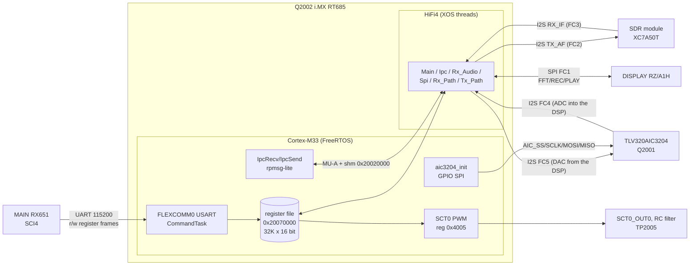
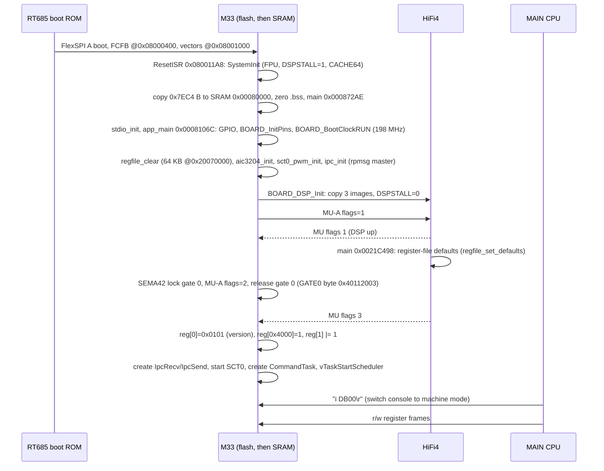
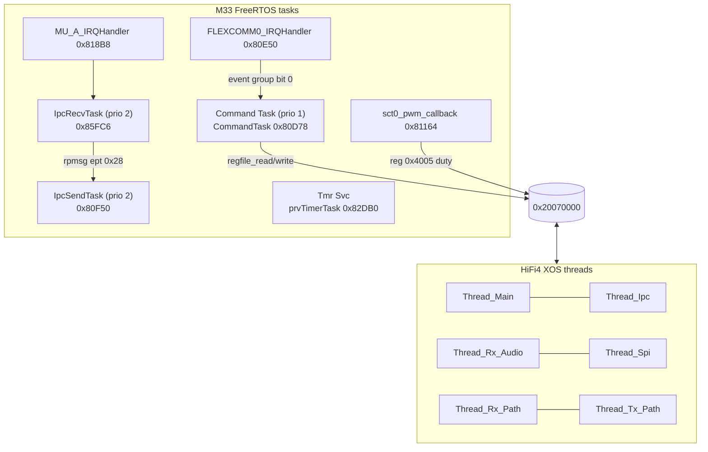

# IFDSP image (ID) — code documentation

Image `FT-710_IFDSP_V0101.SFL` (V01-01, 2023-03-23) runs on **Q2002, NXP i.MX RT685** (Cortex-M33 + Cadence HiFi4 DSP),
the "DSP MAIN/TX" chip on the MAIN unit (service manual p6, p19). Decompile: [`decomp/ifdsp/`](../../../decomp/ifdsp/INDEX.md)
(M33 in `m33/`, HiFi4 in `hifi4/`). Memory map derivation: [`docs/memory-maps.md`](../../memory-maps.md) (IFDSP section).
Claims are tagged **[fact]** (seen in code/data, address cited), **[inference]** or **[guess]**. Tasks: T07 (decompile), T12 (this).

## Purpose

The image has two programs **[fact]**:

- **Cortex-M33 "host"** (~32 KB of code in SRAM): boots from FlexSPI, loads and starts the three HiFi4 images, sets up the
  **TLV320AIC3204 codec** (GPIO bit-banged SPI), and runs a **text command console on FLEXCOMM0 USART** that gives the
  **MAIN CPU** read/write access to a **shared 16-bit parameter register file** at SRAM `0x20070000`. It also drives an SCT0
  PWM output and holds a (dormant) rpmsg-lite link to the DSP.
- **HiFi4 DSP** (~190 KB of code): Cadence XOS threads that move the audio/IF streams (I2S on FLEXCOMM2–5, SPI on FLEXCOMM1)
  and do the signal processing. It reads its operating parameters from the same register file **[fact: literals 0x2006FF00 /
  0x20070000 / 0x20077F00 in DSP code]**.

So the **MAIN ↔ IFDSP control protocol is a register-poke protocol**: MAIN's SCI4 sends ASCII frames `r AAAA` / `w AAAA DDDD`
with a checksum to the M33 console, the M33 stores the word in the register file, and the DSP picks it up from shared SRAM.
**[fact]** (M33 `console_rx_char` 0x00081430; MAIN `FUN_fffa0b4c` builds the frames, `FUN_fff9d06c` sends `i DB00\r`, sent with
`R_SCI4_Serial_Send` via `FUN_fffb1ab4`).

## Block diagram

Pin/flexcomm assignment is printed on the schematic (p19): FC0 UART, FC1 FFT/REC/PLAY data, FC2 TX AF I2S, FC3 RX IF I2S,
FC4 codec I2S, FC5 codec I2S, GPIO = AIC setting **[fact, p19]**. T12e (FLIX-aware decode): FC4 = codec ADC into the DSP (I2S RX),
FC5 = DAC from the DSP (I2S TX) **[fact, hifi4.md]**. Which DSP thread owns which FLEXCOMM: see [hifi4.md](hifi4.md).

## Boot flow

All steps **[fact]** from `app_main` (0x0008106C) and `BOARD_DSP_Init` (0x00084AD8). The meaning of the MU flag values on the DSP
side is **[inference]**.

## Memory map summary

| Range (M33 view) | Use |
|---|---|
| 0x08000000–0x080652EB | FlexSPI XIP image: FCFB, M33 vectors + flash stub, three HiFi4 images, M33 SRAM load image **[fact]** |
| 0x00080000–0x00087EC3 | M33 code, rodata, .data (copied by `ResetISR`) **[fact]** |
| 0x00087EC4–0x000A1EF7 | M33 .bss: FreeRTOS heap (heap_4, 0x18FF8 bytes), UART rings, console buffers **[fact]** |
| 0x00200000–0x002383B3 (+ .bss) | HiFi4 image 1: rodata/literals, text, data **[fact]** |
| 0x24000000 / 0x24020000 | HiFi4 DTCM / ITCM (image 0: reset and window vectors) **[fact]** |
| 0x20020000–0x200203FF / 0x20020400–0x200207FF | rpmsg-lite vrings `rx_vq` / `tx_vq` (`rpmsg_lite_master_init(0x20020000, 0x20000)`) **[fact]**; details in [ipc.md](ipc.md) |
| 0x20020800–0x20020FFF | rpmsg buffers (2 × 2 × 512 B) **[fact]** |
| 0x20021000–0x2003FFFF | rest of the rpmsg window, unused **[fact]** |
| 0x20040000–0x200431DF | HiFi4 image 2 (all zero) **[fact]** |
| 0x20060000–0x200631DF | DSP buffers (XOS init 0x0021C498, DMA buffers 0x20062BE0.. for FC3/4/5) **[fact: DSP literals]** |
| 0x20070000–0x2007FFFF | **shared parameter register file**, 16-bit words, word index = (addr − 0x20070000)/2; M33 clears it at boot **[fact]** |

## Task / thread structure

M33 tasks and priorities are **[fact]** (`create_CommandTask`, `create_IpcTasks`, stacks 0x1800). `IpcSendTask` waits on a FreeRTOS
queue that no code writes to, so the rpmsg path carries no traffic in this firmware **[fact: no writer of queue 0x886E0]**.
DSP thread names are **[fact]** (strings at 0x206370; creators 0x0021C498, 0x00220BD0, 0x00224A10, 0x00225E40); their roles are
**[inference]**.

## Subsystems

| Page | Sub-task | Contents |
|---|---|---|
| [control-link.md](control-link.md) | T12b | FLEXCOMM0 USART driver, console grammar (interactive and machine mode), frame format, register file and register map (113 regs, 98 with a known access), MAIN-side register list |
| [ipc.md](ipc.md) | T12c | MU-A boot handshake, SEMA42, rpmsg-lite master (shm 0x20020000, endpoints 0x28 ↔ 0x1E, srtm-style 0x98-byte messages; the link is idle: nothing writes the send queue), DSP reply categories |
| [m33-platform.md](m33-platform.md) | T12d | reset/copy-down, clocks (198 MHz core, CLKIN 18.432 MHz on PIO2_30), pins, codec init table, SCT0 PWM, FreeRTOS/Redlib, full M33 function table |
| [hifi4.md](hifi4.md) | T12e | XOS threads, FLEXCOMM/DMA/GPIO usage per function, register-file use, coefficient tables, what the base-ISA decode can and cannot show; starts with the understanding gaps in numbers |
| [ghidra-flix.md](ghidra-flix.md) | #97 | what Ghidra needs to decode the HiFi4 FLIX bundles: the gap in numbers, the core's ISA description (`xtensa-modules.c`, MIT), the SLEIGH work and a plan |

Pages not yet written are tracked by their sub-task on the board (`docs/tasks/README.md`).

## Key numbers

| Item | Value | Evidence |
|---|---|---|
| M33 core clock | 198 MHz (`SystemCoreClock`) | `BOARD_BootClockRUN` 0x0008494C **[fact]** |
| HiFi4 clock / SYSPLL | DSP 594 MHz, SYSPLL 396 MHz | `BOARD_BootClockRUN` (T12d, [m33-platform.md](m33-platform.md)) **[fact]** |
| FreeRTOS tick / watchdog | 1 kHz tick; no watchdog is started | T12d **[fact]** |
| DSP audio blocks | 24-sample blocks at **72 kHz** (I2S and codec rate, 333 µs); Rx_Audio and TX cores at 12 kHz (÷6 / ×6) | #154, [hifi4.md](hifi4.md#i2s-on-flexcomm25-dma1) **[fact]** |
| XOS thread priorities | Thread_Main 4, Thread_Ipc 13, Thread_Rx_Path / Thread_Tx_Path 7, Thread_Rx_Audio 6, Thread_Spi 5 | `xos_thread_create` arguments (T12e) **[fact]** |
| CLKIN | 18.432 MHz (0x1194000), from the SDR module's `DSP_CLK` on PIO2_30 (func 5) | 0x0008494C; p19 **[fact]** |
| Console UART | FLEXCOMM0, 115200 baud (0x1C200), 1 KB RX and TX rings | `uart0_init` 0x00080D0C **[fact]** |
| IFDSP version register | reg 0 = 0x0101 (V01-01); MAIN reads regs 0–4 | `app_main`; MAIN `FUN_fff9d957`.. **[fact]** |
| Codec | AIC3204 is I2S master (BCLK/WCLK out), 32-bit words, PLL from MCLK, NDAC=5 MDAC=4 DOSR=64, NADC=5 MADC=4 AOSR=64 | init table 0x00087A1C **[fact: values]**, decode **[inference]** |
