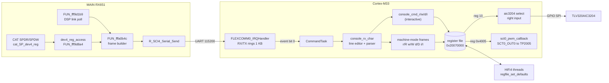
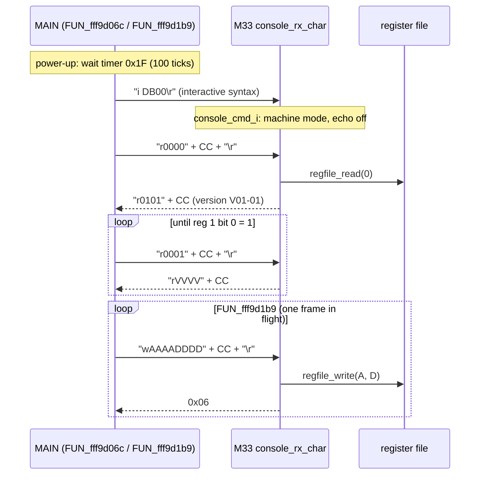
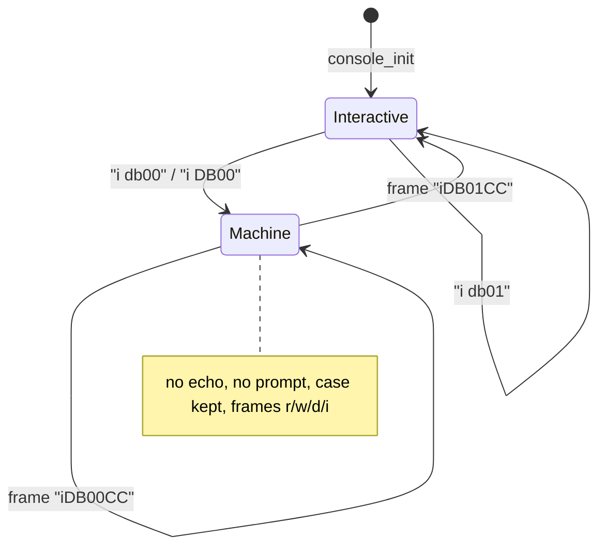

# IFDSP control link: FLEXCOMM0 console, register file, codec control

The MAIN CPU controls the IF DSP (Q2002, i.MX RT685) through a text console that the Cortex-M33 runs on **FLEXCOMM0 USART**
(115200 8N1, `DSP_UMISO/UMOSI`, also on the J2009 header, p19). The console has two modes. The **interactive** mode is for a
person at a terminal: echo, `>> ` prompt, `r`/`w`/`d`/`i` commands. The **machine** mode is what MAIN uses: MAIN sends
`i DB00\r` once, then exchanges short checksummed frames. Every command reads or writes one 16-bit word of a **32K × 16-bit
register file** in shared SRAM at `0x20070000`. The HiFi4 DSP reads its parameters from that file and writes status words back.
The M33 itself uses only five registers. It also owns the **TLV320AIC3204 codec** setup (bit-banged SPI, 67 writes) and turns
register 0x4005 into a PWM output.

Claims are tagged **[fact]** (seen in code, address cited), **[inference]** or **[guess]**. Addresses are M33 SRAM addresses
(0x000xxxxx) unless the text says HiFi4 (0x002xxxxx) or MAIN (0xFFFxxxxx). Proposed names are in *italics*; they are listed in
[`tools/ghidra/names_ifdsp.T12b.tsv`](../../../tools/ghidra/names_ifdsp.T12b.tsv). The MAIN side of the link is documented in
[`docs/code/main/dsp-link.md`](../main/dsp-link.md) (T10d). This page uses the MAIN Ghidra names as they are now.

## Overview

## Function table (M33)

| Address | Ghidra name | Inferred name | Purpose |
|---|---|---|---|
| 0x00080D0C | `uart0_init` | `uart0_init` | FC0 clock (`CLOCK_AttachClk(0x80004508)`), `USART_Init(0x40106000, 115200, TX+RX on)`, event group 0x87EC4, FIFOINTENSET = RXERR+RXLVL (10), NVIC ISER0 bit 14 **[fact]** |
| 0x00080E50 | `FLEXCOMM0_IRQHandler` | `FLEXCOMM0_IRQHandler` | One byte per interrupt. RX: FIFORD → ring 0x87EC8 (head 0x882CC, tail 0x882D0, count 0x882C8), drop when full, set event bit 0. RX error: read and discard, clear FIFOSTAT.RXERR. TX: ring 0x882D4 (count 0x886D4, tail 0x886DC) → FIFOWR; when empty, FIFOINTENCLR = 5 **[fact]** |
| 0x00080CA4 | `uart0_write` | `uart0_write` | Copy bytes into the TX ring (stops when full, returns count) inside a critical section, then enable the TX interrupt (FIFOINTENSET = 0xF) **[fact]** |
| 0x00080F3C | `uart0_tx_pending` | `uart0_tx_pending` | TX count ≠ 0 **[fact]** |
| 0x00080E20 | `create_CommandTask` | `create_CommandTask` | `xTaskCreate(CommandTask, "Command Task", 0x1800, …, prio 1)` **[fact]** |
| 0x00080D78 | `CommandTask` | `CommandTask` | `console_init`, reset both rings, `uart0_init`, set GPIO P2_5 = 1 (0x40100045), then loop: wait event bit 0, feed each RX byte to `console_rx_char` while the TX ring is not full **[fact]**. P2_5's function is unknown **[guess: a "DSP ready" line]** |
| 0x000813EC | `console_init` | `console_init` | argv[0..3] = 0x88D2F/3F/4F/5F (16 bytes each), line state 0, length 0, **interactive mode** (flags 0x88D2D = 0x88D2E = 1) **[fact]** |
| 0x00081430 | `console_rx_char` | `console_rx_char` | Line editor, tokenizer and both command interpreters (below) **[fact]** |
| 0x00081274 | `console_cmd_i` | `console_cmd_i` | `i db00` → machine mode (no reply); `i db01` → interactive mode, prints `\r\n>> ` **[fact]** |
| 0x000812C4 | `console_cmd_w` | `console_cmd_w` | `w AAAA DDDD` → `regfile_write`, prints `\r\n>> ` **[fact]** |
| 0x000812FC | `console_cmd_d` | `console_cmd_d` | `d AAAA` → 8 lines of `\r\n AAAA :` + 8 × ` %04X` (64 words) **[fact]** |
| 0x000813B4 | `console_cmd_r` | `console_cmd_r` | `r AAAA` → `\r\nr AAAA VVVV\r\n>> ` **[fact]** |
| 0x0008138C | (none) | *`console_printf`* | `vsprintf` into 0x88DF0, then `console_puts`; tail-called by `console_cmd_r` **[fact]** |
| 0x00085FAE | `console_puts` | `console_puts` | `uart0_write(s, strlen(s))` **[fact]** |
| 0x00086014 | `is_hex_string` | `is_hex_string` | All chars in `0-9A-Fa-f` (empty string counts as hex) **[fact]** |
| 0x00086044 | `frame_checksum_ok` | `frame_checksum_ok` | 8-bit sum of the first n chars == `strtoul(rest, 16)` **[fact]** |
| 0x00080C20 | `regfile_clear` | `regfile_clear` | `memset(0x20070000, 0, 0x10000)` at boot **[fact]** |
| 0x00080C30 | `regfile_read` | `regfile_read` | `reg < 0x8000 ? word[reg] : 0` **[fact]** |
| 0x00080C4C | `regfile_write` | `regfile_write` | Store if `reg < 0x8000`; for reg 10 also call the codec input select **[fact]** |
| 0x00080C78 | `regfile_set_bits` | `regfile_set_bits` | `word[reg] \|= v` in a critical section (used once: reg 1 bit 0) **[fact]** |
| 0x00085F88 | (none) | *`aic3204_select_right_input`* | Page 1, R55 = 0x10 (arg 1: IN2R) or 0x40 (arg 0: IN1R), back to page 0 **[fact]** |
| 0x00080B68 | `aic3204_spi_write` | `aic3204_spi_write` | 16-bit word `reg<<9 \| val` (R/W bit 0 = write), MSB first, CS P1_7, SCLK P2_29, MOSI P1_1, 1 µs half-period, 10 µs after CS high **[fact]** |
| 0x00080BD0 | `aic3204_init` | `aic3204_init` | Reset P1_0 low 20 ms, high 20 ms, then 67 table entries {reg, val, delay µs} from 0x87A1C **[fact]** |
| 0x00080B44 | `delay_us` | `delay_us` | Busy loop of `n × core_clock / 1e6` iterations **[fact]** (so the real delay is several times longer **[inference]**) |
| 0x000811E0 | `sct0_pwm_init` | `sct0_pwm_init` | SCT0 PWM output 0, 20 kHz, duty 1 %, period callback **[fact]** |
| 0x00081164 | `sct0_pwm_callback` | `sct0_pwm_callback` | Every 400 periods (20 ms): duty = clamp(reg 0x4005, 1, 99) % **[fact]** |

Pins: AIC_RESET P1_0, AIC_MOSI P1_1, AIC_SS P1_7, AIC_MISO P2_28 (never read), AIC_SCLK P2_29 (p19, T12a) **[fact]**. The GPIO
writes use the RT685 byte registers `B[port][pin]` at `0x40100000 + 0x20·port + pin` **[fact]**.

## Line editor and tokenizer (`console_rx_char`)

| Input | Effect |
|---|---|
| 0x20..0x7E or any other control char not listed | Echo if the echo flag (0x88D2E) is set. In idle state a non-space char starts a line; CR in idle prints `\r\n>> ` (echo mode only). In a line: append to 0x88D6F (max 128 chars; overflow silently drops the line) **[fact]** |
| CR, LF | End of line → tokenize and run **[fact]** (NUL is also in the end-of-line mask 0x2401, but NUL is ignored before it gets there) |
| 0x00 | ignored **[fact]** |
| Ctrl+C (0x03) | Echo mode only: abandons nothing, prints `\r\n>> ` then `\r\nCtrl+C\r\n>> ` (the line buffer is not cleared) **[fact]** |
| BS (0x08) / DEL (0x7F) | Remove the last char; echo `\b \b` in echo mode **[fact]** |
| ESC (0x1B) | Echo mode only: print `\r\n>> ` **[fact]** |

Tokenizer **[fact]**: whitespace = ctype bit 0 of table 0x87D84 (TAB, LF, VT, FF, CR, space). Up to 4 tokens of up to 15 chars
into argv[0..3]. A 5th token or a 16th char aborts the line with `\r\n?\r\n>> ` (interactive) or silently (machine). In
interactive mode every token is lower-cased.

## Interactive mode

Entered at boot and with `i db01`. Commands are looked up in table 0x8795C (4 × {name[16], handler}) and called as
`handler(argv, argc)` **[fact]**. All numbers are hex (`strtoul(…, 16)`), truncated to 16 bits.

| Command | Args | Effect | Reply | Wrong argc |
|---|---|---|---|---|
| `r AAAA` | 1 | `regfile_read(AAAA)` | `\r\nr AAAA VVVV\r\n>> ` | `\r\n?\r\n>> ` |
| `w AAAA DDDD` | 2 | `regfile_write(AAAA, DDDD)` (reg 10 side effect) | `\r\n>> ` | nothing (no prompt) |
| `d AAAA` | 1 | dump 64 words from AAAA (wraps at 0xFFFF) | 8 × `\r\n AAAA :` + 8 × ` VVVV`, then `\r\n>> ` | `\r\n?\r\n>> ` |
| `i db00` | 1 | machine mode: echo off, no lower-casing | none | ignored |
| `i db01` | 1 | interactive mode | `\r\n>> ` | ignored |
| anything else | | | `\r\n?\r\n>> ` | |

Registers ≥ 0x8000 read as 0 and writes to them are dropped **[fact: bound 0x2007FFFF]**. `d` calls `vTaskDelay(1)` after each
word while TX bytes are pending, so a dump paces itself to the UART **[fact]**.

## Machine mode (the MAIN link)

Entered with `i DB00\r` (interactive syntax, lower-cased to `i db00`) or with a machine frame `iDB00CC`. Echo and prompts
are off. The line is still tokenized, and only argv[0] is used. Its first char is the command; the rest must be hex
(`is_hex_string`), otherwise the line is dropped without a reply **[fact]**.

| Frame (chars) | Check | Effect | Reply |
|---|---|---|---|
| `rAAAACC` / `RAAAACC` (7) | CC = sum of 5 chars | `regfile_read` | `r` + `%04X` value + `%02X` sum of those 5 chars; **no CR** |
| `wAAAADDDDCC` / `W…` (11) | CC = sum of 9 chars | `regfile_write` | `0x06` (ACK) |
| `dAAAACC` / `DAAAACC` (7) | sum of 5 | dump 64 words | 8 × `\r\nAAAA :` + 8 × ` VVVV`, then `\r\n` |
| `iDB00CC` / `idb00CC` (7) | sum of 5 | machine mode | none |
| `iDB01CC` / `idb01CC` (7) | sum of 5 | interactive mode | none |
| any other first char, valid length and checksum | | none | none |
| length not 7/11, or bad checksum | | none | `?` |

All **[fact]** (`console_rx_char` 0x0008168C..0x00081840, strings 0x87CB1 `db`, 0x87CB4 `DB`, 0x87CB7 `?`, 0x87CB9 `\x06`).
CC is the low 8 bits of the ASCII sum, as two hex digits. Example: reading register 0 is `r0000` → 0x72+4×0x30 = 0x132 →
`r000032\r`; the reply for value 0x0101 is `r0101` + sum (0x72+0x30+0x31+0x30+0x31 = 0x134) = `r010134` **[fact: arithmetic]**.

MAIN side **[fact]** (`decomp/main`): `FUN_fffa0b4c(cmd)` builds `cmd` + `word2hex(addr 0x1B6DE)` [+ `word2hex(data 0x1B6E0)`] +
`byte2hex(FUN_fffa0c01 sum)` + CR and sends it with `FUN_fffb1ab4` (SCI4), then starts timer 3 (6 ticks). Flags 0x1C5E (write
pending) and 0x1C5F (read pending) allow one frame in flight. `FUN_fffa0ad6` takes the reply: for `r` it checks the 5-char
checksum (`FUN_fffa0c2e`), for `w` it expects 0x06. On timeout it drops the pending flag, so a lost frame is not retried
directly; the setter sends it again on its next pass because the shadow still differs **[inference]**. `FUN_fffa037a` stores
the confirmed value in a shadow table at 0x1B634.. (one slot per register, not linear in the register number). Each setter
compares its new value with the shadow and sends at most one frame per pass of `FUN_fff9d1b9` **[fact]**. While the radio is in
state 3 or 8 (0x20B18), regs 1–4 are read in rotation every 20 ticks (timer 0xB) **[fact]**.

**CAT access [fact]:** the service CAT commands `SPDRaaaa;` / `SPDWaaaavvvv;` (`cat_SP_dev4_reg` 0xFFFA4E8F →
`dev4_reg_access` 0xFFF9D8A4) send the same `r`/`w` frames, so they read and write **this register file** directly.
`docs/cat-commands.md` calls the SCI4 device "unknown"; it is the IFDSP. `SPDW` changes DSP parameters live and must not be
sent to the radio without the owner's approval.

## Register file

- Location: SRAM `0x20070000..0x2007FFFF`, 32768 × 16-bit words; register *n* is at `0x20070000 + 2n` **[fact]**.
- M33: cleared at boot (`regfile_clear`, before the DSP is released), then `reg0 = 0x0101`, `reg 0x4000 = 1`, `reg1 |= 1` after the
  MU handshake (`app_main` 0x0008106C) **[fact]**.
- HiFi4: `0x0021C498` (DSP main init) sets the region's cache attribute (`call8 0x233410(0x20070000, 0x10000, 2, 0)`, probably
  `xthal_set_region_attribute` = bypass **[inference]**), calls *`regfile_set_defaults`* 0x0021BE80 and *`regfile_capture_init`*
  0x0021C090 **[fact]**. The defaults function writes every register in the map below except 0, 1 and 0x4000 (the M33's) **[fact]**.
- The DSP addresses the file through three base literals: `0x2006FF00` (+0x100 + 2n → regs 0x00–0x7F), `0x20073F00` (regs
  0x2000–0x207F) and `0x20077F00` (regs 0x4000–0x407F), because the `l16ui`/`s16i` offset only reaches 510 bytes **[fact]**.
- The bands: 0x0000–0x0068 parameters and status shared with MAIN; 0x2000–0x200F zeroed only; 0x4000–0x4026 mostly DSP-internal
  (MAIN writes 7 of them); 0x7000 and 0x7800 two 4 KB capture blocks (0x2007E000, 0x2007F000) **[fact]**.

### Register map

How the table was made: **DSP default** and **HiFi4 access** come from a scan of the HiFi4 image 1 text, disassembled with the
Zephyr SDK `xtensa-nxp_rt600_adsp_zephyr-elf-objdump` (which decodes the HiFi4 FLIX bundles that Ghidra cannot), by
[`tools/ifdsp_hifi4_regscan.py`](../../../tools/ifdsp_hifi4_regscan.py). It tracks constant base registers per function, so
accesses through computed pointers are missed; "ptr" means the function stores the register's address in a structure. HiFi4
addresses are function entries from `decomp/ifdsp/hifi4/functions.tsv`. **MAIN** lists the MAIN function that sends the frame
(`r` = read, `w` = write); MAIN reads only 0–4 (plus anything through `SPDR`). Mode names use the MAIN mode index of
`FUN_fffb3196` (0 LSB, 1 USB, 2 CW-L, 3 CW-U, 4 AM, 5 AM-N, 6 FM, 7 FM-N, 8 DATA-L, 9 DATA-U, 10 DATA-FM, 11 DATA-FM-N,
12 RTTY-L, 13 RTTY-U, 14 PSK, from `cat_mode_codes`, see `docs/cat-commands-primary.md` MD) **[fact]**. "Settings 0x9Axx" are
MAIN RAM bytes (menu/VFO settings) whose names T10d may supply. `FUN_fffb3196(1)` is used for TX-side registers and
`FUN_fffb3196(0)` for RX-side ones **[inference: TX vs RX VFO]**.

| Reg | DSP default | MAIN | M33 | HiFi4 access | Meaning |
|---|---|---|---|---|---|
| 0x0000 |  | r `FUN_fff9d957` | W 0x0101 (`app_main`) |  | IFDSP version, 0x0101 = V01-01; MAIN reads it once at init and prints it as `V01-01` [fact] |
| 0x0001 |  | r `FUN_fff9d967` | set bit 0 (`regfile_set_bits`) | R 0x0021F7EC, 0x0021FA48, 0x0021FD20, 0x00220370, 0x002235D2, 0x00223734; R(byte) 0x0021D68C; W 0x0021D68C, 0x0021F7EC, 0x0021FA48, 0x0021FD20, 0x00220370, 0x002235D2, 0x00223734 | status flags. bit 0 = DSP up (M33, after the MU handshake; MAIN waits for it at init) [fact]. bit 4 = DSP flag from 0x002235D2/0x00223734 (MAIN `FUN_fff9d7f0` users test it) [fact], meaning [guess: VOX/detector]. bit 6 = DSP flag (0x0021F7EC/0x0021FA48); MAIN debounces 5 polls → 0x1C61, used in FM modes [fact] → squelch open [inference]. bit 7 = DSP flag (0x0021FD20/0x00220370) [fact]. Bits 15..8 = level byte from 0x0021D68C; MAIN averages 2 polls → 0x1C60, compares with a threshold → squelch [inference] |
| 0x0002 | 0x0000 | r `FUN_fff9d977` |  | R 0x00224ED8; R(byte) 0x00222034; W 0x00222034, 0x00224ED8 | two level bytes: low = min(255, x) from 0x00224ED8, high from 0x00222034; MAIN averages 32 polls per byte → 0x1B6E2 and converts with a piecewise-linear table [fact] → meter (S-meter) [inference] |
| 0x0003 | 0x0000 | r `FUN_fff9d987` |  | W 0x0021F388 | high byte = level min(255, v>>6), low byte = 255 − x (0x0021F388) [fact]; MAIN averages the low byte over 16 polls → 0x1C62 [fact]; same source value as reg 0x4005 [fact] |
| 0x0004 | 0x0000 | r `FUN_fff9d997` |  | W 0x0021D270 | signed offset, 0x7FFF = invalid (0x0021D270) [fact]; MAIN takes the majority of 8 polls (default 100), clips to ±99 and adds `×10 Hz` to the VFO (negated in CW-L) [fact] → CW auto zero-in offset [inference] |
| 0x0006 | 0x0000 | w `FUN_fff9d9a7` |  | R 0x0021F484, 0x00220EE0, 0x002220E8, 0x0022313C, 0x002262FC | demodulator class from the RX mode (`FUN_fffb3196(0)`): CW-U 0, CW-L 1, USB/DATA-U/RTTY-U/PSK 2, LSB/DATA-L/RTTY-L 3, AM/AM-N 8, FM/FM-N/DATA-FM/DATA-FM-N 9 [fact: mapping]; = mode/sideband select [inference] |
| 0x0008 | 0x2031 | w `FUN_fff9da09` |  | R 0x002249D0 | mode-dependent constant from `FUN_fffa0e3a(8)`: 0x2022 (most modes), 0x2222 (RTTY-U, PSK), or variable 0x20B34 (LSB, USB, CW-L, DATA-L, DATA-U) [fact]; routing/path selector [guess] |
| 0x0009 | 0x0002 | w `FUN_fff9da3c` |  | R 0x002249D0 | `FUN_fffa0e3a(9)`: 2 in RTTY-U and PSK, else 0 [fact] |
| 0x000A | 0x0022 | w `FUN_fff9da6f` | any write → codec P1 R55 (`regfile_write`) | R 0x002249D0 | `FUN_fffa0e3a(10)`: LSB/CW-L/DATA-L 0x52, USB/DATA-U 0x50, CW-U/AM 0x02, AM-N/DATA-FM-N/RTTY-L/PSK 0x03, FM/FM-N/DATA-FM/RTTY-U 0x22 [fact]. Low nibble == 1 would select codec IN1R; MAIN never sends 1, so the first write switches the right MICPGA to IN2R [inference] |
| 0x000C | 0x0001 | w `FUN_fff9daa2` |  | R 0x0021C5CC, 0x0022309C, 0x002233FC, 0x00223734 | written 0 once by MAIN [fact]; DSP 0x0021C5CC tests `(reg & 0xF000) == 0x1000` to read GPIO P0_4 into reg 0x4004 bit 2 [fact] |
| 0x000D | 0x0000 | w `FUN_fff9dad1` |  |  | `FUN_fffa0e3a(0xD)`: 0xF000 in FM, else 0 [fact] |
| 0x000E | 0x0000 | w `FUN_fff9db04` |  |  | `FUN_fffa0e3a(0xE)`: 0xF000 in FM, else 0 [fact] |
| 0x000F | 0x0000 | w `FUN_fff9db37` |  | R 0x00225DC4 | constant 0x002B written once [fact] |
| 0x0010 | 0x0000 |  |  | R 0x00225DC4 | no MAIN writer [fact] |
| 0x0011 | 0xFFD4 | w `FUN_fff9db66` |  | R 0x00222510, 0x00222688, 0x00222AF0 | constant 0xFFA2 (−94) written once [fact] |
| 0x0012 | 0x0000 | w `FUN_fff9db97` |  |  | constant 8 written once [fact] |
| 0x0013 | 0x0000 | w `FUN_fff9dbc6` |  | R 0x00225AB4 | constant 0xFFF8 (−8) written once [fact] |
| 0x0020 | 0x0000 | w `FUN_fff9dbf7` |  |  | `FUN_fffa0e3a(0x20)` (0xFFFF/0xFFFE mean "compute": LSB, DATA-L, RTTY-U → `FUN_fffb34e4`, PSK → `FUN_fffb350e`); forced 0 when 0x20BAF==1 && 0x20F01 [fact] |
| 0x0021 | 0xFFB0 | w `FUN_fff9dc8a` |  | ptr 0x00223320 | setting via `FUN_fffb3538` [fact]; DSP keeps a pointer to it (channel 0, with reg 0x4008) [fact] |
| 0x0022 | 0x0000 | w `FUN_fff9dce4` |  | ptr 0x0022338C | 0xFF or −(setting − x + 0x32) [fact]; DSP pointer (channel 1, with reg 0x4009) [fact] |
| 0x0023 | 0x0000 |  |  | R 0x002248D8 | no MAIN writer [fact] |
| 0x0025 | 0x0000 | w `FUN_fff9dd6a` |  |  | TX EQ band 1: frequency `setting×100` Hz, bit 12 = on [fact: MAIN formula] → parametric MIC EQ [inference] |
| 0x0026 | 0x0000 | w `FUN_fff9dee6` |  |  | TX EQ band 1 level, signed byte [fact] |
| 0x0027 | 0x0000 | w `FUN_fff9dfd5` |  |  | TX EQ band 1 width byte [fact] |
| 0x0028 | 0x0000 | w `FUN_fff9dd6a` |  |  | TX EQ band 2: `setting×100+600` Hz, bit 12 = on [fact] |
| 0x0029 | 0x0000 | w `FUN_fff9dee6` |  |  | TX EQ band 2 level [fact] |
| 0x002A | 0x0000 | w `FUN_fff9dfd5` |  |  | TX EQ band 2 width [fact] |
| 0x002B | 0x0000 | w `FUN_fff9dd6a` |  | R 0x00221220 | TX EQ band 3: `setting×100+1400` Hz, bit 12 = on; DSP checks low 12 bits ≤ 5999 [fact] |
| 0x002C | 0x0000 | w `FUN_fff9dee6` |  | R 0x00221220 | TX EQ band 3 level; DSP clips to −40..+20 [fact] |
| 0x002D | 0x0000 | w `FUN_fff9dfd5` |  | R 0x00221220 | TX EQ band 3 width [fact] |
| 0x002E | 0x0000 | w `FUN_fff9e0ad` |  |  | `0x9BF1` (also selects the processor EQ set) when TX mode is SSB, else 0, bit 12 set when non-zero [fact] → speech processor [inference] |
| 0x002F | 0x0001 | w `FUN_fff9e12b` |  | R 0x002221D0 | per-mode setting byte (SSB 0x9A36, AM 0x9A4B, DATA/PSK 0x9A73) or 0x20B64 [fact] |
| 0x0030 | 0x00FF | w `FUN_fff9e21f` |  | R 0x00222D00, 0x00222D34 | 0xFF in the FM modes (TX mode) [fact] |
| 0x0031 | 0x0FFA | w `FUN_fff9e26b` |  | R 0x00221E84 | −43 (SSB/CW/DATA/RTTY/PSK), −54 (AM), −56 (FM) by TX mode [fact] |
| 0x0032 | 0x0FFA | w `FUN_fff9e330` |  | R 0x00221E84 | same table as 0x31 [fact] |
| 0x0033 | 0x000C | w `FUN_fff9e3f5` |  | R 0x00221E84 | from 0x9AD9 and the TX mode [fact] |
| 0x0034 | 0x0000 | w `FUN_fff9e480` |  | R 0x00221E84 | from 0x9BF2, bit 12 flag [fact] |
| 0x0035 | 0x0000 | w `FUN_fff9e51c` |  | R 0x00222510 | TX-mode/VFO dependent [fact] |
| 0x0036 | 0x0000 | w `FUN_fff9e5b4` |  | R 0x00222AF0 | 0 written once [fact] |
| 0x0037 | 0x0000 | w `FUN_fff9e5e4` |  | R 0x00222AF0 | 0 written once [fact] |
| 0x0038 | 0x0000 | w `FUN_fff9e614` |  | R 0x00222688 | 0 written once [fact] |
| 0x0039 | 0x0000 |  |  |  |  |
| 0x003A | 0x0001 | w `FUN_fff9e644` |  | R 0x00220B5C, 0x00222D34 | mode dependent (`FUN_fff9e644`) [fact] |
| 0x003B | 0x02C4 | w `FUN_fff9e6b9` |  |  | TX-mode dependent (`FUN_fff9e6b9`) [fact] |
| 0x0040 | 0x0000 | w `FUN_fff9e750` |  | R 0x0021DBD0 | RX mode/VFO dependent (`FUN_fff9e750`) [fact] |
| 0x0041 | 0x0000 | w `FUN_fff9e7c4` |  | R 0x0021C8BC | RX mode/VFO dependent [fact] |
| 0x0042 | 0x0000 | w `FUN_fff9e871` |  |  | RX mode/VFO dependent [fact] |
| 0x0043 | 0x0000 | w `FUN_fff9e9a4` |  |  | from 0x9AD5 [fact] |
| 0x0044 | 0x0000 | w `FUN_fff9e9fa` |  |  | `0xB − 0x9AD6` [fact] |
| 0x0045 | 0x0000 | w `FUN_fff9ea39` |  | R 0x0021C610 | from 0x9AD4/0x9C04/0x9C5F and the mode [fact] |
| 0x0046 | 0x0000 | w `FUN_fff9eae7` |  |  | per-mode setting table (0x9A32/0x9A33 + 0x13..0x15 stride) [fact] |
| 0x0047 | 0x0000 | w `FUN_fff9ed0e` |  |  | per-mode setting table (0x9A30/0x9A31 ...) [fact] |
| 0x0048 | 0x0000 | w `FUN_fff9ef34` |  |  | RX EQ band 1 frequency (per mode constant), bit 12 = on [fact: layout like 0x25–0x2D] → RX EQ [inference] |
| 0x0049 | 0x0000 | w `FUN_fff9f0b1` |  |  | RX EQ band 1 level (settings 0x9A2A..) [fact] |
| 0x004A | 0x0000 | w `FUN_fff9f291` |  |  | RX EQ band 1 width [fact] |
| 0x004B | 0x0000 | w `FUN_fff9ef34` |  |  | RX EQ band 2 frequency [fact] |
| 0x004C | 0x0000 | w `FUN_fff9f0b1` |  |  | RX EQ band 2 level [fact] |
| 0x004D | 0x0000 | w `FUN_fff9f291` |  |  | RX EQ band 2 width [fact] |
| 0x004E | 0x0000 | w `FUN_fff9ef34` |  | R 0x00220470 | RX EQ band 3 frequency [fact] |
| 0x004F | 0x0000 | w `FUN_fff9f0b1` |  | R 0x00220470 | RX EQ band 3 level [fact] |
| 0x0050 | 0x0000 | w `FUN_fff9f291` |  | R 0x00220470 | RX EQ band 3 width [fact] |
| 0x0051 | 0x0000 | w `FUN_fff9f400` |  |  | 0 written once [fact] |
| 0x0052 | 0x0000 | w `FUN_fff9f430` |  | R 0x0021E530 | from 0x9AD1 and the RX mode [fact] |
| 0x0053 | 0x0000 | w `FUN_fff9f4c8` |  | R 0x0021F7EC | from 0x20B72 and the RX mode [fact] |
| 0x0054 | 0x0000 |  |  |  |  |
| 0x0055 | 0x0000 |  |  |  |  |
| 0x0056 | 0x0000 | w `FUN_fff9f54b` |  | R 0x0021E6C4 | constant 0x20 [fact] |
| 0x0057 | 0x0000 |  |  |  |  |
| 0x0058 | 0x02C4 |  |  |  |  |
| 0x005C | 0x0000 | w `FUN_fff9f57b` |  | R 0x00223C8C | from 0x9C39, bit 12 flag [fact] |
| 0x005D | 0x0000 | w `FUN_fff9f5c6` |  |  | from 0x9C3A..0x9C3C, bit 12 flag [fact] |
| 0x0060 | 0x0000 |  |  | R 0x00224960 |  |
| 0x0061 | 0x0000 | w `FUN_fff9f638` |  | R 0x0021D270 | from 0x9C04, bit 12 flag [fact] |
| 0x0062 | 0x0001 | w `FUN_fff9f681` |  | R 0x0021F004 | per-mode settings (`FUN_fff9f681`) [fact] |
| 0x0063 | 0x00E7 | w `FUN_fff9fb6e` |  | R 0x0021F004 | from 0x4674..0x4678 (`FUN_fff9fb6e`) [fact] |
| 0x0066 | 0x0BB8 | w `FUN_fff9f681` |  | R 0x0021F004 | per-mode settings (`FUN_fff9f681`) [fact] |
| 0x0067 | 0x00FF | w `FUN_fff9fc2a` |  | R 0x0021F004 | from 0x9AB6/0x20BA7 [fact] |
| 0x0068 | 0x0000 | w `FUN_fff9fca0` |  | R 0x0021F2D0 | constant 0x94 written once [fact] |
| 0x2000–0x200F | 0x0000 |  |  | only zeroed by defaults |  |
| 0x4000 |  |  | W 1 (`app_main`) |  | M33 writes 1 after the DSP is up [fact]; no reader found [fact] |
| 0x4001 | 0x0001 |  |  |  | DSP default 1; no other access found [fact] |
| 0x4004 |  |  |  | W 0x0021C060 | DSP writes `(f()<<2) OR (GPIO P0_21<<1) OR GPIO P0_22` from Thread_Main (0x0021C060) [fact]; board input status [inference] |
| 0x4005 | 0x0000 |  | R every 20 ms (`sct0_pwm_callback`) | W 0x0021F348 | DSP writes a 0..99 level (0x0021F348: `min(255, v>>8)×100>>8`, v = float×65535) [fact]; M33 sets SCT0 PWM duty = clamp(reg, 1, 99) % → RC filter → TP2005 (p19) [fact]; analog test output [inference] |
| 0x4006 | 0x0000 |  |  | R 0x0022313C | DSP R [fact] |
| 0x4007 | 0x003A |  |  | R 0x00221A30 | DSP R, default 0x3A [fact] |
| 0x4008 | 0x0000 |  |  | ptr 0x00223320 | DSP pointer (channel 0, with reg 0x21) [fact] |
| 0x4009 | 0x0000 |  |  | ptr 0x0022338C | DSP pointer (channel 1, with reg 0x22) [fact] |
| 0x400A | 0x0000 |  |  | W 0x00223734 | DSP W (0x00223734) [fact] |
| 0x400B | 0x0008 | w `FUN_fff9fcd0` |  | R 0x0021DBD0 | RX mode/VFO dependent [fact] |
| 0x400C | 0x0400 |  |  | R 0x0021C8BC |  |
| 0x400D | 0x0200 | w `FUN_fff9fd51` |  | R 0x0021DBD0 | RX mode/VFO dependent [fact] |
| 0x400E | 0x0002 |  |  | R 0x0021C8BC |  |
| 0x400F | 0x0000 |  |  |  |  |
| 0x4011 | 0x0080 |  |  | R 0x002233FC, 0x00223734 |  |
| 0x4012 | 0x4000 |  |  | R 0x002233FC, 0x00223734 |  |
| 0x4013 | 0x03E8 |  |  |  |  |
| 0x4014 | 0xFFE8 |  |  |  |  |
| 0x4015 | 0x0000 |  |  |  |  |
| 0x4016 | 0xFFFA |  |  |  |  |
| 0x4017 | 0x0000 |  |  |  |  |
| 0x4018 | 0x0064 |  |  |  |  |
| 0x4019 | 0x0000 |  |  |  |  |
| 0x401A | 0x0000 |  |  | R 0x00222244 |  |
| 0x401B | 0x02C4 |  |  | R 0x00222244 |  |
| 0x401C | 0x000A |  |  | R 0x00222244 |  |
| 0x401D | 0x012C |  |  | R 0x00222244 |  |
| 0x401E | 0x0000 |  |  | R 0x00222244 |  |
| 0x401F | 0x000A |  |  | R 0x00222244 |  |
| 0x4020 | 0x0000 | w `FUN_fff9fdd2` |  | R 0x0021E754 | 0x22BC or 0x23E8 (`FUN_fffb54a0`/`FUN_fffb552c`) [fact] |
| 0x4021 | 0x0000 |  |  |  |  |
| 0x4022 | 0x0000 | w `FUN_fff9fe2a` |  | R 0x0021DFE4 | RX mode/VFO dependent [fact] |
| 0x4023 | 0x0064 | w `FUN_fff9feaf` |  | R 0x0021DFE4 | RX mode/VFO dependent [fact] |
| 0x4025 | 0x0000 | w `FUN_fff9ff30` |  | R 0x0021DBD0 | RX mode/VFO dependent [fact] |
| 0x4026 | 0x0000 | w `FUN_fff9ffb1` |  | R 0x0021DBD0 | RX mode/VFO dependent [fact] |
| 0x7000 |  |  |  | ptr 0x0021C090 | capture block 0 (4 KB, 0x2007E000): word 0 control (bit 0 enable, bit 1 wrap), word 1 count, then up to 1022 32-bit samples; zeroed at DSP boot (0x0021C090); the append helper 0x0021C0E8 has no caller [fact] → unused debug capture [inference] |
| 0x7800 |  |  |  | ptr 0x0021C090 | capture block 1 (0x2007F000), same layout [fact] |

### Cross-check: MAIN writes vs DSP use

- Every register MAIN writes has a DSP default **[fact]**, so the two firmwares agree on the register set.
- Registers MAIN writes but the scan found no DSP reader for: 0x0D, 0x0E, 0x12, 0x20, 0x25–0x2A, 0x2E, 0x3B, 0x42–0x44,
  0x46–0x4D, 0x51, 0x5D **[fact: scan]**. The EQ groups are read through a per-band loop or pointer (band 3 of each group is
  found at 0x00221220 / 0x00220470, bands 1–2 are not), so most of these are probably read indirectly **[inference]**.
- Registers the DSP reads that MAIN never writes: 0x10, 0x23, 0x60, 0x4006, 0x4007, 0x400C, 0x400E, 0x4011, 0x4012, 0x401A–0x401F
  **[fact: scan]**. They keep their DSP defaults unless someone uses `w`/`SPDW` **[inference]**, so they are tuning constants.
- Status registers the DSP writes for MAIN: 1, 2, 3, 4 (read by MAIN) and 0x4004, 0x4005 (not read by MAIN; 0x4005 drives the PWM)
  **[fact]**.

## Register-driven side effects on the M33

| Register | Effect | Evidence |
|---|---|---|
| 10 (0x0A) | Every write (from MAIN or the console) rewrites codec page 1 R55 (right MICPGA positive input): low nibble 1 → 0x40 = IN1R via 10 kΩ (the init value), anything else → 0x10 = IN2R via 10 kΩ, then page 0 is selected again | `regfile_write` 0x00080C4C, 0x00085F88 **[fact]**; datasheet bit meaning **[inference]** |
| 0x4005 | PWM duty of SCT0 output 0 (PIO2_2 func 2, 20 kHz), updated every 20 ms, clamped 1–99 %, into R2041/C2003 → TP2005 | `sct0_pwm_callback` 0x00081164, p19 (T12d) **[fact]** |
| 0 / 1 / 0x4000 | written once by `app_main` after the DSP handshake | **[fact]** |

The codec SPI write for reg 10 runs in the Command Task, so it can interleave only with `aic3204_init`, which has finished before
the scheduler starts **[fact: call order]**.

## TLV320AIC3204 initialisation (table 0x00087A1C)

`aic3204_init` sends 67 entries of `{u8 reg, u8 value, u16 delay_us}` **[fact]**. Register meanings are from the TI datasheet
**[inference]**.

| # | Page | Reg = value | Meaning |
|---|---|---|---|
| 0–1 | 0 | R1 = 0x01, wait 1 ms | software reset |
| 2–5 | 1 | R1 = 0x08, R2 = 0x01, R123 = 0x05, wait 50 ms | weak AVDD link off, LDO/analog power, reference power-up |
| 6–8 | 0 | R27 = 0x3C, R28 = 0x00 | I2S, 32-bit words, **BCLK and WCLK outputs (codec is master)**, no offset |
| 9–14 | 0 | R4 = 0x03, R6 = 5, R7/R8 = 0, R30 = 0x84, R5 = 0x91, wait 10 ms | PLL from MCLK, J.D = 5.0000, P = R = 1, PLL on; BCLK = DAC_CLK / 4 |
| 15–21 | 0 | R13/14 = 0x0040, R20 = 0x40, R11 = 0x85, R12 = 0x84, R18 = 0x85, R19 = 0x84 | DOSR = AOSR = 64, NDAC = NADC = 5, MDAC = MADC = 4 → fs = MCLK × 5 / 5 / 4 / 64 = MCLK / 256 |
| 22–44 | 8, 9 | coefficient registers, then P8 R1 = 0x04 | first-order IIR N0 = 0x7FE36C, N1 = 0x801C94, D1 = 0x7FC6DA on both channels (DC-blocking high-pass), then switch coefficient buffers |
| 45–47 | 1 | R14 = 0x08, R15 = 0x08 | left DAC → LOL, right DAC → LOR |
| 48–51 | 0 | R64 = 0x02, R65 = 0x00, R63 = 0xD4 | DAC volume (right follows left), 0 dB, both DACs on, L→L R→R |
| 52–55 | 1 | R18 = 0, R19 = 0, R9 = 0x0C, wait 100 µs | LOL/LOR 0 dB unmuted, LOL/LOR powered |
| 56–62 | 1 | R52 = 0x40, R55 = 0x40, R54 = 0x40, R57 = 0x40, R59 = 0, R60 = 0 | MICPGA: left + = IN1L, right + = IN1R, − = CM1L/CM1R (all 10 kΩ), 0 dB |
| 63–66 | 0 | R81 = 0xC0, R82 = 0x00 | both ADCs on and unmuted |

So the codec is used as a line-level stereo ADC/DAC (line outputs only, no headphone driver) **[inference]**. With the 18.432 MHz
`DSP_CLK` as MCLK fs would be 72 kHz; the real MCLK pin is set up by T12d/T12e **[guess]**.

## Findings in short

1. The console is the MAIN↔IFDSP control link; machine mode is a strict 7/11-char frame protocol with an 8-bit ASCII sum **[fact]**.
2. The **register map** has about 110 live registers. MAIN writes 72 registers (0x06–0x68 and 0x400B–0x4026), reads 0–4 **[fact]**.
   Several are now identified by their MAIN formulas: reg 6 demod class, TX parametric EQ 0x25–0x2D, RX EQ 0x48–0x50,
   reg 4 CW zero-in offset, regs 1–3 squelch/meter levels **[inference]**.
3. The CAT service commands `SPDR`/`SPDW` give raw access to this register file **[fact]**.
4. Two 4 KB **capture blocks** at regs 0x7000/0x7800 exist in the DSP, but no code appends to them in this build **[fact]**.
5. Reg 10 controls the codec's right input mux on the M33 side; MAIN's values make it always IN2R after the first write **[inference]**.
