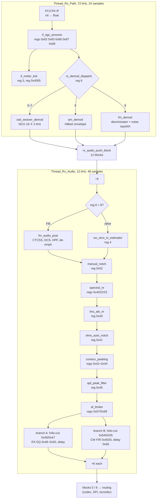
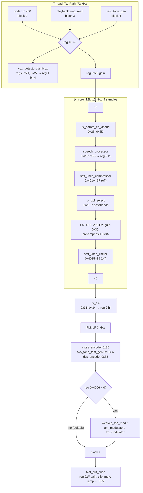

# IFDSP: HiFi4 receive and transmit chains, stage by stage (#86)

Back to [hifi4.md](hifi4.md) (threads, I/O, register file, tables) and the [IFDSP overview](README.md). This page says **what each signal
stage computes**, with its constants and the registers that steer it. Sources: the decompiled C in `decomp/ifdsp/hifi4/` and, for every
kernel, the FLIX-aware listing `decomp/ifdsp/hifi4/flix.dis` (the decompiler drops many loops and the `ae_*` arithmetic). Literal values
are decoded from the L32R pools. Tags: **[fact]** = seen in code or data (address given), **[inference]**, **[guess]**. Function names are
the ones applied in Ghidra by this issue (`tools/ghidra/IfdspHifi4Names.java`). Register numbers are DSP register-file indexes; the MAIN
side of each register is in [control-link.md](control-link.md#register-map).

## Rates and conventions

- The I2S links and the per-block threads run at **72 kHz**, 24 samples per block (333 µs). The receive-audio chain (`Thread_Rx_Audio`)
  and the transmit core run at **12 kHz** between a ÷6 and a ×6 resampler (#154, [hifi4.md](hifi4.md#i2s-on-flexcomm25-dma1)) **[fact]**.
- **Gain registers are in 0.5 dB steps.** Every dB-valued register is converted with `i2f_scaled`(v, −1) = v / 2 before 10^(x/20)
  (`FUN_00234730`; e.g. reg 0x20 at 0x2264C8, reg 0x13 at 0x225A9E, reg 0xF at 0x225E26) **[fact]**. This applies to regs 0x0F, 0x11–0x13,
  0x20–0x23, 0x31, 0x32, 0x3B, 0x58, 0x60, 0x68, 0x4014–0x4016, 0x4025, 0x4026. hifi4.md called reg 0x20 "signed dB"; it is half-dB.
- Many settings use a **"bit 12 = on, bits 11–0 = value"** word (frequency in Hz ≤ 5999 for the 12 kHz stages) **[fact]**.
- All arithmetic is float32 **[fact]**.

Library helpers used below **[fact: code and polynomial tables]**: `vec_sum_sq` 0x234BE0 (Σx²), `sqrtf_` 0x235C8C, `divf_` 0x235BA8,
`log10f_` 0x2190F0, `pow10f_` 0x218B70, `tanf_` 0x219690 (table 0x200890: 1/3, 0.1333, 0.0540), `cosf_` 0x218FC0, `sinf_` 0x219560,
`atan2f_` 0x218E60, `i2f_scaled` 0x234730 (float(i)·2^s), `f2i_scaled` 0x234710, `vec_scale_f32` 0x234F40, `fir_init` 0x233984,
`fir_process` 0x233A10, `iir_cascade_init` 0x2340FC, `iir_cascade_process` 0x2341C0.

## Receive chain

### Rx_Path (72 kHz)

| Address | Ghidra name | What it computes | Registers | Tag |
|---|---|---|---|---|
| 0x220EE0 | `rx_demod_dispatch` | Copies the block, runs `if_agc_process`, then by reg 6: 0, 2, 4, 6 → `ssb_weaver_init`(0) + `ssb_weaver_demod`; 1, 3, 5, 7 → (1); 8 → AM; 9 → FM; anything else passes through | 6 | [fact] |
| 0x21F0DC (+0x21EF90 init, 0x21F004 params) | `if_agc_process` | **Feed-forward AGC, one gain per block.** Level = √(Σx² / 24) (1/24 = 0x3D2AAAAB at 0x21F0F6), averaged with the previous block. Wanted gain = min(Gmax, 0.2512 / level): target 0.2512 = **−12 dBFS** (0x3E809BCC at 0x21F088). **Attack** is immediate and the gain is applied to the previous block (one block = 333 µs look-ahead). **Hang** 20 ms (counter step 1/60 per block, 0x3C888889). **Decay** linear in dB, 40 dB per reg-0x66 ms | 0x62 ≠ 0: AGC on (0: fixed gain Gmax). 0x66: decay time in ms, 20–4000 (default 3000). 0x67: gain 10^((x − 255)·0.025) (0x204BD0 = 0.025). 0x63: Gmax = g67 · 10^((255 − x)/40). 0x68: fixed input gain, 0.5 dB steps (MAIN writes 0x94 = +74 dB) | [fact] constants and flow; units of 0x66 [inference] |
| 0x21F320 (+0x21F348 `meter_to_reg4005`, 0x21F388 `status_reg3_update`) | `if_meter_tick` | Every 60 blocks (20 ms): reg 0x4005 = linear RMS level before the AGC (PWM meter); reg 3 high byte = min(255, (65535·rms) >> 6); reg 3 low byte = 255 − 2·(Gmax_dB − gain_dB) = **AGC gain reduction in 0.5 dB steps** | writes 3, 0x4005 | [fact]; reg 3 low byte as S-meter source [inference, MAIN averages it] |
| 0x21D8A0 / 0x21D940 | `ssb_weaver_init` / `ssb_weaver_demod` | **Weaver SSB/CW demodulator.** NCO 1 at (±2000 + 18000) Hz, 2π/72000 (0x206EA8/0x206EAC), I/Q mix; ÷6 with 0x2373D0 (LP 4.9 kHz); 9-section LP 0x237440 (1.97 kHz at 12 kHz) on I and Q; NCO 2 at 2 kHz (π/3 per sample at 12 kHz) and I·cos + s·Q·sin; ×6 with gain 6 and 0x2373D0. Param 0 (CW-U, USB) sets s = −1 → NCO 1 at 16 kHz; param 1 (CW-L, LSB) → 20 kHz. So the SDR delivers the signal with its (suppressed) carrier at **18 kHz** in a real 72 kHz stream, and the audio passband is 0–4 kHz | 6 | [fact: constants]; carrier position [inference] |
| 0x21D5B0 / 0x21D5C8 | `am_demod_init` / `am_demod` | Analytic signal (`hilbert_iq` 0x225370: 71-tap FIR 0x205840 for Q, I = input delayed 35 samples), envelope √(I² + Q²), DC blocker y = x − x₋₁ + 0.999·y₋₁ | — | [fact: structure]; coefficient values [fact per the FLIX listing, not re-checked] |
| 0x21D650 / 0x21D68C | `fm_demod_init` / `fm_demod` | Analytic signal, mix by an NCO of −2π/3 per sample (−24 kHz, fs/3; 0xC0060A92), polar discriminator atan2(x·conj(x₋₁)) × 1.6225, hold on zero input. **Noise squelch level:** discriminator output through the 5-section BP 0x2368D0 (9–15 kHz at 72 kHz), Σ\|n\| over 1800 samples (25 ms), scaled into **reg 1 high byte** | writes reg 1 bits 15–8 | [fact]; why FM sits at 24 kHz and SSB at 18 kHz is open |
| 0x224960 | `rx_loop_gain` | Gain from reg 0x60 (0.5 dB) on a block taken from output FIFO 1 instead of the demodulator; only when reg 6 = 10 and the reg-10 selector = 1. MAIN never sends 10 | 0x60 | [fact]; purpose (loop-back test) [guess] |
| 0x224814 | `rx_out_gain_mute_update` | Per-output gain from regs 0xE / 0xD (0.5 dB; MAIN's 0xF000 in FM = mute), applied with a ±1 clip in the sink `codec_out_sink` (0x224604); reg 0x10 bit 0 or the GPIO select starts a soft mute through the 1 ms raised-cosine ramp (`mute_ramp_step`) | 0xD, 0xE, 0x10 | [fact] |
| 0x225AB4 | `play_gain_update` | reg 0x13 → 10^(x/40), the gain of the playback reader `playback_ring_read` | 0x13 | [fact] |

### Rx_Audio (12 kHz, 48 samples)

| Address | Ghidra name | What it computes | Registers | Tag |
|---|---|---|---|---|
| 0x21F484 | `rx_audio_chain` | ÷6 (0x2373D0), the stages below in order, ×6 per branch | 6 | [fact] |
| 0x21D270 (+0x21D234) | `cw_zero_in_estimator` (was `status_reg4_update`) | Non-FM modes. Analytic signal; sums the per-sample phase step (atan2) over 240 samples (20 ms) → frequency f. If f ≥ 10 Hz and the amplitude ≥ 1e-5 (with debounce): reg 4 = round(clamp(f − pitch, ±999) / 10), else 0x7FFF. MAIN adds reg 4 × 10 Hz to the VFO: **CW auto zero-in** | 0x61: bit 12 on, bits 11–0 = CW pitch | [fact] |
| 0x220B5C (+0x220B30) | `fm_audio_post` | FM only: CTCSS and DCS decoders, then 5-section HP 0x236AB0 (−70 dB below 200 Hz, flat above 300 Hz: removes the subtone); if reg 0x3A bit 0, 8-section 0x236B20 (≈ −6 dB/octave above 400 Hz: **de-emphasis**) | 0x3A | [fact: response]; names [inference] |
| 0x21F6D0 / 0x21F7EC / 0x21FA48 | `ctcss_init` / `ctcss_config` / `ctcss_detect` | LP 0x236940, keep 1 of 8 (1.5 kHz), BP 0x236990. **Sliding Goertzel** over 200 samples (133 ms) at 0.985 f, f, 1.015 f. Lock when the centre bin beats both sides and is > 50.1 × the window amplitude; unlock below 3.16 × (10 dB hysteresis). Result → reg 1 bit 6 | 0x53: bit 12 on, tone index 1–50 into 0x204BE0 | [fact] |
| 0x21FD20 / 0x21FDBC (+0x220224) | `dcs_init` / `dcs_config` / `dcs_detect` | **DCS decoder.** Builds the 23-bit Golay word from the 9-bit code + 0x800, normal / inverted / either; LP 0x236A30 + 109-tap FIR 0x2051C0; 2136-sample buffer (23 bits at 134.4 bit/s); bit-phase search, slicing at ±0.7 × RMS. Result → reg 1 bit 7 | 0x51 (MAIN writes 0) | [fact: structure]; Golay [inference] |
| 0x21E530 (+0x21E520) | `manual_notch` | Three identical notch biquads, b = g·[1, −2 cos ω, 1], a = [1, −2g cos ω, 2g − 1], g = 1/(1 + α), α = k·tan(ω/35). Type 1 k = 0.05 (−3 dB width ≈ 4 Hz at 700 Hz), type 2 k = 1.4705 (≈ 115 Hz at 700 Hz) | 0x52: type in bits 15–12, frequency bits 11–0 | [fact] |
| 0x21E0F4 (+0x21DF20, 0x21DFE4, 0x21E24C) | `spectral_nr` | **STFT Wiener noise reduction.** 512-point periodic-Hann frames, hop 256 (21.3 ms), overlap-add, complex FFT `fft512_cplx` 0x2174B0 with twiddles 0x200D00, inverse 0x217D10. Per bin γ = \|X\|² / N; **decision-directed** a-priori SNR ξ = 0.98·G²·γ₋₁ + 0.02·max(γ − 1, 0); G = ξ / (1 + ξ); out = \|X\|·(1 − β + β·G) with the input phase. Noise PSD N: mode 1 learns (pass-through), 2 freezes the average, 3 tracks N = 0.99 N + 0.01 \|X\|² | 0x4022: mode 0–3 (0 bypass); 0x4023: depth β in % (≤ 100) | [fact] |
| 0x21DBD0 (+0x21DBB0) | `lms_ale_nr` | **LMS adaptive line enhancer** (keeps the correlated part = signal). Input gain reg 0x4025, LP 0x236850; 128 taps, reference delayed 33 samples; y = Σw·x, e = d − y (both clipped ±10); w ← w·(1 − 1e-6·leak) + μ·e·x, μ = min(reg 0x400B / 1000, 1.8). Output y × reg 0x4026; 1 s cross-fade when switched on | 0x40 bit 0 on; 0x400B μ (default 8); 0x400D leak (default 512); 0x4025/0x4026 gains | [fact] |
| 0x21C8BC (+0x21C890) | `nlms_auto_notch` | ×2 to 24 kHz (96 samples), LP 0x236850; **NLMS predictor**, 128 taps, delay ≈ 257 samples (10.7 ms); w ← leak·w + μ·e·x / max(Σx², 0.001), μ = reg 0x400C·1e-6, leak = 1 − reg 0x400E·1e-6. **Outputs the error** (removes steady tones), back to 12 kHz | 0x41 bit 0 on; 0x400C (1024), 0x400E (2) | [fact] |
| 0x21CC68 (+0x21CC50) | `contour_peaking` | One peaking biquad (Zölzer boost/cut), K = tan(π f / 12000), V = 10^(dB/20); on boost the output is rescaled so the peak stays near unity | 0x42: bit 12 on + frequency; 0x43: level −40 … +20 dB; 0x44: Q 1–10 (0 → 0.5) | [fact: ranges]; rescaling [inference] |
| 0x21C818 (+0x21C610, 0x21C670, 0x21C748) | `apf_peak_filter` | Type 1: resonator biquad, Q = 30, +60 dB peak × 0.001 (unity at the peak). Types 2–4: FIR band-pass = low-pass prototype × 2 cos(ω₀ n), prototypes of 295 / 197 / 103 taps (0x203120, 0x2035C0, 0x2038E0; lengths at 0x203100), ≈ 100 / 108 / 150 Hz wide | 0x45: type bits 15–12 = 1–4, centre = CW pitch | [fact] |
| 0x224ED8 (1, …) (+0x224E80) | `peak_limiter` (shared with the TX speech processor, instance 0) | 7-sample look-ahead; envelope √2·RMS over 7 samples; above the threshold gain = thr / env at once, linear release over 2·T[L] samples (T from 0x237500, 600 … 6); pre-gain 10^(0.003 L) | RX: 0x57 (bit 12 on, L ≤ 100), 0x58 threshold. MAIN never writes 0x57, so it is off | [fact] |
| 0x21EC40 (+0x21EC20) | `af_hicut` | Type 1: 1st-order bilinear low-pass (6 dB/oct); type 2: 3rd-order (18 dB/oct) | instance 0: 0x46; instance 1: 0x54 | [fact]; HI-CUT menu [inference] |
| 0x21E8B0 (+0x21E890) | `af_locut` | Same structure as high-pass | 0x47; 0x55 | [fact] |
| 0x220AA4 / 0x220470 (+0x220420, band 0x220790) | `rx_eq_3band` / `rx_eq_update` | Three peaking biquads like the contour: f ≤ 5999 Hz, −40 … +20 dB, Q 1–10 | 0x48–0x4A, 0x4B–0x4D, 0x4E–0x50 | [fact] |
| 0x21E82C | `branch_a_align_delay` | 128-sample delay, active only while the branch-B FIR is on: matches the 257-tap FIR's group delay | (0x4020) | [fact]; purpose [inference] |
| 0x21E754 (+0x21E740) | `cw_fir_lowpass` | 257-tap FIR: 700 or 1000 Hz, gentle or sharp (0x203B70, 0x204390, 0x203F80, 0x2047A0) | 0x4020 | [fact] |
| 0x21E6C4 (+0x21E6B0) | `branch_b_delay` | Delay of up to 1200 samples; MAIN writes 32 (2.7 ms) | 0x56 | [fact]; why [guess] |

**No noise blanker on the HiFi4.** None of the stages above is an impulse blanker, and MAIN sends its NB level to the SDR FPGA
(register 0x1A, [main/sdr-link.md](../main/sdr-link.md)), so the NB runs in the FPGA **[inference]**.

## Transmit chain

| Address | Ghidra name | What it computes | Registers | Tag |
|---|---|---|---|---|
| 0x2249D0 | `routing_regs_decode` | Splits regs 8/9/10 into the selector nibbles 0x263D50–0x263D5C | 8, 9, 10 | [fact] |
| 0x224798 | `codec_in_fifo_pop` | Pops one block of codec-in channel *ch* (Q31 → float), zeros if empty; ch 0 = mic (block 2), ch 1 = block 5 | — | [fact]; ch 0 = mic [inference] |
| 0x2248D8 (+0x2248A0) | `aux_in_gain_lp` | Block 5: gain reg 0x23, LP 0x2373A0 (4.9 kHz); only when reg 6 = 10 | 0x23 | [fact] |
| 0x2259E4 | `playback_ring_read` | Next block from the 4000-block ring 0x268E20 (filled by `playback_ring_fill` 0x225834 from the DISPLAY PLAY stream, ÷2 + IIR), gain from reg 0x13, clip ±1 | 0x13 | [fact]; PLAY source [inference] |
| 0x225264 | `test_tone_gen` | Sine, phase += f·2π/72000 (0x38B702D4), amplitude 10^(L/40); defaults 1000 Hz, −12 dB | 0x4013 f, 0x4014 L | [fact] |
| 0x2233FC / 0x223734 (+0x223320, 0x22338C) | `vox_detector` / `antivox_detector` | 3 blocks (1 ms) → LP 0x237360 → keep 1 of 9 (8 kHz). With reg 0xC bit 0, a 51-tap NLMS predictor (`nlms_51tap_update`) is used as a line enhancer first. Level = 20 log10(Σ\|x\| / 160) over 20 ms; above the threshold → flag with 100 ms hang. Writes level·2 to reg 0x4008/0x4009, reg 0x400A = ch0 \| ch1 << 1 \| VOX << 2, reg 1 bit 4 = VOX = mic ∧ ¬speaker (`vox_state` 0x223A74) | 0x21 (VOX gain), 0x22 (anti-VOX), 0xC bit 0, 0x4011 μ, 0x4012 leak | [fact: 0x22354D, 0x223559, 0x223584]; VOX / anti-VOX [inference, strong] |
| 0x22313C | `tx_chain` | `tx_core_12k` → `tx_alc` → (FM: `fm_post_lpf`) → block 2 → `ctcss_encoder` → `two_tone_test_gen` → `dcs_encoder` → **if reg 0x4006 ≠ 0**: modulator by reg 6 (jump table 0x204EF0: 0/2/4/6 Weaver(0), 1/3/5/7 Weaver(1), 8 AM, 9 FM, 10 none) → block 1 | 6, 0x4006 | [fact: gate `beqz` at 0x2231BD on reg 0x4006 (0x20077F00 + 0x10C)] |
| 0x2220E8 (+0x2220A0) | `tx_core_12k` | ÷6 (0x2373D0) → EQ → processor → compressor → BPF → FM block → limiter → ×6 (gain 6, 0x2373D0) | 6 | [fact] |
| 0x221854 + 0x221220 / 0x221540 | `tx_param_eq_3band` + `tx_eq_band3_update` / `tx_eq_band_update` | Three peaking biquads (Zölzer), K = tan(π f / 12000), gain −40 … +20 dB, Q 1–10 | 0x25–0x2D | [fact] |
| 0x224ED8 (0, …) | `peak_limiter` (instance 0) = **speech processor** | Pre-gain 10^(0.003 L), 7-sample look-ahead limiter (above), release from 0x237500 (100 ms … 1 ms); every 5 calls **reg 2 low byte** = gain reduction in 0.5 dB steps | 0x2E (on + level, SSB only), 0x3B threshold | [fact] |
| 0x222244 | `soft_knee_compressor` | dB-domain gain computer with soft knee (T, W, R) and attack/release smoothing α = exp(−ln 9 / (t·12000)) | 0x401A on (default off), 0x401B T, 0x401C attack 10 ms, 0x401D release 300 ms, 0x401E knee, 0x401F ratio 10; no MAIN writer | [fact: 0xC00C9F54 = −ln 9, 12000.0 = 0x463B8000] |
| 0x2221D0 | `tx_bpf_select` | reg 0x2F = 1–7 picks the cascade 0x236C50[v − 1] (section counts 0x204DA0: 9, 9, 10, 11, 12, 9, 8): passbands 35–3199, 70–3035, 117–2930, 246–2824, 363–2766, 23–3352, 23–4137 Hz at 12 kHz, i.e. the SSB TX BPF menu | 0x2F | [fact] |
| 0x222D34 (+0x222D00) | `fm_tx_audio` | HP 0x2371F0 (293 Hz) → gain (reg 0x30 & 0xFF)/255 → if reg 0x3A bit 0, 0x237240 (+6 dB/octave 200 Hz – 3 kHz): **pre-emphasis** | 0x30, 0x3A | [fact: response]; name [inference] |
| 0x222E30 (+0x222E10) | `soft_knee_limiter` | Same gain computer with R = ∞ | 0x4015 on (off), 0x4016–0x4019 | [fact] |
| 0x221F98 + 0x221E84 (+0x221E40) | `tx_alc` + `tx_alc_update` | Peak envelope (fast rise, release from reg 0x33), gain = P·G1 / max(e, P·G2); **reg 2 high byte** = ALC gain reduction | 0x31/0x32 (−43 SSB, −54 AM, −56 FM half-dB), 0x33, 0x34 | [fact: structure]; operand order and the reg 0x33 mapping [inference] |
| 0x22309C (+0x223080) | `fm_post_lpf` | LP 0x2372E0 (3.0 kHz at 72 kHz), bypassed by reg 0xC bit 8 | 0xC | [fact] |
| 0x222510 (+0x2224E0) | `ctcss_encoder` | Adds A·sin φ, φ += tone·2π/72000 (table 0x204DD0), A from reg 0x11 | 0x35 (bit 12 + index 1–50), 0x11 | [fact] |
| 0x222AF0 (+0x222AB0) | `two_tone_test_gen` | Two sine generators, on when reg 0x36/0x37 top nibble = 1, f = bits 11–0 | 0x36, 0x37 (MAIN writes 0) | [fact]; name [inference] |
| 0x222688 (+0x222640) | `dcs_encoder` | 23-bit Golay DCS word (normal / inverted), NRZ at 24 kHz (179 samples per bit ≈ 134 bit/s), shaped by the 109-tap FIR 0x205380, ×3 to 72 kHz | 0x38, 0x39, 0x11 | [fact]; DCS [inference, strong] |
| 0x221B10 / 0x221BB8 | `weaver_ssb_mod_init` / `weaver_ssb_mod` | Mirror of the demodulator: ÷6, 2 kHz NCO, 0x237440 LP pair, ×6, NCO at 18 ∓ 2 kHz (2π/72000, 0x221D65) | 6 | [fact] |
| 0x2218E0 + 0x221908 | `am_modulator_init` / `am_modulator` | DC blocker (0.999, 0x3F7FBE77 at 0x22190E), 0.3·(1 + m)·sin φ with φ += 2π/3 (**24 kHz carrier**), then the 6-section BP 0x236BD0 (≈ 21–29 kHz) | 6 = 8 | [fact] |
| 0x221A10 + 0x221A30 | `fm_modulator_init` / `fm_modulator` | φ += x·k + 2π/3, out = sin φ; k = (reg 0x4007 / 256)·7500·2π/72000 (7500.0 = 0x45EA6000 at 0x221AED): 24 kHz centre | 0x4007 (default 0x3A) | [fact] |
| 0x225BE8 | `txaf_out_push` | If the FC2 FIFO has room: clip(x·g, ±1), g from reg 0xF, × mute ramp, float → Q31; source block 1 (reg 9 n0 = 2) or 5 (= 1) | 0xF, 9 | [fact] |
| 0x225408 (+0x2253F0, 0x225478, 0x22548C) | `mute_ramp_step` | States on / off / falling / rising, one step per sample through the 73-point raised cosine 0x2375D0: **1.0 ms** fades | — | [fact] |
| 0x225DC4 | `tx_mute_ctrl` | mute = reg 0x10 bit 1 or GPIO P0_4 (reg 0xC top nibble = 1); writes the VOX state to GPIO byte 0x40100044 | 0xF, 0x10, 0xC | [fact] |
| 0x225A84 | `rec_gain_update` | Recorder gain from reg 0x12 (MAIN 8 = +4 dB) for `rec_resample_sink` (`FUN_002255B4`) | 0x12 | [fact] |

**The modulators are gated off.** `tx_chain` runs the Weaver / AM / FM modulators only when reg 0x4006 ≠ 0; its default is 0 and neither MAIN
nor the M33 writes it (register scan) **[fact]**. So in normal use block 1 (the TX AF stream to the SDR) is **baseband audio** from the
12 kHz core, and the modulation is done in the SDR FPGA **[inference]**. The DSP has no CW keying or side-tone source of its own; MAIN sets reg
10 to the mic in CW, so CW is generated in the FPGA too **[inference]**.

## Corrections to earlier pages (made here)

- **reg 2** is not the S-meter: low byte = speech-processor gain reduction (COMP meter), high byte = ALC gain reduction, both 0.5 dB steps
  **[fact: 0x22519B, 0x222034]**. The S-meter source is reg 3's low byte (AGC gain reduction) **[inference]**.
- **reg 0x4005** (PWM meter) is the linear IF RMS before the AGC **[fact]**.
- Gain registers are half-dB (above).
- The 7 voice passbands (0x236C50) are the 12 kHz TX BPF, selected by reg 0x2F **[fact]**.
- `FUN_002233FC`'s 51-tap NLMS is part of the VOX detector, not a TX signal stage **[fact]**.

## Open points (#184)

- Why the FM demodulator and the AM/FM modulators sit at 24 kHz while the Weaver works around 18 kHz, and what the FPGA sends in each
  mode (with reg 0x4006 = 0 the DSP modulators are unused).
- Which NR MAIN's DNR setting drives: MAIN writes neither 0x40 nor 0x4022/0x4023 in the register scan.
- The reg-0x33 → ALC release mapping (`FUN_002294E0`, a double-precision pow-like routine), reg 0x34's meaning, reg 0x63's role.
- Branch B of Rx_Audio (spare hi/lo-cut 0x54/0x55, CW FIR, delay 0x56) and the reg-6 value 10 path: who uses them.
- The VOX NLMS takes its desired signal from raw 72 kHz samples, not the decimated ones (bundle 0x2234BC): a bug or a misread.
- `FUN_0021D0D0`/`D140`/`D190`/`D1E0` (zero-in level gate and debounce) and `FUN_0021F8BC`/`F968` (CTCSS coefficient refresh) are not read.
- The exact arithmetic of the `ae_*` operations is still taken from the FLIX listing; the Ghidra C shows them as named calls.
