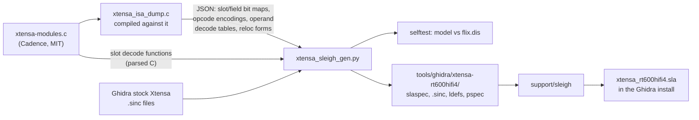
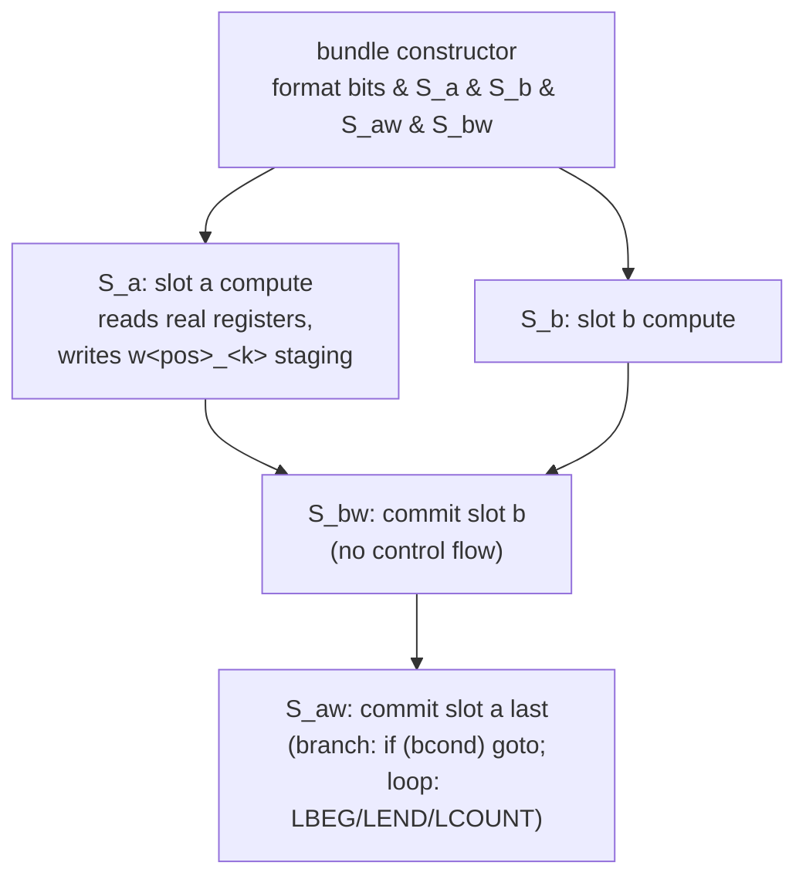

# What Ghidra needs to decode the HiFi4 FLIX bundles

**Status: done (T21, 2026-10-28).** The generated language `Xtensa:LE:32:rt600hifi4` (T21a) decodes every instruction of the image,
and since T21g the canonical project `ghidra/FT710_IFDSP` and `decomp/ifdsp/hifi4/` use it (before → after in
[the table below](#in-the-canonical-project-t21g)). The first sections are the analysis as written before the work (T21 plan):
stock Ghidra 12.1.4 could not decode most of the IF DSP's HiFi4 code, so `decomp/ifdsp/hifi4/` was close to useless and the DSP was
known mainly from an objdump listing (`decomp/ifdsp/hifi4/flix.dis`). They measure the gap, say exactly what was missing, and
propose how to close it. Issues: [#97](https://github.com/Reid-n0rc/FT-710_Firmware/issues/97) (the decompile) and
[FT-710_Custom_Firmware#1](https://github.com/Reid-n0rc/FT-710_Custom_Firmware/issues/1) (RADE in the DSP, formerly #102, which needs this code understood). Claims are
tagged **[fact]**, **[inference]** or **[guess]**; counts come from `flix.dis` (V01-01, 1,065 functions) and the core's ISA
description, and are reproducible with the commands at the end.

## The gap in numbers

| Measure | Value |
|---|---|
| HiFi4 functions (FLIX listing) | 1,065, with 49,389 instructions in 188,006 bytes (plus 461 single padding bytes the listing shows as `.byte`) **[fact]** |
| Functions that contain at least one FLIX bundle | **891 (84 %)** **[fact]** |
| FLIX bundles | **12,676**: 26 % of the instructions, **46 % of the code bytes** **[fact]** |
| Bundle sizes | 10,438 × 6 bytes (48-bit), 2,238 × 11 bytes (88-bit) **[fact]** |
| Slots per bundle | 2 slots: 10,173; 3 slots: 817; 4 slots: 1,686 **[fact]** |
| Bundles with a branch or loop in a slot | **2,387 (19 %)**, e.g. `beqz.w15` 425, `beqi.w15` 311, `loop`/`loopgtz`/`loopnez` 154 **[fact]** |
| Bundles where one slot writes a register another slot names | about 1,465 (12 %), so slots must read before any slot writes **[inference: operand heuristic]** |
| Distinct operations used | 476 (239 inside bundles, 351 outside) **[fact]** |
| … not in Ghidra's Xtensa module | **197**: 158 HiFi4 `ae_*` plus 39 FPU and other ops (`div0.s`, `recip0.s`, `f64*`, `maddn.s`, …); 6,508 of 66,254 operations (9.8 %) **[fact]** |
| … in Ghidra's module but on the wrong registers | **30 FPU ops** (`mul.s`, `add.s`, `sub.s`, `madd.s`, `wfr`, …), 3,159 uses: this core's FPU works on the 64-bit `aed` registers, Ghidra's on `f0..f15` **[fact]** |
| Operations Ghidra cannot represent correctly | about **14.6 %** of all operations (the two rows above) **[fact]** |
| What stock Ghidra does (before T21) | `op0 = 0xE` becomes a 3-byte placeholder `FLIX` (the real bundle is 6 bytes, so the next instructions are decoded from the middle of the bundle); `op0 = 0xF` (the 11-byte bundles) has no constructor, so disassembly stops; one function (`FUN_0020bb74`) crashes the decompiler **[fact: `flix.sinc`, `xtensaArch.sinc`, `decomp/ifdsp/INDEX.md`]** |

So, before T21, even with the FLIX listing the DSP had **no usable decompiled C**: every reading of the audio chain was done from assembly.

## What the core is

The RT600's HiFi4 is a configured Xtensa core. Its exact instruction set is published as a generated C file,
`xtensa-modules.c`, in Zephyr's SDK repository:
[`sdk-ng/overlays/xtensa_nxp_rt600_adsp/binutils/bfd/xtensa-modules.c`](https://github.com/zephyrproject-rtos/sdk-ng/blob/main/overlays/xtensa_nxp_rt600_adsp/binutils/bfd/xtensa-modules.c)
(2,996,889 bytes, last changed in commit `15daabb` on 2023-12-11, SHA-256 `9e218b19…f372`). It is the same description the Zephyr
objdump is built with, so it matches this firmware exactly **[inference: the objdump decodes every bundle in the image]**. It is
**MIT-licensed** by Cadence ("Permission is hereby granted, free of charge … to use, copy, modify, merge, publish, distribute"), so
SLEIGH generated from it can be committed **[fact: file header]**.

| Item in `xtensa-modules.c` | Count | Notes |
|---|---|---|
| Formats | 10 | `x24`, `x16a`, `x16b` (the base ISA) and 7 FLIX formats: `ae_format48`, `ae_format48_2`, `ae_format48_3` (6 bytes, `op0 = 0xE`), `ae_format88`, `ae_format88_2/_3/_4` (11 bytes, `op0 = 0xF`) **[fact: `formats[]`, `format_decoder`]** |
| Slots | 25 | each with a `get` function that gathers the slot's bits from the bundle; they are **scattered**, e.g. `ae_slot0` of `ae_format88` is assembled from 6 pieces in 3 words **[fact]** |
| Opcodes | 1,713 | 5,857 opcode-in-slot encodings (one opcode can sit in several slots) **[fact]** |
| Operands / fields | 554 / 406 | immediates have encode/decode functions (scaling, sign, offsets) **[fact]** |
| Instruction classes | 1,548 | each lists its operands as in/out/inout and the processor states it reads and writes **[fact]** |
| Register files | 10 | `AR` (32 × 32-bit), `AE_DR` (16 × 64-bit), `AE_VALIGN` (4 × 64), `AE_EP` (4 × 8), `MR`, `BR` and its 2/4/8/16-bit views **[fact]** |
| States / special registers | 83 / 74 | **[fact]** |

## What Ghidra needs

1. **Length and format decode.** Constructors for the 7 FLIX formats with their true lengths (6 and 11 bytes), selected by the
   same bit tests as `format_decoder`. This alone stops the desynchronisation.
2. **Slot extraction.** For each of the 25 slots, the bit pieces from the slot's `get` function, as SLEIGH fields. libisa works on
   the bundle as 32-bit little-endian words (`insn[0..2]`); mirroring that (tokens of 32 + 16 or 32 + 32 + 24 bits) makes every
   piece a plain field **[inference]**.
3. **Opcodes per slot.** One constructor per opcode-in-slot encoding, from each slot's `decode` function. Only the 476 operations
   the firmware uses are needed at first; the generator can emit all 5,857 later.
4. **Operands.** Fields → operand values through the operand decode functions (written as SLEIGH disassembly expressions).
5. **Registers.** `AE_DR` (`aed0..15`, 64-bit), `AE_VALIGN`, `AE_EP`, `MR`, the `BR` views, and the HiFi4 states and user
   registers, added to the language. The 30 FPU ops must be re-pointed from `f0..f15` to the low 32 bits of `aed0..15`.
6. **Semantics.** Three levels, in order of value:
   - base-ISA ops inside slots: reuse the existing Ghidra p-code (with the `.w15` branch forms mapped to the normal branches);
   - `ae_*` and the 39 missing FPU ops: a named p-code operation per opcode with the right inputs and outputs, taken from the
     instruction class (in/out operands and states). The decompiler then tracks data flow correctly even without the arithmetic;
   - exact arithmetic for the few kernels that matter (for example the multiply-accumulates in the filters), later and by hand.
7. **Parallel execution.** All slots of a bundle read their inputs before any slot writes. The generated bundle constructor must
   compute each slot into temporaries and commit afterwards; about 12 % of bundles depend on this.
8. **Control flow in slots.** Branches and zero-overhead loops inside a slot (2,387 bundles) need the existing branch and loop
   semantics, with targets relative to the bundle start.
9. **A test oracle.** Ghidra's listing compared with `flix.dis` for all 49,389 instructions: length, mnemonic and operands must
   match.

## How to get there

| Option | What it gives | Effort **[guess]** |
|---|---|---|
| **A. Generator** (recommended): a script that reads `xtensa-modules.c` and writes a SLEIGH extension (`.sinc` files plus language and pspec entries) for this core | correct disassembly of all 49,389 instructions; decompiler data flow through `ae_*` ops as named operations; re-runnable for other Xtensa cores | large: a few thousand lines of generator, mostly mechanical, because the C file is regular generated code |
| **B. Length and control flow only**: the 7 formats with correct lengths plus the branch and loop slots; every other slot a single opaque operation | function boundaries and control-flow graphs right, so the decompiler no longer breaks; no data flow through HiFi4 ops | small to medium, and a first step of A |
| **C. Stay with the objdump listing** (today) | readable assembly for every function; no decompiler | none |

Recommended order: B as the first milestone of A (it already fixes the 84 % of functions that break), then the `ae_*` ops as named
operations with correct in/out, then the parallel commit, then exact semantics only where an algorithm needs them. Every step is
checked against `flix.dis`. Nothing here touches the radio.

The open points of this plan are answered in the next section (T21a).

## The SLEIGH language Xtensa:LE:32:rt600hifi4 (T21a)

Option A is built: `tools/xtensa_sleigh_gen.py` generates the language from `xtensa-modules.c`, and the result is committed in
`tools/ghidra/xtensa-rt600hifi4/` and installed by `tools/bootstrap.sh --only hifi4` (pinning and install: [tooling.md](../../tooling.md)).

### Result

| Check | Result |
|---|---|
| Generator model vs objdump (`xtensa_sleigh_gen.py selftest`, exact text) | **49,389 / 49,389** instructions **[fact]** |
| Ghidra decode of every `flix.dis` address (T21b oracle, decode mode) | **49,389 / 49,389 = 100 %**, bundles 12,676 / 12,676, 1,065 / 1,065 functions clean **[fact]** |
| Ghidra analysed listing (oracle, listing mode) | 47,312 / 49,389 = 95.8 %; every mismatch is "missing": bytes `flix.dis` decodes by linear sweep that no code flow reaches (padding, data), no wrong decodes **[fact]** |
| Function list (with `tools/ghidra/entries_hifi4.tsv`) | 1,067 = reference (B10) **[fact]** |
| `FUN_0020bb74` (B9) | decompiles, and the C is correct for the parallel bundles in it (e.g. `{ l32r a3, …; and a14, a14, a3 }` ANDs with the old `a3`) **[fact: oracle b9.txt]** |
| Full HiFi4 decompile (`ExportDecomp.java`, scratch project) vs the committed stock-language one | decompile failures 1 → **0**; `halt_baddata` 1,054 → **1** (`FUN_00218480`, which objdump cannot decode either: it is data); bad-instruction bookmarks 1,098 → 1; warnings 2,038 → 258; undefined non-0xFF bytes 186,167 → 29,161 **[fact]** |

### How it is made



- **Probing instead of parsing C** **[fact]**: the slot `get`, field `get`, opcode `encode` and operand `decode`/`undo_reloc`
  functions are run in a small C probe that includes `xtensa-modules.c`. Single-bit probes give every slot bit's bundle bit and every
  field bit's slot bit; operand decoders are tabulated over their whole field range and fitted to `((sext|zext)(field) × k) + c`
  (everything in this core fits, the rest would become one constructor per value); PC-relative operands fit
  `((pc + a) & ~m) + value` (`l32r`: a = 3, m = 3; calls: a = 0, m = 3; branches, loops: pc + value). Only the slot decode functions
  are parsed from the C text (nested `if` with `&&`/`||` on field equalities); the parsed decoder is checked against the C decoder
  on 4,000 random slot values per slot and on every opcode's encoding (0 mismatches).
- **Tokens** **[fact]**: SLEIGH accepts tokens wider than 64 bits, so each bundle is one token: `fx48(48)` and `fx88(88)`, with bit
  numbering identical to libisa's little-endian 32-bit words (`insn[0]` = bits 0–31). A scattered field is assembled from its
  contiguous runs in a disassembly action. No `;` sequencing is needed.
- **Decode order** **[fact]**: libisa decodes first-match; SLEIGH picks the most specific constructor. The generator checks that every
  earlier, overlapping decode entry is more specific than the later one (or the later one is unreachable and dropped); no partial
  overlaps exist in this core.
- **Display** **[fact]**: bundles show as `{ l32r a5, 0x206510; extui a9, a9, 0x0, 0x2 }` (mnemonic `{`), the slot order and
  operand order of objdump, register groups as `b0:b1`. Numbers are Ghidra's hex; the oracle compares them by value.
- **Base formats** **[fact]**: the 24/16-bit instructions keep the stock constructors (and their p-code) where the stock module is
  right for this core; 71 stock mnemonics are dropped — not in this core (`lsi`, `mov.s`, …), on the `f0..f15` registers this core
  does not have (the FPU uses `aed`), printing wrongly (`movi.n` negative values, `bany`/`bnone`/`ball`/`bnall` operand order,
  `remu`/`rems` trailing comma), with a wrong constant (`bgeui`/`bltui` 0x1000 for 0x10000), or shadowing other encodings
  (`ret` over `jx a0`, `licw` over `rems`, `mul.dd.lh` over `ae_pksr24`, stock `mula.da.*.ldinc` on the `mula.dd.*.ldinc`
  encodings) — and 559 generated constructors replace them and add the 24-bit HiFi4, FPU, `rsr.*`/`wsr.*`/`xsr.*`/`rur.*`/`wur.*`
  forms.

### Bundle constructors and parallel semantics



- **Temporaries** **[fact]**: SLEIGH `local` temporaries belong to one constructor, so sibling slot sub-constructors cannot share
  them. Every slot therefore computes into global staging registers `w<position>_<output>_<size>` (overlapping 1/2/4/8/16-byte
  names), and a second sub-table per slot, `S<slot>w`, with the same patterns, copies them to the real operands. `build` runs in the
  order written, so the bundle builds every compute part, then every commit part, with the slot that can hold a branch or loop
  (always position 0 in this core) last. Memory stores are not staged (no bundle in the firmware stores and loads the same address
  is known **[guess]**).
- **Semantics levels** **[fact: generator tables]**: base-ISA operations in slots (`add`, `l32i`, `extui`, `movi`, `s32i`, …) and
  the 30 FPU operations (single precision in the low 32 bits of `aed`, upper half written as 0 **[guess]**) have real p-code from a
  hand table; `.w15` branches use the base branch conditions with targets relative to the bundle start; `loop`/`loopgtz`/`loopnez`
  in slots use the stock module's loop context trick. The simple HiFi4 loads and stores (`ae_l*`/`ae_s*` with `.i .x .iu .xu .ip
  .xp .xc .xc1`) have a real memory access and a real base-register update (circular `.xc` updates are `ae_circ0`/`ae_circ1`
  p-code ops); only the data conversion is a named operation (`aed2 = ae_l32_ip(*:4 ea)`). Every other operation is a named p-code
  operation per opcode with the iclass's register inputs and outputs and its HiFi4 states (`AE_OVERFLOW`, `AE_SAR`, …; `CPENABLE`
  and the FP exception flags are left out as noise); several outputs use one operation each (`op`, `op_1`, …). 2,090 named
  operations in all.
- **Decompiler with ~2,100 p-code operations** **[fact]**: no problem; the full HiFi4 export (1,081 functions) runs in about two minutes.

### What is left

- Exact arithmetic for the HiFi4 operations that matter (multiply-accumulates in the filter kernels) — by hand, per kernel (#86, #102).
- The aligning loads/stores (`ae_la*`, `ae_sa*` with `AE_VALIGN`) and the `.ri*`/`.ic*` forms are named operations without a
  memory access yet.
- The FPU lane layout (whether the `.s` operations also act on the high half) is a guess; the FP compares write a BR pair (`b0:b1`)
  and are named operations.

### In the canonical project (T21g)

`tools/bootstrap.sh` (step `ghidra`, `build_ifdsp`) imports the HiFi4 program with `-processor Xtensa:LE:32:rt600hifi4` (after step
`hifi4` has installed it; the language files are part of the program's rebuild stamp), then `IfdspHifi4Setup.java`,
`IfdspHifi4FindFuncs.java` with the reference list `entries_hifi4.tsv`, and `IfdspHifi4Names.java`. The canonical
`ghidra/FT710_IFDSP` was rebuilt that way and `decomp/ifdsp/hifi4/` re-exported **[fact: `quality.tsv`, `functions.tsv`, 2026-10-28]**:

| Count | stock `Xtensa:LE:32:default` | `Xtensa:LE:32:rt600hifi4` |
|---|---:|---:|
| functions exported | 1,148 (84 artefacts, 1 missing) | 1,081 (1,067 SRAM = reference, 14 TCM) |
| decompile failures | 1 (`FUN_0020bb74`) | **0** |
| average body | 26 B | 167 B |
| `flix.dis` bytes inside a Ghidra function body | 27,519 of 191,248 (14 %) | 178,629 (93 %) |
| `flix.dis` functions with a body ≥ 90 % of their listing span | 133 | 860 of 1,065 |
| warnings (functions with one) | 2,038 (861) | **258 (99)** |
| `halt_baddata()` (functions) | 1,054 (819) | **1 (1)** |
| "Bad Instruction" bookmarks | 1,098 | 1 |
| functions with `in_`/`unaff_`/`extraout_` | 317 | 171 |
| undefined non-0xFF bytes in executable blocks | 186,167 | 29,161 |
| names (`IfdspHifi4Names.java`) | 111 | 111 (none lost) |

The warning kinds that went up (unreachable blocks 47 → 187, infinite-loop traps 9 → 20 and a few others) all sit in bodies that the
stock language had cut short, or are now-correct exception vectors; the per-kind explanation is in `decomp/ifdsp/INDEX.md`
("HiFi4 decompile quality"). `flix.dis` rebuilt from the new `functions.tsv` is identical except for the list of dropped entries.

## Reproduce the counts

```sh
python3 -I tools/flix_stats.py      # every count in "The gap in numbers" (Ghidra dir defaults to the Homebrew install)
curl -L -o xtensa-modules.c https://raw.githubusercontent.com/zephyrproject-rtos/sdk-ng/main/overlays/xtensa_nxp_rt600_adsp/binutils/bfd/xtensa-modules.c
sed -n '/^xtensa_isa_internal xtensa_modules = {/,/^};/p' xtensa-modules.c     # formats, slots, operands, iclasses, opcodes, regfiles
grep -c "Opcode_.*_Slot_.*_encode" xtensa-modules.c                             # 5857 opcode-in-slot encodings
grep -h -oE "^:[a-zA-Z0-9_.]+" "$GHIDRA"/Ghidra/Processors/Xtensa/data/languages/*.sinc | sort -u   # Ghidra's mnemonics
```
