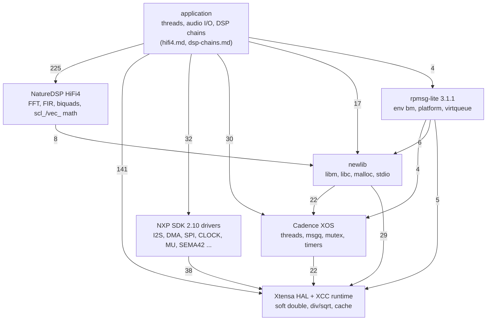
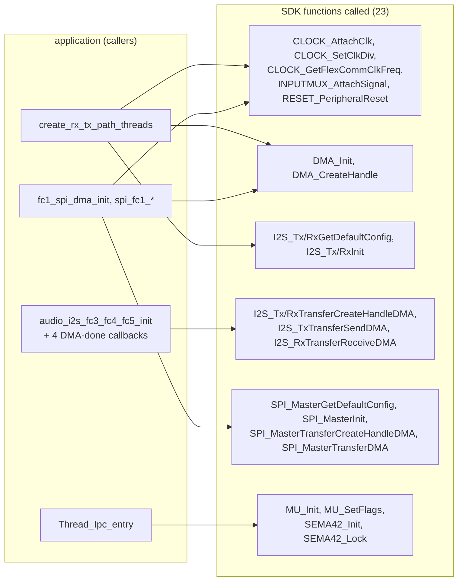

# IFDSP: libraries linked into the HiFi4 image (SDK drivers, rpmsg-lite, NatureDSP, newlib, XOS, runtime)

Program: `FT-710_IFDSP_V0101_hifi4.bin` (`decomp/ifdsp/hifi4/`). Overview: [README.md](README.md); the application code that uses these libraries is on [hifi4.md](hifi4.md) (threads, audio I/O), [dsp-chains.md](dsp-chains.md) (signal chains) and [ipc.md](ipc.md) (M33 link). Claims are tagged **[fact]** (seen in the code or data, address cited), **[inference]** or **[guess]**.

About two thirds of the HiFi4 functions are library code, linked whole and in source-file order. T23d/T23e (2026-10-30) matched each block file by file against the library sources (versions and commits in [docs/tooling.md](../../tooling.md#hifi4-library-sources-t23dt23e-hifi4-2026-10-30); how each block was matched: [hifi4.md](hifi4.md#libraries-linked-into-the-hifi4-image-t23)). The names and the evidence per row are in `tools/ghidra/names_hifi4.T23.tsv` and the "T23 HiFi4" block of `tools/ghidra/IfdspHifi4Names.java`. This page lists every library function named there that no other page lists: **666 rows**. Functions of the same libraries that were named before T23 (the I2S/DMA/SPI/clock calls of the audio set-up, MU, SEMA42, the rpmsg-lite remote API, the XOS thread/queue/mutex calls, `memcpy`/`memset`/`__udivdi3`, `iir_cascade_*`) stay in the function tables of [hifi4.md](hifi4.md#function-table-hifi4) and [ipc.md](ipc.md#hifi4).

## Summary

| Library | Address range | Rows on this page | With a caller in the decompile | Section |
|---|---|---:|---:|---|
| crtbegin + `system_MIMXRT685S_dsp.c` | 0x207CF0–0x208050 | 5 | 2 | [C runtime start](#c-runtime-start-and-system-file) |
| NXP MCUXpresso SDK 2.10 drivers (35 `fsl_*.c` files) | 0x208060–0x216DC4 | 440 | 156 | [SDK drivers](#nxp-mcuxpresso-sdk-210-drivers) |
| Cadence NatureDSP HiFi4 (float32) | 0x216E00–0x21A970, 0x233670–0x235190 | 22 | 10 | [NatureDSP](#cadence-naturedsp-hifi4) |
| rpmsg-lite v3.1.1 | 0x21AA90–0x21BD24 | 69 | 54 | [rpmsg-lite](#rpmsg-lite-v311) |
| Cadence XOS and its C-library glue | 0x2266FC–0x229380, 0x235F40–0x236000 | 17 | 11 | [XOS](#cadence-xos-and-c-library-glue) |
| newlib libm (single precision) | 0x229A20–0x22BA10 | 17 | 17 | [libm](#newlib-libm) |
| newlib libc | 0x22BA20–0x233250, 0x235F90–0x236430 | 83 | 65 | [libc](#newlib-libc) |
| Xtensa HAL and XCC runtime | 0x233410–0x236500 | 13 | 11 | [HAL and runtime](#xtensa-hal-and-xcc-runtime) |

"With a caller" counts the rows whose function has at least one direct caller in the exported decompile (the `callers` column of `decomp/ifdsp/hifi4/functions.tsv`) **[fact]**. Interrupt handlers, callbacks and functions reached through a function pointer have no direct caller, so a zero does not prove dead code; but most of the SDK is linked without a use: the image pulls in every `fsl_*.c` of the SDK's RT685 DSP driver set, and the application calls 23 of its functions (table below) **[fact for the calls; inference: whole-library link]**.

### How the libraries call each other

Edges are caller–callee function pairs in the decompile between the address blocks of the summary table ("app" = the application block 0x21BD40–0x2266FC of [hifi4.md](hifi4.md#libraries-linked-into-the-hifi4-image-t23)); the number is the count of distinct pairs, not of call sites **[fact: `tools/doc_table_gaps.py` call graph over `decomp/ifdsp/hifi4/*.c`]**.

- The application reaches the SDK only for its own peripherals: the I2S/DMA audio path (FLEXCOMM2–5, DMA1), the FLEXCOMM1 SPI to the DISPLAY (DMA0), clock/reset/input-mux set-up, and MU-B + SEMA42 in `Thread_Ipc_entry` **[fact: callers below]**.
- rpmsg-lite is entered at four functions (`rpmsg_lite_remote_init`, `rpmsg_lite_is_link_up`, `rpmsg_lite_create_ept` from `Thread_Ipc_entry`, `rpmsg_lite_send` from `ipc_handle_msg`); it uses XOS only for the interrupt registration (`xos_register_interrupt_handler`, `xos_interrupt_enable`) **[fact]**. The protocol is on [ipc.md](ipc.md#rpmsg-lite-instance).
- newlib takes its locks from XOS (`__malloc_lock`/`__malloc_unlock` on an XOS mutex, the `__sfp_lock_*`/`__sinit_lock_*` hooks) and its heap from `_sbrk_r` **[fact: callers]**.

## C runtime start and system file

crtbegin's `__do_global_dtors_aux`/`frame_dummy` (once flag, weak `__register_frame_info` = 0) and the three functions of `system_MIMXRT685S_dsp.c` **[inference: crtstuff shape, system file order]**.

| Address | Ghidra name | Purpose |
|---|---|---|
| 0x00207CF0 | `__do_global_dtors_aux` | crtbegin: once-flag 0x238400, runs the destructor list 0x236820, __deregister_frame_info (weak, 0) **[inference]** |
| 0x00207D2C | `frame_dummy` | crtbegin: __register_frame_info (weak, 0)(0x206484, object 0x238404) **[inference]** |
| 0x00207D50 | `SystemInit` | system_MIMXRT685S_dsp.c: calls SystemInitHook **[inference]** |
| 0x00207D58 | `SystemCoreClockUpdate` | system_MIMXRT685S_dsp.c: CLKCTL1 DSPCPUCLKSEL (0x40021200 + 0x234), FFRO/SysPLL/PFD paths, 16 MHz FFRO, udivdi3 **[inference]** |
| 0x00208050 | `SystemInitHook` | system_MIMXRT685S_dsp.c weak hook, empty **[inference]** |

## NXP MCUXpresso SDK 2.10 drivers

Every `fsl_*.c` driver of the SDK's RT685 set is linked in file-name order (acmp ... wwdt). Version 2.10: `SDK_Malloc` has the 2.9+ overflow checks, `I2C_MasterInit` calls `I2C_MasterSetTimeoutValue` (2.10+), and the I2S DMA driver lacks the loop-DMA functions of 2.11 **[fact]**. Inline functions of a driver header (`fsl_i2c.h`, `fsl_i3c.h`, ...) are emitted out of line at the start of the file that uses them and are listed under that file. Per file: the address range, the functions in it (all named), the rows below, how many have a direct caller, and which of them the code outside the SDK calls **[fact: export]**.

| File | Range | Functions | Rows below | With a caller | Called from outside the SDK |
|---|---|---:|---:|---:|---|
| `fsl_acmp.c` | 0x208060–0x2085DC | 19 | [19](#fsl_acmp) | 1 |  |
| `fsl_clock.c` | 0x208600–0x209B30 | 34 | [32](#fsl_clock) | 23 | `CLOCK_AttachClk`, `CLOCK_GetFlexCommClkFreq`, `CLOCK_SetClkDiv` |
| `fsl_common.c` | 0x209C10–0x209C70 | 3 | [3](#fsl_common) | 1 |  |
| `fsl_crc.c` | 0x209D20–0x209E18 | 5 | [5](#fsl_crc) | 0 |  |
| `fsl_ctimer.c` | 0x209E90–0x20A4A8 | 15 | [15](#fsl_ctimer) | 0 |  |
| `fsl_dma.c` | 0x20A500–0x20B05C | 24 | [21](#fsl_dma) | 18 | `DMA_CreateHandle`, `DMA_Init` |
| `fsl_dmic.c` | 0x20B070–0x20B444 | 16 | [16](#fsl_dmic) | 2 |  |
| `fsl_dmic_dma.c` | 0x20B460–0x20B760 | 6 | [6](#fsl_dmic_dma) | 0 |  |
| `fsl_flexcomm.c` | 0x20B790–0x20BA90 | 13 | [13](#fsl_flexcomm) | 3 |  |
| `fsl_flexspi.c` | 0x20BAC0–0x20C92C | 21 | [21](#fsl_flexspi) | 9 |  |
| `fsl_flexspi_dma.c` | 0x20C940–0x20D070 | 6 | [6](#fsl_flexspi_dma) | 1 |  |
| `fsl_fmeas.c` | 0x20D0D0–0x20D0D0 | 1 | [1](#fsl_fmeas) | 0 |  |
| `fsl_gpio.c` | 0x20D100–0x20D494 | 10 | [10](#fsl_gpio) | 0 |  |
| `fsl_i2c.c` | 0x20D4D0–0x20E4E8 | 34 | [34](#fsl_i2c) | 12 |  |
| `fsl_i2c_dma.c` | 0x20E720–0x20ECF0 | 9 | [9](#fsl_i2c_dma) | 3 |  |
| `fsl_i2s.c` | 0x20ED70–0x20F8A0 | 19 | [15](#fsl_i2s) | 6 | `I2S_RxGetDefaultConfig`, `I2S_RxInit`, `I2S_TxGetDefaultConfig`, `I2S_TxInit` |
| `fsl_i2s_dma.c` | 0x20FB70–0x210420 | 12 | [8](#fsl_i2s_dma) | 11 | `I2S_RxTransferCreateHandleDMA`, `I2S_RxTransferReceiveDMA`, `I2S_TxTransferCreateHandleDMA`, `I2S_TxTransferSendDMA` |
| `fsl_i3c.c` | 0x2104F0–0x2123E0 | 56 | [56](#fsl_i3c) | 30 |  |
| `fsl_iap.c` | 0x212430–0x212648 | 21 | [21](#fsl_iap) | 0 |  |
| `fsl_inputmux.c` | 0x212670–0x2126E0 | 4 | [3](#fsl_inputmux) | 1 | `INPUTMUX_AttachSignal` |
| `fsl_lpadc.c` | 0x212700–0x212AF4 | 8 | [8](#fsl_lpadc) | 0 |  |
| `fsl_mrt.c` | 0x212B30–0x212CC8 | 3 | [3](#fsl_mrt) | 0 |  |
| `fsl_mu.c` | 0x212D00–0x212EF0 | 6 | [2](#fsl_mu) | 2 | `MU_Init`, `MU_SetFlags` |
| `fsl_otfad.c` | 0x212F20–0x213100 | 6 | [6](#fsl_otfad) | 0 |  |
| `fsl_pint.c` | 0x213170–0x2136C8 | 23 | [23](#fsl_pint) | 5 |  |
| `fsl_reset.c` | 0x213700–0x213910 | 3 | [3](#fsl_reset) | 3 | `RESET_PeripheralReset` |
| `fsl_rtc.c` | 0x213920–0x213C58 | 5 | [5](#fsl_rtc) | 0 |  |
| `fsl_sema42.c` | 0x213D10–0x213ED0 | 6 | 0 | 3 | `SEMA42_Init`, `SEMA42_Lock` |
| `fsl_spi.c` | 0x213F00–0x21487C | 21 | [19](#fsl_spi) | 12 | `SPI_MasterGetDefaultConfig`, `SPI_MasterInit` |
| `fsl_spi_dma.c` | 0x214C30–0x215248 | 7 | [7](#fsl_spi_dma) | 2 | `SPI_MasterTransferCreateHandleDMA`, `SPI_MasterTransferDMA` |
| `fsl_trng.c` | 0x215280–0x21596C | 5 | [5](#fsl_trng) | 1 |  |
| `fsl_usart.c` | 0x215AD0–0x21640C | 24 | [24](#fsl_usart) | 6 |  |
| `fsl_usart_dma.c` | 0x216718–0x216914 | 9 | [9](#fsl_usart_dma) | 0 |  |
| `fsl_utick.c` | 0x216940–0x216B14 | 7 | [7](#fsl_utick) | 1 |  |
| `fsl_wwdt.c` | 0x216B30–0x216DC4 | 5 | [5](#fsl_wwdt) | 0 |  |
| **total** | 0x208060–0x216DC4 | 466 | 440 | 156 | 23 functions |

`fsl_sema42.c` (0x213D10–0x213ED0) and the MU, I2S, DMA and SPI functions named before T23 are in the tables of [ipc.md](ipc.md#hifi4) and [hifi4.md](hifi4.md#function-table-hifi4).

### fsl_acmp

| Address | Ghidra name | Purpose |
|---|---|---|
| 0x00208060 | `ACMP_Init` | fsl_acmp.c (CMP 0x40139000, s_acmpClocks 0x200084 / bases 0x200088); first function of the file **[inference]** |
| 0x00208164 | `ACMP_Deinit` | fsl_acmp.c **[inference]** |
| 0x0020821C | `ACMP_GetDefaultConfig` | fsl_acmp.c **[inference]** |
| 0x00208234 | `ACMP_Enable` | fsl_acmp.c; called by ACMP_Init/Deinit **[inference]** |
| 0x00208268 | `ACMP_EnableLinkToDAC` | fsl_acmp.c order **[inference]** |
| 0x00208294 | `ACMP_SetChannelConfig` | fsl_acmp.c order **[inference]** |
| 0x002082C8 | `ACMP_EnableDMA` | fsl_acmp.c order **[inference]** |
| 0x002082F4 | `ACMP_EnableWindowMode` | fsl_acmp.c order **[inference]** |
| 0x00208320 | `ACMP_SetFilterConfig` | fsl_acmp.c order **[inference]** |
| 0x00208360 | `ACMP_SetDACConfig` | fsl_acmp.c order **[inference]** |
| 0x002083D0 | `ACMP_SetRoundRobinConfig` | fsl_acmp.c order **[inference]** |
| 0x00208450 | `ACMP_SetRoundRobinPreState` | fsl_acmp.c order **[inference]** |
| 0x00208468 | `ACMP_ClearRoundRobinStatusFlags` | fsl_acmp.c order **[inference]** |
| 0x00208484 | `ACMP_EnableInterrupts` | fsl_acmp.c order **[inference]** |
| 0x002084D8 | `ACMP_DisableInterrupts` | fsl_acmp.c order **[inference]** |
| 0x00208514 | `ACMP_GetStatusFlags` | fsl_acmp.c order **[inference]** |
| 0x0020853C | `ACMP_ClearStatusFlags` | fsl_acmp.c order **[inference]** |
| 0x0020856C | `ACMP_SetDiscreteModeConfig` | fsl_acmp.c order **[inference]** |
| 0x002085DC | `ACMP_GetDefaultDiscreteModeConfig` | fsl_acmp.c, last of the file **[inference]** |

### fsl_clock

| Address | Ghidra name | Purpose |
|---|---|---|
| 0x00208654 | `CLOCK_SetClkDiv` | fsl_clock.c: write divider, wait REQFLAG (bit 29) **[inference]** |
| 0x002086B4 | `CLOCK_GetFFroFreq` | fsl_clock.c: 48 / 60 MHz by FFROCTL0 trim range; 14 callers **[inference]** |
| 0x002086E0 | `CLOCK_GetSysPllFreq` | fsl_clock.c: SYSPLL0CLKSEL (0x40001200), 64-bit numerator/denominator **[inference]** |
| 0x0020876C | `CLOCK_GetSysPfdFreq` | fsl_clock.c: PFD fields 0x3F << 8n **[inference]** |
| 0x00208818 | `CLOCK_GetAudioPllFreq` | fsl_clock.c: AUDIOPLL0CLKSEL (0x40021200) **[inference]** |
| 0x002088A8 | `CLOCK_GetAudioPfdFreq` | fsl_clock.c **[inference]** |
| 0x00208958 | `CLOCK_GetMainClkFreq` | fsl_clock.c order, 9 callers **[inference]** |
| 0x002089F8 | `CLOCK_GetDspMainClkFreq` | fsl_clock.c order **[inference]** |
| 0x00208AA8 | `CLOCK_GetAdcClkFreq` | fsl_clock.c order **[inference]** |
| 0x00208BE0 | `CLOCK_GetClockOutClkFreq` | fsl_clock.c order **[inference]** |
| 0x00208D94 | `CLOCK_GetFRGClock` | fsl_clock.c order; called by CLOCK_GetFlexCommClkFreq **[inference]** |
| 0x00208F10 | `CLOCK_GetCtimerClkFreq` | fsl_clock.c order **[inference]** |
| 0x00208F78 | `CLOCK_GetFlexspiClkFreq` | fsl_clock.c order **[inference]** |
| 0x00209038 | `CLOCK_GetSctClkFreq` | fsl_clock.c order **[inference]** |
| 0x00209130 | `CLOCK_GetMclkClkFreq` | fsl_clock.c order **[inference]** |
| 0x00209194 | `CLOCK_GetWdtClkFreq` | fsl_clock.c order **[inference]** |
| 0x002091D0 | `CLOCK_GetSystickClkFreq` | fsl_clock.c order **[inference]** |
| 0x00209220 | `CLOCK_GetSdioClkFreq` | fsl_clock.c order **[inference]** |
| 0x002092F4 | `CLOCK_GetI3cClkFreq` | fsl_clock.c order **[inference]** |
| 0x00209344 | `CLOCK_GetUsbClkFreq` | fsl_clock.c order **[inference]** |
| 0x002093CC | `CLOCK_GetDmicClkFreq` | fsl_clock.c order **[inference]** |
| 0x002094DC | `CLOCK_GetAcmpClkFreq` | fsl_clock.c order **[inference]** |
| 0x00209590 | `CLOCK_GetFreq` | fsl_clock.c: switch over clock names, calls the getters above **[inference]** |
| 0x0020969C | `CLOCK_SetFRGClock` | fsl_clock.c order (CLOCK_EnableFfroClk / EnableSfroClk are #ifndef __XCC__) **[inference]** |
| 0x00209720 | `CLOCK_InitSysPll` | fsl_clock.c: SYSPLL0, POWER PDRUNCFG (SYSCTL0 0x40002600), SDK_DelayAtLeastUs **[inference]** |
| 0x00209878 | `CLOCK_InitSysPfd` | fsl_clock.c order **[inference]** |
| 0x002098EC | `CLOCK_InitAudioPll` | fsl_clock.c: AUDIOPLL0 (0x40021200) **[inference]** |
| 0x00209A40 | `CLOCK_InitAudioPfd` | fsl_clock.c order **[inference]** |
| 0x00209AB4 | `CLOCK_EnableSysOscClk` | fsl_clock.c order, SDK_DelayAtLeastUs **[inference]** |
| 0x00209AE8 | `CLOCK_EnableUsbhsDeviceClock` | fsl_clock.c order **[inference]** |
| 0x00209B0C | `CLOCK_EnableUsbhsHostClock` | fsl_clock.c order **[inference]** |
| 0x00209B30 | `CLOCK_EnableUsbhsPhyClock` | fsl_clock.c order; USBPHY 0x4013B000 **[inference]** |

### fsl_common

| Address | Ghidra name | Purpose |
|---|---|---|
| 0x00209C10 | `SDK_Malloc` | fsl_common.c: malloc(aligned size + 4), magic 0x3039 (SDK_MEM_MAGIC_NUMBER 12345) and offset below the result; SDK >= 2.9 overflow checks **[fact]** |
| 0x00209C54 | `SDK_Free` | fsl_common.c: checks magic 0x3039, free(ptr - offset) **[fact]** |
| 0x00209C70 | `SDK_DelayAtLeastUs` | fsl_common.c (XCC path: CCOUNT cycles, 1,000,000 divisor) **[inference]** |

### fsl_crc

| Address | Ghidra name | Purpose |
|---|---|---|
| 0x00209D20 | `CRC_Init` | fsl_crc.c (lpc_crc) order **[inference]** |
| 0x00209D88 | `CRC_GetDefaultConfig` | fsl_crc.c: copies default_config 0x2000FC; CRC_Reset (0x209DB8) follows inside this listing entry **[fact]** |
| 0x00209DCC | `CRC_WriteSeed` | fsl_crc.c: base->SEED = seed **[fact]** |
| 0x00209DD8 | `CRC_GetConfig` | fsl_crc.c order **[inference]** |
| 0x00209E18 | `CRC_WriteData` | fsl_crc.c order **[inference]** |

### fsl_ctimer

| Address | Ghidra name | Purpose |
|---|---|---|
| 0x00209E90 | `CTIMER_Init` | fsl_ctimer.c: s_ctimerBases 0x200110, clocks 0x200130 **[inference]** |
| 0x00209F9C | `CTIMER_Deinit` | fsl_ctimer.c order **[inference]** |
| 0x0020A05C | `CTIMER_GetDefaultConfig` | fsl_ctimer.c order **[inference]** |
| 0x0020A06C | `CTIMER_SetupPwm` | fsl_ctimer.c order **[inference]** |
| 0x0020A138 | `CTIMER_SetupPwmPeriod` | fsl_ctimer.c order **[inference]** |
| 0x0020A1CC | `CTIMER_UpdatePwmDutycycle` | fsl_ctimer.c order **[inference]** |
| 0x0020A200 | `CTIMER_SetupMatch` | fsl_ctimer.c order **[inference]** |
| 0x0020A2BC | `CTIMER_GetOutputMatchStatus` | fsl_ctimer.c order **[inference]** |
| 0x0020A2CC | `CTIMER_SetupCapture` | fsl_ctimer.c order **[inference]** |
| 0x0020A330 | `CTIMER_RegisterCallBack` | fsl_ctimer.c: callback table 0x238430 **[inference]** |
| 0x0020A378 | `CTIMER0_DriverIRQHandler` | fsl_ctimer.c (CTIMER_GenericIRQHandler inlined, CTIMER0 0x40028000) **[inference]** |
| 0x0020A3C4 | `CTIMER1_DriverIRQHandler` | fsl_ctimer.c **[inference]** |
| 0x0020A410 | `CTIMER2_DriverIRQHandler` | fsl_ctimer.c **[inference]** |
| 0x0020A45C | `CTIMER3_DriverIRQHandler` | fsl_ctimer.c **[inference]** |
| 0x0020A4A8 | `CTIMER4_DriverIRQHandler` | fsl_ctimer.c **[inference]** |

### fsl_dma

| Address | Ghidra name | Purpose |
|---|---|---|
| 0x0020A500 | `DMA_GetVirtualStartChannel` | fsl_dma.c static, called by DMA_CreateHandle **[inference]** |
| 0x0020A644 | `DMA_Deinit` | fsl_dma.c order **[inference]** |
| 0x0020A708 | `DMA_ConfigureChannelTrigger` | fsl_dma.c order **[inference]** |
| 0x0020A73C | `DMA_GetRemainingBytes` | fsl_dma.c; called by the *_TransferGet*CountDMA functions **[inference]** |
| 0x0020A78C | `DMA_SetupDescriptor` | fsl_dma.c; called by DMA_CreateDescriptor and the I2S/DMIC/SPI DMA drivers **[inference]** |
| 0x0020A818 | `DMA_SetupChannelDescriptor` | fsl_dma.c order **[inference]** |
| 0x0020A94C | `DMA_CreateDescriptor` | fsl_dma.c; calls DMA_SetupDescriptor **[inference]** |
| 0x0020AA20 | `DMA_AbortTransfer` | fsl_dma.c; called by every *_TransferAbort*DMA **[inference]** |
| 0x0020AB28 | `DMA_SetCallback` | fsl_dma.c order **[inference]** |
| 0x0020AB34 | `DMA_PrepareTransfer` | fsl_dma.c order **[inference]** |
| 0x0020AC04 | `DMA_SetChannelConfig` | fsl_dma.c order **[inference]** |
| 0x0020AC54 | `DMA_PrepareChannelTransfer` | fsl_dma.c order **[inference]** |
| 0x0020ACA8 | `DMA_LoadChannelDescriptor` | fsl_dma.c order **[inference]** |
| 0x0020AD04 | `DMA_InstallDescriptorMemory` | fsl_dma.c order **[inference]** |
| 0x0020AD10 | `DMA_SubmitChannelTransferParameter` | fsl_dma.c order **[inference]** |
| 0x0020AD68 | `DMA_SubmitChannelDescriptor` | fsl_dma.c; calls DMA_LoadChannelDescriptor **[inference]** |
| 0x0020AD78 | `DMA_SubmitChannelTransfer` | fsl_dma.c order **[inference]** |
| 0x0020AE18 | `DMA_SubmitTransfer` | fsl_dma.c; called by the DMA drivers **[inference]** |
| 0x0020AED8 | `DMA_StartTransfer` | fsl_dma.c; 9 callers **[inference]** |
| 0x0020B050 | `DMA0_DriverIRQHandler` | fsl_dma.c: DMA_IRQHandle(DMA0 0x40104000) **[fact]** |
| 0x0020B05C | `DMA1_DriverIRQHandler` | fsl_dma.c: DMA_IRQHandle(DMA1 0x40105000) **[fact]** |

### fsl_dmic

| Address | Ghidra name | Purpose |
|---|---|---|
| 0x0020B070 | `DMIC_GetInstance` | fsl_dmic.c: DMIC0 0x40121000 **[inference]** |
| 0x0020B084 | `DMIC_Init` | fsl_dmic.c order **[inference]** |
| 0x0020B164 | `DMIC_DeInit` | fsl_dmic.c order **[inference]** |
| 0x0020B1FC | `DMIC_SetOperationMode` | fsl_dmic.c order (DMIC_ConfigIO excluded, FSL_FEATURE_DMIC_HAS_NO_IOCFG) **[inference]** |
| 0x0020B24C | `DMIC_ConfigChannel` | fsl_dmic.c order **[inference]** |
| 0x0020B2D8 | `DMIC_CfgChannelDc` | fsl_dmic.c order **[inference]** |
| 0x0020B304 | `DMIC_Use2fs` | fsl_dmic.c order **[inference]** |
| 0x0020B314 | `DMIC_EnableChannnel` | fsl_dmic.c order (SDK spelling); called by DMIC_TransferReceiveDMA **[inference]** |
| 0x0020B330 | `DMIC_FifoChannel` | fsl_dmic.c order **[inference]** |
| 0x0020B36C | `DMIC_ResetChannelDecimator` | fsl_dmic.c order **[inference]** |
| 0x0020B3DC | `DMIC_EnableIntCallback` | fsl_dmic.c: callback table 0x238578 **[inference]** |
| 0x0020B3F0 | `DMIC_DisableIntCallback` | fsl_dmic.c order **[inference]** |
| 0x0020B408 | `DMIC_HwvadEnableIntCallback` | fsl_dmic.c: table 0x23857C **[inference]** |
| 0x0020B41C | `DMIC_HwvadDisableIntCallback` | fsl_dmic.c order **[inference]** |
| 0x0020B434 | `DMIC0_DriverIRQHandler` | fsl_dmic.c **[inference]** |
| 0x0020B444 | `HWVAD0_DriverIRQHandler` | fsl_dmic.c **[inference]** |

### fsl_dmic_dma

| Address | Ghidra name | Purpose |
|---|---|---|
| 0x0020B460 | `DMIC_TransferReceiveDMACallback` | fsl_dmic_dma.c static; passed as the callback by DMIC_TransferCreateHandleDMA **[inference]** |
| 0x0020B488 | `DMIC_InstallDMADescriptorMemory` | fsl_dmic_dma.c order **[inference]** |
| 0x0020B494 | `DMIC_TransferCreateHandleDMA` | fsl_dmic_dma.c order **[inference]** |
| 0x0020B4C4 | `DMIC_TransferReceiveDMA` | fsl_dmic_dma.c order **[inference]** |
| 0x0020B74C | `DMIC_TransferAbortReceiveDMA` | fsl_dmic_dma.c: DMA_AbortTransfer **[inference]** |
| 0x0020B760 | `DMIC_TransferGetReceiveCountDMA` | fsl_dmic_dma.c: DMA_GetRemainingBytes **[inference]** |

### fsl_flexcomm

| Address | Ghidra name | Purpose |
|---|---|---|
| 0x0020B790 | `FLEXCOMM_GetInstance` | fsl_flexcomm.c: index of base in s_flexcommBaseAddrs 0x2001D0; 12 callers **[inference]** |
| 0x0020B7B0 | `FLEXCOMM_Init` | fsl_flexcomm.c: clock enable, reset, PSELID; called by I2S_TxInit/RxInit, SPI_MasterInit, I2C/USART init **[inference]** |
| 0x0020B8E4 | `FLEXCOMM_SetIRQHandler` | fsl_flexcomm.c: s_flexcommIrqHandler 0x238580; called by the TransferCreateHandle functions **[inference]** |
| 0x0020B904 | `FLEXCOMM0_DriverIRQHandler` | fsl_flexcomm.c (FLEXCOMM0 0x40106000, handler table 0x2385B0) **[inference]** |
| 0x0020B930 | `FLEXCOMM1_DriverIRQHandler` | fsl_flexcomm.c (0x40107000) **[inference]** |
| 0x0020B95C | `FLEXCOMM2_DriverIRQHandler` | fsl_flexcomm.c (0x40108000) **[inference]** |
| 0x0020B988 | `FLEXCOMM3_DriverIRQHandler` | fsl_flexcomm.c (0x40109000) **[inference]** |
| 0x0020B9B4 | `FLEXCOMM4_DriverIRQHandler` | fsl_flexcomm.c (0x40122000) **[inference]** |
| 0x0020B9E0 | `FLEXCOMM5_DriverIRQHandler` | fsl_flexcomm.c (0x40123000) **[inference]** |
| 0x0020BA0C | `FLEXCOMM6_DriverIRQHandler` | fsl_flexcomm.c (0x40124000) **[inference]** |
| 0x0020BA38 | `FLEXCOMM7_DriverIRQHandler` | fsl_flexcomm.c (0x40125000) **[inference]** |
| 0x0020BA64 | `FLEXCOMM14_DriverIRQHandler` | fsl_flexcomm.c (0x40126000, high-speed SPI) **[inference]** |
| 0x0020BA90 | `FLEXCOMM15_DriverIRQHandler` | fsl_flexcomm.c (0x40127000, PMIC I2C) **[inference]** |

### fsl_flexspi

| Address | Ghidra name | Purpose |
|---|---|---|
| 0x0020BAC0 | `FLEXSPI_EnableInterrupts` | fsl_flexspi.h inline emitted out of line: INTEN (+0x10) \|= mask **[fact]** |
| 0x0020BAD4 | `FLEXSPI_DisableInterrupts` | fsl_flexspi.h inline: INTEN &= ~mask **[fact]** |
| 0x0020BAEC | `FLEXSPI_ClearInterruptStatusFlags` | fsl_flexspi.h inline: INTR (+0x14) \|= mask **[fact]** |
| 0x0020BB00 | `FLEXSPI_GetInstance` | fsl_flexspi.c: FLEXSPI 0x40134000 **[inference]** |
| 0x0020BB14 | `FLEXSPI_CheckAndClearError` | fsl_flexspi.c: kStatus_FLEXSPI_* 7001..7003 **[inference]** |
| 0x0020BB74 | `FLEXSPI_Init` | fsl_flexspi.c: s_flexspiClock 0x20028C **[inference]** |
| 0x0020BE6C | `FLEXSPI_GetDefaultConfig` | fsl_flexspi.c order **[inference]** |
| 0x0020BF30 | `FLEXSPI_Deinit` | fsl_flexspi.c order **[inference]** |
| 0x0020BF5C | `FLEXSPI_UpdateDllValue` | fsl_flexspi.c; called by FLEXSPI_SetFlashConfig **[inference]** |
| 0x0020C03C | `FLEXSPI_SetFlashConfig` | fsl_flexspi.c order **[inference]** |
| 0x0020C224 | `FLEXSPI_UpdateLUT` | fsl_flexspi.c: LUT key 0x5AF05AF0 **[fact]** |
| 0x0020C2A8 | `FLEXSPI_UpdateRxSampleClock` | fsl_flexspi.c order **[inference]** |
| 0x0020C320 | `FLEXSPI_WriteBlocking` | fsl_flexspi.c order **[inference]** |
| 0x0020C3CC | `FLEXSPI_ReadBlocking` | fsl_flexspi.c order **[inference]** |
| 0x0020C4D0 | `FLEXSPI_TransferBlocking` | fsl_flexspi.c: calls Write/ReadBlocking **[inference]** |
| 0x0020C5E4 | `FLEXSPI_TransferCreateHandle` | fsl_flexspi.c: handler FLEXSPI_TransferHandleIRQ 0x20C728 **[inference]** |
| 0x0020C610 | `FLEXSPI_TransferNonBlocking` | fsl_flexspi.c order **[inference]** |
| 0x0020C6F8 | `FLEXSPI_TransferGetCount` | fsl_flexspi.c order **[inference]** |
| 0x0020C714 | `FLEXSPI_TransferAbort` | fsl_flexspi.c order **[inference]** |
| 0x0020C728 | `FLEXSPI_TransferHandleIRQ` | fsl_flexspi.c order **[inference]** |
| 0x0020C92C | `FLEXSPI_DriverIRQHandler` | fsl_flexspi.c **[inference]** |

### fsl_flexspi_dma

| Address | Ghidra name | Purpose |
|---|---|---|
| 0x0020C940 | `FLEXSPI_TransferDMACallback` | fsl_flexspi_dma.c static callback **[inference]** |
| 0x0020C990 | `FLEXSPI_TransferCreateHandleDMA` | fsl_flexspi_dma.c order **[inference]** |
| 0x0020C9C8 | `FLEXSPI_TransferUpdateSizeDMA` | fsl_flexspi_dma.c order **[inference]** |
| 0x0020C9D0 | `FLEXSPI_TransferDMA` | fsl_flexspi_dma.c (Write/ReadDataDMA inlined) **[inference]** |
| 0x0020D01C | `FLEXSPI_TransferAbortDMA` | fsl_flexspi_dma.c: DMA_AbortTransfer **[inference]** |
| 0x0020D070 | `FLEXSPI_TransferGetTransferCountDMA` | fsl_flexspi_dma.c: DMA_GetRemainingBytes **[inference]** |

### fsl_fmeas

| Address | Ghidra name | Purpose |
|---|---|---|
| 0x0020D0D0 | `FMEAS_GetFrequency` | fsl_fmeas.c: 64-bit division **[inference]** |

### fsl_gpio

| Address | Ghidra name | Purpose |
|---|---|---|
| 0x0020D100 | `GPIO_PortInit` | fsl_gpio.c (lpc_gpio): s_gpioClock 0x2002A0, reset **[inference]** |
| 0x0020D1A4 | `GPIO_PinInit` | fsl_gpio.c order **[inference]** |
| 0x0020D2B0 | `GPIO_SetPinInterruptConfig` | fsl_gpio.c order **[inference]** |
| 0x0020D300 | `GPIO_PortEnableInterrupts` | fsl_gpio.c order **[inference]** |
| 0x0020D340 | `GPIO_PortDisableInterrupts` | fsl_gpio.c order **[inference]** |
| 0x0020D38C | `GPIO_PortClearInterruptFlags` | fsl_gpio.c order **[inference]** |
| 0x0020D3B8 | `GPIO_PortGetInterruptStatus` | fsl_gpio.c order **[inference]** |
| 0x0020D3E8 | `GPIO_PinEnableInterrupt` | fsl_gpio.c order **[inference]** |
| 0x0020D438 | `GPIO_PinDisableInterrupt` | fsl_gpio.c order **[inference]** |
| 0x0020D494 | `GPIO_PinClearInterruptFlag` | fsl_gpio.c order **[inference]** |

### fsl_i2c

| Address | Ghidra name | Purpose |
|---|---|---|
| 0x0020D4D0 | `I2C_EnableInterrupts` | fsl_i2c.h inline (fsl_i2c.c copy): INTENSET (+0x808) = mask **[fact]** |
| 0x0020D4E0 | `I2C_DisableInterrupts` | fsl_i2c.h inline (fsl_i2c.c copy): INTENCLR (+0x80C) = mask **[fact]** |
| 0x0020D4F0 | `I2C_GetInstance` | fsl_i2c.c: 9 FLEXCOMM bases at 0x2002E0 **[inference]** |
| 0x0020D510 | `I2C_MasterGetDefaultConfig` | fsl_i2c.c: 100 kHz (0x186A0); I2C_MasterInit (0x20D530: FLEXCOMM_Init, SetBaudRate, SetTimeoutValue) follows inside this listing entry **[fact]** |
| 0x0020D584 | `I2C_MasterDeinit` | fsl_i2c.c order **[inference]** |
| 0x0020D5A0 | `I2C_GetStatusFlags` | fsl_i2c.c (SDK 2.10): STAT (+0x804) with the timeout bits remapped; 9 callers **[inference]** |
| 0x0020D604 | `I2C_MasterSetBaudRate` | fsl_i2c.c; called by I2C_MasterInit **[inference]** |
| 0x0020D6D0 | `I2C_MasterSetTimeoutValue` | fsl_i2c.c (SDK 2.10); called by I2C_MasterInit **[inference]** |
| 0x0020D700 | `I2C_PendingStatusWait` | fsl_i2c.c static: polls I2C_GetStatusFlags, kStatus_I2C_* 0xA2D/0xA30/0xA34/0xA35 **[inference]** |
| 0x0020D748 | `I2C_MasterStart` | fsl_i2c.c: MSTDAT = addr << 1 \| dir, MSTCTL = 2 (start) **[fact]** |
| 0x0020D7B4 | `I2C_MasterStop` | fsl_i2c.c: MSTCTL = 4 (stop) **[fact]** |
| 0x0020D814 | `I2C_MasterWriteBlocking` | fsl_i2c.c order **[inference]** |
| 0x0020D8F4 | `I2C_MasterReadBlocking` | fsl_i2c.c order **[inference]** |
| 0x0020DA04 | `I2C_MasterCheckStartResponse` | fsl_i2c.c static **[inference]** |
| 0x0020DA74 | `I2C_MasterTransferBlocking` | fsl_i2c.c: calls Start, Write/ReadBlocking, Stop **[inference]** |
| 0x0020DB88 | `I2C_MasterTransferCreateHandle` | fsl_i2c.c: IRQ handler 0x20DD40 **[inference]** |
| 0x0020DBB8 | `I2C_MasterTransferNonBlocking` | fsl_i2c.c order **[inference]** |
| 0x0020DCB0 | `I2C_MasterTransferGetCount` | fsl_i2c.c order **[inference]** |
| 0x0020DCD4 | `I2C_MasterTransferAbort` | fsl_i2c.c order **[inference]** |
| 0x0020DD40 | `I2C_MasterTransferHandleIRQ` | fsl_i2c.c (state machine inlined) **[inference]** |
| 0x0020DFE8 | `I2C_SlaveAddressIRQ` | fsl_i2c.c static; called by I2C_SlaveTransferHandleIRQ **[inference]** |
| 0x0020E050 | `I2C_SlaveSetSendBuffer` | fsl_i2c.c order **[inference]** |
| 0x0020E0C8 | `I2C_SlaveSetReceiveBuffer` | fsl_i2c.c order **[inference]** |
| 0x0020E140 | `I2C_SlaveSetAddress` | fsl_i2c.c; called by I2C_SlaveInit **[inference]** |
| 0x0020E160 | `I2C_SlaveGetDefaultConfig` | fsl_i2c.c: copies 0x200340 **[inference]** |
| 0x0020E18C | `I2C_SlaveInit` | fsl_i2c.c order **[inference]** |
| 0x0020E248 | `I2C_SlaveDeinit` | fsl_i2c.c order **[inference]** |
| 0x0020E258 | `I2C_SlaveWriteBlocking` | fsl_i2c.c order **[inference]** |
| 0x0020E31C | `I2C_SlaveReadBlocking` | fsl_i2c.c order **[inference]** |
| 0x0020E3E0 | `I2C_SlaveTransferCreateHandle` | fsl_i2c.c: IRQ handler 0x20E4E8 **[inference]** |
| 0x0020E41C | `I2C_SlaveTransferNonBlocking` | fsl_i2c.c order **[inference]** |
| 0x0020E490 | `I2C_SlaveTransferGetCount` | fsl_i2c.c order **[inference]** |
| 0x0020E4BC | `I2C_SlaveTransferAbort` | fsl_i2c.c order **[inference]** |
| 0x0020E4E8 | `I2C_SlaveTransferHandleIRQ` | fsl_i2c.c order **[inference]** |

### fsl_i2c_dma

| Address | Ghidra name | Purpose |
|---|---|---|
| 0x0020E720 | `I2C_EnableInterrupts_dma` | fsl_i2c.h inline, fsl_i2c_dma.c copy: INTENSET = mask (suffix keeps the name unique) **[fact]** |
| 0x0020E730 | `I2C_DisableInterrupts_dma` | fsl_i2c.h inline, fsl_i2c_dma.c copy: INTENCLR = mask **[fact]** |
| 0x0020E740 | `I2C_RunDMATransfer` | fsl_i2c_dma.c static: DMA_PrepareTransfer / SubmitTransfer / StartTransfer **[inference]** |
| 0x0020E7D0 | `I2C_MasterTransferDMAHandleIRQ` | fsl_i2c_dma.c static, registered by I2C_MasterTransferCreateHandleDMA **[inference]** |
| 0x0020EAEC | `I2C_MasterTransferCallbackDMA` | fsl_i2c_dma.c static DMA callback **[inference]** |
| 0x0020EB84 | `I2C_MasterTransferCreateHandleDMA` | fsl_i2c_dma.c order **[inference]** |
| 0x0020EBD0 | `I2C_MasterTransferDMA` | fsl_i2c_dma.c order **[inference]** |
| 0x0020ECCC | `I2C_MasterTransferGetCountDMA` | fsl_i2c_dma.c order **[inference]** |
| 0x0020ECF0 | `I2C_MasterTransferAbortDMA` | fsl_i2c_dma.c order **[inference]** |

### fsl_i2s

| Address | Ghidra name | Purpose |
|---|---|---|
| 0x0020ED70 | `I2S_EnableInterrupts` | fsl_i2s.h inline: FIFOINTENSET (+0xE10) = mask **[fact]** |
| 0x0020ED80 | `I2S_DisableInterrupts` | fsl_i2s.h inline: FIFOINTENCLR (+0xE14) = mask **[fact]** |
| 0x0020ED90 | `I2S_SetBitClockRate` | fsl_i2s.c: DIV (+0xC1C) = sourceClock / sampleRate / bitWidth / channels - 1 **[fact]** |
| 0x0020F060 | `I2S_Deinit` | fsl_i2s.c order **[inference]** |
| 0x0020F068 | `I2S_EnableSecondaryChannel` | fsl_i2s.c order **[inference]** |
| 0x0020F0BC | `I2S_TxTransferCreateHandle` | fsl_i2s.c: IRQ handler 0x20F518 **[inference]** |
| 0x0020F154 | `I2S_TxTransferNonBlocking` | fsl_i2s.c order, kStatus_I2S_Busy 0xA8E **[inference]** |
| 0x0020F260 | `I2S_TxTransferAbort` | fsl_i2s.c order **[inference]** |
| 0x0020F2C0 | `I2S_RxTransferCreateHandle` | fsl_i2s.c: IRQ handler 0x20F8A0 **[inference]** |
| 0x0020F35C | `I2S_RxTransferNonBlocking` | fsl_i2s.c order **[inference]** |
| 0x0020F468 | `I2S_RxTransferAbort` | fsl_i2s.c order **[inference]** |
| 0x0020F4C8 | `I2S_TransferGetCount` | fsl_i2s.c order **[inference]** |
| 0x0020F4F0 | `I2S_TransferGetErrorCount` | fsl_i2s.c order **[inference]** |
| 0x0020F518 | `I2S_TxHandleIRQ` | fsl_i2s.c order **[inference]** |
| 0x0020F8A0 | `I2S_RxHandleIRQ` | fsl_i2s.c order **[inference]** |

### fsl_i2s_dma

| Address | Ghidra name | Purpose |
|---|---|---|
| 0x0020FB70 | `DMA_EnableChannelInterrupts` | fsl_dma.h inline (fsl_i2s_dma.c copy): COMMON INTENSET (+0x48) \|= bit **[fact]** |
| 0x0020FB98 | `DMA_DisableChannelInterrupts` | fsl_dma.h inline: COMMON INTENCLR (+0x50) **[fact]** |
| 0x0020FBC0 | `I2S_DisableDMAInterrupts` | fsl_i2s_dma.c static inline **[inference]** |
| 0x0020FBD0 | `I2S_EnableDMAInterrupts` | fsl_i2s_dma.c static inline **[inference]** |
| 0x0020FD54 | `I2S_TransferAbortDMA` | fsl_i2s_dma.c: DMA_AbortTransfer **[inference]** |
| 0x0020FF80 | `I2S_StartTransferDMA` | fsl_i2s_dma.c static **[inference]** |
| 0x002101EC | `I2S_AddTransferDMA` | fsl_i2s_dma.c static **[inference]** |
| 0x00210420 | `I2S_DMACallback` | fsl_i2s_dma.c: DMA callback installed by I2S_TxTransferCreateHandleDMA **[inference]** |

### fsl_i3c

| Address | Ghidra name | Purpose |
|---|---|---|
| 0x002104F0 | `I3C_MasterGetErrorStatusFlags` | fsl_i3c.h inline: MERRWARN (+0x9C) **[fact]** |
| 0x002104FC | `I3C_MasterClearErrorStatusFlags` | fsl_i3c.h inline: write MERRWARN, wait clear **[fact]** |
| 0x00210524 | `I3C_MasterEnableInterrupts` | fsl_i3c.h inline: MINTSET (+0x90) \|= mask **[fact]** |
| 0x00210538 | `I3C_MasterDisableInterrupts` | fsl_i3c.h inline: MINTCLR (+0x94) **[fact]** |
| 0x00210544 | `I3C_MasterGetEnabledInterrupts` | fsl_i3c.h inline: MINTSET **[fact]** |
| 0x00210550 | `I3C_MasterGetPendingInterrupts` | fsl_i3c.h inline: MINTMASKED (+0x98) **[fact]** |
| 0x0021055C | `I3C_SlaveGetErrorStatusFlags` | fsl_i3c.h inline: SERRWARN (+0x1C) **[fact]** |
| 0x00210568 | `I3C_SlaveClearErrorStatusFlags` | fsl_i3c.h inline: SERRWARN write **[fact]** |
| 0x00210574 | `I3C_SlaveEnableInterrupts` | fsl_i3c.h inline: SINTSET (+0x10) \|= mask **[fact]** |
| 0x00210588 | `I3C_SlaveDisableInterrupts` | fsl_i3c.h inline: SINTCLR (+0x14) **[fact]** |
| 0x00210594 | `I3C_SlaveGetEnabledInterrupts` | fsl_i3c.h inline: SINTSET **[fact]** |
| 0x002105A0 | `I3C_SlaveGetPendingInterrupts` | fsl_i3c.h inline: SINTMASKED (+0x18) **[fact]** |
| 0x002105AC | `I3C_GetInstance` | fsl_i3c.c: I3C 0x40036000 **[inference]** |
| 0x002105C0 | `I3C_MasterCheckAndClearError` | fsl_i3c.c: kStatus_I3C_* 0x1EDE **[inference]** |
| 0x00210650 | `I3C_MasterWaitForCtrlDone` | fsl_i3c.c static **[inference]** |
| 0x002106A4 | `I3C_MasterWaitForTxReady` | fsl_i3c.c static **[inference]** |
| 0x002106EC | `I3C_SlaveCheckAndClearError` | fsl_i3c.c static: slave status codes 0x1EEA **[inference]** |
| 0x00210784 | `I3C_MasterEmitStop` | fsl_i3c.c static **[inference]** |
| 0x002107EC | `I3C_GetIBIType` | fsl_i3c.c static: table 0x20020C **[inference]** |
| 0x00210814 | `I3C_CheckForBusyBus` | fsl_i3c.c: kStatus_I3C_Busy 0x1EDC **[inference]** |
| 0x00210834 | `I3C_GetDefaultConfig` | fsl_i3c.c: 400 kHz / 1 / 2.5 / 12.5 MHz defaults **[fact]** |
| 0x0021089C | `I3C_Init` | fsl_i3c.c order **[inference]** |
| 0x00210AE8 | `I3C_MasterGetDefaultConfig` | fsl_i3c.c order **[inference]** |
| 0x00210B10 | `I3C_MasterInit` | fsl_i3c.c order **[inference]** |
| 0x00210C20 | `I3C_MasterGetState` | fsl_i3c.c: state table 0x200420 **[inference]** |
| 0x00210C38 | `I3C_MasterDeinit` | fsl_i3c.c order **[inference]** |
| 0x00210D30 | `I3C_CalcErrorRatio` | fsl_i3c.c static; called by I3C_MasterSetBaudRate **[inference]** |
| 0x00210D58 | `I3C_MasterSetBaudRate` | fsl_i3c.c order **[inference]** |
| 0x00210E38 | `I3C_MasterStart` | fsl_i3c.c: GetState, then I3C_MasterRepeatedStart **[inference]** |
| 0x00210E7C | `I3C_MasterRepeatedStart` | fsl_i3c.c order **[inference]** |
| 0x00210ECC | `I3C_MasterStop` | fsl_i3c.c order **[inference]** |
| 0x00210F34 | `I3C_MasterEmitRequest` | fsl_i3c.c order **[inference]** |
| 0x00210F50 | `I3C_MasterRegisterIBI` | fsl_i3c.c order **[inference]** |
| 0x00210FA4 | `I3C_MasterReceive` | fsl_i3c.c order **[inference]** |
| 0x002110E4 | `I3C_MasterSend` | fsl_i3c.c order **[inference]** |
| 0x00211204 | `I3C_MasterProcessDAA` | fsl_i3c.c order **[inference]** |
| 0x0021139C | `I3C_MasterTransferBlocking` | fsl_i3c.c order **[inference]** |
| 0x00211590 | `I3C_MasterTransferCreateHandle` | fsl_i3c.c: handler 0x2117DC **[inference]** |
| 0x002115F8 | `I3C_MasterTransferNonBlocking` | fsl_i3c.c order **[inference]** |
| 0x00211748 | `I3C_MasterTransferGetCount` | fsl_i3c.c order **[inference]** |
| 0x002117A8 | `I3C_MasterTransferAbort` | fsl_i3c.c order **[inference]** |
| 0x002117DC | `I3C_MasterTransferHandleIRQ` | fsl_i3c.c (state machine inlined) **[inference]** |
| 0x00211BEC | `I3C_SlaveGetDefaultConfig` | fsl_i3c.c order **[inference]** |
| 0x00211C28 | `I3C_SlaveInit` | fsl_i3c.c order **[inference]** |
| 0x00211DE8 | `I3C_SlaveDeinit` | fsl_i3c.c order **[inference]** |
| 0x00211EE0 | `I3C_SlaveGetActivityState` | fsl_i3c.c: table 0x200450 **[inference]** |
| 0x00211F04 | `I3C_SlaveRequestEvent` | fsl_i3c.c order **[inference]** |
| 0x00211F20 | `I3C_SlaveRequestIBIWithData` | fsl_i3c.c order **[inference]** |
| 0x00211F68 | `I3C_SlaveSend` | fsl_i3c.c order **[inference]** |
| 0x00211FF0 | `I3C_SlaveReceive` | fsl_i3c.c order **[inference]** |
| 0x0021202C | `I3C_SlaveTransferCreateHandle` | fsl_i3c.c: handler 0x2120F4 **[inference]** |
| 0x00212060 | `I3C_SlaveTransferNonBlocking` | fsl_i3c.c order **[inference]** |
| 0x002120A8 | `I3C_SlaveTransferGetCount` | fsl_i3c.c order **[inference]** |
| 0x002120CC | `I3C_SlaveTransferAbort` | fsl_i3c.c order **[inference]** |
| 0x002120F4 | `I3C_SlaveTransferHandleIRQ` | fsl_i3c.c order **[inference]** |
| 0x002123E0 | `I3C0_DriverIRQHandler` | fsl_i3c.c (I3C_CommonIRQHandler inlined) **[inference]** |

### fsl_iap

| Address | Ghidra name | Purpose |
|---|---|---|
| 0x00212430 | `IAP_RunBootLoader` | fsl_iap.c: ROM API tree 0x1303EE00 + 0x200 (runBootloader) **[fact]** |
| 0x00212440 | `IAP_FlexspiNorInit` | fsl_iap.c: flexspiNorDriver (tree + 0x21C) -> init (+4) **[fact]** |
| 0x00212458 | `IAP_FlexspiNorPageProgram` | fsl_iap.c: flexspiNorDriver -> page_program (+8) **[fact]** |
| 0x00212478 | `IAP_FlexspiNorEraseAll` | fsl_iap.c: flexspiNorDriver -> erase_all (+12) **[fact]** |
| 0x00212490 | `IAP_FlexspiNorErase` | fsl_iap.c: flexspiNorDriver -> erase (+16) **[fact]** |
| 0x002124B0 | `IAP_FlexspiNorEraseSector` | fsl_iap.c: flexspiNorDriver -> erase_sector (+20) **[fact]** |
| 0x002124CC | `IAP_FlexspiNorEraseBlock` | fsl_iap.c: flexspiNorDriver -> erase_block (+24) **[fact]** |
| 0x002124E8 | `IAP_FlexspiNorGetConfig` | fsl_iap.c: flexspiNorDriver -> get_config (+28) **[fact]** |
| 0x00212504 | `IAP_FlexspiNorRead` | fsl_iap.c: flexspiNorDriver -> read (+32) **[fact]** |
| 0x00212528 | `IAP_FlexspiXfer` | fsl_iap.c: flexspiNorDriver -> xfer (+36) **[fact]** |
| 0x00212540 | `IAP_FlexspiUpdateLut` | fsl_iap.c: flexspiNorDriver -> update_lut (+40) **[fact]** |
| 0x00212560 | `IAP_FlexspiSetClockSource` | fsl_iap.c: flexspiNorDriver -> set_clock_source (+44) **[fact]** |
| 0x00212574 | `IAP_FlexspiConfigClock` | fsl_iap.c: flexspiNorDriver -> config_clock (+48) **[fact]** |
| 0x0021258C | `IAP_FlexspiNorAutoConfig` | fsl_iap.c: get_config then init **[fact]** |
| 0x002125BC | `IAP_OtpInit` | fsl_iap.c: otpDriver (tree + 0x220) -> init (+0) **[fact]** |
| 0x002125D0 | `IAP_OtpDeinit` | fsl_iap.c: otpDriver -> deinit (+4) **[fact]** |
| 0x002125E4 | `IAP_OtpFuseRead` | fsl_iap.c: otpDriver -> fuse_read **[inference]** |
| 0x002125FC | `IAP_OtpFuseProgram` | fsl_iap.c: otpDriver -> fuse_program **[inference]** |
| 0x00212618 | `IAP_OtpCrcCalc` | fsl_iap.c: otpDriver -> crc_calc **[inference]** |
| 0x00212634 | `IAP_OtpShadowRegisterReload` | fsl_iap.c: otpDriver -> reload **[inference]** |
| 0x00212648 | `IAP_OtpCrcCheck` | fsl_iap.c: otpDriver -> crc_check **[inference]** |

### fsl_inputmux

| Address | Ghidra name | Purpose |
|---|---|---|
| 0x00212670 | `INPUTMUX_Init` | fsl_inputmux.c: clock enable (CLKCTL1) **[inference]** |
| 0x002126A0 | `INPUTMUX_EnableSignal` | fsl_inputmux.c order **[inference]** |
| 0x002126E0 | `INPUTMUX_Deinit` | fsl_inputmux.c: clock disable **[inference]** |

### fsl_lpadc

| Address | Ghidra name | Purpose |
|---|---|---|
| 0x00212700 | `LPADC_Init` | fsl_lpadc.c: ADC0 0x4013A000 **[inference]** |
| 0x002128B8 | `LPADC_GetDefaultConfig` | fsl_lpadc.c order **[inference]** |
| 0x002128E8 | `LPADC_Deinit` | fsl_lpadc.c order **[inference]** |
| 0x002129A8 | `LPADC_GetConvResult` | fsl_lpadc.c order **[inference]** |
| 0x002129D4 | `LPADC_SetConvTriggerConfig` | fsl_lpadc.c order **[inference]** |
| 0x00212A18 | `LPADC_GetDefaultConvTriggerConfig` | fsl_lpadc.c order **[inference]** |
| 0x00212A2C | `LPADC_SetConvCommandConfig` | fsl_lpadc.c order **[inference]** |
| 0x00212AF4 | `LPADC_GetDefaultConvCommandConfig` | fsl_lpadc.c order (calibration functions excluded by feature macros) **[inference]** |

### fsl_mrt

| Address | Ghidra name | Purpose |
|---|---|---|
| 0x00212B30 | `MRT_Init` | fsl_mrt.c: MRT0 0x4002D000, clock, reset **[inference]** |
| 0x00212C04 | `MRT_Deinit` | fsl_mrt.c order **[inference]** |
| 0x00212CC8 | `MRT_UpdateTimerPeriod` | fsl_mrt.c order **[inference]** |

### fsl_mu

| Address | Ghidra name | Purpose |
|---|---|---|
| 0x00212DAC | `MU_Deinit` | fsl_mu.c order (MU-B 0x40111000) **[inference]** |
| 0x00212EF0 | `MU_TriggerInterrupts` | fsl_mu.c order **[inference]** |

### fsl_otfad

| Address | Ghidra name | Purpose |
|---|---|---|
| 0x00212F20 | `OTFAD_GetDefaultConfig` | fsl_otfad.c: zeroes the 4 config bytes **[inference]** |
| 0x00212F34 | `OTFAD_Init` | fsl_otfad.c: waits FlexSPI STS0 idle, then CR (+0xC00) \|= flags **[inference]** |
| 0x00212FA0 | `OTFAD_Deinit` | fsl_otfad.c: CR &= ~GE (bit 31) **[inference]** |
| 0x00212FBC | `OTFAD_SetEncryptionConfig` | fsl_otfad.c: kStatus_OTFAD_* 15000/15001 **[inference]** |
| 0x0021306C | `OTFAD_GetEncryptionConfig` | fsl_otfad.c order **[inference]** |
| 0x00213100 | `OTFAD_HitDetermination` | fsl_otfad.c order **[inference]** |

### fsl_pint

| Address | Ghidra name | Purpose |
|---|---|---|
| 0x00213170 | `PINT_PinInterruptClrFallFlag` | fsl_pint.h inline: FALL (+0x20) = 1 << pin **[fact]** |
| 0x00213184 | `PINT_PinInterruptClrRiseFlag` | fsl_pint.h inline: RISE (+0x1C) = 1 << pin **[fact]** |
| 0x00213198 | `PINT_Init` | fsl_pint.c: PINT 0x40025000, callback table 0x238F20 **[inference]** |
| 0x0021320C | `PINT_PinInterruptConfig` | fsl_pint.c order **[inference]** |
| 0x00213288 | `PINT_PinInterruptGetConfig` | fsl_pint.c order **[inference]** |
| 0x002132F4 | `PINT_PatternMatchConfig` | fsl_pint.c order **[inference]** |
| 0x0021337C | `PINT_PatternMatchGetConfig` | fsl_pint.c order **[inference]** |
| 0x002133F8 | `PINT_PatternMatchResetDetectLogic` | fsl_pint.c; called first by every PIN_INTn handler **[inference]** |
| 0x0021341C | `PINT_PinInterruptClrStatus` | fsl_pint.c (base, pin); called by the handlers **[inference]** |
| 0x00213448 | `PINT_PinInterruptClrStatusAll` | fsl_pint.c order **[inference]** |
| 0x002134A8 | `PINT_EnableCallback` | fsl_pint.c order **[inference]** |
| 0x002134C8 | `PINT_EnableCallbackByIndex` | fsl_pint.c order **[inference]** |
| 0x002134D8 | `PINT_DisableCallback` | fsl_pint.c order **[inference]** |
| 0x002134F8 | `PINT_DisableCallbackByIndex` | fsl_pint.c order **[inference]** |
| 0x00213514 | `PINT_Deinit` | fsl_pint.c: DisableCallback, reset **[inference]** |
| 0x0021354C | `PIN_INT0_DriverIRQHandler` | fsl_pint.c: callback[0](0, status) **[fact]** |
| 0x00213584 | `PIN_INT1_DriverIRQHandler` | fsl_pint.c: callback[1] **[fact]** |
| 0x002135BC | `PIN_INT2_DriverIRQHandler` | fsl_pint.c: callback[2] **[fact]** |
| 0x002135F0 | `PIN_INT3_DriverIRQHandler` | fsl_pint.c: callback[3] **[fact]** |
| 0x00213628 | `PIN_INT4_DriverIRQHandler` | fsl_pint.c: callback[4] **[inference]** |
| 0x0021365C | `PIN_INT5_DriverIRQHandler` | fsl_pint.c: callback[5] **[inference]** |
| 0x00213690 | `PIN_INT6_DriverIRQHandler` | fsl_pint.c: callback[6] **[inference]** |
| 0x002136C8 | `PIN_INT7_DriverIRQHandler` | fsl_pint.c: callback[7] **[inference]** |

### fsl_reset

| Address | Ghidra name | Purpose |
|---|---|---|
| 0x00213700 | `RESET_SetPeripheralReset` | fsl_reset.c: RSTCTL0/1 PRSTCTL_SET, wait **[inference]** |
| 0x00213808 | `RESET_ClearPeripheralReset` | fsl_reset.c: PRSTCTL_CLR, wait **[inference]** |
| 0x00213910 | `RESET_PeripheralReset` | fsl_reset.c: set then clear; 16 callers (every driver Init) **[inference]** |

### fsl_rtc

| Address | Ghidra name | Purpose |
|---|---|---|
| 0x00213920 | `RTC_Init` | fsl_rtc.c (lpc_rtc) order **[inference]** |
| 0x00213950 | `RTC_SetDatetime` | fsl_rtc.c: days table 0x2004D0, year <= 2099, 86400 / 3600 s **[fact]** |
| 0x00213A78 | `RTC_GetDatetime` | fsl_rtc.c order **[inference]** |
| 0x00213B3C | `RTC_SetAlarm` | fsl_rtc.c order **[inference]** |
| 0x00213C58 | `RTC_GetAlarm` | fsl_rtc.c order **[inference]** |

### fsl_spi

| Address | Ghidra name | Purpose |
|---|---|---|
| 0x00213F00 | `SPI_SlaveTransferHandleIRQ` | fsl_spi.h inline emitted at the start of fsl_spi.c: forwards to SPI_MasterTransferHandleIRQ; installed by SPI_MasterTransferCreateHandle for slave mode **[inference]** |
| 0x00213F10 | `SPI_GetInstance` | fsl_spi.c: 8 bases at 0x2004F0 **[inference]** |
| 0x00213F30 | `SPI_SetDummyData` | fsl_spi.c: s_dummyData 0x238F40 **[inference]** |
| 0x00213F48 | `SPI_GetConfig` | fsl_spi.c: g_configs 0x238F50 **[inference]** |
| 0x00214114 | `SPI_SlaveGetDefaultConfig` | fsl_spi.c order **[inference]** |
| 0x0021413C | `SPI_SlaveInit` | fsl_spi.c order **[inference]** |
| 0x00214250 | `SPI_Deinit` | fsl_spi.c order **[inference]** |
| 0x00214290 | `SPI_EnableTxDMA` | fsl_spi.c: FIFOCFG bit 12 **[inference]** |
| 0x002142C4 | `SPI_EnableRxDMA` | fsl_spi.c: FIFOCFG bit 13 **[inference]** |
| 0x002142F8 | `SPI_MasterSetBaud` | fsl_spi.c: kStatus_SPI_BaudrateNotSupport 5603; called by SPI_MasterInit **[inference]** |
| 0x0021435C | `SPI_WriteData` | fsl_spi.c order **[inference]** |
| 0x002143AC | `SPI_MasterTransferCreateHandle` | fsl_spi.c order **[inference]** |
| 0x00214430 | `SPI_MasterTransferBlocking` | fsl_spi.c order **[inference]** |
| 0x002145F0 | `SPI_MasterTransferNonBlocking` | fsl_spi.c order **[inference]** |
| 0x002146AC | `SPI_MasterHalfDuplexTransferBlocking` | fsl_spi.c: calls SPI_MasterTransferBlocking **[inference]** |
| 0x00214754 | `SPI_MasterHalfDuplexTransferNonBlocking` | fsl_spi.c: calls SPI_MasterTransferNonBlocking **[inference]** |
| 0x00214804 | `SPI_MasterTransferGetCount` | fsl_spi.c order **[inference]** |
| 0x00214838 | `SPI_MasterTransferAbort` | fsl_spi.c order **[inference]** |
| 0x0021487C | `SPI_MasterTransferHandleIRQ` | fsl_spi.c: installed by SPI_MasterTransferCreateHandle (literal 0x21487C) **[fact]** |

### fsl_spi_dma

| Address | Ghidra name | Purpose |
|---|---|---|
| 0x00214C30 | `SPI_MasterTransferCreateHandleDMA` | fsl_spi_dma.c: DMA callbacks 0x2151B8 / 0x2151F0; called by the app SPI setup **[inference]** |
| 0x00214C8C | `SPI_MasterTransferDMA` | fsl_spi_dma.c (SPI_SetupDummy inlined); called by the app **[inference]** |
| 0x0021510C | `SPI_MasterHalfDuplexTransferDMA` | fsl_spi_dma.c order **[inference]** |
| 0x002151B8 | `SPI_RxDMACallback` | fsl_spi_dma.c static **[inference]** |
| 0x002151F0 | `SPI_TxDMACallback` | fsl_spi_dma.c static **[inference]** |
| 0x00215228 | `SPI_MasterTransferAbortDMA` | fsl_spi_dma.c: DMA_AbortTransfer **[inference]** |
| 0x00215248 | `SPI_MasterTransferGetCountDMA` | fsl_spi_dma.c: DMA_GetRemainingBytes **[inference]** |

### fsl_trng

| Address | Ghidra name | Purpose |
|---|---|---|
| 0x00215280 | `TRNG_GetDefaultConfig` | fsl_trng.c: default limits (3200, 2500,...) **[inference]** |
| 0x00215318 | `trng_ApplyUserConfig` | fsl_trng.c static; called by TRNG_Init **[inference]** |
| 0x002155D0 | `TRNG_Init` | fsl_trng.c: TRNG 0x40138000 **[inference]** |
| 0x00215880 | `TRNG_Deinit` | fsl_trng.c order **[inference]** |
| 0x0021596C | `TRNG_GetRandomData` | fsl_trng.c order **[inference]** |

### fsl_usart

| Address | Ghidra name | Purpose |
|---|---|---|
| 0x00215AD0 | `USART_EnableInterrupts` | fsl_usart.h inline: FIFOINTENSET (+0xE10) = mask & 0xF **[fact]** |
| 0x00215AE0 | `USART_DisableInterrupts` | fsl_usart.h inline: FIFOINTENCLR (+0xE14) **[fact]** |
| 0x00215AF0 | `USART_GetEnabledInterrupts` | fsl_usart.h inline: FIFOINTENSET **[fact]** |
| 0x00215B00 | `USART_GetInstance` | fsl_usart.c: 8 bases at 0x2005B0 **[inference]** |
| 0x00215B20 | `USART_TransferGetRxRingBufferLength` | fsl_usart.c order **[inference]** |
| 0x00215B44 | `USART_TransferStartRingBuffer` | fsl_usart.c order **[inference]** |
| 0x00215B68 | `USART_TransferStopRingBuffer` | fsl_usart.c order **[inference]** |
| 0x00215BAC | `USART_Init` | fsl_usart.c: FLEXCOMM_Init, USART_SetBaudRate **[inference]** |
| 0x00215D70 | `USART_Deinit` | fsl_usart.c order **[inference]** |
| 0x00215DC0 | `USART_GetDefaultConfig` | fsl_usart.c: 115200 baud **[fact]** |
| 0x00215DFC | `USART_SetBaudRate` | fsl_usart.c: kStatus_USART_BaudrateNotSupport 5713 **[inference]** |
| 0x00215ED4 | `USART_Enable32kMode` | fsl_usart.c: 9600 baud, calls USART_SetBaudRate **[inference]** |
| 0x00215F70 | `USART_Enable9bitMode` | fsl_usart.c order **[inference]** |
| 0x00215FB4 | `USART_SendAddress` | fsl_usart.c order **[inference]** |
| 0x00215FC8 | `USART_WriteBlocking` | fsl_usart.c order **[inference]** |
| 0x00216034 | `USART_ReadBlocking` | fsl_usart.c: kStatus_USART_* 5709..5712 **[inference]** |
| 0x002160F8 | `USART_TransferCreateHandle` | fsl_usart.c: IRQ handler 0x21640C **[inference]** |
| 0x00216164 | `USART_TransferSendNonBlocking` | fsl_usart.c: kStatus_USART_TxBusy 5700 **[inference]** |
| 0x002161C4 | `USART_TransferAbortSend` | fsl_usart.c order **[inference]** |
| 0x002161F8 | `USART_TransferGetSendCount` | fsl_usart.c order **[inference]** |
| 0x00216238 | `USART_TransferReceiveNonBlocking` | fsl_usart.c order **[inference]** |
| 0x00216394 | `USART_TransferAbortReceive` | fsl_usart.c order **[inference]** |
| 0x002163E4 | `USART_TransferGetReceiveCount` | fsl_usart.c order **[inference]** |
| 0x0021640C | `USART_TransferHandleIRQ` | fsl_usart.c; USART_TransferSendDMACallback (fsl_usart_dma.c, 0x2166F0) follows inside this listing entry **[inference]** |

### fsl_usart_dma

| Address | Ghidra name | Purpose |
|---|---|---|
| 0x00216718 | `USART_TransferReceiveDMACallback` | fsl_usart_dma.c static **[inference]** |
| 0x00216750 | `USART_TransferCreateHandleDMA` | fsl_usart_dma.c: callbacks 0x2166F0 / 0x216718, IRQ 0x216914 **[inference]** |
| 0x002167C8 | `USART_TransferSendDMA` | fsl_usart_dma.c order **[inference]** |
| 0x0021682C | `USART_TransferReceiveDMA` | fsl_usart_dma.c order **[inference]** |
| 0x00216894 | `USART_TransferAbortSendDMA` | fsl_usart_dma.c order **[inference]** |
| 0x002168A8 | `USART_TransferAbortReceiveDMA` | fsl_usart_dma.c order **[inference]** |
| 0x002168BC | `USART_TransferGetReceiveCountDMA` | fsl_usart_dma.c order **[inference]** |
| 0x002168E8 | `USART_TransferGetSendCountDMA` | fsl_usart_dma.c order **[inference]** |
| 0x00216914 | `USART_TransferDMAHandleIRQ` | fsl_usart_dma.c order **[inference]** |

### fsl_utick

| Address | Ghidra name | Purpose |
|---|---|---|
| 0x00216940 | `UTICK_SetTick` | fsl_utick.c: UTICK0 0x4000F000, callback 0x239084 **[inference]** |
| 0x00216970 | `UTICK_Init` | fsl_utick.c order **[inference]** |
| 0x00216A38 | `UTICK_Deinit` | fsl_utick.c order **[inference]** |
| 0x00216AEC | `UTICK_GetStatusFlags` | fsl_utick.c order **[inference]** |
| 0x00216AF8 | `UTICK_ClearStatusFlags` | fsl_utick.c; called by UTICK_HandleIRQ **[inference]** |
| 0x00216B04 | `UTICK_HandleIRQ` | fsl_utick.c order **[inference]** |
| 0x00216B14 | `UTICK0_DriverIRQHandler` | fsl_utick.c order **[inference]** |

### fsl_wwdt

| Address | Ghidra name | Purpose |
|---|---|---|
| 0x00216B30 | `WWDT_GetDefaultConfig` | fsl_wwdt.c order **[inference]** |
| 0x00216B58 | `WWDT_Init` | fsl_wwdt.c: clock 0x200628, SDK_DelayAtLeastUs **[inference]** |
| 0x00216D00 | `WWDT_Deinit` | fsl_wwdt.c order **[inference]** |
| 0x00216DB0 | `WWDT_Refresh` | fsl_wwdt.c order **[inference]** |
| 0x00216DC4 | `WWDT_ClearStatusFlags` | fsl_wwdt.c, last SDK driver function **[inference]** |

## Cadence NatureDSP HiFi4

NDSP float32 kernels. The rodata tables 0x200650..0x2008BF equal NDSP's `alog10f_tbl`, `atanf_tbl`, `expf_tbl`, `inv2pif_tbl`, `log10f_tbl`, `lognf_tbl`, `nanf_tbl`, `pif_tbl`, `sinf_tbl`, `sqrt2f_tbl`, `tanf_tbl` and the local tables of `scl_cosinef`/`scl_sinef`/`scl_tanf` word for word; the code is in NDSP file-name order in two blocks (0x216E00.. and 0x233670..) **[fact]**. The kernels renamed from their #86 names (`fft512_cplx` → `fft_cplxf_ie`, ...) and the biquad engine are described where the chains use them, on [dsp-chains.md](dsp-chains.md).

| Address | Ghidra name | Purpose |
|---|---|---|
| 0x00216E00 | `vec_complex2mag` | NDSP complexf/vec_complex2mag: \|x\| per bin (abs, max/min, sqrt0.s, divn.s, 0x400000); used by spectral_nr_frame **[inference]** |
| 0x00218640 | `fft_spectrumf` | NDSP fft/fft_spectrum: (y, x, N, mode): returns at once unless N is a power of 2 and mode is 0 (power) or 1 (magnitude, sqrt0.s) **[fact]** |
| 0x00218CF0 | `scl_antilognf` | NDSP mathf: expftbl_Q30 0x200720, no alog10f table; used by soft_knee_compressor / soft_knee_limiter **[inference]** |
| 0x00219320 | `scl_lognf` | NDSP mathf: lognf_tbl 0x2007E0 **[fact]** |
| 0x00219800 | `vec_atan2f` | NDSP mathf: vector atan2 (recip0.s, atanftbl, pi); used by spectral_nr_frame **[inference]** |
| 0x0021A0B0 | `vec_log10f` | NDSP mathf: vector log10 (float.sx2, log10f_tbl) **[inference]** |
| 0x0021A730 | `scl_bexpf` | NDSP vectorf: block exponent of one float (2^24 scaling for subnormals) **[inference]** |
| 0x0021A7A0 | `vec_bexpf` | NDSP vectorf: max \|x\| over the vector, then exponent **[inference]** |
| 0x0021A8C0 | `vec_maxf` | NDSP vectorf: max.s loop from -inf (0x2008B8) **[fact]** |
| 0x0021A970 | `vec_minf` | NDSP vectorf: min.s loop from +inf (0x2008BC) **[fact]** |
| 0x00233670 | `fft_realf_ie` | NDSP fft/fft_ief: real FFT, calls fft_cplxf_ie then splits with conjc.s **[inference]** |
| 0x00233970 | `bkfiraf_alloc` | NDSP fir/firblkf: 8 * align4(M) + 23 bytes **[inference]** |
| 0x00233CF0 | `bkfirf_alloc` | NDSP fir/firblkf: (M, extIR) -> 4M + (extIR ? 0 : 4M) + 23, exactly NDSP's formula **[fact]** |
| 0x00233D08 | `bkfirf_init` | NDSP fir/firblkf **[inference]** |
| 0x00233D70 | `bkfirf_process` | NDSP fir/firblkf: circular delay line (ae_l32x2.xc) **[inference]** |
| 0x002340F0 | `iir_cascade_alloc` | NDSP iirf bqriirf_df2 / df2t alloc: 32 M + 30 bytes (both variants have this size; which one is not settled) **[inference]** |
| 0x00234750 | `vec_float2int` | NDSP mathf: trunc.sx2 loop; float -> Q31 for codec_out_sink, rec_resample_sink, txaf_out_push **[inference]** |
| 0x00234890 | `vec_int2float` | NDSP mathf: float.sx2 loop; Q31 -> float for codec_in_fifo_pop, playback_ring_fill **[inference]** |
| 0x002349F0 | `vec_addf` | NDSP vectorf: add.s loop **[inference]** |
| 0x00234B50 | `vec_dotf` | NDSP vectorf: madd.s reduction **[inference]** |
| 0x00234E00 | `vec_scale_sf` | NDSP vectorf: y = clamp(x * s, fmin, fmax) (mul.s, max.s, min.s) **[inference]** |
| 0x00235190 | `vec_shiftf` | NDSP vectorf: y = x * 2^t **[inference]** |

## rpmsg-lite v3.1.1

The remote side of the M33 ↔ HiFi4 link: the bare-metal environment (`rpmsg_env_bm.c`, `env_lock_mutex` is empty), the `imxrt600_hifi4` platform layer (MU-B doorbell, XOS interrupt registration), `rpmsg_lite.c`, `rpmsg_ns.c` and `virtqueue.c`, in source order one to one; `RL_ERR_PARAM` is −5003 and `virtqueue_dump` prints "VQ: %s - size=%d; …" (0x2062E4) **[fact]**. The message flow is on [ipc.md](ipc.md#rpmsg-lite-instance).

### rpmsg_env_bm.c

| Address | Ghidra name | Purpose |
|---|---|---|
| 0x0021AA90 | `env_init` | rpmsg_env_bm.c: memset, platform_init **[inference]** |
| 0x0021AAC0 | `env_deinit` | rpmsg_env_bm.c: platform_deinit **[inference]** |
| 0x0021AAE4 | `env_allocate_memory` | rpmsg_env_bm.c: malloc **[inference]** |
| 0x0021AAF0 | `env_free_memory` | rpmsg_env_bm.c: free **[inference]** |
| 0x0021AAFC | `env_memset` | rpmsg_env_bm.c **[inference]** |
| 0x0021AB0C | `env_memcpy` | rpmsg_env_bm.c **[inference]** |
| 0x0021AB1C | `env_strcmp` | rpmsg_env_bm.c: strcmp **[inference]** |
| 0x0021AB2C | `env_strncpy` | rpmsg_env_bm.c: strncpy **[inference]** |
| 0x0021AB3C | `env_strncmp` | rpmsg_env_bm.c: strncmp **[inference]** |
| 0x0021AB50 | `env_mb` | rpmsg_env_bm.c **[inference]** |
| 0x0021AB58 | `env_rmb` | rpmsg_env_bm.c **[inference]** |
| 0x0021AB60 | `env_wmb` | rpmsg_env_bm.c **[inference]** |
| 0x0021AB68 | `env_map_vatopa` | rpmsg_env_bm.c: platform_vatopa **[inference]** |
| 0x0021AB74 | `env_map_patova` | rpmsg_env_bm.c: platform_patova **[inference]** |
| 0x0021AB80 | `env_create_mutex` | rpmsg_env_bm.c **[inference]** |
| 0x0021AB8C | `env_delete_mutex` | rpmsg_env_bm.c **[inference]** |
| 0x0021ABA4 | `env_sleep_msec` | rpmsg_env_bm.c: platform_time_delay **[inference]** |
| 0x0021ABC4 | `env_unregister_isr` | rpmsg_env_bm.c: isr_table 0x2390A0 **[inference]** |
| 0x0021ABDC | `env_enable_interrupt` | rpmsg_env_bm.c: platform_interrupt_enable **[inference]** |
| 0x0021ABE8 | `env_disable_interrupt` | rpmsg_env_bm.c: platform_interrupt_disable **[inference]** |
| 0x0021ABF4 | `env_map_memory` | rpmsg_env_bm.c: platform_map_mem_region **[inference]** |
| 0x0021AC08 | `env_disable_cache` | rpmsg_env_bm.c: platform cache flush/disable **[inference]** |

### rpmsg_platform.c

| Address | Ghidra name | Purpose |
|---|---|---|
| 0x0021AD64 | `platform_in_isr` | rpmsg_platform.c (imxrt600_hifi4) **[inference]** |
| 0x0021AD6C | `platform_interrupt_enable` | rpmsg_platform.c: xos_interrupt_enable **[inference]** |
| 0x0021AD88 | `platform_interrupt_disable` | rpmsg_platform.c: xos_interrupt_disable **[inference]** |
| 0x0021ADA4 | `platform_map_mem_region` | rpmsg_platform.c **[inference]** |
| 0x0021ADAC | `platform_cache_all_flush_invalidate` | rpmsg_platform.c **[inference]** |
| 0x0021ADB4 | `platform_cache_disable` | rpmsg_platform.c **[inference]** |
| 0x0021ADBC | `platform_vatopa` | rpmsg_platform.c **[inference]** |
| 0x0021ADC4 | `platform_patova` | rpmsg_platform.c **[inference]** |
| 0x0021ADCC | `platform_init` | rpmsg_platform.c: env_create_mutex(platform lock 0x2390D0) **[inference]** |
| 0x0021ADE4 | `platform_deinit` | rpmsg_platform.c: env_delete_mutex **[inference]** |

### rpmsg_lite.c

| Address | Ghidra name | Purpose |
|---|---|---|
| 0x0021AE00 | `rpmsg_lite_rx_callback` | rpmsg_lite.c static; passed to virtqueue_create by the init functions **[inference]** |
| 0x0021AED4 | `rpmsg_lite_tx_callback` | rpmsg_lite.c static **[inference]** |
| 0x0021AEE8 | `vq_tx_remote` | rpmsg_lite.c: virtqueue_add_consumed_buffer **[inference]** |
| 0x0021AF00 | `vq_tx_alloc_remote` | rpmsg_lite.c: virtqueue_get_available_buffer **[inference]** |
| 0x0021AF14 | `vq_rx_remote` | rpmsg_lite.c: virtqueue_get_available_buffer **[inference]** |
| 0x0021AF28 | `vq_rx_free_remote` | rpmsg_lite.c: virtqueue_add_consumed_buffer **[inference]** |
| 0x0021AF40 | `vq_tx_master` | rpmsg_lite.c: virtqueue_add_buffer **[inference]** |
| 0x0021AF54 | `vq_tx_alloc_master` | rpmsg_lite.c: virtqueue_get_buffer **[inference]** |
| 0x0021AF68 | `vq_rx_master` | rpmsg_lite.c: virtqueue_get_buffer **[inference]** |
| 0x0021AF7C | `vq_rx_free_master` | rpmsg_lite.c: virtqueue_add_buffer **[inference]** |
| 0x0021AF90 | `virtqueue_notify` | rpmsg_lite.c static: platform_notify **[inference]** |
| 0x0021B034 | `rpmsg_lite_destroy_ept` | rpmsg_lite.c: RL_ERR_PARAM -5003; called by rpmsg_ns_unbind **[inference]** |
| 0x0021B190 | `rpmsg_lite_alloc_tx_buffer` | rpmsg_lite.c: waits with env_sleep_msec **[inference]** |
| 0x0021B238 | `rpmsg_lite_send_nocopy` | rpmsg_lite.c order **[inference]** |
| 0x0021B2F8 | `rpmsg_lite_release_rx_buffer` | rpmsg_lite.c order **[inference]** |
| 0x0021B664 | `rpmsg_lite_deinit` | rpmsg_lite.c order **[inference]** |

### rpmsg_ns.c

| Address | Ghidra name | Purpose |
|---|---|---|
| 0x0021B6D0 | `rpmsg_ns_rx_cb` | rpmsg_ns.c static; passed to rpmsg_lite_create_ept by rpmsg_ns_bind **[inference]** |
| 0x0021B768 | `rpmsg_ns_unbind` | rpmsg_ns.c: rpmsg_lite_destroy_ept **[inference]** |

### virtqueue.c

| Address | Ghidra name | Purpose |
|---|---|---|
| 0x0021B7C0 | `virtqueue_create` | virtqueue.c: env_allocate_memory, ERROR_VQUEUE_INVLD_PARAM -3004 **[inference]** |
| 0x0021B854 | `virtqueue_create_static` | virtqueue.c; called by both init functions **[inference]** |
| 0x0021B8E8 | `virtqueue_add_buffer` | virtqueue.c order **[inference]** |
| 0x0021B938 | `virtqueue_fill_avail_buffers` | virtqueue.c order **[inference]** |
| 0x0021B9B4 | `virtqueue_get_buffer` | virtqueue.c order **[inference]** |
| 0x0021BA14 | `virtqueue_get_buffer_length` | virtqueue.c order **[inference]** |
| 0x0021BA24 | `virtqueue_free` | virtqueue.c: env_free_memory **[inference]** |
| 0x0021BA3C | `virtqueue_free_static` | virtqueue.c order **[inference]** |
| 0x0021BA54 | `virtqueue_get_available_buffer` | virtqueue.c order **[inference]** |
| 0x0021BAA8 | `virtqueue_add_consumed_buffer` | virtqueue.c order **[inference]** |
| 0x0021BAE0 | `virtqueue_fill_used_buffers` | virtqueue.c order **[inference]** |
| 0x0021BB44 | `virtqueue_enable_cb` | virtqueue.c: vq_ring_enable_interrupt **[inference]** |
| 0x0021BB54 | `virtqueue_disable_cb` | virtqueue.c order **[inference]** |
| 0x0021BB84 | `virtqueue_kick` | virtqueue.c order **[inference]** |
| 0x0021BBE0 | `virtqueue_dump` | virtqueue.c: printf of "VQ: %s - size=%d;..." 0x2062E4 **[fact]** |
| 0x0021BC20 | `virtqueue_get_desc_size` | virtqueue.c order **[inference]** |
| 0x0021BC54 | `vq_ring_init` | virtqueue.c; called by rpmsg_lite_master_init **[inference]** |
| 0x0021BCD8 | `vq_ring_enable_interrupt` | virtqueue.c static; called by virtqueue_enable_cb **[inference]** |
| 0x0021BD24 | `virtqueue_notification` | virtqueue.c: called by env_isr **[inference]** |

## Cadence XOS and C-library glue

XOS error codes are 0xFFFF0000 + n (0x0C message queue full, 0x0D empty, 0x0E deleted, 0x04 mutex locked, 0x07 mutex deleted) **[inference: by use]**. The thread, queue and mutex calls that the application uses are on [hifi4.md](hifi4.md#function-table-hifi4) and [ipc.md](ipc.md#hifi4); the scheduler internals stay unnamed. The rows from 0x228DC0 are the C-library support: newlib's lock hooks on XOS mutexes, the heap break and the per-thread `_reent` set-up.

| Address | Ghidra name | Purpose |
|---|---|---|
| 0x00226AA4 | `xos_msgq_delete` | XOS: wakes the waiters with 0xFFFF000E **[inference]** |
| 0x00226BC4 | `xos_msgq_put_timeout` | XOS: 0xFFFF000C (full) and a timer (0x2283E0) **[inference]** |
| 0x00226D7C | `xos_msgq_get_timeout` | XOS: 0xFFFF000D (empty) and a timer **[inference]** |
| 0x0022700C | `xos_mutex_create` | XOS; called by Thread_Ipc_entry for the reply mutex and by the clib lock init **[inference]** |
| 0x00227058 | `xos_mutex_delete` | XOS: 0xFFFF0007 **[inference]** |
| 0x00227168 | `xos_mutex_lock_timeout` | XOS: as xos_mutex_lock plus a timer **[inference]** |
| 0x00227294 | `xos_mutex_trylock` | XOS: returns 0xFFFF0004 when locked **[inference]** |
| 0x00228DC0 | `__malloc_lock` | XOS clib support: xos_mutex_lock(0x2CD6B0); called by _malloc_r, _free_r, _realloc_r **[inference]** |
| 0x00228DF0 | `__malloc_unlock` | XOS clib support: xos_mutex_unlock(0x2CD6B0) **[inference]** |
| 0x00228E34 | `_sbrk_r` | heap break 0x2CD6D8.. limit; called by _malloc_r / _malloc_trim_r **[inference]** |
| 0x00228E84 | `xos_clib_reent_init` | XOS clib support: per-thread _reent init (rand48 seeds 0x330E 0xABCD 0x1234 0xE66D 0xDEEC); called by xos_thread_create **[inference]** |
| 0x00235F40 | `__sfp_lock_acquire` | newlib findfp.c; called by __sfp, __fp_lock_all, _fclose_r **[inference]** |
| 0x00235F50 | `__sfp_lock_release` | newlib findfp.c **[inference]** |
| 0x00235F60 | `__sinit_lock_acquire` | newlib findfp.c; called by __sinit **[inference]** |
| 0x00235F70 | `__sinit_lock_release` | newlib findfp.c; called by __sinit **[inference]** |
| 0x00235FA0 | `_fwalk` | newlib fwalk.c; called by _cleanup_r and __fp_lock_all / __fp_unlock_all **[inference]** |
| 0x00236000 | `_fwalk_reent` | newlib fwalk.c; fflush(NULL) walks with _fflush_r **[inference]** |

## newlib libm

Single-precision libm with the old-style `_LIB_VERSION`/matherr wrappers, matched by literal tables against newlib built with the Zephyr SDK RT600 toolchain (`__ieee754_powf` 36 of 43 constants) **[fact for the constants]**. `powf`, `cosf`, `sinf` were named before.

| Address | Ghidra name | Purpose |
|---|---|---|
| 0x00229A20 | `sqrtf` | w_sqrtf.c wrapper: core 0x235C8C, _LIB_VERSION 0x237ACC, matherr name "sqrtf" 0x20641C, __errno **[fact]** |
| 0x00229B10 | `__ieee754_powf` | e_powf.c: 36 of its 43 distinct constants equal newlib's (bp, dp_h, L1..L6, P1..P5, lg2, ovt) **[fact]** |
| 0x0022A320 | `__ieee754_rem_pio2f` | e_rem_pio2f.c: 11 constants equal newlib's (pio2_1, pio2_1t, invpio2, npio2_hw); called by sinf **[fact]** |
| 0x0022A610 | `__kernel_cosf` | k_cosf.c: C1..C6 coefficients; called by sinf and cosf **[fact]** |
| 0x0022A6F0 | `__kernel_rem_pio2f` | k_rem_pio2f.c: tables 0x205DE0.. (init_jk, PIo2); called by __ieee754_rem_pio2f **[inference]** |
| 0x0022B420 | `__kernel_sinf` | k_sinf.c: S1..S6 coefficients; called by sinf and cosf **[fact]** |
| 0x0022B4D0 | `matherr` | s_matherr.c default: compares arg1 with itself, returns 0 **[inference]** |
| 0x0022B4F0 | `rint` | s_rint.c (double): TWO52 table 0x205E50, __adddf3 then __subdf3; used by the powf wrapper **[inference]** |
| 0x0022B680 | `fabsf` | sf_fabs.c: bits & 0x7FFFFFFF **[fact]** |
| 0x0022B6A0 | `finitef` | sf_finite.c **[inference]** |
| 0x0022B6C0 | `__fpclassifyf` | sf_fpclassify.c: zero / subnormal / normal / inf / nan bounds **[fact]** |
| 0x0022B710 | `nanf` | sf_nan.c: 0x7FC00000 **[fact]** |
| 0x0022B720 | `scalbnf` | sf_scalbn.c: two25 0x4C000000, 50000 limit **[fact]** |
| 0x0022B810 | `copysignf` | sf_copysign.c; called by scalbnf **[inference]** |
| 0x0022B8AC | `__truncdfsf2` | double -> float (XCC soft double); used by the powf / sqrtf wrappers **[inference]** |
| 0x0022B96C | `__extendsfdf2` | float -> double (XCC soft double); first conversion in the powf / sqrtf wrappers **[inference]** |
| 0x0022BA10 | `__errno` | newlib errno.c: &_impure_ptr->_errno (0x237F00); 10 callers **[inference]** |

## newlib libc

dlmalloc, stdio (`_vfprintf_r`/`_vfiprintf_r`, file list and locks), `_dtoa_r` and the mprec helpers, locale, `rand`, `exit` (`_dtoa_r` 14 of 15 constants, `rand`'s multiplier 6364136223846793005) **[fact for the constants]**. Most of stdio and the locale accessors have no caller in the image **[fact: callers column]**.

| Address | Ghidra name | Purpose |
|---|---|---|
| 0x0022BA20 | `exit` | newlib exit.c: __call_exitprocs, then _exit **[inference]** |
| 0x0022BA40 | `malloc` | newlib malloc.c: _malloc_r(_impure_ptr); called by SDK_Malloc, env_allocate_memory **[inference]** |
| 0x0022BA60 | `free` | newlib malloc.c: _free_r(_impure_ptr) **[inference]** |
| 0x0022BA80 | `_malloc_r` | newlib mallocr.c (dlmalloc): __malloc_lock / __malloc_unlock, sbrk **[inference]** |
| 0x0022BFB0 | `_printf_r` | newlib printf.c: _vfprintf_r(ptr, stdout of ptr) **[inference]** |
| 0x0022BFF0 | `printf` | newlib printf.c: _impure_ptr; called by virtqueue_dump **[inference]** |
| 0x0022C030 | `srand` | newlib rand.c: _impure_ptr->_new._reent._rand_next **[inference]** |
| 0x0022C050 | `rand` | newlib rand.c: LCG multiplier 6364136223846793005 (0x5851F42D4C957F2D) **[fact]** |
| 0x0022C0A0 | `cleanup_glue` | newlib reent.c static, recursive, frees the glue chain **[inference]** |
| 0x0022C0C0 | `_reclaim_reent` | newlib reent.c: frees the per-thread buffers; called from the XOS clib thread cleanup **[inference]** |
| 0x0022C150 | `_wrapup_reent` | newlib reent.c: runs atexit functions and __cleanup **[inference]** |
| 0x0022C190 | `strcmp` | newlib strcmp (word-at-a-time, 0x40404040 hack); called by env_strcmp and _setlocale_r **[inference]** |
| 0x0022C2E0 | `strncmp` | newlib strncmp (0xFEFEFEFF / 0x80808080); called by env_strncmp **[inference]** |
| 0x0022C3BC | `strncpy` | newlib strncpy; called by env_strncpy **[inference]** |
| 0x0022C4D0 | `__sbprintf` | newlib vfprintf.c: unbuffered-stream helper (vfprintf into a stack buffer, fflush) **[inference]** |
| 0x0022C590 | `vfprintf` | newlib vfprintf.c: _vfprintf_r(_impure_ptr) **[inference]** |
| 0x0022C5B0 | `_vfprintf_r` | newlib vfprintf.c (8,320 bytes): __sinit, __swsetup_r, __sprint_r, _dtoa_r, _localeconv_r, strlen **[inference]** |
| 0x0022E630 | `__swsetup_r` | newlib wsetup.c: __sinit, __smakebuf_r, _free_r **[inference]** |
| 0x0022E740 | `__call_exitprocs` | newlib __call_atexit.c: callx through the atexit list, free (weak reference 0x22BA60) **[inference]** |
| 0x0022E810 | `quorem` | newlib dtoa.c static; calls __mcmp **[inference]** |
| 0x0022E990 | `_dtoa_r` | newlib dtoa.c (4,208 bytes): 14 of 15 distinctive constants of newlib's _dtoa_r, 9999 (0x270F) **[fact]** |
| 0x0022FA00 | `__sflush_r` | newlib fflush.c **[inference]** |
| 0x0022FB80 | `_fflush_r` | newlib fflush.c: __sinit, __sflush_r; 6 callers **[inference]** |
| 0x0022FBB0 | `fflush` | newlib fflush.c: _fwalk_reent(_GLOBAL_REENT, _fflush_r) when fp is NULL **[inference]** |
| 0x0022FBE0 | `__sfmoreglue` | newlib findfp.c: _malloc_r, memset **[inference]** |
| 0x0022FC20 | `__sfp` | newlib findfp.c: lock, __sfmoreglue, memset **[inference]** |
| 0x0022FCE0 | `_cleanup_r` | newlib findfp.c: _fwalk(ptr, _fclose_r) **[inference]** |
| 0x0022FCF0 | `_cleanup` | newlib findfp.c: _cleanup_r(_GLOBAL_REENT) **[inference]** |
| 0x0022FD00 | `__sinit` | newlib findfp.c: installs __sread/__swrite/__sseek/__sclose (0x230D80..0x230E40) on stdin/out/err **[fact]** |
| 0x0022FE10 | `__fp_lock_all` | newlib findfp.c: _fwalk(_impure_ptr, __fp_lock 0x235F80) **[inference]** |
| 0x0022FE30 | `__fp_unlock_all` | newlib findfp.c: _fwalk(_impure_ptr, __fp_unlock 0x235F90) **[inference]** |
| 0x0022FE50 | `_free_r` | newlib mallocr.c: __malloc_lock, _malloc_trim_r **[inference]** |
| 0x00230090 | `_malloc_trim_r` | newlib mallocr.c: sbrk(0), sbrk(-extra) **[inference]** |
| 0x00230160 | `_setlocale_r` | newlib locale.c: compares with "C", "POSIX" (0x206478), "" **[inference]** |
| 0x002301B0 | `__locale_mb_cur_max` | newlib locale.c: current locale 0x238330 **[inference]** |
| 0x002301E0 | `_localeconv_r` | newlib localeconv.c: lconv 0x238334; used by _vfprintf_r **[inference]** |
| 0x002301F0 | `setlocale` | newlib locale.c: _setlocale_r(_impure_ptr) **[inference]** |
| 0x00230210 | `localeconv` | newlib localeconv.c **[inference]** |
| 0x00230230 | `__smakebuf_r` | newlib makebuf.c: __swhatbuf_r, _malloc_r; 0x800 / 0xF000 st_mode masks **[inference]** |
| 0x00230340 | `memchr` | newlib memchr; called by _vfprintf_r, _vfiprintf_r and __sfvwrite_r **[inference]** |
| 0x002303D0 | `_Balloc` | newlib mprec.c: freelist, _calloc_r; 8 callers in dtoa **[inference]** |
| 0x00230440 | `__multadd` | newlib mprec.c: _Balloc, Bcopy (memcpy), _Bfree **[inference]** |
| 0x002304F0 | `__s2b` | newlib mprec.c: __multadd **[inference]** |
| 0x002305A0 | `__i2b` | newlib mprec.c: _Balloc(1) **[inference]** |
| 0x002305C0 | `__multiply` | newlib mprec.c **[inference]** |
| 0x00230750 | `__pow5mult` | newlib mprec.c: p05 table {5, 25, 125} 0x205F40 **[inference]** |
| 0x00230800 | `__lshift` | newlib mprec.c **[inference]** |
| 0x002308E0 | `__mdiff` | newlib mprec.c: __mcmp, _Balloc **[inference]** |
| 0x00230A30 | `__ulp` | newlib mprec.c: (P-1) << 20 = 0xFCC00000 **[fact]** |
| 0x00230A90 | `__b2d` | newlib mprec.c: __hi0bits, 0x3FF00000 **[inference]** |
| 0x00230B70 | `__d2b` | newlib mprec.c: __lo0bits, __hi0bits **[inference]** |
| 0x00230C40 | `__ratio` | newlib mprec.c: __b2d twice, __divdf3 **[inference]** |
| 0x00230CC0 | `_mprec_log10` | newlib mprec.c: tens table 0x206010, x10.0 (0x40240000) loop **[fact]** |
| 0x00230D80 | `__sread` | newlib stdio.c: _read_r **[inference]** |
| 0x00230DC0 | `__swrite` | newlib stdio.c: _lseek_r on append, _write_r **[inference]** |
| 0x00230E00 | `__sseek` | newlib stdio.c: _lseek_r, __SOFF 0x1000 **[inference]** |
| 0x00230E40 | `__sclose` | newlib stdio.c: _close_r **[inference]** |
| 0x00230E50 | `strlen` | newlib strlen (word-at-a-time) **[inference]** |
| 0x00230EC0 | `__sprint_r` | newlib vfprintf.c: __sfputwc loop (wide streams) or __sfvwrite_r **[inference]** |
| 0x00230F60 | `__sbprintf_i` | newlib vfiprintf.c copy of __sbprintf (vfiprintf into a stack buffer, fflush) **[inference]** |
| 0x00231020 | `vfiprintf` | newlib vfiprintf.c: _vfiprintf_r(_impure_ptr) **[inference]** |
| 0x00231040 | `_vfiprintf_r` | newlib vfiprintf.c (integer-only printf, 5,168 bytes) **[inference]** |
| 0x00232470 | `__swhatbuf_r` | newlib makebuf.c **[inference]** |
| 0x002324A0 | `_calloc_r` | newlib: _malloc_r then memset; called by _Balloc **[inference]** |
| 0x00232520 | `_fclose_r` | newlib fclose.c: _fflush_r, _free_r, sfp locks; fclose follows inside this listing entry (0x2325D0, used by _cleanup_r) **[inference]** |
| 0x002325F0 | `__fputwc` | newlib fputwc.c: __locale_mb_cur_max, _wcrtomb_r, __swbuf_r **[inference]** |
| 0x00232700 | `fputwc` | newlib fputwc.c: _impure_ptr, __sinit, __fputwc **[inference]** |
| 0x00232730 | `__sfvwrite_r` | newlib fvwrite.c: __swsetup_r, _realloc_r, memchr, _fflush_r **[inference]** |
| 0x00232AF0 | `_realloc_r` | newlib mallocr.c: malloc lock, memmove, _free_r **[inference]** |
| 0x00233010 | `__swbuf_r` | newlib wbuf.c: __sinit, __swsetup_r, _fflush_r **[inference]** |
| 0x002330E0 | `__swbuf` | newlib wbuf.c: _impure_ptr **[inference]** |
| 0x00233100 | `_wcrtomb_r` | newlib wcrtomb.c **[inference]** |
| 0x00233160 | `wcrtomb` | newlib wcrtomb.c: _impure_ptr **[inference]** |
| 0x00233220 | `_read_r` | newlib reent read: calls the 8-byte read stub 0x23329C **[inference]** |
| 0x00233250 | `_write_r` | newlib reent write **[inference]** |
| 0x002332A4 | `_exit` | board/runtime exit: data cache write-back (0x236450), then halts **[inference]** |
| 0x00236060 | `_Bfree` | newlib mprec.c (sequence match 0.95 with newlib's _Bfree) **[inference]** |
| 0x00236080 | `__hi0bits` | newlib mprec.c; called by __b2d, __d2b, _dtoa_r **[inference]** |
| 0x002360E0 | `__lo0bits` | newlib mprec.c; called by __d2b **[inference]** |
| 0x00236170 | `__mcmp` | newlib mprec.c; called by quorem, __mdiff, _dtoa_r **[inference]** |
| 0x00236300 | `memmove` | newlib memmove; called by __sfvwrite_r and _realloc_r **[inference]** |
| 0x00236420 | `_close_r` | stub: returns 0; called by __sclose **[fact]** |
| 0x00236430 | `_lseek_r` | stub: errno = 29 (ESPIPE), returns -1; called by __swrite / __sseek **[fact]** |

## Xtensa HAL and XCC runtime

Cache maintenance from the Xtensa HAL and the compiler runtime: soft double arithmetic using the HiFi4 `f64*` assist operations, and the single-precision reciprocal / reciprocal square root sequences on the FPU seed instructions (`recip0.s`, `rsqrt0.s`) **[fact for the instruction sequences]**. `xthal_set_region_attribute`, `__divsf3`, `__ieee754_sqrtf`, `memcpy`, `memset`, `__udivdi3` are listed on [hifi4.md](hifi4.md) and [ipc.md](ipc.md).

| Address | Ghidra name | Purpose |
|---|---|---|
| 0x00235510 | `__adddf3` | XCC soft double using the HiFi4 f64 assist ops (f64cmpl/f64addc/f64rnd); first of the two calls in rint **[inference]** |
| 0x00235570 | `__subdf3` | XCC soft double; second call in rint (w - TWO52) **[inference]** |
| 0x00235630 | `__muldf3` | XCC soft double (mull/muluh on the significands); _mprec_log10 multiplies by 10.0 with it **[inference]** |
| 0x002357C0 | `__divdf3` | XCC soft double; __ratio and the 0/0 of the sqrtf wrapper **[inference]** |
| 0x002358E0 | `__muldi3` | 64 x 64 -> 64 multiply (mull/muluh); used by xos_get_cpu_load **[fact]** |
| 0x00235B80 | `__recipsf2` | XCC/libgcc Xtensa ieee754-sf: 1/x with recip0.s + 2 Newton steps **[fact]** |
| 0x00235C50 | `__rsqrtsf2` | XCC/libgcc Xtensa ieee754-sf: 1/sqrt(x) with rsqrt0.s **[fact]** |
| 0x00236450 | `xthal_dcache_all_writeback` | Xtensa HAL: diwb over 256 lines **[fact]** |
| 0x00236470 | `xthal_get_ccount` | Xtensa HAL: rsr.ccount; used by SDK_DelayAtLeastUs **[fact]** |
| 0x002364B0 | `xthal_dcache_all_writeback_inv` | Xtensa HAL: diwbi over 256 lines; called by xthal_set_region_attribute **[fact]** |
| 0x002364D0 | `xthal_icache_all_invalidate` | Xtensa HAL: iii loop; called by xthal_set_region_attribute **[fact]** |
| 0x002364F4 | `__floatunsidf` | XCC soft double (4-instruction sequence equal to libgcc's) **[inference]** |
| 0x00236500 | `__floatsidf` | XCC soft double (sequence match 0.92 with libgcc __floatsidf) **[inference]** |
