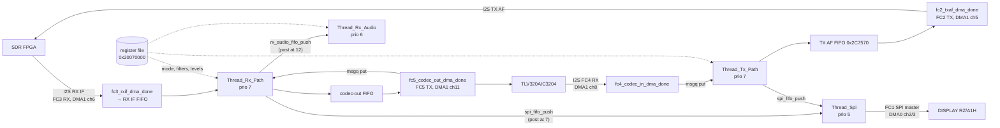

# IFDSP — HiFi4 DSP code (XOS threads, audio I/O, register file, coefficient tables)

Program: `FT-710_IFDSP_V0101_hifi4.bin` (Ghidra project `FT710_IFDSP`, `Xtensa:LE:32:rt600hifi4` since T21g; `Xtensa:LE:32:default` before), carved by
`tools/ifdsp_dsp_images.py`. Overview: [README.md](README.md). Sub-task: T12e. Claims are tagged **[fact]** (seen in the
disassembly or data, address cited), **[inference]** or **[guess]**. Function names are the names applied in Ghidra (`tools/ghidra/IfdspM33Names.java` / `IfdspHifi4Names.java`, merged by T17) and match `decomp/ifdsp/`; a name still in *italics* is a description that was not applied as a Ghidra name.

## Understanding at a glance (2026-10-28)

How much of the HiFi4 code is understood, in numbers. The tool gap is detailed in [ghidra-flix.md](ghidra-flix.md); the counts come
from `tools/flix_stats.py` and the files named.

| Measure | Value |
|---|---|
| Functions | 1,065 (49,389 instructions, 188,006 bytes) in the FLIX listing **[fact]** |
| Named | **99 (9 %)**, also 9 % of the code bytes; the five largest unnamed functions are 8,320, 5,168, 4,208, 3,376 and 2,224 bytes (`FUN_0022c5b0`, `FUN_00231040`, `FUN_0022e990`, `FUN_0022a6f0`, `FUN_00219800`) **[fact]** |
| Described in the IFDSP docs | about 96 functions (9 %) mentioned by name or address in this page, [control-link.md](control-link.md) or [ipc.md](ipc.md) **[fact: text search]** |
| Readable as decompiled C | **since T21g (2026-10-28): all 1,067 functions decompile**, 0 failures, 982 of 1,081 exported functions without any decompiler warning, 1 `halt_baddata()` (data). Ghidra bodies cover 93 % of the listing's bytes (14 % before). Control flow, base-ISA and FPU operations and the simple HiFi4 loads/stores are real C; most `ae_*` operations are named calls with the right inputs and outputs but no arithmetic. Before T21, with the stock language: **none in practice** (891 functions, 84 %, contain FLIX bundles it could not decode) **[fact: `decomp/ifdsp/hifi4/quality.tsv`, [ghidra-flix.md](ghidra-flix.md)]** |
| Signal-processing algorithms | the receive and transmit chains are known by call order only; noise reduction, noise blanker, notch, AGC and the demodulators are **not yet understood as algorithms**. Understood: the IIR biquad cascade engine, the 51-tap NLMS update and the FIR/IIR coefficient tables below **[fact: Open points]** |
| Evidence tags on this page | 47 **[fact]**, 29 **[inference]**, 9 **[guess]** |

## How this page was made: a FLIX-aware disassembler

Ghidra's stock Xtensa module decodes only the base ISA, so with it most HiFi4 bodies stopped at the first FLIX bundle (T07; fixed by
the generated language `Xtensa:LE:32:rt600hifi4`, T21, which this page predates). The
**Zephyr SDK toolchain for the NXP RT600 ADSP** (`xtensa-nxp_rt600_adsp_zephyr-elf`, GNU binutils 2.38 built with the RT600
HiFi4 core overlay) decodes this image completely: FLIX bundles (`{ op; op }`, 48- and 88-bit formats), HiFi4 `ae_*`
opcodes, the FPU (`add.s`, `mul.s`, `wfr`) and the zero-overhead loops (`loop`, `loopgtz`) **[fact: every thread entry,
driver and filter loop in this page disassembles cleanly]**. The RT600 HiFi4 core configuration is the one this firmware was
built for, so the decode is exact, not a guess at the FLIX formats.

| Tool | Use |
|---|---|
| `~/opt/zephyr-sdk-0.17.0/xtensa-nxp_rt600_adsp_zephyr-elf/bin/xtensa-nxp_rt600_adsp_zephyr-elf-objdump` | from the official Zephyr `sdk-ng` v0.17.0 GitHub release (`toolchain_linux-x86_64_xtensa-nxp_rt600_adsp_zephyr-elf.tar.xz`, SHA-256 checked against the release `sha256.sum`) |
| `tools/ifdsp_hifi4_dis.py` | per-function disassembly (a linear sweep desyncs at literal pools): entries from `functions.tsv` that start with `entry` (57 bogus Ghidra entries dropped) plus missed call targets; puts names from `IfdspHifi4Names.java` on headers and calls |
| `tools/ifdsp_coef_tables.py` | finds referenced numeric tables in rodata/.data and characterises them (FIR symmetry, DC gain, -3/-6/-40 dB points, IIR biquad cascades, sin/cos, windows) |

```sh
OD=~/opt/zephyr-sdk-0.17.0/xtensa-nxp_rt600_adsp_zephyr-elf/bin/xtensa-nxp_rt600_adsp_zephyr-elf-objdump
python3 -I tools/ifdsp_hifi4_dis.py $OD build/FT-710_IFDSP_V0101_hifi4_1_sram_text.bin decomp/ifdsp/hifi4/functions.tsv \
  decomp/ifdsp/hifi4/flix.dis tools/ghidra/IfdspHifi4Names.java     # 1065 functions, ~52k lines, ~5 s; committed
python3 -I tools/ifdsp_coef_tables.py build/FT-710_IFDSP_V0101_hifi4_1_sram_text.bin --dis decomp/ifdsp/hifi4/flix.dis
```

Limit that remains: the disassembly is not decompiled C. The DSP kernels (filters, FFT, NR) are readable as FLIX assembly,
but working out every algorithm needs more time than T12e had; the tables below say how far each block is understood.

## Memory used by the DSP (DSP view)

| Range | Use |
|---|---|
| 0x00200000–0x002062D3 | rodata: SDK tables, **float coefficient tables** (0x200CD0–0x205844), strings (0x2062D4..) **[fact]** |
| 0x00206498–0x00206FFF | L32R literal pools **[fact]** |
| 0x00207000–0x002367FF | .text (1065 functions with `entry`) **[fact]** |
| 0x00236800–0x002383B3 | .data: **IIR biquad sets** (0x236830–0x23773C), XOS/rpmsg objects, msgq pointers **[fact]** |
| 0x002383B4–0x002CBFFF | .bss: thread stacks and TCBs, FIFOs, filter states (e.g. TCB `Thread_Rx_Path` 0x2C7890) **[fact: addresses in the thread-create calls]** |
| 0x20020000 | rpmsg-lite shared memory (`rpmsg_lite_remote_init` arg) **[fact]** |
| 0x20060000–0x200631DF | I2S DMA ping-pong buffers (8 × 0xC0 bytes at 0x20062BE0..), set to a special MPU/cache attribute at boot **[fact: `xos_create_main_ipc_threads`]** |
| 0x20070000–0x2007FFFF | shared parameter register file; the DSP uses bases 0x2006FF00 (reg = (offset − 0x100)/2) and 0x20077F00 (reg 0x4000 + …) **[fact]** |

## XOS threads

`xos_create_main_ipc_threads` (0x0021C498, the DSP `main`) runs once **[fact]**:

1. `xthal_set_region_attribute`(0x20060000, 0x31E0, 2, 0)` and `(0x20070000, 0x10000, 2, 0)` — sets a memory attribute on the DMA buffers
   and the register file (both shared with the M33 or DMA) **[fact: args]**; that it is `xthal_mpu_set_region_attribute`
   (making them uncached) is **[inference]**.
2. `regfile_set_defaults` (0x0021BE80): clears the 64 KB register file and writes defaults (table below) **[fact]**.
3. `regfile_capture_init` (GPIO setup), `SystemCoreClock` = **594 MHz** (0x2367B880 → 0x2CB680), `xos_start_system_timer(-1, 0)`,
   `g_xtal = 24 MHz`, `g_clkin = 18.432 MHz` (0x238420 / 0x23841C) **[fact: values]**.
4. `create_rx_tx_path_threads` (0x00225E40) — audio I/O init, `Thread_Rx_Path`, `Thread_Tx_Path`, then `create_Thread_Rx_Audio`.
5. `fc1_spi_dma_init` (0x00220FD0), `FUN_0021C140` (sin/cos table init, 2π constants).
6. `xos_thread_create` for `Thread_Main` and `Thread_Ipc`, `create_Thread_Spi`, then `xos_start(0)`.

`xos_thread_create(tcb, parent=0, entry, arg=0, name, stack, stack_size, priority, parms=0, flags=0)` — the argument
order matches Cadence XOS **[inference]**; the values are **[fact]** from the call sites:

| Thread | Created in | Entry | Prio | Stack | Wakes on | Role |
|---|---|---|---|---|---|---|
| `Thread_Main` | 0x0021C498 | `Thread_Main_entry` 0x0021C360 | 4 | 0x1398 @0x241170 | `xos_thread_sleep(SystemCoreClock·100/1000)` = 100 ms | starts the I2S DMA (`audio_i2s_fc3_fc4_fc5_init`), then every 100 ms `tx_gpio_to_reg4004`, every 1 s `cpu_load_to_regs_2000` **[fact]** |
| `Thread_Ipc` | 0x0021C498 | `Thread_Ipc_entry` 0x0021C3B4 | 13 | 0x2000 @0x240290 | msgq (10 × 152 B) fed by the rpmsg endpoint callback | MU-B/SEMA42 boot handshake, rpmsg-lite remote on 0x20020000, endpoint 30, `ipc_handle_msg` 0x0021BD40 (see [ipc.md](ipc.md)) **[fact]** |
| `Thread_Rx_Path` | 0x00225E40 | `Thread_Rx_Path_entry` 0x002262FC | 7 | 0x1398 @0x2C83B0 | msgq 0x23773C[0] (2 × 4 B), posted by the codec-out DMA callback | per 24-sample block: RX IF in → receive chain → codec out; forwards blocks to Rx_Audio and Spi **[fact: calls]**, chain contents **[inference]** |
| `Thread_Tx_Path` | 0x00225E40 | `Thread_Tx_Path_entry` 0x0022647C | 7 | 0x1398 @0x2C9750 | msgq 0x23773C[1], posted by the codec-in DMA callback | per 24-sample block: mic/codec in → transmit chain → TX AF FIFO for FC2 **[fact: calls]** |
| `Thread_Rx_Audio` | 0x00220BD0 | `Thread_Rx_Audio_entry` 0x00220F90 | 6 | 0x1398 @0x258A00 | msgq 0x236BC0 (2 × 4 B), posted when 12 blocks are queued | batch processing of 12 × 24 = 288 samples (24 ms): reads most "RX DSP" registers (0x40–0x45, 0x52, 0x56, 0x61, 0x400B–0x400E, 0x4020–0x4026) **[fact]** |
| `Thread_Spi` | 0x00224A10 | `Thread_Spi_entry` 0x00224AA4 | 5 | 0x1398 @0x2650F0 | msgq 0x2374F4 (4 × 4 B): msg 0 = 7 blocks queued, msg 1 = SPI transfer done | builds spectrum/scope data from tapped blocks (decimate by 7, 128-point buffer, regs 0x5C/0x5D) and sends it to the DISPLAY over FC1 SPI **[fact: calls]**, purpose **[inference]** |

XOS priority: higher number = higher priority **[inference from XOS]**, so the IPC thread and the two 2 ms block threads
pre-empt the batch threads.



## Audio I/O

### I2S on FLEXCOMM2–5 (DMA1)

`create_rx_tx_path_threads` (0x00225E40) **[fact]**: `INPUTMUX_AttachSignal(INPUTMUX, 18, 0x14000014)`, `CLOCK_AttachClk`
for FC2–FC5 (0x80002548/68/88/A8) and one more clock (0x80001740), four clock/reset calls (`FUN_00213910` 0x30A–0x30D),
writes to 0x40021E00 (+0x210/0x24C/0x250/0x280/0x284, I2S signal sharing / clock setup **[inference]**), DMA1 IRQ 23 via
`xos_register_interrupt_handler(23, DMA_IRQHandle, DMA1)` + `xos_interrupt_enable(23)`, then four `i2s_config_t`
(28 bytes each at 0x2C8208/24/40/5C) set to **slave, divider 1, 32-bit data, 64-bit frame** (stereo 2 × 32) **[fact: values;
field mapping from the SDK struct = inference]**. Every FLEXCOMM is an I2S **slave**: the bit clocks come from the SDR FPGA
and the AIC3204 (which is I2S master, T12a).

| FLEXCOMM | Base | Direction (SDK call) | DMA1 channel (priority) | Schematic signal (p19) | Callback |
|---|---|---|---|---|---|
| FC2 | 0x40108000 | `I2S_TxInit`, `I2S_TxTransferSendDMA` | ch5 (prio 5) | TX AF → SDR | `fc2_txaf_dma_done` 0x00226224 |
| FC3 | 0x40109000 | `I2S_RxInit`, `I2S_RxTransferReceiveDMA` | ch6 (prio 3) | RX IF ← SDR | `fc3_rxif_dma_done` 0x00226254 |
| FC4 | 0x40122000 | `I2S_RxInit`, receive | ch8 (prio 2) | codec I2S "out" (ADC data into the DSP) | `fc4_codec_in_dma_done` 0x002262C0 |
| FC5 | 0x40123000 | `I2S_TxInit`, send | ch11 (prio 4) | codec I2S "in" (DAC data from the DSP) | `fc5_codec_out_dma_done` 0x00226284 |

The DMA channel numbers follow the RT600 request map (FCn RX = 2n, TX = 2n+1), which agrees with each FLEXCOMM's
Tx/Rx init call **[fact: both sides]**. So the schematic's "codec I2S out/in" are named from the codec's side **[inference]**.

`audio_i2s_fc3_fc4_fc5_init` (0x002260D8; the T12a name is too narrow, it starts all four) creates the four DMA transfer handles
and queues **two 0xC0-byte transfers per FLEXCOMM** (ping-pong) from the 8 buffers at 0x20062BE0 + n·0xC0 **[fact]**. Each
callback re-queues the buffer it just finished (index toggles 0/1) and then:

- `fc2_txaf_dma_done` → `txaf_fifo_pop_to_dma` 0x00225C9C: pops one 24-sample float block pair from a 2-deep FIFO (0x2C7570) that
  Tx_Path fills, or zeros if empty, and interleaves it into the DMA buffer (`FUN_0021C598`, float → int32).
- `fc3_rxif_dma_done` → `rxif_dma_to_fifo` 0x00225CF8: de-interleaves 24 stereo int32 frames into two float arrays (I and Q
  **[inference]**) and pushes them into a 2-deep FIFO (0x2C7648); Rx_Path pops it with int→float scaling 2^-31
  (`FUN_00225D48` → `FUN_00234890(…, -31, 24)`) **[fact]**.
- `fc5_codec_out_dma_done` → `codec_out_fill_dma`, then `xos_msgq_put(Rx_Path queue)`.
- `fc4_codec_in_dma_done` → `codec_in_from_dma`, then `xos_msgq_put(Tx_Path queue)`.

So **Rx_Path is clocked by the codec DAC and Tx_Path by the codec ADC**; the SDR side is decoupled by 2-deep FIFOs **[fact]**.

**Block size and sample rate.** One DMA transfer = 0xC0 bytes = 24 stereo frames; all path buffers are 96 bytes = 24 floats
**[fact]**. The sample rate is **12 kHz** **[inference, strong]**: the constant 1/12000 (0x38AEC33E at 0x206D04) is used in
~10 parameter functions to turn Hz into normalised frequency, 12000.0 appears in 0x21CAD4, and the 12-bit frequency field of
reg 0x45 is clamped to 5999 (0x176F, just below Nyquist) **[fact: constants]**. So one block = 2 ms, and Rx_Audio frames are
24 ms. The FIR/IIR tables below are consistent with 12 kHz (SSB/CW passbands of 0–4 kHz). **Open (T14, C9):** the DISPLAY writes the
REC PCM it receives over FC1 as a **16 kHz** stereo WAV ([display/spi-links.md](../display/spi-links.md#link-2-if-dsp-fftrecplay-rspi4)),
so either `Thread_Spi` resamples to 16 kHz or the WAV header is nominal. The FC1 buffer spacing (0x1200) matches the DISPLAY's 0x11F8-byte frame **[fact]**.
*#59:* `Thread_Spi` does not resample. The recorder audio is resampled before it, in the routing sink `FUN_002255B4` (reg 10 n1,
[control-link.md](control-link.md#audio-routing-registers-8-9-10-77-fact)) **[fact, FLIX listing]**: each 24-sample block is zero-stuffed by 2 with gain 2
(0x2C6B90); every 0x90 = 144 stuffed samples go through `iir_cascade_process` (anti-image filter), a `loop` of 8 keeps every **9th** sample
(16 outputs), `FUN_00234750` converts them to int16 (shift −15), and they enter the 4000-entry ring 0x266ED8 (count 0x268E18). So the
recorder rate is **2/9 of the sink's input rate**. `FUN_00225790` packs the 4000-byte PCM part of each SPI frame as `u16 count`
(≤ 0x7CE = 1998), `u16 (4000 − 0x2C6A20)/6`, then up to `count` int16 samples, the rest 0xF0. A 16 kHz WAV therefore needs **72 kHz** at
the sink's input, which does not fit the 12 kHz block rate inferred above (that would give 2.67 kHz); one of the two rate readings is
wrong **[inference]**, see #154.

### SPI on FLEXCOMM1 (DMA0)

`fc1_spi_dma_init` (0x00220FD0) **[fact]**: `INPUTMUX_AttachSignal(17, 0x14000013)`, DMA0 IRQ 22, `CLOCK_AttachClk(0x80002528)`,
`SPI_MasterGetDefaultConfig`, `SPI_MasterInit(FC1 0x40107000, cfg, CLOCK_GetFlexCommClkFreq(1))` with baud **1 000 000**, a
second field = 1 (polarity, **[inference]**), SSEL 0; DMA0 ch3 (TX, prio 3) and ch2 (RX, prio 2). The DSP is the **SPI master**
towards the DISPLAY CPU (FFT/REC/PLAY on the schematic) **[fact: MasterInit]**. FC1 RX/TX buffers 0x200607E0 / 0x200619E0 (T12a).
`spi_post_tx_done` (0x00224D40) is called from the SPI DMA completion (`FUN_0022111C`) and posts msg 1 to Thread_Spi **[fact]**.

### GPIO, PWM meter

- `tx_gpio_to_reg4004` (0x0021C060), every 100 ms: reg 0x4004 = (`regfile_gpio_sel`() << 2) | (P0_21 << 1) | P0_22 (GPIO byte registers
  0x40100015/16); `regfile_gpio_sel` returns P0_4 unless reg 0xC & 0xF000 == 0x1000 **[fact]**. MAIN polls these bits **[inference]**.
- `meter_to_reg4005` (0x0021F348, Rx_Path): float level × 65535 → 8 bit → ×100/256 → **reg 0x4005**, which the M33 copies into
  the SCT0 PWM duty (T12d) — an analogue meter output **[fact: code]**, which meter **[guess: S-meter/ALC]**.
- `cpu_load_to_regs_2000` (0x0021C230), every 1 s: `xos_get_cpu_load(stats[8], &n, reset=1)` and writes each thread's
  `cpu_pct` to **regs 0x2000–0x2007** — a diagnostics view that MAIN (or a service tool) can read over the console **[fact: code;
  XOS struct layout = inference]**.

## Register file use

Defaults written by `regfile_set_defaults` (0x0021BE80) **[fact]** (all other regs in 1–0x68, 0x2000–0x200F and 0x4001–0x4026 are
cleared to 0): reg 0x8 = 0x2031, 0x9 = 2, 0xA = 0x22, 0xC = 1, 0x11 = 0xFFD4 (−44), 0x21 = 0xFFB0 (−80), 0x2F = 1, 0x30 = 0xFF,
0x31 = 0x32 = 0xFFA (4090), 0x33 = 12, 0x3A = 1, 0x3B = 0x58 = 0x2C4 (708), 0x62 = 1, 0x63 = 0xE7 (231), 0x66 = 0xBB8 (3000),
0x67 = 0xFF, 0x4001 = 1, 0x4007 = 0x3A, 0x400B = 8, 0x400C = 0x400, 0x400D = 0x200, 0x400E = 2, 0x4011 = 0x80, 0x4012 = 0x4000,
0x4013 = 1000, 0x4014 = 0xFFE8 (−24), 0x4016 = 0xFFFA (−6), 0x4018 = 100, 0x401B = 0x2C4, 0x401C = 10, 0x401D = 300,
0x401F = 10, 0x4023 = 100. (The M33 later sets reg 0 = 0x0101 and reg 0x4000 = 1, T12a.)

Direct accesses found by base-register tracking in the FLIX disassembly (register indexes computed at run time are not seen;
reads through copied pointers are not seen) **[fact for what is listed]**. Thread: RA = Rx_Audio, RP = Rx_Path, TP = Tx_Path,
S = Spi, M = Main; "fp" = only reached through a function pointer.

| Reg | Read by | Written by | Thread | Notes |
|---|---|---|---|---|
| 0x1 | 0x21D68C, 0x21F7EC, 0x21FA48, 0x21FD20, 0x220224, 0x2233FC, 0x223734 | same | RP, TP, fp | status/flag bits (M33 sets bit 0) **[inference]** |
| 0x2 | 0x222034, 0x224ED8 | same | RA, TP | flag word |
| 0x3 / 0x4 | — | 0x21F388 / 0x21D270 | RP / RA | DSP → MAIN results (MAIN reads regs 0–4) **[inference]** |
| 0x6 | 0x21F484, 0x220EE0, 0x2220E8, 0x22313C, Rx_Path, Tx_Path | — | all | **operating mode**: compared with 9 and 10, and indexes an 11-entry jump table (0x204EF0) in the TX filter switch **[fact]**; the mode numbering **[unknown]** on the DSP side; MAIN writes 0 CW-U, 1 CW-L, 2 USB/DATA-U/RTTY-U/PSK, 3 LSB/DATA-L/RTTY-L, 8 AM, 9 FM ([control-link.md](control-link.md#register-map)) **[fact, MAIN mapping]**, so 9 is FM; which MAIN value the 10 compare means is open |
| 0x8–0xA | 0x2249D0 | — | TP | |
| 0xC | 0x21C5CC, 0x22309C, 0x2233FC, 0x223734 | — | M, TP | top nibble selects a GPIO input / TX source **[inference]** |
| 0xD, 0xE, 0x10 | 0x224814 | — | RP | |
| 0xF, 0x10 | 0x225DC4 | — | TP | |
| 0x11 | 0x222510, 0x222688, 0x222AF0 | — | TP | with 0x35–0x38: tone/CTCSS encoder block (uses the CTCSS table 0x204DD0) **[inference]** |
| 0x12 / 0x13 | 0x225A84 / 0x225AB4 | — | TP / RP | gains **[guess]** |
| 0x20 | Tx_Path | — | TP | signed dB: on change computes 10^(0.05·x) (`FUN_00218B70`) → linear TX gain **[fact: code]** |
| 0x23 | 0x2248D8 | — | TP | |
| 0x2B–0x2D | 0x221220 | — | TP | |
| 0x2F, 0x30, 0x3A | 0x2221D0, 0x222D00/0x222D34, 0x220B5C | — | TP, fp | |
| 0x31–0x34 | 0x221E84 | — | TP | |
| 0x40, 0x400B, 0x400D, 0x4025, 0x4026 | 0x21DBD0 | — | RA | |
| 0x41, 0x400C, 0x400E | 0x21C8BC | — | RA | |
| 0x42–0x44 | 0x21CC68 | — | RA | |
| 0x45 | 0x21C610 | — | RA | bits 15–12 = type 1–4, bits 11–0 = frequency in Hz ≤ 5999; selects tables 0x203100–0x2038E0 **[fact]** (notch/peak filter **[inference]**) |
| 0x4E–0x50 | 0x220470 | — | RA | |
| 0x51 | 0x21FDBC | — | fp | |
| 0x52 / 0x56 | 0x21E530 / 0x21E6C4 | — | RA | |
| 0x53 | 0x21F7EC | — | fp | CTCSS decoder block (table 0x204BE0) **[inference]** |
| 0x5C / 0x5D | 0x223C8C / 0x224060 | — | S | spectrum/scope settings **[inference]** |
| 0x60 / 0x61 | 0x224960 / 0x21D270 | — | RP / RA | |
| 0x62, 0x63, 0x66, 0x67 | 0x21F004 | — | RP | |
| 0x68 | 0x21F2D0 | — | RP | |
| 0x2000–0x2007 | — | `cpu_load_to_regs_2000` | M | per-thread CPU % |
| 0x4004 | — | `tx_gpio_to_reg4004` | M | GPIO bits |
| 0x4005 | — | `meter_to_reg4005` | RP | PWM meter duty |
| 0x4006 | 0x22313C | — | TP | non-zero enables the mode-dependent TX filter |
| 0x4007 | 0x221A30 | — | TP | |
| 0x400A | — | 0x2233FC, 0x223734 | TP | DSP → MAIN |
| 0x4011, 0x4012 | 0x2233FC, 0x223734 | — | TP | adaptive (LMS) block, `nlms_51tap_update` **[inference]** |
| 0x4013, 0x4014 | 0x225264 | — | TP | |
| 0x4015–0x4019 / 0x401A–0x401F | 0x222E30 / 0x222244 | — | TP | two level-control blocks (constants 20, 1e-6, 0.001 = dB/attack-release style) **[inference]** |
| 0x4020 | 0x21E754 | — | RA | type nibble 1/2 and 700 or 1000 → one of four 257-tap FIRs (below) **[fact]** |
| 0x4022, 0x4023 | 0x21DFE4 | — | RA | |

The MAIN side of these registers (who writes which, with what values) is T12b's [control-link.md](control-link.md).

## Coefficient and constant tables

From `tools/ifdsp_coef_tables.py` at Fs = 12 kHz (frequencies scale linearly if a block runs at another rate). Biquad sets are
stored as **b0 b1 b2 a1 a2** per section with denominator 1 + a1 z⁻¹ + a2 z⁻² (all sections stable with this sign) **[fact:
pole check]**. Passband edges are at −3 dB from the peak **[fact: computed]**; the purpose is **[inference]** unless stated.

### FIR tables (rodata)

| Address | Taps | Shape | Response @12 kHz | Used by | Purpose |
|---|---|---|---|---|---|
| 0x203B70 | 257 | symmetric, DC = 1.000 | LP, −3 dB 703 Hz, −6 dB 996 Hz | 0x21E754 (reg 0x4020) | CW/narrow filter set, gentle 700 |
| 0x204390 | 257 | symmetric, DC = 1.000 | LP, −3 dB 703 Hz, −6 dB 797 Hz | 0x21E754 | sharp 700 |
| 0x203F80 | 257 | symmetric, DC = 1.000 | LP, −3 dB 996 Hz, −6 dB 1418 Hz | 0x21E754 | gentle 1000 |
| 0x2047A0 | 257 | symmetric, DC = 1.000 | LP, −3 dB 1008 Hz, −6 dB 1125 Hz | 0x21E754 | sharp 1000 |
| 0x2035C0 | 197 | symmetric, DC 0.986 | LP, −3 dB 59 Hz | 0x21C748 (reg 0x45) | narrow lowpass for a notch/peak tracker |
| 0x2038E0 | 103 | symmetric, all positive, peak 1/60 | LP, −3 dB 82 Hz | 0x21C748 | smoothing window |
| 0x203120 + 0x203370 | 148 + 147 | rising / falling halves, max 1/150 | — | pointer at 0x206D38 | ramp/window halves (keying shape **[guess]**) |
| 0x204F80 | 123 | symmetric, DC = 1 | LP, −3 dB 984 Hz, −40 dB 1184 Hz | 0x224000 (Spi init) | sharp lowpass before the decimate-by-7 scope path |
| 0x2051C0 | 109 | symmetric, positive | LP, −3 dB 94 Hz | 0x21FD20 | slow detector smoothing |
| 0x205380 | 109 | symmetric, positive | LP, −3 dB 59 Hz | 0x222640 | slow detector smoothing |
| 0x205540 | 173 | not symmetric, sum 1.12 | — | `create_Thread_Spi` | Spi-thread filter (init copies it) |

### IIR biquad sets (.data)

| Address | Sections | Response @12 kHz (−3 dB) | Used by | Purpose |
|---|---|---|---|---|
| 0x236C70 | 9 | BP 35–3199 Hz | pointer table 0x236C50[0] | **set of 7 voice passbands**, selected by index **[fact: pointer table]**: matches the SSB TX BPF menu style (50–3050, 100–2900, 200–2800, 300–2700, 400–2600, wide) **[inference]** |
| 0x236D30 | 9 | BP 70–3035 Hz | 0x236C50[1] | ″ |
| 0x236DF0 | 10 | BP 117–2930 Hz | 0x236C50[2] | ″ |
| 0x236EC0 | 11 | BP 246–2824 Hz | 0x236C50[3] | ″ |
| 0x236FA0 | 12 | BP 363–2766 Hz | 0x236C50[4] | ″ |
| 0x237090 | 9 | BP 23–3352 Hz | 0x236C50[5] | ″ (wide) |
| 0x237150 | 8 | BP 23–4137 Hz | 0x236C50[6] | ″ (AM/wide) |
| 0x236BD0 | 6 | (head of the same struct) | `FUN_002218E0` (TX filter switch, reg 6) | TX path biquad, `iir_cascade_init(state, coefs, 6, 1)` |
| 0x236850 | 6 | LP 2812 Hz, sharp | 0x21C8BC, 0x21DBD0 | RX audio lowpass |
| 0x2368D0 | 5 | BP 1500–2520 Hz (peak 2297) | 0x21D650 | tone/data band (RTTY/PSK tones **[guess]**) |
| 0x236940 | 4 | LP 316 Hz (order 8) | 0x21F6D0, 0x21F7EC, 0x231040 | **CTCSS subtone lowpass** (with table 0x204BE0) **[inference]** |
| 0x236990 | 8 | BP 234–2133 Hz | 0x21F6D0, 0x21F7EC | FM voice band above the subtone |
| 0x236A30 | (2 sections, copy of 0x236940 head) | — | 0x21FD20, 0x21FDBC | |
| 0x236AB0 | 5 | HP 305 Hz (order 9) | 0x220B30 | subtone-removal highpass |
| 0x2371F0 | 4 | HP 293 Hz (order 7) | 0x222DD4 | ″ (TX) |
| 0x236B20 | 8 | LP 434 Hz | 0x220B5C (reg 0x3A) | |
| 0x237240 | 8 | HP 2121 Hz | 0x222D34 (regs 0x30, 0x3A) | pre-emphasis / treble **[guess]** |
| 0x2372E0 | 2 | LP 504 Hz | 0x223080 | |
| 0x237310 | 4 | BP 23–3410 Hz | 0x2230D0 | |
| 0x237360 | 3 | LP 586 Hz | 0x223320, 0x22338C, 0x2254A0 copy at 0x237700 | level-detector smoothing **[inference]** |
| 0x2373A0 | 2 | LP 820 Hz | 0x2248A0, 0x2248D8 | |
| 0x2373D0 | 5 | LP 820 Hz, sharp | 0x21D8A0, 0x21F410, 0x221B10, 0x2220A0, 0x222640 | CW/narrow lowpass |
| 0x237440 | 9 | LP 1980 Hz, very sharp | 0x21D8A0, 0x221B10 | |

`iir_cascade_init` (0x002340FC, 32 callers, section count 1–9 in a11) and `iir_cascade_process` (0x002341C0, 1360 bytes of
FLIX) are the generic cascade engine **[inference]**.

### Other tables

| Address | Contents | Used by |
|---|---|---|
| 0x204BE0, 0x204DD0 | **CTCSS tone list**: 88.5 (default) then the 50 standard tones 67.0 … 254.1 Hz **[fact: values]** | 0x21F6D0/0x21F7EC (decoder side), 0x222510 (TX encoder side) |
| 0x201900 | 1536 floats = cos/sin pairs, step 2π/1024 (radix-4 twiddles) | 0x21C140, 0x223C8C (Spi) — FFT **[inference]** |
| 0x200D00 | 192 floats, cos/sin step 2π/512 | 0x21E24C, 0x223C8C |
| 0x201000 | 576 floats, twiddles starting cos(π/8) | 0x209B30 (NatureDSP-style FFT **[guess]**) |
| 0x2375D0 | 73 floats 0 → 1, raised-cosine ramp | 0x225408 (TX), keying/ALC ramp **[inference]** |
| 0x200650–0x200890 | polynomial coefficients (log, exp, atan, sqrt; 0.693147, π, π/2, 1/ln10) | libm-style float helpers 0x218B70–0x21A0B0 |
| 0x237500 | 52 int16 pairs, decreasing 600 → … | 0x224ED8 (regs 2) — AGC/ALC curve **[guess]** |
| 0x204D10 | int32 {0, 600, 1600, 2600, 3600} | 0x22111C (SPI) — scope span/offset steps **[guess]** |

No Q15/Q31 coefficient tables were found: all signal processing is in **float32** (the HiFi4 FPU) **[fact: every table is
float; kernels use `add.s`/`mul.s`/`ae_l32.i`]**.

## Function table (HiFi4)

| Address | Ghidra name | Inferred name | Purpose |
|---|---|---|---|
| 0x0021C498 | `xos_create_main_ipc_threads` | `xos_create_main_ipc_threads` | DSP main: MPU attrs, regfile defaults, clocks, audio init, threads, `xos_start` |
| 0x0021C360 | `Thread_Main_entry` | `Thread_Main_entry` | 100 ms loop: GPIO → reg 0x4004, 1 s CPU load → regs 0x2000.. |
| 0x0021C3B4 | `Thread_Ipc_entry` | `Thread_Ipc_entry` | MU-B/SEMA42 handshake, rpmsg remote, msg loop |
| 0x00220BD0 | `create_Thread_Rx_Audio` | `create_Thread_Rx_Audio` | thread + msgq (2 × 4) |
| 0x00220F90 | `Thread_Rx_Audio_entry` | `Thread_Rx_Audio_entry` | wait msg, copy 12 blocks, `FUN_0021F484` chain, two outputs (`FUN_00220DA4`) |
| 0x00224A10 | `create_Thread_Spi` | `create_Thread_Spi` | SPI state init, thread + msgq (4 × 4) |
| 0x00224AA4 | `Thread_Spi_entry` | `Thread_Spi_entry` | sine table, then msg 0: 7 blocks → decimate → spectrum (`FUN_00224060`, `FUN_00223C8C`) → SPI; msg 1: next SPI transfer |
| 0x00225E40 | `create_rx_tx_path_threads` | `create_rx_tx_path_threads` | I2S/DMA1 init (FC2–5), Rx/Tx path threads, then Rx_Audio |
| 0x002262FC | `Thread_Rx_Path_entry` | `Thread_Rx_Path_entry` | per 2 ms block, receive chain; mode reg 6 |
| 0x0022647C | `Thread_Tx_Path_entry` | `Thread_Tx_Path_entry` | per 2 ms block, transmit chain; reg 0x20 gain |
| 0x002260D8 | `audio_i2s_fc3_fc4_fc5_init` | `audio_i2s_fc3_fc4_fc5_init` | DMA handles and ping-pong transfers for FC2–FC5 |
| 0x00226224 / 54 / 84 / 0x002262C0 | FUN_… | `fc2_txaf_dma_done` / `fc3_rxif_dma_done` / `fc5_codec_out_dma_done` / `fc4_codec_in_dma_done` | DMA callbacks (above) |
| 0x00225C9C / 0x00225CF8 | FUN_… | `txaf_fifo_pop_to_dma` / `rxif_dma_to_fifo` | SDR-side FIFOs |
| 0x002246C0 / 0x00224734 | FUN_… | `codec_out_fill_dma` / `codec_in_from_dma` | codec-side buffers |
| 0x00220F74 / 0x00220C7C | FUN_… | `rx_audio_push_block` / `rx_audio_fifo_push` | 24-deep block ring, posts Rx_Audio at 12 |
| 0x00224D58 / 0x00224D40 | FUN_… | `spi_fifo_push` / `spi_post_tx_done` | 14-deep ring, posts Spi at 7 / msg 1 |
| 0x00220FD0 | `fc1_spi_dma_init` | `fc1_spi_dma_init` | FC1 SPI master 1 MHz + DMA0 ch2/3 |
| 0x0021BE80 | `regfile_set_defaults` | `regfile_set_defaults` | clear + defaults |
| 0x0021C060 | `tx_gpio_to_reg4004` | `tx_gpio_to_reg4004` | GPIO P0_4/21/22 → reg 0x4004 |
| 0x0021C230 | `cpu_load_to_regs_2000` | `cpu_load_to_regs_2000` | XOS CPU load → regs 0x2000.. |
| 0x0021F348 | `meter_to_reg4005` | `meter_to_reg4005` | level → PWM meter reg |
| 0x002274E0, 0x002277F0, 0x0022835C, 0x0022866C, 0x0022735C | FUN_… | `xos_thread_create`, `xos_start`, `xos_start_system_timer`, `xos_thread_sleep`, `xos_get_cpu_load` | Cadence XOS |
| 0x00226A50, 0x00226B38, 0x00226CEC | FUN_… | `xos_msgq_create`, `xos_msgq_put`, `xos_msgq_get` | XOS message queues |
| 0x002266FC, 0x0022678C | FUN_… | `xos_register_interrupt_handler`, `xos_interrupt_enable` | XOS interrupts (IRQ 22 = DMA0, 23 = DMA1) |
| 0x00235D30, 0x00235EB0, 0x00235900 | FUN_… | `memcpy`, `memset`, `__udivdi3` | runtime |
| 0x00212684, 0x00208600, 0x00208E90 | FUN_… | `INPUTMUX_AttachSignal`, `CLOCK_AttachClk`, `CLOCK_GetFlexCommClkFreq` | NXP SDK |
| 0x0020A528, 0x0020AAB4, 0x0020AF38 | FUN_… | `DMA_Init`, `DMA_CreateHandle`, `DMA_IRQHandle` | NXP SDK DMA |
| 0x0020EDAC, 0x0020EECC, 0x0020EFDC, 0x0020F020 | FUN_… | `I2S_TxInit`, `I2S_RxInit`, `I2S_TxGetDefaultConfig`, `I2S_RxGetDefaultConfig` | NXP SDK I2S |
| 0x0020FBE4, 0x0020FC7C, 0x0020FE90, 0x0020FEA8 | FUN_… | `I2S_TxTransferCreateHandleDMA`, `I2S_TxTransferSendDMA`, `I2S_RxTransferCreateHandleDMA`, `I2S_RxTransferReceiveDMA` | NXP SDK I2S DMA |
| 0x00213F58, 0x00213F9C | FUN_… | `SPI_MasterGetDefaultConfig`, `SPI_MasterInit` | NXP SDK SPI |
| 0x00212EB8, 0x00213E84 | FUN_… | `MU_SetFlags`, `SEMA42_Lock` | MU-B / SEMA42 |
| 0x0021B544, 0x0021B078, 0x0021AF9C, 0x0021C398, 0x0021BD40 | FUN_… | `rpmsg_lite_remote_init`, `rpmsg_lite_is_link_up`, `rpmsg_lite_create_ept`, `ipc_ept_rx_cb`, `ipc_handle_msg` | rpmsg-lite remote |
| 0x002340FC, 0x002341C0 | FUN_… | `iir_cascade_init`, `iir_cascade_process` | biquad engine |
| 0x00223250 | `nlms_51tap_update` | `nlms_51tap_update` | 51-tap normalised LMS (error, power + 1e-12, weight update) |

## Open points

- Mode numbering of reg 6: MAIN's side is now known ([control-link.md](control-link.md#register-map): 0 CW-U … 9 FM); what the DSP does
  with each value (and with 10, which MAIN never sends **[inference]**) is open. The meaning of most RX registers: needs the MAIN-side setter names (T10/T12b) next to this table.
- The receive and transmit chains are listed by call, not yet by algorithm (NR, NB, notch, AGC, demodulators). The FLIX
  disassembly makes this possible function by function.
- Done (T21, #97): `decomp/ifdsp/hifi4/` is decompiled with the generated FLIX-aware language `Xtensa:LE:32:rt600hifi4`
  ([ghidra-flix.md](ghidra-flix.md); numbers in `decomp/ifdsp/INDEX.md`). Still open: exact arithmetic for the `ae_*` operations of
  the filter kernels, and memory semantics for the aligning `ae_la*`/`ae_sa*` loads/stores; until then the arithmetic is read from
  `flix.dis`.
