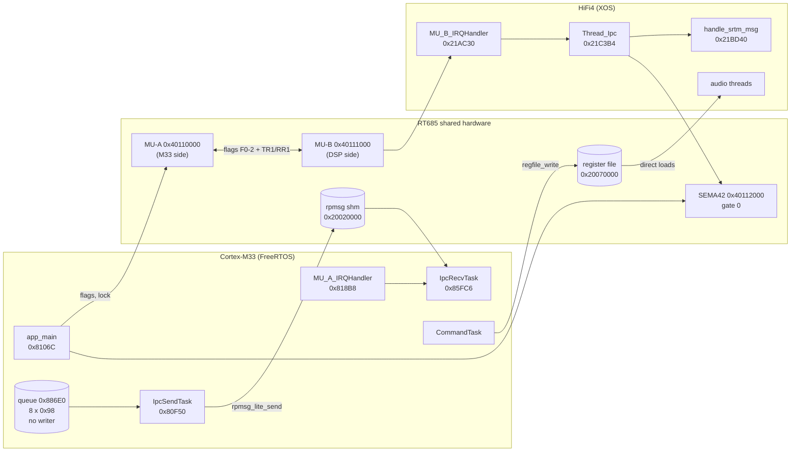
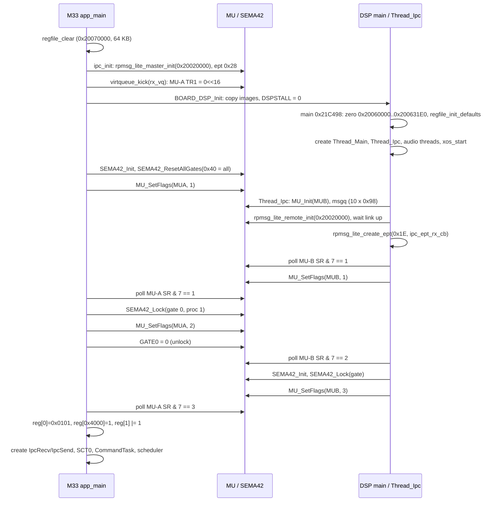
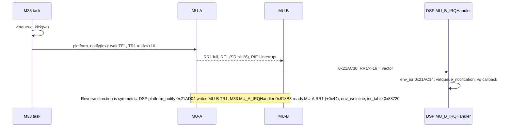
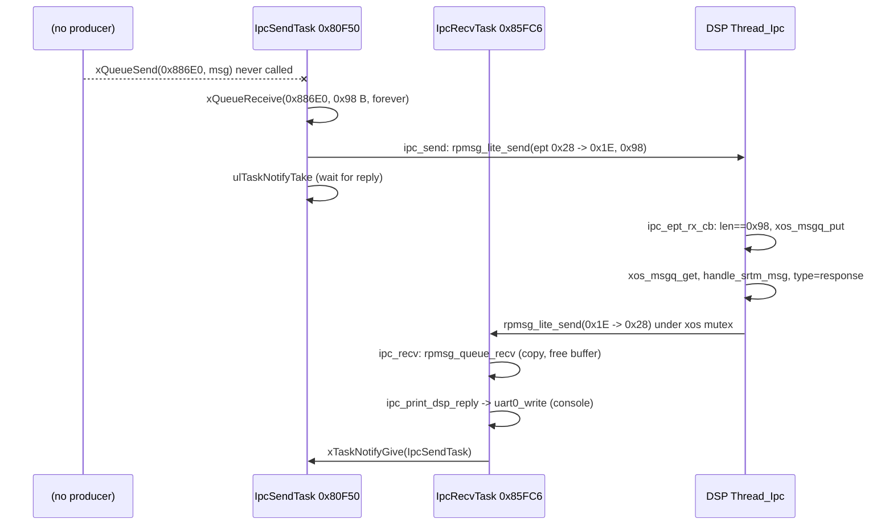

# IFDSP: M33 ↔ HiFi4 IPC (MU, SEMA42, rpmsg-lite, shared SRAM)

Sub-task T12c. Image `FT-710_IFDSP_V0101` (NXP i.MX RT685). This page covers every interaction between the Cortex-M33 and the
HiFi4 DSP: the MU flag handshake, the SEMA42 gate, the rpmsg-lite link, the shared parameter register file, the DSP
start sequence, and which audio buffers cross the cores (none do). Overview: [README.md](README.md).

Claims are tagged **[fact]** (seen in code or data, address cited), **[inference]** or **[guess]**. M33 addresses are in
`decomp/ifdsp/m33` and `build/ifdsp_m33_sram.dis`. HiFi4 addresses are in `decomp/ifdsp/hifi4`. Names in *italics* are
proposed in [`tools/ghidra/names_ifdsp.T12c.tsv`](../../../tools/ghidra/names_ifdsp.T12c.tsv) and are not yet in the Ghidra project.

**HiFi4 evidence levels.** Ghidra's Xtensa module decodes only the base ISA, so the DSP listings break at every FLIX bundle.
For this page the DSP code was read with [`tools/ifdsp_xtdis.py`](../../../tools/ifdsp_xtdis.py), a small base-ISA sweep that
skips bundles. With op0 = 0xE treated as a 6-byte bundle, the sweep stays in sync through the control code (see the tool's
docstring for the statistics). Operands that sit *inside* a bundle (some call arguments, the shared-memory address, the
endpoint number) cannot be read. Those claims are tagged **[inference: L32R]** (literal-pool evidence only) or
**[inference: FLIX]** (value hidden in a bundle).

## Summary

1. **Boot handshake (the only IPC that is used).** The M33 releases the DSP, then the two cores step their 3-bit MU flags
   through 1 → 2 → 3, with SEMA42 gate 0 as a token. The M33 does not start its tasks, or accept MAIN's register writes,
   until the DSP has reached flag 3. **[fact: M33 `app_main` 0x0008106C; DSP `Thread_Ipc` 0x0021C3B4]**
2. **rpmsg-lite link (built but idle).** The M33 is the rpmsg master over shared memory at 0x20020000 with endpoint 0x28. The
   DSP is the remote, with endpoint 0x1E. Messages are fixed 0x98-byte SRTM-style requests and responses, copied from NXP's
   RT685 `dsp_xaf` demo pattern. **No M33 code writes the send queue**, so no request is ever sent, and the DSP only answers
   requests. The link carries **no traffic** in this firmware. **[fact: queue 0x000886E0 has two literal references, both
   readers or the creator]** It was meant for M33 console commands such as "get DSP version", "mute", or "component versions"
   (see [Message format](#message-format)). **[inference]**
3. **Parameter register file (the real control path).** MAIN's register writes reach the DSP only through the 64 KB register
   file at 0x20070000, which both cores access directly with no lock and no notification. The DSP writes its own defaults there
   at boot, before the handshake completes. **[fact: DSP `regfile_init_defaults` 0x0021BE80 called from DSP `main` 0x0021C498]**
4. **Audio buffers.** None cross the cores. All I2S/SPI/DMA buffers (0x20060000–0x200631DF) are DSP-only. **[fact: no M33
   code references them; inference: DSP literal pools]**

## Block diagram

## Hardware blocks used

| Block | M33 address | DSP address | Registers used | Evidence |
|---|---|---|---|---|
| MU-A (M33 side of the MU) | 0x40110000 | — | TR1 (+0x24), RR1 (+0x44), SR (+0x60), CR (+0x64) | `MU_SetFlags` 0x00086F14, *`MU_SendMsg`* 0x00086EFE, `MU_A_IRQHandler` 0x000818B8 **[fact]** |
| MU-B (DSP side) | — | 0x40111000 (some code uses base 0x40110E00 + 0x2xx) | TR1, RR1, SR, CR | DSP 0x00212D00..0x00212EB8, 0x0021AC30..0x0021AD04 **[fact]** |
| SEMA42 | 0x40112000 | 0x40112000 | GATE0 (byte +3, gate n is at +(n ^ 3)), RSTGT (+0x42) | M33 0x00086FEC / 0x00087008 / `strb` at 0x0008110A; DSP 0x00213E84 **[fact]** |
| MU clock | CLKCTL1 PSCCTL1_SET (0x40021044) = 0x10000000 | DSP *`MU_Init`* 0x00212D00 | — | M33 `MU_Init` 0x000842C8 **[fact]** |
| SEMA42 clock | 0x40021044 = 0x20000000 | DSP *`SEMA42_Init`* 0x00213D24 | — | M33 `SEMA42_Init` 0x000848F4 **[fact]** |
| NVIC (M33) | IRQ 34 = MU_A, IPR byte 0xE000E422 = 0x60, ISER1/ICER1 bit 2 | — | — | 0x000819B4, 0x00081958, 0x00081980 **[fact]** |
| SYSCTL0 DSPSTALL | 0x4000200C | — | 1 = stall, 0 = run | `SystemInit` 0x08001540, `BOARD_DSP_Init` 0x00084AD8 **[fact]** |

The MU has two separate uses here **[fact]**:

- The **flags** (CR bits 0–2 on one side appear in SR bits 0–2 on the other) carry the boot handshake.
- **Channel 1** (TR1/RR1, RF1 = SR bit 26, TE1 = SR bit 22, RIE1 = CR bit 26) carries the rpmsg doorbell: the value is
  `virtqueue index << 16`. This is the rpmsg-lite `imxrt600_m33` / `imxrt600_hifi4` platform layer (`RPMSG_MU_CHANNEL` = 1).

Channels 0, 2 and 3 and the general-purpose interrupts are not used. **[fact: only TR1/RR1 offsets appear in either platform layer]**

## DSP start, stop and reset (M33 side)

| Step | Where | What |
|---|---|---|
| 1 | `SystemInit` 0x08001540 | SYSCTL0 DSPSTALL = 1, so the DSP is held stalled from reset **[fact]** |
| 2 | `BOARD_DSP_Init` 0x00084AD8 | DSP clock setup (`FUN_00083b04(1,0xC)`, `CLOCK_AttachClk(0x80002434)`, DSP clock dividers 1 and 2), then *`DSP_Init`* 0x00083E48: power up the DSP memories if PDRUNCFG1 & 0x0F000000 (PDRUNCFG1_CLR, `POWER_ApplyPD` 0x00084470) and release the DSP reset (RSTCTL0 PRSTCTL0_CLR bit 1) **[fact: registers; inference: NXP `DSP_Init`]** |
| 3 | `BOARD_DSP_Init` | `DSP_CopyImage` × 3: TCM image → 0x24000000 (0x20644 B), SRAM text → 0x00200000 (0x383B4 B), SRAM data → 0x20040000 (0x31E0 B) **[fact]** |
| 4 | `BOARD_DSP_Init` | DSPSTALL = 0: the DSP starts at its reset vector 0x24020000 **[fact]** |

There is no later stop, re-stall or reset of the DSP. `POWER_EnterDeepSleep` 0x0008059C would stall the DSP around deep sleep,
but it has no callers. Nothing else writes DSPSTALL or RSTCTL0 bit 1. **[fact: all DSPSTALL accesses listed above]**
So the DSP is started once per power cycle. A DSP crash can only be recovered by resetting the whole RT685, which only MAIN can
do (its reset line to Q2002 is outside this image). **[inference]**

Note that `ipc_init` (the rpmsg master) runs **before** `BOARD_DSP_Init`. The vrings are already set up, and the master's
first doorbell is already sitting in MU-A TR1, before the DSP executes its first instruction. **[fact: call order in `app_main`]**

## Startup handshake

Details and evidence:

| Step | M33 (address) | DSP (address) | Tag |
|---|---|---|---|
| Flag 1 from M33 | `MU_SetFlags(0x40110000, 1)` at 0x000810E4 | Polls `l32i SR (+0x60)`, `extui 0..2`, `beqi 1` at 0x0021C416–0x0021C434 | **[fact]** |
| Flag 1 from DSP | Polls SR & 7 == 1 at 0x000810EA–0x000810F2 | `call8 MU_SetFlags` 0x0021C43E (argument in a bundle) | **[fact]**, value 1 **[inference: FLIX]** |
| Gate 0 lock, flag 2 | `SEMA42_Lock(0x40112000, 0, r2 = 1)` 0x000810FA, `MU_SetFlags(2)` 0x00081102, `strb 0 → 0x40112003` (GATE0 unlock) 0x0008110A | Polls SR & 7 == 2 at 0x0021C441–0x0021C45C | **[fact]** |
| DSP takes the gate, flag 3 | Polls SR & 7 == 3 at 0x0008110C–0x00081114 | *`SEMA42_Init`* 0x0021C463, *`SEMA42_Lock`* 0x0021C46F, `MU_SetFlags` 0x0021C478 | calls **[fact]**, gate number and flag 3 **[inference: FLIX]** |

**Correction to the T12a notes:** the M33 releases **gate 0**, not gate 3. The NXP SEMA42 gate registers are byte-reversed
inside each word (gate n is at byte offset n ^ 3), so 0x40112003 is GATE0. `SEMA42_Lock` 0x00086FEC computes the same
address (`base + (gate ^ 3)`). **[fact]**

What the handshake guarantees **[inference]**:

- When the M33 sees flag 1, the DSP's rpmsg remote side is up and endpoint 0x1E exists, because `Thread_Ipc` creates the
  endpoint before it raises flag 1.
- The DSP's `regfile_init_defaults` (called from DSP `main` before any thread runs) has finished. So the M33's own writes
  (reg 0 = 0x0101, reg 0x4000 = 1, reg 1 bit 0) and every later MAIN write via the console cannot be overwritten by the DSP's
  defaults. This is likely the real purpose of the handshake: `CommandTask` is created only after flag 3.
- SEMA42 is used only as this one-shot token. No other code on either core references 0x40112000. **[fact: M33 literal at
  0x0008115C only; DSP literals 0x002069B0 used only by 0x00213D10 and `Thread_Ipc`]** The DSP never releases the gate in
  visible code. **[inference: FLIX may hide it]**

The handshake has no timeouts. If the DSP never reaches flag 3, the M33 spins in `app_main` forever. No console comes up, and
MAIN's `i DB00` / register frames go unanswered. **[fact: busy loops without a counter]**

## rpmsg-lite instance

### Configuration (M33 = master)

| Item | Value | Evidence |
|---|---|---|
| Shared memory | 0x20020000, length 0x20000 | `ipc_init` 0x00084A50 **[fact]** |
| Link id / flags | 0 / none | same **[fact]** |
| vrings | vq 0 `"rx_vq"` at 0x20020000, vq 1 `"tx_vq"` at 0x20020400 (`VRING_SIZE` 0x400), align 0x10, **2 descriptors each**, 0x4E bytes cleared per ring | `rpmsg_lite_master_init` 0x00081C28 (`local_2c = 2`, `memset(..,0,0x4e)`, ring step 0x400) **[fact]** |
| Buffer pool | from 0x20020800, 512 B each. 0x1F800 / 0x200 = 252 slots are computed, but only 2 + 2 are posted | same (`(len-0x800)>>9`, loop bounded by `vq_nentries`) **[fact]** |
| Posted buffers | rx_vq: 0x20020800, 0x20020A00 (avail ring). tx_vq: 0x20020C00, 0x20020E00 (used ring) | `virtqueue_fill_avail_buffers` 0x000863AC / `virtqueue_fill_used_buffers` 0x00086460, sequential allocation **[fact: computed from code]** |
| Max payload | 0x1F0 (512 − 16-byte header) | `rpmsg_lite_send` 0x00081AFC **[fact]** |
| Header | +0 src, +4 dst, +8 reserved, +0xC len (u16), +0xE flags (u16) = 0, payload at +0x10 | same **[fact]** |
| vq ops | table 0x000879AC: { *`vq_tx_master`* 0x86232, *`vq_tx_alloc_master`* 0x86244, *`vq_rx_master`* 0x862AE, *`vq_rx_free_master`* 0x86240 } | **[fact]** |
| Callbacks | rx_vq → *`rpmsg_lite_rx_callback`* 0x00086258; tx_vq → *`rpmsg_lite_tx_callback`* 0x0008621E (sets `link_state` = 1); notify → *`virtqueue_notify`* 0x0008622A → *`platform_notify`* 0x00081914 | **[fact]** |
| Local endpoint | 0x28 (40), rx callback *`rpmsg_queue_rx_cb`* 0x000861B8 into a FreeRTOS queue of `rvq->vq_nentries` = 2 × 12 B | `ipc_init`, `rpmsg_queue_create` 0x000861DA **[fact]** |
| Remote endpoint | 0x1E (30), stored at 0x00088B54 | `ipc_init` **[fact]** |
| DSP side | `rpmsg_lite_remote_init` 0x0021B544 with shm 0x20020000 | call **[fact]**, address **[inference: L32R]**: literal 0x20020000 at 0x00206CA8, next to the endpoint-callback literal 0x00206CAC in `Thread_Ipc`'s pool, loaded inside a bundle |
| DSP endpoint | 0x1E, callback *`ipc_ept_rx_cb`* 0x0021C398 | callback **[fact: literal 0x00206CAC loaded at 0x0021C402]**, number **[inference: FLIX]** (byte 0x1E appears in the bundle `eef11e7b12e0` at 0x0021C405 that sets up the call) |

The endpoint numbers 0x28 (MCU) and 0x1E (DSP) are the `MCU_EPT_ADDR` (40) / `DSP_EPT_ADDR` (30) values of NXP's RT685
`dsp_xaf_*` SDK examples. The DSP code structure (remote init, wait for link up, `create_ept`, message queue, `handleMSG`
with a reply under a mutex) matches those examples line for line. **[inference]**

### Doorbell (notify) path

The M33 MU interrupt is enabled in two steps: `platform_init` sets NVIC priority and enable, and on first use
`platform_init_interrupt` sets MU-A CR RIE1. `platform_interrupt_enable`/`disable` count nested masks of NVIC IRQ 34. **[fact]**

### Virtqueue roles

| vq | Name (M33 view) | Direction | Buffers posted by M33 | Who adds / who consumes |
|---|---|---|---|---|
| 0 | `rx_vq` | DSP → M33 | 0x20020800, 0x20020A00 (avail) | DSP takes a buffer from avail, fills it, puts it on used, rings vector 0. M33 `rpmsg_lite_rx_callback` → `rpmsg_queue_rx_cb` → FreeRTOS queue → `IpcRecvTask` copies it out and returns it (`rpmsg_queue_nocopy_free` 0x00081BE8) **[fact: M33 code]** |
| 1 | `tx_vq` | M33 → DSP | 0x20020C00, 0x20020E00 (used, i.e. free for the master) | M33 `rpmsg_lite_send` takes one (`vq_tx_alloc_master`), writes header + payload, adds it to avail, kicks vector 1 **[fact]** |

## Message format

Every message is exactly 0x98 bytes. The M33 sends and receives 0x98 (`ipc_send` 0x00084A8C, `ipc_recv` 0x00084AB0), and the DSP
endpoint callback drops anything else (`movi a8, 152; beq a3, a8` at 0x0021C39B). **[fact]**

| Offset | Size | Field (NXP `srtm_message` name) | Seen in code | Tag |
|---|---|---|---|---|
| 0x00 | 8 | (unused prefix) | not read by either side | **[fact: no access seen]**, meaning **[guess]** |
| 0x08 | 1 | `head.category` | M33 `ipc_print_dsp_reply` 0x00080FE8, DSP `handle_srtm_msg` 0x0021BD5B | **[fact]** |
| 0x09 | 1 | `head.majorVersion` | DSP loads +9 at 0x0021BD43, checks a value == 2 | **[fact]** load, meaning **[inference]** |
| 0x0A | 1 | `head.minorVersion` | (likely checked inside the bundle at 0x0021BD49) | **[guess]** |
| 0x0B | 1 | `head.type` (0 = request) | DSP loads +0xB; handlers write it (`s8i …, 11`); reply sent only when the original type was 0 | **[inference]** |
| 0x0C | 1 | `head.command` | M33 0x00080FE8, DSP 0x0021BDCF / 0x0021BE57 | **[fact]** |
| 0x0D–0x13 | 7 | `head.priority`, `reserved[4]`, padding | — | **[inference]** |
| 0x14 | 4 | `error` (0 = OK) | M33 reads it; DSP writes it on unknown category/command | **[fact]** |
| 0x18 | 4 × 32 | `param[0..31]` | M33 prints `param[0]` (mute state, DSP version); DSP general handler fills `param[0..8]` | **[fact]** |

Total size 0x18 + 32 × 4 = 0x98, which matches. **[fact: arithmetic]** NXP's `srtm_message` has the same field order starting
at offset 0. Here it starts at +8, so this build's message struct has an extra 8-byte prefix. **[inference]**

Categories and commands known from both sides:

| Category | Command | M33 reply text (`ipc_print_dsp_reply`) | DSP handler | Tag |
|---|---|---|---|---|
| 0 (general) | 0 | `Component versions from DSP:` (header only, no parameters printed) | *`handle_msg_general`* 0x0021BDCC: one command fills `param[]` with nine `major<<16 \| minor` words: 0x00020000, 0x00010003, 0x00040000, 0x0004000A, 0x00030011, 0x00030006, 0x0001000C, 0x00010008, 0x00010004 (Xtensa Audio Framework / codec library versions, as in NXP's `SRTM_Command_SYST`) | **[fact]** values, meaning **[inference]** |
| 0 | other | `Incoming unknown message command %d from category %d` | error | **[fact]** |
| 1 (audio) | 0 | `Mute on` / `Mute off` (`param[0]` ≠ 0 / = 0), `Mute error (%d)` (error ≠ 0) | *`handle_msg_audio`* 0x0021BE54: command at +0xC, sets error +0x14 (0 on the success path at 0x0021BE4D) | **[fact]** strings; DSP command meaning **[inference]** |
| 3 | 0 | `DSP Version %04X` (`param[0]`) / `DSP Version error (%d)` | **none**: `handle_srtm_msg` only accepts categories 0 and 1, and stores an error for others | **[fact]** M33; DSP **[inference: FLIX in the error path 0x0021BD63]** |
| other | — | `Incoming unknown message category %d` | error | **[fact]** |

The M33 and DSP tables do not match (category 3 exists only on the M33). This fits the code being a leftover from development,
or from a different DSP build. **[inference]**

## IPC tasks and steady state

### Designed flow

This is a stop-and-wait protocol: `IpcSendTask` sends one request and blocks on a task notification. `IpcRecvTask` gives that
notification after it has printed each reply, using the handle at `task_handles+4`. **[fact: 0x00080F50, 0x00085FC6]** The
replies are printed on the FLEXCOMM0 console, which is also MAIN's machine-mode link. So any DSP reply would also be sent to
MAIN as text. **[fact: `uart0_write` 0x00080CA4]**

### Actual behaviour

- **No writer.** Queue 0x000886E0 is referenced only by literals at 0x00080F7C (`IpcSendTask`) and 0x00080FD4 (`create_IpcTasks`).
  No code reaches it as an offset from `task_handles` (0x000886E4) either: the `get_task_handles` users access only +0, +4 and +8.
  The console's command table (`console_rx_char` 0x00081430: `i`, `w`, `d`, `r`, `?`) has no IPC command. **[fact]**
- So in steady state: `IpcSendTask` blocks in `xQueueReceive` forever, `IpcRecvTask` blocks in `rpmsg_queue_recv` forever, and DSP
  `Thread_Ipc` blocks in `xos_msgq_get` forever. The only rpmsg traffic ever is the master's init-time kick (vector 0). **[inference
  from the above facts]**
- The DSP never sends unsolicited messages. Its only `rpmsg_lite_send` calls are the reply in `handle_srtm_msg` (0x0021BDC0) and
  *`rpmsg_ns_announce`* 0x0021B778, which has no callers. **[fact: call scan]**
- What it was meant for: a developer or service console on FLEXCOMM0 (J2009 debug header) to query DSP component versions,
  read the DSP version and toggle mute over rpmsg. That is the NXP demo's shell, reduced. **[inference]** All production
  control goes through the register file instead.

## Shared SRAM layout (extends the README table)

| Range (M33 view) | Owner / users | Use | Evidence |
|---|---|---|---|
| 0x00080000–0x000A1EF7 | M33 only | M33 code/data/bss (FreeRTOS heap holds the rpmsg instance, vq structs and endpoint structs) | README **[fact]** |
| 0x00200000–0x002383B3 (+ bss to ≥ 0x002CB6xx) | DSP only | HiFi4 image 1 (text, rodata, data). DSP bss holds XOS stacks (`Thread_Main` stack 0x0023F920, size 0x1398) and the IPC msgq | DSP `main` literals **[fact]** |
| 0x20020000–0x200203FF | both | vring 0 `rx_vq` (DSP → M33): desc[2], avail, used | `rpmsg_lite_master_init` **[fact]** |
| 0x20020400–0x200207FF | both | vring 1 `tx_vq` (M33 → DSP) | **[fact]** |
| 0x20020800–0x20020BFF | both | 2 × 512 B rx buffers | **[fact: computed]** |
| 0x20020C00–0x20020FFF | both | 2 × 512 B tx buffers | **[fact: computed]** |
| 0x20021000–0x2003FFFF | — | unused part of the rpmsg window (0x1F000 B). The DSP has literals 0x20021001, 0x20022800 (×2), 0x200317E5, 0x20037D38 and 0x2003D400 in code at 0x0021532C / 0x00209250 / 0x002092B0 / …; these are probably float constants or unrelated values, not checked | **[guess]** |
| 0x20040000–0x200431DF | DSP | HiFi4 image 2 (all zero) copied by the M33 | **[fact]** |
| 0x20060000–0x200631DF | DSP only | DMA/I2S buffers. DSP `main` zeroes the region and `FUN_002260d8` lists 0x20062BE0.. 0x20063120 per FLEXCOMM; never touched by the M33 | DSP literals **[fact]**, ownership **[inference]** |
| 0x20070000–0x2007FFFF | both, unsynchronised | parameter register file (32K × 16 bit). Cleared by the M33 before the DSP starts, cleared again and filled with defaults by DSP `regfile_init_defaults` before the handshake ends, then written by the M33 console (MAIN) and read and written by DSP threads | **[fact]** |

### How the DSP consumes the register file

- **Addressing.** DSP code loads one of three bases with L32R and uses 16-bit loads and stores with an immediate offset.
  The bases are 0x2006FF00 (offset 0x100 + 2·n reaches regs 0..0x7F), 0x20077F00 (regs 0x4000..0x407F) and 0x20070000.
  Only the first two can be scanned mechanically (`tools/ifdsp_regscan.py`). **[fact: 0x0021C5D5 `l16ui …, 0x118` reads reg
  0x0C; 0x0021BEA1 `s16i …, 258` writes reg 0x4001]**
- **No synchronisation.** Neither core uses SEMA42, an MU flag or a doorbell around register-file accesses. The M33 side
  wraps `regfile_set_bits` in a FreeRTOS critical section (local to the M33 only), and `regfile_write` / `regfile_read` are
  plain 16-bit stores and loads. **[fact: 0x00080C30..0x00080C78]** The DSP therefore polls the values it needs, for example
  `0x0021C5CC`, which tests reg 0x0C and returns GPIO pin byte 0x40100004 or 0x40100005 accordingly. Torn writes cannot happen because each
  value is a single aligned 16-bit word. **[inference]**
- **Defaults.** *`regfile_init_defaults`* 0x0021BE80 does `memset(0x20070000, 0, 0x10000)` and then writes defaults into dozens of
  about 70 registers in 0x0002–0x0068 and about 30 in 0x4001–0x4025 (for example 0x0BB8 = 3000 into reg 0x58). It runs once from DSP
  `main`. **[fact: scan]**
- **Handshake registers.** After flag 3 the M33 writes reg 0 = 0x0101 (IFDSP version, read by MAIN), reg 0x4000 = 1 and
  reg 1 |= 1. No base-ISA DSP access to reg 0 or 0x4000 was found. Reg 1 is written by six DSP functions and read by two
  (0x002235D2, 0x00223734), so it is a shared status word. The M33's bit 0 is probably an "M33 ready / console up" bit.
  **[fact: scan; meaning inference]** Details per register belong to T12b/T12e.

## Audio-buffer handoffs

There are none between the cores. The M33 code contains no reference to the DMA controllers, FLEXCOMM1–5 or the
0x20060000 buffer area. It only has the SDK's generic base-address tables, which nothing on the M33 uses for I/O. The
rpmsg link moves only 0x98-byte control messages. The audio paths (RX IF from the SDR on FC3, TX AF to the SDR on FC2,
codec FC4/FC5, FFT/REC/PLAY SPI to the DISPLAY CPU on FC1) start and end on the DSP. **[fact: M33 literal pools;
inference: DSP ownership, see T12e]**

## Function tables

### M33

| Address | Ghidra name | Inferred name | Purpose |
|---|---|---|---|
| 0x0008106C | `app_main` | `app_main` | Handshake: SEMA42 init/reset, flags 1 → wait 1 → lock gate 0, flags 2, unlock → wait 3; then regs 0/0x4000/1 and task creation **[fact]** |
| 0x00084AD8 | `BOARD_DSP_Init` | `BOARD_DSP_Init` | DSP clocks, `DSP_Init`, image copy, DSPSTALL = 0 **[fact]** |
| 0x00083E48 | `FUN_00083e48` | *`DSP_Init`* | DSP memory power-up and reset release **[inference]** |
| 0x00084A50 | `ipc_init` | `ipc_init` | master init (0x20020000, 0x20000, link 0), queue, endpoint 0x28, remote = 0x1E **[fact]** |
| 0x00084A8C | `ipc_send` | `ipc_send` | `rpmsg_lite_send(rl, ept, 0x1E, msg, 0x98, forever)` **[fact]** |
| 0x00084AB0 | `ipc_recv` | `ipc_recv` | `rpmsg_queue_recv(rl, q, &src, buf, 0x98, NULL, forever)` **[fact]** |
| 0x00080F80 | `create_IpcTasks` | `create_IpcTasks` | queue 0x886E0 (8 × 0x98), tasks prio 2, stack 0x1800 **[fact]** |
| 0x00080F50 | `IpcSendTask` | `IpcSendTask` | queue → `ipc_send` → `ulTaskNotifyTake` **[fact]** |
| 0x00085FC6 | `IpcRecvTask` | `IpcRecvTask` | `ipc_recv` → `ipc_print_dsp_reply` → notify `IpcSendTask` **[fact]** |
| 0x00080FE8 | `ipc_print_dsp_reply` | `ipc_print_dsp_reply` | category/command text on the console **[fact]** |
| 0x00081064 | `get_task_handles` | `get_task_handles` | returns 0x886E4 {+0 CommandTask, +4 IpcSendTask, +8 IpcRecvTask} **[fact]** |
| 0x00081C28 | `rpmsg_lite_master_init` | `rpmsg_lite_master_init` | see configuration table **[fact]** |
| 0x00081DEC | `virtqueue_create` | `virtqueue_create` | 0x68-byte vq struct **[fact]** |
| 0x00081AFC | `rpmsg_lite_send` | `rpmsg_lite_send` | blocking send with 1-tick retry **[fact]** |
| 0x00081A88 | `rpmsg_queue_recv` | `rpmsg_queue_recv` | **[fact]** |
| 0x00081BE8 | `rpmsg_queue_nocopy_free` | `rpmsg_queue_nocopy_free` | return rx buffer **[fact]** |
| 0x000861DA | `rpmsg_queue_create` | `rpmsg_queue_create` | queue of `vq_nentries` × 12 B **[fact]** |
| 0x000862B2 | `rpmsg_lite_create_ept` | `rpmsg_lite_create_ept` | **[fact]** |
| 0x000861B8 | (label) | *`rpmsg_queue_rx_cb`* | endpoint callback → queue, returns RL_HOLD **[fact]** |
| 0x00086258 | `FUN_00086258` | *`rpmsg_lite_rx_callback`* | **[fact]** |
| 0x0008621E | (none) | *`rpmsg_lite_tx_callback`* | link_state = 1 **[fact]** |
| 0x0008622A | (none) | *`virtqueue_notify`* | → `platform_notify` **[fact]** |
| 0x00086232 / 0x00086244 / 0x000862AE / 0x00086240 | (none) | *`vq_tx_master`* / *`vq_tx_alloc_master`* / *`vq_rx_master`* / *`vq_rx_free_master`* | ops table 0x879AC **[fact]** |
| 0x00086200 / 0x00086248 | `FUN_…` | *`add_to_list`* / *`rpmsg_lite_get_endpoint_from_addr`* | endpoint list **[fact]** |
| 0x00086342 / 0x00086370 / 0x00086396 | `FUN_…` | *`vq_ring_update_avail`* / *`vq_ring_update_used`* / *`virtqueue_add_buffer`* | **[fact]** |
| 0x000863AC / 0x00086460 | `FUN_…` | *`virtqueue_fill_avail_buffers`* / *`virtqueue_fill_used_buffers`* | **[fact]** |
| 0x000863FE / 0x00086456 | `FUN_…` | *`virtqueue_get_buffer`* / *`virtqueue_get_buffer_length`* | **[fact]** |
| 0x000864AA / 0x000864D2 / 0x00086518 | `FUN_…` | *`virtqueue_disable_cb`* / *`virtqueue_kick`* / *`vq_ring_init`* | **[fact]** |
| 0x000819E8 | `platform_init` | *`env_init`* | env counter, semaphore, isr_table clear, `platform_init` **[fact]** |
| 0x000819B4 | `platform_init_interrupt` | *`platform_init`* | MU_Init, NVIC IRQ 34 prio 0x60 + enable, platform_lock **[fact]** |
| 0x000818D0 | `platform_interrupt_enable` | *`platform_init_interrupt`* | register ISR, CR RIE1 on first use **[fact]** |
| 0x00081958 / 0x00081980 | `env_enable_interrupt` / `env_disable_interrupt` | *`platform_interrupt_enable`* / *`platform_interrupt_disable`* | nested NVIC mask of IRQ 34 **[fact]** |
| 0x00081A60 | `platform_register_isr` | *`env_register_isr`* | isr_table[32] at 0x88720 **[fact]** |
| 0x00081914 | (none) | *`platform_notify`* | MU-A TR1 = vector << 16 under platform_lock **[fact]** |
| 0x000818B8 | `MU_A_IRQHandler` | `MU_A_IRQHandler` | RF1 → RR1 >> 16 → isr_table → vq callback (+0x30) **[fact]** |
| 0x00086106 / 0x00086120 / 0x0008616E | `FUN_…` | *`env_create_queue`* / *`env_put_queue`* / *`env_get_queue`* | FreeRTOS queue wrappers (ISR-aware) **[fact]** |
| 0x00086086 / 0x0008608C / 0x00086092 / 0x0008606A | `FUN_…` | *`env_mb`* / *`env_rmb`* / *`env_wmb`* / *`env_map_vatopa`* | **[fact]** |
| 0x000860A0 / 0x000860C4 / 0x000860DE / 0x00086072 | `env_create_mutex` … `env_free_memory` | same | **[fact]** |
| 0x00086F14 / 0x00086EFE / 0x000842C8 | `MU_SetFlags` / `FUN_00086efe` / `MU_Init` | `MU_SetFlags` / *`MU_SendMsg`* / `MU_Init` | **[fact]** |
| 0x000848F4 / 0x00087008 / 0x00086FEC | `SEMA42_Init` / `SEMA42_ResetAllGates` / `SEMA42_Lock` | same | **[fact]** |

### HiFi4

| Address | Ghidra name | Inferred name | Purpose |
|---|---|---|---|
| 0x0021C498 | `FUN_0021c498` | *`main`* | zero DMA area, `regfile_init_defaults`, clocks, create threads, `xos_start` **[fact: calls]** |
| 0x0021C360 | `FUN_0021c360` | *`Thread_Main`* | thread entry (literal 0x00206CD0 with name 0x00206370) **[fact]** |
| 0x0021C3B4 | `FUN_0021c3b4` | *`Thread_Ipc`* | rpmsg remote, endpoint, handshake, message loop **[fact: calls; args inference]** |
| 0x0021C398 | `FUN_0021c398` | *`ipc_ept_rx_cb`* | length check 0x98, `xos_msgq_put`, return 0 (RL_RELEASE) **[fact]** |
| 0x0021BD40 | `FUN_0021bd40` | *`handle_srtm_msg`* | version check, category dispatch, reply via `rpmsg_lite_send` under `xos_mutex` **[fact: calls]** |
| 0x0021BDCC / 0x0021BE54 | `FUN_…` | *`handle_msg_general`* / *`handle_msg_audio`* | category 0 / 1 **[inference]** |
| 0x0021BE80 | `FUN_0021be80` | *`regfile_init_defaults`* | clear + defaults of 0x20070000 **[fact]** |
| 0x0021B544 | `FUN_0021b544` | *`rpmsg_lite_remote_init`* | **[inference]** |
| 0x0021B078 / 0x0021B088 / 0x0021AF9C | `FUN_…` | *`rpmsg_lite_is_link_up`* / *`rpmsg_lite_send`* / *`rpmsg_lite_create_ept`* | **[fact: link_state +0x10; inference others]** |
| 0x0021B734 / 0x0021B778 | `FUN_…` | *`rpmsg_ns_bind`* / *`rpmsg_ns_announce`* | no callers **[inference]** |
| 0x0021B34C | `FUN_0021b34c` | (rpmsg init variant, uses `"rx_vq"`/`"tx_vq"` and callbacks 0x0021AED4 / 0x0021AF90) | no callers found; possibly master init linked in **[guess]** |
| 0x0021AC30 | `FUN_0021ac30` | *`MU_B_IRQHandler`* | SR bit 26 → RR1 → `env_isr` **[fact]** |
| 0x0021AC58 / 0x0021ACB4 | `FUN_…` | *`platform_init_interrupt`* / *`platform_deinit_interrupt`* | MU-B CR RIE1 set/clear, XOS interrupt handler **[fact]** |
| 0x0021AD04 | `FUN_0021ad04` | *`platform_notify`* | wait TE1 (bit 22), TR1 = vector << 16 **[fact]** |
| 0x0021AC14 / 0x0021AD44 | `FUN_…` | *`env_isr`* / *`platform_time_delay`* | **[inference]** |
| 0x00212D00 | `FUN_00212d00` | *`MU_Init`* | arg MU-B (0x40111000) **[fact]** |
| 0x00212E58 / 0x00212E88 / 0x00212EB8 | `FUN_…` | *`MU_SendMsg`* / *`MU_ReceiveMsg`* / *`MU_SetFlags`* | **[fact]** |
| 0x00213D10 / 0x00213D24 / 0x00213DBC | `FUN_…` | *`SEMA42_GetInstance`* / *`SEMA42_Init`* / *`SEMA42_Deinit`* | **[fact: CLKCTL SET/CLR writes]** |
| 0x00213E54 / 0x00213E84 / 0x00213ED0 | `FUN_…` | *`SEMA42_TryLock`* / *`SEMA42_Lock`* / *`SEMA42_ResetGate`* | **[fact]** |
| 0x00226A50 / 0x00226B38 / 0x00226CEC | `FUN_…` | *`xos_msgq_create`* / *`xos_msgq_put`* / *`xos_msgq_get`* | **[inference: call pattern]** |
| 0x002270D4 / 0x00227230 / 0x002274E0 / 0x002277F0 / 0x002266FC | `FUN_…` | *`xos_mutex_lock`* / *`xos_mutex_unlock`* / *`xos_thread_create`* / *`xos_start`* / *`xos_register_interrupt_handler`* | **[inference]** |

## Globals (M33)

| Address | Name (proposed) | Contents |
|---|---|---|
| 0x000886E0 | `ipc_send_queue` | FreeRTOS queue handle, 8 × 0x98, never written to **[fact]** |
| 0x000886E4 | `task_handles` | {CommandTask, IpcSendTask, IpcRecvTask} handles, cleared by `app_main` **[fact]** |
| 0x00088B54 / 58 / 5C / 60 | `ipc_remote_addr` / `ipc_ept` / `ipc_queue` / `ipc_rl` | 0x1E, endpoint, rpmsg queue, rpmsg-lite instance **[fact]** |
| 0x0008870C / 0x00088710 / 0x00088714 | `disable_counter` / `isr_counter` / `platform_lock` | rpmsg platform layer **[fact]** |
| 0x00088718 / 0x0008871C / 0x00088720 | `env_init_counter` / `env_sema` / `isr_table[32]` | rpmsg env layer **[fact]** |
| 0x00088C2C | `ipc_reply_text` | sprintf buffer of `ipc_print_dsp_reply` **[fact]** |
| 0x000879AC | `master_vq_ops` | rpmsg-lite master vq ops (rodata) **[fact]** |

## Open questions

- DSP flag values 1 and 3, the SEMA42 gate number and proc id, and the DSP endpoint number 0x1E are inside FLIX bundles.
  A correct HiFi4 decode (T12e / T07 follow-up) would turn these from inference into fact.
- What reg 0x4000 = 1 and reg 1 bit 0 mean to the DSP (FLIX-hidden loads, or the 0x20070000 base, which the scanner does not track).
- Whether the DSP's `Thread_Main` (reads a global ×100 in a loop of 10, then `FUN_0021c230`) polls the register file. See T12e.
- The 8-byte prefix of the 0x98-byte message.
