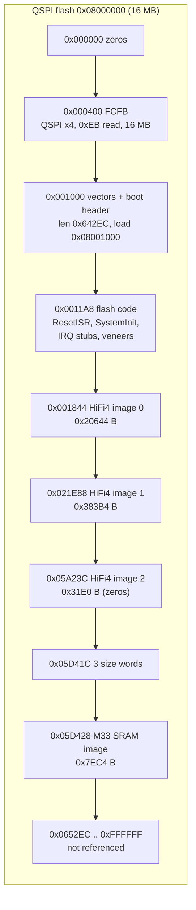
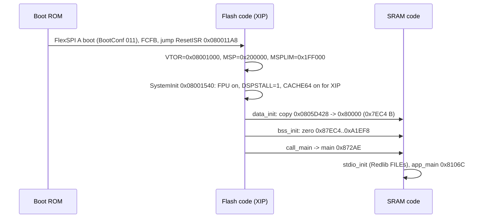
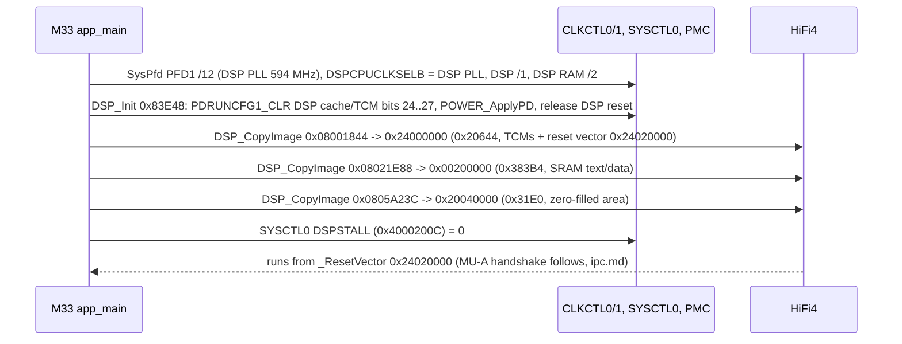

# IFDSP Cortex-M33 platform: boot, clocks, pins, DSP loader, FreeRTOS

Part of the IFDSP image docs ([README](README.md)). Sub-task T12d. Covers everything on the M33 except the console
([control-link.md](control-link.md)) and the rpmsg/MU link ([ipc.md](ipc.md)).
Function names are the names applied in Ghidra (`tools/ghidra/IfdspM33Names.java` / `IfdspHifi4Names.java`, merged by T17) and match `decomp/ifdsp/`; a name still in *italics* is a description that was not applied as a Ghidra name.
Tags: **[fact]** seen in code/data (address given), **[inference]**, **[guess]**.

The M33 program is a stock **MCUXpresso SDK** project: MCUXpresso startup (`ResetISR`, copy tables), SDK board files
(`board.c`, `clock_config.c`, `pin_mux.c`), SDK drivers (clock, power, reset, flexcomm/USART, SCTimer, MU, SEMA42, PINT, DMA,
…), **FreeRTOS** (ARM_CM33 non-secure port, heap_4), **rpmsg-lite**, and the **Redlib** C library with the "no host" stubs.
Most of the 171 functions that T12a left as `FUN_` are these libraries; all are named in the TSV **[inference]**.

## 1. Flash layout (16 MB W25Q128JV on FlexSPI A)

- FlexSPI config block at 0x08000400 **[fact]**: tag `FCFB` v1.4.0, `deviceType` 1 (serial NOR), `sflashPadType` 4 (quad),
  `serialClkFreq` 7 (120 MHz in the RT600 ROM enum **[inference]**), `sflashA1Size` 0x1000000, page 256, sector 4 KB, block 64 KB.
  LUT: read `0xEB` (quad I/O fast read, 24-bit address, 6 dummy cycles), status `0x05`, write enable `0x06`, sector erase `0x20`,
  block erase `0xD8`, page program `0x02`, chip erase `0x60`. These match the W25Q128JV (docs/hardware.md Q2008).
- Boot header in the vector table **[fact]**: +0x20 image length 0x642EC, +0x24 type 0 (plain XIP image), +0x34 load 0x08001000.
- The code references only these flash addresses: the three DSP images and their size words (literal pool 0x84B50) and the
  FreeRTOS idle task name `"IDLE"` at 0x08001834 **[fact]**. There is no FlexSPI IP-command (program/erase) code, so the
  M33 never writes its own flash; updates go through the ROM serial ISP (`DSP_UPDATE`, docs/hardware.md) **[inference]**.
  Everything above 0x080652EC is unused by this image **[fact: no references]**.

## 2. Reset and copy-down

- `SystemInit` (flash 0x08001540) **[fact]**: SCB CPACR/NSACR enable CP10/CP11; SYSCTL0 DSPSTALL (0x4000200C) = 1; if executing
  from FlexSPI and CACHE64 is off, CACHE64_POLSEL (0x40033000) REG0_TOP = 0x07FFFC00, POLSEL = 1, CACHE64_CTRL CCR invalidate
  (0x05000000 | GO) then CCR = 3 (cache + write buffer on); then the empty `SystemInitHook` (0x080015D4).
- Flash also holds `SystemCoreClockUpdate` (0x0800143C) and a copy of `CLOCK_GetFFroFreq` (0x08001414); the main code only uses
  the SRAM copies **[fact]**.
- After the copy-down nothing executes from flash except the IRQ stubs and veneers (section 7) **[fact]**.

## 3. Clock tree (`BOARD_BootClockRUN` 0x0008494C)

The RT685 crystal is not fitted. **SYSOSC runs in bypass from CLKIN = `DSP_CLK` 18.432 MHz** from the SDR module (PIO2_30
func 5) **[fact: SYSOSCBYPASS (CLKCTL0 0x168) = 1, g_clkinFreq = 0x1194000]**. `g_xtalFreq` is set to 24 MHz but not used.

| Step (in order) | Register effect | Result |
|---|---|---|
| PDRUNCFG0_CLR 0x4000/0x10000, `CLOCK_EnableFfroClk`(48 MHz) | FFRO on, trim from OTP | FFRO 48 MHz |
| PDRUNCFG0_CLR 0x8000, `CLOCK_EnableSfroClk` | SFRO on | 16 MHz |
| `BOARD_FlexspiClockSafeConfig`, `CLOCK_AttachClk(0x04343430)` | FlexSPI from FFRO /1; main clock = FFRO | safe switch |
| PDRUNCFG0_CLR 0x2000, `POWER_UpdateOscSettlingTime`(260), `CLOCK_EnableSysOscClk`(on, mode 1, 260 µs) | SYSOSC, then SYSOSCBYPASS = 1 | SYSOSC = CLKIN 18.432 MHz |
| `CLOCK_InitSysPll`(cfg 0x87A08: src 1 SYSOSC, NUM 31, DENOM 64, MULT idx 5 = ×21) | 18.432 × (21 + 31/64) | **SYSPLL 396.000 MHz** |
| `CLOCK_InitSysPfd`(PFD0, 12), (PFD2, 24) | 396 × 18 / PFD | main PLL 594 MHz, AUX0 297 MHz |
| `CLOCK_InitAudioPll`(cfg 0x879F8: SYSOSC, 22 + 5040/27000), then AUDIOPLL0CTL0 \|= BYPASS, `CLOCK_InitAudioPfd`(PFD0, 26) | bypass wins | **audio PLL clock = 18.432 MHz** (= 384 × 48 kHz) |
| `CLOCK_SetClkDiv(SYSCPUAHB 0x400, 3)`, `CLOCK_AttachClk(0x2434)` MAINCLKSELB = main PLL | 594 / 3 | **M33 core 198 MHz** |
| `CLOCK_SetClkDiv(CLKCTL1 0x240 AUDIOPLLCLKDIV, 1)` | /1 | 18.432 MHz |
| `CLOCK_SetClkDiv(0x500 PFC0DIV, 2)` | /2 | **[inference]** register name |
| `CLOCK_SetClkDiv(CLKCTL1 0x6FC FRGPLLCLKDIV, 12)` | 594 / 12 | FRG PLL clock 49.5 MHz |
| `BOARD_SetFlexspiClock`(1 = main PLL, 6) | 594 / 6 | **FlexSPI 99 MHz** |
| `SystemCoreClock` (0x87EC0) = 198000000 | | |

All register values **[fact]**; the frequencies are computed from them with the RT600 PLL formula (output = in × (MULT + NUM/DENOM),
PFD = PLL × 18 / n) **[inference]**. Later clock users:

- `BOARD_DSP_Init`: `CLOCK_InitSysPfd`(PFD1, 12) → DSP PLL 594 MHz; DSPCPUCLKSELB = DSP PLL; DSPCPUCLKDIV /1, DSPMAINRAMCLKDIV /2
  → **HiFi4 at 594 MHz, DSP RAM clock 297 MHz** (DSPPLLCLKDIV left at reset /1) **[fact: writes; inference: frequencies]**.
- `uart0_init`: FRG0 source = FRG PLL clock, FRGCTL 0x00FF (MULT 0, so ÷1), FC0 clock = FRG → 49.5 MHz → 115200 baud via
  `USART_SetBaudRate` **[fact]**.
- SysTick: reload = `SystemCoreClock` / 1000 − 1 → **1 kHz FreeRTOS tick** (`vPortSetupTimerInterrupt` 0x82060) **[fact]**.
- No code selects the MCLK output clock (`AIC_MCLK` on PIO1_10), so the DSP must select it or it keeps its reset setting **[inference]**.

## 4. Pin mux (IOPCTL 0x40004000) and GPIO

`BOARD_InitPins` 0x87294 calls `BOARD_InitPins_flexcomm` 0x87242, `BOARD_InitPins_P0` 0x84B78, `BOARD_InitPins_codec_spi`
0x84BEC, `BOARD_InitPins_i2s` 0x8726C and tail-jumps to `BOARD_InitPins_debug_gpio` 0x84C90 (Ghidra merged that last body
into `BOARD_InitPins`). IOPCTL bits: FSEL[2:0], IBENA 0x40 (input buffer), FULLDRIVE 0x100, IIENA 0x800 (input invert).
Net names come from service manual p19 (renders checked in T12d). Where p19 routes nets through a crossed resistor network,
the pin chosen is the one the firmware configures **[inference]**.

| Pin | IOPCTL | Function | Net (p19) | Notes |
|---|---|---|---|---|
| PIO0_1 | 0x001 | FC0_TXD | `DSP_UMISO` | console/MAIN link TX **[fact]** |
| PIO0_2 | 0x041 | FC0_RXD | `DSP_UMOSI` | RX **[fact]** |
| PIO0_4 | 0x040 | GPIO in | `AF_MUTE` | `BOARD_InitPins_P0` **[fact]** |
| PIO0_5 | 0x040 | GPIO in | `ADC0_0` → TP2013 | debug **[fact]** |
| PIO0_7/8/9 | 0x041 | FC1 SCK/TXD/RXD | FFT/REC/PLAY SPI | to DISPLAY; driven by the DSP **[inference]** |
| PIO0_10 | 0x001 | FC1_SSEL0 out | | output only, so FC1 is SPI master **[inference]** |
| PIO0_14 | 0x941 | FC2_SCK, **inverted** | `TX_AF_CLK`/`FRM` | clock from the SDR module **[fact: value]** |
| PIO0_15 | 0x141 | FC2_TXD_WS | `TX_AF_FRM`/`CLK` | |
| PIO0_16 | 0x101 | FC2 data out | `TX_AF_DAT` | I2S transmit to SDR **[inference]** |
| PIO0_21, PIO0_22 | 0x040 | GPIO in | `TX`, `SEND_A` | from SDR **[inference]** (T12a: ambiguous) |
| PIO0_23 | 0x141 | FC3 data in | `RX_IF_DAT` | FC3 SCK/WS not on pins: shared from another FLEXCOMM, set up by the DSP **[inference]** |
| PIO0_28/29/31 | 0x000 | GPIO out, low | TP2043/2046/2044 | debug **[fact]** |
| PIO0_30 | 0x141 | FC4 data in | `AIC_DOUT` | codec ADC data; SCK/WS shared **[inference]** |
| PIO1_0 | 0x000 | GPIO out | `AIC_RESET` | `aic3204_init` **[fact]** |
| PIO1_1 | 0x000 | GPIO out | `AIC_MOSI` | bit-banged SPI |
| PIO1_3 / PIO1_4 | 0x141 | FC5 SCK / WS in | `AIC_BCLK` / `AIC_WCLK` | codec is I2S master |
| PIO1_5 | 0x101 | FC5 data out | `AIC_DIN` | codec DAC data |
| PIO1_7 | 0x000 | GPIO out, high | `AIC_SS` | |
| PIO1_10 | 0x101 | MCLK out | `AIC_MCLK` | full drive |
| PIO2_2 | 0x002 | SCT0_OUT0 | `SCT0_OUT0` → R2041/C2003 | PWM, [control-link.md](control-link.md) reg 0x4005 |
| PIO2_4/5/6 | 0x000 | GPIO out, low | `SCT0_OUT2/OUT3/GPI4` → TP2007/2008/2009 "for DEBUG" | PIO2_5 goes **high when `CommandTask` starts** (GPIO B[2][5] at 0x40100045) **[fact]** |
| PIO2_28 | 0x040 | GPIO in | `AIC_MISO` | |
| PIO2_29 | 0x000 | GPIO out | `AIC_SCLK` | |
| PIO2_30 | 0x045 | CLKIN | `DSP_CLK` | 18.432 MHz |

Clock gates set for this: CLKCTL1 PSCCTL1_SET bits 0/1/2 (HS GPIO0/1/2), bit 28 (MU-A, `MU_Init`), PSCCTL2_SET bit 31 before
`INPUTMUX_AttachSignal(INPUTMUX 0x40026000, 1, 0x14000015)` **[fact]**. The connection value is `21 + (0x140 << 20)` =
`kINPUTMUX_MuBToDspInterrupt` of the NXP SDK (`fsl_inputmux_connections.h`, MIMXRT685S: `DSP_INT_PMUX_ID` 0x140, source 21 = MU-B),
so the call writes 21 to `DSP_INT_SEL[1]` (INPUTMUX + 0x140 + 1·4): the messaging unit's B-side interrupt drives HiFi4 interrupt
input 1, which the DSP sees as **IRQ 6**, where `env_register_isr` installs `MU_B_IRQHandler`
(`xos_register_interrupt_handler(6, MU_B_IRQHandler, 0)`, `xos_interrupt_enable(6)`). This is the rpmsg-lite doorbell from the M33
(MU-A) to the DSP ([ipc.md](ipc.md)) **[fact, #88]**. Resets released
in `app_main`: RSTCTL1 bits 28/29 (MU-A, SEMA42) **[inference]**.

## 5. DSP image loader (`BOARD_DSP_Init` 0x00084AD8)

The copy descriptors are `{src, dst, size}` built on the stack; the sizes come from the flash words at 0x0805D41C..0x0805D424
**[fact]**. `DSP_CopyImage` (0x86EAA) is a plain `memcpy` (no checksum, no decompression) **[fact]**. `SystemInit` already holds the DSP
stalled, so the DSP runs only after the copy **[fact]**. The DSP reset vector is the default VECBASE in ITCM; the M33 does not remap it
**[inference: no SYSCTL0 DSPVECREMAP write]**.

## 6. FreeRTOS

Kernel configuration seen in code **[fact]**: `configMAX_PRIORITIES` 5, tick 1 kHz, heap_4 heap `ucHeap` 0x88EF0..0xA1EE8
(0x18FF8 = 102,392 bytes), `configASSERT` = raise BASEPRI and spin, timers enabled (queue length 10, item 16 bytes), event groups,
queue registry. No idle/tick/malloc-failed/stack-overflow hooks are called.

| Object | Created by | Parameters | Use |
|---|---|---|---|
| Task `Command Task` (0x80D78) | `create_CommandTask` 0x80E20 | 0x1800 words, prio 1 | console / MAIN link |
| Task `IpcRecvTask` (0x85FC6) | `create_IpcTasks` 0x80F80 | 0x1800 words, prio 2 | rpmsg receive, prints DSP replies |
| Task `IpcSendTask` (0x80F50) | `create_IpcTasks` | 0x1800 words, prio 2 | waits on queue 0x886E0 (never written) |
| Task `IDLE` (`prvIdleTask` 0x821D0) | `vTaskStartScheduler` 0x82418 | 0x80 words, prio 0 | |
| Task `Tmr Svc` (`prvTimerTask` 0x82DB0) | `xTimerCreateTimerTask` 0x82C80 | 0x100 words, prio 2 | no timers are ever created |
| Queue `TmrQ` (0x88920) | `prvCheckForValidListAndQueue` | 10 × 16 B | timer commands |
| Queue 0x886E0 | `create_IpcTasks` | 8 × 0x98 B | IPC send (unused) |
| rpmsg queue | `ipc_init` → `env_create_queue` | | IPC receive ([ipc.md](ipc.md)) |
| Mutex 0x8871C | `env_create_mutex` | `xQueueGenericCreate(1,0,3)` | rpmsg-lite lock |
| Event group 0x87EC4 | `uart0_init` | bit 0 | FLEXCOMM0 RX → `CommandTask` |

Stack depths are in 32-bit words, so each application task has 24 KB of stack; together with TCBs they use about 74 KB of the
100 KB heap **[inference]**. Kernel globals **[inference from code shape]**: `pxCurrentTCB` 0x88800, `pxDelayedTaskList` 0x88804,
`pxOverflowDelayedTaskList` 0x88808, `pxReadyTasksLists` 0x8880C, `uxSchedulerSuspended` 0x88874, `uxTopReadyPriority` 0x8887C,
`xNextTaskUnblockTime` 0x888AC, `xNumOfOverflows` 0x888B0, `xPendedTicks` 0x888B4, `xSchedulerRunning` 0x888CC, `xTickCount` 0x888E4,
`xYieldPending` 0x888E8.

Port: `SVC_Handler` 0x80B20 → `vPortSVCHandler_C` 0x8657C → `vRestoreContextOfFirstTask` 0x80A60 (svc 2 from `vStartFirstTask`);
`PendSV_Handler` 0x80AC0 does the context switch; `SysTick_Handler` 0x86558 calls `xTaskIncrementTick`. The two "undecodable
instruction" stubs from T07 are just literal words (0xFFFFFFFF padding) after `vRestoreContextOfFirstTask` and `vStartFirstTask`
**[fact]**.

## 7. Interrupts, faults and watchdog

The vector table stays in flash (VTOR 0x08001000). FLEXCOMM0 (IRQ14 → `FLEXCOMM0_IRQHandler` 0x80E50), MU_A (IRQ34 → 0x818B8),
HardFault, SVC, PendSV and SysTick point straight into SRAM. Every other IRQ vector points to a flash stub that calls either
`IntDefaultHandler` (0x08001220, `b .`) or a **veneer** (0x080015D8..0x08001808, `ldr ip,=addr; bx ip`) into an SDK
`*_DriverIRQHandler` in SRAM **[fact]**. 35 SDK handlers are linked this way (DMA0/1, DMIC0, HWVAD0, FLEXCOMM1–7/14/15, FLEXSPI,
HASHCRYPT, I3C0, OS_EVENT, PIN_INT0–7, SCT0, USDHC0/1, UTICK0, CTIMER0–4; list in the TSV) **[fact]**. Of these only
**`SCT0_DriverIRQHandler`** (IRQ12, 0x848E4 → `sct0_pwm_callback`) is enabled by the M33; the others are library code the
linker kept **[inference: no NVIC enable for them on the M33]**.

- **Faults:** NMI, MemManage, BusFault, UsageFault, SecureFault and DebugMon are flash `b .` loops (0x0800120C..0x0800121A).
  `HardFault_Handler` (0x85FEA) is the MCUXpresso semihosting handler: if the faulting instruction is `BKPT 0xAB` it skips it and
  returns r0 = 0x20, otherwise it spins **[fact]**. There is no fault logging or reset.
- **Assertions:** `configASSERT` and task-creation failures spin with interrupts masked; `_Csys_alloc` (0x84E04) failure writes a
  message to the (dead) stdio and spins in `__sys_appexit` **[fact]**.
- **Watchdog:** none. No WWDT0/WWDT1 base appears in the code and the WDT IRQs go to `IntDefaultHandler` **[fact]**. A hung M33
  therefore stays hung until MAIN resets the chip (`DSP_RESET18`, docs/hardware.md) **[inference]**.

## 8. Power management

`fsl_power.c` is linked (`POWER_EnterDeepSleep` 0x8059C, `POWER_EnterSleep_mode1..3`, `POWER_CalculateSafetyCount` 0x800E8,
`deinitXip`/`initXip`/`initFlexSPI`, `POWER_UpdateOscSettlingTime`) but nothing calls the sleep functions **[fact]**. The only power
changes at run time are the PDRUNCFG0_CLR writes in `BOARD_BootClockRUN`, the DSP SRAM power-up in `DSP_Init` and
`POWER_ApplyPD` **[fact]**. The PMC/PMIC pins (`PMIC_MODE0/1`, `PMIC_IRQ_N`) are strapped by resistors on p19.

## 9. C library (Redlib)

`stdio_init` (0x84E38) opens stdin/stdout/stderr (FILE at 0x88B78, 0x88BB4, 0x88BF0) with `_Cfdopen` and gives each a 256-byte
buffer with `setvbuf`. The low-level `__sys_*` functions are the "no host" stubs (0x87932..0x87958): `__sys_write` returns the
length unwritten and the others return −1, so **stdio output goes nowhere**. All console output uses `uart0_write` directly **[fact]**.
The Redlib heap (`malloc` 0x84D3C, `free` 0x872C4, `_sbrk` 0x85D48) is a separate 4 KB area 0xA1EF8..0xA2EF8 used only for stdio
buffers; FreeRTOS uses heap_4 **[fact: addresses]**. `errno` is at 0x88B74 **[inference]**.

## 10. Function table (M33, platform scope)

Already-named functions (T07/T12a) are listed only where this page changes or explains them. Full list of proposals:
`tools/ghidra/names_ifdsp.T12d.tsv` (178 entries).

| Address | Ghidra name | Inferred name | Purpose |
|---|---|---|---|
| 0x080011A8 | `ResetISR` | | VTOR/MSP/MSPLIM, `SystemInit`, copy tables, `call_main` |
| 0x08001540 | `SystemInit` | | FPU, DSPSTALL=1, CACHE64 |
| 0x000872AE | `main` | | `stdio_init`, tail-jump `app_main` |
| 0x0008106C | `app_main` | | board init, DSP start, MU handshake, tasks, scheduler |
| 0x0008494C | `BOARD_BootClockRUN` | | clock tree, section 3 |
| 0x000809A0 | `BOARD_SetFlexspiClock` | `BOARD_SetFlexspiClock` | FlexSPI clock source/divider with XIP-safe deinit/init |
| 0x00080914 / 0x0008092E | `FUN_` | `BOARD_DeinitXip` / `BOARD_InitXip` | FlexSPI disable / enable + DLL lock |
| 0x00087234 | `BOARD_FlexspiClockSafeConfig` | `BOARD_FlexspiClockSafeConfig` | FlexSPI on FFRO /1 |
| 0x00087294 | `BOARD_InitPins` | | pin mux, section 4 |
| 0x00087242 / 0x0008726C / 0x00084C90 | `FUN_` / — | `BOARD_InitPins_flexcomm` / *`_i2s`* / *`_debug_gpio`* | IOPCTL groups |
| 0x00084AD8 | `BOARD_DSP_Init` | | DSP clocks, power, copy, unstall |
| 0x00083E48 | `DSP_Init` | `DSP_Init` | DSP SRAM power and reset |
| 0x00086EAA | `DSP_CopyImage` | | memcpy of one image |
| 0x000839FC / 0x00083B04 | `FUN_` | `CLOCK_InitSysPll` / `CLOCK_InitSysPfd` | SYSPLL setup |
| 0x00083B4C / 0x00083C54 | `FUN_` | `CLOCK_InitAudioPll` / `CLOCK_InitAudioPfd` | audio PLL setup |
| 0x000838F4 / 0x000839B4 | `FUN_` | `CLOCK_EnableFfroClk` / `CLOCK_EnableSfroClk` | oscillators, OTP trim via ROM |
| 0x00083C9C | `CLOCK_EnableSysOscClk` | `CLOCK_EnableSysOscClk` | SYSOSC (bypass to CLKIN) |
| 0x00082F70..0x0008322C | `FUN_` | *`CLOCK_Get…Freq`* (13 functions) | frequency queries used by `CLOCK_GetFreq` |
| 0x00083CC4 | `SDK_DelayAtLeastUs` | `SDK_DelayAtLeastUs` | busy-wait |
| 0x00084150 / 0x00084498 | `FUN_` | `CLOCK_EnableClock` / `RESET_SetPeripheralReset` | clock gates, resets |
| 0x00083EA0 / 0x00083EBC | `FUN_` | `FLEXCOMM_GetInstance` / `FLEXCOMM_Init` | used by `USART_Init` |
| 0x0008704E | `USART_SetBaudRate` | `USART_SetBaudRate` | FC0 baud |
| 0x00084670 | `SCTIMER_CreateAndScheduleEvent` | `SCTIMER_CreateAndScheduleEvent` | used by `SCTIMER_SetupPwm` |
| 0x000848E4 | — | `SCT0_DriverIRQHandler` | IRQ12 → `sct0_pwm_callback` |
| 0x00085FEA | `HardFault_Handler` | | semihosting BKPT skip, else spin |
| 0x000800E8 | `POWER_CalculateSafetyCount` | `POWER_CalculateSafetyCount` | T12a's 0x800EE is a mid-function entry |
| 0x00084470 / 0x0008448C | `FUN_` | `POWER_ApplyPD` / `POWER_UpdateOscSettlingTime` | PMC apply, osc delay |
| 0x000824A0 | `xTaskIncrementTick` | `xTaskIncrementTick` | tick |
| 0x00082CC4 / 0x00082D10 | `FUN_` | `xTimerGenericCommand` / `prvSampleTimeNow` | timers |
| 0x00086716..0x00086778 | `FUN_` | *`vList*`*, `uxListRemove` | FreeRTOS lists |
| 0x000866A4 | `xEventGroupSetBits` | `xEventGroupSetBits` | |
| 0x00084D3C | `malloc` | `malloc` | Redlib heap |
| 0x00084E04 | `_Csys_alloc` | `_Csys_alloc` | malloc + failure message |
| 0x00087756 | `__aeabi_uldivmod` | `__aeabi_uldivmod` | 64-bit divide (clock maths) |

The FreeRTOS, rpmsg-lite and Redlib internals in the TSV follow the upstream names one to one and are not repeated here.

## Further functions (T23g)

Named functions of this subsystem that the tables above did not list yet, one row each (T23g, found with `tools/doc_table_gaps.py`). The purpose is the plate comment of the name in `tools/ghidra/names_*.tsv` (or the `Ifdsp*Names.java` / `*.lib.tsv` entry); rows marked *code shape* have no comment there and give what the decompile shows: the direct callees, the first string, the size and the caller count. Tags as in the names files; a comment without a tag is an inference from the code.

### Cortex-M33 (`decomp/ifdsp/m33`)

| Address | Ghidra name | Inferred name | Purpose |
|---|---|---|---|
| 0x0008000C | `rom_api_1c_guarded_call` |  | Calls ROM API table *(0x1303F01C): if fn[7]() == 0 then fn[1](a,b); no callers **[guess]** |
| 0x00080030 | `power_set_deepsleep_pmc_cfg` |  | PMC 0x40135020 = 0x04040808, PMC 0x40135014 = 10 if different; called by POWER_EnterDeepSleep **[guess]** |
| 0x00080050 | `delay` |  | fsl_power.c busy loop (count iterations) **[inference]** |
| 0x0008005E | `deinitXip` |  | fsl_power.c: if running XIP (PC in 0x08xxxxxx) wait FlexSPI idle, MDIS, PSCCTL0_CLR FlexSPI clock **[inference]** |
| 0x0008009C | `power_sram_pd_differs` |  | Compares PDSLEEPCFG1..3 with PDRUNCFG1..3 (SYSCTL0 0x604..0x61C) **[guess]** |
| 0x000802AA | `initFlexSPI` |  | fsl_power.c: FlexSPI enable, SWRESET, wait DLL lock (STS2) **[inference]** |
| 0x0008032C | `initXip` |  | fsl_power.c: re-enable FlexSPI clock and initFlexSPI after deep sleep (body merged by Ghidra) **[inference]** |
| 0x0008034C | `POWER_EnterSleep_mode1` |  | names-file group "NXP SDK drivers"; calls `power_set_deepsleep_pmc_cfg`; 182 B, callers: 0 **[fact]** (code shape) |
| 0x00080414 | `POWER_EnterSleep_mode2` |  | names-file group "NXP SDK drivers"; calls `power_set_deepsleep_pmc_cfg`; 182 B, callers: 0 **[fact]** (code shape) |
| 0x000804DC | `POWER_EnterSleep_mode3` |  | names-file group "NXP SDK drivers"; no direct calls; 174 B, callers: 0 **[fact]** (code shape) |
| 0x0008059C | `POWER_EnterDeepSleep` |  | names-file group "NXP SDK drivers"; calls `POWER_CalculateSafetyCount`, `deinitXip`, `delay`, `initXip` and 1 more; 852 B, callers: 0 **[fact]** (code shape) |
| 0x00080A18 | `OTFAD_Init` |  | true entry of FUN_00080A24: waits FlexSPI idle, base+0xC00 (OTFAD CR) \|= cfg bits \| GE; unused **[guess]** |
| 0x00080A44 | `OTFAD_Deinit` |  | OTFAD CR &= ~GE; unused **[guess]** |
| 0x00080A60 | `vRestoreContextOfFirstTask` |  | PSPLIM/CONTROL=2/PSP from pxCurrentTCB (0x88800), bx to task; reached from vPortSVCHandler_C **[inference]** |
| 0x00080A90 | `vStartFirstTask` |  | FreeRTOS V10.3.0 library function, matched by lib_match (score 1.000, T23d) **[inference]** |
| 0x00080AC0 | `PendSV_Handler` |  | FreeRTOS V10.3.0 library function, matched by lib_match (score 0.963, T23d) **[inference]** |
| 0x00080B20 | `SVC_Handler` |  | FreeRTOS V10.3.0 library function, matched by lib_match (score 0.863, T23d) **[inference]** |
| 0x00081264 | `SCTIMER_StartTimer` |  | names-file group "SCT0 PWM (duty from register 0x4005)"; no direct calls; 12 B, callers: 1 **[fact]** (code shape) |
| 0x00081944 | `xPortIsInsideInterrupt` |  | names-file group "IPC (rpmsg-lite over MU-A)"; no direct calls; 16 B, callers: 4 **[fact]** (code shape) |
| 0x00081E80 | `prvInsertBlockIntoFreeList` |  | names-file group "FreeRTOS kernel + ARM_CM33 port + heap_4"; no direct calls; 62 B, callers: 2 **[fact]** (code shape) |
| 0x00081EC8 | `pvPortMalloc` |  | FreeRTOS V10.3.0 library function, matched by lib_match (score 0.832, T23d) **[inference]** |
| 0x00081FD4 | `vPortFree` |  | FreeRTOS V10.3.0 library function, matched by lib_match (score 0.941, T23d) **[inference]** |
| 0x00082038 | `prvTaskExitError` |  | FreeRTOS V10.3.0 library function, matched by lib_match (score 1.000, T23d) **[inference]** |
| 0x00082060 | `vPortSetupTimerInterrupt` |  | FreeRTOS V10.3.0 library function, matched by lib_match (score 1.000, T23d) **[inference]** |
| 0x00082084 | `vPortEnterCritical` |  | FreeRTOS V10.3.0 library function, matched by lib_match (score 1.000, T23d) **[inference]** |
| 0x000820A0 | `vPortExitCritical` |  | FreeRTOS V10.3.0 library function, matched by lib_match (score 0.981, T23d) **[inference]** |
| 0x000820C8 | `pxPortInitialiseStack` |  | FreeRTOS V10.3.0 library function, matched by lib_match (score 0.969, T23d) **[inference]** |
| 0x00082174 | `xEventGroupSetBitsFromISR` |  | names-file group "FreeRTOS kernel + ARM_CM33 port + heap_4"; calls `xQueueGenericSendFromISR`; 46 B, callers: 1 **[fact]** (code shape) |
| 0x00082184 | `vQueueAddToRegistry` |  | FreeRTOS V10.3.0 library function, matched by lib_match (score 0.958, T23d) **[inference]** |
| 0x000821A8 | `vQueueUnregisterQueue` |  | names-file group "FreeRTOS kernel + ARM_CM33 port + heap_4"; no direct calls; 34 B, callers: 1 **[fact]** (code shape) |
| 0x000821D0 | `prvIdleTask` |  | "IDLE" task entry (vTaskStartScheduler, stack 0x80 words, prio 0) **[fact]** |
| 0x000821E4 | `prvAddCurrentTaskToDelayedList` |  | FreeRTOS V10.3.0 library function, matched by lib_match (score 1.000, T23d) **[inference]** |
| 0x00082254 | `prvResetNextTaskUnblockTime` |  | FreeRTOS V10.3.0 library function, matched by lib_match (score 1.000, T23d) **[inference]** |
| 0x00082278 | `xTaskCreate` |  | FreeRTOS V10.3.0 library function, matched by lib_match (score 0.841, T23d) **[inference]** |
| 0x00082418 | `vTaskStartScheduler` |  | FreeRTOS V10.3.0 library function, matched by lib_match (score 0.811, T23d) **[inference]** |
| 0x00082484 | `vTaskSuspendAll` |  | FreeRTOS V10.3.0 library function, matched by lib_match (score 0.950, T23d) **[inference]** |
| 0x00082494 | `xTaskGetTickCount` |  | xTickCount 0x888E4 **[inference]** |
| 0x00082598 | `xTaskResumeAll` |  | FreeRTOS V10.3.0 library function, matched by lib_match (score 0.865, T23d) **[inference]** |
| 0x00082664 | `vTaskDelay` |  | FreeRTOS V10.3.0 library function, matched by lib_match (score 0.982, T23d) **[inference]** |
| 0x00082694 | `vTaskSwitchContext` |  | FreeRTOS V10.3.0 library function, matched by lib_match (score 0.993, T23d) **[inference]** |
| 0x00082700 | `vTaskPlaceOnEventList` |  | FreeRTOS V10.3.0 library function, matched by lib_match (score 0.980, T23d) **[inference]** |
| 0x00082728 | `vTaskPlaceOnUnorderedEventList` |  | FreeRTOS V10.3.0 library function, matched by lib_match (score 0.987, T23d) **[inference]** |
| 0x00082768 | `vTaskPlaceOnEventListRestricted` |  | FreeRTOS V10.3.0 library function, matched by lib_match (score 0.985, T23d) **[inference]** |
| 0x0008279C | `xTaskRemoveFromEventList` |  | FreeRTOS V10.3.0 library function, matched by lib_match (score 0.859, T23d) **[inference]** |
| 0x00082818 | `vTaskRemoveFromUnorderedEventList` |  | FreeRTOS V10.3.0 library function, matched by lib_match (score 0.824, T23d) **[inference]** |
| 0x0008288C | `vTaskInternalSetTimeOutState` |  | FreeRTOS V10.3.0 library function, matched by lib_match (score 0.963, T23d) **[inference]** |
| 0x000828A4 | `xTaskCheckForTimeOut` |  | FreeRTOS V10.3.0 library function, matched by lib_match (score 1.000, T23d) **[inference]** |
| 0x00082904 | `vTaskMissedYield` |  | FreeRTOS V10.3.0 library function, matched by lib_match (score 1.000, T23d) **[inference]** |
| 0x00082910 | `xTaskGetSchedulerState` |  | no direct calls; 24 B, callers: 5 **[fact]** (code shape) |
| 0x00082930 | `xTaskPriorityInherit` |  | FreeRTOS V10.3.0 library function, matched by lib_match (score 0.851, T23d) **[inference]** |
| 0x000829B4 | `xTaskPriorityDisinherit` |  | FreeRTOS V10.3.0 library function, matched by lib_match (score 0.900, T23d) **[inference]** |
| 0x00082A24 | `vTaskPriorityDisinheritAfterTimeout` |  | FreeRTOS V10.3.0 library function, matched by lib_match (score 0.872, T23d) **[inference]** |
| 0x00082AB0 | `uxTaskResetEventItemValue` |  | FreeRTOS V10.3.0 library function, matched by lib_match (score 1.000, T23d) **[inference]** |
| 0x00082AC8 | `pvTaskIncrementMutexHeldCount` |  | FreeRTOS V10.3.0 library function, matched by lib_match (score 0.871, T23d) **[inference]** |
| 0x00082AE0 | `ulTaskNotifyTake` |  | FreeRTOS V10.3.0 library function, matched by lib_match (score 0.925, T23d) **[inference]** |
| 0x00082B34 | `xTaskGenericNotify` |  | names-file group "FreeRTOS kernel + ARM_CM33 port + heap_4"; calls `ulSetInterruptMask`, `uxListRemove`, `vListInsertEnd`, `vPortEnterCritical` and 2 more; 164 B, callers: 1 **[fact]** (code shape) |
| 0x00082BEC | `prvCheckForValidListAndQueue` |  | FreeRTOS V10.3.0 library function, matched by lib_match (score 1.000, T23d) **[inference]** |
| 0x00082C44 | `prvInsertTimerInActiveList` |  | FreeRTOS V10.3.0 library function, matched by lib_match (score 0.989, T23d) **[inference]** |
| 0x00082C80 | `xTimerCreateTimerTask` |  | FreeRTOS V10.3.0 library function, matched by lib_match (score 0.867, T23d) **[inference]** |
| 0x00082DB0 | `prvTimerTask` |  | FreeRTOS V10.3.0 library function, matched by lib_match (score 0.920, T23d) **[inference]** |
| 0x00083470 | `CLOCK_GetFlexCommClkFreq` |  | names-file group "NXP SDK drivers"; calls `CLOCK_GetAudioPllClkFreq`, `CLOCK_GetFFroFreq`, `CLOCK_GetMainClkFreq`, `CLOCK_GetMainPllClkFreq` and 1 more; 238 B, callers: 2 **[fact]** (code shape) |
| 0x000837A8 | `CLOCK_GetFreq` |  | names-file group "NXP SDK drivers"; calls `CLOCK_GetAudioPllClkFreq`, `CLOCK_GetAux0PllClkFreq`, `CLOCK_GetAux1PllClkFreq`, `CLOCK_GetDspMainClkFreq` and 7 more; 214 B, callers: 2 **[fact]** (code shape) |
| 0x000838A8 | `CLOCK_SetFRGClock` |  | FRGnCLKSEL/FRGnCTL for FC0..7, 14, 15 **[inference]** |
| 0x00083D40 | `DMA_GetInstance` |  | 0x40104000 -> 0, 0x40105000 -> 1 **[fact]** |
| 0x00083D5C | `DMA_IRQHandle` |  | fsl_dma.c channel interrupt dispatcher (33 channels); unused (DMA IRQs never enabled by the M33) **[inference]** |
| 0x00083E10 | `DMA0_DriverIRQHandler` |  | IRQ1 -> DMA_IRQHandle(DMA0) **[fact]** |
| 0x00083E1C | `DMA1_DriverIRQHandler` |  | IRQ54 **[fact]** |
| 0x00083E28 | `DMIC0_DriverIRQHandler` |  | IRQ25 **[fact]** |
| 0x00083E38 | `HWVAD0_DriverIRQHandler` |  | IRQ29 **[fact]** |
| 0x00083F88 | `FLEXCOMM1_DriverIRQHandler` |  | IRQ15, generic fsl_flexcomm handler **[fact]** |
| 0x00083FB8 | `FLEXCOMM2_DriverIRQHandler` |  | IRQ16 **[fact]** |
| 0x00083FE8 | `FLEXCOMM3_DriverIRQHandler` |  | IRQ17 **[fact]** |
| 0x00084018 | `FLEXCOMM4_DriverIRQHandler` |  | IRQ18 **[fact]** |
| 0x00084048 | `FLEXCOMM5_DriverIRQHandler` |  | IRQ19 **[fact]** |
| 0x00084078 | `FLEXCOMM6_DriverIRQHandler` |  | IRQ43 **[fact]** |
| 0x000840A8 | `FLEXCOMM7_DriverIRQHandler` |  | IRQ44 **[fact]** |
| 0x000840D8 | `FLEXCOMM14_DriverIRQHandler` |  | IRQ20 **[fact]** |
| 0x00084108 | `FLEXCOMM15_DriverIRQHandler` |  | IRQ21 **[fact]** |
| 0x00084138 | `FLEXSPI_DriverIRQHandler` |  | IRQ42 **[fact]** |
| 0x000841B4 | `GPIO_PortInit` |  | names-file group "NXP SDK drivers"; calls `CLOCK_EnableClock`, `RESET_ClearPeripheralReset`; 26 B, callers: 3 **[fact]** (code shape) |
| 0x000841D8 | `GPIO_PinInit` |  | names-file group "NXP SDK drivers"; calls `CLOCK_EnableClock`; 74 B, callers: 15 **[fact]** (code shape) |
| 0x00084228 | `HASHCRYPT_DriverIRQHandler` |  | IRQ59, base 0x40158000 **[fact]** |
| 0x00084280 | `I3C0_DriverIRQHandler` |  | IRQ49, base 0x40036000 **[fact]** |
| 0x000842D8 | `OS_EVENT_DriverIRQHandler` |  | IRQ41, OSTIMER 0x40113000 **[fact]** |
| 0x000842F0 | `PIN_INT0_DriverIRQHandler` |  | IRQ4, PINT 0x40025000 **[fact]** |
| 0x00084320 | `PIN_INT1_DriverIRQHandler` |  | IRQ5 **[fact]** |
| 0x00084350 | `PIN_INT2_DriverIRQHandler` |  | IRQ6 **[fact]** |
| 0x00084380 | `PIN_INT3_DriverIRQHandler` |  | IRQ7 **[fact]** |
| 0x000843B0 | `PIN_INT4_DriverIRQHandler` |  | IRQ35 **[fact]** |
| 0x000843E0 | `PIN_INT5_DriverIRQHandler` |  | IRQ36 **[fact]** |
| 0x00084410 | `PIN_INT6_DriverIRQHandler` |  | IRQ37 **[fact]** |
| 0x00084440 | `PIN_INT7_DriverIRQHandler` |  | IRQ38 **[fact]** |
| 0x000845B4 | `SCTIMER_Init` |  | names-file group "SCT0 PWM (duty from register 0x4005)"; calls `RESET_ClearPeripheralReset`; 154 B, callers: 1 **[fact]** (code shape) |
| 0x0008477C | `SCTIMER_SetupPwm` |  | names-file group "SCT0 PWM (duty from register 0x4005)"; calls `SCTIMER_CreateAndScheduleEvent`, `__aeabi_uldivmod`; 344 B, callers: 1 **[fact]** (code shape) |
| 0x000848D8 | `SCTIMER_SetCallback` |  | names-file group "SCT0 PWM (duty from register 0x4005)"; no direct calls; 8 B, callers: 1 **[fact]** (code shape) |
| 0x00084904 | `USDHC0_DriverIRQHandler` |  | IRQ45 **[fact]** |
| 0x0008491C | `USDHC1_DriverIRQHandler` |  | IRQ46 **[fact]** |
| 0x00084934 | `UTICK0_DriverIRQHandler` |  | IRQ8 **[fact]** |
| 0x00084B78 | `BOARD_InitPins_P0` |  | names-file group "application"; calls `GPIO_PinInit`; 108 B, callers: 1 **[fact]** (code shape) |
| 0x00084BEC | `BOARD_InitPins_codec_spi` |  | names-file group "application"; calls `GPIO_PinInit`; 150 B, callers: 1 **[fact]** (code shape) |
| 0x00084E24 | `tolower` |  | names-file group "C library (NXP Redlib: `_Csys_alloc`)"; no direct calls; 16 B, callers: 1 **[fact]** (code shape) |
| 0x00084E38 | `stdio_init` |  | names-file group "application"; calls `_Cfdopen`, `setvbuf`; 94 B, callers: 1 **[fact]** (code shape) |
| 0x00084EB0 | `vsnprintf_core` |  | names-file group "C library (NXP Redlib: `_Csys_alloc`)"; calls `fputc`, `strlen`; string "0123456789ABCDEF"; 2778 B, callers: 3 **[fact]** (code shape) |
| 0x00085A9C | `siprintf` |  | names-file group "C library (NXP Redlib: `_Csys_alloc`)"; calls `fputc`, `memset`, `vsnprintf_core`; 102 B, callers: 2 **[fact]** (code shape) |
| 0x00085B08 | `snprintf` |  | names-file group "C library (NXP Redlib: `_Csys_alloc`)"; calls `fputc`, `memset`, `vsnprintf_core`; 114 B, callers: 4 **[fact]** (code shape) |
| 0x00085B80 | `sprintf` |  | names-file group "C library (NXP Redlib: `_Csys_alloc`)"; calls `fputc`, `memset`, `vsnprintf_core`; 88 B, callers: 2 **[fact]** (code shape) |
| 0x00085BDC | `_Cdigit_value` |  | ctype-table digit value for strtoul **[inference]** |
| 0x00085C0C | `_strtoul_core` |  | Base detection (0x / 0), overflow -> errno 34 (0x88B74) **[inference]** |
| 0x00085CC0 | `strtoul` |  | names-file group "C library (NXP Redlib: `_Csys_alloc`)"; calls `_strtoul_core`; 128 B, callers: 8 **[fact]** (code shape) |
| 0x00085D48 | `_sbrk` |  | Heap 0xA1EF8..0xA2EF8 (4 KB), errno 12 on overflow **[fact]** |
| 0x00085D84 | `_Cwrite_buffer` |  | Flush FILE buffer through __sys_write **[inference]** |
| 0x00085DF0 | `fflush` |  | NULL -> all three streams at 0x88B78 (0x3C bytes each) **[inference]** |
| 0x00085E2C | `fseek` |  | calls `__sys_flen`, `__sys_istty`, `ftell`; 252 B, callers: 3 **[fact]** (code shape) |
| 0x00085F2C | `ftell` |  | no direct calls; 64 B, callers: 1 **[fact]** (code shape) |
| 0x00085F70 | `__check_heap_overflow` |  | new_end >= 0xA2EF8 **[fact]** |
| 0x00086542 | `vPortYield` |  | FreeRTOS V10.3.0 library function, matched by lib_match (score 1.000, T23d) **[inference]** |
| 0x00086558 | `SysTick_Handler` |  | FreeRTOS V10.3.0 library function, matched by lib_match (score 1.000, T23d) **[inference]** |
| 0x0008657C | `vPortSVCHandler_C` |  | FreeRTOS V10.3.0 library function, matched by lib_match (score 1.000, T23d) **[inference]** |
| 0x00086596 | `ulSetInterruptMask` |  | FreeRTOS V10.3.0 library function, matched by lib_match (score 1.000, T23d): renamed; size 22/22; seq 1.000; margin 0.260 **[inference]** |
| 0x000865AC | `vClearInterruptMask` |  | FreeRTOS V10.3.0 library function, matched by lib_match (score 1.000, T23d): renamed; size 14/14; seq 1.000; margin 0.183 **[inference]** |
| 0x000865BA | `xEventGroupCreate` |  | FreeRTOS V10.3.0 library function, matched by lib_match (score 1.000, T23d) **[inference]** |
| 0x000865D4 | `xEventGroupWaitBits` |  | FreeRTOS V10.3.0 library function, matched by lib_match (score 0.896, T23d) **[inference]** |
| 0x00086798 | `prvIsQueueEmpty` |  | FreeRTOS V10.3.0 library function, matched by lib_match (score 1.000, T23d) **[inference]** |
| 0x000867AE | `prvCopyDataToQueue` |  | FreeRTOS V10.3.0 library function, matched by lib_match (score 0.844, T23d) **[inference]** |
| 0x00086818 | `prvCopyDataFromQueue` |  | FreeRTOS V10.3.0 library function, matched by lib_match (score 0.800, T23d) **[inference]** |
| 0x00086844 | `prvUnlockQueue` |  | FreeRTOS V10.3.0 library function, matched by lib_match (score 0.904, T23d) **[inference]** |
| 0x000868B4 | `xQueueGenericReset` |  | FreeRTOS V10.3.0 library function, matched by lib_match (score 0.985, T23d) **[inference]** |
| 0x00086916 | `xQueueGenericCreate` |  | FreeRTOS V10.3.0 library function, matched by lib_match (score 1.000, T23d) **[inference]** |
| 0x00086952 | `xQueueCreateCountingSemaphore` |  | FreeRTOS V10.3.0 library function, matched by lib_match (score 1.000, T23d) **[inference]** |
| 0x00086976 | `xQueueGenericSend` |  | FreeRTOS V10.3.0 library function, matched by lib_match (score 0.822, T23d) **[inference]** |
| 0x00086A8A | `xQueueGenericSendFromISR` |  | FreeRTOS V10.3.0 library function, matched by lib_match (score 0.947, T23d) **[inference]** |
| 0x00086B1C | `xQueueReceive` |  | names-file group "FreeRTOS kernel + ARM_CM33 port + heap_4"; calls `prvCopyDataFromQueue`, `prvIsQueueEmpty`, `prvUnlockQueue`, `ulSetInterruptMask` and 10 more; 248 B, callers: 3 **[fact]** (code shape) |
| 0x00086C14 | `xQueueSemaphoreTake` |  | FreeRTOS V10.3.0 library function, matched by lib_match (score 0.832, T23d) **[inference]** |
| 0x00086D48 | `xQueueReceiveFromISR` |  | FreeRTOS V10.3.0 library function, matched by lib_match (score 0.950, T23d) **[inference]** |
| 0x00086DBC | `vQueueDelete` |  | FreeRTOS V10.3.0 library function, matched by lib_match (score 0.865, T23d) **[inference]** |
| 0x00086DD6 | `vQueueWaitForMessageRestricted` |  | FreeRTOS V10.3.0 library function, matched by lib_match (score 1.000, T23d) **[inference]** |
| 0x00086E1C | `CLOCK_AttachClk` |  | names-file group "NXP SDK drivers"; no direct calls; 60 B, callers: 4 **[fact]** (code shape) |
| 0x00086E58 | `CLOCK_SetClkDiv` |  | names-file group "NXP SDK drivers"; no direct calls; 52 B, callers: 6 **[fact]** (code shape) |
| 0x00086E8C | `CTIMER0_DriverIRQHandler` |  | IRQ10 **[fact]** |
| 0x00086E92 | `CTIMER1_DriverIRQHandler` |  | IRQ11 **[fact]** |
| 0x00086E98 | `CTIMER2_DriverIRQHandler` |  | IRQ39 **[fact]** |
| 0x00086E9E | `CTIMER3_DriverIRQHandler` |  | IRQ13 **[fact]** |
| 0x00086EA4 | `CTIMER4_DriverIRQHandler` |  | IRQ40 **[fact]** |
| 0x00086EC4 | `hashcrypt_get_digest` |  | Reads 5 (SHA-1) or 8 words from HASHCRYPT DIGEST (0x40158040) into the context; only used by the HASHCRYPT IRQ handler **[guess]** |
| 0x00086EF0 | `INPUTMUX_AttachSignal` |  | names-file group "NXP SDK drivers"; no direct calls; 14 B, callers: 1 **[fact]** (code shape) |
| 0x00086F2E | `PINT_PatternMatchResetDetectLogic` |  | PMCTRL PMAT != 0 -> PMSRC = PMSRC **[inference]** |
| 0x00086F3C | `PINT_PinInterruptClrStatus` |  | no direct calls; 22 B, callers: 8 **[fact]** (code shape) |
| 0x00086F52 | `RESET_ClearPeripheralReset` |  | names-file group "NXP SDK drivers"; calls `RESET_SetPeripheralReset`; 18 B, callers: 6 **[fact]** (code shape) |
| 0x00086F64 | `SCTIMER_GetDefaultConfig` |  | names-file group "SCT0 PWM (duty from register 0x4005)"; calls `memset`; 38 B, callers: 1 **[fact]** (code shape) |
| 0x00086F8A | `SCTIMER_UpdatePwmDutycycle` |  | names-file group "SCT0 PWM (duty from register 0x4005)"; calls `__aeabi_uldivmod`; 98 B, callers: 1 **[fact]** (code shape) |
| 0x0008702C | `USART_GetDefaultConfig` |  | names-file group "NXP SDK drivers"; calls `memset`; 34 B, callers: 1 **[fact]** (code shape) |
| 0x00087100 | `USART_Init` |  | names-file group "NXP SDK drivers"; calls `FLEXCOMM_Init`, `USART_SetBaudRate`; 306 B, callers: 1 **[fact]** (code shape) |
| 0x00087240 | `BOARD_InitDebugConsole` |  | Empty stub called from app_main right after BOARD_BootClockRUN **[guess]** |
| 0x000872C4 | `free` |  | Marks block 0x10000000 and merges free successors **[inference]** |
| 0x000872F8 | `setvbuf` |  | _IOFBF 0x100 / _IOLBF 0x200 / _IONBF 0x400 **[inference]** |
| 0x00087336 | `strcmp` |  | names-file group "C library (NXP Redlib: `_Csys_alloc`)"; no direct calls; 68 B, callers: 3 **[fact]** (code shape) |
| 0x0008737A | `strlen` |  | names-file group "C library (NXP Redlib: `_Csys_alloc`)"; no direct calls; 72 B, callers: 10 **[fact]** (code shape) |
| 0x000873C2 | `strncmp` |  | names-file group "C library (NXP Redlib: `_Csys_alloc`)"; no direct calls; 86 B, callers: 4 **[fact]** (code shape) |
| 0x00087418 | `strncpy` |  | no direct calls; 88 B, callers: 2 **[fact]** (code shape) |
| 0x00087470 | `_Cflush_read` |  | calls `_Cflush_write`; 64 B, callers: 3 **[fact]** (code shape) |
| 0x000874B0 | `fputc` |  | FILE output slow path, 19 callers (printf engine) **[inference]** |
| 0x000875F0 | `_Cfdopen` |  | Opens fd with mode "r"/"w"/"a"[+][b] into a FILE (used by stdio_init) **[inference]** |
| 0x00087658 | `_Cflush_write` |  | calls `_Cwrite_buffer`; 82 B, callers: 2 **[fact]** (code shape) |
| 0x000876AA | `_Cfclose` |  | calls `__sys_close`, `__sys_tmpnam`, `fflush`, `free` and 2 more; 88 B, callers: 1 **[fact]** (code shape) |
| 0x00087702 | `remove` |  | Stub: strlen then return -1 **[guess]** |
| 0x00087716 | `_Cfflush1` |  | calls `_Cflush_read`, `_Cflush_write`, `fseek`; 64 B, callers: 2 **[fact]** (code shape) |
| 0x00087850 | `__udivmoddi_core` |  | no direct calls; 122 B, callers: 3 **[fact]** (code shape) |
| 0x000878CC | `memcpy` |  | names-file group "C library (NXP Redlib: `_Csys_alloc`)"; no direct calls; 52 B, callers: 2 **[fact]** (code shape) |
| 0x00087900 | `memset` |  | names-file group "C library (NXP Redlib: `_Csys_alloc`)"; no direct calls; 50 B, callers: 2 **[fact]** (code shape) |
| 0x00087932 | `__sys_appexit` |  | b . (hang) **[fact]** |
| 0x00087934 | `__sys_close` |  | returns -1 (no host) **[fact]** |
| 0x0008793A | `__sys_flen` |  | returns -1 **[fact]** |
| 0x00087940 | `__sys_istty` |  | returns -1 **[fact]** |
| 0x00087946 | `__sys_readc` |  | returns -1 **[guess]** |
| 0x0008794C | `__sys_seek` |  | returns -1 **[fact]** |
| 0x00087952 | `__sys_tmpnam` |  | returns -1 **[guess]** |
| 0x00087958 | `__sys_write` |  | returns len (nothing written: stdio goes nowhere) **[fact]** |
| 0x0800120C | `NMI_Handler` |  | no direct calls; 2 B, callers: 1 **[fact]** (code shape) |
| 0x08001210 | `MemManage_Handler` |  | no direct calls; 2 B, callers: 1 **[fact]** (code shape) |
| 0x08001212 | `BusFault_Handler` |  | no direct calls; 2 B, callers: 1 **[fact]** (code shape) |
| 0x08001214 | `UsageFault_Handler` |  | no direct calls; 2 B, callers: 1 **[fact]** (code shape) |
| 0x08001216 | `SecureFault_Handler` |  | no direct calls; 2 B, callers: 1 **[fact]** (code shape) |
| 0x0800121A | `DebugMon_Handler` |  | no direct calls; 2 B, callers: 1 **[fact]** (code shape) |
| 0x08001220 | `DefaultHandler` |  | MCUXpresso startup - library function, matched by idiom (score 0.900, T23d): b . loop right after the per-exception b . handlers 0x0800120C..0x0800121E; the 25 weak IRQ handlers without a driver call it **[inference]** |
| 0x08001222 | `data_init` |  | names-file group "reset / startup (flash)"; no direct calls; 18 B, callers: 1 **[fact]** (code shape) |
| 0x08001234 | `bss_init` |  | names-file group "reset / startup (flash)"; no direct calls; 16 B, callers: 1 **[fact]** (code shape) |
| 0x08001244 | `WDT0_IRQHandler` |  | calls `DefaultHandler`; 8 B, callers: 0 **[fact]** (code shape) |
| 0x0800124C | `DMA0_IRQHandler` |  | calls `__DMA0_DriverIRQHandler_veneer`; 8 B, callers: 0 **[fact]** (code shape) |
| 0x08001254 | `GPIO_INTA_IRQHandler` |  | calls `DefaultHandler`; 8 B, callers: 0 **[fact]** (code shape) |
| 0x0800125C | `GPIO_INTB_IRQHandler` |  | calls `DefaultHandler`; 8 B, callers: 0 **[fact]** (code shape) |
| 0x08001264 | `PIN_INT0_IRQHandler` |  | calls `__PIN_INT0_DriverIRQHandler_veneer`; 8 B, callers: 0 **[fact]** (code shape) |
| 0x0800126C | `PIN_INT1_IRQHandler` |  | calls `__PIN_INT1_DriverIRQHandler_veneer`; 8 B, callers: 0 **[fact]** (code shape) |
| 0x08001274 | `PIN_INT2_IRQHandler` |  | calls `__PIN_INT2_DriverIRQHandler_veneer`; 8 B, callers: 0 **[fact]** (code shape) |
| 0x0800127C | `PIN_INT3_IRQHandler` |  | calls `__PIN_INT3_DriverIRQHandler_veneer`; 8 B, callers: 0 **[fact]** (code shape) |
| 0x08001284 | `UTICK0_IRQHandler` |  | calls `__UTICK0_DriverIRQHandler_veneer`; 8 B, callers: 0 **[fact]** (code shape) |
| 0x0800128C | `MRT0_IRQHandler` |  | calls `DefaultHandler`; 8 B, callers: 0 **[fact]** (code shape) |
| 0x08001294 | `CTIMER0_IRQHandler` |  | calls `__CTIMER0_DriverIRQHandler_veneer`; 8 B, callers: 0 **[fact]** (code shape) |
| 0x0800129C | `CTIMER1_IRQHandler` |  | calls `__CTIMER1_DriverIRQHandler_veneer`; 8 B, callers: 0 **[fact]** (code shape) |
| 0x080012A4 | `SCT0_IRQHandler` |  | calls `__SCT0_DriverIRQHandler_veneer`; 8 B, callers: 0 **[fact]** (code shape) |
| 0x080012AC | `CTIMER3_IRQHandler` |  | calls `__CTIMER3_DriverIRQHandler_veneer`; 8 B, callers: 0 **[fact]** (code shape) |
| 0x080012B4 | `FLEXCOMM1_IRQHandler` |  | calls `__FLEXCOMM1_DriverIRQHandler_veneer`; 8 B, callers: 0 **[fact]** (code shape) |
| 0x080012BC | `FLEXCOMM2_IRQHandler` |  | calls `__FLEXCOMM2_DriverIRQHandler_veneer`; 8 B, callers: 0 **[fact]** (code shape) |
| 0x080012C4 | `FLEXCOMM3_IRQHandler` |  | calls `__FLEXCOMM3_DriverIRQHandler_veneer`; 8 B, callers: 0 **[fact]** (code shape) |
| 0x080012CC | `FLEXCOMM4_IRQHandler` |  | calls `__FLEXCOMM4_DriverIRQHandler_veneer`; 8 B, callers: 0 **[fact]** (code shape) |
| 0x080012D4 | `FLEXCOMM5_IRQHandler` |  | calls `__FLEXCOMM5_DriverIRQHandler_veneer`; 8 B, callers: 0 **[fact]** (code shape) |
| 0x080012DC | `FLEXCOMM14_IRQHandler` |  | calls `__FLEXCOMM14_DriverIRQHandler_veneer`; 8 B, callers: 0 **[fact]** (code shape) |
| 0x080012E4 | `FLEXCOMM15_IRQHandler` |  | calls `__FLEXCOMM15_DriverIRQHandler_veneer`; 8 B, callers: 0 **[fact]** (code shape) |
| 0x080012EC | `ADC0_IRQHandler` |  | calls `DefaultHandler`; 8 B, callers: 0 **[fact]** (code shape) |
| 0x080012F4 | `Reserved39_IRQHandler` |  | calls `DefaultHandler`; 8 B, callers: 0 **[fact]** (code shape) |
| 0x080012FC | `ACMP_IRQHandler` |  | calls `DefaultHandler`; 8 B, callers: 0 **[fact]** (code shape) |
| 0x08001304 | `DMIC0_IRQHandler` |  | calls `__DMIC0_DriverIRQHandler_veneer`; 8 B, callers: 0 **[fact]** (code shape) |
| 0x0800130C | `Reserved42_IRQHandler` |  | calls `DefaultHandler`; 8 B, callers: 0 **[fact]** (code shape) |
| 0x08001314 | `HYPERVISOR_IRQHandler` |  | calls `DefaultHandler`; 8 B, callers: 0 **[fact]** (code shape) |
| 0x0800131C | `SECURE_VIOLATION_IRQHandler` |  | calls `DefaultHandler`; 8 B, callers: 0 **[fact]** (code shape) |
| 0x08001324 | `HWVAD0_IRQHandler` |  | calls `__HWVAD0_DriverIRQHandler_veneer`; 8 B, callers: 0 **[fact]** (code shape) |
| 0x0800132C | `Reserved46_IRQHandler` |  | calls `DefaultHandler`; 8 B, callers: 0 **[fact]** (code shape) |
| 0x08001334 | `RNG_IRQHandler` |  | calls `DefaultHandler`; 8 B, callers: 0 **[fact]** (code shape) |
| 0x0800133C | `RTC_IRQHandler` |  | calls `DefaultHandler`; 8 B, callers: 0 **[fact]** (code shape) |
| 0x08001344 | `DSP_TIE_EXPSTATE1_IRQHandler` |  | calls `DefaultHandler`; 8 B, callers: 0 **[fact]** (code shape) |
| 0x0800134C | `PIN_INT4_IRQHandler` |  | calls `__PIN_INT4_DriverIRQHandler_veneer`; 8 B, callers: 0 **[fact]** (code shape) |
| 0x08001354 | `PIN_INT5_IRQHandler` |  | calls `__PIN_INT5_DriverIRQHandler_veneer`; 8 B, callers: 0 **[fact]** (code shape) |
| 0x0800135C | `PIN_INT6_IRQHandler` |  | calls `__PIN_INT6_DriverIRQHandler_veneer`; 8 B, callers: 0 **[fact]** (code shape) |
| 0x08001364 | `PIN_INT7_IRQHandler` |  | calls `__PIN_INT7_DriverIRQHandler_veneer`; 8 B, callers: 0 **[fact]** (code shape) |
| 0x0800136C | `CTIMER2_IRQHandler` |  | calls `__CTIMER2_DriverIRQHandler_veneer`; 8 B, callers: 0 **[fact]** (code shape) |
| 0x08001374 | `CTIMER4_IRQHandler` |  | calls `__CTIMER4_DriverIRQHandler_veneer`; 8 B, callers: 0 **[fact]** (code shape) |
| 0x0800137C | `OS_EVENT_IRQHandler` |  | calls `__OS_EVENT_DriverIRQHandler_veneer`; 8 B, callers: 0 **[fact]** (code shape) |
| 0x08001384 | `FLEXSPI_IRQHandler` |  | calls `__FLEXSPI_DriverIRQHandler_veneer`; 8 B, callers: 0 **[fact]** (code shape) |
| 0x0800138C | `FLEXCOMM6_IRQHandler` |  | calls `__FLEXCOMM6_DriverIRQHandler_veneer`; 8 B, callers: 0 **[fact]** (code shape) |
| 0x08001394 | `FLEXCOMM7_IRQHandler` |  | calls `__FLEXCOMM7_DriverIRQHandler_veneer`; 8 B, callers: 0 **[fact]** (code shape) |
| 0x0800139C | `USDHC0_IRQHandler` |  | calls `__USDHC0_DriverIRQHandler_veneer`; 8 B, callers: 0 **[fact]** (code shape) |
| 0x080013A4 | `USDHC1_IRQHandler` |  | calls `__USDHC1_DriverIRQHandler_veneer`; 8 B, callers: 0 **[fact]** (code shape) |
| 0x080013AC | `SGPIO_INTA_IRQHandler` |  | calls `DefaultHandler`; 8 B, callers: 0 **[fact]** (code shape) |
| 0x080013B4 | `SGPIO_INTB_IRQHandler` |  | calls `DefaultHandler`; 8 B, callers: 0 **[fact]** (code shape) |
| 0x080013BC | `I3C0_IRQHandler` |  | calls `__I3C0_DriverIRQHandler_veneer`; 8 B, callers: 0 **[fact]** (code shape) |
| 0x080013C4 | `USB0_IRQHandler` |  | calls `DefaultHandler`; 8 B, callers: 0 **[fact]** (code shape) |
| 0x080013CC | `USB0_NEEDCLK_IRQHandler` |  | calls `DefaultHandler`; 8 B, callers: 0 **[fact]** (code shape) |
| 0x080013D4 | `WDT1_IRQHandler` |  | calls `DefaultHandler`; 8 B, callers: 0 **[fact]** (code shape) |
| 0x080013DC | `USB_PHYDCD_IRQHandler` |  | calls `DefaultHandler`; 8 B, callers: 0 **[fact]** (code shape) |
| 0x080013E4 | `DMA1_IRQHandler` |  | calls `__DMA1_DriverIRQHandler_veneer`; 8 B, callers: 0 **[fact]** (code shape) |
| 0x080013EC | `PUF_IRQHandler` |  | calls `DefaultHandler`; 8 B, callers: 0 **[fact]** (code shape) |
| 0x080013F4 | `POWERQUAD_IRQHandler` |  | calls `DefaultHandler`; 8 B, callers: 0 **[fact]** (code shape) |
| 0x080013FC | `CASPER_IRQHandler` |  | calls `DefaultHandler`; 8 B, callers: 0 **[fact]** (code shape) |
| 0x08001404 | `PMC_PMIC_IRQHandler` |  | calls `DefaultHandler`; 8 B, callers: 0 **[fact]** (code shape) |
| 0x0800140C | `HASHCRYPT_IRQHandler` |  | calls `__HASHCRYPT_DriverIRQHandler_veneer`; 8 B, callers: 0 **[fact]** (code shape) |
| 0x0800143C | `SystemCoreClockUpdate` |  | flash copy; entry fixed by entries_m33.tsv (T21j), docs/code/ifdsp/m33-platform.md **[inference]** |
| 0x080015D8 | `__FLEXCOMM2_DriverIRQHandler_veneer` |  | GNU ld - library function, matched by veneer_pattern (score 1.000, T23d): new; push {r0}; ldr r0,=0x00083fb9; mov ip,r0; pop {r0}; bx ip **[inference]** |
| 0x080015E8 | `__USDHC0_DriverIRQHandler_veneer` |  | GNU ld - library function, matched by veneer_pattern (score 1.000, T23d): new; push {r0}; ldr r0,=0x00084905; mov ip,r0; pop {r0}; bx ip **[inference]** |
| 0x080015F8 | `__OS_EVENT_DriverIRQHandler_veneer` |  | GNU ld - library function, matched by veneer_pattern (score 1.000, T23d): new; push {r0}; ldr r0,=0x000842d9; mov ip,r0; pop {r0}; bx ip **[inference]** |
| 0x08001608 | `__CTIMER1_DriverIRQHandler_veneer` |  | GNU ld - library function, matched by veneer_pattern (score 1.000, T23d): new; push {r0}; ldr r0,=0x00086e93; mov ip,r0; pop {r0}; bx ip **[inference]** |
| 0x08001618 | `____aeabi_uldivmod_veneer` |  | GNU ld - library function, matched by veneer_pattern (score 1.000, T23d): new; push {r0}; ldr r0,=0x00087757; mov ip,r0; pop {r0}; bx ip **[inference]** |
| 0x08001628 | `__HASHCRYPT_DriverIRQHandler_veneer` |  | GNU ld - library function, matched by veneer_pattern (score 1.000, T23d): new; push {r0}; ldr r0,=0x00084229; mov ip,r0; pop {r0}; bx ip **[inference]** |
| 0x08001638 | `__USDHC1_DriverIRQHandler_veneer` |  | GNU ld - library function, matched by veneer_pattern (score 1.000, T23d): new; push {r0}; ldr r0,=0x0008491d; mov ip,r0; pop {r0}; bx ip **[inference]** |
| 0x08001648 | `__PIN_INT2_DriverIRQHandler_veneer` |  | GNU ld - library function, matched by veneer_pattern (score 1.000, T23d): new; push {r0}; ldr r0,=0x00084351; mov ip,r0; pop {r0}; bx ip **[inference]** |
| 0x08001658 | `__CTIMER0_DriverIRQHandler_veneer` |  | GNU ld - library function, matched by veneer_pattern (score 1.000, T23d): new; push {r0}; ldr r0,=0x00086e8d; mov ip,r0; pop {r0}; bx ip **[inference]** |
| 0x08001668 | `__UTICK0_DriverIRQHandler_veneer` |  | GNU ld - library function, matched by veneer_pattern (score 1.000, T23d): new; push {r0}; ldr r0,=0x00084935; mov ip,r0; pop {r0}; bx ip **[inference]** |
| 0x08001678 | `__PIN_INT0_DriverIRQHandler_veneer` |  | GNU ld - library function, matched by veneer_pattern (score 1.000, T23d): new; push {r0}; ldr r0,=0x000842f1; mov ip,r0; pop {r0}; bx ip **[inference]** |
| 0x08001688 | `__CTIMER4_DriverIRQHandler_veneer` |  | GNU ld - library function, matched by veneer_pattern (score 1.000, T23d): new; push {r0}; ldr r0,=0x00086ea5; mov ip,r0; pop {r0}; bx ip **[inference]** |
| 0x08001698 | `__DMA0_DriverIRQHandler_veneer` |  | GNU ld - library function, matched by veneer_pattern (score 1.000, T23d): new; push {r0}; ldr r0,=0x00083e11; mov ip,r0; pop {r0}; bx ip **[inference]** |
| 0x080016A8 | `__FLEXCOMM15_DriverIRQHandler_veneer` |  | GNU ld - library function, matched by veneer_pattern (score 1.000, T23d): new; push {r0}; ldr r0,=0x00084109; mov ip,r0; pop {r0}; bx ip **[inference]** |
| 0x080016B8 | `__PIN_INT5_DriverIRQHandler_veneer` |  | GNU ld - library function, matched by veneer_pattern (score 1.000, T23d): new; push {r0}; ldr r0,=0x000843e1; mov ip,r0; pop {r0}; bx ip **[inference]** |
| 0x080016C8 | `__HWVAD0_DriverIRQHandler_veneer` |  | GNU ld - library function, matched by veneer_pattern (score 1.000, T23d): new; push {r0}; ldr r0,=0x00083e39; mov ip,r0; pop {r0}; bx ip **[inference]** |
| 0x080016D8 | `__FLEXCOMM1_DriverIRQHandler_veneer` |  | GNU ld - library function, matched by veneer_pattern (score 1.000, T23d): new; push {r0}; ldr r0,=0x00083f89; mov ip,r0; pop {r0}; bx ip **[inference]** |
| 0x080016E8 | `__FLEXCOMM5_DriverIRQHandler_veneer` |  | GNU ld - library function, matched by veneer_pattern (score 1.000, T23d): new; push {r0}; ldr r0,=0x00084049; mov ip,r0; pop {r0}; bx ip **[inference]** |
| 0x080016F8 | `__CTIMER3_DriverIRQHandler_veneer` |  | GNU ld - library function, matched by veneer_pattern (score 1.000, T23d): new; push {r0}; ldr r0,=0x00086e9f; mov ip,r0; pop {r0}; bx ip **[inference]** |
| 0x08001708 | `__FLEXCOMM6_DriverIRQHandler_veneer` |  | GNU ld - library function, matched by veneer_pattern (score 1.000, T23d): new; push {r0}; ldr r0,=0x00084079; mov ip,r0; pop {r0}; bx ip **[inference]** |
| 0x08001718 | `__PIN_INT4_DriverIRQHandler_veneer` |  | GNU ld - library function, matched by veneer_pattern (score 1.000, T23d): new; push {r0}; ldr r0,=0x000843b1; mov ip,r0; pop {r0}; bx ip **[inference]** |
| 0x08001728 | `__PIN_INT3_DriverIRQHandler_veneer` |  | GNU ld - library function, matched by veneer_pattern (score 1.000, T23d): new; push {r0}; ldr r0,=0x00084381; mov ip,r0; pop {r0}; bx ip **[inference]** |
| 0x08001738 | `__CTIMER2_DriverIRQHandler_veneer` |  | GNU ld - library function, matched by veneer_pattern (score 1.000, T23d): new; push {r0}; ldr r0,=0x00086e99; mov ip,r0; pop {r0}; bx ip **[inference]** |
| 0x08001748 | `__FLEXSPI_DriverIRQHandler_veneer` |  | GNU ld - library function, matched by veneer_pattern (score 1.000, T23d): new; push {r0}; ldr r0,=0x00084139; mov ip,r0; pop {r0}; bx ip **[inference]** |
| 0x08001758 | `__DMA1_DriverIRQHandler_veneer` |  | GNU ld - library function, matched by veneer_pattern (score 1.000, T23d): new; push {r0}; ldr r0,=0x00083e1d; mov ip,r0; pop {r0}; bx ip **[inference]** |
| 0x08001768 | `__FLEXCOMM14_DriverIRQHandler_veneer` |  | GNU ld - library function, matched by veneer_pattern (score 1.000, T23d): new; push {r0}; ldr r0,=0x000840d9; mov ip,r0; pop {r0}; bx ip **[inference]** |
| 0x08001778 | `__FLEXCOMM7_DriverIRQHandler_veneer` |  | GNU ld - library function, matched by veneer_pattern (score 1.000, T23d): new; push {r0}; ldr r0,=0x000840a9; mov ip,r0; pop {r0}; bx ip **[inference]** |
| 0x08001788 | `__PIN_INT6_DriverIRQHandler_veneer` |  | GNU ld - library function, matched by veneer_pattern (score 1.000, T23d): new; push {r0}; ldr r0,=0x00084411; mov ip,r0; pop {r0}; bx ip **[inference]** |
| 0x08001798 | `__PIN_INT1_DriverIRQHandler_veneer` |  | GNU ld - library function, matched by veneer_pattern (score 1.000, T23d): new; push {r0}; ldr r0,=0x00084321; mov ip,r0; pop {r0}; bx ip **[inference]** |
| 0x080017A8 | `call_main` |  | GNU ld - library function, matched by veneer_pattern (score 1.000, T23d): renamed; push {r0}; ldr r0,=0x000872af; mov ip,r0; pop {r0}; bx ip **[inference]** |
| 0x080017B8 | `__DMIC0_DriverIRQHandler_veneer` |  | GNU ld - library function, matched by veneer_pattern (score 1.000, T23d): new; push {r0}; ldr r0,=0x00083e29; mov ip,r0; pop {r0}; bx ip **[inference]** |
| 0x080017C8 | `__I3C0_DriverIRQHandler_veneer` |  | GNU ld - library function, matched by veneer_pattern (score 1.000, T23d): new; push {r0}; ldr r0,=0x00084281; mov ip,r0; pop {r0}; bx ip **[inference]** |
| 0x080017D8 | `__PIN_INT7_DriverIRQHandler_veneer` |  | GNU ld - library function, matched by veneer_pattern (score 1.000, T23d): new; push {r0}; ldr r0,=0x00084441; mov ip,r0; pop {r0}; bx ip **[inference]** |
| 0x080017E8 | `__FLEXCOMM3_DriverIRQHandler_veneer` |  | GNU ld - library function, matched by veneer_pattern (score 1.000, T23d): new; push {r0}; ldr r0,=0x00083fe9; mov ip,r0; pop {r0}; bx ip **[inference]** |
| 0x080017F8 | `__SCT0_DriverIRQHandler_veneer` |  | GNU ld - library function, matched by veneer_pattern (score 1.000, T23d): new; push {r0}; ldr r0,=0x000848e5; mov ip,r0; pop {r0}; bx ip **[inference]** |
| 0x08001808 | `__FLEXCOMM4_DriverIRQHandler_veneer` |  | GNU ld - library function, matched by veneer_pattern (score 1.000, T23d): new; push {r0}; ldr r0,=0x00084019; mov ip,r0; pop {r0}; bx ip **[inference]** |
