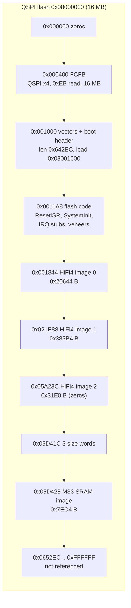
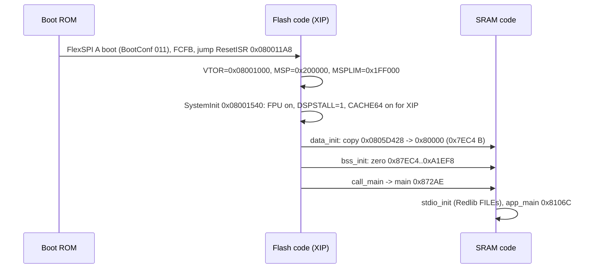
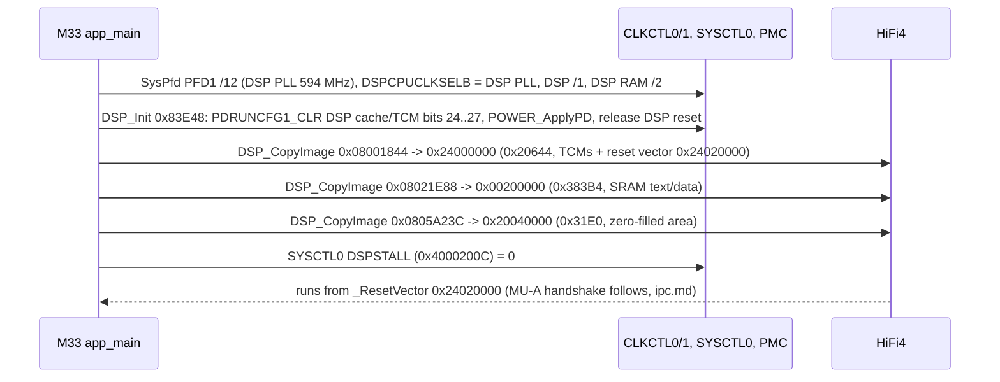

# IFDSP Cortex-M33 platform: boot, clocks, pins, DSP loader, FreeRTOS

Part of the IFDSP image docs ([README](README.md)). Sub-task T12d. Covers everything on the M33 except the console
([control-link.md](control-link.md)) and the rpmsg/MU link ([ipc.md](ipc.md)).
Names in *italics* are proposals from `tools/ghidra/names_ifdsp.T12d.tsv` and are not yet in the Ghidra project or `decomp/`.
Tags: **[fact]** seen in code/data (address given), **[inference]**, **[guess]**.

The M33 program is a stock **MCUXpresso SDK** project: MCUXpresso startup (`ResetISR`, copy tables), SDK board files
(`board.c`, `clock_config.c`, `pin_mux.c`), SDK drivers (clock, power, reset, flexcomm/USART, SCTimer, MU, SEMA42, PINT, DMA,
…), **FreeRTOS** (ARM_CM33 non-secure port, heap_4), **rpmsg-lite**, and the **Redlib** C library with the "no host" stubs.
Most of the 171 functions that T12a left as `FUN_` are these libraries; all are named in the TSV **[inference]**.

## 1. Flash layout (16 MB W25Q128JV on FlexSPI A)

- FlexSPI config block at 0x08000400 **[fact]**: tag `FCFB` v1.4.0, `deviceType` 1 (serial NOR), `sflashPadType` 4 (quad),
  `serialClkFreq` 7 (120 MHz in the RT600 ROM enum **[inference]**), `sflashA1Size` 0x1000000, page 256, sector 4 KB, block 64 KB.
  LUT: read `0xEB` (quad I/O fast read, 24-bit address, 6 dummy cycles), status `0x05`, write enable `0x06`, sector erase `0x20`,
  block erase `0xD8`, page program `0x02`, chip erase `0x60`. These match the W25Q128JV (docs/hardware.md Q2008).
- Boot header in the vector table **[fact]**: +0x20 image length 0x642EC, +0x24 type 0 (plain XIP image), +0x34 load 0x08001000.
- The code references only these flash addresses: the three DSP images and their size words (literal pool 0x84B50) and the
  FreeRTOS idle task name `"IDLE"` at 0x08001834 **[fact]**. There is no FlexSPI IP-command (program/erase) code, so the
  M33 never writes its own flash; updates go through the ROM serial ISP (`DSP_UPDATE`, docs/hardware.md) **[inference]**.
  Everything above 0x080652EC is unused by this image **[fact: no references]**.

## 2. Reset and copy-down

- `SystemInit` (flash 0x08001540) **[fact]**: SCB CPACR/NSACR enable CP10/CP11; SYSCTL0 DSPSTALL (0x4000200C) = 1; if executing
  from FlexSPI and CACHE64 is off, CACHE64_POLSEL (0x40033000) REG0_TOP = 0x07FFFC00, POLSEL = 1, CACHE64_CTRL CCR invalidate
  (0x05000000 | GO) then CCR = 3 (cache + write buffer on); then the empty `SystemInitHook` (0x080015D4).
- Flash also holds `SystemCoreClockUpdate` (0x0800143C) and a copy of `CLOCK_GetFFroFreq` (0x08001414); the main code only uses
  the SRAM copies **[fact]**.
- After the copy-down nothing executes from flash except the IRQ stubs and veneers (section 7) **[fact]**.

## 3. Clock tree (`BOARD_BootClockRUN` 0x0008494C)

The RT685 crystal is not fitted. **SYSOSC runs in bypass from CLKIN = `DSP_CLK` 18.432 MHz** from the SDR module (PIO2_30
func 5) **[fact: SYSOSCBYPASS (CLKCTL0 0x168) = 1, g_clkinFreq = 0x1194000]**. `g_xtalFreq` is set to 24 MHz but not used.

| Step (in order) | Register effect | Result |
|---|---|---|
| PDRUNCFG0_CLR 0x4000/0x10000, *`CLOCK_EnableFfroClk`*(48 MHz) | FFRO on, trim from OTP | FFRO 48 MHz |
| PDRUNCFG0_CLR 0x8000, *`CLOCK_EnableSfroClk`* | SFRO on | 16 MHz |
| *`BOARD_FlexspiClockSafeConfig`*, `CLOCK_AttachClk(0x04343430)` | FlexSPI from FFRO /1; main clock = FFRO | safe switch |
| PDRUNCFG0_CLR 0x2000, *`POWER_UpdateOscSettlingTime`*(260), *`CLOCK_EnableSysOscClk`*(on, mode 1, 260 µs) | SYSOSC, then SYSOSCBYPASS = 1 | SYSOSC = CLKIN 18.432 MHz |
| *`CLOCK_InitSysPll`*(cfg 0x87A08: src 1 SYSOSC, NUM 31, DENOM 64, MULT idx 5 = ×21) | 18.432 × (21 + 31/64) | **SYSPLL 396.000 MHz** |
| *`CLOCK_InitSysPfd`*(PFD0, 12), (PFD2, 24) | 396 × 18 / PFD | main PLL 594 MHz, AUX0 297 MHz |
| *`CLOCK_InitAudioPll`*(cfg 0x879F8: SYSOSC, 22 + 5040/27000), then AUDIOPLL0CTL0 \|= BYPASS, *`CLOCK_InitAudioPfd`*(PFD0, 26) | bypass wins | **audio PLL clock = 18.432 MHz** (= 384 × 48 kHz) |
| `CLOCK_SetClkDiv(SYSCPUAHB 0x400, 3)`, `CLOCK_AttachClk(0x2434)` MAINCLKSELB = main PLL | 594 / 3 | **M33 core 198 MHz** |
| `CLOCK_SetClkDiv(CLKCTL1 0x240 AUDIOPLLCLKDIV, 1)` | /1 | 18.432 MHz |
| `CLOCK_SetClkDiv(0x500 PFC0DIV, 2)` | /2 | **[inference]** register name |
| `CLOCK_SetClkDiv(CLKCTL1 0x6FC FRGPLLCLKDIV, 12)` | 594 / 12 | FRG PLL clock 49.5 MHz |
| *`BOARD_SetFlexspiClock`*(1 = main PLL, 6) | 594 / 6 | **FlexSPI 99 MHz** |
| `SystemCoreClock` (0x87EC0) = 198000000 | | |

All register values **[fact]**; the frequencies are computed from them with the RT600 PLL formula (output = in × (MULT + NUM/DENOM),
PFD = PLL × 18 / n) **[inference]**. Later clock users:

- `BOARD_DSP_Init`: *`CLOCK_InitSysPfd`*(PFD1, 12) → DSP PLL 594 MHz; DSPCPUCLKSELB = DSP PLL; DSPCPUCLKDIV /1, DSPMAINRAMCLKDIV /2
  → **HiFi4 at 594 MHz, DSP RAM clock 297 MHz** (DSPPLLCLKDIV left at reset /1) **[fact: writes; inference: frequencies]**.
- `uart0_init`: FRG0 source = FRG PLL clock, FRGCTL 0x00FF (MULT 0, so ÷1), FC0 clock = FRG → 49.5 MHz → 115200 baud via
  *`USART_SetBaudRate`* **[fact]**.
- SysTick: reload = `SystemCoreClock` / 1000 − 1 → **1 kHz FreeRTOS tick** (`vPortSetupTimerInterrupt` 0x82060) **[fact]**.
- No code selects the MCLK output clock (`AIC_MCLK` on PIO1_10), so the DSP must select it or it keeps its reset setting **[inference]**.

## 4. Pin mux (IOPCTL 0x40004000) and GPIO

`BOARD_InitPins` 0x87294 calls *`BOARD_InitPins_flexcomm`* 0x87242, `BOARD_InitPins_P0` 0x84B78, `BOARD_InitPins_codec_spi`
0x84BEC, *`BOARD_InitPins_i2s`* 0x8726C and tail-jumps to *`BOARD_InitPins_debug_gpio`* 0x84C90 (Ghidra merged that last body
into `BOARD_InitPins`). IOPCTL bits: FSEL[2:0], IBENA 0x40 (input buffer), FULLDRIVE 0x100, IIENA 0x800 (input invert).
Net names come from service manual p19 (renders checked in T12d). Where p19 routes nets through a crossed resistor network,
the pin chosen is the one the firmware configures **[inference]**.

| Pin | IOPCTL | Function | Net (p19) | Notes |
|---|---|---|---|---|
| PIO0_1 | 0x001 | FC0_TXD | `DSP_UMISO` | console/MAIN link TX **[fact]** |
| PIO0_2 | 0x041 | FC0_RXD | `DSP_UMOSI` | RX **[fact]** |
| PIO0_4 | 0x040 | GPIO in | `AF_MUTE` | `BOARD_InitPins_P0` **[fact]** |
| PIO0_5 | 0x040 | GPIO in | `ADC0_0` → TP2013 | debug **[fact]** |
| PIO0_7/8/9 | 0x041 | FC1 SCK/TXD/RXD | FFT/REC/PLAY SPI | to DISPLAY; driven by the DSP **[inference]** |
| PIO0_10 | 0x001 | FC1_SSEL0 out | | output only, so FC1 is SPI master **[inference]** |
| PIO0_14 | 0x941 | FC2_SCK, **inverted** | `TX_AF_CLK`/`FRM` | clock from the SDR module **[fact: value]** |
| PIO0_15 | 0x141 | FC2_TXD_WS | `TX_AF_FRM`/`CLK` | |
| PIO0_16 | 0x101 | FC2 data out | `TX_AF_DAT` | I2S transmit to SDR **[inference]** |
| PIO0_21, PIO0_22 | 0x040 | GPIO in | `TX`, `SEND_A` | from SDR **[inference]** (T12a: ambiguous) |
| PIO0_23 | 0x141 | FC3 data in | `RX_IF_DAT` | FC3 SCK/WS not on pins: shared from another FLEXCOMM, set up by the DSP **[inference]** |
| PIO0_28/29/31 | 0x000 | GPIO out, low | TP2043/2046/2044 | debug **[fact]** |
| PIO0_30 | 0x141 | FC4 data in | `AIC_DOUT` | codec ADC data; SCK/WS shared **[inference]** |
| PIO1_0 | 0x000 | GPIO out | `AIC_RESET` | `aic3204_init` **[fact]** |
| PIO1_1 | 0x000 | GPIO out | `AIC_MOSI` | bit-banged SPI |
| PIO1_3 / PIO1_4 | 0x141 | FC5 SCK / WS in | `AIC_BCLK` / `AIC_WCLK` | codec is I2S master |
| PIO1_5 | 0x101 | FC5 data out | `AIC_DIN` | codec DAC data |
| PIO1_7 | 0x000 | GPIO out, high | `AIC_SS` | |
| PIO1_10 | 0x101 | MCLK out | `AIC_MCLK` | full drive |
| PIO2_2 | 0x002 | SCT0_OUT0 | `SCT0_OUT0` → R2041/C2003 | PWM, [control-link.md](control-link.md) reg 0x4005 |
| PIO2_4/5/6 | 0x000 | GPIO out, low | `SCT0_OUT2/OUT3/GPI4` → TP2007/2008/2009 "for DEBUG" | PIO2_5 goes **high when `CommandTask` starts** (GPIO B[2][5] at 0x40100045) **[fact]** |
| PIO2_28 | 0x040 | GPIO in | `AIC_MISO` | |
| PIO2_29 | 0x000 | GPIO out | `AIC_SCLK` | |
| PIO2_30 | 0x045 | CLKIN | `DSP_CLK` | 18.432 MHz |

Clock gates set for this: CLKCTL1 PSCCTL1_SET bits 0/1/2 (HS GPIO0/1/2), bit 28 (MU-A, `MU_Init`), PSCCTL2_SET bit 31 before
`INPUTMUX_AttachSignal(…, 1, 0x14000015)` **[fact]** (the INPUTMUX selection is in [ipc.md](ipc.md) **[guess]**). Resets released
in `app_main`: RSTCTL1 bits 28/29 (MU-A, SEMA42) **[inference]**.

## 5. DSP image loader (`BOARD_DSP_Init` 0x00084AD8)

The copy descriptors are `{src, dst, size}` built on the stack; the sizes come from the flash words at 0x0805D41C..0x0805D424
**[fact]**. `DSP_CopyImage` (0x86EAA) is a plain `memcpy` (no checksum, no decompression) **[fact]**. `SystemInit` already holds the DSP
stalled, so the DSP runs only after the copy **[fact]**. The DSP reset vector is the default VECBASE in ITCM; the M33 does not remap it
**[inference: no SYSCTL0 DSPVECREMAP write]**.

## 6. FreeRTOS

Kernel configuration seen in code **[fact]**: `configMAX_PRIORITIES` 5, tick 1 kHz, heap_4 heap `ucHeap` 0x88EF0..0xA1EE8
(0x18FF8 = 102,392 bytes), `configASSERT` = raise BASEPRI and spin, timers enabled (queue length 10, item 16 bytes), event groups,
queue registry. No idle/tick/malloc-failed/stack-overflow hooks are called.

| Object | Created by | Parameters | Use |
|---|---|---|---|
| Task `Command Task` (0x80D78) | `create_CommandTask` 0x80E20 | 0x1800 words, prio 1 | console / MAIN link |
| Task `IpcRecvTask` (0x85FC6) | `create_IpcTasks` 0x80F80 | 0x1800 words, prio 2 | rpmsg receive, prints DSP replies |
| Task `IpcSendTask` (0x80F50) | `create_IpcTasks` | 0x1800 words, prio 2 | waits on queue 0x886E0 (never written) |
| Task `IDLE` (*`prvIdleTask`* 0x821D0) | `vTaskStartScheduler` 0x82418 | 0x80 words, prio 0 | |
| Task `Tmr Svc` (`prvTimerTask` 0x82DB0) | `xTimerCreateTimerTask` 0x82C80 | 0x100 words, prio 2 | no timers are ever created |
| Queue `TmrQ` (0x88920) | `prvCheckForValidListAndQueue` | 10 × 16 B | timer commands |
| Queue 0x886E0 | `create_IpcTasks` | 8 × 0x98 B | IPC send (unused) |
| rpmsg queue | `ipc_init` → *`env_create_queue`* | | IPC receive ([ipc.md](ipc.md)) |
| Mutex 0x8871C | `env_create_mutex` | `xQueueGenericCreate(1,0,3)` | rpmsg-lite lock |
| Event group 0x87EC4 | `uart0_init` | bit 0 | FLEXCOMM0 RX → `CommandTask` |

Stack depths are in 32-bit words, so each application task has 24 KB of stack; together with TCBs they use about 74 KB of the
100 KB heap **[inference]**. Kernel globals **[inference from code shape]**: `pxCurrentTCB` 0x88800, `pxDelayedTaskList` 0x88804,
`pxOverflowDelayedTaskList` 0x88808, `pxReadyTasksLists` 0x8880C, `uxSchedulerSuspended` 0x88874, `uxTopReadyPriority` 0x8887C,
`xNextTaskUnblockTime` 0x888AC, `xNumOfOverflows` 0x888B0, `xPendedTicks` 0x888B4, `xSchedulerRunning` 0x888CC, `xTickCount` 0x888E4,
`xYieldPending` 0x888E8.

Port: `SVC_Handler` 0x80B20 → `vPortSVCHandler_C` 0x8657C → *`vRestoreContextOfFirstTask`* 0x80A60 (svc 2 from `vStartFirstTask`);
`PendSV_Handler` 0x80AC0 does the context switch; `SysTick_Handler` 0x86558 calls *`xTaskIncrementTick`*. The two "undecodable
instruction" stubs from T07 are just literal words (0xFFFFFFFF padding) after `vRestoreContextOfFirstTask` and `vStartFirstTask`
**[fact]**.

## 7. Interrupts, faults and watchdog

The vector table stays in flash (VTOR 0x08001000). FLEXCOMM0 (IRQ14 → `FLEXCOMM0_IRQHandler` 0x80E50), MU_A (IRQ34 → 0x818B8),
HardFault, SVC, PendSV and SysTick point straight into SRAM. Every other IRQ vector points to a flash stub that calls either
`IntDefaultHandler` (0x08001220, `b .`) or a **veneer** (0x080015D8..0x08001808, `ldr ip,=addr; bx ip`) into an SDK
`*_DriverIRQHandler` in SRAM **[fact]**. 35 SDK handlers are linked this way (DMA0/1, DMIC0, HWVAD0, FLEXCOMM1–7/14/15, FLEXSPI,
HASHCRYPT, I3C0, OS_EVENT, PIN_INT0–7, SCT0, USDHC0/1, UTICK0, CTIMER0–4; list in the TSV) **[fact]**. Of these only
**`SCT0_DriverIRQHandler`** (IRQ12, 0x848E4 → `sct0_pwm_callback`) is enabled by the M33; the others are library code the
linker kept **[inference: no NVIC enable for them on the M33]**.

- **Faults:** NMI, MemManage, BusFault, UsageFault, SecureFault and DebugMon are flash `b .` loops (0x0800120C..0x0800121A).
  `HardFault_Handler` (0x85FEA) is the MCUXpresso semihosting handler: if the faulting instruction is `BKPT 0xAB` it skips it and
  returns r0 = 0x20, otherwise it spins **[fact]**. There is no fault logging or reset.
- **Assertions:** `configASSERT` and task-creation failures spin with interrupts masked; `_Csys_alloc` (0x84E04) failure writes a
  message to the (dead) stdio and spins in `__sys_appexit` **[fact]**.
- **Watchdog:** none. No WWDT0/WWDT1 base appears in the code and the WDT IRQs go to `IntDefaultHandler` **[fact]**. A hung M33
  therefore stays hung until MAIN resets the chip (`DSP_RESET18`, docs/hardware.md) **[inference]**.

## 8. Power management

`fsl_power.c` is linked (`POWER_EnterDeepSleep` 0x8059C, `POWER_EnterSleep_mode1..3`, *`POWER_CalculateSafetyCount`* 0x800E8,
*`deinitXip`*/*`initXip`*/*`initFlexSPI`*, *`POWER_UpdateOscSettlingTime`*) but nothing calls the sleep functions **[fact]**. The only power
changes at run time are the PDRUNCFG0_CLR writes in `BOARD_BootClockRUN`, the DSP SRAM power-up in *`DSP_Init`* and
*`POWER_ApplyPD`* **[fact]**. The PMC/PMIC pins (`PMIC_MODE0/1`, `PMIC_IRQ_N`) are strapped by resistors on p19.

## 9. C library (Redlib)

`stdio_init` (0x84E38) opens stdin/stdout/stderr (FILE at 0x88B78, 0x88BB4, 0x88BF0) with *`_Cfdopen`* and gives each a 256-byte
buffer with *`setvbuf`*. The low-level `__sys_*` functions are the "no host" stubs (0x87932..0x87958): `__sys_write` returns the
length unwritten and the others return −1, so **stdio output goes nowhere**. All console output uses `uart0_write` directly **[fact]**.
The Redlib heap (*`malloc`* 0x84D3C, *`free`* 0x872C4, *`_sbrk`* 0x85D48) is a separate 4 KB area 0xA1EF8..0xA2EF8 used only for stdio
buffers; FreeRTOS uses heap_4 **[fact: addresses]**. `errno` is at 0x88B74 **[inference]**.

## 10. Function table (M33, platform scope)

Already-named functions (T07/T12a) are listed only where this page changes or explains them. Full list of proposals:
`tools/ghidra/names_ifdsp.T12d.tsv` (178 entries).

| Address | Ghidra name | Inferred name | Purpose |
|---|---|---|---|
| 0x080011A8 | `ResetISR` | | VTOR/MSP/MSPLIM, `SystemInit`, copy tables, `call_main` |
| 0x08001540 | `SystemInit` | | FPU, DSPSTALL=1, CACHE64 |
| 0x000872AE | `main` | | `stdio_init`, tail-jump `app_main` |
| 0x0008106C | `app_main` | | board init, DSP start, MU handshake, tasks, scheduler |
| 0x0008494C | `BOARD_BootClockRUN` | | clock tree, section 3 |
| 0x000809A0 | `CLOCK_SetDiv_0x620` | *`BOARD_SetFlexspiClock`* | FlexSPI clock source/divider with XIP-safe deinit/init |
| 0x00080914 / 0x0008092E | `FUN_` | *`BOARD_DeinitXip`* / *`BOARD_InitXip`* | FlexSPI disable / enable + DLL lock |
| 0x00087234 | `FUN_00087234` | *`BOARD_FlexspiClockSafeConfig`* | FlexSPI on FFRO /1 |
| 0x00087294 | `BOARD_InitPins` | | pin mux, section 4 |
| 0x00087242 / 0x0008726C / 0x00084C90 | `FUN_` / — | *`BOARD_InitPins_flexcomm`* / *`_i2s`* / *`_debug_gpio`* | IOPCTL groups |
| 0x00084AD8 | `BOARD_DSP_Init` | | DSP clocks, power, copy, unstall |
| 0x00083E48 | `FUN_00083e48` | *`DSP_Init`* | DSP SRAM power and reset |
| 0x00086EAA | `DSP_CopyImage` | | memcpy of one image |
| 0x000839FC / 0x00083B04 | `FUN_` | *`CLOCK_InitSysPll`* / *`CLOCK_InitSysPfd`* | SYSPLL setup |
| 0x00083B4C / 0x00083C54 | `FUN_` | *`CLOCK_InitAudioPll`* / *`CLOCK_InitAudioPfd`* | audio PLL setup |
| 0x000838F4 / 0x000839B4 | `FUN_` | *`CLOCK_EnableFfroClk`* / *`CLOCK_EnableSfroClk`* | oscillators, OTP trim via ROM |
| 0x00083C9C | `FUN_00083c9c` | *`CLOCK_EnableSysOscClk`* | SYSOSC (bypass to CLKIN) |
| 0x00082F70..0x0008322C | `FUN_` | *`CLOCK_Get…Freq`* (13 functions) | frequency queries used by `CLOCK_GetFreq` |
| 0x00083CC4 | `FUN_00083cc4` | *`SDK_DelayAtLeastUs`* | busy-wait |
| 0x00084150 / 0x00084498 | `FUN_` | *`CLOCK_EnableClock`* / *`RESET_SetPeripheralReset`* | clock gates, resets |
| 0x00083EA0 / 0x00083EBC | `FUN_` | *`FLEXCOMM_GetInstance`* / *`FLEXCOMM_Init`* | used by `USART_Init` |
| 0x0008704E | `FUN_0008704e` | *`USART_SetBaudRate`* | FC0 baud |
| 0x00084670 | `FUN_00084670` | *`SCTIMER_CreateAndScheduleEvent`* | used by `SCTIMER_SetupPwm` |
| 0x000848E4 | — | *`SCT0_DriverIRQHandler`* | IRQ12 → `sct0_pwm_callback` |
| 0x00085FEA | `HardFault_Handler` | | semihosting BKPT skip, else spin |
| 0x000800E8 | `FUN_000800e8` | *`POWER_CalculateSafetyCount`* | T12a's 0x800EE is a mid-function entry |
| 0x00084470 / 0x0008448C | `FUN_` | *`POWER_ApplyPD`* / *`POWER_UpdateOscSettlingTime`* | PMC apply, osc delay |
| 0x000824A0 | `FUN_000824a0` | *`xTaskIncrementTick`* | tick |
| 0x00082CC4 / 0x00082D10 | `FUN_` | *`xTimerGenericCommand`* / *`prvSampleTimeNow`* | timers |
| 0x00086716..0x00086778 | `FUN_` | *`vList*`*, *`uxListRemove`* | FreeRTOS lists |
| 0x000866A4 | `FUN_000866a4` | *`xEventGroupSetBits`* | |
| 0x00084D3C | `redlib_malloc` | *`malloc`* | Redlib heap |
| 0x00084E04 | `_Csys_alloc_failed` | *`_Csys_alloc`* | malloc + failure message |
| 0x00087756 | `FUN_00087756` | *`__aeabi_uldivmod`* | 64-bit divide (clock maths) |

The FreeRTOS, rpmsg-lite and Redlib internals in the TSV follow the upstream names one to one and are not repeated here.
