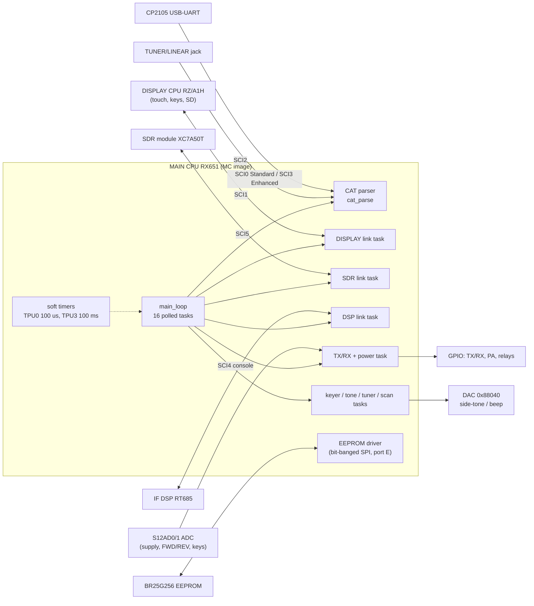
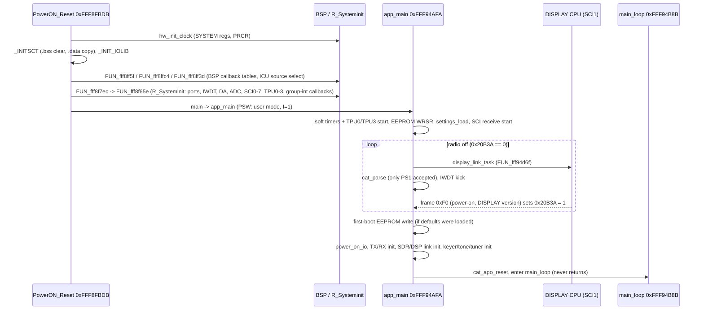
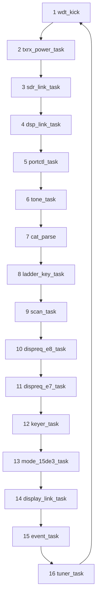
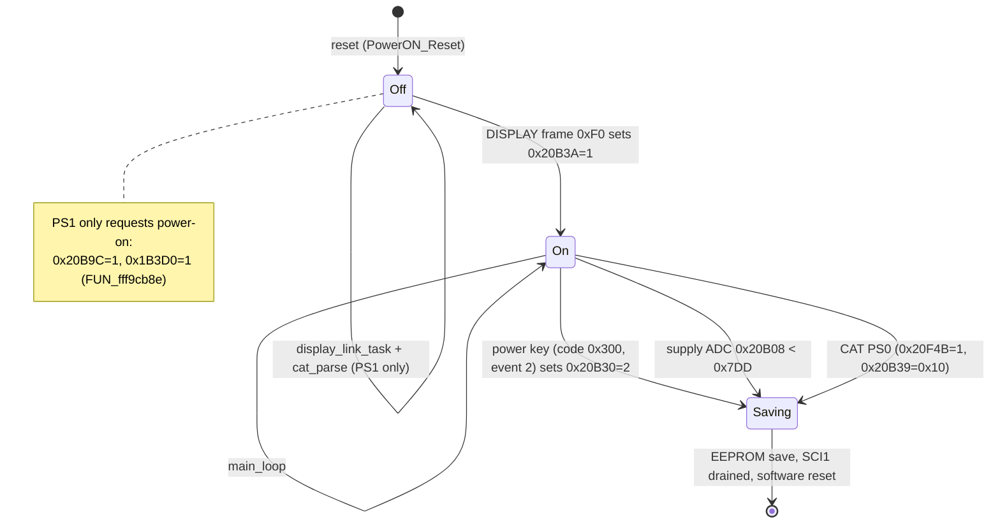

# MAIN image (MC) — code documentation

**Image:** `FT-710_MAIN_V0112.SFL` (tag MC, V01-12, 2024-02-16), decoded to `build/FT-710_MAIN_V0112.bin`, a flat
512 KB code-flash image loaded at **0xFFF80000**. **CPU:** Q1001 Renesas **RX651** R5F56514 (RXv2, little-endian).
Ghidra project `ghidra/FT710_MAIN` (source of truth for names), names file `tools/ghidra/names_main.tsv`, decompiled C
in [`decomp/main/`](../../../decomp/main/INDEX.md). Hardware context: [docs/hardware.md](../../hardware.md#q1001-main-cpu-renesas-rx651-image-mc),
memory map: [docs/memory-maps.md](../../memory-maps.md#main-mc-image-ft-710_main_v0112sfl--t05).

Tags follow AGENTS.md: **[fact]** = seen in code or data at the address given, **[inference]**, **[guess]**.
Names in `code` are the current Ghidra names. Names in *italics* are proposals from T10a
(`tools/ghidra/names_main.T10a.tsv`) that the parent applies after the T10 rename pass.

## What the MAIN CPU does

The RX651 is the radio's control processor. It owns no display, no audio DSP and no SD card; it coordinates the
other processors over UARTs and drives the RF hardware through GPIOs, ADCs and a DAC **[fact for the peripheral use,
inference for the role split]**:

- **CAT** remote control on three UARTs (SCI0/SCI3 through the CP2105 USB bridge, SCI2 on the TUNER/LINEAR jack) — [cat.md](cat.md).
- **DISPLAY link** on SCI1 to the RZ/A1H front-panel CPU, which owns the touch screen, keys, encoders and SD card.
  The DISPLAY CPU tells MAIN when to power on and forwards key/encoder events; MAIN sends state for display.
- **SDR link** on SCI5 to the Artix-7 FPGA (register read/write commands, `sdr_reg_access`).
- **DSP link** on SCI4 to the i.MX RT685 IF DSP console (register pokes, `dev4_reg_access`).
- **Settings** in the external BR25G256 SPI EEPROM (bit-banged on port E) and **RF control**: TX/RX sequencing,
  supply and power monitoring (12-bit ADCs), CW keyer, side-tone/beep generator (DAC), band/antenna/tuner lines (GPIO).

There is **no RTOS**: after init the firmware runs a single cooperative super-loop (`main_loop`) that polls 16 tasks.
Time is kept by soft timers ticked from TPU interrupts **[fact]**.

## Block diagram

## Reset and boot flow

`PowerON_Reset` @ 0xFFF8FBDB (fixed reset vector 0xFFFFFFFC) is the Renesas CC-RX/BSP `resetprg` **[fact]**. It sets
USP = 0x1004, ISP = 0x1404, INTB = 0xFFF8E6DC, EXTB = 0xFFFFFF80, FPSW = 0x100 (T05), then:

### Steps in detail

| Step | Address | Ghidra name | Inferred name | What it does |
|---|---|---|---|---|
| 1 | 0xFFF8FBDB | `PowerON_Reset` | — | Stack/INTB/EXTB/FPSW set-up, then the calls below; `_CLOSEALL` and an endless `bra` if `main` ever returns **[fact]** |
| 2 | 0xFFF913D7 | `hw_init_clock` | — | SYSTEM/clock registers (PRCR 0xA50B…) **[inference]**. The side-tone code computes TPU periods from **PCLK = 60 MHz** (`6e+07` in FUN_fffb2e1e) **[fact]** |
| 3 | 0xFFFEDEDA | `_INITSCT` | — | CC-RX section init: BTBL zero-fill, DTBL ROM→RAM copy **[fact]** |
| 4 | 0xFFF8FF5F | `FUN_fff8ff5f` | *bsp_callbacks_clear* | Clears 0x74 words at 0x1FFC4 (BSP interrupt callback table) **[fact; role inference]** |
| 5 | 0xFFF8F8F5 | `_INIT_IOLIB` | — | CC-RX stdio init (FILE table 0x1FF74) **[fact]** |
| 6 | 0xFFF8FFC4 | `FUN_fff8ffc4` | *bsp_interrupt_open* | Fills the 0x5F-entry group-interrupt callback table at 0x20194 with 0x10000000 (`FIT_NO_FUNC`), calls `FUN_fff92014` and `FUN_fff9089e(0/1)` **[fact; FIT naming inference]** |
| 6a | 0xFFF92014 | `FUN_fff92014` | *icu_select_init* | Writes the ICU selectable-interrupt source registers SLIBXR128.. (0x87780..): e.g. vector 130 ← source 0x0F, 138 ← 0x18, 142 ← 0x1C, 144 ← 0x14, 186 ← 0x40, 189 ← 0x44 **[fact]** |
| 7 | 0xFFF8FF3D | `FUN_fff8ff3d` | — | Clears 4 halfwords at 0x1B5FC **[fact]** |
| 8 | 0xFFF8F7EC | `FUN_fff8f7ec` | *hardware_setup* | Calls two empty stubs, `FUN_fff8f65e`, port direction init `FUN_fff91608`, `FUN_fff8f809` (PRCR-protected module-stop / ADC register), `FUN_fff8f879` (register 0xC5800) **[fact]** |
| 8a | 0xFFF8F65E | `FUN_fff8f65e` | *R_Systeminit* | Renesas Code Generator init: `R_PORT_Create`-like port set-up, IWDT, DA, S12AD0/1, `R_SCI0..5_Create`, TPU0/1/3 create, `R_SCI6_Create_IIC`, `R_SCI7_Create`, TPU2 create, then registers 17 interrupt callbacks with `FUN_fff8fffb` (ids 7, 10, 0x14–0x20, 0x22, 0x23; the targets sit next to the SCI drivers, so they are the SCI TEI/ERI group callbacks **[inference]**) **[fact for the calls]** |
| 9 | 0xFFF90097 | `FUN_fff90097` | *R_BSP_InterruptControl* | Called as `(0xB, 1, 0x10000000)` before `main`, and as `(n, 0, 0x10000000)` from the group ISRs (call callback) **[fact for the calls; FIT naming inference]** |
| 10 | 0xFFF8F658 | `main` | — | Calls `app_main` **[fact]** |

### `app_main` @ 0xFFF94AFA **[fact for the call order]**

| Phase | Address | Ghidra name | Inferred name | Role |
|---|---|---|---|---|
| pre-power | 0xFFFB3E6A | `FUN_fffb3e6a` | *wdt_kick* | → `FUN_fff927ce`: writes 0x00 then 0xFF to 0x88030 (IWDT refresh register) **[fact; IWDT inference from the RX65x map]** |
| pre-power | 0xFFFB2228 | `FUN_fffb2228` | *timers_init* | Marks the 75 one-shot soft timers (flags 0x11FED) and the 4 slow timers (0x1203A) as expired, sets two periodic on/off timers (450/250 ms, 1000/1000 ms), starts TPU0 (`FUN_fff94a38`) and TPU3 (`FUN_fffb27b2`) **[fact]** |
| pre-power | 0xFFFB27DF | `FUN_fffb27df` | — | empty stub **[fact]** |
| pre-power | 0xFFFB01F3 | `FUN_fffb01f3` | *eeprom_wrsr_init* | EEPROM WRSR (0x01) with status 0x80 (bit-banged on port E) **[fact]**. See [eeprom.md](eeprom.md) |
| pre-power | 0xFFFB0229 | `FUN_fffb0229` | *settings_load* | Reads the EEPROM header (0x464F, 10 B) and branches on byte 0x4658: **1** = valid image, read everything from EEPROM 0 and return; **0** = read `cfg105` (0x000A) and the destination code (0x010F), then `settings_defaults(0)`; **other** (blank EEPROM) = clear the header, `settings_defaults(1)`, save `cfg105` and destination. In the last two cases it sets 0x20B45 = 1 (defaults loaded) **[fact]** |
| pre-power | 0xFFFBBD53 | `FUN_fffbbd53` | — | → `FUN_fffc4d93`: copies a 31-byte per-port config block (index 0x9BC9) to 0x20B4C and reapplies `sci3_set_baud` if it changed **[fact]** |
| pre-power | 0xFFFB1632 | `FUN_fffb1632` | *sci_rx_start_all* | `sci0_set_baud`, SCI1 receive into 0x9E86 (0x204 B), `sci2_configure`, `sci3_set_baud`, SCI4 and SCI5 start **[fact]**. See [sci.md](sci.md) |
| pre-power | 0xFFF94CAB | `FUN_fff94cab` | *startup_state_init* | Initialises fields of the state block 0x20B04 (see below), checks two settings (0x9DBE/0x9DBF == 5) **[fact]** |
| power-off loop | 0xFFF94D6F | `FUN_fff94d6f` | *display_link_task* | Runs while 0x20B3A == 0 **[fact]**; see the main-loop table |
| power-off loop | 0xFFFA347C | `cat_parse` | — | Only `PS1` is accepted while off ([cat.md](cat.md)) **[fact]** |
| post-power | 0xFFFB02AF | `FUN_fffb02af` | *eeprom_save_all* | Only if 0x20B45 == 1: writes the RAM image at 0x4761 to EEPROM 0x0112 and sets 0x20F10 = 1 **[fact]** |
| post-power | 0xFFFB1F83 | `FUN_fffb1f83` | *power_on_io* | Sets the port outputs for the "on" state (P6/PA/PB/…); the counterpart of `power_off_io` 0xFFFB73A6 **[fact for the ports; inference for the pairing]** |
| post-power | 0xFFFB6CDE | `FUN_fffb6cde` | *txrx_init* | 0x20B18 = 4, 0x20B6B = 0, starts soft timer 0x13 (2500 ms), sets PB3, builds 0x20F60 from 0x9E82 **[fact]** |
| post-power | 0xFFFA1132 | `FUN_fffa1132` | *sdr_link_init* | Version placeholder `V**-**`, starts timer 0x1F (1000 ms), SDR handshake **[fact for the string/timer]**. See [sdr-link.md](sdr-link.md) |
| post-power | 0xFFF9D06C | `FUN_fff9d06c` | *dsp_link_init* | Same pattern for the DSP (`V**-**`, timer 0x1F 100 ms); sends `i DB00\r` on SCI4 (T12) **[fact]**. See [dsp-link.md](dsp-link.md) |
| post-power | 0xFFFB55B8 | `FUN_fffb55b8` | *portctl_init* | 0x12042 = 0 **[fact]** |
| post-power | 0xFFFB28D1 | `FUN_fffb28d1` | *tone_init* | DAC output = 0x1FF1C, `FUN_fff92826` (DA control 0x88044) **[fact]** |
| post-power | 0xFFFB98C8 | `FUN_fffb98c8` | *keyer_init* | Clears 0x20B2F, 0x1215F and 0xA0 bytes at 0x120BC **[fact]** |
| post-power | 0xFFFEC46C | `FUN_fffec46c` | *tuner_init* | One `tuner_task` pass, then `FUN_fffec578` **[fact]** |
| post-power | 0xFFFC98AA | `FUN_fffc98aa` | — | `FUN_fffd405e` + `FUN_fffd4ff1` (menu/UI tables) **[fact; role guess]**. See [menu.md](menu.md) |
| post-power | 0xFFFB263D | `cat_apo_reset` | — | Arms the auto-power-off timer **[fact]** |

## Main loop

`main_loop` @ 0xFFF94B8B is a `do { … } while (true)` that calls these 16 functions in order and has no other logic
**[fact]**. Every task is non-blocking by design: it checks flags and soft timers and returns **[inference]**. The
exceptions are the power-off path (busy-waits on `sci1_tx_end`) and the EEPROM writes (busy-wait on WIP) **[fact]**.

| # | Address | Ghidra name | Inferred name | Role | Page |
|---|---|---|---|---|---|
| 1 | 0xFFFB3E6A | `FUN_fffb3e6a` | *wdt_kick* | Independent-watchdog refresh (0x88030 ← 0x00, 0xFF) **[fact; IWDT inference]**. Also called in the power-off loop | [peripherals.md](peripherals.md) |
| 2 | 0xFFFB6D56 | `FUN_fffb6d56` | *txrx_power_task* | TX/RX and power supervisor: PB3 vs 0x20B44 with timer 0x2A; four sub-tasks (`FUN_fffb73dd` timers/APO, `FUN_fffb7b43` GPIO/TX state machine on 0x20B18, `FUN_fffb8d77`, `FUN_fffb9605`); **supply monitor** `FUN_fffb4b28` (if ADC 0x20B08 < 0x7DD: `power_off_io`, save, 0x20B39 = 0x90); **power-off**: when 0x20B30 == 2 it saves the EEPROM (`FUN_fffb02cf`), waits for SCI1 to drain and calls `FUN_fffb3e55` (software reset) **[fact]** | [tx-protection.md](tx-protection.md), [peripherals.md](peripherals.md) |
| 3 | 0xFFFA11ED | `FUN_fffa11ed` | *sdr_link_task* | SCI5 FPGA link: pending `sdr_reg_access` (flag 0x1C8B), `sdr_bridge_mode` (0x1C8D), then ~30 change detectors that push radio state to the FPGA whenever something changes; aborts the pass when a transfer is pending **[fact for the structure]** | [sdr-link.md](sdr-link.md) |
| 4 | 0xFFF9D1B9 | `FUN_fff9d1b9` | *dsp_link_task* | SCI4 DSP link: pending `dev4_reg_access` (0x1C5E/0x1C5F), a 4-step sequence on timer 0x0B while 0x20B18 is 3 or 8, then ~40 change detectors (DSP register writes) **[fact for the structure]** | [dsp-link.md](dsp-link.md) |
| 5 | 0xFFFB55C2 | `FUN_fffb55c2` | *portctl_task* | Six port-output sub-tasks (`FUN_fffb55eb`, `…56a5`, `…5786`, `…5874`, `…5976`, `…5d68`) on P6/P7/PA/PB, partly region-dependent (`dest_code_get`) **[fact; role guess: relays / band / TX lines]** | [radio-control.md](radio-control.md), [peripherals.md](peripherals.md) |
| 6 | 0xFFFB28E2 | `FUN_fffb28e2` | *tone_task* | Beep / side-tone sequencer: patterns of `FUN_fffb2e1e(freq, ms)` (880 Hz, 1046.5 Hz, …; case 4 uses pitch 0x9C04 × 10 + 300 Hz, the CW pitch from `cat_KP`) on soft timer 0x16 **[fact]**. `FUN_fffb2e1e` sets the TPU1 period for 36 samples per cycle and loads a 36-entry table (`FUN_fffb24a3(0x1FF1C, 36)`); the TPU1 ISR steps through the table at *0x20B00 into the DAC **[fact]** | [peripherals.md](peripherals.md) |
| 7 | 0xFFFA347C | `cat_parse` | — | One CAT command per pass, then `cat_ai_poll` **[fact]** | [cat.md](cat.md) |
| 8 | 0xFFFE3E2A | `FUN_fffe3e2a` | *ladder_key_task* | Acts on key code 0x1204C (1..6, 0xF7..0xFA; `FUN_fffb7a40` ORs 0xF0 in after the key is held for 100 passes, i.e. a long press **[inference]**), produced by `FUN_fffb7a40` from ADC channel 0x20B10 (a 12-level resistor ladder) **[fact for the decode; guess: microphone or remote-keypad keys]** | [ui-keys.md](ui-keys.md) |
| 9 | 0xFFFE587F | `FUN_fffe587f` | *scan_task* | State machine on 0x18877, gated by 0x20F1C (the flag `cat_SC` reports as "scan on") **[fact; scan inference]** | [radio-control.md](radio-control.md) |
| 10 | 0xFFFE360E | `FUN_fffe360e` | *dispreq_e8_task* | `FUN_fffe376a` executes the command 1..5 that DISPLAY frame 0xE8 (`FUN_fff95dad`) posts in 0x20F90, then `FUN_fffe3615` **[fact; purpose unknown]** | [display-link.md](display-link.md) |
| 11 | 0xFFFE2CD0 | `FUN_fffe2cd0` | *dispreq_e7_task* | Same for DISPLAY frame 0xE7 (`FUN_fff95cbc`) and command word 0x20F8C **[fact; purpose unknown — guess: SD/voice-memory record/playback control]** | [display-link.md](display-link.md) |
| 12 | 0xFFFB98E9 | `FUN_fffb98e9` | *keyer_task* | CW keyer: uses key speed 0x9C03 (also `cat_KS`), 0x20B97 (also `cat_KY`), timer 0x13 **[inference]** | [tx-protection.md](tx-protection.md) |
| 13 | 0xFFFD0582 | `FUN_fffd0582` | — | When 0x20B8C != 0, runs one of four sub-state machines selected by 0x15DE3 (1..4, set by `FUN_fffcf6f7` / `…f7a7` / `…f88b` / `…f951`) **[fact; purpose unknown]** | [radio-control.md](radio-control.md) |
| 14 | 0xFFF94D6F | `FUN_fff94d6f` | *display_link_task* | SCI1 DISPLAY link: takes a received frame, validates it (`FUN_fff9c60f`), dispatches by first byte (`FUN_fff95331`: 0x06 ACK, 0x15 NAK, 0xB3, 0xC3–0xC5, 0xE0–0xE8, 0xF0, 0xF1…), answers ACK/NAK and sends the next queued frame (`FUN_fff951ff`) with retry timers 0x3B/0x3C **[fact]** | [display-link.md](display-link.md) |
| 15 | 0xFFFBBD58 | `FUN_fffbbd58` | *event_task* | Key/event dispatcher: a new event (flag 0x20BA4, type 0x20BA1, code 0x20BA2) is latched into 0x1FA40 and is mapped through the 4651-entry **handler table 0xFFF89D94** (`FUN_fffbc35f`), with auto-repeat timers 0x3F/0x40; also per-port config refresh (`FUN_fffc4d93`) **[fact]** | [ui-keys.md](ui-keys.md), [menu.md](menu.md) |
| 16 | 0xFFFEC473 | `FUN_fffec473` | *tuner_task* | Antenna tuner: dispatch on tuner-select setting 0x9AB8 (also read by `cat_AC`): 3 → `FUN_fffed165`, 2 → `FUN_fffed62a`, else `FUN_fffec62b` (state machine 0x1B3AC) **[fact; tuner inference]** | [tx-protection.md](tx-protection.md), [peripherals.md](peripherals.md) |

### Power states

- **Power-on is a handshake with DISPLAY.** `cat_PS` with `1` only calls `FUN_fff9cb8e` (0x20B9C = 1, 0x1B3D0 = 1)
  **[fact]**; the flag 0x20B3A is set only in `FUN_fff9546a`, the handler of DISPLAY frame 0xF0, which also stores the
  DISPLAY version string (0x1436, `ver_display`) and a power-on reason byte at 0x20B9F **[fact]**. So MAIN asks the
  DISPLAY CPU and waits for it **[inference]**.
- **Power-off ends in a software reset.** `FUN_fffb3e55` writes PRCR (0x803FE) = 0xA502 and 0x800C2 = 0xA501
  **[fact]**, which is the RX65x software-reset register SWRR **[inference]**. The CPU then restarts in `PowerON_Reset`
  and waits in the power-off loop again **[inference]**. The front-panel power key is key code 0x300 with event type 2
  in `key_event_filter` **[fact for 0x300 → 0x20B30 = 2; inference that it is the power key]**.
- The PS0 path (0x20F4B / 0x20B39 = 0x10) and the low-voltage path (0x20B39 = 0x90) record a reason code; who
  consumes 0x20F4B is left to [tx-protection.md](tx-protection.md) / [display-link.md](display-link.md).

## Soft timers and interrupts

### Soft timers **[fact unless marked]**

| Timer set | Storage | API | Tick |
|---|---|---|---|
| 75 one-shot timers, id 0..0x4A | expired flags 0x11FED[id], counters 0x20890[id], limits 0x209BC[id] | `FUN_fffb237a(id, ms)` *sw_timer_start* (limit = ms × 10), `FUN_fffb23f3(id)` *sw_timer_expired* | TPU0 vector 130 ISR → `FUN_fffb2288` |
| 2 periodic on/off timers | 0x20AE8, 0x20AF0/0x20AF4, state 0x12038 | `FUN_fffb2419(id, on_ms, off_ms)` | same ISR (blink cadence, e.g. 450/250 ms) |
| 4 slow timers | flags 0x1203A, counters 0x1FA24, limits 0x1FA2C | — | TPU3 vector 142 ISR → `FUN_fffb259c` |

TPU0 is set up with TCR = 0x2A (PCLK/16, clear on TGRA) and TGRA = 0x176 → (374 + 1) × 16 / 60 MHz = **100 µs**
**[fact for the values; the arithmetic assumes PCLK = 60 MHz]**, which matches `ms × 10` in `sw_timer_start`. TPU3
has TGRA = 0x5B8D with TCR = 0x2E; with PCLK/256 that is **100 ms** **[inference: TPSC decode from the RX TPU manual]**.
Timer ids seen on this page (the id and its user are **[fact]**, the role words are **[inference]**): 0x0B DSP
sequence, 0x13 power-up settle (2500 ms), 0x16 tone step, 0x1F link init, 0x2A PB3 check, 0x2B/0x3B/0x3C DISPLAY link,
0x2D TPU2 pulse, 0x31 `FUN_fffcdb26` delay (200 ms), 0x32 CAT AI hold-off (200 ms), 0x3F/0x40 event repeat, 0x4A
`display_link_task` 100 ms re-check. The decompiler shows the counter compare as `(count & 0xFF) >= limit`; that would
never fire for 200 ms (limit 2000), so it is probably a decompiler artifact **[inference]**.

### Vector table

The relocatable vector table at INTB = **0xFFF8E6DC** has 256 entries: **31 populated**, the other 225 point to
`Undefined_0xD8` @ 0xFFF90802 **[fact]**. Vectors ≥ 128 are selectable (ICU SLIBXRn, set in `FUN_fff92014`).

| Vector | Handler | Source | Role |
|---|---|---|---|
| 16 | `vec016_BSC_BUSERR` 0xFFF90819 | bus error | BSP stub **[fact]** |
| 26 / 27 | `vec026_ICU_SWINT2` / `vec027_ICU_SWINT` | software interrupts | → `FUN_fff910c3(1/0)`, BSP software-interrupt task queue at 0x20318 **[fact; FIT naming inference]** |
| 58–63, 80–85 | `r_sci0..5_receive/transmit_interrupt` | SCI0–SCI5 RXI/TXI | UART drivers ([sci.md](sci.md)) **[fact]** |
| 86 / 87 | `r_sci6_iic_rxi` / `r_sci6_iic_txi` | SCI6 (simple I2C) | [peripherals.md](peripherals.md) **[fact]** |
| 98 / 99 | `r_sci7_receive/transmit_interrupt` | SCI7 | "C4" link **[fact]** |
| 106, 107, 110–113 | `vec106_GROUPBE0`, `vec107_GROUPBL2`, `vec110_GROUPBL0`, `vec111_GROUPBL1`, `vec112_GROUPAL0`, `vec113_GROUPAL1` | group interrupts | SCI TEI/ERI and others, dispatched to the callbacks registered by `FUN_fff8fffb` in `R_Systeminit` **[fact]** |
| 130 | `vec130_isr` 0xFFF94A57 | source 0x0F = TPU0 TGI0A **[inference]** | 100 µs soft-timer tick `FUN_fffb2288` **[fact]** |
| 138 | `vec138_isr` 0xFFFEDD8C | source 0x18 = TPU2 TGI2A **[inference]** | `FUN_fffb24d8`: pulse train on a port bit chosen by 0x20FCC (P7/P8/PB), stops itself via `FUN_fffedd7c` when timer 0x2D expires **[fact; purpose unknown]** |
| 142 | `vec142_isr` 0xFFFB27D1 | source 0x1C = TPU3 TGI3A **[inference]** | 100 ms slow timers `FUN_fffb259c` **[fact]** |
| 144 | `vec144_isr` 0xFFF94AEC | source 0x14 = TPU1 TGI1A **[inference]** | Tone DAC: next sample of the table at 0x20B00 → DAC 0x88040 (`FUN_fff9283d`); TGRA 0x88128 sets the pitch **[fact]** |
| 186 | `vec186_isr` 0xFFF92B01 | source 0x40 = S12ADI0 **[inference]** | Stores ADC0 channels 1,2,3,5,6,7 to 0x20B04..0x20B0E, sets 0x1203E **[fact]** |
| 189 | `vec189_isr` 0xFFF92E0F | source 0x44 = S12ADI1 **[inference]** | Stores ADC1 channels 8,9,15,17 to 0x20B10..0x20B16, sets 0x1203F **[fact]** |

Fixed vectors (0xFFFFFFD0..FC): `SuperVisorInst`, `AccessExc`, `UndefinedInst`, `FloatingPoint`, `NMI` 0xFFF9061B,
reset `PowerON_Reset`; the remaining slots use `Undefined_0xD8` **[fact]**.

## Memory map summary

Full table: [docs/memory-maps.md](../../memory-maps.md#main-mc-image-ft-710_main_v0112sfl--t05). In short **[fact, T05]**:

| Range | Contents |
|---|---|
| 0x00000000..0x00001403 | user stack (top 0x1004), interrupt stack (top 0x1404) |
| 0x00001404..0x00025E5F | .bss / .data (three DTBL copies); highest used RAM ~0x25E60 of 256 KB |
| 0x00080000..0x000FFFFF | peripheral I/O (SYSTEM, ICU 0x87000, IWDT 0x88030, DA 0x88040, TPU 0x88100, S12AD 0x89000/0x89100, SCI 0x8A000.., ports 0x8C000..) |
| 0x00100000..0x00107FFF | E2 data flash |
| 0xFFF80000..0xFFF8FFFF | constants: CAT tables (0xFFF805EC), menu strings, **event handler table 0xFFF89D94**, vector table 0xFFF8E6DC, DTBL/BTBL, .data images, CAT switch/reply tables (0xFFF8F014, 0xFFF8F480) |
| 0xFFF8FBDB..~0xFFFEE1BE | code (2252 functions) |
| 0xFFFFFF00 / 0xFFFFFF80 | version string `V01-12` / fixed vectors |

### Global state block 0x20B04 **[fact]**

Most radio state lives in one RAM block that starts at **0x20B04**. The compiler reaches it through eleven
per-module pointer constants in `.data` (0x25D38, 0x25D4C, 0x25D54, 0x25D58, 0x25D5C, 0x25D60, 0x25D6C, 0x25D70,
0x25D74, 0x25D78, 0x25D7C, all = 0x20B04), so `PTR_DAT_00025d38[0x36]` in the decomp is the same byte as `DAT_00020b3a`.
To find all users of a field, search for both forms. Other pointers there: 0x25D34 → 0x203F4, 0x25D50 → 0x4659
(`cfg105`), 0x25D3C = 7,000,000 (a 7 MHz default frequency) **[fact]**.

| Address | Offset | Meaning |
|---|---|---|
| 0x20B04..0x20B16 | +0x00 | ADC results written by the S12AD ISRs (0x20B08 = supply voltage channel **[inference]**, 0x20B10 = key ladder) **[fact]** |
| 0x20B18 | +0x14 | TX/RX sequencer state (0..8) **[fact; meaning in tx-protection.md]** |
| 0x20B20..0x20B22 | +0x1C | CAT AI flags per port **[fact]** |
| 0x20B30 | +0x2C | 2 = power-off requested by the power key **[fact]** |
| 0x20B39 | +0x35 | power-off reason (0x10 = CAT PS0, 0x90 = low supply) **[fact]** |
| 0x20B3A | +0x36 | radio on (0 = power-off loop) **[fact]** |
| 0x20B45 | +0x41 | settings defaults were loaded at boot **[fact]** |
| 0x20B46 | +0x42 | CAT disabled (set by DISPLAY) **[fact]** |
| 0x20B6B | +0x67 | RX/TX or VFO selector watched by the SDR and DSP link tasks **[fact for the use; meaning guess]** |
| 0x20B9C | +0x98 | power-on request to DISPLAY (`PS1`) **[fact]** |
| 0x20F1C | +0x418 | scan running (`cat_SC`) **[fact]** |
| 0x20F8C / 0x20F90 | +0x488 / +0x48C | command words from DISPLAY frames 0xE7 / 0xE8 **[fact]** |

## Subsystem index

| Page | Task | Contents |
|---|---|---|
| [cat.md](cat.md) | T09 | CAT receive ring, parser, dispatch, AI broadcaster, all handlers. Command reference [docs/cat-commands.md](../../cat-commands.md) |
| [sci.md](sci.md) | T10b | SCI0–SCI7 driver layer: create/start/stop, ISRs, buffers, baud tables |
| [display-link.md](display-link.md) | T10b | SCI1 protocol to the DISPLAY CPU (frames, ACK/NAK, power-on handshake) |
| [ui-keys.md](ui-keys.md) | T10b | Key/encoder/touch events → radio actions, event handler table 0xFFF89D94 |
| [sdr-link.md](sdr-link.md) | T10c | SCI5 FPGA register protocol, SDR_UPDATE/SDR_RESET |
| [dsp-link.md](dsp-link.md) | T10d | SCI4 IF-DSP register pokes, SCI7 "C4" link |
| [eeprom.md](eeprom.md) | T10e | BR25G256 driver, EEPROM map, settings image, defaults and factory reset |
| [menu.md](menu.md) | T10f | EX menu table and engine |
| [radio-control.md](radio-control.md) | T10g | VFO/band/mode, memories, scan, frequency programming |
| [tx-protection.md](tx-protection.md) | T10h | PTT/TX sequencing, protection, keyer, tuner |
| [peripherals.md](peripherals.md) | T10h | ADC channels, DAC/tone, timers, SCI2 tuner port, SCI6 I2C device, GPIO map, power on/off |

Related: [DISPLAY overview](../display/README.md), [IFDSP overview](../ifdsp/README.md), [SDR overview](../sdr/README.md),
custom-firmware feasibility [docs/custom-firmware.md](../../custom-firmware.md).

## Function table (boot, scheduler, timers, interrupts)

Functions owned by a subsystem page are listed there; this table covers the ones documented on this page.

| Address | Ghidra name | Inferred name | Purpose |
|---|---|---|---|
| 0xFFF8FBDB | `PowerON_Reset` | — | Reset entry |
| 0xFFF8F658 | `main` | — | → `app_main` |
| 0xFFF94AFA | `app_main` | — | Init, power-off loop, post-power init, `main_loop` |
| 0xFFF94B8B | `main_loop` | — | 16-task super-loop |
| 0xFFF8F7EC | `FUN_fff8f7ec` | *hardware_setup* | BSP hardware set-up wrapper |
| 0xFFF8F65E | `FUN_fff8f65e` | *R_Systeminit* | Peripheral create calls + group-interrupt callback registration |
| 0xFFF8FFFB | `FUN_fff8fffb` | *R_BSP_InterruptWrite* | Registers a callback (id, function) **[inference]** |
| 0xFFF90097 | `FUN_fff90097` | *R_BSP_InterruptControl* | BSP interrupt control / callback call **[inference]** |
| 0xFFF8FF5F | `FUN_fff8ff5f` | *bsp_callbacks_clear* | Clears the callback table 0x1FFC4 |
| 0xFFF8FFC4 | `FUN_fff8ffc4` | *bsp_interrupt_open* | Group callback table = FIT_NO_FUNC, ICU source select |
| 0xFFF92014 | `FUN_fff92014` | *icu_select_init* | SLIBXR128.. source mapping |
| 0xFFF92E49 | `FUN_fff92e49` | *R_PORT_Create* | Port PDR/PODR/PMR set-up **[inference]** |
| 0xFFF927A9 | `FUN_fff927a9` | *R_IWDT_Create* | IWDT registers 0x88032..0x88038 **[inference]** |
| 0xFFF927CE | `FUN_fff927ce` | *R_IWDT_Restart* | Refresh 0x88030 |
| 0xFFF927E5 | `FUN_fff927e5` | *R_DA_Create* | DAC registers 0x88044.. |
| 0xFFF92851 | `FUN_fff92851` | *R_S12AD0_Create* | ADC0 (0x89000) and vector 186 |
| 0xFFF92B17 | `FUN_fff92b17` | *R_S12AD1_Create* | ADC1 (0x89100) and vector 189 |
| 0xFFF949B4 | `FUN_fff949b4` | *R_TPU0_Create* | TCR 0x2A, TGRA 0x176 |
| 0xFFF94A38 | `FUN_fff94a38` | *R_TPU0_Start* | IER bit + TSTR bit 0 |
| 0xFFF94A65 | `FUN_fff94a65` | *R_TPU1_Create* | TCR 0x20, TGRA 0x270 |
| 0xFFF94ACD | `FUN_fff94acd` | *R_TPU1_Start* | TSTR bit 1 |
| 0xFFF94ADC | `FUN_fff94adc` | *R_TPU1_Stop* | |
| 0xFFFEDD07 | `FUN_fffedd07` | *R_TPU2_Create* | TCR 0x29, TGRA 0x4A |
| 0xFFFEDD7C | `FUN_fffedd7c` | *R_TPU2_Stop* | |
| 0xFFFB2734 | `FUN_fffb2734` | *R_TPU3_Create* | TCR 0x2E, TGRA 0x5B8D |
| 0xFFFB27B2 | `FUN_fffb27b2` | *R_TPU3_Start* | TSTR bit 3 |
| 0xFFFB3E6A | `FUN_fffb3e6a` | *wdt_kick* | Task 1 |
| 0xFFFB3E55 | `FUN_fffb3e55` | *sw_reset* | PRCR + SWRR = 0xA501 |
| 0xFFFB2228 | `FUN_fffb2228` | *timers_init* | Soft timers, TPU0/TPU3 start |
| 0xFFFB2288 | `FUN_fffb2288` | *sw_timer_tick* | 100 µs tick body |
| 0xFFFB237A | `FUN_fffb237a` | *sw_timer_start* | (id, ms) |
| 0xFFFB23F3 | `FUN_fffb23f3` | *sw_timer_expired* | (id) → flag |
| 0xFFFB2419 | `FUN_fffb2419` | *sw_blink_set* | (id, on_ms, off_ms) |
| 0xFFFB259C | `FUN_fffb259c` | *sw_timer_slow_tick* | 100 ms tick body |
| 0xFFFB2469 | `FUN_fffb2469` | *tone_dac_step* | TPU1 ISR body |
| 0xFFF9283D | `FUN_fff9283d` | *da_write* | DADR0 0x88040 = value & 0xFFF |
| 0xFFFB27FB | `FUN_fffb27fb` | *adc0_store* | ADC0 ISR body |
| 0xFFFB2858 | `FUN_fffb2858` | *adc1_store* | ADC1 ISR body |
| 0xFFFB0229 | `FUN_fffb0229` | *settings_load* | Boot settings load |
| 0xFFFB02AF | `FUN_fffb02af` | *eeprom_save_all* | First-boot full save |
| 0xFFFB02CF | `FUN_fffb02cf` | *eeprom_save_state* | Power-off save (0x9A2A 0x45C B → EEPROM 0x53DB; 0x60B1 0x18 B → 0x1A62) |
| 0xFFFB01F3 | `FUN_fffb01f3` | *eeprom_wrsr_init* | EEPROM status register write |
| 0xFFFB1632 | `FUN_fffb1632` | *sci_rx_start_all* | UART start-up |
| 0xFFF94CAB | `FUN_fff94cab` | *startup_state_init* | State block init |
| 0xFFFB1F83 | `FUN_fffb1f83` | *power_on_io* | GPIO "on" state |
| 0xFFFB6CDE / 0xFFFB6D56 | `FUN_fffb6cde` / `FUN_fffb6d56` | *txrx_init* / *txrx_power_task* | Task 2 |
| 0xFFFB4B28 | `FUN_fffb4b28` | *supply_monitor* | Low-voltage shutdown |
| 0xFFFA1132 / 0xFFFA11ED | `FUN_fffa1132` / `FUN_fffa11ed` | *sdr_link_init* / *sdr_link_task* | Task 3 |
| 0xFFF9D06C / 0xFFF9D1B9 | `FUN_fff9d06c` / `FUN_fff9d1b9` | *dsp_link_init* / *dsp_link_task* | Task 4 |
| 0xFFFB55B8 / 0xFFFB55C2 | `FUN_fffb55b8` / `FUN_fffb55c2` | *portctl_init* / *portctl_task* | Task 5 |
| 0xFFFB28D1 / 0xFFFB28E2 | `FUN_fffb28d1` / `FUN_fffb28e2` | *tone_init* / *tone_task* | Task 6 |
| 0xFFFB2E1E | `FUN_fffb2e1e` | *tone_start* | (freq Hz, ms); 30..20000 Hz, TPU1 TGRA = 60e6/(36 f) − 1 |
| 0xFFFE3E2A | `FUN_fffe3e2a` | *ladder_key_task* | Task 8 |
| 0xFFFB7A40 | `FUN_fffb7a40` | *ladder_key_decode* | ADC 0x20B10 → key code 0x1204C |
| 0xFFFE587F | `FUN_fffe587f` | *scan_task* | Task 9 |
| 0xFFFE360E | `FUN_fffe360e` | *dispreq_e8_task* | Task 10 |
| 0xFFFE2CD0 | `FUN_fffe2cd0` | *dispreq_e7_task* | Task 11 |
| 0xFFFB98C8 / 0xFFFB98E9 | `FUN_fffb98c8` / `FUN_fffb98e9` | *keyer_init* / *keyer_task* | Task 12 |
| 0xFFFD0582 | `FUN_fffd0582` | — | Task 13 |
| 0xFFF94D6F | `FUN_fff94d6f` | *display_link_task* | Task 14 |
| 0xFFF95331 | `FUN_fff95331` | *display_rx_dispatch* | DISPLAY frame dispatch by first byte |
| 0xFFF9546A | `FUN_fff9546a` | *display_power_on_msg* | Frame 0xF0: DISPLAY version, radio on |
| 0xFFF9CB8E | `FUN_fff9cb8e` | *power_on_request* | `PS1` path |
| 0xFFFBBD58 | `FUN_fffbbd58` | *event_task* | Task 15 |
| 0xFFFBC35F | `FUN_fffbc35f` | *event_handler_lookup* | Table 0xFFF89D94[event] |
| 0xFFFEC46C / 0xFFFEC473 | `FUN_fffec46c` / `FUN_fffec473` | *tuner_init* / *tuner_task* | Task 16 |
| 0xFFFB24D8 | `FUN_fffb24d8` | *tpu2_pulse_isr* | Vector 138 body |

## Open questions

- Tasks 10, 11 and 13 have no identified purpose yet (DISPLAY frames 0xE7/0xE8; mode 0x15DE3).
- The role of TPU2 (5 µs period with PCLK/4, port pulse train on vector 138) is unknown.
- The power-on handshake frames should be cross-checked against the DISPLAY side (T11b `mainlink_*`).
- SCI4 vs SCI7 for the DSP: the code talks to the DSP console on SCI4; what SCI7 ("C4") carries is open (T10d).
