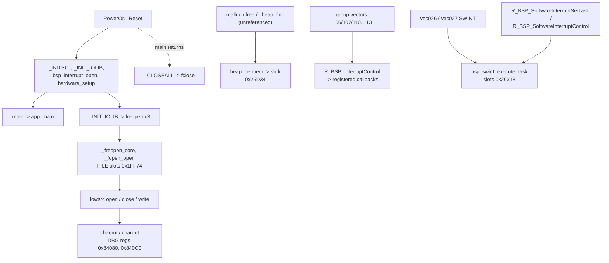

# MAIN — BSP, exception vectors and C runtime

The board-support code of the MAIN image: the Renesas RX BSP pieces that sit around `PowerON_Reset` (interrupt enable/disable,
the software-interrupt task queue, the group-interrupt dispatchers), the fixed exception vectors, the CC-RX intrinsic helpers and
the CC-RX C library (lowsrc I/O, stdio FILE handling, heap). The boot order itself (`PowerON_Reset`, `_INITSCT`, `_INIT_IOLIB`,
`bsp_interrupt_open`, `hardware_setup`, `R_Systeminit`, `main`) and the vector table are on the [overview](README.md#reset-and-boot-flow);
the Code Generator peripheral drivers are on [sci.md](sci.md) and [peripherals.md](peripherals.md).

Sources: `decomp/main/` (0xFFF8F658..0xFFF92014 and 0xFFFEDD9A..0xFFFEE2B0), the plate comments in `tools/ghidra/names_main.tsv`
(sections "boot / runtime", "CC-RX intrinsic helpers" T21h/T21i, "CC-RX C library" #78) and `names_main.T10a.tsv`. Claims are tagged
**[fact]** (seen in code) or **[inference]** (evidence given), and unsettled points are open questions; the library names are **[inference]** from the code shape (the image has no
symbols).

## Overview

- **Exceptions.** The fixed vectors point at `SuperVisorInst`, `AccessExc`, `UndefinedInst`, `FloatingPoint` and `NMI`; 225 of the 256
  relocatable vectors share `Undefined_0xD8` 0xFFF90802, and `vec016_BSC_BUSERR` handles the bus error **[fact]**
  ([vector table](README.md#vector-table)).
- **Interrupt helpers.** `R_BSP_InterruptRequestEnable` / `Disable` set or clear bit `v & 7` of ICU IER[v >> 3] (0x87200 + v/8) for a
  vector number **[fact]**. The group interrupts (`vec106_GROUPBE0`, `vec107_GROUPBL2`, `vec110_GROUPBL0`, `vec111_GROUPBL1`,
  `vec112_GROUPAL0`, `vec113_GROUPAL1`) call the callbacks registered by `R_BSP_InterruptWrite` through `R_BSP_InterruptControl`
  **[fact]**; the SCI TEI/ERI callbacks are the main users ([sci.md](sci.md#interrupt-wiring)).
- **Software-interrupt task queue.** `R_BSP_SoftwareInterruptSetTask` queues a function in one of the slots of unit 0 (SWINT, vector 27)
  or unit 1 (SWINT2, vector 26); `R_BSP_SoftwareInterruptControl` dispatches commands 0..12 to the `bsp_swint_*` helpers (priority,
  request, nesting, clear task, task status, access lock); `vec027_ICU_SWINT` / `vec026_ICU_SWINT2` run `bsp_swint_execute_task`
  **[fact]**. The slot array is at 0x20318 (0xC bytes per slot, 0x6C per unit), the counters at 0x142C / 0x142E / 0x1430 **[fact]**.
  The names follow the Renesas FIT `r_bsp` software-interrupt API **[inference]**.
- **CC-RX intrinsics.** `get_bpsw`, `get_bpc`, `get_extb`, `get_acc_hi`, `get_acc_mi` each return a control register or an
  accumulator part in R1 and have no callers **[fact]**.
- **C library.** lowsrc `open` / `close` / `write` / `charput` / `charget` (E1/E2 virtual console through the DBG registers 0x84080..0x840C0)
  and `sbrk` (heap pointer 0x25D34, limit 0x207F4) **[fact]**. On top: `freopen`, `fclose`, `fflush`, `_freopen_core`, the FILE slots
  (20 at 0x1FF74) and a first-fit heap (`malloc`, `free`, `_heap_find`, `heap_getmem`, free list 0x25E5C). Only `_INIT_IOLIB`
  (freopen of the three std streams) and `_CLOSEALL` reach this code; `malloc` is linked but its only caller `_file_alloc` is
  unreferenced, so the heap is dead code **[fact]** (#78).

## Functions

| Address | Ghidra name | Inferred name | Purpose |
|---|---|---|---|
| 0xFFF8F8BB | `charput` |  | lowsrc charput: waits for DBG_DBGSTAT (0x840C0) bit 8 clear, writes DBG_C2E0 (0x84080); E1/E2 virtual console, called by write (T23a) **[fact]** |
| 0xFFF8F8D8 | `charget` |  | lowsrc charget: waits for DBG_DBGSTAT (0x840C0) bit 12, returns DBG_E2C0 (0x84090) & 0xFF; E1/E2 virtual console (T23a) **[fact]** |
| 0xFFF8F9DD | `_CLOSEALL` |  | CC-RX runtime: closes the 20 stdio slots at 0x1FF74 (reached only if main returns) **[inference]** |
| 0xFFF8FA1B | `open` |  | lowsrc open(name, mode): matches "C:\stdin"/"C:\stdout"/"C:\stderr" (0xFFF8F2E9/F4/0x300), stores the mode in the fd flag bytes 0x1404..0x1406 **[inference]** |
| 0xFFF8FAC2 | `close` |  | lowsrc close(fd): returns 1, no-op **[inference]** |
| 0xFFF8FACD | `write` |  | lowsrc write(fd, buf, n): fd 1/2 with a write flag in 0x1404[fd] -> charput (FUN_fff8f8bb) per byte; fd 0 -> -1 **[inference]** |
| 0xFFF8FF82 | `R_BSP_InterruptRequestEnable` |  | Sets bit (v & 7) of ICU IER[v >> 3] (0x87200 + v/8) for vector v; Renesas BSP R_BSP_InterruptRequestEnable (T23a) **[fact]** |
| 0xFFF8FFA3 | `R_BSP_InterruptRequestDisable` |  | Clears bit (v & 7) of ICU IER[v >> 3] (0x87200 + v/8) for vector v; Renesas BSP R_BSP_InterruptRequestDisable (T23a) **[fact]** |
| 0xFFF905AD | `SuperVisorInst` |  | calls `R_BSP_InterruptControl`; 23 B, callers: 2 **[fact]** (code shape) |
| 0xFFF905C4 | `AccessExc` |  | calls `R_BSP_InterruptControl`; 23 B, callers: 2 **[fact]** (code shape) |
| 0xFFF905DB | `UndefinedInst` |  | calls `R_BSP_InterruptControl`; 23 B, callers: 2 **[fact]** (code shape) |
| 0xFFF905F2 | `FloatingPoint` |  | calls `R_BSP_InterruptControl`; 41 B, callers: 2 **[fact]** (code shape) |
| 0xFFF9061B | `NMI` |  | calls `R_BSP_InterruptControl`; 487 B, callers: 2 **[fact]** (code shape) |
| 0xFFF90802 | `Undefined_0xD8` |  | calls `R_BSP_InterruptControl`; 23 B, callers: 232 **[fact]** (code shape) |
| 0xFFF90819 | `vec016_BSC_BUSERR` |  | calls `R_BSP_InterruptControl`; 30 B, callers: 2 **[fact]** (code shape) |
| 0xFFF90A96 | `R_BSP_SoftwareInterruptSetTask` |  | (unit, fn, arg,...): queues fn in the next of 8 slots (counters 0x142C/0x142E) under the access lock; 6 = no function **[fact]** |
| 0xFFF90BA6 | `bsp_swint_get_interrupt_information` |  | cmd 0: IPR (0x87303) & 0xF, IER bit, IR (0x8701A/B) bit and the nested flag 0x1432/3 into arg[0..3] **[fact]** |
| 0xFFF90C36 | `bsp_swint_enable_interrupt` |  | cmd 1: R_BSP_InterruptRequestEnable(0x1B unit 0 / 0x1A unit 1) **[fact]** |
| 0xFFF90C56 | `bsp_swint_disable_interrupt` |  | cmd 2: R_BSP_InterruptRequestDisable(0x1B / 0x1A) **[fact]** |
| 0xFFF90C76 | `bsp_swint_set_interrupt_priority` |  | cmd 3: priority < 16 written to the IPR with the IER bit saved and cleared around it **[fact]** |
| 0xFFF90D21 | `bsp_swint_set_interrupt_request` |  | cmd 4: ICU SWINTR / SWINT2R (0x872E0 / 0x872E1) \|= 1 **[fact]** |
| 0xFFF90D42 | `bsp_swint_clear_interrupt_request` |  | cmd 5: IR027 / IR026 (0x8701B / 0x8701A) &= ~1 **[fact]** |
| 0xFFF90D63 | `bsp_swint_enable_nested_interrupt` |  | cmd 6: nested flag 0x1432[unit] = 1 **[fact]** |
| 0xFFF90D74 | `bsp_swint_disable_nested_interrupt` |  | cmd 7: nested flag 0x1432[unit] = 0 **[fact]** |
| 0xFFF90D85 | `bsp_swint_clear_task` |  | cmd 8: removes one of the 9 task slots (0x20318 + 0xC*i + 0x6C*unit) unless it is running (status 2) **[fact]** |
| 0xFFF90E3C | `bsp_swint_clear_all_task` |  | cmd 9: resets all 9 slots to a dummy task and the queue counters 0x142C/0x142E/0x1430 **[fact]** |
| 0xFFF90F30 | `bsp_swint_get_all_task_status` |  | cmd 10: copies the 9 {status, function, argument} slots to arg **[fact]** |
| 0xFFF90F9B | `R_BSP_SoftwareInterruptControl` |  | (unit 0/1, cmd 0..12, arg): switch over the bsp_swint_* helpers; unit 0 = SWINT (vector 27), 1 = SWINT2 (vector 26); 3 = bad unit, 5 = bad cmd; the Renesas BSP software-interrupt API with the same command order **[fact]** |
| 0xFFF91059 | `bsp_swint_get_access_control` |  | Exchanges the access word 0x20310[unit] with *arg; true when the lock was free (1) **[fact]** |
| 0xFFF91087 | `bsp_swint_release_access_control` |  | Exchanges back into 0x20310[unit]; true when it now holds 1 **[fact]** |
| 0xFFF910C3 | `bsp_swint_execute_task` |  | Runs the queued tasks of a unit in ring order (status 1 -> 2 -> fn(arg)), optional nesting via FUN_fff8fd84; called from the SWINT ISRs **[fact]** |
| 0xFFF9120A | `vec027_ICU_SWINT` |  | calls `bsp_swint_execute_task`; 15 B, callers: 2 **[fact]** (code shape) |
| 0xFFF91219 | `vec026_ICU_SWINT2` |  | calls `bsp_swint_execute_task`; 15 B, callers: 2 **[fact]** (code shape) |
| 0xFFF9124C | `get_bpsw` |  | CC-RX intrinsic: return BPSW in R1 (SUB #8,SP; save via [SP]; RTSD #8); no callers **[inference]** |
| 0xFFF91263 | `get_bpc` |  | CC-RX intrinsic: return BPC in R1 (SUB #8,SP; save via [SP]; RTSD #8); no callers **[inference]** |
| 0xFFF9127A | `get_extb` |  | CC-RX intrinsic: return EXTB in R1 (SUB #8,SP; save via [SP]; RTSD #8); no callers **[inference]** |
| 0xFFF91295 | `get_acc_hi` |  | CC-RX intrinsic: return ACC bits 63..32 (MVFACHI #0,A0) in R1 (SUB #8,SP; save via [SP]; RTSD #8); no callers **[inference]** |
| 0xFFF912A8 | `get_acc_mi` |  | CC-RX intrinsic: return ACC bits 47..16 (MVFACMI #0,A0) in R1 (SUB #8,SP; save via [SP]; RTSD #8); no callers **[inference]** |
| 0xFFF912C7 | `sbrk` |  | lowsrc sbrk(size): advances the heap pointer at 0x25D34 if the new end is <= 0x207F4; only caller heap_getmem **[inference]** |
| 0xFFF9174A | `vec110_GROUPBL0` |  | calls `R_BSP_InterruptControl`; 884 B, callers: 2 **[fact]** (code shape) |
| 0xFFF91ABE | `vec111_GROUPBL1` |  | calls `R_BSP_InterruptControl`; 736 B, callers: 2 **[fact]** (code shape) |
| 0xFFF91D9E | `vec107_GROUPBL2` |  | calls `R_BSP_InterruptControl`; 46 B, callers: 2 **[fact]** (code shape) |
| 0xFFF91DCC | `vec112_GROUPAL0` |  | calls `R_BSP_InterruptControl`; 316 B, callers: 2 **[fact]** (code shape) |
| 0xFFF91F08 | `vec113_GROUPAL1` |  | calls `R_BSP_InterruptControl`; 166 B, callers: 2 **[fact]** (code shape) |
| 0xFFF91FAE | `vec106_GROUPBE0` |  | calls `R_BSP_InterruptControl`; 102 B, callers: 2 **[fact]** (code shape) |
| 0xFFFEDD9A | `freopen` |  | freopen(name, mode, fp): fclose(fp) then _freopen_core; called by _INIT_IOLIB for stdin/stdout/stderr **[inference]** |
| 0xFFFEDDC9 | `fclose` |  | fclose(fp): fflush, free the buffer, close(fd), release the FILE slot; called by freopen and _CLOSEALL **[inference]** |
| 0xFFFEDE1D | `strncmp` |  | strncmp(a, b, n), byte compare up to n **[inference]** |
| 0xFFFEDE41 | `__udiv64` |  | CC-RX runtime library function, matched by idiom (score 0.800, T23d): (u64 n in R1:R2, u64 d in R3:R4) -> quotient: 16-bit long-division fast paths, then normalise + 64-step shift/subtract; between strncmp and _INITSCT in the … **[inference]** |
| 0xFFFEDF24 | `fflush` |  | fflush(fp) (fp=0: all 20 slots at 0x1FF74), writes the pending buffer with write() **[inference]** |
| 0xFFFEDFA7 | `_freopen_core` |  | Parses the mode string ("r"/"w"/"a", "+", "b"), calls _fopen_open, sets up the FILE **[inference]** |
| 0xFFFEE07D | `_file_alloc` |  | Takes a free FILE from the 20 slots at 0x1FF74 or mallocs a new 0x48-byte one; no callers (fopen not linked) **[inference]** |
| 0xFFFEE0C2 | `_file_release` |  | Resets a static FILE (std streams) or drops a malloc'ed one from the slot table and frees it **[inference]** |
| 0xFFFEE10B | `free` |  | free(p): 8-byte header (size, next), inserts into the address-ordered free list at 0x25E5C and merges neighbours **[inference]** |
| 0xFFFEE18E | `_fopen_open` |  | Maps the parsed mode bits to open() flags (perm 0666, or 0600 for exclusive) and calls open **[inference]** |
| 0xFFFEE1BE | `_heap_find` |  | First-fit search of the free list at 0x25E5C (from the rover 0x25E58); grows the heap via heap_getmem in >= 1 KB steps; the 244 bytes T05 saw as undefined data (#78) **[inference]** |
| 0xFFFEE239 | `malloc` |  | malloc(n): size (n+15)&~7, minimum 8, splits the block from _heap_find; only caller _file_alloc (unreferenced), so dead code **[inference]** |
| 0xFFFEE29C | `heap_getmem` |  | sbrk wrapper: returns 0 for size < 1 or when sbrk fails **[inference]** |
The boot-chain functions (`PowerON_Reset`, `_INITSCT`, `_INIT_IOLIB`, `bsp_callbacks_clear`, `bsp_interrupt_open`, `icu_select_init`,
`hardware_setup`, `R_Systeminit`, `R_BSP_InterruptControl`, `main`) are in the step table of the [overview](README.md#steps-in-detail).

## Data structures and globals

| Address | Meaning |
|---|---|
| 0x1404..0x1406 | lowsrc fd flag bytes of stdin / stdout / stderr (`open`, `write`) **[fact]** |
| 0x142C / 0x142E / 0x1430 | software-interrupt queue counters (`R_BSP_SoftwareInterruptSetTask`, `bsp_swint_clear_all_task`) **[fact]** |
| 0x1432 / 0x1433 | nested-interrupt flag per unit (`bsp_swint_enable_nested_interrupt`) **[fact]** |
| 0x1FF74 | 20 stdio FILE slots (`_INIT_IOLIB`, `fflush`, `_CLOSEALL`) **[fact]** |
| 0x20310 | access-control word per unit (`bsp_swint_get_access_control`) **[fact]** |
| 0x20318 | software-interrupt task slots, 9 × 0xC bytes {status, function, argument} per unit, unit stride 0x6C **[fact]** |
| 0x25D34 | heap break pointer (`sbrk`), limit 0x207F4 **[fact]** |
| 0x25E58 / 0x25E5C | heap rover / address-ordered free list (`_heap_find`, `free`) **[fact]** |
| 0x84080 / 0x84090 / 0x840C0 | DBG C2E0 / E2C0 / DBGSTAT: the E1/E2 virtual console of `charput` / `charget` **[fact]** |

## Open questions

- `R_BSP_SoftwareInterruptSetTask` has no caller in V01-12 **[fact]**, so the software-interrupt queue is probably never filled and
  `vec026` / `vec027` only run empty slots **[inference]**; whether SWINT is ever requested was not traced.

<!-- T23e3:begin -->

### More functions (T23e round 3)

Named in the T23e round-3 batch for MAIN (`tools/ghidra/names_main.T23e3.tsv`); they show in `decomp/main` after the next Ghidra apply and re-export.

| Address | Ghidra name | Inferred name | Purpose |
|---|---|---|---|
| 0xFFF8FC4D | `R_BSP_GetIClkFreqHz` |  | Returns get_iclk_freq_hz() **[fact: fff8fc4d]**; Renesas BSP API name **[inference]** |
| 0xFFF8FC57 | `R_BSP_SoftwareDelay` |  | (delay, units): units must be 1000000 / 1000 / 1 (us / ms / s); cycles = ICLK * delay / units, minus overhead, / 4, then a spin loop **[fact: fff8fc57]**; Renesas BSP API **[inference]** |
| 0xFFF8FE3C | `R_BSP_RegisterProtectEnable` |  | (region): the counterpart of R_BSP_RegisterProtectDisable (counter 0x1B5FC, PWPR / PRCR) **[fact: fff8fe3c]**; BSP name **[inference]** |
| 0xFFF8FEC0 | `R_BSP_RegisterProtectDisable` |  | (region): counter 0x1B5FC[region]; on the first disable clears MPC PWPR.B0WI and sets PFSWE (region 3) or ORs the PRCR bit with key 0xA5 (others), inside R_BSP_InterruptControl(0x5E, 6/5) **[fact: fff8fec0]**; Renesas BSP API **[inference]** |
| 0xFFF901F8 | `bsp_interrupt_group_enable_disable` |  | (vector, enable, ipl) of R_BSP_InterruptControl: for the group vectors sets/clears ICU IPR106 (GROUPBE0, checking GENBE0) / IPR110 (GROUPBL0) etc. with R_BSP_InterruptRequestDisable/Enable around it; ipl 1..15 checked **[fact: fff901f8]**; matches the Renesas BSP static function of that name **[inference]** |
| 0xFFF90837 | `R_BSP_SoftwareLock` |  | (*lock): exchanges 1 into the lock word, returns true when it was 0 **[fact: fff90837]**; Renesas BSP name **[inference]** |
| 0xFFF9085E | `R_BSP_SoftwareUnlock` |  | (*lock): writes 0, returns true **[fact: fff9085e]**; Renesas BSP name **[inference]** |
| 0xFFF9086C | `R_BSP_HardwareLock` |  | (lock id): R_BSP_SoftwareLock on the lock word 0x1FFC4 + id*4 **[fact: fff9086c]**; Renesas BSP name **[inference]** |
| 0xFFF90885 | `R_BSP_HardwareUnlock` |  | (lock id): R_BSP_SoftwareUnlock on 0x1FFC4 + id*4 **[fact: fff90885]**; Renesas BSP name **[inference]** |
| 0xFFF9089E | `R_BSP_SoftwareInterruptOpen` |  | (unit 0/1): takes hardware lock 0x72/0x73, clears and disables the software interrupt, empties its 9-entry task table 0x20318 + unit*0x6C, then enables it via R_BSP_SoftwareInterruptControl **[fact: fff9089e]**; Renesas BSP API name **[inference]** |
| 0xFFF909AF | `R_BSP_SoftwareInterruptClose` |  | (unit): disables the software interrupt, empties the task table, releases hardware lock 0x72/0x73 **[fact: fff909af]**; no caller in the export; Renesas BSP API name **[inference]** |
| 0xFFF91303 | `get_iclk_freq_hz` |  | ICLK in Hz from SCKCR3 CKSEL (PLL: HOCO 16/18/20 MHz or 24 MHz main, PLLCR divider and multiplier; HOCO; LOCO 240 kHz; sub 32768 Hz; main 24 MHz) >> SCKCR.ICK **[fact: fff91303]** |
| 0xFFF913DB | `mcu_clock_setup` |  | PRCR unlock, clock_source_select, SCKCR = 0x21C21222, SCKCR2 = 0x11, SCKCR3 = 0x400 (PLL), LOCO off, R_BSP_SoftwareDelay(25 us), PRCR lock **[fact: fff913db]**; only caller hw_init_clock; BSP name **[inference]** |
| 0xFFF91495 | `clock_source_select` |  | Oscillator set-up: MOFCR, HOCO power, main oscillator wait MOSCWTCR = 0x53 and start, sub-clock / RTC RCR3/RCR4 on cold reset, PLLCR = 0x1300 class and PLL start, ROMWT = 2 **[fact: fff91495]**; matches the Renesas BSP mcu_clocks.c function **[inference]** |
| 0xFFF92475 | `mpc_pin_functions_init` |  | MPC pin functions inside RegisterProtectDisable/Enable(3): ASEL (PFS = 0x80, input) for P41..P43, P45..P47, PD0, PD1, P91, P93, P03; PSEL 0x0A/0x0B (SCI) for P00, P01, P12, P13, P23, P25..P27, P30, P32, P33, P90, P92, PB0, PB1, PC2, PC3 **[fact: fff92475]**; no caller in the export |

<!-- T23e3:end -->
