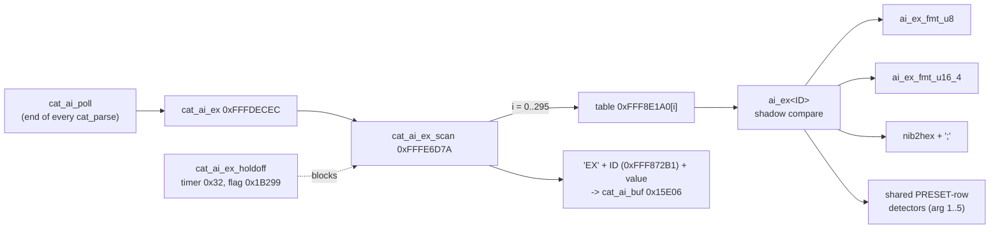

# MAIN — CAT auto information for the EX menu (change detectors)

With auto information (AI) on, the radio reports a changed EX-menu setting by itself as `EX` + item ID + value + `;`. This page is
the catalogue of the 296 per-item change detectors behind that and their two value formatters. The AI broadcaster, the other
~70 detectors and the hold-off are on [cat.md](cat.md) (overview, "Auto information"); the menu items themselves are on
[menu.md](menu.md) and [menu-items.md](menu-items.md).

Sources: `decomp/main/` (0xFFFE6D7A..0xFFFEC46C), the plate comments in `tools/ghidra/names_main.tsv` (section "CAT AI for the EX
menu (#70/#71)"), the table at 0xFFF8E1A0 and the ID list at 0xFFF872B1 (described in [ui-keys.md](ui-keys.md), where the table was
first told apart from the key tables). Claims are tagged **[fact]** (seen in code or data) or **[inference]** (evidence given); unsettled points are open questions.

## Overview

- `cat_ai_ex` 0xFFFDECEC is one of the detectors of the AI broadcaster `cat_ai_poll`. It runs `cat_ai_ex_scan` 0xFFFE6D7A and copies
  the frame to `cat_ai_buf` 0x15E06 **[fact]**.
- `cat_ai_ex_scan` calls the 296 detectors of the code-pointer table **0xFFF8E1A0** in turn until one sets the reply length 0x1FF12; it
  then builds `EX` + the i-th 8-character ID from the list at **0xFFF872B1** (`EX010101` … `EX060518`) + the value at 0x1B23D **[fact]**.
  It is held off while 0x1B299 = 1 and soft timer 0x32 runs; `cat_ai_ex_holdoff` 0xFFFE6E26 sets both after an EX set (200 ms)
  **[fact]**.
- **Detector *i*** (`ai_ex<ID>`, named after the i-th ID) compares one setting with its own shadow byte (0x1B29A upwards), and on a
  change stores the new value in the shadow and formats it into 0x1B23D: `ai_ex_fmt_u8` (2 or 3 digits, or signed), `ai_ex_fmt_u16_4`
  (4 digits), or one `nib2hex` digit followed by `;` (length 10) **[fact]**. Settings kept per VFO (FM repeater shift, tone) are read
  from the active VFO record, and the big-endian words (`*_be`) are joined first **[fact]**.
- **PRESET rows.** The 90 detectors of EX06 (PRESET1..5) are 6-byte stubs that call one shared detector per row with an argument
  1..5, which selects `g_opstate.presets[arg − 1]` (seen in `FUN_fffead00`) **[fact for that row; inference for the others]**.

## Functions

| Address | Ghidra name | Inferred name | Purpose |
|---|---|---|---|
| 0xFFFE6E3A | `ai_ex010101` | | `EX010101`, entry 0 of 0xFFF8E1A0: compares `g_opstate.ex010101_af_treble_gain` with its shadow 0x1B29A; on a change copies it and formats the value (`ai_ex_fmt_u8`) **[fact]** |
| 0xFFFE6E77 | `ai_ex010102` | | `EX010102`, entry 1 of 0xFFF8E1A0: compares `g_opstate.ex010102_af_middle_tone_gain` with its shadow 0x1B29B; on a change copies it and formats the value (`ai_ex_fmt_u8`) **[fact]** |
| 0xFFFE6EB4 | `ai_ex010103` | | `EX010103`, entry 2 of 0xFFF8E1A0: compares `g_opstate.ex010103_af_bass_gain` with its shadow 0x1B29C; on a change copies it and formats the value (`ai_ex_fmt_u8`) **[fact]** |
| 0xFFFE6EF1 | `ai_ex010104` | | `EX010104`, entry 3 of 0xFFF8E1A0: compares `g_opstate.ex010104_agc_fast_delay` with its shadow 0x1B29D; on a change copies it and formats the value (`ai_ex_fmt_u16_4`) **[fact]** |
| 0xFFFE6F39 | `ai_ex010105` | | `EX010105`, entry 4 of 0xFFF8E1A0: compares `g_opstate.ex010105_agc_mid_delay` with its shadow 0x1B29E; on a change copies it and formats the value (`ai_ex_fmt_u16_4`) **[fact]** |
| 0xFFFE6F81 | `ai_ex010106` | | `EX010106`, entry 5 of 0xFFF8E1A0: compares `g_opstate.ex010106_agc_slow_dely` with its shadow 0x1B29F; on a change copies it and formats the value (`ai_ex_fmt_u16_4`) **[fact]** |
| 0xFFFE6FC9 | `ai_ex010107` | | `EX010107`, entry 6 of 0xFFF8E1A0: compares `g_opstate.ex010107_lcut_freq` with its shadow 0x1B2A0; on a change copies it and formats the value (`ai_ex_fmt_u8`) **[fact]** |
| 0xFFFE7006 | `ai_ex010108` | | `EX010108`, entry 7 of 0xFFF8E1A0: compares `g_opstate.ex010108_lcut_slope` with its shadow 0x1B2A1; on a change copies it and formats the value (`nib2hex`) **[fact]** |
| 0xFFFE7052 | `ai_ex010109` | | `EX010109`, entry 8 of 0xFFF8E1A0: compares `g_opstate.ex010109_hcut_freq` with its shadow 0x1B2A2; on a change copies it and formats the value (`ai_ex_fmt_u8`) **[fact]** |
| 0xFFFE708F | `ai_ex010110` | | `EX010110`, entry 9 of 0xFFF8E1A0: compares `g_opstate.ex010110_hcut_slope` with its shadow 0x1B2A3; on a change copies it and formats the value (`nib2hex`) **[fact]** |
| 0xFFFE70DB | `ai_ex010111` | | `EX010111`, entry 10 of 0xFFF8E1A0: compares `g_opstate.ex010111_usb_out_level` with its shadow 0x1B2A4; on a change copies it and formats the value (`ai_ex_fmt_u8`) **[fact]** |
| 0xFFFE7118 | `ai_ex010112` | | `EX010112`, entry 11 of 0xFFF8E1A0: compares `g_opstate.ex010112_rear_out_level` with its shadow 0x1B2A5; on a change copies it and formats the value (`ai_ex_fmt_u8`) **[fact]** |
| 0xFFFE7155 | `ai_ex010113` | | `EX010113`, entry 12 of 0xFFF8E1A0: compares `g_opstate.ex010113_tx_bpf_sel` with its shadow 0x1B2A6; on a change copies it and formats the value (`nib2hex`) **[fact]** |
| 0xFFFE71A1 | `ai_ex010114` | | `EX010114`, entry 13 of 0xFFF8E1A0: compares `g_opstate.ex010114_mod_source` with its shadow 0x1B2A7; on a change copies it and formats the value (`nib2hex`) **[fact]** |
| 0xFFFE71ED | `ai_ex010115` | | `EX010115`, entry 14 of 0xFFF8E1A0: compares `g_opstate.ex010115_usb_mod_gain` with its shadow 0x1B2A8; on a change copies it and formats the value (`ai_ex_fmt_u8`) **[fact]** |
| 0xFFFE722A | `ai_ex010116` | | `EX010116`, entry 15 of 0xFFF8E1A0: compares `g_opstate.ex010116_rear_mod_gain` with its shadow 0x1B2A9; on a change copies it and formats the value (`ai_ex_fmt_u8`) **[fact]** |
| 0xFFFE7267 | `ai_ex010117` | | `EX010117`, entry 16 of 0xFFF8E1A0: compares `g_opstate.ex010117_rptt_select` with its shadow 0x1B2AA; on a change copies it and formats the value (`nib2hex`) **[fact]** |
| 0xFFFE72B3 | `ai_ex010118` | | `EX010118`, entry 17 of 0xFFF8E1A0: compares `g_opstate.ex010118_nar_width` with its shadow 0x1B2AB; on a change copies it and formats the value (`ai_ex_fmt_u8`) **[fact]** |
| 0xFFFE72F0 | `ai_ex010119` | | `EX010119`, entry 18 of 0xFFF8E1A0: compares `g_opstate.ex010119_cw_auto_mode` with its shadow 0x1B2AC; on a change copies it and formats the value (`nib2hex`) **[fact]** |
| 0xFFFE733C | `ai_ex010201` | | `EX010201`, entry 19 of 0xFFF8E1A0: compares `g_opstate.ex010201_af_treble_gain` with its shadow 0x1B2AD; on a change copies it and formats the value (`ai_ex_fmt_u8`) **[fact]** |
| 0xFFFE7379 | `ai_ex010202` | | `EX010202`, entry 20 of 0xFFF8E1A0: compares `g_opstate.ex010202_af_middle_tone_gain` with its shadow 0x1B2AE; on a change copies it and formats the value (`ai_ex_fmt_u8`) **[fact]** |
| 0xFFFE73B6 | `ai_ex010203` | | `EX010203`, entry 21 of 0xFFF8E1A0: compares `g_opstate.ex010203_af_bass_gain` with its shadow 0x1B2AF; on a change copies it and formats the value (`ai_ex_fmt_u8`) **[fact]** |
| 0xFFFE73F3 | `ai_ex010204` | | `EX010204`, entry 22 of 0xFFF8E1A0: compares `g_opstate.ex010204_agc_fast_delay` with its shadow 0x1B2B0; on a change copies it and formats the value (`ai_ex_fmt_u16_4`) **[fact]** |
| 0xFFFE743B | `ai_ex010205` | | `EX010205`, entry 23 of 0xFFF8E1A0: compares `g_opstate.ex010205_agc_mid_delay` with its shadow 0x1B2B1; on a change copies it and formats the value (`ai_ex_fmt_u16_4`) **[fact]** |
| 0xFFFE7483 | `ai_ex010206` | | `EX010206`, entry 24 of 0xFFF8E1A0: compares `g_opstate.ex010206_agc_slow_delay` with its shadow 0x1B2B2; on a change copies it and formats the value (`ai_ex_fmt_u16_4`) **[fact]** |
| 0xFFFE74CB | `ai_ex010207` | | `EX010207`, entry 25 of 0xFFF8E1A0: compares `g_opstate.ex010207_lcut_freq` with its shadow 0x1B2B3; on a change copies it and formats the value (`ai_ex_fmt_u8`) **[fact]** |
| 0xFFFE7508 | `ai_ex010208` | | `EX010208`, entry 26 of 0xFFF8E1A0: compares `g_opstate.ex010208_lcut_slope` with its shadow 0x1B2B4; on a change copies it and formats the value (`nib2hex`) **[fact]** |
| 0xFFFE7554 | `ai_ex010209` | | `EX010209`, entry 27 of 0xFFF8E1A0: compares `g_opstate.ex010209_hcut_freq` with its shadow 0x1B2B5; on a change copies it and formats the value (`ai_ex_fmt_u8`) **[fact]** |
| 0xFFFE7591 | `ai_ex010210` | | `EX010210`, entry 28 of 0xFFF8E1A0: compares `g_opstate.ex010210_hcut_slope` with its shadow 0x1B2B6; on a change copies it and formats the value (`nib2hex`) **[fact]** |
| 0xFFFE75DD | `ai_ex010211` | | `EX010211`, entry 29 of 0xFFF8E1A0: compares `g_opstate.ex010211_usb_out_level` with its shadow 0x1B2B7; on a change copies it and formats the value (`ai_ex_fmt_u8`) **[fact]** |
| 0xFFFE761A | `ai_ex010212` | | `EX010212`, entry 30 of 0xFFF8E1A0: compares `g_opstate.ex010212_rear_out_level` with its shadow 0x1B2B8; on a change copies it and formats the value (`ai_ex_fmt_u8`) **[fact]** |
| 0xFFFE7657 | `ai_ex010213` | | `EX010213`, entry 31 of 0xFFF8E1A0: compares `g_opstate.ex010213_tx_bpf_sel` with its shadow 0x1B2B9; on a change copies it and formats the value (`nib2hex`) **[fact]** |
| 0xFFFE76A3 | `ai_ex010214` | | `EX010214`, entry 32 of 0xFFF8E1A0: compares `g_opstate.ex010214_mod_source` with its shadow 0x1B2BA; on a change copies it and formats the value (`nib2hex`) **[fact]** |
| 0xFFFE76EF | `ai_ex010215` | | `EX010215`, entry 33 of 0xFFF8E1A0: compares `g_opstate.ex010215_usb_mod_gain` with its shadow 0x1B2BB; on a change copies it and formats the value (`ai_ex_fmt_u8`) **[fact]** |
| 0xFFFE772C | `ai_ex010216` | | `EX010216`, entry 34 of 0xFFF8E1A0: compares `g_opstate.ex010216_rear_mod_gain` with its shadow 0x1B2BC; on a change copies it and formats the value (`ai_ex_fmt_u8`) **[fact]** |
| 0xFFFE7769 | `ai_ex010217` | | `EX010217`, entry 35 of 0xFFF8E1A0: compares `g_opstate.ex010217_rptt_select` with its shadow 0x1B2BD; on a change copies it and formats the value (`nib2hex`) **[fact]** |
| 0xFFFE77B5 | `ai_ex010301` | | `EX010301`, entry 36 of 0xFFF8E1A0: compares `g_opstate.ex010301_af_treble_gain` with its shadow 0x1B2BE; on a change copies it and formats the value (`ai_ex_fmt_u8`) **[fact]** |
| 0xFFFE77F2 | `ai_ex010302` | | `EX010302`, entry 37 of 0xFFF8E1A0: compares `g_opstate.ex010302_af_middle_tone_gain` with its shadow 0x1B2BF; on a change copies it and formats the value (`ai_ex_fmt_u8`) **[fact]** |
| 0xFFFE782F | `ai_ex010303` | | `EX010303`, entry 38 of 0xFFF8E1A0: compares `g_opstate.ex010303_af_bass_gain` with its shadow 0x1B2C0; on a change copies it and formats the value (`ai_ex_fmt_u8`) **[fact]** |
| 0xFFFE786C | `ai_ex010304` | | `EX010304`, entry 39 of 0xFFF8E1A0: compares `g_opstate.ex010304_agc_fast_delay` with its shadow 0x1B2C1; on a change copies it and formats the value (`ai_ex_fmt_u16_4`) **[fact]** |
| 0xFFFE78B4 | `ai_ex010305` | | `EX010305`, entry 40 of 0xFFF8E1A0: compares `g_opstate.ex010305_agc_mid_delay` with its shadow 0x1B2C2; on a change copies it and formats the value (`ai_ex_fmt_u16_4`) **[fact]** |
| 0xFFFE78FC | `ai_ex010306` | | `EX010306`, entry 41 of 0xFFF8E1A0: compares `g_opstate.ex010306_agc_slow_delay` with its shadow 0x1B2C3; on a change copies it and formats the value (`ai_ex_fmt_u16_4`) **[fact]** |
| 0xFFFE7944 | `ai_ex010307` | | `EX010307`, entry 42 of 0xFFF8E1A0: compares `g_opstate.ex010307_lcut_freq` with its shadow 0x1B2C4; on a change copies it and formats the value (`ai_ex_fmt_u8`) **[fact]** |
| 0xFFFE7981 | `ai_ex010308` | | `EX010308`, entry 43 of 0xFFF8E1A0: compares `g_opstate.ex010308_lcut_slope` with its shadow 0x1B2C5; on a change copies it and formats the value (`nib2hex`) **[fact]** |
| 0xFFFE79CD | `ai_ex010309` | | `EX010309`, entry 44 of 0xFFF8E1A0: compares `g_opstate.ex010309_hcut_freq` with its shadow 0x1B2C6; on a change copies it and formats the value (`ai_ex_fmt_u8`) **[fact]** |
| 0xFFFE7A0A | `ai_ex010310` | | `EX010310`, entry 45 of 0xFFF8E1A0: compares `g_opstate.ex010310_hcut_slope` with its shadow 0x1B2C7; on a change copies it and formats the value (`nib2hex`) **[fact]** |
| 0xFFFE7A56 | `ai_ex010311` | | `EX010311`, entry 46 of 0xFFF8E1A0: compares `g_opstate.ex010311_usb_out_level` with its shadow 0x1B2C8; on a change copies it and formats the value (`ai_ex_fmt_u8`) **[fact]** |
| 0xFFFE7A93 | `ai_ex010312` | | `EX010312`, entry 47 of 0xFFF8E1A0: compares `g_opstate.ex010312_rear_out_level` with its shadow 0x1B2C9; on a change copies it and formats the value (`ai_ex_fmt_u8`) **[fact]** |
| 0xFFFE7AD0 | `ai_ex010313` | | `EX010313`, entry 48 of 0xFFF8E1A0: compares `g_opstate.ex010313_mod_source` with its shadow 0x1B2CA; on a change copies it and formats the value (`nib2hex`) **[fact]** |
| 0xFFFE7B1C | `ai_ex010314` | | `EX010314`, entry 49 of 0xFFF8E1A0: compares `g_opstate.ex010314_usb_mod_gain` with its shadow 0x1B2CB; on a change copies it and formats the value (`ai_ex_fmt_u8`) **[fact]** |
| 0xFFFE7B59 | `ai_ex010315` | | `EX010315`, entry 50 of 0xFFF8E1A0: compares `g_opstate.ex010315_rear_mod_gain` with its shadow 0x1B2CC; on a change copies it and formats the value (`ai_ex_fmt_u8`) **[fact]** |
| 0xFFFE7B96 | `ai_ex010316` | | `EX010316`, entry 51 of 0xFFF8E1A0: compares `g_opstate.ex010316_rptt_select` with its shadow 0x1B2CD; on a change copies it and formats the value (`nib2hex`) **[fact]** |
| 0xFFFE7BE2 | `ai_ex010317` | | `EX010317`, entry 52 of 0xFFF8E1A0: compares `n` (derived from `g_opstate.active_vfo`, `g_opstate.vfo_a.flags2`, `g_opstate.vfo_b.flags2`) with its shadow 0x1B2CE; on a change copies it and formats the value (`nib2hex`) **[fact]** |
| 0xFFFE7C4C | `ai_ex010318` | | `EX010318`, entry 53 of 0xFFF8E1A0: compares `g_opstate.ex010318_rpt_shift_28mhz` with its shadow 0x1B2CF; on a change copies it and formats the value (`ai_ex_fmt_u16_4`) **[fact]** |
| 0xFFFE7C8F | `ai_ex010319` | | `EX010319`, entry 54 of 0xFFF8E1A0: compares `sVar1` (derived from `g_opstate.ex010319_rpt_shift_50mhz_be[0]`, `g_opstate.ex010319_rpt_shift_50mhz_be[1]`) with its shadow 0x1FF14; on a change copies it and formats the value (`ai_ex_fmt_u16_4`) **[fact]** |
| 0xFFFE7CE1 | `ai_ex010320` | | `EX010320`, entry 55 of 0xFFF8E1A0: compares `local_1` (derived from `g_opstate.active_vfo`, `g_opstate.vfo_a.flags3`, `g_opstate.vfo_b.flags3`) with its shadow 0x1B2D0; on a change copies it and formats the value (`nib2hex`) **[fact]** |
| 0xFFFE7D53 | `ai_ex010321` | | `EX010321`, entry 56 of 0xFFF8E1A0: compares `local_1` (derived from `g_opstate.active_vfo`, `g_opstate.vfo_a.tone_num`, `g_opstate.vfo_b.tone_num`) with its shadow 0x1B2D1; on a change copies it and formats the value (`ai_ex_fmt_u8`) **[fact]** |
| 0xFFFE7DAC | `ai_ex010401` | | `EX010401`, entry 57 of 0xFFF8E1A0: compares `g_opstate.ex010401_af_treble_gain` with its shadow 0x1B2D2; on a change copies it and formats the value (`ai_ex_fmt_u8`) **[fact]** |
| 0xFFFE7DE9 | `ai_ex010402` | | `EX010402`, entry 58 of 0xFFF8E1A0: compares `g_opstate.ex010402_af_middle_tone_gain` with its shadow 0x1B2D3; on a change copies it and formats the value (`ai_ex_fmt_u8`) **[fact]** |
| 0xFFFE7E26 | `ai_ex010403` | | `EX010403`, entry 59 of 0xFFF8E1A0: compares `g_opstate.ex010403_af_bass_gain` with its shadow 0x1B2D4; on a change copies it and formats the value (`ai_ex_fmt_u8`) **[fact]** |
| 0xFFFE7E63 | `ai_ex010404` | | `EX010404`, entry 60 of 0xFFF8E1A0: compares `g_opstate.ex010404_agc_fast_delay` with its shadow 0x1B2D5; on a change copies it and formats the value (`ai_ex_fmt_u16_4`) **[fact]** |
| 0xFFFE7EAB | `ai_ex010405` | | `EX010405`, entry 61 of 0xFFF8E1A0: compares `g_opstate.ex010405_agc_mid_delay` with its shadow 0x1B2D6; on a change copies it and formats the value (`ai_ex_fmt_u16_4`) **[fact]** |
| 0xFFFE7EF3 | `ai_ex010406` | | `EX010406`, entry 62 of 0xFFF8E1A0: compares `g_opstate.ex010406_agc_slow_delay` with its shadow 0x1B2D7; on a change copies it and formats the value (`ai_ex_fmt_u16_4`) **[fact]** |
| 0xFFFE7F3B | `ai_ex010407` | | `EX010407`, entry 63 of 0xFFF8E1A0: compares `g_opstate.ex010407_lcut_freq` with its shadow 0x1B2D8; on a change copies it and formats the value (`ai_ex_fmt_u8`) **[fact]** |
| 0xFFFE7F78 | `ai_ex010408` | | `EX010408`, entry 64 of 0xFFF8E1A0: compares `g_opstate.ex010408_lcut_slope` with its shadow 0x1B2D9; on a change copies it and formats the value (`nib2hex`) **[fact]** |
| 0xFFFE7FC4 | `ai_ex010409` | | `EX010409`, entry 65 of 0xFFF8E1A0: compares `g_opstate.ex010409_hcut_freq` with its shadow 0x1B2DA; on a change copies it and formats the value (`ai_ex_fmt_u8`) **[fact]** |
| 0xFFFE8001 | `ai_ex010410` | | `EX010410`, entry 66 of 0xFFF8E1A0: compares `g_opstate.ex010410_hcut_slope` with its shadow 0x1B2DB; on a change copies it and formats the value (`nib2hex`) **[fact]** |
| 0xFFFE804D | `ai_ex010411` | | `EX010411`, entry 67 of 0xFFF8E1A0: compares `g_opstate.ex010411_usb_out_level` with its shadow 0x1B2DC; on a change copies it and formats the value (`ai_ex_fmt_u8`) **[fact]** |
| 0xFFFE808A | `ai_ex010412` | | `EX010412`, entry 68 of 0xFFF8E1A0: compares `g_opstate.ex010412_rear_out_level` with its shadow 0x1B2DD; on a change copies it and formats the value (`ai_ex_fmt_u8`) **[fact]** |
| 0xFFFE80C7 | `ai_ex010413` | | `EX010413`, entry 69 of 0xFFF8E1A0: compares `g_opstate.ex010413_tx_bpf_sel` with its shadow 0x1B2DE; on a change copies it and formats the value (`nib2hex`) **[fact]** |
| 0xFFFE8113 | `ai_ex010414` | | `EX010414`, entry 70 of 0xFFF8E1A0: compares `g_opstate.ex010414_mod_source` with its shadow 0x1B2DF; on a change copies it and formats the value (`nib2hex`) **[fact]** |
| 0xFFFE815F | `ai_ex010415` | | `EX010415`, entry 71 of 0xFFF8E1A0: compares `g_opstate.ex010415_usb_mod_gain` with its shadow 0x1B2E0; on a change copies it and formats the value (`ai_ex_fmt_u8`) **[fact]** |
| 0xFFFE819C | `ai_ex010416` | | `EX010416`, entry 72 of 0xFFF8E1A0: compares `g_opstate.ex010416_rear_mod_gain` with its shadow 0x1B2E1; on a change copies it and formats the value (`ai_ex_fmt_u8`) **[fact]** |
| 0xFFFE81D9 | `ai_ex010417` | | `EX010417`, entry 73 of 0xFFF8E1A0: compares `g_opstate.ex010417_rptt_select` with its shadow 0x1B2E2; on a change copies it and formats the value (`nib2hex`) **[fact]** |
| 0xFFFE8225 | `ai_ex010418` | | `EX010418`, entry 74 of 0xFFF8E1A0: compares `g_opstate.ex010418_nar_width` with its shadow 0x1B2E3; on a change copies it and formats the value (`ai_ex_fmt_u8`) **[fact]** |
| 0xFFFE8262 | `ai_ex010419` | | `EX010419`, entry 75 of 0xFFF8E1A0: compares `g_opstate.ex010419_psk_tone` with its shadow 0x1B2E4; on a change copies it and formats the value (`nib2hex`) **[fact]** |
| 0xFFFE82AE | `ai_ex010420` | | `EX010420`, entry 76 of 0xFFF8E1A0: compares `sVar1` (derived from `g_opstate.ex010420_data_shift_ssb_be[0]`, `g_opstate.ex010420_data_shift_ssb_be[1]`) with its shadow 0x1FF16; on a change copies it and formats the value (`ai_ex_fmt_u16_4`) **[fact]** |
| 0xFFFE8300 | `ai_ex010501` | | `EX010501`, entry 77 of 0xFFF8E1A0: compares `g_opstate.ex010501_af_treble_gain` with its shadow 0x1B2E5; on a change copies it and formats the value (`ai_ex_fmt_u8`) **[fact]** |
| 0xFFFE833D | `ai_ex010502` | | `EX010502`, entry 78 of 0xFFF8E1A0: compares `g_opstate.ex010502_af_middle_tone_gain` with its shadow 0x1B2E6; on a change copies it and formats the value (`ai_ex_fmt_u8`) **[fact]** |
| 0xFFFE837A | `ai_ex010503` | | `EX010503`, entry 79 of 0xFFF8E1A0: compares `g_opstate.ex010503_af_bass_gain` with its shadow 0x1B2E7; on a change copies it and formats the value (`ai_ex_fmt_u8`) **[fact]** |
| 0xFFFE83B7 | `ai_ex010504` | | `EX010504`, entry 80 of 0xFFF8E1A0: compares `g_opstate.ex010504_agc_fast_delay` with its shadow 0x1B2E8; on a change copies it and formats the value (`ai_ex_fmt_u16_4`) **[fact]** |
| 0xFFFE83FF | `ai_ex010505` | | `EX010505`, entry 81 of 0xFFF8E1A0: compares `g_opstate.ex010505_agc_mid_delay` with its shadow 0x1B2E9; on a change copies it and formats the value (`ai_ex_fmt_u16_4`) **[fact]** |
| 0xFFFE8447 | `ai_ex010506` | | `EX010506`, entry 82 of 0xFFF8E1A0: compares `g_opstate.ex010506_agc_slow_delay` with its shadow 0x1B2EA; on a change copies it and formats the value (`ai_ex_fmt_u16_4`) **[fact]** |
| 0xFFFE848F | `ai_ex010507` | | `EX010507`, entry 83 of 0xFFF8E1A0: compares `g_opstate.ex010507_lcut_freq` with its shadow 0x1B2EB; on a change copies it and formats the value (`ai_ex_fmt_u8`) **[fact]** |
| 0xFFFE84CC | `ai_ex010508` | | `EX010508`, entry 84 of 0xFFF8E1A0: compares `g_opstate.ex010508_lcut_slope` with its shadow 0x1B2EC; on a change copies it and formats the value (`nib2hex`) **[fact]** |
| 0xFFFE8518 | `ai_ex010509` | | `EX010509`, entry 85 of 0xFFF8E1A0: compares `g_opstate.ex010509_hcut_freq` with its shadow 0x1B2ED; on a change copies it and formats the value (`ai_ex_fmt_u8`) **[fact]** |
| 0xFFFE8555 | `ai_ex010510` | | `EX010510`, entry 86 of 0xFFF8E1A0: compares `g_opstate.ex010510_hcut_slope` with its shadow 0x1B2EE; on a change copies it and formats the value (`nib2hex`) **[fact]** |
| 0xFFFE85A1 | `ai_ex010511` | | `EX010511`, entry 87 of 0xFFF8E1A0: compares `g_opstate.ex010511_usb_out_level` with its shadow 0x1B2EF; on a change copies it and formats the value (`ai_ex_fmt_u8`) **[fact]** |
| 0xFFFE85DE | `ai_ex010512` | | `EX010512`, entry 88 of 0xFFF8E1A0: compares `g_opstate.ex010512_rear_out_level` with its shadow 0x1B2F0; on a change copies it and formats the value (`ai_ex_fmt_u8`) **[fact]** |
| 0xFFFE861B | `ai_ex010513` | | `EX010513`, entry 89 of 0xFFF8E1A0: compares `g_opstate.ex010513_rptt_select` with its shadow 0x1B2F1; on a change copies it and formats the value (`nib2hex`) **[fact]** |
| 0xFFFE8667 | `ai_ex010514` | | `EX010514`, entry 90 of 0xFFF8E1A0: compares `g_opstate.ex010514_nar_width` with its shadow 0x1B2F2; on a change copies it and formats the value (`ai_ex_fmt_u8`) **[fact]** |
| 0xFFFE86A4 | `ai_ex010515` | | `EX010515`, entry 91 of 0xFFF8E1A0: compares `g_opstate.ex010515_mark_frequency` with its shadow 0x1B2F3; on a change copies it and formats the value (`nib2hex`) **[fact]** |
| 0xFFFE86F0 | `ai_ex010516` | | `EX010516`, entry 92 of 0xFFF8E1A0: compares `g_opstate.ex010516_shift_frequency` with its shadow 0x1B2F4; on a change copies it and formats the value (`nib2hex`) **[fact]** |
| 0xFFFE873C | `ai_ex010517` | | `EX010517`, entry 93 of 0xFFF8E1A0: compares `g_opstate.ex010517_polarity_tx` with its shadow 0x1B2F5 and formats it with `nib2hex` **[fact]**; the decompile reads an uninitialised `local_1`, a register-use artefact **[inference]** |
| 0xFFFE878E | `ai_ex020101` | | `EX020101`, entry 94 of 0xFFF8E1A0: compares `g_opstate.ex020101_af_treble_gain` with its shadow 0x1B2F6; on a change copies it and formats the value (`ai_ex_fmt_u8`) **[fact]** |
| 0xFFFE87CB | `ai_ex020102` | | `EX020102`, entry 95 of 0xFFF8E1A0: compares `g_opstate.ex020102_af_middle_tone_gain` with its shadow 0x1B2F7; on a change copies it and formats the value (`ai_ex_fmt_u8`) **[fact]** |
| 0xFFFE8808 | `ai_ex020103` | | `EX020103`, entry 96 of 0xFFF8E1A0: compares `g_opstate.ex020103_af_bass_gain` with its shadow 0x1B2F8; on a change copies it and formats the value (`ai_ex_fmt_u8`) **[fact]** |
| 0xFFFE8845 | `ai_ex020104` | | `EX020104`, entry 97 of 0xFFF8E1A0: compares `g_opstate.ex020104_agc_fast_delay` with its shadow 0x1B2F9; on a change copies it and formats the value (`ai_ex_fmt_u16_4`) **[fact]** |
| 0xFFFE888D | `ai_ex020105` | | `EX020105`, entry 98 of 0xFFF8E1A0: compares `g_opstate.ex020105_agc_mid_delay` with its shadow 0x1B2FA; on a change copies it and formats the value (`ai_ex_fmt_u16_4`) **[fact]** |
| 0xFFFE88D5 | `ai_ex020106` | | `EX020106`, entry 99 of 0xFFF8E1A0: compares `g_opstate.ex020106_agc_slow_delay` with its shadow 0x1B2FB; on a change copies it and formats the value (`ai_ex_fmt_u16_4`) **[fact]** |
| 0xFFFE891D | `ai_ex020107` | | `EX020107`, entry 100 of 0xFFF8E1A0: compares `g_opstate.ex020107_lcut_freq` with its shadow 0x1B2FC; on a change copies it and formats the value (`ai_ex_fmt_u8`) **[fact]** |
| 0xFFFE895A | `ai_ex020108` | | `EX020108`, entry 101 of 0xFFF8E1A0: compares `g_opstate.ex020108_lcut_slope` with its shadow 0x1B2FD; on a change copies it and formats the value (`nib2hex`) **[fact]** |
| 0xFFFE89A6 | `ai_ex020109` | | `EX020109`, entry 102 of 0xFFF8E1A0: compares `g_opstate.ex020109_hcut_freq` with its shadow 0x1B2FE; on a change copies it and formats the value (`ai_ex_fmt_u8`) **[fact]** |
| 0xFFFE89E3 | `ai_ex020110` | | `EX020110`, entry 103 of 0xFFF8E1A0: compares `g_opstate.ex020110_hcut_slope` with its shadow 0x1B2FF; on a change copies it and formats the value (`nib2hex`) **[fact]** |
| 0xFFFE8A2F | `ai_ex020111` | | `EX020111`, entry 104 of 0xFFF8E1A0: compares `g_opstate.ex020111_usb_out_level` with its shadow 0x1B300; on a change copies it and formats the value (`ai_ex_fmt_u8`) **[fact]** |
| 0xFFFE8A6C | `ai_ex020112` | | `EX020112`, entry 105 of 0xFFF8E1A0: compares `g_opstate.ex020112_rear_out_level` with its shadow 0x1B301; on a change copies it and formats the value (`ai_ex_fmt_u8`) **[fact]** |
| 0xFFFE8AA9 | `ai_ex020113` | | `EX020113`, entry 106 of 0xFFF8E1A0: compares `g_opstate.ex020113_rptt_select` with its shadow 0x1B302; on a change copies it and formats the value (`nib2hex`) **[fact]** |
| 0xFFFE8AF5 | `ai_ex020114` | | `EX020114`, entry 107 of 0xFFF8E1A0: compares `g_opstate.ex020114_nar_width` with its shadow 0x1B303; on a change copies it and formats the value (`ai_ex_fmt_u8`) **[fact]** |
| 0xFFFE8B32 | `ai_ex020115` | | `EX020115`, entry 108 of 0xFFF8E1A0: compares `g_opstate.ex020115_pc_keying` with its shadow 0x1B304; on a change copies it and formats the value (`nib2hex`) **[fact]** |
| 0xFFFE8B7E | `ai_ex020116` | | `EX020116`, entry 109 of 0xFFF8E1A0: compares `g_opstate.ex020116_cw_bk_in_type` with its shadow 0x1B305; on a change copies it and formats the value (`nib2hex`) **[fact]** |
| 0xFFFE8BCA | `ai_ex020117` | | `EX020117`, entry 110 of 0xFFF8E1A0: compares `g_opstate.ex020117_cw_wave_shape` with its shadow 0x1B306; on a change copies it and formats the value (`nib2hex`) **[fact]** |
| 0xFFFE8C16 | `ai_ex020118` | | `EX020118`, entry 111 of 0xFFF8E1A0: compares `g_opstate.ex020118_cw_freq_display` with its shadow 0x1B307; on a change copies it and formats the value (`nib2hex`) **[fact]** |
| 0xFFFE8C62 | `ai_ex020119` | | `EX020119`, entry 112 of 0xFFF8E1A0: compares `g_opstate.ex020119_qsk_delay_time` with its shadow 0x1B308; on a change copies it and formats the value (`nib2hex`) **[fact]** |
| 0xFFFE8CAE | `ai_ex020120` | | `EX020120`, entry 113 of 0xFFF8E1A0: compares `g_opstate.ex020120_cw_indicator` with its shadow 0x1B309; on a change copies it and formats the value (`nib2hex`) **[fact]** |
| 0xFFFE8CFA | `ai_ex020201` | | `EX020201`, entry 114 of 0xFFF8E1A0: compares `g_opstate.ex020201_keyer_type` with its shadow 0x1B30A; on a change copies it and formats the value (`nib2hex`) **[fact]** |
| 0xFFFE8D46 | `ai_ex020202` | | `EX020202`, entry 115 of 0xFFF8E1A0: compares `g_opstate.ex020202_keyer_dot_dash` with its shadow 0x1B30B; on a change copies it and formats the value (`nib2hex`) **[fact]** |
| 0xFFFE8D92 | `ai_ex020203` | | `EX020203`, entry 116 of 0xFFF8E1A0: compares `g_opstate.ex020203_cw_weight` with its shadow 0x1B30C; on a change copies it and formats the value (`ai_ex_fmt_u8`) **[fact]** |
| 0xFFFE8DCF | `ai_ex020204` | | `EX020204`, entry 117 of 0xFFF8E1A0: compares `g_opstate.ex020204_number_style` with its shadow 0x1B30D; on a change copies it and formats the value (`nib2hex`) **[fact]** |
| 0xFFFE8E1B | `ai_ex020205` | | `EX020205`, entry 118 of 0xFFF8E1A0: compares `sVar1` (derived from `g_opstate.ex020205_contest_number_be[0]`, `g_opstate.ex020205_contest_number_be[1]`) with its shadow 0x1FF18; on a change copies it and formats the value (`ai_ex_fmt_u16_4`) **[fact]** |
| 0xFFFE8E67 | `ai_ex020206` | | `EX020206`, entry 119 of 0xFFF8E1A0: compares `g_opstate.ex020206_cw_memory_1` with its shadow 0x1B30E; on a change copies it and formats the value (`nib2hex`) **[fact]** |
| 0xFFFE8EB3 | `ai_ex020207` | | `EX020207`, entry 120 of 0xFFF8E1A0: compares `g_opstate.ex020207_cw_memory_2` with its shadow 0x1B30F; on a change copies it and formats the value (`nib2hex`) **[fact]** |
| 0xFFFE8EFF | `ai_ex020208` | | `EX020208`, entry 121 of 0xFFF8E1A0: compares `g_opstate.ex020208_cw_memory_3` with its shadow 0x1B310; on a change copies it and formats the value (`nib2hex`) **[fact]** |
| 0xFFFE8F4B | `ai_ex020209` | | `EX020209`, entry 122 of 0xFFF8E1A0: compares `g_opstate.ex020209_cw_memory_4` with its shadow 0x1B311; on a change copies it and formats the value (`nib2hex`) **[fact]** |
| 0xFFFE8F97 | `ai_ex020210` | | `EX020210`, entry 123 of 0xFFF8E1A0: compares `g_opstate.ex020210_cw_memory_5` with its shadow 0x1B312; on a change copies it and formats the value (`nib2hex`) **[fact]** |
| 0xFFFE8FE3 | `ai_ex020211` | | `EX020211`, entry 124 of 0xFFF8E1A0: compares `g_opstate.ex020211_repeat_interval` with its shadow 0x1B313; on a change copies it and formats the value (`ai_ex_fmt_u8`) **[fact]** |
| 0xFFFE9020 | `ai_ex030101` | | `EX030101`, entry 125 of 0xFFF8E1A0: compares `g_opstate.ex030101_beep_level` with its shadow 0x1B314; on a change copies it and formats the value (`ai_ex_fmt_u8`) **[fact]** |
| 0xFFFE905D | `ai_ex030102` | | `EX030102`, entry 126 of 0xFFF8E1A0: compares `g_opstate.ex030102_rf_sql_vr` with its shadow 0x1B315; on a change copies it and formats the value (`nib2hex`) **[fact]** |
| 0xFFFE90A9 | `ai_ex030103` | | `EX030103`, entry 127 of 0xFFF8E1A0: compares `g_opstate.ex030103_tun_lin_port_select` with its shadow 0x1B316; on a change copies it and formats the value (`nib2hex`) **[fact]** |
| 0xFFFE90F5 | `ai_ex030104` | | `EX030104`, entry 128 of 0xFFF8E1A0: compares `g_opstate.ex030104_tuner_type_select` with its shadow 0x1B317; on a change copies it and formats the value (`nib2hex`) **[fact]** |
| 0xFFFE9141 | `ai_ex030105` | | `EX030105`, entry 129 of 0xFFF8E1A0: compares `g_opstate.ex030105_cat_1_rate` with its shadow 0x1B318; on a change copies it and formats the value (`nib2hex`) **[fact]** |
| 0xFFFE918D | `ai_ex030106` | | `EX030106`, entry 130 of 0xFFF8E1A0: compares `g_opstate.ex030106_cat_1_time_out_timer` with its shadow 0x1B319; on a change copies it and formats the value (`nib2hex`) **[fact]** |
| 0xFFFE91D9 | `ai_ex030107` | | `EX030107`, entry 131 of 0xFFF8E1A0: compares `g_opstate.ex030107_cat_1_cat_3_stop_bit` with its shadow 0x1B31A; on a change copies it and formats the value (`nib2hex`) **[fact]** |
| 0xFFFE9225 | `ai_ex030108` | | `EX030108`, entry 132 of 0xFFF8E1A0: compares `g_opstate.ex030108_cat_2_rate` with its shadow 0x1B31B; on a change copies it and formats the value (`nib2hex`) **[fact]** |
| 0xFFFE9271 | `ai_ex030109` | | `EX030109`, entry 133 of 0xFFF8E1A0: compares `g_opstate.ex030109_cat_2_time_out_timer` with its shadow 0x1B31C; on a change copies it and formats the value (`nib2hex`) **[fact]** |
| 0xFFFE92BD | `ai_ex030110` | | `EX030110`, entry 134 of 0xFFF8E1A0: compares `g_opstate.ex030110_cat_3_rate` with its shadow 0x1B31D; on a change copies it and formats the value (`nib2hex`) **[fact]** |
| 0xFFFE9309 | `ai_ex030111` | | `EX030111`, entry 135 of 0xFFF8E1A0: compares `g_opstate.ex030111_cat_3_time_out_timer` with its shadow 0x1B31E; on a change copies it and formats the value (`nib2hex`) **[fact]** |
| 0xFFFE9355 | `ai_ex030112` | | `EX030112`, entry 136 of 0xFFF8E1A0: compares `g_opstate.ex030112_qmb_ch` with its shadow 0x1B31F; on a change copies it and formats the value (`nib2hex`) **[fact]** |
| 0xFFFE93A1 | `ai_ex030113` | | `EX030113`, entry 137 of 0xFFF8E1A0: compares `g_opstate.ex030113_band_stack` with its shadow 0x1B320; on a change copies it and formats the value (`nib2hex`) **[fact]** |
| 0xFFFE93ED | `ai_ex030114` | | `EX030114`, entry 138 of 0xFFF8E1A0: compares `g_opstate.ex030114_mem_group` with its shadow 0x1B321; on a change copies it and formats the value (`nib2hex`) **[fact]** |
| 0xFFFE9439 | `ai_ex030115` | | `EX030115`, entry 139 of 0xFFF8E1A0: compares `g_opstate.ex030115_tx_time_out_timer` with its shadow 0x1B322; on a change copies it and formats the value (`ai_ex_fmt_u8`) **[fact]** |
| 0xFFFE9476 | `ai_ex030116` | | `EX030116`, entry 140 of 0xFFF8E1A0: compares `g_opstate.ex030116_mic_scan` with its shadow 0x1B323; on a change copies it and formats the value (`nib2hex`) **[fact]** |
| 0xFFFE94C2 | `ai_ex030117` | | `EX030117`, entry 141 of 0xFFF8E1A0: compares `g_opstate.ex030117_mic_scan_resume` with its shadow 0x1B324; on a change copies it and formats the value (`nib2hex`) **[fact]** |
| 0xFFFE950E | `ai_ex030118` | | `EX030118`, entry 142 of 0xFFF8E1A0: compares `g_opstate.ex030118_ref_freq_fine_adj` with its shadow 0x1B325; on a change copies it and formats the value (`ai_ex_fmt_u8`) **[fact]** |
| 0xFFFE954B | `ai_ex030119` | | `EX030119`, entry 143 of 0xFFF8E1A0: compares `g_opstate.ex030119_keyboard_language` with its shadow 0x1B326; on a change copies it and formats the value (`ai_ex_fmt_u8`) **[fact]** |
| 0xFFFE9588 | `ai_ex030120` | | `EX030120`, entry 144 of 0xFFF8E1A0: compares `g_opstate.ex030120_mic_p1` with its shadow 0x1B327; on a change copies it and formats the value (`ai_ex_fmt_u8`) **[fact]** |
| 0xFFFE95C5 | `ai_ex030121` | | `EX030121`, entry 145 of 0xFFF8E1A0: compares `g_opstate.ex030121_mic_p2` with its shadow 0x1B328; on a change copies it and formats the value (`ai_ex_fmt_u8`) **[fact]** |
| 0xFFFE9602 | `ai_ex030122` | | `EX030122`, entry 146 of 0xFFF8E1A0: compares `g_opstate.ex030122_mic_p3` with its shadow 0x1B329; on a change copies it and formats the value (`ai_ex_fmt_u8`) **[fact]** |
| 0xFFFE963F | `ai_ex030123` | | `EX030123`, entry 147 of 0xFFF8E1A0: compares `g_opstate.ex030123_mic_p4` with its shadow 0x1B32A; on a change copies it and formats the value (`ai_ex_fmt_u8`) **[fact]** |
| 0xFFFE967C | `ai_ex030124` | | `EX030124`, entry 148 of 0xFFF8E1A0: compares `g_opstate.ex030124_mic_up` with its shadow 0x1B32B; on a change copies it and formats the value (`ai_ex_fmt_u8`) **[fact]** |
| 0xFFFE96B9 | `ai_ex030125` | | `EX030125`, entry 149 of 0xFFF8E1A0: compares `g_opstate.ex030125_mic_down` with its shadow 0x1B32C; on a change copies it and formats the value (`ai_ex_fmt_u8`) **[fact]** |
| 0xFFFE96F6 | `ai_ex030126` | | `EX030126`, entry 150 of 0xFFF8E1A0: compares `g_opstate.ex030126_scu_lan10` with its shadow 0x1B32D; on a change copies it and formats the value (`nib2hex`) **[fact]** |
| 0xFFFE9742 | `ai_ex030201` | | `EX030201`, entry 151 of 0xFFF8E1A0: compares `g_opstate.ex030201_if_notch_width` with its shadow 0x1B32E; on a change copies it and formats the value (`nib2hex`) **[fact]** |
| 0xFFFE978E | `ai_ex030202` | | `EX030202`, entry 152 of 0xFFF8E1A0: compares `g_opstate.ex030202_nb_rejection` with its shadow 0x1B32F; on a change copies it and formats the value (`nib2hex`) **[fact]** |
| 0xFFFE97DA | `ai_ex030203` | | `EX030203`, entry 153 of 0xFFF8E1A0: compares `g_opstate.ex030203_nb_width` with its shadow 0x1B330; on a change copies it and formats the value (`nib2hex`) **[fact]** |
| 0xFFFE9826 | `ai_ex030204` | | `EX030204`, entry 154 of 0xFFF8E1A0: compares `g_opstate.ex030204_apf_width` with its shadow 0x1B331; on a change copies it and formats the value (`nib2hex`) **[fact]** |
| 0xFFFE9872 | `ai_ex030205` | | `EX030205`, entry 155 of 0xFFF8E1A0: compares `g_opstate.ex030205_contour_level` with its shadow 0x1B332; on a change copies it and formats the value (`ai_ex_fmt_u8`) **[fact]** |
| 0xFFFE98AF | `ai_ex030206` | | `EX030206`, entry 156 of 0xFFF8E1A0: compares `g_opstate.ex030206_contour_width` with its shadow 0x1B333; on a change copies it and formats the value (`ai_ex_fmt_u8`) **[fact]** |
| 0xFFFE98EC | `ai_ex030301` | | `EX030301`, entry 157 of 0xFFF8E1A0: compares `g_opstate.ex030301_amc_release_time` with its shadow 0x1B334; on a change copies it and formats the value (`nib2hex`) **[fact]** |
| 0xFFFE9938 | `ai_ex030302` | | `EX030302`, entry 158 of 0xFFF8E1A0: compares `g_opstate.ex030302_prmtrc_eq1_freq` with its shadow 0x1B335; on a change copies it and formats the value (`ai_ex_fmt_u8`) **[fact]** |
| 0xFFFE9975 | `ai_ex030303` | | `EX030303`, entry 159 of 0xFFF8E1A0: compares `g_opstate.ex030303_prmtrc_eq1_level` with its shadow 0x1B336; on a change copies it and formats the value (`ai_ex_fmt_u8`) **[fact]** |
| 0xFFFE99B2 | `ai_ex030304` | | `EX030304`, entry 160 of 0xFFF8E1A0: compares `g_opstate.ex030304_prmtrc_eq1_bwth` with its shadow 0x1B337; on a change copies it and formats the value (`ai_ex_fmt_u8`) **[fact]** |
| 0xFFFE99EF | `ai_ex030305` | | `EX030305`, entry 161 of 0xFFF8E1A0: compares `g_opstate.ex030305_prmtrc_eq2_freq` with its shadow 0x1B338; on a change copies it and formats the value (`ai_ex_fmt_u8`) **[fact]** |
| 0xFFFE9A2C | `ai_ex030306` | | `EX030306`, entry 162 of 0xFFF8E1A0: compares `g_opstate.ex030306_prmtrc_eq2_level` with its shadow 0x1B339; on a change copies it and formats the value (`ai_ex_fmt_u8`) **[fact]** |
| 0xFFFE9A69 | `ai_ex030307` | | `EX030307`, entry 163 of 0xFFF8E1A0: compares `g_opstate.ex030307_prmtrc_eq2_bwth` with its shadow 0x1B33A; on a change copies it and formats the value (`ai_ex_fmt_u8`) **[fact]** |
| 0xFFFE9AA6 | `ai_ex030308` | | `EX030308`, entry 164 of 0xFFF8E1A0: compares `g_opstate.ex030308_prmtrc_eq3_freq` with its shadow 0x1B33B; on a change copies it and formats the value (`ai_ex_fmt_u8`) **[fact]** |
| 0xFFFE9AE3 | `ai_ex030309` | | `EX030309`, entry 165 of 0xFFF8E1A0: compares `g_opstate.ex030309_prmtrc_eq3_level` with its shadow 0x1B33C; on a change copies it and formats the value (`ai_ex_fmt_u8`) **[fact]** |
| 0xFFFE9B20 | `ai_ex030310` | | `EX030310`, entry 166 of 0xFFF8E1A0: compares `g_opstate.ex030310_prmtrc_eq3_bwth` with its shadow 0x1B33D; on a change copies it and formats the value (`ai_ex_fmt_u8`) **[fact]** |
| 0xFFFE9B5D | `ai_ex030311` | | `EX030311`, entry 167 of 0xFFF8E1A0: compares `g_opstate.ex030311_p_prmtrc_eq1_freq` with its shadow 0x1B33E; on a change copies it and formats the value (`ai_ex_fmt_u8`) **[fact]** |
| 0xFFFE9B9A | `ai_ex030312` | | `EX030312`, entry 168 of 0xFFF8E1A0: compares `g_opstate.ex030312_p_prmtrc_eq1_level` with its shadow 0x1B33F; on a change copies it and formats the value (`ai_ex_fmt_u8`) **[fact]** |
| 0xFFFE9BD7 | `ai_ex030313` | | `EX030313`, entry 169 of 0xFFF8E1A0: compares `g_opstate.ex030313_p_prmtrc_eq1_bwth` with its shadow 0x1B340; on a change copies it and formats the value (`ai_ex_fmt_u8`) **[fact]** |
| 0xFFFE9C14 | `ai_ex030314` | | `EX030314`, entry 170 of 0xFFF8E1A0: compares `g_opstate.ex030314_p_prmtrc_eq2_freq` with its shadow 0x1B341; on a change copies it and formats the value (`ai_ex_fmt_u8`) **[fact]** |
| 0xFFFE9C51 | `ai_ex030315` | | `EX030315`, entry 171 of 0xFFF8E1A0: compares `g_opstate.ex030315_p_prmtrc_eq2_level` with its shadow 0x1B342; on a change copies it and formats the value (`ai_ex_fmt_u8`) **[fact]** |
| 0xFFFE9C8E | `ai_ex030316` | | `EX030316`, entry 172 of 0xFFF8E1A0: compares `g_opstate.ex030316_p_prmtrc_eq2_bwth` with its shadow 0x1B343; on a change copies it and formats the value (`ai_ex_fmt_u8`) **[fact]** |
| 0xFFFE9CCB | `ai_ex030317` | | `EX030317`, entry 173 of 0xFFF8E1A0: compares `g_opstate.ex030317_p_prmtrc_eq3_freq` with its shadow 0x1B344; on a change copies it and formats the value (`ai_ex_fmt_u8`) **[fact]** |
| 0xFFFE9D08 | `ai_ex030318` | | `EX030318`, entry 174 of 0xFFF8E1A0: compares `g_opstate.ex030318_p_prmtrc_eq3_level` with its shadow 0x1B345; on a change copies it and formats the value (`ai_ex_fmt_u8`) **[fact]** |
| 0xFFFE9D45 | `ai_ex030319` | | `EX030319`, entry 175 of 0xFFF8E1A0: compares `g_opstate.ex030319_p_prmtrc_eq3_bwth` with its shadow 0x1B346; on a change copies it and formats the value (`ai_ex_fmt_u8`) **[fact]** |
| 0xFFFE9D82 | `ai_ex030401` | | `EX030401`, entry 176 of 0xFFF8E1A0: compares `g_opstate.ex030401_hf_max_power` with its shadow 0x1B347; on a change copies it and formats the value (`ai_ex_fmt_u8`) **[fact]** |
| 0xFFFE9DBF | `ai_ex030402` | | `EX030402`, entry 177 of 0xFFF8E1A0: compares `g_opstate.ex030402_50m_max_power` with its shadow 0x1B348; on a change copies it and formats the value (`ai_ex_fmt_u8`) **[fact]** |
| 0xFFFE9DFC | `ai_ex030403` | | `EX030403`, entry 178 of 0xFFF8E1A0: compares `g_opstate.ex030403_70m_max_power` with its shadow 0x1B349; on a change copies it and formats the value (`ai_ex_fmt_u8`) **[fact]** |
| 0xFFFE9E39 | `ai_ex030404` | | `EX030404`, entry 179 of 0xFFF8E1A0: compares `g_opstate.ex030404_am_max_power` with its shadow 0x1B34A; on a change copies it and formats the value (`ai_ex_fmt_u8`) **[fact]** |
| 0xFFFE9E76 | `ai_ex030405` | | `EX030405`, entry 180 of 0xFFF8E1A0: compares `g_opstate.ex030405_vox_select` with its shadow 0x1B34B; on a change copies it and formats the value (`nib2hex`) **[fact]** |
| 0xFFFE9EC2 | `ai_ex030406` | | `EX030406`, entry 181 of 0xFFF8E1A0: compares `g_opstate.ex030406_emergency_freq_tx` with its shadow 0x1B34C; on a change copies it and formats the value (`nib2hex`) **[fact]** |
| 0xFFFE9F0E | `ai_ex030407` | | `EX030407`, entry 182 of 0xFFF8E1A0: compares `g_opstate.ex030407_tx_inhitbit` with its shadow 0x1B34D; on a change copies it and formats the value (`nib2hex`) **[fact]** |
| 0xFFFE9F5A | `ai_ex030408` | | `EX030408`, entry 183 of 0xFFF8E1A0: compares `g_opstate.ex030408_meter_detector` with its shadow 0x1B34E; on a change copies it and formats the value (`nib2hex`) **[fact]** |
| 0xFFFE9FA7 | `ai_ex030501` | | `EX030501`, entry 184 of 0xFFF8E1A0: compares `g_opstate.ex030501_ssb_cw_dial_step` with its shadow 0x1B34F; on a change copies it and formats the value (`nib2hex`) **[fact]** |
| 0xFFFE9FF3 | `ai_ex030502` | | `EX030502`, entry 185 of 0xFFF8E1A0: compares `g_opstate.ex030502_rtty_psk_dial_step` with its shadow 0x1B350; on a change copies it and formats the value (`nib2hex`) **[fact]** |
| 0xFFFEA03F | `ai_ex030503` | | `EX030503`, entry 186 of 0xFFF8E1A0: compares `g_opstate.ex030503_ch_step` with its shadow 0x1B351; on a change copies it and formats the value (`nib2hex`) **[fact]** |
| 0xFFFEA08B | `ai_ex030504` | | `EX030504`, entry 187 of 0xFFF8E1A0: compares `g_opstate.ex030504_am_ch_step` with its shadow 0x1B352; on a change copies it and formats the value (`nib2hex`) **[fact]** |
| 0xFFFEA0D7 | `ai_ex030505` | | `EX030505`, entry 188 of 0xFFF8E1A0: compares `g_opstate.ex030505_fm_ch_step` with its shadow 0x1B353; on a change copies it and formats the value (`nib2hex`) **[fact]** |
| 0xFFFEA123 | `ai_ex030506` | | `EX030506`, entry 189 of 0xFFF8E1A0: compares `g_opstate.ex030506_main_steps_per_rev` with its shadow 0x1B354; on a change copies it and formats the value (`nib2hex`) **[fact]** |
| 0xFFFEA16F | `ai_ex040101` | | `EX040101` (MY CALL), entry 190 of 0xFFF8E1A0: `strncmp` of the 12-character shadow 0x1B355 with 0x9B01; on a change copies the call sign to the shadow and to the reply 0x1B23D, length 0x15 **[fact]** |
| 0xFFFEA1E9 | `ai_ex040102` | | `EX040102`, entry 191 of 0xFFF8E1A0: compares `g_opstate.ex040102_my_call_time` with its shadow 0x1B361; on a change copies it and formats the value (`nib2hex`) **[fact]** |
| 0xFFFEA235 | `ai_ex040103` | | `EX040103`, entry 192 of 0xFFF8E1A0: compares `g_opstate.ex040103_pop_up_time` with its shadow 0x1B362; on a change copies it and formats the value (`nib2hex`) **[fact]** |
| 0xFFFEA27C | `ai_ex040104` | | `EX040104`, entry 193 of 0xFFF8E1A0: compares `g_opstate.ex040104_screen_saver` with its shadow 0x1B363; on a change copies it and formats the value (`nib2hex`) **[fact]** |
| 0xFFFEA2C8 | `ai_ex040105` | | `EX040105`, entry 194 of 0xFFF8E1A0: compares `g_opstate.ex040105_led_dimmer` with its shadow 0x1B364; on a change copies it and formats the value (`ai_ex_fmt_u8`) **[fact]** |
| 0xFFFEA305 | `ai_ex040106` | | `EX040106`, entry 195 of 0xFFF8E1A0: compares `g_opstate.ex040106_mouse_pointer_speed` with its shadow 0x1B365; on a change copies it and formats the value (`ai_ex_fmt_u8`) **[fact]** |
| 0xFFFEA342 | `ai_ex040201` | | `EX040201`, entry 196 of 0xFFF8E1A0: compares `g_opstate.ex040201_rbw` with its shadow 0x1B366; on a change copies it and formats the value (`nib2hex`) **[fact]** |
| 0xFFFEA38E | `ai_ex040202` | | `EX040202`, entry 197 of 0xFFF8E1A0: compares `g_opstate.ex040202_scope_ctr` with its shadow 0x1B367; on a change copies it and formats the value (`nib2hex`) **[fact]** |
| 0xFFFEA3DA | `ai_ex040203` | | `EX040203`, entry 198 of 0xFFF8E1A0: compares `g_opstate.ex040203_2d_disp_sensitivity` with its shadow 0x1B368; on a change copies it and formats the value (`nib2hex`) **[fact]** |
| 0xFFFEA426 | `ai_ex040204` | | `EX040204`, entry 199 of 0xFFF8E1A0: compares `g_opstate.ex040204_3dss_disp_sensitivity` with its shadow 0x1B369; on a change copies it and formats the value (`nib2hex`) **[fact]** |
| 0xFFFEA472 | `ai_ex040301` | | `EX040301`, entry 200 of 0xFFF8E1A0: compares `g_opstate.ex040301_vmi_color_vfo_a` with its shadow 0x1B36A; on a change copies it and formats the value (`nib2hex`) **[fact]** |
| 0xFFFEA4BE | `ai_ex040302` | | `EX040302`, entry 201 of 0xFFF8E1A0: compares `g_opstate.ex040302_vmi_color_vfo_b` with its shadow 0x1B36B; on a change copies it and formats the value (`nib2hex`) **[fact]** |
| 0xFFFEA50A | `ai_ex040303` | | `EX040303`, entry 202 of 0xFFF8E1A0: compares `g_opstate.ex040303_vmi_color_memory` with its shadow 0x1B36C; on a change copies it and formats the value (`nib2hex`) **[fact]** |
| 0xFFFEA556 | `ai_ex040304` | | `EX040304`, entry 203 of 0xFFF8E1A0: compares `g_opstate.ex040304_vmi_color_clar` with its shadow 0x1B36D; on a change copies it and formats the value (`nib2hex`) **[fact]** |
| 0xFFFEA5A2 | `ai_ex040401` | | `EX040401`, entry 204 of 0xFFF8E1A0: compares `g_opstate.ex040401_ext_display` with its shadow 0x1B36E; on a change copies it and formats the value (`nib2hex`) **[fact]** |
| 0xFFFEA5EE | `ai_ex040402` | | `EX040402`, entry 205 of 0xFFF8E1A0: compares `g_opstate.ex040402_pixel` with its shadow 0x1B36F; on a change copies it and formats the value (`nib2hex`) **[fact]** |
| 0xFFFEC0C9 | `ai_ex060101` | | `EX060101`, entry 206 of 0xFFF8E1A0: only calls `FUN_fffea63a(1)` (6 B) **[fact]**, the detector shared by the rows of PRESET1..5; the argument is the PRESET number **[inference]** |
| 0xFFFEC0CF | `ai_ex060102` | | `EX060102`, entry 207 of 0xFFF8E1A0: only calls `FUN_fffea88c(1)` (6 B) **[fact]**, the detector shared by the rows of PRESET1..5; the argument is the PRESET number **[inference]** |
| 0xFFFEC0D5 | `ai_ex060103` | | `EX060103`, entry 208 of 0xFFF8E1A0: only calls `FUN_fffeaa08(1)` (6 B) **[fact]**, the detector shared by the rows of PRESET1..5; the argument is the PRESET number **[inference]** |
| 0xFFFEC0DB | `ai_ex060104` | | `EX060104`, entry 209 of 0xFFF8E1A0: only calls `FUN_fffeab84(1)` (6 B) **[fact]**, the detector shared by the rows of PRESET1..5; the argument is the PRESET number **[inference]** |
| 0xFFFEC0E1 | `ai_ex060105` | | `EX060105`, entry 210 of 0xFFF8E1A0: only calls `FUN_fffead00(1)` (6 B) **[fact]**, the detector shared by the rows of PRESET1..5; the argument is the PRESET number **[inference]** |
| 0xFFFEC0E7 | `ai_ex060106` | | `EX060106`, entry 211 of 0xFFF8E1A0: only calls `FUN_fffeae77(1)` (6 B) **[fact]**, the detector shared by the rows of PRESET1..5; the argument is the PRESET number **[inference]** |
| 0xFFFEC0ED | `ai_ex060107` | | `EX060107`, entry 212 of 0xFFF8E1A0: only calls `FUN_fffeafee(1)` (6 B) **[fact]**, the detector shared by the rows of PRESET1..5; the argument is the PRESET number **[inference]** |
| 0xFFFEC0F3 | `ai_ex060108` | | `EX060108`, entry 213 of 0xFFF8E1A0: only calls `FUN_fffeb165(1)` (6 B) **[fact]**, the detector shared by the rows of PRESET1..5; the argument is the PRESET number **[inference]** |
| 0xFFFEC0F9 | `ai_ex060109` | | `EX060109`, entry 214 of 0xFFF8E1A0: only calls `FUN_fffeb2b9(1)` (6 B) **[fact]**, the detector shared by the rows of PRESET1..5; the argument is the PRESET number **[inference]** |
| 0xFFFEC0FF | `ai_ex060110` | | `EX060110`, entry 215 of 0xFFF8E1A0: only calls `FUN_fffeb435(1)` (6 B) **[fact]**, the detector shared by the rows of PRESET1..5; the argument is the PRESET number **[inference]** |
| 0xFFFEC105 | `ai_ex060111` | | `EX060111`, entry 216 of 0xFFF8E1A0: only calls `FUN_fffeb589(1)` (6 B) **[fact]**, the detector shared by the rows of PRESET1..5; the argument is the PRESET number **[inference]** |
| 0xFFFEC10B | `ai_ex060112` | | `EX060112`, entry 217 of 0xFFF8E1A0: only calls `FUN_fffeb705(1)` (6 B) **[fact]**, the detector shared by the rows of PRESET1..5; the argument is the PRESET number **[inference]** |
| 0xFFFEC111 | `ai_ex060113` | | `EX060113`, entry 218 of 0xFFF8E1A0: only calls `FUN_fffeb859(1)` (6 B) **[fact]**, the detector shared by the rows of PRESET1..5; the argument is the PRESET number **[inference]** |
| 0xFFFEC117 | `ai_ex060114` | | `EX060114`, entry 219 of 0xFFF8E1A0: only calls `FUN_fffeb9ad(1)` (6 B) **[fact]**, the detector shared by the rows of PRESET1..5; the argument is the PRESET number **[inference]** |
| 0xFFFEC11D | `ai_ex060115` | | `EX060115`, entry 220 of 0xFFF8E1A0: only calls `FUN_fffebb29(1)` (6 B) **[fact]**, the detector shared by the rows of PRESET1..5; the argument is the PRESET number **[inference]** |
| 0xFFFEC123 | `ai_ex060116` | | `EX060116`, entry 221 of 0xFFF8E1A0: only calls `FUN_fffebca5(1)` (6 B) **[fact]**, the detector shared by the rows of PRESET1..5; the argument is the PRESET number **[inference]** |
| 0xFFFEC129 | `ai_ex060117` | | `EX060117`, entry 222 of 0xFFF8E1A0: only calls `FUN_fffebdf9(1)` (6 B) **[fact]**, the detector shared by the rows of PRESET1..5; the argument is the PRESET number **[inference]** |
| 0xFFFEC12F | `ai_ex060118` | | `EX060118`, entry 223 of 0xFFF8E1A0: only calls `FUN_fffebf4d(1)` (6 B) **[fact]**, the detector shared by the rows of PRESET1..5; the argument is the PRESET number **[inference]** |
| 0xFFFEC135 | `ai_ex060201` | | `EX060201`, entry 224 of 0xFFF8E1A0: only calls `FUN_fffea63a(2)` (6 B) **[fact]**, the detector shared by the rows of PRESET1..5; the argument is the PRESET number **[inference]** |
| 0xFFFEC13B | `ai_ex060202` | | `EX060202`, entry 225 of 0xFFF8E1A0: only calls `FUN_fffea88c(2)` (6 B) **[fact]**, the detector shared by the rows of PRESET1..5; the argument is the PRESET number **[inference]** |
| 0xFFFEC141 | `ai_ex060203` | | `EX060203`, entry 226 of 0xFFF8E1A0: only calls `FUN_fffeaa08(2)` (6 B) **[fact]**, the detector shared by the rows of PRESET1..5; the argument is the PRESET number **[inference]** |
| 0xFFFEC147 | `ai_ex060204` | | `EX060204`, entry 227 of 0xFFF8E1A0: only calls `FUN_fffeab84(2)` (6 B) **[fact]**, the detector shared by the rows of PRESET1..5; the argument is the PRESET number **[inference]** |
| 0xFFFEC14D | `ai_ex060205` | | `EX060205`, entry 228 of 0xFFF8E1A0: only calls `FUN_fffead00(2)` (6 B) **[fact]**, the detector shared by the rows of PRESET1..5; the argument is the PRESET number **[inference]** |
| 0xFFFEC153 | `ai_ex060206` | | `EX060206`, entry 229 of 0xFFF8E1A0: only calls `FUN_fffeae77(2)` (6 B) **[fact]**, the detector shared by the rows of PRESET1..5; the argument is the PRESET number **[inference]** |
| 0xFFFEC159 | `ai_ex060207` | | `EX060207`, entry 230 of 0xFFF8E1A0: only calls `FUN_fffeafee(2)` (6 B) **[fact]**, the detector shared by the rows of PRESET1..5; the argument is the PRESET number **[inference]** |
| 0xFFFEC15F | `ai_ex060208` | | `EX060208`, entry 231 of 0xFFF8E1A0: only calls `FUN_fffeb165(2)` (6 B) **[fact]**, the detector shared by the rows of PRESET1..5; the argument is the PRESET number **[inference]** |
| 0xFFFEC165 | `ai_ex060209` | | `EX060209`, entry 232 of 0xFFF8E1A0: only calls `FUN_fffeb2b9(2)` (6 B) **[fact]**, the detector shared by the rows of PRESET1..5; the argument is the PRESET number **[inference]** |
| 0xFFFEC16B | `ai_ex060210` | | `EX060210`, entry 233 of 0xFFF8E1A0: only calls `FUN_fffeb435(2)` (6 B) **[fact]**, the detector shared by the rows of PRESET1..5; the argument is the PRESET number **[inference]** |
| 0xFFFEC171 | `ai_ex060211` | | `EX060211`, entry 234 of 0xFFF8E1A0: only calls `FUN_fffeb589(2)` (6 B) **[fact]**, the detector shared by the rows of PRESET1..5; the argument is the PRESET number **[inference]** |
| 0xFFFEC177 | `ai_ex060212` | | `EX060212`, entry 235 of 0xFFF8E1A0: only calls `FUN_fffeb705(2)` (6 B) **[fact]**, the detector shared by the rows of PRESET1..5; the argument is the PRESET number **[inference]** |
| 0xFFFEC17D | `ai_ex060213` | | `EX060213`, entry 236 of 0xFFF8E1A0: only calls `FUN_fffeb859(2)` (6 B) **[fact]**, the detector shared by the rows of PRESET1..5; the argument is the PRESET number **[inference]** |
| 0xFFFEC183 | `ai_ex060214` | | `EX060214`, entry 237 of 0xFFF8E1A0: only calls `FUN_fffeb9ad(2)` (6 B) **[fact]**, the detector shared by the rows of PRESET1..5; the argument is the PRESET number **[inference]** |
| 0xFFFEC189 | `ai_ex060215` | | `EX060215`, entry 238 of 0xFFF8E1A0: only calls `FUN_fffebb29(2)` (6 B) **[fact]**, the detector shared by the rows of PRESET1..5; the argument is the PRESET number **[inference]** |
| 0xFFFEC18F | `ai_ex060216` | | `EX060216`, entry 239 of 0xFFF8E1A0: only calls `FUN_fffebca5(2)` (6 B) **[fact]**, the detector shared by the rows of PRESET1..5; the argument is the PRESET number **[inference]** |
| 0xFFFEC195 | `ai_ex060217` | | `EX060217`, entry 240 of 0xFFF8E1A0: only calls `FUN_fffebdf9(2)` (6 B) **[fact]**, the detector shared by the rows of PRESET1..5; the argument is the PRESET number **[inference]** |
| 0xFFFEC19B | `ai_ex060218` | | `EX060218`, entry 241 of 0xFFF8E1A0: only calls `FUN_fffebf4d(2)` (6 B) **[fact]**, the detector shared by the rows of PRESET1..5; the argument is the PRESET number **[inference]** |
| 0xFFFEC1A1 | `ai_ex060301` | | `EX060301`, entry 242 of 0xFFF8E1A0: only calls `FUN_fffea63a(3)` (6 B) **[fact]**, the detector shared by the rows of PRESET1..5; the argument is the PRESET number **[inference]** |
| 0xFFFEC1A7 | `ai_ex060302` | | `EX060302`, entry 243 of 0xFFF8E1A0: only calls `FUN_fffea88c(3)` (6 B) **[fact]**, the detector shared by the rows of PRESET1..5; the argument is the PRESET number **[inference]** |
| 0xFFFEC1AD | `ai_ex060303` | | `EX060303`, entry 244 of 0xFFF8E1A0: only calls `FUN_fffeaa08(3)` (6 B) **[fact]**, the detector shared by the rows of PRESET1..5; the argument is the PRESET number **[inference]** |
| 0xFFFEC1B3 | `ai_ex060304` | | `EX060304`, entry 245 of 0xFFF8E1A0: only calls `FUN_fffeab84(3)` (6 B) **[fact]**, the detector shared by the rows of PRESET1..5; the argument is the PRESET number **[inference]** |
| 0xFFFEC1B9 | `ai_ex060305` | | `EX060305`, entry 246 of 0xFFF8E1A0: only calls `FUN_fffead00(3)` (6 B) **[fact]**, the detector shared by the rows of PRESET1..5; the argument is the PRESET number **[inference]** |
| 0xFFFEC1BF | `ai_ex060306` | | `EX060306`, entry 247 of 0xFFF8E1A0: only calls `FUN_fffeae77(3)` (6 B) **[fact]**, the detector shared by the rows of PRESET1..5; the argument is the PRESET number **[inference]** |
| 0xFFFEC1C5 | `ai_ex060307` | | `EX060307`, entry 248 of 0xFFF8E1A0: only calls `FUN_fffeafee(3)` (6 B) **[fact]**, the detector shared by the rows of PRESET1..5; the argument is the PRESET number **[inference]** |
| 0xFFFEC1CB | `ai_ex060308` | | `EX060308`, entry 249 of 0xFFF8E1A0: only calls `FUN_fffeb165(3)` (6 B) **[fact]**, the detector shared by the rows of PRESET1..5; the argument is the PRESET number **[inference]** |
| 0xFFFEC1D1 | `ai_ex060309` | | `EX060309`, entry 250 of 0xFFF8E1A0: only calls `FUN_fffeb2b9(3)` (6 B) **[fact]**, the detector shared by the rows of PRESET1..5; the argument is the PRESET number **[inference]** |
| 0xFFFEC1D7 | `ai_ex060310` | | `EX060310`, entry 251 of 0xFFF8E1A0: only calls `FUN_fffeb435(3)` (6 B) **[fact]**, the detector shared by the rows of PRESET1..5; the argument is the PRESET number **[inference]** |
| 0xFFFEC1DD | `ai_ex060311` | | `EX060311`, entry 252 of 0xFFF8E1A0: only calls `FUN_fffeb589(3)` (6 B) **[fact]**, the detector shared by the rows of PRESET1..5; the argument is the PRESET number **[inference]** |
| 0xFFFEC1E3 | `ai_ex060312` | | `EX060312`, entry 253 of 0xFFF8E1A0: only calls `FUN_fffeb705(3)` (6 B) **[fact]**, the detector shared by the rows of PRESET1..5; the argument is the PRESET number **[inference]** |
| 0xFFFEC1E9 | `ai_ex060313` | | `EX060313`, entry 254 of 0xFFF8E1A0: only calls `FUN_fffeb859(3)` (6 B) **[fact]**, the detector shared by the rows of PRESET1..5; the argument is the PRESET number **[inference]** |
| 0xFFFEC1EF | `ai_ex060314` | | `EX060314`, entry 255 of 0xFFF8E1A0: only calls `FUN_fffeb9ad(3)` (6 B) **[fact]**, the detector shared by the rows of PRESET1..5; the argument is the PRESET number **[inference]** |
| 0xFFFEC1F5 | `ai_ex060315` | | `EX060315`, entry 256 of 0xFFF8E1A0: only calls `FUN_fffebb29(3)` (6 B) **[fact]**, the detector shared by the rows of PRESET1..5; the argument is the PRESET number **[inference]** |
| 0xFFFEC1FB | `ai_ex060316` | | `EX060316`, entry 257 of 0xFFF8E1A0: only calls `FUN_fffebca5(3)` (6 B) **[fact]**, the detector shared by the rows of PRESET1..5; the argument is the PRESET number **[inference]** |
| 0xFFFEC201 | `ai_ex060317` | | `EX060317`, entry 258 of 0xFFF8E1A0: only calls `FUN_fffebdf9(3)` (6 B) **[fact]**, the detector shared by the rows of PRESET1..5; the argument is the PRESET number **[inference]** |
| 0xFFFEC207 | `ai_ex060318` | | `EX060318`, entry 259 of 0xFFF8E1A0: only calls `FUN_fffebf4d(3)` (6 B) **[fact]**, the detector shared by the rows of PRESET1..5; the argument is the PRESET number **[inference]** |
| 0xFFFEC20D | `ai_ex060401` | | `EX060401`, entry 260 of 0xFFF8E1A0: only calls `FUN_fffea63a(4)` (6 B) **[fact]**, the detector shared by the rows of PRESET1..5; the argument is the PRESET number **[inference]** |
| 0xFFFEC213 | `ai_ex060402` | | `EX060402`, entry 261 of 0xFFF8E1A0: only calls `FUN_fffea88c(4)` (6 B) **[fact]**, the detector shared by the rows of PRESET1..5; the argument is the PRESET number **[inference]** |
| 0xFFFEC219 | `ai_ex060403` | | `EX060403`, entry 262 of 0xFFF8E1A0: only calls `FUN_fffeaa08(4)` (6 B) **[fact]**, the detector shared by the rows of PRESET1..5; the argument is the PRESET number **[inference]** |
| 0xFFFEC21F | `ai_ex060404` | | `EX060404`, entry 263 of 0xFFF8E1A0: only calls `FUN_fffeab84(4)` (6 B) **[fact]**, the detector shared by the rows of PRESET1..5; the argument is the PRESET number **[inference]** |
| 0xFFFEC225 | `ai_ex060405` | | `EX060405`, entry 264 of 0xFFF8E1A0: only calls `FUN_fffead00(4)` (6 B) **[fact]**, the detector shared by the rows of PRESET1..5; the argument is the PRESET number **[inference]** |
| 0xFFFEC22B | `ai_ex060406` | | `EX060406`, entry 265 of 0xFFF8E1A0: only calls `FUN_fffeae77(4)` (6 B) **[fact]**, the detector shared by the rows of PRESET1..5; the argument is the PRESET number **[inference]** |
| 0xFFFEC231 | `ai_ex060407` | | `EX060407`, entry 266 of 0xFFF8E1A0: only calls `FUN_fffeafee(4)` (6 B) **[fact]**, the detector shared by the rows of PRESET1..5; the argument is the PRESET number **[inference]** |
| 0xFFFEC237 | `ai_ex060408` | | `EX060408`, entry 267 of 0xFFF8E1A0: only calls `FUN_fffeb165(4)` (6 B) **[fact]**, the detector shared by the rows of PRESET1..5; the argument is the PRESET number **[inference]** |
| 0xFFFEC23D | `ai_ex060409` | | `EX060409`, entry 268 of 0xFFF8E1A0: only calls `FUN_fffeb2b9(4)` (6 B) **[fact]**, the detector shared by the rows of PRESET1..5; the argument is the PRESET number **[inference]** |
| 0xFFFEC243 | `ai_ex060410` | | `EX060410`, entry 269 of 0xFFF8E1A0: only calls `FUN_fffeb435(4)` (6 B) **[fact]**, the detector shared by the rows of PRESET1..5; the argument is the PRESET number **[inference]** |
| 0xFFFEC249 | `ai_ex060411` | | `EX060411`, entry 270 of 0xFFF8E1A0: only calls `FUN_fffeb589(4)` (6 B) **[fact]**, the detector shared by the rows of PRESET1..5; the argument is the PRESET number **[inference]** |
| 0xFFFEC24F | `ai_ex060412` | | `EX060412`, entry 271 of 0xFFF8E1A0: only calls `FUN_fffeb705(4)` (6 B) **[fact]**, the detector shared by the rows of PRESET1..5; the argument is the PRESET number **[inference]** |
| 0xFFFEC255 | `ai_ex060413` | | `EX060413`, entry 272 of 0xFFF8E1A0: only calls `FUN_fffeb859(4)` (6 B) **[fact]**, the detector shared by the rows of PRESET1..5; the argument is the PRESET number **[inference]** |
| 0xFFFEC25B | `ai_ex060414` | | `EX060414`, entry 273 of 0xFFF8E1A0: only calls `FUN_fffeb9ad(4)` (6 B) **[fact]**, the detector shared by the rows of PRESET1..5; the argument is the PRESET number **[inference]** |
| 0xFFFEC261 | `ai_ex060415` | | `EX060415`, entry 274 of 0xFFF8E1A0: only calls `FUN_fffebb29(4)` (6 B) **[fact]**, the detector shared by the rows of PRESET1..5; the argument is the PRESET number **[inference]** |
| 0xFFFEC267 | `ai_ex060416` | | `EX060416`, entry 275 of 0xFFF8E1A0: only calls `FUN_fffebca5(4)` (6 B) **[fact]**, the detector shared by the rows of PRESET1..5; the argument is the PRESET number **[inference]** |
| 0xFFFEC26D | `ai_ex060417` | | `EX060417`, entry 276 of 0xFFF8E1A0: only calls `FUN_fffebdf9(4)` (6 B) **[fact]**, the detector shared by the rows of PRESET1..5; the argument is the PRESET number **[inference]** |
| 0xFFFEC273 | `ai_ex060418` | | `EX060418`, entry 277 of 0xFFF8E1A0: only calls `FUN_fffebf4d(4)` (6 B) **[fact]**, the detector shared by the rows of PRESET1..5; the argument is the PRESET number **[inference]** |
| 0xFFFEC279 | `ai_ex060501` | | `EX060501`, entry 278 of 0xFFF8E1A0: only calls `FUN_fffea63a(5)` (6 B) **[fact]**, the detector shared by the rows of PRESET1..5; the argument is the PRESET number **[inference]** |
| 0xFFFEC27F | `ai_ex060502` | | `EX060502`, entry 279 of 0xFFF8E1A0: only calls `FUN_fffea88c(5)` (6 B) **[fact]**, the detector shared by the rows of PRESET1..5; the argument is the PRESET number **[inference]** |
| 0xFFFEC285 | `ai_ex060503` | | `EX060503`, entry 280 of 0xFFF8E1A0: only calls `FUN_fffeaa08(5)` (6 B) **[fact]**, the detector shared by the rows of PRESET1..5; the argument is the PRESET number **[inference]** |
| 0xFFFEC28B | `ai_ex060504` | | `EX060504`, entry 281 of 0xFFF8E1A0: only calls `FUN_fffeab84(5)` (6 B) **[fact]**, the detector shared by the rows of PRESET1..5; the argument is the PRESET number **[inference]** |
| 0xFFFEC291 | `ai_ex060505` | | `EX060505`, entry 282 of 0xFFF8E1A0: only calls `FUN_fffead00(5)` (6 B) **[fact]**, the detector shared by the rows of PRESET1..5; the argument is the PRESET number **[inference]** |
| 0xFFFEC297 | `ai_ex060506` | | `EX060506`, entry 283 of 0xFFF8E1A0: only calls `FUN_fffeae77(5)` (6 B) **[fact]**, the detector shared by the rows of PRESET1..5; the argument is the PRESET number **[inference]** |
| 0xFFFEC29D | `ai_ex060507` | | `EX060507`, entry 284 of 0xFFF8E1A0: only calls `FUN_fffeafee(5)` (6 B) **[fact]**, the detector shared by the rows of PRESET1..5; the argument is the PRESET number **[inference]** |
| 0xFFFEC2A3 | `ai_ex060508` | | `EX060508`, entry 285 of 0xFFF8E1A0: only calls `FUN_fffeb165(5)` (6 B) **[fact]**, the detector shared by the rows of PRESET1..5; the argument is the PRESET number **[inference]** |
| 0xFFFEC2A9 | `ai_ex060509` | | `EX060509`, entry 286 of 0xFFF8E1A0: only calls `FUN_fffeb2b9(5)` (6 B) **[fact]**, the detector shared by the rows of PRESET1..5; the argument is the PRESET number **[inference]** |
| 0xFFFEC2AF | `ai_ex060510` | | `EX060510`, entry 287 of 0xFFF8E1A0: only calls `FUN_fffeb435(5)` (6 B) **[fact]**, the detector shared by the rows of PRESET1..5; the argument is the PRESET number **[inference]** |
| 0xFFFEC2B5 | `ai_ex060511` | | `EX060511`, entry 288 of 0xFFF8E1A0: only calls `FUN_fffeb589(5)` (6 B) **[fact]**, the detector shared by the rows of PRESET1..5; the argument is the PRESET number **[inference]** |
| 0xFFFEC2BB | `ai_ex060512` | | `EX060512`, entry 289 of 0xFFF8E1A0: only calls `FUN_fffeb705(5)` (6 B) **[fact]**, the detector shared by the rows of PRESET1..5; the argument is the PRESET number **[inference]** |
| 0xFFFEC2C1 | `ai_ex060513` | | `EX060513`, entry 290 of 0xFFF8E1A0: only calls `FUN_fffeb859(5)` (6 B) **[fact]**, the detector shared by the rows of PRESET1..5; the argument is the PRESET number **[inference]** |
| 0xFFFEC2C7 | `ai_ex060514` | | `EX060514`, entry 291 of 0xFFF8E1A0: only calls `FUN_fffeb9ad(5)` (6 B) **[fact]**, the detector shared by the rows of PRESET1..5; the argument is the PRESET number **[inference]** |
| 0xFFFEC2CD | `ai_ex060515` | | `EX060515`, entry 292 of 0xFFF8E1A0: only calls `FUN_fffebb29(5)` (6 B) **[fact]**, the detector shared by the rows of PRESET1..5; the argument is the PRESET number **[inference]** |
| 0xFFFEC2D3 | `ai_ex060516` | | `EX060516`, entry 293 of 0xFFF8E1A0: only calls `FUN_fffebca5(5)` (6 B) **[fact]**, the detector shared by the rows of PRESET1..5; the argument is the PRESET number **[inference]** |
| 0xFFFEC2D9 | `ai_ex060517` | | `EX060517`, entry 294 of 0xFFF8E1A0: only calls `FUN_fffebdf9(5)` (6 B) **[fact]**, the detector shared by the rows of PRESET1..5; the argument is the PRESET number **[inference]** |
| 0xFFFEC2DF | `ai_ex060518` | | `EX060518`, entry 295 of 0xFFF8E1A0: only calls `FUN_fffebf4d(5)` (6 B) **[fact]**, the detector shared by the rows of PRESET1..5; the argument is the PRESET number **[inference]** |
| 0xFFFEC2E5 | `ai_ex_fmt_u8` |  | CAT AI EX reply value at 0x1B23D: u8 as 2 (arg 0) or 3 (arg 1) digits, or signed +/- 2 digits (3rd arg 0), then ';'; returns the reply length that the ai_ex* detectors store to 0x1FF12 **[fact]** |
| 0xFFFEC3F8 | `ai_ex_fmt_u16_4` |  | CAT AI EX reply value at 0x1B23D: u16 as 4 digits + ';'; returns the reply length **[fact]** |

`cat_ai_ex` 0xFFFDECEC, `cat_ai_ex_scan` 0xFFFE6D7A and `cat_ai_ex_holdoff` 0xFFFE6E26 are described above; the shared PRESET-row
detectors (`FUN_fffea63a`, `FUN_fffea88c`, `FUN_fffead00`, ...) are not named yet.

## Data structures and globals

| Address | Meaning |
|---|---|
| 0xFFF8E1A0 | 296 code pointers, one detector per EX item, in ID-list order **[fact]** |
| 0xFFF872B1 | 296 × 8-character IDs `EX010101` … `EX060518` **[fact]** |
| 0x1B23D | value part of the reply being built (digits, then `;`) **[fact]** |
| 0x1B235 | the `EXnnnnnn` frame built by `cat_ai_ex_scan` **[fact]** |
| 0x1B29A.. | shadow bytes, one per detector (for example 0x1B29A EX010101, 0x1B2A6 EX010113, 0x1B355 the 12-character MY CALL) **[fact]** |
| 0x1FF12 | reply length set by the detector that saw a change (0 = no change) **[fact]** |
| 0x1FF14 / 0x1FF16 / 0x1FF18 | u16 shadows of RPT SHIFT (50 MHz), DATA SHIFT (SSB), CONTEST NUMBER **[fact]** |
| 0x1B299 | EX hold-off flag (`cat_ai_ex_holdoff`), with soft timer 0x32 **[fact]** |
| 0x15E06 | `cat_ai_buf`, where `cat_ai_ex` copies the frame **[fact]** |

<!-- T23e3:begin -->

### More functions (T23e round 3)

Named in the T23e round-3 batch for MAIN (`tools/ghidra/names_main.T23e3.tsv`); they show in `decomp/main` after the next Ghidra apply and re-export.

| Address | Ghidra name | Inferred name | Purpose |
|---|---|---|---|
| 0xFFFEA63A | `ai_ex_preset_name` |  | Shared AI detector for EX060n01 (PRESET n name): called by ai_ex06{01..05}01 with n = 1..5; compares g_opstate.presets[n-1].name with its shadow, strncmp on the 12-char name, copies it to its shadow, length 0x15 **[fact: fffea63a]** |
| 0xFFFEA88C | `ai_ex_preset_cat1_rate` |  | Shared AI detector for EX060n02 (PRESET n cat1_rate): called by ai_ex06{01..05}02 with n = 1..5; compares g_opstate.presets[n-1].cat1_rate with its shadow, formats with nib2hex **[fact: fffea88c]** |
| 0xFFFEAA08 | `ai_ex_preset_cat1_tot` |  | Shared AI detector for EX060n03 (PRESET n cat1_tot): called by ai_ex06{01..05}03 with n = 1..5; compares g_opstate.presets[n-1].cat1_tot with its shadow, formats with nib2hex **[fact: fffeaa08]** |
| 0xFFFEAB84 | `ai_ex_preset_cat1_cat3_stop_bit` |  | Shared AI detector for EX060n04 (PRESET n cat1_cat3_stop_bit): called by ai_ex06{01..05}04 with n = 1..5; compares g_opstate.presets[n-1].cat1_cat3_stop_bit with its shadow, formats with nib2hex **[fact: fffeab84]** |
| 0xFFFEAD00 | `ai_ex_preset_agc_fast_delay` |  | Shared AI detector for EX060n05 (PRESET n agc_fast_delay): called by ai_ex06{01..05}05 with n = 1..5; compares g_opstate.presets[n-1].agc_fast_delay with its shadow, formats with ai_ex_fmt_u16_4 **[fact: fffead00]** |
| 0xFFFEAE77 | `ai_ex_preset_agc_mid_delay` |  | Shared AI detector for EX060n06 (PRESET n agc_mid_delay): called by ai_ex06{01..05}06 with n = 1..5; compares g_opstate.presets[n-1].agc_mid_delay with its shadow, formats with ai_ex_fmt_u16_4 **[fact: fffeae77]** |
| 0xFFFEAFEE | `ai_ex_preset_agc_slow_delay` |  | Shared AI detector for EX060n07 (PRESET n agc_slow_delay): called by ai_ex06{01..05}07 with n = 1..5; compares g_opstate.presets[n-1].agc_slow_delay with its shadow, formats with ai_ex_fmt_u16_4 **[fact: fffeafee]** |
| 0xFFFEB165 | `ai_ex_preset_lcut_freq` |  | Shared AI detector for EX060n08 (PRESET n lcut_freq): called by ai_ex06{01..05}08 with n = 1..5; compares g_opstate.presets[n-1].lcut_freq with its shadow, formats with ai_ex_fmt_u8 **[fact: fffeb165]** |
| 0xFFFEB2B9 | `ai_ex_preset_lcut_slope` |  | Shared AI detector for EX060n09 (PRESET n lcut_slope): called by ai_ex06{01..05}09 with n = 1..5; compares g_opstate.presets[n-1].lcut_slope with its shadow, formats with nib2hex **[fact: fffeb2b9]** |
| 0xFFFEB435 | `ai_ex_preset_hcut_freq` |  | Shared AI detector for EX060n10 (PRESET n hcut_freq): called by ai_ex06{01..05}10 with n = 1..5; compares g_opstate.presets[n-1].hcut_freq with its shadow, formats with ai_ex_fmt_u8 **[fact: fffeb435]** |
| 0xFFFEB589 | `ai_ex_preset_hcut_slope` |  | Shared AI detector for EX060n11 (PRESET n hcut_slope): called by ai_ex06{01..05}11 with n = 1..5; compares g_opstate.presets[n-1].hcut_slope with its shadow, formats with nib2hex **[fact: fffeb589]** |
| 0xFFFEB705 | `ai_ex_preset_usb_out_level` |  | Shared AI detector for EX060n12 (PRESET n usb_out_level): called by ai_ex06{01..05}12 with n = 1..5; compares g_opstate.presets[n-1].usb_out_level with its shadow, formats with ai_ex_fmt_u8 **[fact: fffeb705]** |
| 0xFFFEB859 | `ai_ex_preset_rear_out_level` |  | Shared AI detector for EX060n13 (PRESET n rear_out_level): called by ai_ex06{01..05}13 with n = 1..5; compares g_opstate.presets[n-1].rear_out_level with its shadow, formats with ai_ex_fmt_u8 **[fact: fffeb859]** |
| 0xFFFEB9AD | `ai_ex_preset_tx_bpf_sel` |  | Shared AI detector for EX060n14 (PRESET n tx_bpf_sel): called by ai_ex06{01..05}14 with n = 1..5; compares g_opstate.presets[n-1].tx_bpf_sel with its shadow, formats with nib2hex **[fact: fffeb9ad]** |
| 0xFFFEBB29 | `ai_ex_preset_mod_source` |  | Shared AI detector for EX060n15 (PRESET n mod_source): called by ai_ex06{01..05}15 with n = 1..5; compares g_opstate.presets[n-1].mod_source with its shadow, formats with nib2hex **[fact: fffebb29]** |
| 0xFFFEBCA5 | `ai_ex_preset_usb_mod_gain` |  | Shared AI detector for EX060n16 (PRESET n usb_mod_gain): called by ai_ex06{01..05}16 with n = 1..5; compares g_opstate.presets[n-1].usb_mod_gain with its shadow, formats with ai_ex_fmt_u8 **[fact: fffebca5]** |
| 0xFFFEBDF9 | `ai_ex_preset_rear_mod_gain` |  | Shared AI detector for EX060n17 (PRESET n rear_mod_gain): called by ai_ex06{01..05}17 with n = 1..5; compares g_opstate.presets[n-1].rear_mod_gain with its shadow, formats with ai_ex_fmt_u8 **[fact: fffebdf9]** |
| 0xFFFEBF4D | `ai_ex_preset_rptt_select` |  | Shared AI detector for EX060n18 (PRESET n rptt_select): called by ai_ex06{01..05}18 with n = 1..5; compares g_opstate.presets[n-1].rptt_select with its shadow, formats with nib2hex **[fact: fffebf4d]** |

<!-- T23e3:end -->
