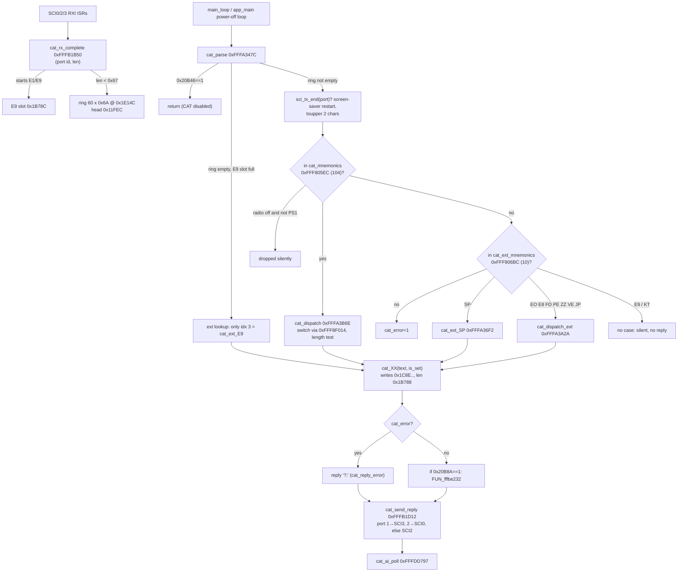
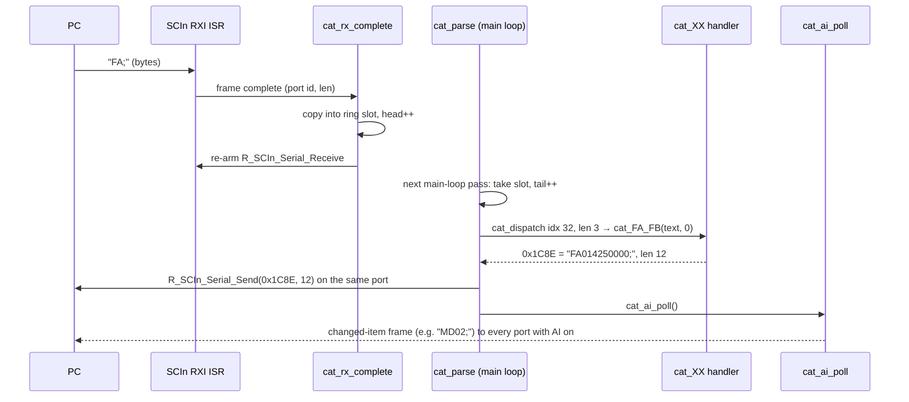
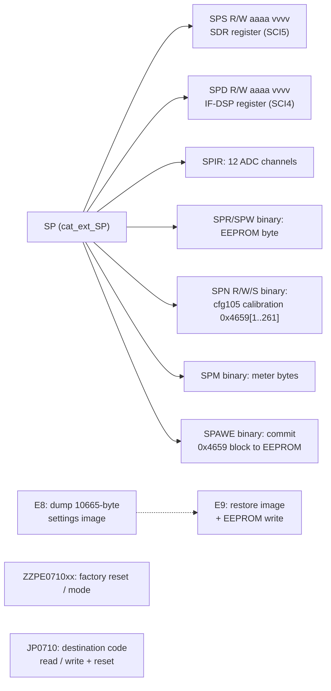

# MAIN — CAT subsystem (remote control)

Part of the MAIN code documentation (T09). Command reference: [docs/cat-commands.md](../../cat-commands.md).
Other MAIN subsystem pages (T10): [README.md](README.md) (overview, boot, main loop), [sci.md](sci.md) (UART drivers),
[display-link.md](display-link.md) (SCI1 link to the DISPLAY CPU), [sdr-link.md](sdr-link.md) (SCI5), [dsp-link.md](dsp-link.md)
(SCI4, IF-DSP), [eeprom.md](eeprom.md) (settings/memory persistence), [menu.md](menu.md) (EX menu engine), [ui-keys.md](ui-keys.md)
(front-panel key events), [radio-control.md](radio-control.md), [tx-protection.md](tx-protection.md), [peripherals.md](peripherals.md).
The names below are the Ghidra names in `ghidra/FT710_MAIN` (from `tools/ghidra/names_main.tsv`).
All addresses are MAIN ROM/RAM addresses, and the tags follow AGENTS.md: **[fact]** means seen in code or data, at the address given.

## Overview

- **Ports.** CAT is served on three UARTs. Each received command carries a port id byte, and the reply goes back to the same port. **[fact]** `cat_rx_complete` @ 0xFFFB1B50 and `cat_send_reply` @ 0xFFFB1D12.

| Port id | SCI | Receive buffer | Physical port | Manual name |
|---|---|---|---|---|
| 1 | SCI3 | 0xF62C | CP2105 "Enhanced" USB COM | CAT-1 **[inference]** |
| 2 | SCI0 | 0xA2B4 | CP2105 "Standard" USB COM | CAT-2 **[inference]** |
| 3 (any other id) | SCI2 | 0xCC70 | TUNER/LINEAR jack, 5 V TTL | CAT-3 **[inference]**. The manual says the TUNER/LINEAR jack is CAT-3 when it is enabled in the menu. |

- **Command queue.** `cat_rx_complete` copies every received frame shorter than 0x67 bytes into a **60-slot ring** at 0x1E14C. Each slot is 0x6A bytes: `+0` port id, `+2` length (u16), `+4` text. The head index is 0x11FEC and the tail index is 0x11FEB. **[fact]**
- **Framing** (`cat_rx_byte_hook` 0xFFFB1DAD, called from the SCI0/2/3 receive ISRs for every byte) **[fact]** (#76). A frame ends at `;`
  unless its first four bytes fix the length: `SPR` → 7, `SPW` → 8, `SPN` + `W` → 9 (other `SPN`/`SPn` → 8), `E9` → **0x29B2 = 10,674
  bytes**. So a `;` inside the `E9` binary data does not end the frame; only the byte count does. Each byte restarts an inter-byte timer
  from the port's CAT TIME OUT TIMER setting (0x9ABA for the USB-side port, or 0x20B59 when 0x9DC6 is set; 0x9ABD, 0x9ABF for the others):
  10, 100, 1000 or 3000 ms. If it expires mid-frame, the partial frame is dropped and the new byte starts a new one.
- **Fast path for E1/E9.** Frames that start with `E1`/`e1`/`E9`/`e9` bypass the ring. They go into a single-slot buffer at 0x1B78C: flag, port 0x1B78D, length 0x1B78E, data 0x1B790. This path exists for the 10 kB binary `E9` restore frame. **[fact]**
- **Main-loop parse.** `cat_parse` @ 0xFFFA347C runs once per pass of `main_loop`, and from the power-off loop in `app_main`. Each call parses at most one ring slot, or else the E9 slot, and at most one reply is sent per call. **[fact]**
- **Reply buffer and error reply.** Every reply is built in place at **0x1C8E** (`cat_reply`). The length goes in 0x1B788 (`cat_reply_len`), and a length of 0 means no reply. Errors set **0x464A** (`cat_error`), and the parser then replaces the reply with `?;` (`cat_reply_error` @ 0xFFFB0166). There is no other error code and no "busy" reply. **[fact]**
- **Auto information (AI).** AI is enabled per port with flags 0x20B20/0x20B21/0x20B22 (port 1/2/3). The broadcaster `cat_ai_poll` @ 0xFFFDD797 runs at the end of every `cat_parse` call. It walks about 70 change detectors (one per AI-capable item; each keeps a shadow copy of the last value it sent), formats at most one changed item into 0x15E06, and sends it to every port whose AI flag is set. **[fact]**
  - After a successful AI-relevant set, handlers call `cat_ai_holdoff` @ 0xFFFDDB6A. It starts timer 0x32 for 200 ms and sets 0x187C2, which delays the next AI frame. **[fact]**
  - Reading `AI1` also triggers the holdoff. **[fact]**
  - The EX menu has its own detector `cat_ai_ex` 0xFFFDECEC. `cat_ai_ex_scan` 0xFFFE6D7A calls 296 detectors from the table 0xFFF8E1A0, one per
    menu item in the order of the ID list at 0xFFF872B1 (`EX010101` … `EX060518`; named `ai_ex010101` …). The first that sees a change formats
    the value, and the frame is `EX` + ID + value + `;`. An EX set starts `cat_ai_ex_holdoff` 0xFFFE6E26 (timer 0x32, 200; flag 0x1B299) **[fact]** (#70).
- **Power-off gate.** While the radio is "off" (0x20B3A == 0), `cat_parse` drops every command except `PS1`, primary index 71 with a parameter of `1`. **[fact]**
- **Global CAT disable.** While 0x20B46 == 1, `cat_parse` returns at once without consuming anything. The DISPLAY link sets this flag: `displink_rx_F1_sys` sub-command 3. **[fact]** Most likely it is used during firmware update or SD operations **[guess]**.
- **Screen-saver restart.** Every command received through the ring restarts the screen-saver timer (`screensaver_timer_restart` 0xFFFB263D, called from `cat_parse` at 0xFFFA34B6) **[fact]**. The timer is slow timer 0, set to 900, 1800 or 3600 s (15/30/60 min) from menu 040104 DISPLAY > SCREEN SAVER (0x9B0F = 1/2/3; 0 = off) **[fact]**. So CAT traffic keeps the screen saver from starting. This was documented as an auto-power-off timer and named `cat_apo_reset`; the code shows it is the screen saver (#208, details in [README.md](README.md#screen-saver-timer-slow-timer-0)). The committed decompile in `decomp/main/` still shows the old name `cat_apo_reset` until the next Ghidra re-export.

## Parse and dispatch flow

Details **[fact]** unless marked:
- **Case handling.** Only the two mnemonic characters are upper-cased (`toupper_inplace`, called twice). Parameters are case-sensitive unless a handler accepts both cases itself, as `SP` does for its sub-letters.
- **Lookup.** The lookup is a linear `strncmp(text, table+2*i, 2)`, compiled to `SCMPU`, so the decompile shows a strange loop. The index found is the switch case number.
- **Length checks.** Most primary cases check the **total** length, which counts the mnemonic and the `;`. The read form calls `cat_XX(text, 0)` and the set form calls `cat_XX(text, 1)`. Any other length gives `?;`. Some cases accept any length. The per-command list is in [cat-commands.md](../../cat-commands.md).
- **Reply prefill.** Before calling the handler, the case copies the start of the request (mnemonic plus the first 1–2 parameter characters) into 0x1C8E. The answer therefore echoes the selector digits of the request.
- **Mnemonics with no case.** The table holds mnemonics that have no switch case: `BY ED EK EU RC RD RS RT RU XT`. They hit the switch default, which answers `?;`.
  - `XT` (TX CLAR) is documented in manual revs 2211-A and 2306-C (both p. 23, `XTP1;` / `XT;`) but is **not implemented in V01-12**.
  - `KT`, and `E9` when it arrives through the ring, hit no case in `cat_dispatch_ext` and get **no reply at all**.

## Request / reply sequence

## Extended and service commands (summary)

The full table is in [cat-commands.md](../../cat-commands.md#extended-table). The service set is reached only through `cat_ext_mnemonics`:

Binary SP checksum (corrected in T10e/T17) **[fact]** (disassembly at 0xFFFA3867, 0xFFFA38C4, 0xFFFA39BB and 0xFFFA510A; `decomp/main/fffa20af_fffa7928.c` lines ~1468, 1489, 1551, 2890):
- The checksum-protected sub-commands (`SPR SPW SPM SPN SPA`) call `cat_checksum_ok(text, len-2)`. The checksum is a normal 8-bit sum over the frame without the sum byte and the `;`, compared with the sum byte.
- The earlier "checksum bug" (T09: `n` read from RAM address `len-2`) was a **decoder artifact**. The bytes `60 22 5F 22` are `SUB #2,R2; MOVU.W R2,R2`, but the RX SLEIGH module showed `MOVU.W [R2],R2`. T17 fixed the decoder and re-exported `decomp/main` (see [eeprom.md](eeprom.md) and `decomp/main/INDEX.md`, "Known decompiler artifacts").
- So these sub-commands are **usable in V01-12, high risk**: they read and write EEPROM and calibration/service data. Never send them without the owner's approval.

## Function table

| Address | Ghidra name | Inferred name / role | Purpose |
|---|---|---|---|
| 0xFFFB1B50 | `cat_rx_complete` | receive-end callback | Called by the SCI0/2/3 receive path with the port id and length. Queues the frame (ring or E9 slot) and re-arms reception **[fact]** |
| 0xFFFB1C91 / 0xFFFB1CA0 | `cat_ring_head` / `cat_ring_tail` | ring indices | Return 0x11FEC / 0x11FEB **[fact]** |
| 0xFFFB1CD2 | `cat_ring_pop` | ring take | Increments the tail mod 60 and returns the slot **[fact]**; the decompile lost the return value |
| 0xFFFB1CAF | `cat_ring_unpop` | ring un-take | Steps the tail back when the TX side of the port is busy (`sci_tx_end`==0), so the command is retried **[fact]** |
| 0xFFFB1D06 | `cat_e9_slot` | E9 slot pointer | Returns 0x1B78C **[fact]** (disassembly) |
| 0xFFFA347C | `cat_parse` | parser | See the flow above |
| 0xFFFA3B6E | `cat_dispatch` | primary switch | Index → case via `cat_switch_table` 0xFFF8F014 |
| 0xFFFA3A2A | `cat_dispatch_ext` | extended dispatch | Compare chain for EO/JP/FD/PE/ZZ/VE/E8 |
| 0xFFFA36F2 | `cat_ext_SP` | service command decoder | Dispatches on sub-letter text[2] (S D I W R M N A) |
| 0xFFFB0166 | `cat_reply_error` | error reply | Builds `?;` with length 2 **[fact]** |
| 0xFFFB1D12 | `cat_send_reply` | send by port | Port 1 → `R_SCI3_Serial_Send`, 2 → SCI0, else SCI2. Sets per-port busy flags 0x11FEA/0x11FE8/0x11FE9 **[fact]** |
| 0xFFFB1F42 | `sci_tx_end` | TX idle test | Port id → SCI3/SCI0/SCI2 transmit-end state **[fact]** (T05) |
| 0xFFFB263D | `screensaver_timer_restart` (decompile: `cat_apo_reset`) | screen-saver restart | Restarts slow timer 0 from menu 040104 SCREEN SAVER (0x9B0F) **[fact]** |
| 0xFFFDD797 | `cat_ai_poll` | AI broadcaster | Runs about 70 change detectors (0xFFFDDCB5..0xFFFE1774, 0xFFFDDB7E) and sends to every AI-on port **[fact]** |
| 0xFFFDDB6A | `cat_ai_holdoff` | AI holdoff | Timer 0x32 for 200 ms, flag 0x187C2 **[fact]** |
| 0xFFFDDB7E | `cat_ai_FD` | AI detector for FD | Sends `FD00n<9 digits>;` when the FD value changes; part of the AI chain for an undocumented command **[fact]** |
| 0xFFFB2E9C | `nib2hex` | nibble → ASCII | `"0123456789ABCDEF"[n&15]` **[fact]** |
| 0xFFFB2F07 | `hex2nib` | ASCII → nibble | Accepts 0-9/A-F/a-f, else returns 0xFF **[fact]** |
| 0xFFFB2EB7 / 0xFFFB2EE7 | `byte2hex` / `word2hex` | formatters | 2 / 4 hex characters **[fact]** |
| 0xFFFB2F79 / 0xFFFB2F9E | `hex2byte` / `hex2word` | parsers | 2 / 4 hex characters **[fact]** |
| 0xFFFB3168 | `toupper_inplace` | | a-z → A-Z **[fact]** |
| 0xFFFB01AF | `sum8` | additive checksum | 8-bit sum of n bytes **[fact]** |
| 0xFFFB0182 | `cat_checksum_ok` | checksum test | `sum8(buf,n) == buf[n]` **[fact]** |
| 0xFFFB44F7 | `key_event_filter` | front-panel key gate | Checks a key code against about 20 mode locks (TX, tuning, menus, etc.) and returns 1 if the key may run. Many CAT handlers emulate a key press through it **[fact]** for the structure; it is used by AC CS SV VS VM ZI ST TS UP DN KY LM …. `cat_TX` (0xFFFAF7B8, `TX1;`) does **not** go through it **[fact]** ([tx-protection.md](tx-protection.md)) |
| 0xFFFA4E31 | `cat_SP_sdr_reg` | SPS | Parses 4-hex address and 4-hex value, then `sdr_reg_access` **[fact]** |
| 0xFFFA4E8F | `cat_SP_dev4_reg` | SPD | The same, through `dsp_reg_access` to the IF-DSP register file **[fact]** ([dsp-link.md](dsp-link.md), [../ifdsp/control-link.md](../ifdsp/control-link.md)) |
| 0xFFFA4EED | `cat_SP_adc_dump` | SPIR | 12 × 3 hex digits of ADC results, in the order AN000..AN007 (AN000, AN004 and AN006 reported as 0), AN115, AN117, AN108, AN109 **[fact]** ([peripherals.md](peripherals.md#the-12-spir-fields)) |
| 0xFFFA520B | `cat_SP_eeprom_byte` | SPR/SPW | Byte read/write at a 16-bit EEPROM address. The write also updates the RAM mirror at 0x464F[addr] **[fact]** |
| 0xFFFA50F9 | `cat_SP_table` | SPN | Table 0x4659[idx-1] (idx 1..0x105). `W` sets an entry, `S` schedules `key_dsp_press` after 500 ms (in alignment mode: `align_store`), `R` reads the entry and loads preset idx-1 (`align_load_preset`) **[fact]**. `cfg105` is the calibration table **[fact, #76]** ([eeprom.md](eeprom.md)); each index is one item of the alignment menu, whose labels MAIN holds at 0xFFF817C3 (`001 [GN] VDD MTR` … `261 [TX] IDD MTR`; #203, map in [eeprom.md](eeprom.md#cfg105-the-alignment-table-fact)); index 70..219 are the per-band `FALC`/`MTR`/`TXG` TX power items, of which `TXG` feeds SDR register 0x25 **[fact]** ([sdr-link.md](sdr-link.md)) |
| 0xFFFA5284 | `cat_SP_meters` | SPM | 8 binary bytes: meter values 0x1204A, 0x12048/0x1204B, … **[fact]** for the sources, **[inference]** that they are meters |
| 0xFFFB0532 | `eeprom_save_cfg105` | [eeprom.md](eeprom.md) | `eeprom_write(0x000A, 0x4659, 0x105)` **[fact]** |
| 0xFFFB0544 | `eeprom_save_dest` | [eeprom.md](eeprom.md) | `eeprom_write(0x010F, 0x475E, 3)`; holds the destination code **[fact]** |
| 0xFFFB0558 | `settings_defaults` | factory defaults ([eeprom.md](eeprom.md)) | arg 1: also reloads the 0x105 block from ROM 0xFFF8074F and the destination 0x8043. Then reinitializes VFO, memory and menu RAM from ROM defaults **[fact]** |
| 0xFFFB0356 | `eeprom_save_image` | [eeprom.md](eeprom.md) | `eeprom_write(0x1A7A, 0x60C9, 0x2F49)`, bracketed by header updates (`eeprom_hdr_update` 0xFFFB142B) **[fact]** |
| 0xFFFB0376 | `eeprom_save_memch` | [eeprom.md](eeprom.md) | Writes the 0x87-byte block plus one 0x5A-byte memory channel **[fact]** |
| 0xFFFB3B33 / 0xFFFB3B5D | `dest_code_get` / `dest_code_set` | destination code | 0x475E/0x475F. Set writes EEPROM, reloads defaults (`settings_defaults(0)`) and requests a restart (0x20F4B=1, 0x20B39=0x11) **[fact]**; that 0x20B39=0x11 means a reboot is **[inference]** |
| 0xFFFA1485 | `sdr_reg_access` | SDR register r/w | Waits until idle, then sends an `r`/`w` + hex address [+ value] + 2-hex sum + CR frame over SCI5 (`sdr_send_cmd`) and waits for the reply (7 bytes for a read, 1 byte 0x06 for a write) **[fact]** |
| 0xFFF9D8A4 | `dsp_reg_access` | IF-DSP register r/w | The same protocol over **SCI4** to the RT685 IF-DSP **[fact]** (T10d/T12b, [dsp-link.md](dsp-link.md)). A write does not update the shadow **[fact]** |
| 0xFFFA3226 | `sdr_bridge_mode` | SDR maintenance bridge | Not CAT. Started by a DISPLAY-link message (`displink_rx_F1_sys` sub 1 → 0x1C8D=1). Relays binary SDR register requests from the DISPLAY CPU (ACK 0x06 / NAK 0x15) **[fact]** for the structure |
| 0xFFFB2718 | `cat_rand8` | | Pseudo-random byte from timer counter 0x88116; this is the E8 key **[fact]** |

Handler functions are `cat_<MNEMONIC>` (primary) and `cat_ext_<MNEMONIC>` (extended). Their addresses are in [cat-commands.md](../../cat-commands.md) and `decomp/main/cat_dispatch.tsv`.

## Data structures and globals

| Address | Size | Name | Meaning |
|---|---|---|---|
| 0xFFF805EC | 104×2 | `cat_mnemonics` | primary table **[fact]** |
| 0xFFF806BC | 10×2 | `cat_ext_mnemonics` | `SP EO E8 E9 FD KT PE ZZ VE JP` **[fact]** |
| 0xFFF806D0 | 16 | `cat_mode_codes` | mode nibble → CAT mode char `1 2 7 3 5 D 4 B 8 C A F 6 9 E F` **[fact]** |
| 0xFFF806DF | 10 | `cat_vfo_state_codes` | VFO/memory state → IF P7 char **[fact]** |
| 0xFFF806E9 | 18×3 | `cat_pms_names` | `P1L P1U … P9L P9U` (memory channel names 99..116) **[fact]** |
| 0xFFF8071B | 15×3+3 | `cat_5mhz_names` | `501`..`515`, `EMG` (channels 117..132) **[fact]** |
| 0xFFF8074F | 0x105 | `cfg105_defaults` | ROM defaults of the 0x4659 table **[fact]** |
| 0xFFF8F014 | 104×2 | `cat_switch_table` | int16 case offsets from 0xFFFA3B8A **[fact]** |
| 0xFFF8F480..0xFFF8F5E4 | 55 strings | `cat_ai_templates` | Zero-value answer templates (`AC000;` … `VX0;`) for AI-capable answers **[fact]** for the content; use by the AI detectors **[inference]** |
| 0x1C8E | ≤0x29B2 | `cat_reply` | reply buffer; overlaps 0x1C8E..0x463F for the E8 dump **[fact]** |
| 0x1B788 | u16 | `cat_reply_len` | **[fact]** |
| 0x464A | u8 | `cat_error` | **[fact]** |
| 0x464B | u8 | `cat_spn_save_pending` | set by `SPNS`; `cat_parse` runs `FUN_fffbff93` when timer 0x32 expires **[fact]** |
| 0x464C | u8 | `cat_port` | port id of the command being handled **[fact]** |
| 0x464F | 10 | `eeprom_hdr` | RAM mirror of EEPROM 0x0000..0x0009. `eeprom_hdr_update` increments a 32-bit counter in it on every save **[fact]** |
| 0x4659 | 0x105 | `cfg105` | table addressed by `SPN`, EEPROM 0x000A **[fact]**; the factory calibration table, written item by item in `ZZPE071000` alignment mode (#76) **[fact]** ([eeprom.md](eeprom.md)) |
| 0x475E | 3 | `dest_code` | destination/version code, EEPROM 0x010F. `JP` reads and writes it **[fact]** |
| 0x60C9 | 0x29A9 (0x2F49 saved) | `settings_image` | Memory header + 117 memory channels, dumped by `E8` and restored by `E9`; EEPROM 0x1A7A **[fact]** ([eeprom.md](eeprom.md)) |
| 0x9ADA..0x9AEB | 18 | `peq_params` | `PE` parameters (2 sets × 3 bands × 3 values) **[fact]**; that they are parametric EQ is **[inference]** |
| 0x11FEB / 0x11FEC | u8 | `cat_ring_tail` / `cat_ring_head` | **[fact]** |
| 0x1B78C | 1+1+2+0x29BC | `cat_e9_slot` | flag, port, length, data **[fact]** |
| 0x1E14C | 60×0x6A | `cat_ring` | **[fact]** |
| 0x15E06 | | `cat_ai_buf` | AI frame buffer **[fact]** |
| 0x187C2..0x18807 | | AI shadow copies / flags | one per detector **[fact]** |
| 0x20B04..0x20B16 | 12×u16 | `adc_results` | S12AD/S12AD1 conversions (`adc0_store`, `adc1_store`); `SPIR` reads them **[fact]** |
| 0x20B20/21/22 | u8 | `cat_ai_on[3]` | AI per port 1/2/3 **[fact]** |
| 0x20B3A | u8 | `radio_on` | 0 while off, so only `PS1` is accepted **[fact]** |
| 0x20B46 | u8 | `cat_disabled` | set from the DISPLAY link **[fact]** |
| 0x20BBE | u8 | `zz_mode0` | set by `ZZPE071000`: **factory alignment mode** (UI-state +0xBA). TX band limits off, DSP key stores calibration item 0x20CE2 ([cat-commands.md](../../cat-commands.md#ext-zz), #76) **[fact]** |
| 0x20F4B, 0x20B39 | u8 | restart request | UI-state +0x447 / +0x35. `power_down_save`: frame `0x7F`, EEPROM save, `sw_reset`; 0x10 = power off, 0x11 = restart (radio on again), 0x90 = undervoltage (#76) **[fact]** |

## Further functions (T23g)

Named functions of this subsystem that the tables above did not list yet, one row each (T23g, found with `tools/doc_table_gaps.py`). The purpose is the plate comment of the name in `tools/ghidra/names_*.tsv` (or the `Ifdsp*Names.java` / `*.lib.tsv` entry); rows marked *code shape* have no comment there and give what the decompile shows: the direct callees, the first string, the size and the caller count. Tags as in the names files; a comment without a tag is an inference from the code.

| Address | Ghidra name | Inferred name / role | Purpose |
|---|---|---|---|
| 0xFFF94BCD | `ver_main` |  | Returns pointer to MAIN version string 0xFFFFFF00 (VE0) **[inference]** |
| 0xFFF94BF1 | `ver_display` |  | Returns pointer to DISPLAY version 0x1436 (VE1) **[inference]** |
| 0xFFF9C2CD | `dest_has_5mhz_channels` |  | 1 for destination codes 0x315B / 0x50E2 / 0xA4C5 / 0xD950, which have the 60 m (5 MHz) channels 501..515 (cat_MC, displink_build_41) **[fact]** |
| 0xFFFA53A4 | `cat_ext_E8` |  | names-file group "CAT command handlers (from CatDispatch.java)"; calls `cat_rand8`; 271 B, callers: 1 **[fact]** (code shape) |
| 0xFFFA54B3 | `cat_ext_VE` |  | names-file group "CAT command handlers (from CatDispatch.java)"; calls `ver_display`, `ver_dsp`, `ver_main`, `ver_sdr`; 184 B, callers: 1 **[fact]** (code shape) |
| 0xFFFA556B | `cat_ext_JP` |  | names-file group "CAT command handlers (from CatDispatch.java)"; calls `byte2hex`, `dest_code_get`, `dest_code_set`, `hex2byte` and 1 more; 822 B, callers: 2 **[fact]** (code shape) |
| 0xFFFA58A1 | `cat_ext_ZZ` |  | names-file group "CAT command handlers (from CatDispatch.java)"; calls `eeprom_save_cfg105`, `eeprom_save_dest`, `hex2byte`, `hex2word` and 2 more; 228 B, callers: 1 **[fact]** (code shape) |
| 0xFFFA5985 | `cat_ext_E9` |  | Extended E9, reached only from the second input path in cat_parse **[inference]** |
| 0xFFFA5A51 | `cat_ext_FD` |  | names-file group "CAT command handlers (from CatDispatch.java)"; calls `band_of_freq`, `bandmem_get`, `bandmem_set`, `freq_in_range` and 2 more; 575 B, callers: 2 **[fact]** (code shape) |
| 0xFFFA5C90 | `cat_ext_EO` |  | names-file group "CAT command handlers (from CatDispatch.java)"; calls `enc2_step`, `enc3_step`, `hex2nib`, `vfo_freq` and 1 more; 847 B, callers: 1 **[fact]** (code shape) |
| 0xFFFA5FDF | `cat_ext_PE` |  | names-file group "CAT command handlers (from CatDispatch.java)"; calls `cat_ai_holdoff`, `hex2nib`, `nib2hex`; 1166 B, callers: 2 **[fact]** (code shape) |
| 0xFFFA646D | `cat_AB` |  | Handler of CAT command `AB`: entry of the command dispatch table (CatDispatch.java); 359 B **[fact]** |
| 0xFFFA65D4 | `cat_AC` |  | Handler of CAT command `AC`: entry of the command dispatch table (CatDispatch.java); 659 B **[fact]** |
| 0xFFFA6867 | `cat_AG` |  | Handler of CAT command `AG`: entry of the command dispatch table (CatDispatch.java); 223 B **[fact]** |
| 0xFFFA6946 | `cat_AI` |  | Handler of CAT command `AI`: entry of the command dispatch table (CatDispatch.java); 224 B **[fact]** |
| 0xFFFA6A26 | `cat_AM` |  | Handler of CAT command `AM`: entry of the command dispatch table (CatDispatch.java); 329 B **[fact]** |
| 0xFFFA6B6F | `cat_AO` |  | Handler of CAT command `AO`: entry of the command dispatch table (CatDispatch.java); 302 B **[fact]** |
| 0xFFFA6C9D | `cat_AS` |  | Handler of CAT command `AS`: entry of the command dispatch table (CatDispatch.java); 575 B **[fact]** |
| 0xFFFA6EDC | `cat_AV` |  | Handler of CAT command `AV`: entry of the command dispatch table (CatDispatch.java); 316 B **[fact]** |
| 0xFFFA7018 | `cat_BA` |  | Handler of CAT command `BA`: entry of the command dispatch table (CatDispatch.java); 359 B **[fact]** |
| 0xFFFA717F | `cat_BC` |  | Handler of CAT command `BC`: entry of the command dispatch table (CatDispatch.java); 346 B **[fact]** |
| 0xFFFA72D9 | `cat_BD` |  | Handler of CAT command `BD`: entry of the command dispatch table (CatDispatch.java); 659 B **[fact]** |
| 0xFFFA756C | `cat_BU` |  | Handler of CAT command `BU`: entry of the command dispatch table (CatDispatch.java); 640 B **[fact]** |
| 0xFFFA77EC | `cat_BI` |  | Handler of CAT command `BI`: entry of the command dispatch table (CatDispatch.java); 316 B **[fact]** |
| 0xFFFA7928 | `cat_BM` |  | Handler of CAT command `BM`: entry of the command dispatch table (CatDispatch.java); 329 B **[fact]** |
| 0xFFFA7A71 | `cat_BP` |  | Handler of CAT command `BP`: entry of the command dispatch table (CatDispatch.java); 836 B **[fact]** |
| 0xFFFA7DB5 | `cat_BS` |  | Handler of CAT command `BS`: entry of the command dispatch table (CatDispatch.java); 492 B **[fact]** |
| 0xFFFA7FA1 | `cat_CF` |  | Handler of CAT command `CF`: entry of the command dispatch table (CatDispatch.java); 980 B **[fact]** |
| 0xFFFA8375 | `cat_CH` |  | Handler of CAT command `CH`: entry of the command dispatch table (CatDispatch.java); 414 B **[fact]** |
| 0xFFFA8513 | `cat_CN` |  | Handler of CAT command `CN`: entry of the command dispatch table (CatDispatch.java); 389 B **[fact]** |
| 0xFFFA8698 | `cat_CO` |  | Handler of CAT command `CO`: entry of the command dispatch table (CatDispatch.java); 1280 B **[fact]** |
| 0xFFFA8B98 | `cat_CS` |  | Handler of CAT command `CS`: entry of the command dispatch table (CatDispatch.java); 225 B **[fact]** |
| 0xFFFA8C79 | `cat_CT` |  | Handler of CAT command `CT`: entry of the command dispatch table (CatDispatch.java); 273 B **[fact]** |
| 0xFFFA8D8A | `cat_DA` |  | Handler of CAT command `DA`: entry of the command dispatch table (CatDispatch.java); 671 B **[fact]** |
| 0xFFFA9029 | `cat_DN` |  | Handler of CAT command `DN`: entry of the command dispatch table (CatDispatch.java); 300 B **[fact]** |
| 0xFFFA9155 | `cat_UP` |  | Handler of CAT command `UP`: entry of the command dispatch table (CatDispatch.java); 300 B **[fact]** |
| 0xFFFA9281 | `cat_DT` |  | Handler of CAT command `DT`: entry of the command dispatch table (CatDispatch.java); 967 B **[fact]** |
| 0xFFFA9648 | `cat_EM` |  | Handler of CAT command `EM`: entry of the command dispatch table (CatDispatch.java); 736 B **[fact]** |
| 0xFFFA9928 | `cat_EN` |  | Handler of CAT command `EN`: entry of the command dispatch table (CatDispatch.java); 15 B **[fact]** |
| 0xFFFA99BD | `cat_FA_FB` |  | names-file group "CAT command handlers (from CatDispatch.java)"; calls `freq_clamp`, `freq_in_range`, `nib2hex`, `vfo_mark_edited` and 3 more; 729 B, callers: 2 **[fact]** (code shape) |
| 0xFFFA9C96 | `cat_FN` |  | Handler of CAT command `FN`: entry of the command dispatch table (CatDispatch.java); 167 B **[fact]** |
| 0xFFFA9D3D | `cat_FS` |  | Handler of CAT command `FS`: entry of the command dispatch table (CatDispatch.java); 17 B **[fact]** |
| 0xFFFA9D4E | `cat_FT` |  | Handler of CAT command `FT`: entry of the command dispatch table (CatDispatch.java); 469 B **[fact]** |
| 0xFFFA9F23 | `cat_GT` |  | Handler of CAT command `GT`: entry of the command dispatch table (CatDispatch.java); 764 B **[fact]** |
| 0xFFFAA21F | `cat_GP` |  | Handler of CAT command `GP`: entry of the command dispatch table (CatDispatch.java); 326 B **[fact]** |
| 0xFFFAA365 | `cat_ID` |  | Handler of CAT command `ID`: entry of the command dispatch table (CatDispatch.java); 55 B **[fact]** |
| 0xFFFAA39C | `cat_IF_OI` |  | names-file group "CAT command handlers (from CatDispatch.java)"; calls `nib2hex`, `vfo_freq`; 839 B, callers: 1 **[fact]** (code shape) |
| 0xFFFAA6E3 | `cat_IS` |  | Handler of CAT command `IS`: entry of the command dispatch table (CatDispatch.java); 546 B **[fact]** |
| 0xFFFAA905 | `cat_KM` |  | Handler of CAT command `KM`: entry of the command dispatch table (CatDispatch.java); 817 B **[fact]** |
| 0xFFFAAC36 | `cat_KP` |  | Handler of CAT command `KP`: entry of the command dispatch table (CatDispatch.java); 284 B **[fact]** |
| 0xFFFAAD52 | `cat_KR` |  | Handler of CAT command `KR`: entry of the command dispatch table (CatDispatch.java); 152 B **[fact]** |
| 0xFFFAADEA | `cat_KS` |  | Handler of CAT command `KS`: entry of the command dispatch table (CatDispatch.java); 303 B **[fact]** |
| 0xFFFAAF19 | `cat_KY` |  | Handler of CAT command `KY`: entry of the command dispatch table (CatDispatch.java); 390 B **[fact]** |
| 0xFFFAB09F | `cat_LK` |  | Handler of CAT command `LK`: entry of the command dispatch table (CatDispatch.java); 208 B **[fact]** |
| 0xFFFAB16F | `cat_LM` |  | Handler of CAT command `LM`: entry of the command dispatch table (CatDispatch.java); 654 B **[fact]** |
| 0xFFFAB3FD | `cat_MA` |  | Handler of CAT command `MA`: entry of the command dispatch table (CatDispatch.java); 123 B **[fact]** |
| 0xFFFAB478 | `cat_MB` |  | Handler of CAT command `MB`: entry of the command dispatch table (CatDispatch.java); 123 B **[fact]** |
| 0xFFFAB4F3 | `cat_MC` |  | Handler of CAT command `MC`: entry of the command dispatch table (CatDispatch.java); 734 B **[fact]** |
| 0xFFFAB7D1 | `cat_MD` |  | Handler of CAT command `MD`: entry of the command dispatch table (CatDispatch.java); 659 B **[fact]** |
| 0xFFFABA64 | `cat_MG` |  | Handler of CAT command `MG`: entry of the command dispatch table (CatDispatch.java); 406 B **[fact]** |
| 0xFFFABBFA | `cat_ML` |  | Handler of CAT command `ML`: entry of the command dispatch table (CatDispatch.java); 683 B **[fact]** |
| 0xFFFABEA5 | `cat_MR` |  | Handler of CAT command `MR`: entry of the command dispatch table (CatDispatch.java); 992 B **[fact]** |
| 0xFFFAC285 | `cat_MT` |  | Handler of CAT command `MT`: entry of the command dispatch table (CatDispatch.java); 561 B **[fact]** |
| 0xFFFAC4B6 | `cat_MS` |  | Handler of CAT command `MS`: entry of the command dispatch table (CatDispatch.java); 126 B **[fact]** |
| 0xFFFAC534 | `cat_MW` |  | Handler of CAT command `MW`: entry of the command dispatch table (CatDispatch.java); 1145 B **[fact]** |
| 0xFFFAC9AD | `cat_MX` |  | Handler of CAT command `MX`: entry of the command dispatch table (CatDispatch.java); 154 B **[fact]** |
| 0xFFFACA47 | `cat_NA` |  | Handler of CAT command `NA`: entry of the command dispatch table (CatDispatch.java); 542 B **[fact]** |
| 0xFFFACC65 | `cat_NB` |  | Handler of CAT command `NB`: entry of the command dispatch table (CatDispatch.java); 131 B **[fact]** |
| 0xFFFACCE8 | `cat_NL` |  | Handler of CAT command `NL`: entry of the command dispatch table (CatDispatch.java); 313 B **[fact]** |
| 0xFFFACE21 | `cat_NR` |  | Handler of CAT command `NR`: entry of the command dispatch table (CatDispatch.java); 157 B **[fact]** |
| 0xFFFACEBE | `cat_OS` |  | Handler of CAT command `OS`: entry of the command dispatch table (CatDispatch.java); 323 B **[fact]** |
| 0xFFFAD001 | `cat_PA` |  | Handler of CAT command `PA`: entry of the command dispatch table (CatDispatch.java); 161 B **[fact]** |
| 0xFFFAD0A2 | `cat_PB` |  | Handler of CAT command `PB`: entry of the command dispatch table (CatDispatch.java); 415 B **[fact]** |
| 0xFFFAD241 | `cat_PC` |  | Handler of CAT command `PC`: entry of the command dispatch table (CatDispatch.java); 550 B **[fact]** |
| 0xFFFAD467 | `cat_PL` |  | Handler of CAT command `PL`: entry of the command dispatch table (CatDispatch.java); 302 B **[fact]** |
| 0xFFFAD595 | `cat_PR` |  | Handler of CAT command `PR`: entry of the command dispatch table (CatDispatch.java); 257 B **[fact]** |
| 0xFFFAD696 | `cat_PS` |  | Handler of CAT command `PS`: entry of the command dispatch table (CatDispatch.java); 110 B **[fact]** |
| 0xFFFAD704 | `cat_QI` |  | Handler of CAT command `QI`: entry of the command dispatch table (CatDispatch.java); 5 B **[fact]** |
| 0xFFFAD709 | `cat_QR` |  | Handler of CAT command `QR`: entry of the command dispatch table (CatDispatch.java); 5 B **[fact]** |
| 0xFFFAD70E | `cat_QS` |  | Handler of CAT command `QS`: entry of the command dispatch table (CatDispatch.java); 10 B **[fact]** |
| 0xFFFAD718 | `cat_RA` |  | Handler of CAT command `RA`: entry of the command dispatch table (CatDispatch.java); 150 B **[fact]** |
| 0xFFFAD7AE | `cat_RG` |  | Handler of CAT command `RG`: entry of the command dispatch table (CatDispatch.java); 309 B **[fact]** |
| 0xFFFAD8E3 | `cat_RI` |  | Handler of CAT command `RI`: entry of the command dispatch table (CatDispatch.java); 355 B **[fact]** |
| 0xFFFADA46 | `cat_RL` |  | Handler of CAT command `RL`: entry of the command dispatch table (CatDispatch.java); 311 B **[fact]** |
| 0xFFFADCD6 | `cat_SC` |  | Handler of CAT command `SC`: entry of the command dispatch table (CatDispatch.java); 196 B **[fact]** |
| 0xFFFADD9A | `cat_SD` |  | Handler of CAT command `SD`: entry of the command dispatch table (CatDispatch.java); 284 B **[fact]** |
| 0xFFFADEB6 | `cat_SF` |  | Handler of CAT command `SF`: entry of the command dispatch table (CatDispatch.java); 1044 B **[fact]** |
| 0xFFFAE2CA | `cat_SH` |  | Handler of CAT command `SH`: entry of the command dispatch table (CatDispatch.java); 897 B **[fact]** |
| 0xFFFAE6CC | `cat_SQ` |  | Handler of CAT command `SQ`: entry of the command dispatch table (CatDispatch.java); 388 B **[fact]** |
| 0xFFFAE850 | `cat_SS` |  | Handler of CAT command `SS`: entry of the command dispatch table (CatDispatch.java); 2917 B **[fact]** |
| 0xFFFAF3B5 | `cat_ST` |  | Handler of CAT command `ST`: entry of the command dispatch table (CatDispatch.java); 185 B **[fact]** |
| 0xFFFAF46E | `cat_SV` |  | Handler of CAT command `SV`: entry of the command dispatch table (CatDispatch.java); 345 B **[fact]** |
| 0xFFFAF5C7 | `cat_TS` |  | Handler of CAT command `TS`: entry of the command dispatch table (CatDispatch.java); 497 B **[fact]** |
| 0xFFFAF874 | `cat_VD` |  | Handler of CAT command `VD`: entry of the command dispatch table (CatDispatch.java); 332 B **[fact]** |
| 0xFFFAF9C0 | `cat_VG` |  | Handler of CAT command `VG`: entry of the command dispatch table (CatDispatch.java); 283 B **[fact]** |
| 0xFFFAFADB | `cat_VM` |  | Handler of CAT command `VM`: entry of the command dispatch table (CatDispatch.java); 738 B **[fact]** |
| 0xFFFAFDBD | `cat_VS` |  | Handler of CAT command `VS`: entry of the command dispatch table (CatDispatch.java); 483 B **[fact]** |
| 0xFFFAFFA0 | `cat_VX` |  | Handler of CAT command `VX`: entry of the command dispatch table (CatDispatch.java); 206 B **[fact]** |
| 0xFFFB006E | `cat_ZI` |  | Handler of CAT command `ZI`: entry of the command dispatch table (CatDispatch.java); 190 B **[fact]** |
| 0xFFFB012C | `mem_find_byte` |  | (buf, c, n): pointer to the first byte == c in buf[0..n), else buf itself; returned in R1 (EM, KM) **[fact]** |
| 0xFFFB2FC0 | `bcd_to_bin` |  | Packed BCD byte -> binary: ROM table 0xFFF880C2 (0, 10,.., 90 at stride 2)[high nibble] + low nibble **[fact]** |
| 0xFFFB521A | `tx_breakin_on` |  | Bit 1 (BI break-in flag) of the TX VFO per-mode byte (vfo_rec_ptr(1)/vfo_mode(1)) **[inference]** |
| 0xFFFBB567 | `align_load_preset` |  | Sets up the radio for the current alignment item from preset 0xFFF88CD4[item] (VFO A/B, band memory, mode bits, optional frequency, TX power for items 0x45..0xDA) **[inference]** |
| 0xFFFBBA0F | `align_store` |  | DSP key in alignment mode: runs the store handler 0xFFF89910[item] for the current item (+0x1DE) **[inference]** |
| 0xFFFDECEC | `cat_ai_ex` |  | AI change detector for the EX menu (one of cat_ai_poll's detectors): cat_ai_ex_scan, copies the frame to cat_ai_buf 0x15E06 **[inference]** |
| 0xFFFE4407 | `msg_type_select` |  | Sets UI +0x1C7 (message type) from vfo_mode(1): CW 1, RTTY 2, PSK 3, voice modes 0 **[inference]** |
| 0xFFFE481D | `keyer_text_endmark` |  | Front-panel keyer text editor: length up to the first } (0x7D) or appends } after the last non-space char **[inference]** |
| 0xFFFE538F | `msg_slot_select` |  | (n): UI +0x1C8 = n, +0xBF = +0x1CE = n-1 (KY) **[inference]** |
| 0xFFFE6D7A | `cat_ai_ex_scan` |  | Calls the 296 detectors in 0xFFF8E1A0 until one sets the length 0x1FF12; builds "EXnnnnnn" + value at 0x1B235; held off while 0x1B299 = 1 and timer 0x32 runs **[inference]** |
| 0xFFFE6E26 | `cat_ai_ex_holdoff` |  | After an EX set: timer 0x32 = 200, 0x1B299 = 1 (like cat_ai_holdoff, own flag) **[inference]** |

<!-- T23e3:begin -->

### More functions (T23e round 3)

Named in the T23e round-3 batch for MAIN (`tools/ghidra/names_main.T23e3.tsv`); they show in `decomp/main` after the next Ghidra apply and re-export.

| Address | Ghidra name | Inferred name | Purpose |
|---|---|---|---|
| 0xFFFB1D79 | `cat_tx_busy` |  | Returns the CAT TX busy flag of a port: 1 -> 0x11FEA (SCI3), 2 -> 0x11FE8 (SCI0), else 0x11FE9 (SCI2) **[fact: fffb1d79]**; cat_ai_poll sends only when all three are 0 |
| 0xFFFDDCB5 | `cat_ai_AC` |  | AI change detector for AC (called from cat_ai_poll): compares with its shadow, on a change builds the AC answer in cat_ai_buf 0x15E06 and returns its length, else 0; source: tuner type, tune cycle and result (frame built from 'A','C' chars) **[fact: fffddcb5]** |
| 0xFFFDDE79 | `cat_ai_AG` |  | AI change detector for AG (called from cat_ai_poll): compares with its shadow, on a change builds the AG answer in cat_ai_buf 0x15E06 and returns its length, else 0; source: g_ui.af_gain; ignores jitter: keeps the last 4 values and needs a spread of 3 (max4_u8/min4_u8) between 3 and 252 **[fact: fffdde79]** |
| 0xFFFDDFC3 | `cat_ai_AO` |  | AI change detector for AO (called from cat_ai_poll): compares with its shadow, on a change builds the AO answer in cat_ai_buf 0x15E06 and returns its length, else 0; source: g_opstate.amc_level (constant "AO00") **[fact: fffddfc3]** |
| 0xFFFDE064 | `cat_ai_AS` |  | AI change detector for AS (called from cat_ai_poll): compares with its shadow, on a change builds the AS answer in cat_ai_buf 0x15E06 and returns its length, else 0; source: arg 1 = AESS level (aess_level_ptr, x5), arg 2 = AESS mode (aess_mode_ptr) **[fact: fffde064]** |
| 0xFFFDE180 | `cat_ai_AV` |  | AI change detector for AV (called from cat_ai_poll): compares with its shadow, on a change builds the AV answer in cat_ai_buf 0x15E06 and returns its length, else 0; source: ANTI VOX of the VOX source selected by EX030405 **[fact: fffde180]** |
| 0xFFFDE263 | `cat_ai_BC` |  | AI change detector for BC (called from cat_ai_poll): compares with its shadow, on a change builds the BC answer in cat_ai_buf 0x15E06 and returns its length, else 0; source: bit 0x80 of the RX VFO record's per-mode flags2 (auto notch) **[fact: fffde263]** |
| 0xFFFDE332 | `cat_ai_BI` |  | AI change detector for BI (called from cat_ai_poll): compares with its shadow, on a change builds the BI answer in cat_ai_buf 0x15E06 and returns its length, else 0; source: bit 1 of the RX VFO record's per-mode flags (break-in) **[fact: fffde332]** |
| 0xFFFDE3F1 | `cat_ai_BP` |  | AI change detector for BP (called from cat_ai_poll): compares with its shadow, on a change builds the BP answer in cat_ai_buf 0x15E06 and returns its length, else 0; source: "BP00000;" manual notch **[fact: fffde3f1]** |
| 0xFFFDE58A | `cat_ai_CF` |  | AI change detector for CF (called from cat_ai_poll): compares with its shadow, on a change builds the CF answer in cat_ai_buf 0x15E06 and returns its length, else 0; source: arg 0/1 = VFO side; clarifier frame from the template "CF00000000;" **[fact: fffde58a]** |
| 0xFFFDE887 | `cat_ai_CN` |  | AI change detector for CN (called from cat_ai_poll): compares with its shadow, on a change builds the CN answer in cat_ai_buf 0x15E06 and returns its length, else 0; source: "CN00000;" CTCSS number of VFO A/B **[fact: fffde887]** |
| 0xFFFDE9A8 | `cat_ai_CO` |  | AI change detector for CO (called from cat_ai_poll): compares with its shadow, on a change builds the CO answer in cat_ai_buf 0x15E06 and returns its length, else 0; source: contour / APF (g_opstate.apf_freq; constant "CO") **[fact: fffde9a8]** |
| 0xFFFDEBD1 | `cat_ai_CS` |  | AI change detector for CS (called from cat_ai_poll): compares with its shadow, on a change builds the CS answer in cat_ai_buf 0x15E06 and returns its length, else 0; source: g_ui.cw_spot_on **[fact: fffdebd1]** |
| 0xFFFDEC32 | `cat_ai_CT` |  | AI change detector for CT (called from cat_ai_poll): compares with its shadow, on a change builds the CT answer in cat_ai_buf 0x15E06 and returns its length, else 0; source: "CT00;" CTCSS mode of VFO A/B **[fact: fffdec32]** |
| 0xFFFDED19 | `cat_ai_FA_FB` |  | AI change detector for FA/FB (called from cat_ai_poll): compares with its shadow, on a change builds the FA/FB answer in cat_ai_buf 0x15E06 and returns its length, else 0; source: FA (constant 0x4146) when VFO A's frequency (or the TX frequency while transmitting) changed, else FB; shadows 0x25CF4/0x25CF8 **[fact: fffded19]** |
| 0xFFFDEE2C | `cat_ai_FN` |  | AI change detector for FN (called from cat_ai_poll): compares with its shadow, on a change builds the FN answer in cat_ai_buf 0x15E06 and returns its length, else 0; source: g_opstate.fn_select **[fact: fffdee2c]** |
| 0xFFFDEE96 | `cat_ai_FT` |  | AI change detector for FT (called from cat_ai_poll): compares with its shadow, on a change builds the FT answer in cat_ai_buf 0x15E06 and returns its length, else 0; source: g_opstate.split_on **[fact: fffdee96]** |
| 0xFFFDEF13 | `cat_ai_GT` |  | AI change detector for GT (called from cat_ai_poll): compares with its shadow, on a change builds the GT answer in cat_ai_buf 0x15E06 and returns its length, else 0; source: "GT00;" AGC of the RX VFO **[fact: fffdef13]** |
| 0xFFFDF13A | `cat_ai_IF_OI` |  | AI change detector for IF/OI (called from cat_ai_poll): compares with its shadow, on a change builds the IF/OI answer in cat_ai_buf 0x15E06 and returns its length, else 0; source: arg 0 builds 'I','F' (IF), arg 1 'O','I' (OI) from the template "IF0000000000000000000000000;" **[fact: fffdf13a]** |
| 0xFFFDF66F | `cat_ai_IS` |  | AI change detector for IS (called from cat_ai_poll): compares with its shadow, on a change builds the IS answer in cat_ai_buf 0x15E06 and returns its length, else 0; source: constant "IS" (IF shift) **[fact: fffdf66f]** |
| 0xFFFDF7B3 | `cat_ai_KP` |  | AI change detector for KP (called from cat_ai_poll): compares with its shadow, on a change builds the KP answer in cat_ai_buf 0x15E06 and returns its length, else 0; source: g_opstate.cw_pitch **[fact: fffdf7b3]** |
| 0xFFFDF85C | `cat_ai_KR` |  | AI change detector for KR (called from cat_ai_poll): compares with its shadow, on a change builds the KR answer in cat_ai_buf 0x15E06 and returns its length, else 0; source: g_opstate.keyer_on **[fact: fffdf85c]** |
| 0xFFFDF8D4 | `cat_ai_KS` |  | AI change detector for KS (called from cat_ai_poll): compares with its shadow, on a change builds the KS answer in cat_ai_buf 0x15E06 and returns its length, else 0; source: g_opstate.key_speed **[fact: fffdf8d4]** |
| 0xFFFDF981 | `cat_ai_LK` |  | AI change detector for LK (called from cat_ai_poll): compares with its shadow, on a change builds the LK answer in cat_ai_buf 0x15E06 and returns its length, else 0; source: g_opstate.lock_on **[fact: fffdf981]** |
| 0xFFFDF9EC | `cat_ai_MD` |  | AI change detector for MD (called from cat_ai_poll): compares with its shadow, on a change builds the MD answer in cat_ai_buf 0x15E06 and returns its length, else 0; source: arg 0/1 = VFO side ('M','D') **[fact: fffdf9ec]** |
| 0xFFFDFAE4 | `cat_ai_MG` |  | AI change detector for MG (called from cat_ai_poll): compares with its shadow, on a change builds the MG answer in cat_ai_buf 0x15E06 and returns its length, else 0; source: g_opstate.mic_gain **[fact: fffdfae4]** |
| 0xFFFDFBE4 | `cat_ai_ML` |  | AI change detector for ML (called from cat_ai_poll): compares with its shadow, on a change builds the ML answer in cat_ai_buf 0x15E06 and returns its length, else 0; source: 'M','L' (monitor level) **[fact: fffdfbe4]** |
| 0xFFFDFD36 | `cat_ai_MS` |  | AI change detector for MS (called from cat_ai_poll): compares with its shadow, on a change builds the MS answer in cat_ai_buf 0x15E06 and returns its length, else 0; source: g_opstate.meter_sel **[fact: fffdfd36]** |
| 0xFFFDFDA4 | `cat_ai_MX` |  | AI change detector for MX (called from cat_ai_poll): compares with its shadow, on a change builds the MX answer in cat_ai_buf 0x15E06 and returns its length, else 0; source: g_ui.ptt_mox **[fact: fffdfda4]** |
| 0xFFFDFE0A | `cat_ai_NA` |  | AI change detector for NA (called from cat_ai_poll): compares with its shadow, on a change builds the NA answer in cat_ai_buf 0x15E06 and returns its length, else 0; source: g_opstate.na_ai_value **[fact: fffdfe0a]** |
| 0xFFFDFE7A | `cat_ai_NB` |  | AI change detector for NB (called from cat_ai_poll): compares with its shadow, on a change builds the NB answer in cat_ai_buf 0x15E06 and returns its length, else 0; source: "NB00;" **[fact: fffdfe7a]** |
| 0xFFFDFEE6 | `cat_ai_NL` |  | AI change detector for NL (called from cat_ai_poll): compares with its shadow, on a change builds the NL answer in cat_ai_buf 0x15E06 and returns its length, else 0; source: g_opstate.nb_level **[fact: fffdfee6]** |
| 0xFFFDFF9C | `cat_ai_NR` |  | AI change detector for NR (called from cat_ai_poll): compares with its shadow, on a change builds the NR answer in cat_ai_buf 0x15E06 and returns its length, else 0; source: "NR00;" **[fact: fffdff9c]** |
| 0xFFFE0016 | `cat_ai_OS` |  | AI change detector for OS (called from cat_ai_poll): compares with its shadow, on a change builds the OS answer in cat_ai_buf 0x15E06 and returns its length, else 0; source: 'O','S' repeater shift of VFO A/B **[fact: fffe0016]** |
| 0xFFFE00BE | `cat_ai_PA` |  | AI change detector for PA (called from cat_ai_poll): compares with its shadow, on a change builds the PA answer in cat_ai_buf 0x15E06 and returns its length, else 0; source: 'P','A' pre-amp **[fact: fffe00be]** |
| 0xFFFE0143 | `cat_ai_PC` |  | AI change detector for PC (called from cat_ai_poll): compares with its shadow, on a change builds the PC answer in cat_ai_buf 0x15E06 and returns its length, else 0; source: "PC000;" power by tx_band_of_freq **[fact: fffe0143]** |
| 0xFFFE024B | `cat_ai_PL` |  | AI change detector for PL (called from cat_ai_poll): compares with its shadow, on a change builds the PL answer in cat_ai_buf 0x15E06 and returns its length, else 0; source: g_opstate.proc_level **[fact: fffe024b]** |
| 0xFFFE02F4 | `cat_ai_PR` |  | AI change detector for PR (called from cat_ai_poll): compares with its shadow, on a change builds the PR answer in cat_ai_buf 0x15E06 and returns its length, else 0; source: g_opstate.proc_on / proc_level **[fact: fffe02f4]** |
| 0xFFFE0394 | `cat_ai_RA` |  | AI change detector for RA (called from cat_ai_poll): compares with its shadow, on a change builds the RA answer in cat_ai_buf 0x15E06 and returns its length, else 0; source: "RA00;" attenuator **[fact: fffe0394]** |
| 0xFFFE040B | `cat_ai_RG` |  | AI change detector for RG (called from cat_ai_poll): compares with its shadow, on a change builds the RG answer in cat_ai_buf 0x15E06 and returns its length, else 0; source: g_ui.rf_gain and EX030102 (RF/SQL VR), with the same jitter filter as AG **[fact: fffe040b]** |
| 0xFFFE057B | `cat_ai_RI` |  | AI change detector for RI (called from cat_ai_poll): compares with its shadow, on a change builds the RI answer in cat_ai_buf 0x15E06 and returns its length, else 0; source: "RI00000000;": hi_swr, msg_rec_play_state, tx_lamp, scan, tuner digits **[fact: fffe057b]** |
| 0xFFFE0755 | `msg_rec_play_state` |  | Returns 1 while a message/DVS recording runs (msg_rec_active, dvs_state 2, dvs_lm1_flag), 2 while keyer/PlayList/DVS playback runs (ky_send_0/1, playlist_cmd 1..3, dvs_state 1), else 0 **[fact: fffe0755]**; callers cat_RI and cat_ai_RI use it as an RI digit |
| 0xFFFE0839 | `cat_ai_RL` |  | AI change detector for RL (called from cat_ai_poll): compares with its shadow, on a change builds the RL answer in cat_ai_buf 0x15E06 and returns its length, else 0; source: "RL000;" **[fact: fffe0839]** |
| 0xFFFE08C7 | `cat_ai_RM` |  | AI change detector for RM (called from cat_ai_poll): compares with its shadow, on a change builds the RM answer in cat_ai_buf 0x15E06 and returns its length, else 0; source: 'R','M' meter reading of the selected meter (meter_get_*) **[fact: fffe08c7]** |
| 0xFFFE0A60 | `cat_ai_SC` |  | AI change detector for SC (called from cat_ai_poll): compares with its shadow, on a change builds the SC answer in cat_ai_buf 0x15E06 and returns its length, else 0; source: g_ui.scan_running **[fact: fffe0a60]** |
| 0xFFFE0AFF | `cat_ai_SD` |  | AI change detector for SD (called from cat_ai_poll): compares with its shadow, on a change builds the SD answer in cat_ai_buf 0x15E06 and returns its length, else 0; source: g_opstate.cw_bkin_delay **[fact: fffe0aff]** |
| 0xFFFE0BA1 | `cat_ai_SF` |  | AI change detector for SF (called from cat_ai_poll): compares with its shadow, on a change builds the SF answer in cat_ai_buf 0x15E06 and returns its length, else 0; source: arg 0/1; g_opstate.func_knob / g_ui.func_knob_item **[fact: fffe0ba1]** |
| 0xFFFE0D06 | `cat_ai_SH` |  | AI change detector for SH (called from cat_ai_poll): compares with its shadow, on a change builds the SH answer in cat_ai_buf 0x15E06 and returns its length, else 0; source: "SH0000;" width **[fact: fffe0d06]** |
| 0xFFFE0E99 | `cat_ai_SQ` |  | AI change detector for SQ (called from cat_ai_poll): compares with its shadow, on a change builds the SQ answer in cat_ai_buf 0x15E06 and returns its length, else 0; source: constant "SQ"; reads g_ui.rf_gain and EX030102 (RF/SQL VR) **[fact: fffe0e99]** |
| 0xFFFE0FE6 | `cat_ai_SS` |  | AI change detector for SS (called from cat_ai_poll): compares with its shadow, on a change builds the SS answer in cat_ai_buf 0x15E06 and returns its length, else 0; source: arg 0..8 = the SS item (scope settings: span, level, 3DSS, mode, marker, OSC levels/time) **[fact: fffe0fe6]** |
| 0xFFFE1447 | `cat_ai_ST` |  | AI change detector for ST (called from cat_ai_poll): compares with its shadow, on a change builds the ST answer in cat_ai_buf 0x15E06 and returns its length, else 0; source: 'S','T' split (g_opstate.split_on) **[fact: fffe1447]** |
| 0xFFFE14B4 | `cat_ai_TS` |  | AI change detector for TS (called from cat_ai_poll): compares with its shadow, on a change builds the TS answer in cat_ai_buf 0x15E06 and returns its length, else 0; source: g_ui.txw_swap **[fact: fffe14b4]** |
| 0xFFFE1523 | `cat_ai_TX` |  | AI change detector for TX (called from cat_ai_poll): compares with its shadow, on a change builds the TX answer in cat_ai_buf 0x15E06 and returns its length, else 0; source: 'T','X' **[fact: fffe1523]** |
| 0xFFFE1596 | `cat_ai_VD` |  | AI change detector for VD (called from cat_ai_poll): compares with its shadow, on a change builds the VD answer in cat_ai_buf 0x15E06 and returns its length, else 0; source: g_opstate.vox_delay of the VOX source selected by EX030405 **[fact: fffe1596]** |
| 0xFFFE165D | `cat_ai_VG` |  | AI change detector for VG (called from cat_ai_poll): compares with its shadow, on a change builds the VG answer in cat_ai_buf 0x15E06 and returns its length, else 0; source: g_opstate.vox_gain **[fact: fffe165d]** |
| 0xFFFE170A | `cat_ai_VS` |  | AI change detector for VS (called from cat_ai_poll): compares with its shadow, on a change builds the VS answer in cat_ai_buf 0x15E06 and returns its length, else 0; source: g_opstate.active_vfo **[fact: fffe170a]** |
| 0xFFFE1774 | `cat_ai_VX` |  | AI change detector for VX (called from cat_ai_poll): compares with its shadow, on a change builds the VX answer in cat_ai_buf 0x15E06 and returns its length, else 0; source: g_opstate.vox_on **[fact: fffe1774]** |
| 0xFFFE1805 | `max4_u8` |  | Largest of 4 bytes at *p **[fact: fffe1805]**; used by cat_ai_AG / cat_ai_RG on the last-4 history |
| 0xFFFE1839 | `min4_u8` |  | Smallest of 4 bytes at *p **[fact: fffe1839]**; used by cat_ai_AG / cat_ai_RG |

<!-- T23e3:end -->
