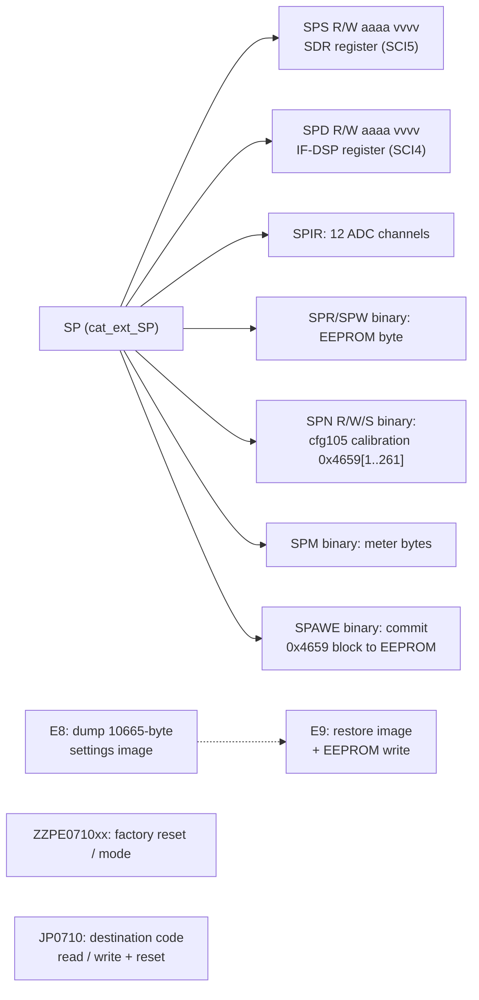

# MAIN — CAT subsystem (remote control)

Part of the MAIN code documentation (T09). Command reference: [docs/cat-commands.md](../../cat-commands.md).
Other MAIN subsystem pages (T10): [README.md](README.md) (overview, boot, main loop), [sci.md](sci.md) (UART drivers),
[display-link.md](display-link.md) (SCI1 link to the DISPLAY CPU), [sdr-link.md](sdr-link.md) (SCI5), [dsp-link.md](dsp-link.md)
(SCI4, IF-DSP), [eeprom.md](eeprom.md) (settings/memory persistence), [menu.md](menu.md) (EX menu engine), [ui-keys.md](ui-keys.md)
(front-panel key events), [radio-control.md](radio-control.md), [tx-protection.md](tx-protection.md), [peripherals.md](peripherals.md).
The names below are the Ghidra names in `ghidra/FT710_MAIN` (from `tools/ghidra/names_main.tsv`).
All addresses are MAIN ROM/RAM addresses, and the tags follow AGENTS.md: **[fact]** means seen in code or data, at the address given.

## Overview

- **Ports.** CAT is served on three UARTs. Each received command carries a port id byte, and the reply goes back to the same port. **[fact]** `cat_rx_complete` @ 0xFFFB1B50 and `cat_send_reply` @ 0xFFFB1D12.

| Port id | SCI | Receive buffer | Physical port | Manual name |
|---|---|---|---|---|
| 1 | SCI3 | 0xF62C | CP2105 "Enhanced" USB COM | CAT-1 **[inference]** |
| 2 | SCI0 | 0xA2B4 | CP2105 "Standard" USB COM | CAT-2 **[inference]** |
| 3 (any other id) | SCI2 | 0xCC70 | TUNER/LINEAR jack, 5 V TTL | CAT-3 **[inference]**. The manual says the TUNER/LINEAR jack is CAT-3 when it is enabled in the menu. |

- **Command queue.** `cat_rx_complete` copies every received frame shorter than 0x67 bytes into a **60-slot ring** at 0x1E14C. Each slot is 0x6A bytes: `+0` port id, `+2` length (u16), `+4` text. The head index is 0x11FEC and the tail index is 0x11FEB. **[fact]**
- **Fast path for E1/E9.** Frames that start with `E1`/`e1`/`E9`/`e9` bypass the ring. They go into a single-slot buffer at 0x1B78C: flag, port 0x1B78D, length 0x1B78E, data 0x1B790. This path exists for the 10 kB binary `E9` restore frame. **[fact]**
- **Main-loop parse.** `cat_parse` @ 0xFFFA347C runs once per pass of `main_loop`, and from the power-off loop in `app_main`. Each call parses at most one ring slot, or else the E9 slot, and at most one reply is sent per call. **[fact]**
- **Reply buffer and error reply.** Every reply is built in place at **0x1C8E** (`cat_reply`). The length goes in 0x1B788 (`cat_reply_len`), and a length of 0 means no reply. Errors set **0x464A** (`cat_error`), and the parser then replaces the reply with `?;` (`cat_reply_error` @ 0xFFFB0166). There is no other error code and no "busy" reply. **[fact]**
- **Auto information (AI).** AI is enabled per port with flags 0x20B20/0x20B21/0x20B22 (port 1/2/3). The broadcaster `cat_ai_poll` @ 0xFFFDD797 runs at the end of every `cat_parse` call. It walks about 70 change detectors (one per AI-capable item; each keeps a shadow copy of the last value it sent), formats at most one changed item into 0x15E06, and sends it to every port whose AI flag is set. **[fact]**
  - After a successful AI-relevant set, handlers call `cat_ai_holdoff` @ 0xFFFDDB6A. It starts timer 0x32 for 200 ms and sets 0x187C2, which delays the next AI frame. **[fact]**
  - Reading `AI1` also triggers the holdoff. **[fact]**
- **Power-off gate.** While the radio is "off" (0x20B3A == 0), `cat_parse` drops every command except `PS1`, primary index 71 with a parameter of `1`. **[fact]**
- **Global CAT disable.** While 0x20B46 == 1, `cat_parse` returns at once without consuming anything. The DISPLAY link sets this flag: `displink_rx_F1_sys` sub-command 3. **[fact]** Most likely it is used during firmware update or SD operations **[guess]**.
- **APO reset.** Every command received through the ring restarts the auto-power-off timer (`cat_apo_reset`). The timer is set to 900, 1800 or 3600 units, according to setting 0x9B0F (1, 2 or 3). **[fact]**

## Parse and dispatch flow


Details **[fact]** unless marked:
- **Case handling.** Only the two mnemonic characters are upper-cased (`toupper_inplace`, called twice). Parameters are case-sensitive unless a handler accepts both cases itself, as `SP` does for its sub-letters.
- **Lookup.** The lookup is a linear `strncmp(text, table+2*i, 2)`, compiled to `SCMPU`, so the decompile shows a strange loop. The index found is the switch case number.
- **Length checks.** Most primary cases check the **total** length, which counts the mnemonic and the `;`. The read form calls `cat_XX(text, 0)` and the set form calls `cat_XX(text, 1)`. Any other length gives `?;`. Some cases accept any length. The per-command list is in [cat-commands.md](../../cat-commands.md).
- **Reply prefill.** Before calling the handler, the case copies the start of the request (mnemonic plus the first 1–2 parameter characters) into 0x1C8E. The answer therefore echoes the selector digits of the request.
- **Mnemonics with no case.** The table holds mnemonics that have no switch case: `BY ED EK EU RC RD RS RT RU XT`. They hit the switch default, which answers `?;`.
  - `XT` (TX CLAR) is documented in manual rev 2211-A but is **not implemented in V01-12**.
  - `KT`, and `E9` when it arrives through the ring, hit no case in `cat_dispatch_ext` and get **no reply at all**.

## Request / reply sequence

```mermaid
sequenceDiagram
  participant PC
  participant ISR as SCIn RXI ISR
  participant RX as cat_rx_complete
  participant P as cat_parse (main loop)
  participant H as cat_XX handler
  participant AI as cat_ai_poll
  PC->>ISR: "FA;" (bytes)
  ISR->>RX: frame complete (port id, len)
  RX->>RX: copy into ring slot, head++
  RX->>ISR: re-arm R_SCIn_Serial_Receive
  P->>P: next main-loop pass: take slot, tail++
  P->>H: cat_dispatch idx 32, len 3 → cat_FA_FB(text, 0)
  H-->>P: 0x1C8E = "FA014250000;", len 12
  P->>PC: R_SCIn_Serial_Send(0x1C8E, 12) on the same port
  P->>AI: cat_ai_poll()
  AI-->>PC: changed-item frame (e.g. "MD02;") to every port with AI on
```

## Extended and service commands (summary)

The full table is in [cat-commands.md](../../cat-commands.md#extended-table). The service set is reached only through `cat_ext_mnemonics`:



Binary SP checksum (corrected in T10e/T17) **[fact]** (disassembly at 0xFFFA3867, 0xFFFA38C4, 0xFFFA39BB and 0xFFFA510A; `decomp/main/fffa20af_fffa7928.c` lines ~1468, 1489, 1551, 2890):
- The checksum-protected sub-commands (`SPR SPW SPM SPN SPA`) call `cat_checksum_ok(text, len-2)`. The checksum is a normal 8-bit sum over the frame without the sum byte and the `;`, compared with the sum byte.
- The earlier "checksum bug" (T09: `n` read from RAM address `len-2`) was a **decoder artifact**. The bytes `60 22 5F 22` are `SUB #2,R2; MOVU.W R2,R2`, but the RX SLEIGH module showed `MOVU.W [R2],R2`. T17 fixed the decoder and re-exported `decomp/main` (see [eeprom.md](eeprom.md) and `decomp/main/INDEX.md`, "Known decompiler artifacts").
- So these sub-commands are **usable in V01-12, high risk**: they read and write EEPROM and calibration/service data. Never send them without the owner's approval.

## Function table

| Address | Ghidra name | Inferred name / role | Purpose |
|---|---|---|---|
| 0xFFFB1B50 | `cat_rx_complete` | receive-end callback | Called by the SCI0/2/3 receive path with the port id and length. Queues the frame (ring or E9 slot) and re-arms reception **[fact]** |
| 0xFFFB1C91 / 0xFFFB1CA0 | `cat_ring_head` / `cat_ring_tail` | ring indices | Return 0x11FEC / 0x11FEB **[fact]** |
| 0xFFFB1CD2 | `cat_ring_pop` | ring take | Increments the tail mod 60 and returns the slot **[fact]**; the decompile lost the return value |
| 0xFFFB1CAF | `cat_ring_unpop` | ring un-take | Steps the tail back when the TX side of the port is busy (`sci_tx_end`==0), so the command is retried **[fact]** |
| 0xFFFB1D06 | `cat_e9_slot` | E9 slot pointer | Returns 0x1B78C **[fact]** (disassembly) |
| 0xFFFA347C | `cat_parse` | parser | See the flow above |
| 0xFFFA3B6E | `cat_dispatch` | primary switch | Index → case via `cat_switch_table` 0xFFF8F014 |
| 0xFFFA3A2A | `cat_dispatch_ext` | extended dispatch | Compare chain for EO/JP/FD/PE/ZZ/VE/E8 |
| 0xFFFA36F2 | `cat_ext_SP` | service command decoder | Dispatches on sub-letter text[2] (S D I W R M N A) |
| 0xFFFB0166 | `cat_reply_error` | error reply | Builds `?;` with length 2 **[fact]** |
| 0xFFFB1D12 | `cat_send_reply` | send by port | Port 1 → `R_SCI3_Serial_Send`, 2 → SCI0, else SCI2. Sets per-port busy flags 0x11FEA/0x11FE8/0x11FE9 **[fact]** |
| 0xFFFB1F42 | `sci_tx_end` | TX idle test | Port id → SCI3/SCI0/SCI2 transmit-end state **[fact]** (T05) |
| 0xFFFB263D | `cat_apo_reset` | APO restart | Restarts the auto-power-off timer from setting 0x9B0F **[fact]** |
| 0xFFFDD797 | `cat_ai_poll` | AI broadcaster | Runs about 70 change detectors (0xFFFDDCB5..0xFFFE1774, 0xFFFDDB7E) and sends to every AI-on port **[fact]** |
| 0xFFFDDB6A | `cat_ai_holdoff` | AI holdoff | Timer 0x32 for 200 ms, flag 0x187C2 **[fact]** |
| 0xFFFDDB7E | `cat_ai_FD` | AI detector for FD | Sends `FD00n<9 digits>;` when the FD value changes; part of the AI chain for an undocumented command **[fact]** |
| 0xFFFB2E9C | `nib2hex` | nibble → ASCII | `"0123456789ABCDEF"[n&15]` **[fact]** |
| 0xFFFB2F07 | `hex2nib` | ASCII → nibble | Accepts 0-9/A-F/a-f, else returns 0xFF **[fact]** |
| 0xFFFB2EB7 / 0xFFFB2EE7 | `byte2hex` / `word2hex` | formatters | 2 / 4 hex characters **[fact]** |
| 0xFFFB2F79 / 0xFFFB2F9E | `hex2byte` / `hex2word` | parsers | 2 / 4 hex characters **[fact]** |
| 0xFFFB3168 | `toupper_inplace` | | a-z → A-Z **[fact]** |
| 0xFFFB01AF | `sum8` | additive checksum | 8-bit sum of n bytes **[fact]** |
| 0xFFFB0182 | `cat_checksum_ok` | checksum test | `sum8(buf,n) == buf[n]` **[fact]** |
| 0xFFFB44F7 | `key_event_filter` | front-panel key gate | Checks a key code against about 20 mode locks (TX, tuning, menus, etc.) and returns 1 if the key may run. Many CAT handlers emulate a key press through it **[fact]** for the structure; it is used by AC CS SV VS VM ZI ST TS UP DN KY LM …. `cat_TX` (0xFFFAF7B8, `TX1;`) does **not** go through it **[fact]** ([tx-protection.md](tx-protection.md)) |
| 0xFFFA4E31 | `cat_SP_sdr_reg` | SPS | Parses 4-hex address and 4-hex value, then `sdr_reg_access` **[fact]** |
| 0xFFFA4E8F | `cat_SP_dev4_reg` | SPD | The same, through `dsp_reg_access` to the IF-DSP register file **[fact]** ([dsp-link.md](dsp-link.md), [../ifdsp/control-link.md](../ifdsp/control-link.md)) |
| 0xFFFA4EED | `cat_SP_adc_dump` | SPIR | 12 × 3 hex digits of ADC results, in the order AN000..AN007 (AN000, AN004 and AN006 reported as 0), AN115, AN117, AN108, AN109 **[fact]** ([peripherals.md](peripherals.md#the-12-spir-fields)) |
| 0xFFFA520B | `cat_SP_eeprom_byte` | SPR/SPW | Byte read/write at a 16-bit EEPROM address. The write also updates the RAM mirror at 0x464F[addr] **[fact]** |
| 0xFFFA50F9 | `cat_SP_table` | SPN | Table 0x4659[idx-1] (idx 1..0x105). `W` sets an entry, `S` schedules `FUN_fffbff93` after 500 ms, `R` reads the entry and loads preset idx-1 (`FUN_fffbb567`) **[fact]**. `cfg105` is the calibration table **[inference]** ([eeprom.md](eeprom.md)); entries from index 70 (0x469E..) hold the per-band TX power calibration used for SDR register 0x25 **[inference]** ([sdr-link.md](sdr-link.md)) |
| 0xFFFA5284 | `cat_SP_meters` | SPM | 8 binary bytes: meter values 0x1204A, 0x12048/0x1204B, … **[fact]** for the sources, **[inference]** that they are meters |
| 0xFFFB0532 | `eeprom_save_cfg105` | [eeprom.md](eeprom.md) | `eeprom_write(0x000A, 0x4659, 0x105)` **[fact]** |
| 0xFFFB0544 | `eeprom_save_dest` | [eeprom.md](eeprom.md) | `eeprom_write(0x010F, 0x475E, 3)`; holds the destination code **[fact]** |
| 0xFFFB0558 | `settings_defaults` | factory defaults ([eeprom.md](eeprom.md)) | arg 1: also reloads the 0x105 block from ROM 0xFFF8074F and the destination 0x8043. Then reinitializes VFO, memory and menu RAM from ROM defaults **[fact]** |
| 0xFFFB0356 | `eeprom_save_image` | [eeprom.md](eeprom.md) | `eeprom_write(0x1A7A, 0x60C9, 0x2F49)`, bracketed by header updates (`eeprom_hdr_update` 0xFFFB142B) **[fact]** |
| 0xFFFB0376 | `eeprom_save_memch` | [eeprom.md](eeprom.md) | Writes the 0x87-byte block plus one 0x5A-byte memory channel **[fact]** |
| 0xFFFB3B33 / 0xFFFB3B5D | `dest_code_get` / `dest_code_set` | destination code | 0x475E/0x475F. Set writes EEPROM, reloads defaults (`settings_defaults(0)`) and requests a restart (0x20F4B=1, 0x20B39=0x11) **[fact]**; that 0x20B39=0x11 means a reboot is **[inference]** |
| 0xFFFA1485 | `sdr_reg_access` | SDR register r/w | Waits until idle, then sends an `r`/`w` + hex address [+ value] + 2-hex sum + CR frame over SCI5 (`sdr_send_cmd`) and waits for the 7-byte reply **[fact]** |
| 0xFFF9D8A4 | `dsp_reg_access` | IF-DSP register r/w | The same protocol over **SCI4** to the RT685 IF-DSP **[fact]** (T10d/T12b, [dsp-link.md](dsp-link.md)). A write does not update the shadow **[fact]** |
| 0xFFFA3226 | `sdr_bridge_mode` | SDR maintenance bridge | Not CAT. Started by a DISPLAY-link message (`displink_rx_F1_sys` sub 1 → 0x1C8D=1). Relays binary SDR register requests from the DISPLAY CPU (ACK 0x06 / NAK 0x15) **[fact]** for the structure |
| 0xFFFB2718 | `cat_rand8` | | Pseudo-random byte from timer counter 0x88116; this is the E8 key **[fact]** |

Handler functions are `cat_<MNEMONIC>` (primary) and `cat_ext_<MNEMONIC>` (extended). Their addresses are in [cat-commands.md](../../cat-commands.md) and `decomp/main/cat_dispatch.tsv`.

## Data structures and globals

| Address | Size | Name | Meaning |
|---|---|---|---|
| 0xFFF805EC | 104×2 | `cat_mnemonics` | primary table **[fact]** |
| 0xFFF806BC | 10×2 | `cat_ext_mnemonics` | `SP EO E8 E9 FD KT PE ZZ VE JP` **[fact]** |
| 0xFFF806D0 | 16 | `cat_mode_codes` | mode nibble → CAT mode char `1 2 7 3 5 D 4 B 8 C A F 6 9 E F` **[fact]** |
| 0xFFF806DF | 10 | `cat_vfo_state_codes` | VFO/memory state → IF P7 char **[fact]** |
| 0xFFF806E9 | 18×3 | `cat_pms_names` | `P1L P1U … P9L P9U` (memory channel names 99..116) **[fact]** |
| 0xFFF8071B | 15×3+3 | `cat_5mhz_names` | `501`..`515`, `EMG` (channels 117..132) **[fact]** |
| 0xFFF8074F | 0x105 | `cfg105_defaults` | ROM defaults of the 0x4659 table **[fact]** |
| 0xFFF8F014 | 104×2 | `cat_switch_table` | int16 case offsets from 0xFFFA3B8A **[fact]** |
| 0xFFF8F480..0xFFF8F5E4 | 55 strings | `cat_ai_templates` | Zero-value answer templates (`AC000;` … `VX0;`) for AI-capable answers **[fact]** for the content; use by the AI detectors **[inference]** |
| 0x1C8E | ≤0x29B2 | `cat_reply` | reply buffer; overlaps 0x1C8E..0x463F for the E8 dump **[fact]** |
| 0x1B788 | u16 | `cat_reply_len` | **[fact]** |
| 0x464A | u8 | `cat_error` | **[fact]** |
| 0x464B | u8 | `cat_spn_save_pending` | set by `SPNS`; `cat_parse` runs `FUN_fffbff93` when timer 0x32 expires **[fact]** |
| 0x464C | u8 | `cat_port` | port id of the command being handled **[fact]** |
| 0x464F | 10 | `eeprom_hdr` | RAM mirror of EEPROM 0x0000..0x0009. `eeprom_hdr_update` increments a 32-bit counter in it on every save **[fact]** |
| 0x4659 | 0x105 | `cfg105` | table addressed by `SPN`, EEPROM 0x000A **[fact]**; calibration table **[inference]** ([eeprom.md](eeprom.md)) |
| 0x475E | 3 | `dest_code` | destination/version code, EEPROM 0x010F. `JP` reads and writes it **[fact]** |
| 0x60C9 | 0x29A9 (0x2F49 saved) | `settings_image` | Settings and memory image dumped by `E8` and restored by `E9`; EEPROM 0x1A7A **[fact]** |
| 0x9ADA..0x9AEB | 18 | `peq_params` | `PE` parameters (2 sets × 3 bands × 3 values) **[fact]**; that they are parametric EQ is **[inference]** |
| 0x11FEB / 0x11FEC | u8 | `cat_ring_tail` / `cat_ring_head` | **[fact]** |
| 0x1B78C | 1+1+2+0x29BC | `cat_e9_slot` | flag, port, length, data **[fact]** |
| 0x1E14C | 60×0x6A | `cat_ring` | **[fact]** |
| 0x15E06 | | `cat_ai_buf` | AI frame buffer **[fact]** |
| 0x187C2..0x18807 | | AI shadow copies / flags | one per detector **[fact]** |
| 0x20B04..0x20B16 | 12×u16 | `adc_results` | S12AD/S12AD1 conversions (`adc0_store`, `adc1_store`); `SPIR` reads them **[fact]** |
| 0x20B20/21/22 | u8 | `cat_ai_on[3]` | AI per port 1/2/3 **[fact]** |
| 0x20B3A | u8 | `radio_on` | 0 while off, so only `PS1` is accepted **[fact]** |
| 0x20B46 | u8 | `cat_disabled` | set from the DISPLAY link **[fact]** |
| 0x20BBE | u8 | `zz_mode0` | set by `ZZPE071000`. While it is 1, `key_event_filter` blocks key codes < 8 and 0x16..0x19 **[fact]**; the purpose is not known **[guess]** |
| 0x20F4B, 0x20B39 | u8 | restart request | written together by ZZ, JP and the destination change **[fact]**; that they mean "restart" is **[inference]** |
