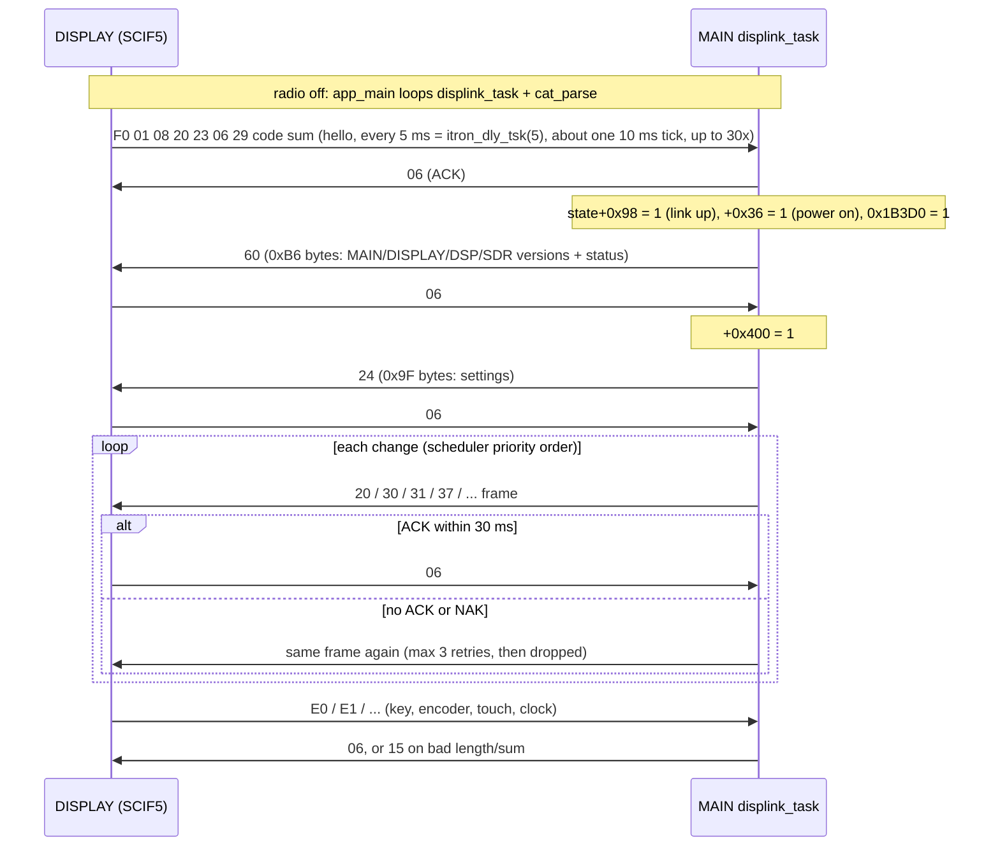
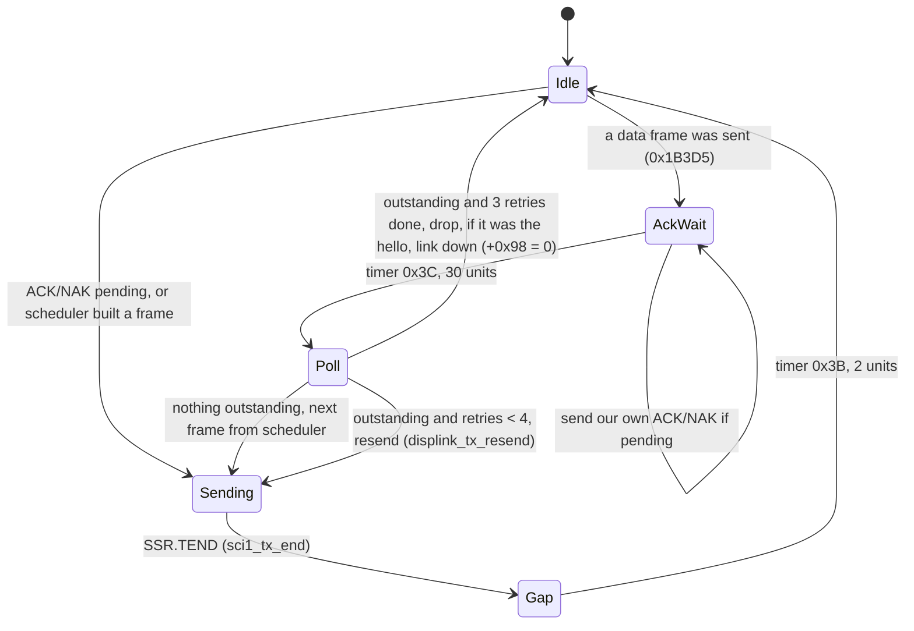
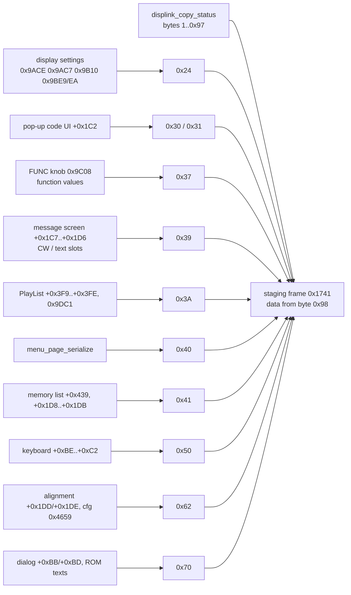
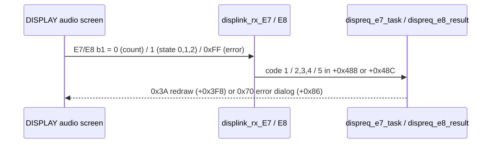

# MAIN — DISPLAY link (SCI1)

Back to the [MAIN overview](README.md).

Part of T10b. The UART driver is on [sci.md](sci.md), and what the key/encoder/touch frames do is on [ui-keys.md](ui-keys.md). The DISPLAY
(RZ/A1H) side is `docs/code/display/mainlink.md` (T11b). Function names are the names applied in Ghidra (`tools/ghidra/names_main.tsv`, merged by T17) and match `decomp/main/`; a name still in *italics* is a description that was not applied as a Ghidra name. Tags follow AGENTS.md.

## Overview

- **Physical link.** RX651 SCI1 (P26 TXD1 / P30 RXD1) ↔ RZ/A1H SCIF5 (P6_6/P6_7), nets `DISP_UMOSI/UMISO` (docs/hardware.md). About
  **340.9 kbit/s, 8 data bits, no parity, 2 stop bits** at PCLKB = 60 MHz ([sci.md](sci.md#channels)) **[fact: registers, PCLKB from SCKCR/PLLCR and the
  BRR formula, RX651 HWM r01uh0590 §9.2.1, §9.2.5, §37.2.13 Table 37.11]**. The same UART is the RX651 serial-boot port that DISPLAY uses to reflash MAIN.
- **Binary frames:** `type, payload…, sum`, where `sum` is the 8-bit sum of every byte before it, type byte included. Exceptions: `0x06` ACK and
  `0x15` NAK are single bytes, and the tunnel frames `'Z'` (0x5A) carry a 16-bit length. **[fact]** `displink_check_sum` 0xFFF9C60F,
  `displink_put_sum` 0xFFF9C5D8; the DISPLAY sender `FUN_201150f8` computes the same sum **[fact]**.
- **Type ranges.** MAIN → DISPLAY types are 0x20..0x7F; DISPLAY → MAIN types are 0xC3..0xC5 and 0xE0..0xF1. The DISPLAY's own 43-entry
  table at 0x20450074 lists both groups (see [cross-image notes](#cross-image-notes)). **[fact]**
- **Stop-and-wait with ACK/NAK.** Each side sends one data frame and waits for `0x06`. MAIN retries an unacknowledged frame every 30 ms up to 3 times,
  then drops it. MAIN answers every valid DISPLAY frame with ACK, and a bad length or checksum with NAK. **[fact]**
- **Change-driven traffic.** MAIN builds each data frame in a staging buffer and only sends it when it differs from the last frame sent
  (`displink_copy_if_changed` 0xFFF9C667). The default frame is the 0x99-byte status frame `0x20`, so in steady state the link is quiet until
  something on the radio changes. **[fact]**
- **Polled, no RTOS.** Everything above the ISR runs in `displink_task` 0xFFF94D6F, called once per `main_loop` pass and from the power-off loop
  in `app_main`. **[fact]**
- **Power on comes from the DISPLAY.** The DISPLAY's `0xF0` hello sets UI state +0x36 = 0x20B3A, which is the flag `app_main` waits on while the
  radio is off. So pressing POWER is seen by the DISPLAY, which wakes MAIN through this link. **[fact for the code path; inference that this is the
  POWER key]**

## Framing

### Receive side (ISR level)

`displink_rx_frame_len` 0xFFF9384C runs for every byte in `r_sci1_receive_interrupt` **[fact]**:

1. If a byte arrives more than 10 timer units (soft timer 1, about 10 ms) after the previous one, the frame restarts with this byte.
2. On the first byte it sets the expected length from the table below. An unknown first byte is dropped.
3. For `'Z'`, at byte index 2 it sets the length to `(b2 << 8 | b1) + 4`.
4. When the count is reached, the receive-end callback sets 0xA08A (`displink_rx_done`). The buffer is 0x9E86 (0x204 bytes).

`displink_task` then copies the frame to 0x198F, re-arms the receive (`displink_rx_rearm` 0xFFFB172D), checks the length again with
`displink_rx_len_of` 0xFFF95277 and the checksum, and dispatches it (`displink_rx_dispatch` 0xFFF95331). **[fact]**

The two length tables differ **[fact]**:

| First byte | ISR length | Task length | Note |
|---|---|---|---|
| 0x06, 0x15 | 1 | 1 | ACK / NAK |
| 0x5A `'Z'` | b1..b2 + 4 | 0 → NAK | only consumed by the DSP tunnel loop |
| 0x65 `'e'` | 9 | 0 → NAK | accepted by the ISR, never consumed (it is a MAIN→DISPLAY type) |
| 0xFD | 11 | 0 → NAK | only consumed by the SDR bridge loop |
| 0xFE | 7 | 0 → NAK | only consumed by the SDR bridge loop |
| 0xC3 / 0xC4 / 0xC5 | 35 / 263 / 7 | same | |
| 0xE0 / 0xE1 / 0xE2 / 0xE3 | 6 / 7 / 7 / 9 | same | |
| 0xE4 / 0xE5 / 0xE6 | 5 / 5 / 5 | same | |
| 0xE7 / 0xE8 | 10 / 10 | same | |
| 0xF0 / 0xF1 | 10 / 8 | same | |
| other | dropped (resync) | — | e.g. DISPLAY's `0xFA` (3 bytes) is never accepted |

### Transmit side

All MAIN data frames go out of one buffer at **0x1456** with the length in 0x1B628. `displink_tx_start` 0xFFF9C5B2 appends the sum, marks the frame
outstanding (0x1B3CE = 1, retry count 0x1B3CF = 0) and sends it with `displink_uart_send` 0xFFFB175B → `R_SCI1_Serial_Send`. Most builders first fill
a staging buffer at 0x1741 (0x24A bytes; 0x16A0 for the status frame) and copy it to 0x1456 only if it changed. **[fact]**

## Link control

Each step is in the code **[fact]**: the hello handler `displink_rx_F0_hello` 0xFFF9546A, the reply `displink_tx_60_hello` 0xFFF96225, the ACK handler
`displink_rx_ack` 0xFFF9541E (which sets +0x400 when the hello was the outstanding frame) and the scheduler `displink_tx_schedule` 0xFFF95F58.
The DISPLAY's hello loop (30 tries, `itron_dly_tsk(5)` apart, until MAIN answers) is the caller of the F0 builder `FUN_201162a4`; the F1 builder is `FUN_20116334` **[fact, DISPLAY image]**.

### `displink_task` timing

- 0x1B3D2 = TX busy, 0x1B3D3 = inter-frame gap running, 0x1B3D4/0x1B3D5 = ACK-wait window, 0x1B3CC = send ACK, 0x1B3CD = send NAK,
  0x1B3CE = data frame outstanding, 0x1B3CF = retry count, 0x1B3D0 = send the hello reply, 0x1B3D1 = hello reply outstanding. **[fact]**
- A received NAK does nothing (`displink_rx_nak` 0xFFF95469 is empty); the frame is simply resent when the 30-unit window ends. **[fact]**
- Every received data frame except `E3` restarts the screen-saver timer (`screensaver_timer_restart` 0xFFFB263D; it was named `cat_apo_reset`, and the committed decompile in `decomp/main/` shows that old name until the next Ghidra re-export, #208). **[fact]** See [README.md](README.md#screen-saver-timer-slow-timer-0).

## DISPLAY → MAIN frames

Offsets are into the frame (byte 0 = type). "UI state" is the struct at **0x20B04** that every module reaches through a pointer (0x25D38, 0x25D4C,
0x25D54, 0x25D58, 0x25D5C, 0x25D60, 0x25D6C..0x25D7C all hold 0x20B04 after `_INITSCT`) **[fact]**. Offsets like "+0x9C" are into that struct.

| Type | Len | Handler | Payload and effect | Reply |
|---|---|---|---|---|
| 0x06 | 1 | `displink_rx_ack` 0xFFF9541E | clears the outstanding frame; after the hello: +0x400 = 1 (send `0x24`) **[fact]** | — |
| 0x15 | 1 | `displink_rx_nak` 0xFFF95469 | nothing **[fact]** | — |
| 0xF0 | 10 | `displink_rx_F0_hello` 0xFFF9546A | b1,b2 → DISPLAY version string `"Vxx-yy"`, b4..b6 → date `"yy-mm-dd"` (stored by 0xFFF94BFD/0xFFF94C1B, read back by `ver_display`), b3 unused (DISPLAY sends 0x20), **b7 = boot code**. Sets link up (+0x98), power on (+0x36), hello reply pending. Boot codes: see below **[fact]** | ACK, then `0x60` |
| 0xF1 | 8 | `displink_rx_F1_sys` 0xFFF957E6 | b1 = sub-command: 0x01 enter SDR bridge (0x1C8D), 0x02 enter DSP ISP tunnel (0x1C63), 0x03 **disable CAT** (0x20B46 = 1), 0x83 no-op; others → NAK. 0x81 / 0x82 leave the SDR / DSP tunnel (handled inside the tunnel loops) **[fact]** | ACK (0x03, 0x83), none for 0x01/0x02 (the tunnel loop ACKs), NAK otherwise |
| 0xE0 | 6 | `displink_rx_E0_key` 0xFFF95829 | **key / touch event**: b1 = source (high nibble) and action (low nibble), b2..b3 = key code (big-endian). Passed through `key_event_filter`, then queued at +0x9C..+0xA0 for `key_task` ([ui-keys.md](ui-keys.md)) **[fact]** | ACK (always) |
| 0xE1 | 7 | `displink_rx_E1_encoder` 0xFFF9588B | **encoder step**: b1 = encoder id, b2 = signed step count ([ui-keys.md](ui-keys.md#encoders-e1)); ignored while +0x80 = 1 **[fact]** | ACK |
| 0xE2 | 7 | `displink_rx_E2` 0xFFF95BF4 | b1 ≠ 0 → +0xA6 = 1 (first frame also sets +0xA7 and +0xA5). Read by 0xFFFCFxxx/0xFFFD3xxx UI code **[fact for the fields]**. **SD-card state**: the DISPLAY sender is `mainlink_send_sd_state` **[inference, T14]** | ACK |
| 0xE3 | 9 | `displink_rx_E3_clock` 0xFFF95ED3 | b1..b5 → +0xAD..+0xB1. **Date/time from the DISPLAY RTC** **[inference]**: the clock-set code (0xFFFCD7xx, 0xFFFCDBB8) copies these to +0xB2..+0xB6 and forces fields 2 and 3 (month, day) to ≥ 1, and `0x65` sends +0xB2..+0xB6 back. No screen-saver timer restart (the frame is periodic) | ACK |
| 0xE4 | 5 | `displink_rx_E4` 0xFFF95C6A | clears +0x82 (`screensaver_on`; the clear is in `displink_rx_dispatch`, the handler only sets 0x1B3CC = send ACK): the DISPLAY's wake-up answer to `0x7B` **[fact]** | ACK |
| 0xE5 | 5 | `displink_rx_E5` 0xFFF95C74 | clears +0x80 (unblocks the scheduler and encoders) **[fact]** | ACK |
| 0xE6 | 5 | `displink_rx_E6_beep` 0xFFF95C8A | b1 = 0/1/2 → `beep_request`(1/2/3) 0xFFFB2DA6 (code 3 is also used when `key_event_filter` rejects a key) **[fact; "beep" is inference]** | ACK |
| 0xE7 | 10 | `displink_rx_E7` 0xFFF95CBC | b1 = 0 / 1 / 0xFF, b5 = value → +0xA8, +0xAA/+0xAB/+0xAC and a result code 1..5 in +0x488 (0xFF: also `beep_stop`). Consumed by `dispreq_e7_task` ([codes](#e7--e8-result-codes-179)). Status of the DISPLAY's **PlayList recorder/player** (sent while its audio owner flag 0x2080048E = 1); b1 = 0xFF is an error with code b5 **[fact, DISPLAY side: `FUN_20124744`]** (#65) | ACK |
| 0xE8 | 10 | `displink_rx_E8` 0xFFF95DAD | as E7, result in +0x48C **[fact]**; sent for the other audio screens (0x2080048E = 2/3), most likely voice messages **[inference]** (#65) | ACK |
| 0xC3 | 35 | `displink_rx_C3` 0xFFF95E65 | copies the payload to +0x2ED (0x109 bytes are copied whatever the frame length), sets +0x3F6: the answer to MAIN's `0x43` **[fact]** | ACK |
| 0xC4 / 0xC5 | 263 / 7 | `displink_rx_C4_C5` 0xFFF95E97 | same as C3: C4 answers `0x44` (block read, carries the data), C5 answers `0x45` (block write, echo only) **[fact, DISPLAY side: `mainlink_rx_block_read` / `mainlink_rx_block_write`]** (corrected in #61; this row used to pair them the other way round). Layout in [SD CARD transfers](#sd-card-transfers-0x43--0x44--0x45) | ACK |
| 0xB3 | — | 0xFFF95EC9 | has a case in the dispatcher (sets ACK) but no length entry, so it can never arrive **[fact]** | — |

### F0 boot codes

The DISPLAY puts the result of `key_scan_first` (which of its 8 key lines is held at power-on) in b7, or 0x10 on a later hello without a key, and sends
code 6 from `FUN_2011668c` **[fact, DISPLAY side]**. MAIN acts on them in `displink_rx_F0_hello` **[fact]**:

| b7 | MAIN action | Meaning |
|---|---|---|
| 0x00 | power on | normal power-on **[inference]** |
| 0x01 | `settings_defaults(0)`, 0x20B45 = 1, `dest_jumper_apply` | **full reset** of the settings **[fact]** |
| 0x02 | +0xBA = 1 (0x20BBE), `align_load_preset` | **factory alignment mode**, the same as `ZZPE071000` (TX band limits off, DSP key stores calibration items; [cat-commands.md](../../cat-commands.md#ext-zz)); the scheduler also sends `0x62`/`0x30`/`0x31` **[fact]** (#75). The service manual enters alignment mode by holding **[BAND] + [QMB] + [NAR]** at power-on, so that is this code **[inference]**; frame `0x62` (`displink_build_62`) carries nine lines of the alignment menu (labels from ROM 0xFFF817C3 plus each item's value), see [eeprom.md](eeprom.md#cfg105-the-alignment-table-fact) (#203) |
| 0x04 | +0x437 = 1, +0x34 = 0 | a numeric-entry/adjust mode: encoders 2/3/4/5 and the main dial go to the 0x25D3C counter (0..99,999,999); encoder 3 also steps the `0x64` LCD test patterns (#72) **[fact; purpose: service mode, inference]** |
| 0x05 | toggles 0x4760; when it turns it off, TX BPF SEL (0x9A36, `EX010113`) above 4 is set back to 1 | **TTBF unlock**: 0x4760 is the hidden flag that lets TX BPF SEL reach value 6 (TTBF) on the front panel ([menu.md](menu.md)) **[fact]** (#75) |
| 0x06 | link down (+0x98 = 0), no power on | the DISPLAY is in its maintenance/loader screen (boot combination 6, `mainlink_hello_key6` from `logo_fade_in`), or this is the first hello after a MAIN update **[fact for the DISPLAY call path, T14]** |
| 0x07 | swaps the destination code: 0xA983 / 0xB5A7 → 0xD950, 0xD950 / 0xA4C5 → 0xA983 (`dest_code_set`, which also resets settings and restarts) | **region change** at power-on **[fact for the values]** |
| 0x10 | power on only if 0x9DC5 ≠ 0 | 0x9DC5 is set by `PS1;`, by a low-voltage power-down and by the `0x7F` power frame, so a DISPLAY restart only powers the radio up if it was on **[inference]** |

## MAIN → DISPLAY frames

Listed in the scheduler's priority order (`displink_tx_schedule`, one frame per call). "Trigger" is the UI-state flag that requests it. Lengths
include type and sum and match the DISPLAY's table **[fact]**. Payload meanings are given only where the builder makes them clear.

| # | Type | Len | Trigger | Builder (send / fill) | Payload |
|---|---|---|---|---|---|
| 1 | 0x60 | 0xB6 | 0x1B3D0 (after F0) | `displink_tx_60_hello` 0xFFF96225 / 0xFFF96241 | b1..b8: MAIN, DISPLAY, DSP, SDR versions as BCD pairs (from `ver_main`, `ver_display`, `ver_dsp`, `ver_sdr`); b13..b14 = +0x32 (0xDB when 0x4660 set); then the 0x97-byte status block (same as `0x20`) and a few settings (0x9B0D, 0x9B09, 0x9B05, 0x9B01, 0x9DC5) **[fact]** |
| 2 | 0x64 | 3 | +0xB7 | 0xFFF986E0 | b1 = +0xB8, sent only when it changed **[fact]** |
| 3 | 0x24 | 0x9F | +0x400 (after the hello ACK; again 0x2B timer after +0x401) | 0xFFF9A17D / 0xFFF9A1A7 | display settings: EXT DISPLAY / PIXEL / SCU-LAN10, keyboard language, mouse speed, TFT brightness, LED dimmer, contrast, see [0x24](#0x24-display-settings-0x9f-bytes-display-mainlink_get_settings24-gui_apply_display_cfg) **[fact]** |
| 4 | 0x7F | 0x0B | +0x447 | `power_down_save` 0xFFF98797 | b1 = +0x35 & 0x7F, then the constant `9B BA F6 38 FF 25 73 1F`. +0x35 (= 0x20B39) is the power command: 0x10 power off (`PS0;`), 0x11 restart (`dest_code_set`, resets), 0x90 low-voltage off (also waits 2000 units) **[fact for the values; the constant looks like a guard against accidental matches, guess]** |
| 5 | 0x62 / 0x30 / 0x31 | 0x197 / 0xA0 / 0xA3 | +0xBA (boot code 2) | 0xFFF9C46D / 0xFFF98ECB | `0x62`: nine alignment-menu lines, see [0x62](#0x62-alignment-menu-0x197-bytes-display-scr_setup_menu) **[fact]** |
| 6 | 0x7C | 5 | +0x81 | 0xFFF98869 | zeros; +0x80 then blocks until `E5` **[fact]** |
| 7 | 0x7B | 5 | +0x83 (`screensaver_toggle_req`, set by `io_task`) | 0xFFF9889C | b1 = toggled +0x82 (`screensaver_on`); while +0x82 = 1 the frames below are not sent, until `E4` **[fact]**. Screen saver on/off ([README.md](README.md#screen-saver-timer-slow-timer-0)) |
| 8 | 0x7A | 5 | +0x85 | 0xFFF988F2 | zeros; +0x84 blocks **[fact]** |
| 9 | 0x70 | 0xE3 | +0x86 | 0xFFF98925 / 0xFFF9894F | dialog box: style, buttons, position, ROM text n = UI +0xBB, see [0x70](#0x70-dialog-0xe3-bytes-display-scr_confirm--confirm_dialog_draw) **[fact]** |
| 10 | 0x43 / 0x44 / 0x45 | 0x23 / 7 / 0x107 | +0x87, type in +0x1E0, length in +0x1E2 | 0xFFF98BCD / 0xFFF98C1F | requests answered by `C3` / `C5` / `C4`; set by the SD CARD menu operations (`sd_menu_task`, task 13: MEM LIST / MENU load and save, INFORMATIONS, FORMAT) **[fact]** (#65) |
| 11 | 0x50 | 0xF5 | +0x88 and +0x90 | 0xFFF9A2D1 / 0xFFF9A2FB | on-screen keyboard: layout, cursor, title, text, see [0x50](#0x50-on-screen-keyboard-0xf5-bytes-display-scr_keyboard) **[fact]** |
| 12 | 0x23 | 0x37 | +0x89 / +0x8A / +0x8B | 0xFFF98E39 / 0xFFF98E96 | b1 = high byte of +0x1BE plus 1. **The +0x8A/+0x8B variants call empty fill functions** (0xFFF98EC9, 0xFFF98ECA) and resend whatever is in 0x1456 with length 0x37 **[fact]** |
| 13 | 0x30 / 0x31 | 0xA0 / 0xA3 | +0x8C | `displink_tx_30_31` 0xFFF98ECB | 0x30 when +0x1C2 < 0x1E or 0xFF, 0x31 when < 0x5F **[fact]**; layouts in [0x30 / 0x31](#0x30-select-pop-up-and-0x31-value-pop-up) |
| 14 | 0x65 | 9 | +0x8D | 0xFFF9A0CC / 0xFFF9A100 | +0xB2..+0xB6: the clock to set on the DISPLAY RTC **[inference]** |
| 15 | 0x34 | 0xA3 | +0x99 (then +0x9A blocks) | 0xFFF98F7C / 0xFFF9A06E | |
| 16 | 0x30 / 0x31 | | +0x1C0 or +0x1C1 (when +0x8F = 0) | 0xFFF98ECB | |
| 17 | 0x50 | 0xF5 | +0x90 | 0xFFF9A2D1 | |
| 18 | 0x3A | 0xA2 | +0x93 | 0xFFF9A8E3 / 0xFFF9A925 | PlayList sub-state, list position, command, volume; sent once per +0x3F8, see [0x3A](#0x3a-playlist-0xa2-bytes-display-scr_playlist) **[fact]** |
| 19 | 0x39 | 0xE9 | +0x94 | 0xFFF9B69E / 0xFFF9B6C8 | message-memory screen: title, state, channel, volumes, 5 slot labels, see [0x39](#0x39-message-memory-screen-0xe9-bytes-display-scr_vfo--fun_201293f8) **[fact]** |
| 20 | 0x3F | 5 | +0x91 | 0xFFF9A89B | b1 = +0x92 **[fact]** |
| 21 | 0x40 | 0x1FB | +0x95, at most every 100 units (timer 0x29) | 0xFFF9AAAD / 0xFFF9AAF7 | the only rate-limited frame. Status + menu list (five 0x2D-byte text slots, also the "FIRMWARE UPDATE" entry) **[fact on the DISPLAY side, display/mainlink.md]**; the scope does not use this link ([system.md §6.4](../system.md#64-scope-and-waterfall-data)). Layout in [0x40](#0x40-menu-page-0x1fb-bytes-display-main-screen-scr_text_list) |
| 22 | 0x37 | 0x240 | +0x96 | 0xFFF9AB2A / 0xFFF9AB57 | the largest frame: FUNC panel, 41 slots of {flag, function id, 8-character value}, see [0x37](#0x37-func-panel-0x240-bytes-display-scr_func_panel) **[fact]** |
| 23 | 0x41 | 0x146 | +0x97 | 0xFFF9BB23 / 0xFFF9BB50 | MEMORY CH LIST: header, group, 4 channel rows, see [0x41](#0x41-memory-ch-list-0x146-bytes-display-scr_memory_list) **[fact]** |
| 24 | 0x20 | 0x99 | default | `displink_tx_20_status` 0xFFF9C42A / 0xFFF9C454 → `displink_build_status` | the main status block: VFO A/B record (0x9D09 or 0x9D63 by 0x9DBD), mode, etc. Sent only when changed **[fact]** |

Types in the DISPLAY table that MAIN V01-12 never sends: **0x21, 0x42, 0x71** (no builder writes them) **[fact: none of the type stores in the
image use these values]**.

The status block itself is mapped below (#72). The data that `0x24`, `0x30`/`0x31`, `0x37`, `0x39`, `0x3A`, `0x40`, `0x41`, `0x50`,
`0x62` and `0x70` carry after it is in [Payloads after the status block](#payloads-after-the-status-block-179) (#179).

### The 0x97-byte radio status block (`0x20`, #72)

`displink_build_status` (0xFFF96455) fills the frame buffer 0x16A0 (byte 0 = type) and returns 0x98, the index of the checksum. The
same block follows the header in `0x60` and starts every "status + …" frame **[fact]**. Indexes are frame bytes (the DISPLAY's
`mainlink_status_valid` 0x2015E354 range-checks the same bytes). "rec" = the **active** VFO record (0x9D09, or 0x9D63 when 0x9DBD = 1);
"UI" = the UI-state struct 0x20B04; per-mode values come from rec's per-mode block ([radio-control.md](radio-control.md#per-mode-block-layout)).
Sources are **[fact]**; names in *italics* are **[inference]**.

| Byte | Source | Content |
|---|---|---|
| 1 | 0x9C37 | *scope flag* (also drives byte 39) |
| 2 | `FUN_fff96dde` | scope mode 0..B, the `SS` sel-6 coding ([cat-commands-primary.md](../../cat-commands-primary.md#ss)) |
| 3 | `FUN_fff96f3e` | bit 7 = active VFO is B (inverted while UI +0x405), bit 5 = split 0x9C5E, else bit 4/bit 6 from UI +0x425/+0x426 (side flag) |
| 4 | `FUN_fff96fb7` | bit 5 when UI +0x95, +0x96 or +0x97 is set |
| 5 | `FUN_fff9700b` | split 0x9C5E \| waterfall EXPAND 0x9C3D << 5 \| 0x9DC6 << 6 |
| 6 | `FUN_fff97049` | 3DSS DISP SENSITIVITY 0x9B17 (bit 0) << 6 \| 2D DISP SENSITIVITY 0x9B16 << 7 (`EX040204` / `EX040203`, [menu.md](menu.md)) |
| 7 | `FUN_fff97075` | *HI-SWR warning* UI +0x69 (0x20B6D, 2 bits: `swr_meter_protect` sets 1 or 2 by blink phase while the TX SWR is outside 1..5, 0 when it is back) << 4 \| +0x68 << 6 (no writer in MAIN, so always 0) \| **TX** (+0x67 = 0x20B6B) << 7 |
| 8 | `FUN_fff970b8` | UI +0x34, high nibble masked off when LED DIMMER 0x9B10 (or +0x480 in numeric-entry mode) is 0. +0x34 is an 8-bit lamp map: `FUN_fff98727`(n, on) sets bit 0x80, 0x40, 0x10, 8, 4, 2, 1, 0x20 for n = 1..8; its callers are the encoder-2 step sequence `FUN_fffc670d` (each lamp on and off in turn, 100-unit timer 0x47) and the timed `FUN_fffc9046`; boot code 4 clears it. **DISPLAY reader** **[fact]** (#179): `gui_screen_update` (0x2012EBB8) calls `led_set_mask(frame[8])` for each status-carrying frame, just before copying it to 0x208F0B2A (and `led_set_mask(0)` on power-off), so the byte drives the front-panel LEDs on P6, bit 0..7 = D_RED, D_GREEN, D_WHITE, D_BLUE, RXBUSY, TX, STEPCH, VOX ([display/peripherals.md](../display/peripherals.md)). So `ui_lamp_set` n = 1..8 is VOX, STEPCH, RXBUSY, D_BLUE, D_WHITE, D_GREEN, D_RED, TX, and LED DIMMER = 0 turns off RXBUSY, TX, STEPCH and VOX **[fact for the bits; the LED names are the schematic's]** |
| 9 | `FUN_fff97105` | 0x9C5C << 3: a toggle flipped only by `key_011_long` (0xFFFBCBBD, beep 2), the **long-press handler of soft key 0x011** (`key_long_table` entry 0xFFF8B8D0; the same key's short handler `key_011_short` 0xFFFBCB77 toggles UI +0x70) **[fact]** (#179). On the DISPLAY, bit 3 of this byte (0x208F0B33) makes both filter-graph drawers (`FUN_201233d4`, `main_filter_graph`) call `filter_graph_affft_overlay` (0x20121AF0), which draws the 200 AF-FFT bins (0x208DD73C, `affft_bins_get` 0x20120D84) as 44-pixel bars into the empty pixels at row 129, x 521..720 **[fact]**: 0x9C5C is an *AF-FFT overlay on/off* switch **[inference]** \| UI +0x6C/+0x6B/+0x6A << 4/5/6 (+0x6A/+0x6B = *frequency settled*, `FUN_fff9ccd3`) \| marker 0x9BE7 << 7 |
| 10 | `FUN_fff9716f` | TX BPF SEL of the mode (0x9A36 SSB, 0x9A4B AM, 0x9A73 DATA/PSK) \| 0x80; 0 in other modes; value 6 without bit 7 |
| 11 | 0x9C5B & 7 | meter selection (0 PO, 1 COMP, 2 ALC, 3 VDD, 4 IDD, 5 SWR; see byte 95) |
| 12 | `FUN_fff971fc` | ATT (rec+3 bits 0–1, `RA`) \| IPO/AMP1/AMP2 (rec+5 bits 0–1, minus 1, `PA`) << 2 \| {2 in FM modes, else DNF on = block+1 bit 7, `BC`} << 4 |
| 13 | `FUN_fff9728c` | 0x80 = CW INDICATOR 0x9AA4 in CW, 0x40 = APF on (CW block bit 5), 0x20 = CONTOUR on (block+0 bit 6), 0x10 = manual NOTCH on (block+0 bit 7; both not in FM), bits 0–2 = AGC (`GT`) speed + 1, 0 = AUTO/off |
| 14 | `FUN_fff97430` | TX-VFO flags: bit 6 `FUN_fff9752b`, bit 5 keyer on (0x9C02) with `FUN_fffc3e3c`, bit 4 monitor on (the per-mode MONI byte from `FUN_fff99669` ≠ 0), bit 2 BK-IN/VOX flag (block+0 bit 1, `BI`); FM modes: repeater shift + 1 in bits 0–1 |
| 15 | `FUN_fff97567` | FM tone mode in use UI +0x6E (0x20B72, rec+3 bits 3–5 in FM/DATA-FM, else 0; `dsp_set_ctcss_dec`) \| tuner indicator +0x6D << 3 (0x20B71, from `tuner_task`: 1 = tuner on, blinking while it tunes (internal tuner, `FUN_fffec62b`), 1/0 or 2 for TUNER TYPE SELECT 0x9AB8 = 2 / 3 (`FUN_fffed62a`, `FUN_fffed165`)) \| message/keyer state << 6 (1 recording, 2 playing, 3 +0x92) |
| 16 | `FUN_fff976d2` | PEAK 0x9BE6 & 7 (`SS01`) \| (UI +0x6F << 4, or 0x40 while timer 0x2A runs); +0x6F has no writer in MAIN, so it is always 0 |
| 17 | `FUN_fff9770b` | span index (`scope_span_index`) \| CENTER/CURSOR/FIX 0x9C35 << 6 |
| 18 | 0x9C5A, 0x9BE8 | scope speed << 4 \| colour; with speed STOP (`FUN_fffc4f8f`) 0x50 \| colour |
| 19–20 | `FUN_fff977b3` | default WIDTH of the mode (3000, 500, 9000, 16000, 3200 Hz) |
| 21–24 | `FUN_fff9782b` | CW only: zero-in indicator, 4 bytes from table 0xFFF804DE by `dsp_tune_offset` (±99 → 0..24), refreshed every 100 units |
| 25–26 | `FUN_fff978eb` | CONTOUR frequency/10 (block +2); bit 7 of byte 25 = CONTOUR LEVEL 0x9AD5 negative |
| 27–28 | `FUN_fff9795f` | NOTCH frequency/10 (block +4) |
| 29–30 | `FUN_fff979d3` | WIDTH (block +6; fixed 6000 AM-N, 16000 FM-N/DATA-FM-N) |
| 31–32 | `FUN_fff97a44` | IF SHIFT (block +8) |
| 33 | 0x9C5F | APF offset (`CO03`) |
| 34 | 0x9C04 + 30 | CW pitch / 10 Hz |
| 35 | `FUN_fff97abc` | bit 7 UI +0x70 (FUNC panel open), bit 6 +0x71, bit 5 shift ≠ 0, bit 4 width ≠ default, bit 2 +0x47A, bits 0–1 DSP-knob function +0x73 (0x20B77, set with +0x7E by `cat_SF` P1 = 1 and the knob code: 0 SHIFT, 1 WIDTH, 2 NOTCH, 3 CONTOUR or APF) |
| 36 | `FUN_fff97b7b` | voice-memory channel UI +0x79 & 0xF (0x20B7D = channel − 1, set by `cat_PB`, `cat_LM`, `FUN_fffe4211`, `FUN_fffe4e6e`) \| DVS state +0x78 << 4 (0x20B7C: 1 play, 2 record) |
| 37–42 | `FUN_fff97ba6` | scope: CENTER/CURSOR/FIX (0 in TX), 0x84/3 (3DSS 0x9C36), 0x86/5 (0x9C37), 0x88/7 (EXPAND 0x9C3D), 9, 10; skipped while UI +0x41A |
| 43 | 0xFF | |
| 44 | `FUN_fff97c74` | FUNC-knob function (0x9DC9, or a code for the open setting +0x1C2: 0x0B→3, '&'→8, '/'→0x11, 'T'→0x36, '9' DNR→0x1B, 'F'→0x10, '8'→0x1A); 0x2D while TXW (UI +0x483) |
| 45–69 | VFO block, **main side** | 45 mode (rec+0 & 0xF); 46 VFO state code (`FUN_fff97cf7`: 1 VFO, 0 state 0, 2 memory, 3 memory tune, 4 PMS, 5 QMB, 7 60 m, 8 EMG; 9 = split RX); 47 channel number; 48 `FUN_fff97e1d` flags; 49–53 frequency digits (`FUN_fff982bb`, or the numeric-entry BCD at UI +0x7B in mode +0x437); 54–65 memory tag (rec+0x4E); 66 UI +0x425; 67–68 clarifier offset (rec+0x48) |
| 70–94 | VFO block, **sub side** | same layout for the other VFO (state 10 = split TX). The two blocks are built for A then B and swapped when B is active |
| 95 | `FUN_fff9849e` | meter value: S-meter in RX, else PO/COMP/ALC/VDD/IDD/SWR by byte 11 |
| 96 | `FUN_fff98526` | FINE/FAST tuning 0x9C61 (0 off, 1, 2; `FN`) \| dial LOCK 0x9C62 << 2 (`LK`) \| rec+2 bit 1 << 3 \| DNR on (rec+6 bit 4) << 4 |
| 103 | 0 | |
| 104 | 0x9A8D, 0x9A8C | RTTY shift (2 bits) \| polarity << 7 |
| 105 | 0x9A79 | (2 bits) << 4 (PSK/DATA setting) |
| 106 | 0x9C03 | key speed (`KS`) |
| 107–112 | 0 | |
| 113 | 0x9C3C, 0x9C39 | OSC time (3 bits) \| AF-FFT att << 5 \| 0x18 (`SS07`) |
| 115–116 | 0x9A7A:7B × 10 | DATA offset in Hz |
| 117–120 | `disp_put_op_freq` | operating frequency (UI +0x458 while TX, else +0x450/+0x454), u32 BE |
| 121–124 | `disp_put_tx_freq` | TX frequency 0x20F50 |
| 125–128 | `disp_put_dial_freq` | dial frequency |
| 129–132 | `disp_put_scope_start` | scope start frequency (0x20F60, or the FIX band memory) |

Bytes 97–102, 114 and 133–151 are **always 0** **[fact]**: every frame builder clears the 0x16A0 buffer before calling
`displink_build_status` (`displink_build_60` runs after a builder that did), and no code in MAIN stores to 0x1701..0x1706, 0x1712 or
0x1725..0x1737 under any address form. The DISPLAY has no absolute reference to the matching snapshot bytes (0x208F0B8B..0x208F0B90,
0x208F0B9C, 0x208F0BAF..0x208F0BC1) **[fact]**; it reads the block mostly through a base pointer, so an indexed read cannot be ruled out
from text alone. The gaps look like fields of the shared Yaesu status layout that the FT-710 does not use **[guess]**. Of the single bits
listed in #179, UI +0x68 and +0x6F are always 0; 0x9C5C (byte 9 bit 3) is the soft-key-0x011 long-press toggle that the DISPLAY reads as
the AF-FFT overlay of the filter graph, and byte 8 (+0x34) is the front-panel LED mask (`led_set_mask`) (see the rows above; #179); `affft_bins_get` and `filter_graph_affft_overlay` are new rows in `tools/ghidra/names_display.tsv` and appear in `decomp/display/` after the next Ghidra re-export). Which
on-screen area sends soft key 0x011 is still open: it is in the DISPLAY's touch hit tables, which were not traced (#212).

### Small frames and mode flags (#72)

- **`0x64` LCD test** **[fact]**: `displink_tx_64` (0xFFF986E0, from the scheduler) sends UI +0xB8 when it changes. +0xB8 is set by
  `FUN_fffc82b7`, which `enc3_step` calls while UI +0x437 = 1, i.e. in **boot mode 4**: the knob steps 0x1B4EC through the test
  patterns and the first position sends 0xFF (off). So boot code 4 is the service mode that holds the LCD test as well as the numeric
  entry **[inference]**.
- **`0x34` info** **[fact]**: `displink_tx_34` (0xFFF98F7C, `displink_build_34(1, 0x1B3D6)`) runs when UI +0x99 is set, by the
  menu item **CERTIFICATION** (`menu_m4_21_0_enter`) and by `FUN_fffbe4e8` (a page step).
- **Mode flags**: 0x20BBE = UI +0xBA, factory alignment mode (boot code 2); 0x20B8A = +0x86, a message pop-up is shown (`FUN_fffcfa3d`) and frame `0x70` is due;
  0x20B7C = +0x78, DVS state (0 idle, 1 play, 2 record; [cat-commands-primary.md](../../cat-commands-primary.md#pb)); 0x20B98 = +0x94,
  the request flag of frame `0x39` **[fact for the writers/readers]**.
- **E2, E7/E8 result codes, boot code 5**: as in the tables above; what `dispreq_e7_task` and `dispreq_e8_result` do with each E7/E8
  code is in [E7 / E8 result codes](#e7--e8-result-codes-179).

### Payloads after the status block (#179)

Every "status + …" frame is built the same way: the builder clears the status buffer 0x16A0 (0x98 bytes) and the staging frame 0x1741
(0x24A bytes), writes the type, and calls `displink_copy_status` (0xFFF98CD3). That runs `displink_build_status` and copies its 0x97
bytes to frame bytes 1..0x97. The frame's own data starts at **byte 0x98** (staging address 0x17D9), and every byte the builder does not
write is 0 **[fact]**. On the DISPLAY the frame lands in the GUI's current-screen copy 0x208F0B2A, so frame byte 0x98 is 0x208F0BC2. The
screen functions read it as `frame + 0x98` **[fact]**. The figure shows which MAIN state feeds which frame **[fact for the edges]**.

The names `displink_copy_status`, `displink_70_*`, `mode_block_byte0/1`, `ui_lamp_set`, `displink_62_value` and `dispreq_e8_result`
were added to `tools/ghidra/names_main.tsv` by #179. `decomp/main/` still shows them as `FUN_<address>` until the next Ghidra
re-export (see the [Functions](#functions) table for the addresses).

#### `0x24` display settings (0x9F bytes; DISPLAY `mainlink_get_settings24`, `gui_apply_display_cfg`)

| Byte | Source | Meaning | DISPLAY use |
|---|---|---|---|
| 0x98 | 0x9ACE << 2 \| 0x9B21 << 1 \| 0x9B20; bit 2 is also forced on in service mode (UI +0x437 = 1) | bit 0 = EXT DISPLAY (`EX040401`), bit 1 = PIXEL (`EX040402`), bit 2 = SCU-LAN10 (`EX030126`) | bit 0 → `lvds_pins_enable`, bit 1 → `dvi_set_resolution`, bit 2 → `gpio_ft4222_reset` (the USB bridge chip, so the SCU-LAN10 port) **[fact for the calls]** |
| 0x99 | 0x9AC7 | KEYBOARD LANGUAGE (`EX030119`) | copied with the rest; reader not traced |
| 0x9A | 0x9B11 | MOUSE POINTER SPEED (`EX040106`) | copied with the rest; reader not traced |
| 0x9B | ROM 0xFFF80557[0x9BEA] (service mode: index UI +0x480) | TFT brightness (`DA` P3, 0..20) converted through a ROM table: **24 + n %** | `backlight_set(b & 0x7F)`, a PWM percentage **[fact]** |
| 0x9C | ROM 0xFFF80542[0x9B10] (service mode: index UI +0x480) | LED DIMMER (`DA` P4, 0..20) converted through a ROM table: **20 + 4·n %** | `dimmer_set(b & 0x7F)` **[fact]** |
| 0x9D | 0x9BE9 (service mode: UI +0x481) | TFT CONTRAST (`DA` P2), 0..20 | `r_vdc5_display_calibration` with gains of 10·n + 0x1C / 10·n + 0x11 (n capped at 20) **[fact]** |

The two ROM tables (`displink_build_24` 0xFFF9A1A7 indexes `0xFFF804E2 + 0x75` and `+ 0x60`) are 21 bytes each, one per setting step
0..20 **[fact, MAIN image]** (#179):

| Table | Values (n = 0..20) | Curve |
|---|---|---|
| 0xFFF80542, LED DIMMER (0x9B10) | 20, 24, 28, … 96, 100 | linear, 20 % at 0 and 100 % at 20 |
| 0xFFF80557, TFT brightness (0x9BEA) | 24, 25, 26, … 43, 44 | linear, 24 % at 0 and 44 % at 20 |

So the TFT backlight never goes below 24 % or above 44 % from the setting (the DISPLAY's own `backlight_set` callers use 60 % at start-up
and 100 % on some screens, [display/peripherals.md](../display/peripherals.md)), and the LED DIMMER spans 20..100 % **[fact for the
values]**. The DA range check (each value ≤ 20) keeps the index inside the tables **[fact]**. In boot mode 4
(service) the counters UI +0x480/+0x481 replace the stored settings **[fact]**, which looks like the service-mode brightness test **[inference]**.

#### `0x30` select pop-up and `0x31` value pop-up

`displink_tx_30_31` sends `0x30` (0xA0 bytes) when the pop-up code UI +0x1C2 is below 0x1E or 0xFF, and `0x31` (0xA3 bytes) when it is
0x1E..0x5E **[fact]**. Key handlers set the code: `key_mode_short` 5, `key_band_short` 0x0C, `key_nb_long` 0x38, `key_dnr_long` 0x39,
`key_lock_pwr_short` 0x47/0x48, and `FUN_fffbc782`..`FUN_fffbd0b9` 0..0x0D **[fact]**.

`0x30` (DISPLAY `scr_select_popup`): byte 0x98 = code, then the fields below **[fact for the sources; the names come from the CAT handlers
in cat-commands-primary.md]**. "rec" is the active VFO record, "block" its per-mode block ([radio-control.md](radio-control.md#per-mode-block-layout)).

| Code | 0x99 | 0x9A | 0x9B | Pop-up |
|---|---|---|---|---|
| 0 | 0x9C5B (meter selection) | | | METER (PO/COMP/ALC/VDD/IDD/SWR) |
| 1 | rec+3 & 3 | UI +0x1C3 | | ATT (`RA`: off / 6 / 12 / 18 dB) |
| 2 | (rec+5 & 3) − 1, never below 0 | UI +0x1C3 | | IPO / AMP1 / AMP2 (`PA`) |
| 3 | block+1 bit 7 (`mode_block_byte1`) | UI +0x1C3 | | DNF / AUTO NOTCH (`BC`) |
| 4 | 0, or AGC speed + 1 (block+1 bits 4–6) | UI +0x1C3 | | AGC (`GT`) |
| 5 | rec+0 & 0xF (mode) | 0 | UI +0x424 (mode cursor) | MODE |
| 6 | `scope_span_index` | | | SPAN |
| 7, 8 | 0 | | | no value |
| 9 | 0x9C39 | | | AF-FFT attenuator (`SS07`) |
| 0x0A | 0x9C3A << 6 \| 0x9C3B << 4 \| 0x9C3C | | | OSC level (TX, RX) and time (`SS07`) |
| 0x0B | 0x9BE8 | 0 | UI +0x424 | scope COLOR |
| 0x0C | UI +0x1DC (band) | 0 | UI +0x424 | BAND |
| 0x0D | 0x9C5A, or 5 while STOP | | | scope SPEED |

UI +0x1C3 is a second flag (set to 1 by `FUN_fffc06ab`); its meaning is open. The DISPLAY draws the pop-up labels from bitmaps, so the
names above come from the MAIN sources only **[inference]**.

`0x31` (DISPLAY `scr_value_popup`): byte 0x98 = code − 0x1E, bytes 0x99..0xA1 = a 9-character value text (spaces when the code has no
formatter, for example the LOCK codes 0x47/0x48) **[fact]**. Code − 0x1E is the same **function id** as in frame `0x37` below, with these
extra ids: 0x1A = NB level (0x9DC0, `NL`), 0x1B = DNR level (rec+6), 0x1C = no text, 0x25 = QMB depth (0x901F/0x9021), 0x26/0x27/0x37
= texts from UI +0x43A, 0x28 = keyer on/off (0x9C02), 0x40 = UI +0x42F **[fact for the sources; names inferred]**.

#### `0x37` FUNC panel (0x240 bytes; DISPLAY `scr_func_panel`)

| Byte | Content |
|---|---|
| 0x98 | UI +0x1C4 << 7 (always 1 here) \| +0x1C5 << 6 \| +0x1C6 << 5 (always 0). On the DISPLAY bit 6 picks the highlight-frame colour (white or red) **[fact]** |
| 0x99 | 0x9C08, the stored FUNC-knob function (`SF` P1 = 0) **[fact]** |
| 0x9A | 0 |
| 0x9B + 10·i | 41 slots (i = 0..40): flag byte (bit 7 = not usable in the current mode; the DISPLAY then takes the label from the second bitmap set 0x20801AD8), function id, 8-character value text **[fact]**. The DISPLAY draws only the first 33 slots (0x21); the last 8 carry id 0xFF |

Function ids, in slot order **[fact for the sources; the names 0..0x14 match the `SF` P2 list in cat-commands-primary.md]**:

| Id | Function | Value source |
|---|---|---|
| 0 | SCOPE LEVEL | per-band RX/TX byte 0x9BCA/0x9BD8 (`FUN_fff9c6ab`), shown as −30.0..+30.0 dB in 0.5 dB steps |
| 1 / 2 / 3 | PEAK / MARKER / COLOR | 0x9BE6 / 0x9BE7 / 0x9BE8 (ROM text tables) |
| 4 / 5 | CONTRAST / DIMMER | 0x9BE9 / 0x9BEA |
| 6 | M-GROUP | no text in `0x37` (the `0x31` pop-up shows the group of the current channel) |
| 7 | MIC GAIN | 0x9BEC..0x9BEF by mode class |
| 8 | MIC EQ on/off (DISPLAY label `MIC EQ`; 0x9BF0 is the parametric-EQ flag `PR1`) | 0x9BF0; greyed outside SSB/AM/FM (`FUN_fffc3d75`) |
| 9 / 0x0A | PROC LEVEL / AMC LEVEL | 0x9BF1 ("OFF" at 0) / 0x9BF2 |
| 0x0B / 0x0C / 0x0D | VOX GAIN / VOX DELAY / ANTI VOX | 0x9BF3 / 0x9BF4 or 0x9BF5 ("ms") / 0x9BF6 or 0x9BF7, the pair chosen by VOX SELECT 0x9AF3 |
| 0x0E / 0x0F | RF POWER / MONI LEVEL | "W" / 0x9BFC..0x9C00 by mode ("OFF" at 0) |
| 0x10 / 0x11 | KEYER on/off / BK-IN (VOX) on/off | 0x9C02, greyed outside CW / block+0 bit 1 (`FUN_fff99dbf`) |
| 0x12 / 0x13 / 0x14 | CW SPEED / CW PITCH / BK-DELAY | 0x9C03 ("wp") / 0x9C04 / 0x9C05 ("ms") |
| 0x15 / 0x3A | AESS / AESS-CF | per-mode settings (`FUN_fffb54a0` / `FUN_fffb552c`, base 0x9BCA); the same as the `0x31` pop-ups 0x33 / 0x58 |
| 0x16 | MESSAGE | greyed in DATA/RTTY/PSK, no text (opens the message-memory screen `0x39`) |
| 0x17 / 0x35 | RECORD / STOP | 0x35 replaces 0x17 while recording (UI +0x92) |
| 0x18 | PLAY | no text (opens the PlayList `0x3A`) |
| 0x2D | TXW | TX watch (listen on the TX frequency in split) **[guess from the label]** |
| 0x30..0x34 | RADIO / CW / OPERATION / DISPLAY / EXTENSION | no text, and the DISPLAY adds an icon: shortcuts to the five setting-menu groups RADIO SETTING … EXTENSION SETTING |
| 0xFF | (empty slot) | |

Labels **[fact]**: rendered from the DISPLAY V01-08 image, sprite table 0x208019EC[id] (normal) and 0x20801AD8[id] (greyed, used when the slot's
flag bit 7 is set; it has sprites only for ids 6, 8, 0x10, 0x11, 0x14–0x16, 0x2D, 0x3A and 0x40), read by `scr_func_panel` 0x2012A9EC. Ids 0x19..0x2C,
0x2E, 0x2F, 0x36..0x39 and 0x3B..0x40 have no normal label. The `SF` command does not list ids above 0x14. That MESSAGE / PLAY open those screens,
and that 0x30..0x34 jump to the menu groups (named like MAIN's P1 titles at ROM `RADIO SETTING`…), is an **[inference]** from the labels; the
"five message memories" guess is withdrawn.

#### `0x39` message-memory screen (0xE9 bytes; DISPLAY `scr_vfo` / `FUN_201293f8`)

| Byte | Source | Meaning |
|---|---|---|
| 0x98..0xB0 | ROM 0xFFF802C0 + 25·(UI +0x1C7) | 25-character title by the screen type +0x1C7 **[fact]**: 0 = voice messages, 1 = CW memories, 2 = text memories **[inference from the slot sources below]** |
| 0xB1 | +0x1C7 \| +0x1CF << 2 \| +0x1D0 << 3 \| (DVS +0x78 = 1) << 4 \| (+0x78 = 2) << 5 | type and state: bit 2 playing (+0x1CF, set by E8 code 3), bit 4 DVS play, bit 5 DVS record |
| 0xB2 | `FUN_fffe5783()` | not traced |
| 0xB3 | 1 << UI +0x1CE when +0x1D1 = 1 (and +0x1CE < 8) | one-hot channel |
| 0xB4 | UI +0x1C8 while anything is playing or recording (+0x78, +0x1C9, +0x1CC, +0x1CD, +0x1CF, +0x1D0) and +0x417 = 0 | active channel |
| 0xB6 | bits 0..4 = 0x9AAD..0x9AB1 equal to 1 | CW MEMORY 1..5 (`EX020206..020210`) |
| 0xB7 / 0xB8 | 0x9DC1 / 0x9DC2 | play volume 0..100 (stepped by `FUN_fffc6595`) / a second level, not traced |
| 0xBA..0xBB | UI +0x1D6, u16 BE (from `FUN_fffba30c`) | time counter **[inference]** |
| 0xC0..0xE7 | 5 × 8 bytes | first 8 characters of each slot. Type 1: the CW memories 0x96A0, 0x96D3, 0x9706, 0x9739, 0x976C (copied to UI +0xC2.. first). Type 2: the `EM` text slots 0x979E..0x9866. Type 0 leaves them 0 |

#### `0x3A` PlayList (0xA2 bytes; DISPLAY `scr_playlist`)

`displink_tx_3A` sends the frame once each time UI +0x3F8 is set, without the change check **[fact]**. Byte 0x98 = sub-state UI +0x3F9,
0x99..0x9A = 0, then:

| +0x3F9 | 0x9B..0x9C | 0x9D | 0x9E | DISPLAY action **[fact, DISPLAY]** |
|---|---|---|---|---|
| 0 open | 0x9B = 0x9DC1 (volume) | | | lists the `.wav` files (`FUN_20124bc0` → `wav_list_dir`) and answers E7 b1 = 0 with the count |
| 1 list | UI +0x3FA (u16 BE): first file shown | cursor row +0x3FC (0..4) | 0 | redraws the list |
| 2 command | as 1 | as 1 | +0x3FD: 0 stop/pause, 1 play, 2 and 3 the wind keys (3 = `play_ffwd`) | starts or stops playback and answers E7 b1 = 1 |
| 3 delete | as 1 | as 1 | | `FUN_20124adc` deletes the selected file (`wav_delete`) and answers E7 b1 = 0 with the new count **[inference for the call path]** |
| 4 volume | 0x9B = +0x3FE & 1 (playing), 0x9C = 0x9DC1 (volume) | | | redraws the volume |

#### `0x40` menu page (0x1FB bytes; DISPLAY main screen, `scr_text_list`)

`displink_build_40` calls `menu_page_serialize(0x1741, 0x98)` ([menu.md](menu.md)) **[fact]**:

| Byte | Content |
|---|---|
| 0x98 | 1 when P1 = 4 (EXTENSION SETTING) and the group 0x15E04 = 2, else 0 (`FUN_fffc98c1`) **[fact]**; that page holds the DISPLAY's FIRMWARE UPDATE entry **[inference]** |
| 0x99 | number of items in the current P2 group |
| 0x9A | first item shown (cursor byte 1) |
| 0x9B | min(items, 5) << 4 \| menu state UI +0x3FF (3 = editing a value) |
| 0x9C | P2 index << 4 \| cursor row |
| 0x9D..0xB0 | P1 title, 20 characters |
| 0xB1..0x118 | up to 8 P2 tab names, 13 characters each |
| 0x119 + 45·r | 5 rows (r = 0..4): byte 0 flags (bits 6–7, `menu_draw_flags`), byte 1 value length (& 0x1F), from +3 the item name (`menu_get_name`), from +0x18 the value text (21 characters, the item's `on_draw`) |

The DISPLAY reads row r's value at 0x131 + 45·r and its length at 0x11A + 45·r **[fact, DISPLAY text-list code in 20124a98_2012cf30.c]**,
so the "+0x11A" in [mainlink.md](../display/mainlink.md) is the length byte of the first row.

#### `0x41` MEMORY CH LIST (0x146 bytes; DISPLAY `scr_memory_list`)

| Byte | Content |
|---|---|
| 0x98 | UI +0x1D8 << 7 (selected channel valid) \| +0x1D9 << 6 |
| 0x99 | UI +0x1DA << 4 \| +0x1DB (cursor row) |
| 0x9C..0xAA | 15-character header from ROM 0xFFF804C4 |
| 0xAB..0xB4 | with MEMORY GROUP on (0x9AC2 = 1): `GROUP ` and either `  n ` (groups 1..5) or a 4-character name from ROM for the PMS, 60 m and EMG groups (`FUN_fff9bfe1` 6..8); otherwise spaces |
| 0xB5 + 36·k | 4 rows (k = 0..3) from channel UI +0x439 on, skipping channels the destination blocks: flags (bit 0 = tag shown, rec+5 bit 7; bit 1 = rec+1 bit 7), 5-character label (`M-01`..`M-99`; `M-PL1`/`M-PU1`.. for PMS 0x63..0x74; `5-01`.. for 60 m 0x75..0x83; `EMG` from 0x84), 10-character frequency (`FUN_fff9c2f9`), 8-character mode name (ROM table), 12-character tag (rec+0x4E). An empty channel shows its label, `--.---.---` and dashes |

The 60 m and EMG channels exist only for the destination codes `FUN_fff9c04a` accepts (limit 0x75 for 0x020B / 0x1CB9 / 0x4380 / 0x60E6, 0x84 for
0x315B / 0x50E2, none for the others) **[fact]**.

#### `0x50` on-screen keyboard (0xF5 bytes; DISPLAY `scr_keyboard`)

UI +0xBE is the keyboard target. The key handler `FUN_fffe29b7` edits the text at UI +0xC2 with the cursor in +0xC1 and the character
set in +0xC0: key 0x81 toggles 0/1, 0x82 sets 0, 0x83 sets 2, 0x84 cancels, 0x85 is ENT, 0x86/0x87 move the cursor, 0x08 is backspace
**[fact]**. Calling +0xC0 = 0/1/2 "lower case / Caps / symbols" matches the DISPLAY keys `Caps` and `#%^` **[inference]**.

| Byte | Content |
|---|---|
| 0x98 | layout: +0xC0 (0, 1 or 2) plus 0x10 for CW TEXT, 0x20 PSK TEXT, 0x30 RTTY TEXT, 0x40 FILE NAME, 0 for the others (CW and RTTY use only 0 and 2) |
| 0x99 | cursor position +0xC1 |
| 0x9A..0x9E | channel label: the memory channel (`FUN_fff9c089`, target 1) or `ch` + slot number (UI +0xBF + 1) for the text memories |
| 0xA4..0xB7 | title: `MY CALL` (target 0), `MEMORY NAME` (1), `CW TEXT` (2), `RTTY TEXT` (3), `PSK TEXT` (4), `FILE NAME` (5), `PRESET NAME` (6) |
| 0xB8..0xBF | `Char #nn` (cursor + 1) |
| 0xC2.. | the text: 12 bytes (targets 0, 1, 6), 20 bytes (FILE NAME) or 50 bytes (the text memories, UI +0xC2 + 0x32·slot). The character under the cursor is sent as 0xFF unless UI +0x1BC is set |

Maximum lengths (`FUN_fffe2b7a`): 12 characters for targets 0, 1 and 6, 50 for CW TEXT, 15 for the others **[fact]**.

#### `0x62` alignment menu (0x197 bytes; DISPLAY `scr_setup_menu`)

Byte 0x98 = cursor row UI +0x1DD (0..8) and 0x99 = 0. Then come 9 lines of 28 bytes from 0x9A: the 25-character label from ROM 0xFFF817C3
(item = UI +0x1DE − row, wrapping at 261) and a 3-character value at line + 0x19. `displink_62_value` (0xFFF9C555) makes the value from
cfg byte 0x4659 + item through `FUN_fff9cea1`, each character `| 0x30` **[fact]**; three decimal digits **[inference]**. The items are listed in
[eeprom.md](eeprom.md#cfg105-the-alignment-table-fact).

#### `0x70` dialog (0xE3 bytes; DISPLAY `scr_confirm` → `confirm_dialog_draw`)

| Byte | Content |
|---|---|
| 0x98 | box style (the DISPLAY clamps it to 3): 1 = two 22-character text lines (`displink_70_msg2`), 3 = one line |
| 0x99 | button set: 0, 2 or 4 (the DISPLAY clamps it to 3; 3 or more selects the second size table 0x208022D0) |
| 0x9A | selected button UI +0xBD |
| 0x9C..0x9D / 0x9E..0x9F | x = 230 and y = 183 (u16 BE), the box corner on the 800 × 480 screen |
| 0xA0.. | 22 or 44 characters of ROM text, chosen by n (table below) |

The message number n is UI +0xBB, and the frame is due when UI +0x86 = 1 **[fact]**. Writers: the SD-card menu code (`FUN_fffcf4b8`..`FUN_fffcf6ac`,
`FUN_fffcfa3d`; numbers 1..0x0F) and the audio error paths of `dispreq_e7_task` and `dispreq_e8_result` (0x10..0x15, 0x18..0x1A; 0x17 from
`FUN_fffe356f`) **[fact]**. `displink_build_70` (0xFFF9894F) is a `switch` on n, not an index: the texts are 22-character slots in ROM
from 0xFFF80000 (the first bytes of the MAIN image), and some numbers share or skip a slot **[fact, MAIN image]** (#179):

| n | ROM text | Text | Style / buttons | Builder |
|---|---|---|---|---|
| 0 | 0xFFF80000 | `RESET?` | 3 / 0 | `displink_70_msg` |
| 1 | 0xFFF80016 | `SETUP?` | 3 / 2 | inline |
| 2 | 0xFFF8002C | `INSERT FIRMWARE` / `SD CARD` | 1 / 4 | `displink_70_msg2` |
| 3 | 0xFFF80058 | `NO SD CARD` | 3 / 4 | `displink_70_query` |
| 4 | 0xFFF8006E | `WRITE PROTECTED ERROR` | 3 / 4 | `displink_70_query` |
| 5 | 0xFFF80084 | `MAXIMUM NUMBER` / `OF FILES EXCEEDE` (sic, cut at 22) | 1 / 4 | `displink_70_msg2` |
| 6 | 0xFFF800B0 | `READ ONLY FILE` | 3 / 4 | `displink_70_query` |
| 7 | 0xFFF800C6 | `FILE OVERWRITE?` | 3 / 0 | inline |
| 8 | 0xFFF800DC | `FILE SAVED` | 3 / 4 | `displink_70_query` |
| 9 | 0xFFF800F2 | `OVERWRITE?` | 3 / 0 | inline |
| 0x0A | 0xFFF80108 | `FILE LOADED` | 3 / 4 | `displink_70_query` |
| 0x0B | 0xFFF8011E | `FORMAT COMPLETED` | 3 / 4 | `displink_70_query` |
| 0x0C | 0xFFF80134 | `FORMAT ERROR` | 3 / 4 | `displink_70_query` |
| 0x0D | 0xFFF8014A | `SD CORD ERROR` (sic) | 3 / 4 | `displink_70_query` |
| 0x0E | 0xFFF80160 | `CLEAR?` | 3 / 0 | `displink_70_msg` |
| 0x0F | 0xFFF80176 | `FILE ERROR` | 3 / 4 | `displink_70_query` |
| 0x10 | 0xFFF8018C | `INSERT SD CARD` | 3 / 4 | `displink_70_query` |
| 0x11 | 0xFFF801A2 | `SD CARD FULL` | 3 / 4 | `displink_70_query` |
| 0x12 | 0xFFF801B8 | `SD CARD ERROR` | 3 / 4 | `displink_70_query` |
| 0x13 | 0xFFF801CE | `NO FILE` | 3 / 4 | `displink_70_query` |
| 0x14 | 0xFFF801E4 | `FILE FULL` | 3 / 4 | `displink_70_query` |
| 0x15 | 0xFFF801FA | `DELETE ERROR` | 3 / 4 | `displink_70_query` |
| 0x16 | 0xFFF80210 | `PLAY ERROR` | 3 / 4 | `displink_70_query`; no code stores 0x16 in UI +0xBB as a constant, so it looks unused **[inference]** |
| 0x17 | 0xFFF80252 | `DELETE` (a question, from `FUN_fffe356f`) | 3 / 0 | `displink_70_msg` |
| 0x18 | 0xFFF80176 | `FILE ERROR` (same slot as 0x0F) | 3 / 4 | `displink_70_query` |
| 0x19 | 0xFFF80226 | `DATA ERROR` | 3 / 4 | `displink_70_query` |
| 0x1A | 0xFFF8023C | `ERROR` | 3 / 4 | `displink_70_query` |
| other | — | nothing after the status block (all 0) | — | — |

All texts are space-padded to 22 characters **[fact]**. The questions (`?`, and `DELETE`) use button set 0 (2 for `SETUP?`) and the
notices use 4, so 4 is most likely a single OK button and 0/2 the YES/NO kinds **[guess]**; the names `displink_70_msg`/`_query` were
given before the texts were known and do not follow this split. After the texts the ROM continues at 0xFFF80268 with the 44-character
warnings `Memory channels are   overwritten.` and `Menu settings are     overwritten.` **[fact]**; their user was not traced.

### E7 / E8 result codes (#179)

`displink_rx_E7` and `displink_rx_E8` turn the DISPLAY's audio status into a code in UI +0x488 / +0x48C. `dispreq_e7_task` (task 11) and
`dispreq_e8_task` (task 10, through `dispreq_e8_result` 0xFFFE376A) act on the code and clear it **[fact]**. On the DISPLAY, E7 comes from the
PlayList (0x2080048E = 1) and E8 from the voice-message (`MSG_CH%d`) screens. The senders are `FUN_20124744` (b1 = 0xFF, error),
`FUN_20124848` / `FUN_201248a4` (b1 = 1, state) and `FUN_20124adc` / `FUN_20124bc0` (b1 = 0, file count) **[fact, DISPLAY]**.

| Code | Frame | E7 action (`dispreq_e7_task`) | E8 action (`dispreq_e8_result`) |
|---|---|---|---|
| 1 | b1 = 0, b5 = number of `.wav` files → UI +0xAA (E7 only) | if the list was in delete state (+0x3F9 = 3) and the cursor +0x3FC ≠ 0, move it up one; then +0x3F9 = 1 and +0x3F8 = 1 (send `0x3A`, list redraw) | E8 never sends b1 = 0; the code is only cleared |
| 2 | b1 = 1, b5 = 0 (stopped) → UI +0xAB | if the PlayList is open (+0x93 = 1): clear +0x3FE (playing); if a command was pending (+0x3FD ≠ 0), clear it and redraw (sub-state 1) | playback or recording ended: DVS state +0x78 = 0 (0x20B2E cleared too if it was a play), +0x1CF = +0x1D0 = +0x1C8 = 0 |
| 3 | b1 = 1, b5 = 1 (playing) | cleared only | +0x1CF = 1 (playing), +0x1D0 = 0 |
| 4 | b1 = 1, b5 = 2 (recording) | cleared only | cleared only |
| 5 | b1 = 0xFF, b5 = error index → UI +0xAC; the receiver also calls `beep_stop` | close the PlayList (+0x93 = +0x3F8 = 0), drop a recording request (+0x92 = 0), error beep (`beep_request(3)`), open dialog `0x70` with message 0x10 + index (index 6 → 0x18, 7 → 0x19, any other → 0x1A) | `FUN_fffe556a`, +0x1C8 = 0, error beep, clear 0x20B2E, then the same message numbers. Index 0 and 1 also close the message screen (+0x94 = 0); index 3 also resets +0x78, +0x1CF, +0x1D0 and +0x1C8 |

The DISPLAY's error index **[fact, DISPLAY `FUN_20124744`]**: the argument −1..−6, −8, −9 maps to 0..7 (−7 has no slot and sends 0xFF).
The callers pass −1 when `FUN_20103ba0` (bit 6 of the SD-card status 0x20800094) is 0, which reads as *no SD card* **[inference]**; −3 when
`FUN_20103bc0` (bit 5 of the card's +0x68 byte) is set (once guessed as *write-protected*, but see below); −4 when the `MSG_CHn` file is missing; −6 when
there is nothing to delete; −8 / −7 when a file cannot be opened to play or wind; −9 when the matching `MSG_CHn` directory entry has a
non-zero field +0x30 (meaning open). With the [0x70 texts](#0x70-dialog-0xe3-bytes-display-scr_confirm--confirm_dialog_draw) the
error index i gives **[fact for the mapping]**: 0 (−1) `INSERT SD CARD`, 1 (−2) `SD CARD FULL`, 2 (−3) `SD CARD ERROR`, 3 (−4) `NO FILE`,
4 (−5) `FILE FULL`, 5 (−6) `DELETE ERROR`, 6 (−8) `FILE ERROR`, 7 (−9) `DATA ERROR`, anything else (0xFF) `ERROR`. That matches the
callers above: −1 no card, −4 file missing, −6 nothing to delete **[inference, consistent]**, and makes −3 a general card error rather
than *write-protected* (the dialog for that, n = 4, comes from the SD-card menu code) **[inference]**.

## Boot error report

Bytes 13..14 of frame `0x60` (frame offsets +0xD/+0xE) are the u16 UI-state field +0x32 (0x20B36/0x20B37), big-endian, cleared after
each `0x60` **[fact]** (#60):

| Value | Set by | DISPLAY reaction |
|---|---|---|
| 0 | normal | power-up continues; with an opening-message time (`0x20800481`) it first shows the 12-character text from the frame |
| 2 | the DSP did not answer at boot ([dsp-link.md](dsp-link.md)) | error screen, `ERROR CODE : 002` |
| 3 | the SDR did not answer register 1 at boot (`sdr_init`, [sdr-link.md](sdr-link.md)) | error screen, `ERROR CODE : 003` |
| 0xDB | `displink_build_60` when +0x32 is 0 and the flag 0x4660 is set | as 0, and the DISPLAY sets 0x20450029, which makes its link-error handler (`mainlink_on_nak`) show an error box instead of resetting |

- **DISPLAY side** **[fact]**: `mainlink_rx_validate` accepts `0x60` only if the u16 is 0..4, 0xDB or 0xFF. `opening_screen` calls
  `FUN_201322AC` when byte 0xE is 1, 2 or 3, or when no `0x60` arrives within about 5 s. That screen draws three text lines from the
  table at 0x20808558 (`INSERT FIRMWARE SD CARD.`, `TOUCH THE SCREEN TO CONTINUE.`, see [display/gui.md](../display/gui.md)) and
  `ERROR CODE : %03d` with byte 0xE (any other value is shown as 1). It then waits for a touch or key and opens the boot-loader
  (firmware update) screen. So **001 = MAIN did not answer, 002 = DSP, 003 = SDR (FPGA)**. Value 1 is never set by MAIN; it is the
  DISPLAY's own default **[fact]**.
- **0x4660** is the RAM copy of EEPROM byte 0x0011 (RAM = EEPROM + 0x464F), alignment item 008 `DBG MODE ENABLE`; only `SPN`, the
  alignment menu and the defaults write it. When it is set, the SOFT VERSION rows (`menu_m4_18_0_draw`) also show `-` + 4 + 8
  characters from ROM 0xFFFFFF10/0xFFFFFF20 after the MAIN version and the DISPLAY's hello date (`yy-mm-dd`) after the DISPLAY
  version (#205, [eeprom.md](eeprom.md#cfg105-the-alignment-table-fact)). A factory/debug display flag **[inference]**.

## SD CARD transfers (0x43 / 0x44 / 0x45)

The SD card is on the DISPLAY, so MEM LIST LOAD/SAVE and MENU LOAD/SAVE move the data through the DISPLAY's 32000-byte transfer buffer
0x208116A6 (#61). `sd_menu_task` (task 13, [README.md](README.md)) drives it; `displink_build_req` builds every request as
`type, +0x1E4, +0x1E5…` with the length in +0x1E2 **[fact]**.

| Frame | Bytes after the type | Built by | Answer (stored at +0x2ED by `displink_rx_C3` / `displink_rx_C4_C5`, flag +0x3F6) |
|---|---|---|---|
| `0x43` (0x23 bytes) | op, 4 bytes | the `sd_*_start` functions (op 1 MEM LIST LOAD, 2 MEM LIST SAVE, 3 MENU LOAD, 4 MENU SAVE, 5 INFORMATIONS, 8 FORMAT; bytes 0) and, with op = transfer id, three steps: `FUN_fffd0902` sub 1 (`1, 0x15DE7, 0x15DE8, 0`), `FUN_fffd04dd` sub 0x10 (`0x10, 0x15DE7 + 0x15DE8, 0x50, 0`) and, for a save, `FUN_fffd041e` sub 4 (`4`, then a 16-bit value) | `C3`, 0x23 bytes |
| `0x44` (7 bytes) | id, offset u16 BE, length u16 BE | `FUN_fffd0980` | `C4`: id, offset, length, then the data (frame 0x106 bytes) |
| `0x45` (0x107 bytes) | id, offset u16 BE, length u16 BE, 0x100 data bytes | `FUN_fffd0fde` (data from `FUN_fffd1078`) | `C5`: id, offset, length |

All facts are from both images **[fact]**, except where noted:

- **Transfer id.** Load uses `0x41` (memory list) / `0x43` (menu), from `FUN_fffd0566`. Save uses `0x42` / `0x44`, from `FUN_fffd04c1`.
  The DISPLAY accepts a block frame only if its id equals the id it armed in 0x208116A0. Its names `sdmenu_req_save` (0x41/0x43) and
  `sdmenu_req_load` (0x42/0x44) have the directions the wrong way round: 0x41/0x43 is the buffer that MAIN *reads* after the DISPLAY
  loaded a file.
- **Data.** The image is a 2-byte destination code (`dest_code_get`) followed by the RAM block: the **menu settings 0x9012..0x9C34**
  (0xC23 bytes, 0x15DE5 = 0; staged at 0x12273, total 0xC25) or the **memory list 0x60C9..0x9011** (0x2F49 bytes, 0x15DE5 = 1; staged at
  0x12E98, total 0x2F4B). It moves in **0x100-byte blocks**: 13 for the menu, 0x30 for the memory list, the last one shorter (offset
  0x1FF02, length 0x1FF04, count 0x15DE4).
- **Load.** MAIN reads every block and checks the echoed offset and length (+0x2EE..+0x2F1). Data starts at +0x2F2. At the end it
  compares the destination code with its own, and copies the staged image over the live RAM only if they match; otherwise
  `beep_request(3)`. So a file from a radio with a different destination code is refused.
- **Save.** MAIN copies the live RAM into the staging area on the first block (offset 0) and writes it block by block with 0x45.
- **0x43 payload.** `0x15DE7` / `0x15DE8` are set by the file-list stepping code 0xFFFCFB26..0xFFFCFFD6 (values 0xFE/0xFF at the ends),
  so they are a page and a row in the DISPLAY's file list, sub 1 asks for a list page and sub 0x10 opens the file at page + row
  **[inference for the meanings; the bytes are fact]**.
- **Not traced.** The meaning of the C3 answer bytes beyond the echo, and the INFORMATIONS (op 5) and FORMAT (op 8) exchanges.

## Tunnel modes

Two DISPLAY-driven maintenance modes take over the link. Each runs as a blocking loop inside a `main_loop` task and talks to SCI1 directly with
`displink_rx_ready` / `displink_rx_buf` / `displink_rx_rearm` / `displink_uart_send` **[fact]**:

- **SDR bridge** — `F1 01` → 0x1C8D → `sdr_bridge_mode` 0xFFFA3226 (from `sdr_task`'s task). It resets the SDR module (P71 via 0xFFFB7080 and the
  0xFFFB7051/0xFFFB7067 pins), then serves `FD 00 …` (write a register: two `hex2word` fields, 11 bytes) and `FE 00 …` (read register 0x32 or 0x33,
  7 bytes), answering `06`/`15` or `7D 00 <4 hex> sum`. `F1 81` leaves. **[fact]** Details: T10c.
- **DSP ISP tunnel** — `F1 02` → 0x1C63 → `dsp_isp_bridge` 0xFFFA0C79 (from `dsp_link_poll`'s task). It toggles P71/P72 (PORT7 PODR bits 1/2 via 0xFFFB7080/0xFFFB7098; RT685 reset/ISP pins
  **[inference]**), sends `5A A6` (NXP ISP ping) on SCI4, ACKs the DISPLAY, then forwards: DISPLAY `Z len16 data… sum` → payload to SCI4; every
  SCI4 packet → `Z len16 packet sum` to the DISPLAY. `F1 82` leaves. **[fact]** So the DISPLAY updates the IF-DSP flash **through MAIN**, with
  MAIN as a transparent UART bridge to the RT685 boot ROM **[inference, high]**. Details: T10d.
- `F1 03` sets 0x20B46, which makes `cat_parse` return at once (CAT disabled) **[fact]**; it is probably sent before a firmware update **[guess]**.

## Cross-image notes

- **Command table.** The DISPLAY table at 0x20450074 (`.data`, 43 × 12 bytes: u16 type, u16 payload length, 8 bytes that are 0 at init) has
  these lengths (payload + 2 = frame length) **[fact, read from the decompressed `.data` in the DISPLAY Ghidra project]**:
  `20:97 23:35 30:9E 31:A1 37:23E 39:E7 3A:A0 3F:03 40:1F9 41:144 43:21 44:05 45:105 42:FD 50:F3 60:B4 62:195 64:01 65:07 70:E1 7A:03 24:9D 21:03
  7B:03 7C:03 71:06 7F:09 34:A1 F0:08 E0:04 E2:05 E4:03 E5:03 E6:03 E7:08 E8:08 E1:05 E3:07 FA:01 F1:06 C3:21 C4:105 C5:05`.
  Every length agrees with MAIN's builders and with MAIN's receive tables **[fact]**.
- `0xFA` (3 bytes) is in the DISPLAY table but MAIN's receiver drops it as unknown **[fact]**.
- **Wire format vs queue element.** `mainlink_send_cmd` / `FUN_201150f8` put `0xAA, length` in front of the frame in the DISPLAY's TX mailbox
  element (+4, +6), and the frame itself starts at +8. MAIN never sees an 0xAA byte, so the header is internal to the DISPLAY **[inference: MAIN
  receive tables have no 0xAA entry]**. T11b should confirm in the DISPLAY TX task.
- **ACK discipline on the DISPLAY side.** `FUN_201150f8` sends `F0`/`F1` at once, and queues the other types behind a "waiting for ACK" flag
  (0x2045002A); `E1` encoder frames are built by `FUN_20115c74` straight into the mailbox **[fact, DISPLAY]**.
- **F0 contents.** The DISPLAY builds `F0 01 08 20 23 06 29 <code>`: version 01-08, date 2023-06-29 (matching the DISPLAY V01-08 package date)
  **[fact]**.
- **Baud.** MAIN uses ≈340.9 kbit/s 8N2. The DISPLAY SCIF5 SCSMR/SCBRR setting was not checked here (T11b).

## Functions

| Address | Ghidra name | Inferred name | Purpose |
|---|---|---|---|
| 0xFFF94D6F | `displink_task` | `displink_task` | RX → validate → dispatch; ACK/NAK; gap/ACK-wait timers; scheduler; also a 100-unit periodic job (timer 0x4A) at the end |
| 0xFFF94CAB | `qmb_boot_init` | `qmb_boot_init` | UI/link state init in `app_main` before the power-off loop (+0xB8/+0xB9 = 0xFF, …) |
| 0xFFFB1702 | `displink_uart_start` | `displink_uart_start` | R_SCI1_Start + arm receive (0x9E86, 0x204) |
| 0xFFFB171E / 0xFFFB172D / 0xFFFB1745 / 0xFFFB174F | `displink_rx_ready` / `displink_rx_rearm` / `displink_rx_done` / `displink_rx_buf` | `displink_rx_ready` / `displink_rx_rearm` / `displink_rx_done` / `displink_rx_buf` | flag 0xA08A; `rx_buf` returns 0x9E86 (the decompiler shows `void`) |
| 0xFFFB175B | `displink_uart_send` | `displink_uart_send` | `R_SCI1_Serial_Send(buf, len)` |
| 0xFFFB176B | `sci1_tx_end` | | SSR.TEND |
| 0xFFF95277 | `displink_rx_len_of` | `displink_rx_len_of` | task-level length table |
| 0xFFF95331 | `displink_rx_dispatch` | `displink_rx_dispatch` | switch on byte 0 |
| 0xFFF951FF | `displink_tx_poll` | `displink_tx_poll` | next frame or retry, link-down on hello timeout |
| 0xFFF95F26 / 0xFFF95F3F | `displink_send_ack` / `displink_send_nak` | `displink_send_ack` / `displink_send_nak` | |
| 0xFFF95F58 | `displink_tx_schedule` | `displink_tx_schedule` | priority list above |
| 0xFFF96209 | `displink_tx_resend` | `displink_tx_resend` | send 0x1456 again |
| 0xFFF9C5B2 / 0xFFF9C5D8 / 0xFFF9C60F | `displink_tx_start` / `displink_put_sum` / `displink_check_sum` | `displink_tx_start` / `displink_put_sum` / `displink_check_sum` | |
| 0xFFF9C655 / 0xFFF9C667 | `mem_zero` / `displink_copy_if_changed` | `mem_zero` / `displink_copy_if_changed` | |
| 0xFFF96455 | `displink_build_status` | `displink_build_status` | fills the 0x97-byte status block at 0x16A1 |
| 0xFFF98CD3 | `FUN_fff98cd3` | `displink_copy_status` | builds the status block and copies it to the staging frame 0x1742 (every "status + …" builder) **[fact]** (#179) |
| 0xFFF98CEC / 0xFFF98D5B / 0xFFF98DCA | `FUN_fff98cec` / `FUN_fff98d5b` / `FUN_fff98dca` | `displink_70_msg` / `displink_70_msg2` / `displink_70_query` | `0x70` dialog header (style 3/1/3, buttons 0/4/4) and 22 or 44 bytes of ROM text **[fact]** |
| 0xFFF973BC / 0xFFF9921F | `FUN_fff973bc` / `FUN_fff9921f` | `mode_block_byte0` / `mode_block_byte1` | the active mode's per-mode block byte +0 (NOTCH/CONTOUR/APF/BI flags) and +1 (BC, AGC) **[fact]** |
| 0xFFF98727 | `FUN_fff98727` | `ui_lamp_set` | set or clear one bit of UI +0x34 (status byte 8), the front-panel LED mask the DISPLAY passes to `led_set_mask` **[fact]** (#179) |
| 0xFFFBCB19 / 0xFFFBCB77 / 0xFFFBCBBD | `FUN_fffbcb19` / `FUN_fffbcb77` / `FUN_fffbcbbd` | `key_011_press` / `key_011_short` / `key_011_long` | soft key 0x011: press check, short = toggle UI +0x70, long = toggle 0x9C5C (status byte 9 bit 3, AF-FFT overlay) **[fact; overlay meaning inference]** (#179; in `names_main.tsv`, shown as `FUN_` until the next Ghidra re-export) |
| 0xFFF9C555 | `FUN_fff9c555` | `displink_62_value` | 3-character value of an alignment item for `0x62` **[fact]** |
| 0xFFFE376A | `FUN_fffe376a` | `dispreq_e8_result` | E8 code actions (called by `dispreq_e8_task`) **[fact]** |
| others | | `displink_rx_*`, `displink_tx_*`, `displink_build_*` | one per frame type, see the two frame tables (all proposed in the TSV) |
| 0xFFF9D94D / 0xFFFA1576 | `dsp_isp_request` / `sdr_bridge_request` | `dsp_isp_request` / `sdr_bridge_request` | set 0x1C63 / 0x1C8D |
| 0xFFFA0C79 | `dsp_isp_bridge` | `dsp_isp_bridge` | see above |
| 0xFFF95A64 / 0xFFF95ACE | `ui_numentry_step` / `ui_numentry_to_bcd` | `ui_numentry_step` / `ui_numentry_to_bcd` | ±step on 0x25D3C (0..99,999,999) and BCD copy to +0x7C..+0x7F |
| 0xFFFB2DA6 | `beep_request` | `beep_request` | 0x12041 = code, 0x12040 = pending **[inference]** |

Decompiler note: `displink_tx_req` shows `*(undefined2 *)(*(ushort *)(state+0x1E2) - 1)` and `dsp_isp_bridge` shows `*(undefined1 *)(len + 3)` as
memory loads. They are the known RX SLEIGH `MOVU.B/W Rs,Rd` bug (a register zero-extend shown as a load), so read them as `len - 1` and `len + 3`
**[inference: matches the frame lengths]**.

## Globals

| Address | Size | Meaning |
|---|---|---|
| 0x20B04 | ~0x490 B | **UI state struct** shared by the link, keys and UI (reached through the pointers at 0x25D38…0x25D7C) **[fact]** |
| 0x20B04+0x36 = 0x20B3A | u8 | power-on flag (`app_main` waits for it) |
| 0x20B04+0x35 = 0x20B39 | u8 | power command sent in `0x7F` |
| 0x20B04+0x98 | u8 | link up |
| 0x20B46 | u8 | CAT disabled (F1 03) |
| 0x9E86 / 0xA08A | 0x204 B / u8 | SCI1 receive buffer / complete flag |
| 0x198F | ≤0x204 B | copy of the received frame being handled |
| 0x1456 / 0x1B628 | 0x24A B / u16 | TX frame / length (last frame sent, also the retry copy) |
| 0x1741 / 0x16A0 | 0x24A B / 0x98 B | staging buffers |
| 0x1B3CC..0x1B3D5 | u8 each | link flags (see the state diagram) |
| 0x1C63 / 0x1C8D | u8 | DSP-tunnel / SDR-bridge request |
| 0x25D3C | u32 | numeric-entry counter (boot code 4 mode) |
| 0x9DC5 | u8 | "power-up allowed after a DISPLAY restart" (see boot code 0x10) **[inference]** |
