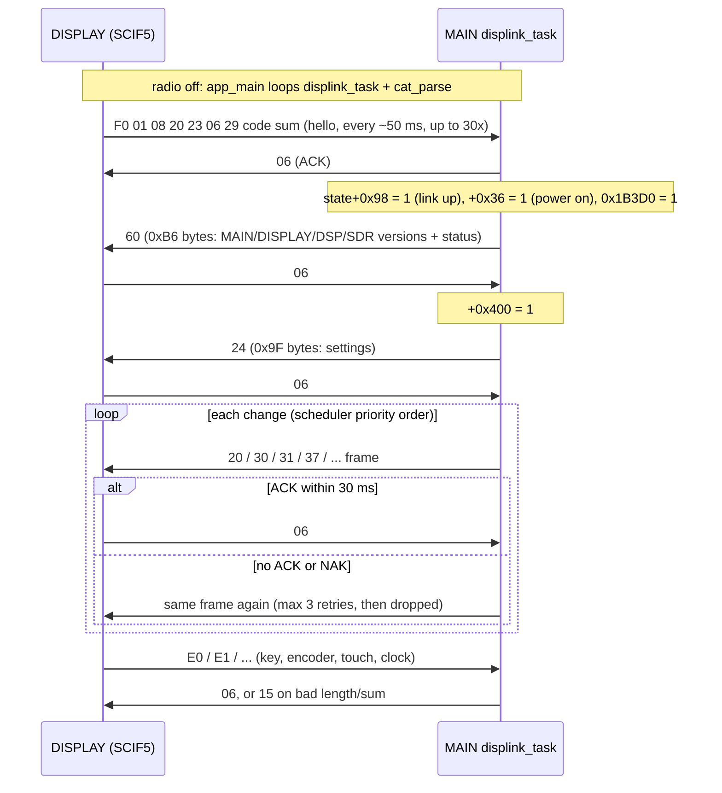

# MAIN — DISPLAY link (SCI1)

Back to the [MAIN overview](README.md).

Part of T10b. The UART driver is on [sci.md](sci.md), and what the key/encoder/touch frames do is on [ui-keys.md](ui-keys.md). The DISPLAY
(RZ/A1H) side is `docs/code/display/mainlink.md` (T11b). Function names are the names applied in Ghidra (`tools/ghidra/names_main.tsv`, merged by T17) and match `decomp/main/`; a name still in *italics* is a description that was not applied as a Ghidra name. Tags follow AGENTS.md.

## Overview

- **Physical link.** RX651 SCI1 (P26 TXD1 / P30 RXD1) ↔ RZ/A1H SCIF5 (P6_6/P6_7), nets `DISP_UMOSI/UMISO` (docs/hardware.md). About
  **340.9 kbit/s, 8 data bits, no parity, 2 stop bits** at PCLKB = 60 MHz ([sci.md](sci.md#channels)) **[fact: registers, PCLKB from SCKCR/PLLCR and the
  BRR formula, RX651 HWM r01uh0590 §9.2.1, §9.2.5, §37.2.13 Table 37.11]**. The same UART is the RX651 serial-boot port that DISPLAY uses to reflash MAIN.
- **Binary frames:** `type, payload…, sum`, where `sum` is the 8-bit sum of every byte before it, type byte included. Exceptions: `0x06` ACK and
  `0x15` NAK are single bytes, and the tunnel frames `'Z'` (0x5A) carry a 16-bit length. **[fact]** `displink_check_sum` 0xFFF9C60F,
  `displink_put_sum` 0xFFF9C5D8; the DISPLAY sender `FUN_201150f8` computes the same sum **[fact]**.
- **Type ranges.** MAIN → DISPLAY types are 0x20..0x7F; DISPLAY → MAIN types are 0xC3..0xC5 and 0xE0..0xF1. The DISPLAY's own 43-entry
  table at 0x20450074 lists both groups (see [cross-image notes](#cross-image-notes)). **[fact]**
- **Stop-and-wait with ACK/NAK.** Each side sends one data frame and waits for `0x06`. MAIN retries an unacknowledged frame every 30 ms up to 3 times,
  then drops it. MAIN answers every valid DISPLAY frame with ACK, and a bad length or checksum with NAK. **[fact]**
- **Change-driven traffic.** MAIN builds each data frame in a staging buffer and only sends it when it differs from the last frame sent
  (`displink_copy_if_changed` 0xFFF9C667). The default frame is the 0x99-byte status frame `0x20`, so in steady state the link is quiet until
  something on the radio changes. **[fact]**
- **Polled, no RTOS.** Everything above the ISR runs in `displink_task` 0xFFF94D6F, called once per `main_loop` pass and from the power-off loop
  in `app_main`. **[fact]**
- **Power on comes from the DISPLAY.** The DISPLAY's `0xF0` hello sets UI state +0x36 = 0x20B3A, which is the flag `app_main` waits on while the
  radio is off. So pressing POWER is seen by the DISPLAY, which wakes MAIN through this link. **[fact for the code path; inference that this is the
  POWER key]**

## Framing

### Receive side (ISR level)

`displink_rx_frame_len` 0xFFF9384C runs for every byte in `r_sci1_receive_interrupt` **[fact]**:

1. If a byte arrives more than 10 timer units (soft timer 1, about 10 ms) after the previous one, the frame restarts with this byte.
2. On the first byte it sets the expected length from the table below. An unknown first byte is dropped.
3. For `'Z'`, at byte index 2 it sets the length to `(b2 << 8 | b1) + 4`.
4. When the count is reached, the receive-end callback sets 0xA08A (`displink_rx_done`). The buffer is 0x9E86 (0x204 bytes).

`displink_task` then copies the frame to 0x198F, re-arms the receive (`displink_rx_rearm` 0xFFFB172D), checks the length again with
`displink_rx_len_of` 0xFFF95277 and the checksum, and dispatches it (`displink_rx_dispatch` 0xFFF95331). **[fact]**

The two length tables differ **[fact]**:

| First byte | ISR length | Task length | Note |
|---|---|---|---|
| 0x06, 0x15 | 1 | 1 | ACK / NAK |
| 0x5A `'Z'` | b1..b2 + 4 | 0 → NAK | only consumed by the DSP tunnel loop |
| 0x65 `'e'` | 9 | 0 → NAK | accepted by the ISR, never consumed (it is a MAIN→DISPLAY type) |
| 0xFD | 11 | 0 → NAK | only consumed by the SDR bridge loop |
| 0xFE | 7 | 0 → NAK | only consumed by the SDR bridge loop |
| 0xC3 / 0xC4 / 0xC5 | 35 / 263 / 7 | same | |
| 0xE0 / 0xE1 / 0xE2 / 0xE3 | 6 / 7 / 7 / 9 | same | |
| 0xE4 / 0xE5 / 0xE6 | 5 / 5 / 5 | same | |
| 0xE7 / 0xE8 | 10 / 10 | same | |
| 0xF0 / 0xF1 | 10 / 8 | same | |
| other | dropped (resync) | — | e.g. DISPLAY's `0xFA` (3 bytes) is never accepted |

### Transmit side

All MAIN data frames go out of one buffer at **0x1456** with the length in 0x1B628. `displink_tx_start` 0xFFF9C5B2 appends the sum, marks the frame
outstanding (0x1B3CE = 1, retry count 0x1B3CF = 0) and sends it with `displink_uart_send` 0xFFFB175B → `R_SCI1_Serial_Send`. Most builders first fill
a staging buffer at 0x1741 (0x24A bytes; 0x16A0 for the status frame) and copy it to 0x1456 only if it changed. **[fact]**

## Link control

Each step is in the code **[fact]**: the hello handler `displink_rx_F0_hello` 0xFFF9546A, the reply `displink_tx_60_hello` 0xFFF96225, the ACK handler
`displink_rx_ack` 0xFFF9541E (which sets +0x400 when the hello was the outstanding frame) and the scheduler `displink_tx_schedule` 0xFFF95F58.
The DISPLAY's hello loop (30 tries, `itron_dly_tsk(5)` apart, until MAIN answers) is the caller of the F0 builder `FUN_201162a4`; the F1 builder is `FUN_20116334` **[fact, DISPLAY image]**.

### `displink_task` timing

```mermaid
stateDiagram-v2
  [*] --> Idle
  Idle --> Sending: ACK/NAK pending, or scheduler built a frame
  Sending --> Gap: SSR.TEND (sci1_tx_end)
  Gap --> Idle: timer 0x3B, 2 units
  Idle --> AckWait: a data frame was sent (0x1B3D5)
  AckWait --> AckWait: send our own ACK/NAK if pending
  AckWait --> Poll: timer 0x3C, 30 units
  Poll --> Sending: nothing outstanding: next frame from scheduler
  Poll --> Sending: outstanding and retries < 4: resend (displink_tx_resend)
  Poll --> Idle: outstanding and 3 retries done: drop; if it was the hello, link down (+0x98 = 0)
```

- 0x1B3D2 = TX busy, 0x1B3D3 = inter-frame gap running, 0x1B3D4/0x1B3D5 = ACK-wait window, 0x1B3CC = send ACK, 0x1B3CD = send NAK,
  0x1B3CE = data frame outstanding, 0x1B3CF = retry count, 0x1B3D0 = send the hello reply, 0x1B3D1 = hello reply outstanding. **[fact]**
- A received NAK does nothing (`displink_rx_nak` 0xFFF95469 is empty); the frame is simply resent when the 30-unit window ends. **[fact]**
- Every received data frame except `E3` restarts the auto-power-off timer (`cat_apo_reset`). **[fact]**

## DISPLAY → MAIN frames

Offsets are into the frame (byte 0 = type). "UI state" is the struct at **0x20B04** that every module reaches through a pointer (0x25D38, 0x25D4C,
0x25D54, 0x25D58, 0x25D5C, 0x25D60, 0x25D6C..0x25D7C all hold 0x20B04 after `_INITSCT`) **[fact]**. Offsets like "+0x9C" are into that struct.

| Type | Len | Handler | Payload and effect | Reply |
|---|---|---|---|---|
| 0x06 | 1 | `displink_rx_ack` 0xFFF9541E | clears the outstanding frame; after the hello: +0x400 = 1 (send `0x24`) **[fact]** | — |
| 0x15 | 1 | `displink_rx_nak` 0xFFF95469 | nothing **[fact]** | — |
| 0xF0 | 10 | `displink_rx_F0_hello` 0xFFF9546A | b1,b2 → DISPLAY version string `"Vxx-yy"`, b4..b6 → date `"yy-mm-dd"` (stored by 0xFFF94BFD/0xFFF94C1B, read back by `ver_display`), b3 unused (DISPLAY sends 0x20), **b7 = boot code**. Sets link up (+0x98), power on (+0x36), hello reply pending. Boot codes: see below **[fact]** | ACK, then `0x60` |
| 0xF1 | 8 | `displink_rx_F1_sys` 0xFFF957E6 | b1 = sub-command: 0x01 enter SDR bridge (0x1C8D), 0x02 enter DSP ISP tunnel (0x1C63), 0x03 **disable CAT** (0x20B46 = 1), 0x83 no-op; others → NAK. 0x81 / 0x82 leave the SDR / DSP tunnel (handled inside the tunnel loops) **[fact]** | ACK (0x03, 0x83), none for 0x01/0x02 (the tunnel loop ACKs), NAK otherwise |
| 0xE0 | 6 | `displink_rx_E0_key` 0xFFF95829 | **key / touch event**: b1 = source (high nibble) and action (low nibble), b2..b3 = key code (big-endian). Passed through `key_event_filter`, then queued at +0x9C..+0xA0 for `key_task` ([ui-keys.md](ui-keys.md)) **[fact]** | ACK (always) |
| 0xE1 | 7 | `displink_rx_E1_encoder` 0xFFF9588B | **encoder step**: b1 = encoder id, b2 = signed step count ([ui-keys.md](ui-keys.md#encoders)); ignored while +0x80 = 1 **[fact]** | ACK |
| 0xE2 | 7 | `displink_rx_E2` 0xFFF95BF4 | b1 ≠ 0 → +0xA6 = 1 (first frame also sets +0xA7 and +0xA5). Read by 0xFFFCFxxx/0xFFFD3xxx UI code; meaning unknown **[fact for the fields]** | ACK |
| 0xE3 | 9 | `displink_rx_E3_clock` 0xFFF95ED3 | b1..b5 → +0xAD..+0xB1. **Date/time from the DISPLAY RTC** **[inference]**: the clock-set code (0xFFFCD7xx, 0xFFFCDBB8) copies these to +0xB2..+0xB6 and forces fields 2 and 3 (month, day) to ≥ 1, and `0x65` sends +0xB2..+0xB6 back. No APO reset (periodic) | ACK |
| 0xE4 | 5 | `displink_rx_E4` 0xFFF95C6A | clears +0x82: the DISPLAY's answer to `0x7B` **[fact]** | ACK |
| 0xE5 | 5 | `displink_rx_E5` 0xFFF95C74 | clears +0x80 (unblocks the scheduler and encoders) **[fact]** | ACK |
| 0xE6 | 5 | `displink_rx_E6_beep` 0xFFF95C8A | b1 = 0/1/2 → `beep_request`(1/2/3) 0xFFFB2DA6 (code 3 is also used when `key_event_filter` rejects a key) **[fact; "beep" is inference]** | ACK |
| 0xE7 | 10 | `displink_rx_E7` 0xFFF95CBC | b1 = 0 / 1 / 0xFF, b5 = value → +0xA8, +0xAA/+0xAB/+0xAC and a result code 1..5 in +0x488 (0xFF: also `beep_stop`). Consumed by `dispreq_e7_task`; looks like the completion status of a DISPLAY-side file operation **[guess]** | ACK |
| 0xE8 | 10 | `displink_rx_E8` 0xFFF95DAD | as E7, result in +0x48C **[fact]** | ACK |
| 0xC3 | 35 | `displink_rx_C3` 0xFFF95E65 | copies the payload to +0x2ED (0x109 bytes are copied whatever the frame length), sets +0x3F6: the answer to MAIN's `0x43` **[fact]** | ACK |
| 0xC4 / 0xC5 | 263 / 7 | `displink_rx_C4_C5` 0xFFF95E97 | same as C3: answers to `0x45` / `0x44` **[fact]** | ACK |
| 0xB3 | — | 0xFFF95EC9 | has a case in the dispatcher (sets ACK) but no length entry, so it can never arrive **[fact]** | — |

### F0 boot codes

The DISPLAY puts the result of `key_scan_first` (which of its 8 key lines is held at power-on) in b7, or 0x10 on a later hello without a key, and sends
code 6 from `FUN_2011668c` **[fact, DISPLAY side]**. MAIN acts on them in `displink_rx_F0_hello` **[fact]**:

| b7 | MAIN action | Meaning |
|---|---|---|
| 0x00 | power on | normal power-on **[inference]** |
| 0x01 | `settings_defaults(0)`, 0x20B45 = 1, `dest_jumper_apply` | **full reset** of the settings **[fact]** |
| 0x02 | +0xBA = 1, `FUN_fffbb567` | a maintenance screen that makes the scheduler send `0x62`/`0x30`/`0x31` **[fact; purpose unknown]** |
| 0x04 | +0x437 = 1, +0x34 = 0 | a numeric-entry/adjust mode: encoders 2/3/4/5 and the main dial go to the 0x25D3C counter (0..99,999,999) **[fact; purpose guess: service/alignment entry]** |
| 0x05 | toggles 0x4760; on the second toggle 0x9A36 is limited to ≤ 4 | unknown **[fact]** |
| 0x06 | link down (+0x98 = 0), no power on | the DISPLAY is going down (sent before its own reset/update) **[inference]** |
| 0x07 | swaps the destination code: 0xA983 / 0xB5A7 → 0xD950, 0xD950 / 0xA4C5 → 0xA983 (`dest_code_set`, which also resets settings and restarts) | **region change** at power-on **[fact for the values]** |
| 0x10 | power on only if 0x9DC5 ≠ 0 | 0x9DC5 is set by `PS1;`, by a low-voltage power-down and by the `0x7F` power frame, so a DISPLAY restart only powers the radio up if it was on **[inference]** |

## MAIN → DISPLAY frames

Listed in the scheduler's priority order (`displink_tx_schedule`, one frame per call). "Trigger" is the UI-state flag that requests it. Lengths
include type and sum and match the DISPLAY's table **[fact]**. Payload meanings are given only where the builder makes them clear.

| # | Type | Len | Trigger | Builder (send / fill) | Payload |
|---|---|---|---|---|---|
| 1 | 0x60 | 0xB6 | 0x1B3D0 (after F0) | `displink_tx_60_hello` 0xFFF96225 / 0xFFF96241 | b1..b8: MAIN, DISPLAY, DSP, SDR versions as BCD pairs (from `ver_main`, `ver_display`, `ver_dsp`, `ver_sdr`); b13..b14 = +0x32 (0xDB when 0x4660 set); then the 0x97-byte status block (same as `0x20`) and a few settings (0x9B0D, 0x9B09, 0x9B05, 0x9B01, 0x9DC5) **[fact]** |
| 2 | 0x64 | 3 | +0xB7 | 0xFFF986E0 | b1 = +0xB8, sent only when it changed **[fact]** |
| 3 | 0x24 | 0x9F | +0x400 (after the hello ACK; again 0x2B timer after +0x401) | 0xFFF9A17D / 0xFFF9A1A7 | settings block (0x9ACE, 0x9B20/21, 0x9AC7, 0x9B11, 0x9BEA, 0x9B10, 0x9BE9 …) **[fact]** |
| 4 | 0x7F | 0x0B | +0x447 | `power_down_save` 0xFFF98797 | b1 = +0x35 & 0x7F, then the constant `9B BA F6 38 FF 25 73 1F`. +0x35 (= 0x20B39) is the power command: 0x10 power off (`PS0;`), 0x11 restart (`dest_code_set`, resets), 0x90 low-voltage off (also waits 2000 units) **[fact for the values; the constant looks like a guard against accidental matches, guess]** |
| 5 | 0x62 / 0x30 / 0x31 | 0x197 / 0xA0 / 0xA3 | +0xBA (boot code 2) | 0xFFF9C46D / 0xFFF98ECB | |
| 6 | 0x7C | 5 | +0x81 | 0xFFF98869 | zeros; +0x80 then blocks until `E5` **[fact]** |
| 7 | 0x7B | 5 | +0x83 | 0xFFF9889C | b1 = toggled +0x82; blocks until `E4` **[fact]** |
| 8 | 0x7A | 5 | +0x85 | 0xFFF988F2 | zeros; +0x84 blocks **[fact]** |
| 9 | 0x70 | 0xE3 | +0x86 | 0xFFF98925 / 0xFFF9894F | |
| 10 | 0x43 / 0x44 / 0x45 | 0x23 / 7 / 0x107 | +0x87, type in +0x1E0, length in +0x1E2 | 0xFFF98BCD / 0xFFF98C1F | requests answered by `C3` / `C5` / `C4`; set by the 0xFFFCF6xx..0xFFFD2xxx code (14 sites for 0x43). Probably SD-card file or memory-list operations, since the SD card is on the DISPLAY **[inference]** |
| 11 | 0x50 | 0xF5 | +0x88 and +0x90 | 0xFFF9A2D1 / 0xFFF9A2FB | |
| 12 | 0x23 | 0x37 | +0x89 / +0x8A / +0x8B | 0xFFF98E39 / 0xFFF98E96 | b1 = high byte of +0x1BE plus 1. **The +0x8A/+0x8B variants call empty fill functions** (0xFFF98EC9, 0xFFF98ECA) and resend whatever is in 0x1456 with length 0x37 **[fact]** |
| 13 | 0x30 / 0x31 | 0xA0 / 0xA3 | +0x8C | `displink_tx_30_31` 0xFFF98ECB | 0x30 when +0x1C2 < 0x1E or 0xFF, 0x31 when < 0x5F **[fact]** |
| 14 | 0x65 | 9 | +0x8D | 0xFFF9A0CC / 0xFFF9A100 | +0xB2..+0xB6: the clock to set on the DISPLAY RTC **[inference]** |
| 15 | 0x34 | 0xA3 | +0x99 (then +0x9A blocks) | 0xFFF98F7C / 0xFFF9A06E | |
| 16 | 0x30 / 0x31 | | +0x1C0 or +0x1C1 (when +0x8F = 0) | 0xFFF98ECB | |
| 17 | 0x50 | 0xF5 | +0x90 | 0xFFF9A2D1 | |
| 18 | 0x3A | 0xA2 | +0x93 | 0xFFF9A8E3 / 0xFFF9A925 | |
| 19 | 0x39 | 0xE9 | +0x94 | 0xFFF9B69E / 0xFFF9B6C8 | |
| 20 | 0x3F | 5 | +0x91 | 0xFFF9A89B | b1 = +0x92 **[fact]** |
| 21 | 0x40 | 0x1FB | +0x95, at most every 100 units (timer 0x29) | 0xFFF9AAAD / 0xFFF9AAF7 | the only rate-limited frame; probably the scope/waterfall or meter data **[guess]** |
| 22 | 0x37 | 0x240 | +0x96 | 0xFFF9AB2A / 0xFFF9AB57 | the largest frame **[fact]** |
| 23 | 0x41 | 0x146 | +0x97 | 0xFFF9BB23 / 0xFFF9BB50 | |
| 24 | 0x20 | 0x99 | default | `displink_tx_20_status` 0xFFF9C42A / 0xFFF9C454 → `displink_build_status` | the main status block: VFO A/B record (0x9D09 or 0x9D63 by 0x9DBD), mode, etc. Sent only when changed **[fact]** |

Types in the DISPLAY table that MAIN V01-12 never sends: **0x21, 0x42, 0x71** (no builder writes them) **[fact: none of the type stores in the
image use these values]**.

The detailed payload layout of the large frames (0x20, 0x24, 0x30/0x31, 0x37, 0x39, 0x3A, 0x40, 0x41, 0x50, 0x62, 0x70) is left for the
subsystem pages that own the data (T10f menu, T10g radio state) and for the DISPLAY-side parser (T11b).

## Tunnel modes

Two DISPLAY-driven maintenance modes take over the link. Each runs as a blocking loop inside a `main_loop` task and talks to SCI1 directly with
`displink_rx_ready` / `displink_rx_buf` / `displink_rx_rearm` / `displink_uart_send` **[fact]**:

- **SDR bridge** — `F1 01` → 0x1C8D → `sdr_bridge_mode` 0xFFFA3226 (from `sdr_task`'s task). It resets the SDR module (P71 via 0xFFFB7080 and the
  0xFFFB7051/0xFFFB7067 pins), then serves `FD 00 …` (write a register: two `hex2word` fields, 11 bytes) and `FE 00 …` (read register 0x32 or 0x33,
  7 bytes), answering `06`/`15` or `7D 00 <4 hex> sum`. `F1 81` leaves. **[fact]** Details: T10c.
- **DSP ISP tunnel** — `F1 02` → 0x1C63 → `dsp_isp_bridge` 0xFFFA0C79 (from `dsp_link_poll`'s task). It toggles P71/P72 (PORT7 PODR bits 1/2 via 0xFFFB7080/0xFFFB7098; RT685 reset/ISP pins
  **[inference]**), sends `5A A6` (NXP ISP ping) on SCI4, ACKs the DISPLAY, then forwards: DISPLAY `Z len16 data… sum` → payload to SCI4; every
  SCI4 packet → `Z len16 packet sum` to the DISPLAY. `F1 82` leaves. **[fact]** So the DISPLAY updates the IF-DSP flash **through MAIN**, with
  MAIN as a transparent UART bridge to the RT685 boot ROM **[inference, high]**. Details: T10d.
- `F1 03` sets 0x20B46, which makes `cat_parse` return at once (CAT disabled) **[fact]**; it is probably sent before a firmware update **[guess]**.

## Cross-image notes

- **Command table.** The DISPLAY table at 0x20450074 (`.data`, 43 × 12 bytes: u16 type, u16 payload length, 8 bytes that are 0 at init) has
  these lengths (payload + 2 = frame length) **[fact, read from the decompressed `.data` in the DISPLAY Ghidra project]**:
  `20:97 23:35 30:9E 31:A1 37:23E 39:E7 3A:A0 3F:03 40:1F9 41:144 43:21 44:05 45:105 42:FD 50:F3 60:B4 62:195 64:01 65:07 70:E1 7A:03 24:9D 21:03
  7B:03 7C:03 71:06 7F:09 34:A1 F0:08 E0:04 E2:05 E4:03 E5:03 E6:03 E7:08 E8:08 E1:05 E3:07 FA:01 F1:06 C3:21 C4:105 C5:05`.
  Every length agrees with MAIN's builders and with MAIN's receive tables **[fact]**.
- `0xFA` (3 bytes) is in the DISPLAY table but MAIN's receiver drops it as unknown **[fact]**.
- **Wire format vs queue element.** `mainlink_send_cmd` / `FUN_201150f8` put `0xAA, length` in front of the frame in the DISPLAY's TX mailbox
  element (+4, +6), and the frame itself starts at +8. MAIN never sees an 0xAA byte, so the header is internal to the DISPLAY **[inference: MAIN
  receive tables have no 0xAA entry]**. T11b should confirm in the DISPLAY TX task.
- **ACK discipline on the DISPLAY side.** `FUN_201150f8` sends `F0`/`F1` at once, and queues the other types behind a "waiting for ACK" flag
  (0x2045002A); `E1` encoder frames are built by `FUN_20115c74` straight into the mailbox **[fact, DISPLAY]**.
- **F0 contents.** The DISPLAY builds `F0 01 08 20 23 06 29 <code>`: version 01-08, date 2023-06-29 (matching the DISPLAY V01-08 package date)
  **[fact]**.
- **Baud.** MAIN uses ≈340.9 kbit/s 8N2. The DISPLAY SCIF5 SCSMR/SCBRR setting was not checked here (T11b).

## Functions

| Address | Ghidra name | Inferred name | Purpose |
|---|---|---|---|
| 0xFFF94D6F | `displink_task` | `displink_task` | RX → validate → dispatch; ACK/NAK; gap/ACK-wait timers; scheduler; also a 100-unit periodic job (timer 0x4A) at the end |
| 0xFFF94CAB | `qmb_boot_init` | `qmb_boot_init` | UI/link state init in `app_main` before the power-off loop (+0xB8/+0xB9 = 0xFF, …) |
| 0xFFFB1702 | `displink_uart_start` | `displink_uart_start` | R_SCI1_Start + arm receive (0x9E86, 0x204) |
| 0xFFFB171E / 0xFFFB172D / 0xFFFB1745 / 0xFFFB174F | `displink_rx_ready` / `displink_rx_rearm` / `displink_rx_done` / `displink_rx_buf` | `displink_rx_ready` / `displink_rx_rearm` / `displink_rx_done` / `displink_rx_buf` | flag 0xA08A; `rx_buf` returns 0x9E86 (the decompiler shows `void`) |
| 0xFFFB175B | `displink_uart_send` | `displink_uart_send` | `R_SCI1_Serial_Send(buf, len)` |
| 0xFFFB176B | `sci1_tx_end` | | SSR.TEND |
| 0xFFF95277 | `displink_rx_len_of` | `displink_rx_len_of` | task-level length table |
| 0xFFF95331 | `displink_rx_dispatch` | `displink_rx_dispatch` | switch on byte 0 |
| 0xFFF951FF | `displink_tx_poll` | `displink_tx_poll` | next frame or retry, link-down on hello timeout |
| 0xFFF95F26 / 0xFFF95F3F | `displink_send_ack` / `displink_send_nak` | `displink_send_ack` / `displink_send_nak` | |
| 0xFFF95F58 | `displink_tx_schedule` | `displink_tx_schedule` | priority list above |
| 0xFFF96209 | `displink_tx_resend` | `displink_tx_resend` | send 0x1456 again |
| 0xFFF9C5B2 / 0xFFF9C5D8 / 0xFFF9C60F | `displink_tx_start` / `displink_put_sum` / `displink_check_sum` | `displink_tx_start` / `displink_put_sum` / `displink_check_sum` | |
| 0xFFF9C655 / 0xFFF9C667 | `mem_zero` / `displink_copy_if_changed` | `mem_zero` / `displink_copy_if_changed` | |
| 0xFFF96455 | `displink_build_status` | `displink_build_status` | fills the 0x97-byte status block at 0x16A1 |
| others | | `displink_rx_*`, `displink_tx_*`, `displink_build_*` | one per frame type, see the two frame tables (all proposed in the TSV) |
| 0xFFF9D94D / 0xFFFA1576 | `dsp_isp_request` / `sdr_bridge_request` | `dsp_isp_request` / `sdr_bridge_request` | set 0x1C63 / 0x1C8D |
| 0xFFFA0C79 | `dsp_isp_bridge` | `dsp_isp_bridge` | see above |
| 0xFFF95A64 / 0xFFF95ACE | `ui_numentry_step` / `ui_numentry_to_bcd` | `ui_numentry_step` / `ui_numentry_to_bcd` | ±step on 0x25D3C (0..99,999,999) and BCD copy to +0x7C..+0x7F |
| 0xFFFB2DA6 | `beep_request` | `beep_request` | 0x12041 = code, 0x12040 = pending **[inference]** |

Decompiler note: `displink_tx_req` shows `*(undefined2 *)(*(ushort *)(state+0x1E2) - 1)` and `dsp_isp_bridge` shows `*(undefined1 *)(len + 3)` as
memory loads. They are the known RX SLEIGH `MOVU.B/W Rs,Rd` bug (a register zero-extend shown as a load), so read them as `len - 1` and `len + 3`
**[inference: matches the frame lengths]**.

## Globals

| Address | Size | Meaning |
|---|---|---|
| 0x20B04 | ~0x490 B | **UI state struct** shared by the link, keys and UI (reached through the pointers at 0x25D38…0x25D7C) **[fact]** |
| 0x20B04+0x36 = 0x20B3A | u8 | power-on flag (`app_main` waits for it) |
| 0x20B04+0x35 = 0x20B39 | u8 | power command sent in `0x7F` |
| 0x20B04+0x98 | u8 | link up |
| 0x20B46 | u8 | CAT disabled (F1 03) |
| 0x9E86 / 0xA08A | 0x204 B / u8 | SCI1 receive buffer / complete flag |
| 0x198F | ≤0x204 B | copy of the received frame being handled |
| 0x1456 / 0x1B628 | 0x24A B / u16 | TX frame / length (last frame sent, also the retry copy) |
| 0x1741 / 0x16A0 | 0x24A B / 0x98 B | staging buffers |
| 0x1B3CC..0x1B3D5 | u8 each | link flags (see the state diagram) |
| 0x1C63 / 0x1C8D | u8 | DSP-tunnel / SDR-bridge request |
| 0x25D3C | u32 | numeric-entry counter (boot code 4 mode) |
| 0x9DC5 | u8 | "power-up allowed after a DISPLAY restart" (see boot code 0x10) **[inference]** |
