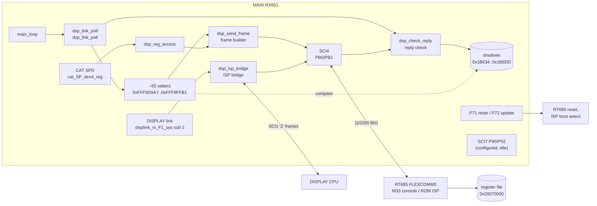
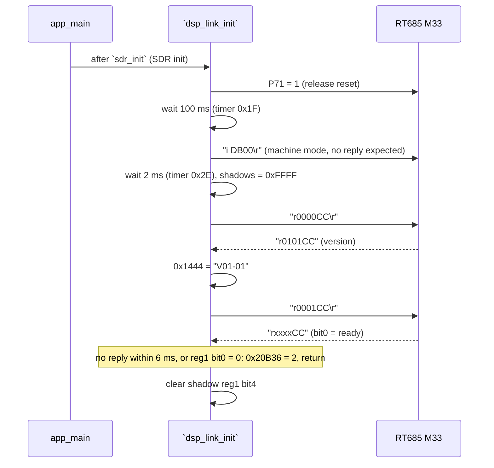
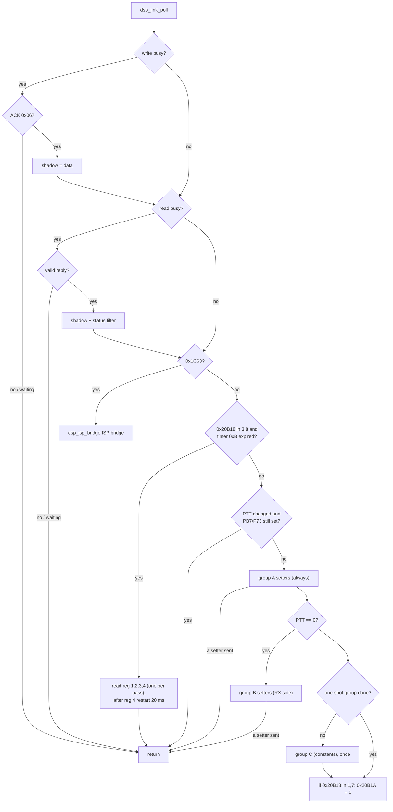
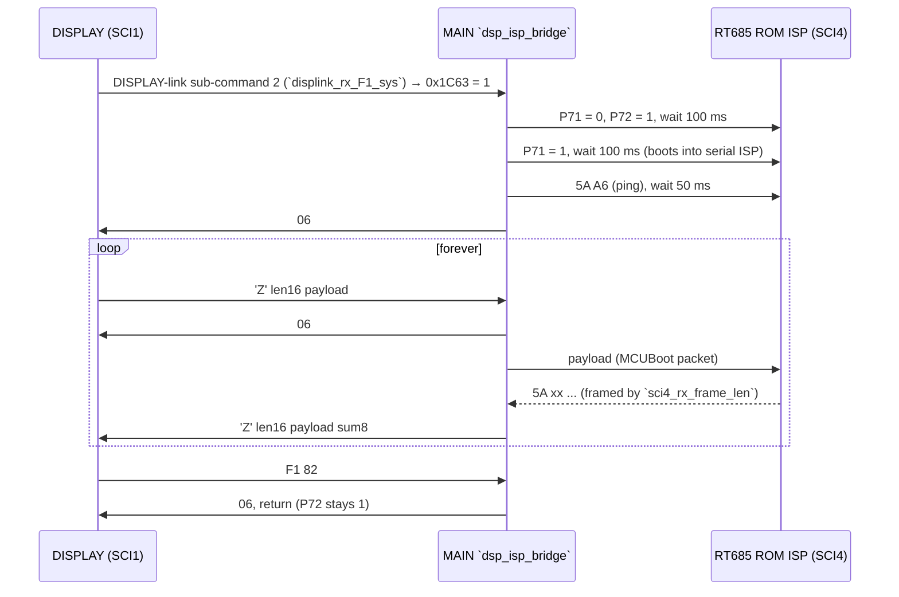

# MAIN — DSP link (SCI4 register protocol to the IF DSP, SCI7)

Back to the [MAIN overview](README.md)

This page covers the MAIN (RX651) side of the control link to the IF DSP, **Q2002 NXP i.MX RT685** (image `ID`). The DSP side
(the M33 console, the register file and the DSP threads) is documented in [../ifdsp/README.md](../ifdsp/README.md) and
[../ifdsp/control-link.md](../ifdsp/control-link.md) (T12b). Register numbers on this page are the word indices of the RT685
register file at SRAM `0x20070000` (index = (addr − 0x20070000)/2), the same numbering T12b uses.

The Ghidra names are the current ones in `ghidra/FT710_MAIN`. Function names are the names applied in Ghidra (`tools/ghidra/names_main.tsv`, merged by T17) and match `decomp/main/`; a name still in *italics* is a description that was not applied as a Ghidra name. Tags follow AGENTS.md:
**[fact]** = seen in code or data at the address given, **[inference]** = evidence and reasoning given; unsettled points are written as open questions.

## Summary

- **Transport.** SCI4 (PB0 = RXD4, PB1 = TXD4), 115200 baud 8N1, polled from the main loop. No RTOS, no queue: **one
  transaction at a time**, at most **one frame sent per `main_loop` pass**. **[fact]** `R_SCI4_Create` 0xFFF9423C (BRR 0x40,
  SEMR 0x50 (BGDM + ABCS) → PCLKB/(8·65) = 115385 baud at PCLKB 60 MHz **[fact: RX651 HWM r01uh0590 §37.2.13 Table 37.11, §37.2.15; PCLKB from SCKCR §9.2.1]**; PFS 0x8C198/0x8C199 = 0x0A).
- **Frames** (ASCII, upper-case hex, 8-bit additive checksum over all preceding characters, then CR) **[fact]** `dsp_send_frame`:
  - read `rAAAACC\r` (8 bytes) → reply `rDDDDCC` (7 bytes, checksum over `rDDDD`);
  - write `wAAAADDDDCC\r` (12 bytes) → reply one byte `0x06` (ACK). `?` (0x3F) is the M33's "invalid" reply.
- **Mirror/shadow model.** MAIN keeps a shadow copy of every register it manages (0x1B634.., table below). Each register has
  one *setter* that computes the wanted value from the radio state and sends a write **only if it differs from the shadow**.
  The shadow is updated only when the ACK arrives. A lost or rejected write is therefore retried automatically on a later
  pass. There is no retry counter and no error report for normal traffic. **[fact]** `dsp_shadow_store`, setters 0xFFF9D9A7..0xFFF9FFB1.
- **Timing.** Reply timeout 6 ms (soft timer 3). Status registers 1–4 are read as a burst of four every 20 ms (timer 0xB),
  only in TX/RX sequencer states 3 and 8. Boot: 100 ms after releasing the DSP reset line, then `i DB00\r`, then version check.
- **About 75 registers are written** (table below), from mode, VFO-record and menu settings. They cover the demodulator,
  AGC, DNR, DNF, contour, APF, LCUT/HCUT, AF tone, notch (AM), CTCSS, mic EQ, the speech processor, AMC, VOX/anti-VOX, the
  TX BPF, RF gain, AESS, the AF-FFT/oscilloscope, CW pitch and per-band calibration. **Five are read**: 0 (version), 1–4 (status).
- **DSP firmware update.** On a DISPLAY-link command, MAIN puts the RT685 into ROM serial-ISP mode (P71/P72) and turns into a
  transparent bridge that carries **NXP MCUBoot (blhost) frames** between the DISPLAY (SCI1) and the RT685 ROM (SCI4).
  **[fact]** bytes, `dsp_isp_bridge`; that the protocol is MCUBoot **[inference, high]**.
- **SCI7 ("C4" UART) carries nothing.** `R_SCI7_Create` configures it, but the transmitter and receiver are never enabled and
  no code starts a transfer. **[fact]**
- CAT service command **`SPD`** reads and writes any DSP register through `dsp_reg_access`, see
  [cat.md](cat.md#extended-and-service-commands-summary).

## Block diagram

## Functions

| Address | Ghidra name | Inferred name | Purpose |
|---|---|---|---|
| 0xFFF9D06C | `dsp_link_init` | `dsp_link_init` | Called by `app_main` after the SDR init. Boot handshake, see the sequence below **[fact]** |
| 0xFFF9D1B9 | `dsp_link_poll` | `dsp_link_poll` | `main_loop` task: finishes the pending transaction, runs the ISP bridge if requested, polls status, then walks the setter chain **[fact]** |
| 0xFFF9D8A4 | `dsp_reg_access` | `dsp_reg_access` | Blocking access for CAT `SPD`: drains the poller, then sends one r/w and busy-waits for the reply. Returns 0 on timeout (CAT `?;`). A write does **not** update the shadow, so an `SPD W` value stays until the setting behind that register changes **[fact]**; consequence **[inference]** |
| 0xFFFA0B4C | `dsp_send_frame` | `dsp_send_frame` | Builds the frame at 0x1A5E from address 0x1B6DE and data 0x1B6E0, sets busy flag 0x1C5E (write) or 0x1C5F (read), sends it, and starts timer 3 = 6 ms **[fact]** |
| 0xFFFA0AD6 | `dsp_check_reply` | `dsp_check_reply` | If a frame is complete (0xA2AB): clears both busy flags; read → 1 if the checksum matches; write → 1 if the first byte is 0x06. If not complete and timer 3 has expired: clears both flags (gives up) **[fact]** |
| 0xFFFA0C01 | `dsp_sum8` | `dsp_sum8` | 8-bit sum of n bytes **[fact]** |
| 0xFFFA0C2E | `dsp_reply_sum_ok` | `dsp_reply_sum_ok` | Compares `sum8(buf,5)` with the two hex characters after it **[fact]** |
| 0xFFFA037A | `dsp_shadow_store` | `dsp_shadow_store` | `if/else` chain over the register number: stores 0x1B6E0 into the register's shadow; for regs 1–4 it also runs the status filters **[fact]** |
| 0xFFFA0E3A | `dsp_route_param` | `dsp_route_param` | Constant tables per audio-route state (`audio_route_state`) for regs 8, 9, 10, 0x0D/0x0E, 0x20 and the mic-EQ enables. Calling it for reg 0x20 sets 0x20B49=1 **[fact]** |
| 0xFFFA0C79 | `dsp_isp_bridge` | `dsp_isp_bridge` | DSP firmware update bridge (below) **[fact]** |
| 0xFFF9D94D | `dsp_isp_request` | `dsp_isp_request` | 0x1C63=1. Called from DISPLAY-link handler `displink_rx_F1_sys` when sub-command byte = 2 **[fact]** |
| 0xFFF9D957..0xFFF9D997 | `dsp_read_version`.. | `dsp_read_version`, *dsp_read_status1..4* | Send a read of reg 0, 1, 2, 3, 4 **[fact]** |
| 0xFFFA0032 / 0140 / 01F2 / 0265 | `dsp_status1_filter`.. | *dsp_statusN_filter* | Filters for regs 1–4 (see "Registers read") **[fact]** |
| 0xFFF9D7F0, 0xFFF9D800, 0xFFF9D838, 0xFFF9D857, 0xFFF9D866, 0xFFF9D895 | | `dsp_status1_raw`, `dsp_fm_noise`, `dsp_tone_detect`, `dsp_comp_level`, `dsp_signal_level`, `dsp_tune_offset` | Getters for the filtered status values **[fact]** |
| 0xFFF94548 | `sci4_rx_frame_len` | `sci4_rx_frame_len` | SCI4 per-byte receive callback (frame length detector, below) **[fact]** |
| 0xFFF94536 | `sci4_rx_frame_done` | `sci4_rx_frame_done` | Frame complete: 0xA2AB=1, length → 0x1B78A **[fact]** |
| 0xFFFB1AB4 | `sci4_send` | `sci4_send` | `R_SCI4_Serial_Send(buf,len)`, then clears 0xA2AB and re-arms `R_SCI4_Serial_Receive(0xA0AB, 0x200)` **[fact]** |
| 0xFFFB1A8F / 1A9E / 1AA8 / 1ADB / 1AE9 | | `sci4_rx_ready` / *_set_ready* / *_buf* / *_set_len* / *_len* | Accessors for 0xA2AB, buffer 0xA0AB, length 0x1B78A **[fact]** |
| 0xFFF9423C, 0xFFF94387, 0xFFF943CB, 0xFFF9442B, 0xFFF9449C | `R_SCI4_Create`, `R_SCI4_Serial_Receive`, `R_SCI4_Serial_Send`, `r_sci4_transmit_interrupt`, `r_sci4_receive_interrupt` | | Renesas code-generator SCI4 driver **[fact]** |
| 0xFFF94C39 | `ver_dsp_set` | `ver_dsp_set` | Stores the 6-char version text at 0x1444, read by `ver_dsp` (CAT `VE`) **[fact]** |
| 0xFFFB7080 / 0xFFFB7098 | `dsp_reset_set` / `dsp_update_set` | `dsp_reset_set` / `dsp_update_set` | Write P71 / P72 (PODR 0x8C027 bits 1/2) **[fact]**; P71=0 = DSP in reset, P72=1 = ISP boot **[inference]** (matches `DSP_RESET18`/`DSP_UPDATE`, service manual p19) |
| 0xFFFB4219 | `audio_route_state` | `audio_route_state` | Returns the audio-route state 0..14 (below). The decompile is broken (return value lost); read from the disassembly **[fact]** |
| 0xFFFB527C | `tx_mod_gain` | `tx_mod_gain` | MIC GAIN (0x9BEC..0x9BEF by mode) or the per-mode USB/REAR MOD GAIN, picked by MOD SOURCE (`FUN_fffb3d11`) **[fact]**; menu names **[inference]** |
| 0xFFFB237A / 0xFFFB23B4 / 0xFFFB23F3 / 0xFFFB2288 | | `swtimer_start` / `timer_start_us` / `swtimer_expired` / `swtimer_tick` | Soft timers 0..0x4A. Start: count = ms·10 (or (µs+50)/100); flag 0x11FED[id] = expired. Tick period 100 µs **[inference]** from the two scalings |
| 0xFFFC95B1, 0xFFFC97A0, 0xFFFC9811 | `R_SCI7_Create`, `r_sci7_transmit_interrupt`, `r_sci7_receive_interrupt` | | SCI7 driver, unused (see SCI7) **[fact]** |
| 0xFFF9D9A7..0xFFF9FFB1 | `dsp_set_demod`.. | *dsp_set_…* | One setter per register (table below) |

## Globals

| Address | Size | Name (proposed) | Meaning |
|---|---|---|---|
| 0x1B6DE | u16 | `dsp_addr` | register number of the current transaction **[fact]** |
| 0x1B6E0 | u16 | `dsp_data` | value written, or value read back **[fact]** |
| 0x1C5E / 0x1C5F | u8 | `dsp_wr_busy` / `dsp_rd_busy` | a write / read is outstanding **[fact]** |
| 0x1C63 | u8 | `dsp_isp_req` | enter the ISP bridge on the next poll **[fact]** |
| 0x1A5E | 12 B | `dsp_txbuf` | outgoing frame **[fact]** |
| 0xA0AB / 0xA2AB / 0x1B78A | 0x200 B / u8 / u16 | `sci4_rxbuf` / `sci4_rx_ready` / `sci4_rx_len` | SCI4 receive buffer, frame-complete flag, length **[fact]** |
| 0x1B634..0x1B6DD | 0x55 × u16 | `dsp_shadow[]` | last acknowledged value per register (layout in the register table). Set to 0xFFFF at boot, so every setter sends once **[fact]** |
| 0x1B3D8 | u8 | `dsp_once_done` | the one-shot group has been sent **[fact]** |
| 0x1B3D9 | u8 | `dsp_ptt_seen` | last PTT state the setters ran for **[fact]** |
| 0x1B3DA | u8 | `dsp_stat_idx` | status poll round-robin 0..3 → regs 1..4 **[fact]** |
| 0x1C60, 0x1C61, 0x1C62, 0x1B6E2, 0x1B6E4 | | | filtered status values (see "Registers read") **[fact]** |
| 0x1444 | 6 B | `dsp_version_text` | `V01-01` from reg 0 **[fact]** |
| 0x20B36 | u8 | `link_error` | 2 = DSP did not answer at boot (this module), 3 = SDR (set by `sdr_init`); read by `displink_build_60` (version/status report) as UI-state +0x32; the DISPLAY shows it as `ERROR CODE : 002` / `003` ([display-link.md](display-link.md#boot-error-report), #60) **[fact]** |
| 0x20B49 | u8 | `dsp_route_ready` | set when reg 0x20 has been computed. The TX/RX sequencer (`trx_sequencer`, 0x20B18 state 6) waits for it **[fact]** |
| 0x20B1A | u8 | `dsp_settled` | set by the poller when no setter has anything to send and 0x20B18 is 1 or 7. Read and cleared by the sequencer `trx_sequencer` **[fact]**; purpose (wait for the DSP to be reconfigured before switching TX/RX) **[inference]** |

Radio-state inputs used by the setters (owned by other pages):
`vfo_mode`(side)` = mode index of the RX (0) or TX (1) VFO, `vfo_rec_ptr`(side)` = pointer to that VFO's 0x5A-byte
record, 0x20B6B = PTT/TX request, 0x20B18 = TX/RX sequencer state (8 = RX steady, 3 = TX steady **[inference]**),
0x20BAF/0x20F01 = voice-message playback **[inference]**.

Mode index (from `cat_mode_codes` 0xFFF806D0 = `12735D4B8CAF69E`, index → `MD` code) **[inference]**:
0 LSB, 1 USB, 2 CW-L, 3 CW-U, 4 AM, 5 AM-N, 6 FM, 7 FM-N, 8 DATA-L, 9 DATA-U, 10 DATA-FM, 11 DATA-FM-N, 12 RTTY-L, 13 RTTY-U, 14 PSK.
The reg 6 mapping below confirms the pairs (2 → CW-L = 1, 3 → CW-U = 0, 4/5 → AM, 6/7/10/11 → FM).

## Boot handshake

**[fact]** 0xFFF9D06C. Each read is tried once. If reg 1 bit 0 is clear on the first read, the loop finds no read outstanding
and fails; it does not poll again. After a failure the setters still run from `main_loop`, so the link recovers by itself if
the DSP answers later. **[fact]** The M33 sets reg[1] |= 1 after the DSP is up (IFDSP README boot flow).

## Poll loop (once per `main_loop` pass)

**[fact]** The setter chain is a long `&&` chain: each setter is followed by `0x1C5E == 0`, so the first setter that sends
ends the pass. Consequences **[inference]**: after a mode change, N changed registers take N main-loop passes plus the reply
time (about 1 ms per write frame at 115200 baud plus the M33's turnaround); writes never pile up in the UART; the status
burst pre-empts setters in TX/RX steady states.

Errors and retries **[fact]**:
- No reply within 6 ms → busy flags cleared, shadow not updated → the setter sends the same write again on a later pass.
- `?` or a bad checksum → same as above (flags cleared, nothing stored).
- Reads 1–4: a missed sample is simply skipped; the filters average over several samples.
- There is no retry limit, no error counter and no user-visible error after boot.

### SCI4 receive framing

`sci4_rx_frame_len` runs for every received byte and decides the frame length from the first one **[fact]**:

| First byte(s) | Length | Meaning |
|---|---|---|
| `0x06` or `?` | 1 | write ACK / console "invalid" |
| `r` | 7 | read reply `rDDDDCC` |
| `0x5A 0xA7` | 10 | MCUBoot ping response |
| `0x5A 0xA1`..`0xA3`, `0x5A 0xA6` | 2 | MCUBoot ACK / NAK / ACK-abort / ping |
| `0x5A` other | len16 (bytes 2–3) + 6 | MCUBoot command/data packet |
| anything else | — | byte dropped (CR/LF and echo are ignored this way) |

## Audio-route state (`audio_route_state`)

The routing registers 8, 9, 10, 0x0D/0x0E and 0x20, and the mic-EQ enables depend on a 0..14 state, read from the disassembly
**[fact]**. "Keyed" = the mode used is CW or RTTY (2, 3, 12, 13). The mode used is the PTT side's mode, or the RX/TX VFO's
mode while recording or playing.

| State | Condition (first match) | Flags |
|---|---|---|
| 2 | spot: 0x20F0B==1 (`CS` spot) or 0x12041==4 (keyed); voice: `FUN_fffba192()`≠0 and 0x12041==4 | RX |
| 1 / 9 | 0x20B96==1 (keyed / voice) | RX, recording **[inference]** |
| 3 | 0x20CCD==1 (keyed) | RX |
| 5 / 12 | 0x20BAF==1 and 0x20B97==1 | RX |
| 4 | keyed: 0x20BAF or 0x20CD0 or 0x20CD1 == 1 | RX, playback **[inference]** |
| 10 / 11 | voice: 0x20B7C==2 or 0x20F1B==1 / 0x20B7C==1 and 0x20B97==0 | RX |
| 0 / 8 | otherwise (keyed / voice) | RX |
| 7 / 6 | keyed TX with / without playback flags | TX (0x20B3D==1) |
| 6 | voice TX with `FUN_fffba192()`==3 and 0x12041==4 | TX |
| 14 / 13 | voice TX from playback (0x20BAF or 0x20B7C==1) / from the mic | TX |

## Registers written

Columns: register, shadow address, setter, value sent, source, group (A = every pass, B = only while PTT==0, C = once after
boot), meaning. "RX VFO"/"TX VFO" = `vfo_rec_ptr`/`vfo_mode` with argument 0/1; "PTT VFO" = argument 0x20B6B. The value
encodings are **[fact]**. The menu-item names come from matching the RAM layout against the CAT manual MENU chart (Table 2,
2306-C) and the value ranges, and are **[inference]** unless marked. Per-mode menu blocks: SSB 0x9A2A, AM 0x9A3F, FM 0x9A52,
DATA 0x9A67, RTTY 0x9A7E, CW 0x9A91, each starting AF TREBLE, AF MIDDLE, AF BASS, AGC FAST/MID/SLOW DELAY, LCUT FREQ/SLOPE,
HCUT FREQ/SLOPE, USB OUT, REAR OUT, TX BPF SEL (not FM), MOD SOURCE, USB MOD GAIN, REAR MOD GAIN **[inference, high]**.
The RX DSP group starts at 0x9AD1: IF NOTCH WIDTH, NB REJECTION, NB WIDTH, APF WIDTH, CONTOUR LEVEL, CONTOUR WIDTH, (0x9AD7,
0x9AD8 unidentified), AMC RELEASE TIME 0x9AD9, PRMTRC EQ 0x9ADA.. **[inference]**. T10f (menu table) should confirm.

### Routing and fixed values

| Reg | Shadow | Setter | Value | Source | Grp | Meaning |
|---|---|---|---|---|---|---|
| 6 | 0x1B63E | `dsp_set_demod` | 3 LSB/DATA-L/RTTY-L, 2 USB/DATA-U/RTTY-U/PSK, 1 CW-L, 0 CW-U, 8 AM, 9 FM | RX mode | B | demodulator / sideband select **[inference, high]** |
| 8 | 0x1B640 | `dsp_set_r08` | route table: 0x2022 (states 3–7, 10–12), 0x2222 (13, 14), else 0x20B34 | route state; 0x20B34 = 0x2222 in TX, 0x3233 / 0x3263 by output select 0x20FCC in RX | A | **AF routing word**, one selector nibble per sink: n3 → block stream to the DISPLAY, n2 → second input of the adaptive (NLMS) pair, n1 → codec DAC channel 0, n0 → codec DAC channel 1; MAIN's values put RX block 3 on all sinks in RX (0x3263 moves DAC 0 to RX block 6) and TX block 2 in TX **[fact: HiFi4 `FUN_002249D0`, [ifdsp/control-link.md](../ifdsp/control-link.md#audio-routing-registers-8-9-10-77-fact)]** |
| 9 | 0x1B642 | `dsp_set_r09` | 2 in states 13, 14, else 0 | route state | A | **TX audio to the SDR** selector (nibble n0 of the sink `FUN_00225BE8`, the FC2 I2S TX AF stream): 2 = TX-chain output 0x2CAFB0, so only voice TX (states 13/14) feeds the SDR's AF input; 0 = nothing **[fact: [ifdsp/control-link.md](../ifdsp/control-link.md#where-the-sinks-go-151)]** |
| 10 | 0x1B644 | `dsp_set_r0a` | 0x52 (0, 2, 8), 0x50 (1, 9), 2 (3, 4), 3 (5, 11, 12, 14), 0x22 (6, 7, 10, 13) | route state | A | input/route select **[inference]**. T12b: the M33 also writes codec reg P1/0x37 from it (low nibble 1 → IN1R); no value MAIN sends has low nibble 1 **[fact]** |
| 0x0C | 0x1B646 | `dsp_set_r0c` | 0 | constant | C | DSP: top nibble ≠ 1 keeps the output mute on GPIO P0_4 (`regfile_gpio_sel`); low nibble configures the adaptive (NLMS) blocks `FUN_002233FC`/`FUN_00223734` (bit 0 copied as their enable, a change resets their state); bit 8 tested by `FUN_0022309C` **[fact: DSP reads]**. MAIN's 0 = mute by P0_4, adaptive blocks off **[inference]** |
| 0x0D, 0x0E | 0x1B648, 0x1B64A | `dsp_set_r0d`, `dsp_set_r0e` | 0xF000 in state 6, else 0 | route state | A | **gain in dB of codec DAC channel 1 / channel 0** (the two routing outputs): `FUN_00224814` converts each with 10^(x/20) for `FUN_00224604`. 0xF000 = −4096 dB, i.e. both codec outputs muted in state 6 **[fact: DSP use]** |
| 0x0F | 0x1B64C | `dsp_set_r0f` | 0x2B | constant | C | **gain of the TX audio to the SDR**: +43 dB (`FUN_00225DC4` → `FUN_00225BE8`, the reg 9 sink) **[fact: DSP use]** |
| 0x11, 0x12, 0x13 | 0x1B650.. | `dsp_set_r11`, `…db97`, `…dbc6` | 0xFFA2 (−94), 8, 0xFFF8 (−8) | constants | C | gains in dB **[fact: DSP converts 10^(x/20)]**: 0x11 = level of the CTCSS encoder tone (`FUN_00222510`, with reg 0x35, TX chain) **[inference: level]**; 0x12 = +8 dB into the **recorder** sink (`FUN_002255B4`, reg 10 n1); 0x13 = −8 dB on the **DISPLAY playback** audio entering TX (`FUN_002259E4`, TX source 3) **[fact]** |
| 0x36, 0x37, 0x38, 0x51 | 0x1B67E.., 0x1B6AA | `dsp_set_r36`, `…e5e4`, `…e614`, `dsp_set_r51` | 0 | constants | C | 0x36–0x38: bit 12 = on, 12-bit value, read by the TX tone blocks `FUN_00222AF0`/`FUN_00222688` next to the CTCSS encoder; 0x51: same format, `FUN_0021FDBC` (RX). 0 = off **[fact for the format; function unknown]** |
| 0x56 | 0x1B6B4 | `dsp_set_r56` | 0x20 | constant | B | **RX audio delay** in samples (`FUN_0021E6C4` in the Rx_Audio chain: a ring of up to 1200 samples, 0 = bypass). 32 samples ≈ 2.7 ms at 12 kHz **[fact for the delay line; time inference]**. #184: it delays only Rx_Audio branch B, the AESS speaker feed **[fact]** |
| 0x68 | 0x1B6CE | `dsp_set_r68` | 0x94 | constant | C | +148 dB scale on the level value of the RX AGC block (`FUN_0021F2D0`, called by `FUN_0021F0DC` right after `FUN_0021F004`, which reads the AGC regs 0x62/0x63/0x66/0x67) **[fact for the call; AGC reference level inference]** |

### Receive processing

| Reg | Shadow | Setter | Value | Source | Grp | Meaning |
|---|---|---|---|---|---|---|
| 0x40 | 0x1B688 | `dsp_set_dnr_r40` | table 0xFFF87FBA[level]: 1 for levels 8–15, else 0 | PTT VFO rec+6: bit4 = NR on, low nibble = level (`NR`/`RL`); 0 in FM modes | A | **LMS line-enhancer NR on** (`lms_ale_nr`) for DNR levels 8–15 **[fact]** ([ifdsp/dsp-chains.md](../ifdsp/dsp-chains.md#dnr-main-drives-both-noise-reductions-split-by-level), #184) |
| 0x400B, 0x400D | 0x1B6D0, 0x1B6D2 | `dsp_set_dnr_400b`, `dsp_set_dnr_400d` | tables 0xFFF87F1A / 0xFFF87F3A [level]: levels 8–15 → 2304,1792,1280,768,256,224,192,160 / 32,64,..,256 | same | A | LMS ALE step size μ ×1000 (clamped to 1.8) / leak ×1e-6 **[fact]** |
| 0x4022, 0x4023 | 0x1B6D6, 0x1B6D8 | `dsp_set_dnr_4022`, `dsp_set_dnr_4023` | tables 0xFFF87F5A / 0xFFF87F7A: levels 1–7 → 3 / 32,40,..,80 | same | A | **STFT Wiener NR** (`spectral_nr`) for DNR levels 1–7: mode 3 = noise tracking, depth β % **[fact]** ([ifdsp/dsp-chains.md](../ifdsp/dsp-chains.md#dnr-main-drives-both-noise-reductions-split-by-level), #184) |
| 0x4025, 0x4026 | 0x1B6DA, 0x1B6DC | `dsp_set_dnr_4025`, `dsp_set_dnr_4026` | tables 0xFFF87F9A (levels 8–15 → −17..−21) / 0xFFF87FDA (all 0) | same | A | LMS ALE input / output gain, half-dB (−8.5 … −10.5 dB / 0 dB) **[fact]** |
| 0x41 | 0x1B68A | `dsp_set_dnf` | 1/0 | PTT VFO per-mode byte bit7 (+0x0B SSB, +0x15 CW, +0x33 AM, +0x1F RTTY, +0x29 DATA/PSK) = `BC` | A | DNF (auto notch) on **[fact for `BC` source]** |
| 0x42 | 0x1B68C | `dsp_set_contour` | freq·10 Hz, \| 0x1000 when on | PTT VFO per-mode contour on bit6 and 16-bit freq/10 = `CO` P2=0/1; 0 in FM | A | contour frequency / on **[fact for `CO` source]** |
| 0x43 | 0x1B68E | `dsp_set_contour_level` | signed | 0x9AD5 | A | CONTOUR LEVEL (−40..+20) |
| 0x44 | 0x1B690 | `dsp_set_contour_width` | 11 − x | 0x9AD6 | A | CONTOUR WIDTH (1..11) |
| 0x45 | 0x1B692 | `dsp_set_apf` | (APF + pitch + 30)·10 Hz; in CW with APF on \| (width+2)<<12 | 0x9C5F (`CO03` −25..+25), 0x9C04 (`KP`), CW rec+0x14 bit5 (`CO02`), 0x9AD4 | A | APF centre = pitch ± 250 Hz; APF WIDTH N/M/W → 2/3/4 |
| 0x46 | 0x1B694 | `dsp_set_hcut` | n=0 → 0; else (700 + 50(n−1)) \| (slope+1)<<12 | RX mode block HCUT FREQ/SLOPE (0x9A32/33 SSB, 0x9A47/48 AM, 0x9A5A/5B FM, 0x9A6F/70 DATA/PSK, 0x9A86/87 RTTY, 0x9A99/9A CW), or 0x20B60/61 when 0x9DC6≠0 | B | HCUT |
| 0x47 | 0x1B696 | `dsp_set_lcut` | n=0 → 0; else (100 + 50(n−1)) \| (slope+1)<<12 | LCUT FREQ/SLOPE (0x9A30/31 SSB, …), or 0x20B5E/5F | B | LCUT |
| 0x48, 0x4B, 0x4E | 0x1B698, 0x1B69A, 0x1B69C | `dsp_set_tone_freq`(0..2)` | 200 / 400 / 1200 Hz \| 0x1000 | constants | B | AF tone band centre **[inference]** |
| 0x49, 0x4C, 0x4F | 0x1B69E, 0x1B6A0, 0x1B6A2 | `dsp_set_tone_gain`(0..2)` | signed | RX mode block AF BASS / MIDDLE / TREBLE (0x9A2C/2B/2A SSB, …) | B | AF tone gains (−20..+10) |
| 0x4A, 0x4D, 0x50 | 0x1B6A4, 0x1B6A6, 0x1B6A8 | `dsp_set_tone_q(0..2)` | 2 / 1 / 1 (the same in every mode) | constants | B | **Q of the BASS / MIDDLE / TREBLE peaking band**: the HiFi4's `rx_eq_band_update` (0x220790) reads the third register of each triple, maps 0 to 0.5, clamps 1..10 and divides by it as Q **[fact: decomp/ifdsp/hifi4/0021f7ec_00222244.c]** (renamed from `dsp_set_tone_type`) |
| 0x52 | 0x1B6AC | `dsp_set_am_notch` | AM modes only: freq·10 \| 0x1000 (0x9AD1=0) or \| 0x2000; else 0 | RX VFO AM manual-notch flag rec+0x32 bit7 and freq rec+0x36/37 (`BP`), IF NOTCH WIDTH 0x9AD1 | B | manual notch in AM. Other modes are not sent to the DSP (probably done in the SDR FPGA) **[inference]** |
| 0x62 | 0x1B6C2 | `dsp_set_agc` | per-mode AGC byte bit6 (AGC on); forced 1 while timer 0x2A runs | RX VFO AGC byte (`GT`) | B | AGC on |
| 0x66 | 0x1B6CA | `dsp_set_agc` (after 0x62) | 20·n + 20 ms for the selected speed (bits 4–5: 1 FAST, 2 MID, 3 SLOW); 20 ms while timer 0x2A runs; during scan (0x20F1C or 0x20F6F) 200, or 40 (AM/FM/DATA-FM), or 4 | AGC FAST/MID/SLOW DELAY of the mode block (0x9A2D..2F SSB, …), or 0x20B5B..5D | B | AGC decay time |
| 0x63 (99) | 0x1B6C4 | `dsp_set_freq_range_param` | byte 0x4674..0x4678 | RX frequency band: ≤7.5, ≤14.5, ≤21.5, ≤41.5, ≤75 MHz (table 0xFFF88598) | B | the alignment items `028..032 [RX] IF-AGC 7/14/21/28/50` of the 0x4659 table (`SPN` 28–32; ROM default 0, owner's radio 190/190/189/188/199) **[fact, #203]**; the service manual aligns them for −2.0 dB of AF at 10 dBµV. In the DSP it is the **IF AGC gain ceiling**, Gmax = g67 · 0.2512 · 10^((255 − x)/40) **[fact, #184]**, so it also shifts the S-meter scale per band **[inference]** |
| 0x67 | 0x1B6CC | `dsp_set_rf_gain` | curve 0xFFF805AC[RG>>2]; 0xFF if RF/SQL VR (0x9AB6) = SQL, or = SQL(FM) in FM modes | 0x20BA7 (`RG`) | B | RF/IF gain |
| 0x4020 | 0x1B6D4 | `dsp_set_aess` | 0 if AESS level = 0, else 0x2000 \| 700 or 0x2000 \| 1000 | `AS1` level, `AS2` centre (`FUN_fffb54a0/552c`) | A | AESS on and centre frequency. The level itself is not sent **[fact]**; it goes to the analog side: `speaker_route` picks route 2 (both speakers) only when it is non-zero, and then sets the R2A20178 channel 8 level (`BOOST LEVEL`) from it ([peripherals.md](peripherals.md#speaker-routing-speaker_route-0x20fcc-fact), #193) **[fact]**. #184: a steep 700 / 1000 Hz low-pass on Rx_Audio branch B, which reaches codec DAC channel 0 only with reg 8 = 0x3263 (both speakers on) **[fact]**: the AESS crossover **[inference, strong]** |
| 0x53 | 0x1B6AE | `dsp_set_ctcss_dec` | FM modes with tone mode ≠ 0: tone index + 1 \| 0x1000; else 0. Also 0x20B72 = tone mode | RX VFO rec+3 bits 3–5 (`CT`), rec+0x46 tone index (TONE FREQ 0 = 67.0 Hz) | B | CTCSS decoder tone |
| 0x5C | 0x1B6BA | `dsp_set_affft_att` | x<<8 \| 0x1000 | 0x9C39 (`SS07` P3) | A | AF-FFT attenuator **[inference]** |
| 0x5D | 0x1B6BC | `dsp_set_osc` | level<<8 \| 0x1000 \| time | 0x9C3B (RX) or 0x9C3A (TX) level, 0x9C3C time (`SS07` P4/P5) | A | oscilloscope level/time **[inference]**; the DSP sends FFT/scope data to the DISPLAY over SPI (FC1) |
| 0x61 | 0x1B6C0 | `dsp_set_cw_pitch` | (pitch + 30)·10 \| 0x1000 | 0x9C04 (`KP`) | A | CW pitch in Hz (300–1050) |

### Transmit processing

| Reg | Shadow | Setter | Value | Source | Grp | Meaning |
|---|---|---|---|---|---|---|
| 0x20 | 0x1B656 | `dsp_set_tx_gain` | route table: states 0, 8, 13 → curve 0xFFF88126[`tx_mod_gain`]; 14 → 0xFFF881F0[0x9DC2]; else 0; 0 during playback (0x20BAF && 0x20F01) | MIC GAIN `MG` 0x9BEC..EF, or USB/REAR MOD GAIN by MOD SOURCE | A | TX input gain |
| 0x21 | 0x1B658 | `dsp_set_vox_gain` | −(VG + 0xFFF812E2[100 − gain] + 29) | 0x9BF3 (`VG`), `tx_mod_gain` | A | VOX threshold |
| 0x22 | 0x1B65A | `dsp_set_antivox` | −((AV − 0xFFF811E2[AF] ) + 50); 0xFF when PF5 = 0 | 0x9BF6 or 0x9BF7 (`AV`, by 0x9AF3), 0x20BA8 (`AG`) | A | anti-VOX threshold relative to the AF gain |
| 0x25, 0x28, 0x2B | 0x1B65C, 0x1B65E, 0x1B660 | `dsp_set_peq_freq`(0..2)` | f·100 / f·100+600 / f·100+1400 Hz, \| 0x1000 when the EQ is on | PRMTRC EQ1–3 FREQ: 0x9ADA/DD/E0 (processor off) or 0x9AE3/E6/E9 (processor on, 0x9BF1≠0); on/off 0x9BF0 (`PR1`). Forced off in CW/DATA/RTTY/PSK, when 0x20B96≠0, in route states < 8, or with PTT while 0x12041 (`FUN_fffb2dfe`) is 4 or 9–11 | A | parametric mic EQ frequency |
| 0x26, 0x29, 0x2C | 0x1B662, 0x1B664, 0x1B666 | `dsp_set_peq_level`(0..2)` | signed | EQ LEVEL 0x9ADB/DE/E1 or 0x9AE4/E7/EA | A | mic EQ level (−20..+10) |
| 0x27, 0x2A, 0x2D | 0x1B668, 0x1B66A, 0x1B66C | `dsp_set_peq_bw`(0..2)` | raw | EQ BWTH 0x9ADC/DF/E2 or 0x9AE5/E8/EB | A | mic EQ bandwidth (0..10) |
| 0x2E | 0x1B66E | `dsp_set_proc` | level \| 0x1000 in TX modes LSB/USB, else 0; 0 during playback | 0x9BF1 (`PL`; `PR0` off = 0) | A | speech processor level |
| 0x2F | 0x1B670 | `dsp_set_tx_bpf` | TX BPF + 1 (SSB 0x9A36, AM 0x9A4B, DATA/PSK 0x9A73, or 0x20B64), else 0; 0 during playback | TX mode | A | TX BPF SEL |
| 0x30 | 0x1B672 | `dsp_set_r30` | 0xFF, sent only in FM modes and never reset | TX mode | A | linear gain x/255 in the TX block `FUN_00222D34` (TX chain); 0xFF = ×1.0, also the DSP default, so it has no effect as sent **[fact]** |
| 0x31, 0x32 | 0x1B674, 0x1B676 | `dsp_set_r31`, `dsp_set_r32` | −43 (SSB, CW, DATA, RTTY, PSK), −54 (AM), −56 (FM, DATA-FM); −43 during playback | TX mode | A | two dB gains of the AMC block `FUN_00221E84`, each multiplied by the AMC output level (reg 0x34)/100 **[fact]**; per-mode TX level trims **[inference]** |
| 0x3B | 0x1B686 | `dsp_set_r3b` | −39 / −50 (AM) / −52 (FM) | TX mode | A | **no reader in the HiFi4 decompile** (only the default 0x2C4) **[fact: no direct access]**; unused or read indirectly |
| 0x33 | 0x1B678 | `dsp_set_amc_release` | 0x11 / 0x12 / 0x13 for 0x9AD9 = 0 / 1 / 2; 0x0C in FM; 0x11 during playback | 0x9AD9 | A | AMC RELEASE TIME (FAST/MID/SLOW). DSP: release coefficient powf(0.5, x) per 72 kHz sample, time constant 2^x / 72000 s = 1.8 / 3.6 / 7.3 s, FM 57 ms **[fact, #184]** |
| 0x34 | 0x1B67A | `dsp_set_amc_level` | level \| 0x1000; 100 in FM; 0 in CW and RTTY | 0x9BF2 (`AO`) | A | AMC OUTPUT LEVEL. DSP: bit 12 = ALC on, bits 11–0 = level % scaling both reg 0x31/0x32 gains; 0 = off (CW, RTTY, playback) **[fact, #184]** |
| 0x35 | 0x1B67C | `dsp_set_ctcss_enc` | FM and tone mode ≠ 0: tone index + 1 \| 0x1000 | TX VFO rec+3, rec+0x46 | A | CTCSS encoder tone |
| 0x3A | 0x1B684 | `dsp_set_fm_flag` | 1 in FM modes | PTT VFO mode | A | bit 0 switches in an 8-section IIR (`iir_cascade_init(…, 8, 0x237240, …)`) in the TX block `FUN_00222D34`, and a filter in the RX block `FUN_00220B5C` **[fact]**: FM pre-/de-emphasis **[inference]** |

Shadows that exist in `dsp_shadow_store` but that no setter writes: regs 0x10, 0x54, 0x55, 0x57, 0x58, 0x60, 0x64, 0x65 **[fact]**
The DSP does read some of them: 0x10 (output / TX-audio mute bits, `FUN_00225DC4`), 0x54 / 0x55 (high-/low-cut of the AESS branch B), 0x57 / 0x58 (RX AF peak limiter), so those stay at their DSP defaults (off) **[fact: [ifdsp/control-link.md](../ifdsp/control-link.md)]**. Open: why MAIN keeps shadows for registers it never writes; would be settled by a MAIN version that writes them, or by Yaesu documentation.

Decompile caveat **[fact]**: setters `dsp_set_vox_gain`, `dsp_set_hcut`, `dsp_set_lcut` and `dsp_set_cw_pitch` show loads such as
`*(short *)(n - 1)` or `*(byte *)(100 - x)`. These are `MOVU.B/W Rs,Rd` register zero-extends that the RX SLEIGH module
mis-decodes as memory loads (found by T10e). The values in the tables above are the corrected arithmetic.

## Registers read (status)

| Reg | Shadow | Filter | Consumer | Meaning |
|---|---|---|---|---|
| 0 | 0x1B634 | — | `dsp_link_init` → 0x1444 | version, 0x0101 = V01-01 **[fact]** |
| 1 | 0x1B636 | bit6 debounced (5 equal samples) → 0x1C61; in RX state 8 the high byte averaged over 2 → 0x1C60 | 0x1C61: `af_mute_update` FM tone-squelch path (opens the squelch, P24); 0x1C60: `FUN_fffb7cec` FM squelch with RF/SQL; bit4: `ptt_inputs_read` VOX trigger (VOX on 0x9C5D, not CW/RTTY, timer 0x2F) → 0x20B29; bit0: ready at boot | bit0 ready, bit4 VOX detect, bit6 CTCSS tone detected, high byte FM noise level **[inference]** |
| 2 | 0x1B638 | 32-sample mean of each byte → 0x1B6E2 | `meter_comp` → meter 0x12049 (`RM3` COMP): high byte when the processor is off, low byte when on | TX compression level **[inference]** |
| 3 | 0x1B63A | 16-sample mean of the low byte → 0x1C62 (no reader found) | raw value: `meter_s` → S meter 0x1204A (`RM1`), with calibration 0x4681; `FUN_fffb7e61` (squelch in non-FM modes) | signal level **[inference]** |
| 4 | 0x1B63C | most frequent of the last 8 samples → 0x1B6E4 (100 if no value repeats) | `FUN_fffbf0b6`: frequency correction ±35 × 10 Hz; `FUN_fff9782b`: display value clamped ±99 | CW tuning offset for ZERO IN (`ZI`) and the tuning indicator, 10 Hz units **[inference]** |

## DSP firmware update bridge

**[fact]** 0xFFFA0C79. The loop also calls `wdt_kick` (the IWDT refresh **[fact: HWM §33.2.1, T18]**). After `F1 82` the function
returns with P72 still high and the DSP in ISP mode; the radio is presumably restarted by the DISPLAY after an update
**[inference]**. The ping response from the RT685 (`5A A7` + 8 bytes) is not checked by MAIN; it is forwarded.

## SCI7 ("C4" UART)

- `R_SCI7_Create` 0xFFFC95B1, called once from `R_Systeminit` (peripheral init) **[fact]**: MSTPCRB bit 24 cleared, IPR for
  vectors 98/99, SMR = 0, SCR = 0, SCMR = 0x72, SEMR = 0, BRR = 0xC2 → 60 MHz/(32·195) = 9615 baud (9600 +0.16 %) **[fact: RX651 HWM r01uh0590 §37.2.13 Table 37.11; PCLKB from SCKCR §9.2.1]**,
  pins P90 = TXD7 and P92 = RXD7 (PFS 0x8C188/0x8C18A = 0x0A), P90 output high.
- SCR is never set again, so TE/RE stay off. The ISR globals (count 0x1FA48 / 0x1FA4A / 0x1FA4C, pointers 0x21054 / 0x21058)
  are written only by the two ISRs; there is no `R_SCI7_Serial_Send/Receive` and no other reference to the SCI7 registers
  (0x8A0E0..) **[fact: decomp search]**.
- So **SCI7 carries no traffic in V01-12**. The DSP control traffic uses SCI4 instead. SCI7's pins carry the nets
  `C4_UMOSI`/`C4_UMISO`, part of the "C4" bus with `C4_BUSY_DSP`/`C4_BOOT`/`C4_RESET` (service manual p17) **[fact: schematic,
  [peripherals.md](peripherals.md)]**. Open: which device the C4 bus reaches (hardware.md's RT685 reading is an unconfirmed
  inference) and why SCI7 is set up but never started; would be settled by tracing the C4 nets past p17 in the service manual
  or a continuity check on the board.

## Open points

- The menu-item identities of the per-mode and RX DSP bytes are matched by layout and range only; T10f's menu table can
  confirm them (and 0x9AD7/0x9AD8, 0x9DC6/0x20B5B..0x20B67, 0x9DC2).
- The routing values (regs 8, 9, 10) are decoded on the DSP side in [ifdsp/control-link.md](../ifdsp/control-link.md#audio-routing-registers-8-9-10-77-fact) (#77): per-sink source selectors. The sinks and the constants are traced in #151 (tables above and [ifdsp/control-link.md](../ifdsp/control-link.md#where-the-sinks-go-151)).
  Still open (#176): the board connectors behind the codec's two DAC and ADC channels, and the effect of reg 0x3B.
- The tick period of the soft timers (100 µs) should be checked against the CMT setup (T10a/T10h).

## Further functions (T23g)

Named functions of this subsystem that the tables above did not list yet, one row each (T23g, found with `tools/doc_table_gaps.py`). The purpose is the plate comment of the name in `tools/ghidra/names_*.tsv` (or the `Ifdsp*Names.java` / `*.lib.tsv` entry); rows marked *code shape* have no comment there and give what the decompile shows: the direct callees, the first string, the size and the caller count. Tags as in the names files; a comment without a tag is an inference from the code.

| Address | Ghidra name | Inferred name | Purpose |
|---|---|---|---|
| 0xFFF94C2D | `ver_dsp` |  | Returns pointer to DSP version 0x1444 (VE3) **[inference]** |
| 0xFFF9DA09 | `dsp_set_r08` |  | reg 8: route word (0x2022 / 0x2222 / 0x20B34) **[inference]** |
| 0xFFF9DA3C | `dsp_set_r09` |  | reg 9: route constant 0/2 **[inference]** |
| 0xFFF9DA6F | `dsp_set_r0a` |  | reg 10: route/input select **[inference]** |
| 0xFFF9DAA2 | `dsp_set_r0c` |  | reg 0x0C = 0 (once) **[inference]** |
| 0xFFF9DAD1 | `dsp_set_r0d` |  | reg 0x0D: 0xF000 in CW TX route, else 0 **[inference]** |
| 0xFFF9DB04 | `dsp_set_r0e` |  | reg 0x0E: 0xF000 in CW TX route, else 0 **[inference]** |
| 0xFFF9DB37 | `dsp_set_r0f` |  | reg 0x0F = 0x2B (once) **[inference]** |
| 0xFFF9DB66 | `dsp_set_r11` |  | reg 0x11 = 0xFFA2 (once) **[inference]** |
| 0xFFF9DB97 | `dsp_set_r12` |  | reg 0x12 = 8 (once) **[inference]** |
| 0xFFF9DBC6 | `dsp_set_r13` |  | reg 0x13 = 0xFFF8 (once) **[inference]** |
| 0xFFF9DBF7 | `dsp_set_tx_gain` |  | reg 0x20: modulation gain curve value (MIC/USB/REAR gain) **[inference]** |
| 0xFFF9DC8A | `dsp_set_vox_gain` |  | reg 0x21: -(VOX GAIN + curve + 29) **[inference]** |
| 0xFFF9DCE4 | `dsp_set_antivox` |  | reg 0x22: anti-VOX vs AF gain, 0xFF when PF5 low **[inference]** |
| 0xFFF9DD6A | `dsp_set_peq_freq` |  | regs 0x25/0x28/0x2B: parametric mic EQ band frequency \| 0x1000 enable **[inference]** |
| 0xFFF9DEE6 | `dsp_set_peq_level` |  | regs 0x26/0x29/0x2C: parametric mic EQ band level (signed) **[inference]** |
| 0xFFF9DFD5 | `dsp_set_peq_bw` |  | regs 0x27/0x2A/0x2D: parametric mic EQ band width **[inference]** |
| 0xFFF9E0AD | `dsp_set_proc` |  | reg 0x2E: speech processor level \| 0x1000 (SSB only) **[inference]** |
| 0xFFF9E12B | `dsp_set_tx_bpf` |  | reg 0x2F: TX BPF SEL + 1 (SSB/AM/DATA) **[inference]** |
| 0xFFF9E21F | `dsp_set_r30` |  | reg 0x30 = 0xFF in FM modes (never cleared) **[inference]** |
| 0xFFF9E26B | `dsp_set_r31` |  | reg 0x31: per-mode constant (-43/-54/-56) **[inference]** |
| 0xFFF9E330 | `dsp_set_r32` |  | reg 0x32: per-mode constant (-43/-54/-56) **[inference]** |
| 0xFFF9E3F5 | `dsp_set_amc_release` |  | reg 0x33: AMC RELEASE TIME 0x11/0x12/0x13, FM 0x0C **[inference]** |
| 0xFFF9E480 | `dsp_set_amc_level` |  | reg 0x34: AMC OUTPUT LEVEL \| 0x1000 **[inference]** |
| 0xFFF9E51C | `dsp_set_ctcss_enc` |  | reg 0x35: TX tone index+1 \| 0x1000 (FM, tone on) **[inference]** |
| 0xFFF9E5B4 | `dsp_set_r36` |  | reg 0x36 = 0 (once) **[inference]** |
| 0xFFF9E5E4 | `dsp_set_r37` |  | reg 0x37 = 0 (once) **[inference]** |
| 0xFFF9E614 | `dsp_set_r38` |  | reg 0x38 = 0 (once) **[inference]** |
| 0xFFF9E644 | `dsp_set_fm_flag` |  | reg 0x3A: 1 in FM modes **[inference]** |
| 0xFFF9E6B9 | `dsp_set_r3b` |  | reg 0x3B: per-mode constant (-39/-50/-52) **[inference]** |
| 0xFFF9E750 | `dsp_set_dnr_r40` |  | reg 0x40: DNR table (levels 8-15 -> 1) **[inference]** |
| 0xFFF9E7C4 | `dsp_set_dnf` |  | reg 0x41: auto notch (BC) on/off **[inference]** |
| 0xFFF9E871 | `dsp_set_contour` |  | reg 0x42: contour freq \| 0x1000 on **[inference]** |
| 0xFFF9E9A4 | `dsp_set_contour_level` |  | reg 0x43: CONTOUR LEVEL (signed) **[inference]** |
| 0xFFF9E9FA | `dsp_set_contour_width` |  | reg 0x44: 11 - CONTOUR WIDTH **[inference]** |
| 0xFFF9EA39 | `dsp_set_apf` |  | reg 0x45: APF centre (pitch + APF offset) \| width<<12 when APF on **[inference]** |
| 0xFFF9EAE7 | `dsp_set_hcut` |  | reg 0x46: HCUT freq (700+50(n-1)) \| slope<<12 **[inference]** |
| 0xFFF9ED0E | `dsp_set_lcut` |  | reg 0x47: LCUT freq (100+50(n-1)) \| slope<<12 **[inference]** |
| 0xFFF9EF34 | `dsp_set_tone_freq` |  | regs 0x48/0x4B/0x4E: AF tone band frequency 200/400/1200 Hz \| 0x1000 **[inference]** |
| 0xFFF9F0B1 | `dsp_set_tone_gain` |  | regs 0x49/0x4C/0x4F: AF BASS/MIDDLE/TREBLE GAIN (signed) **[inference]** |
| 0xFFF9F291 | `dsp_set_tone_q` |  | regs 0x4A/0x4D/0x50: Q of the three AF tone bands, constant 2/1/1 **[fact: HiFi4 `rx_eq_band_update`]** (was `dsp_set_tone_type`) |
| 0xFFF9F400 | `dsp_set_r51` |  | reg 0x51 = 0 (once) **[inference]** |
| 0xFFF9F430 | `dsp_set_am_notch` |  | reg 0x52: manual notch freq \| width<<12 (AM only) **[inference]** |
| 0xFFF9F4C8 | `dsp_set_ctcss_dec` |  | reg 0x53: RX tone index+1 \| 0x1000 (FM, tone on); sets 0x20B72 **[inference]** |
| 0xFFF9F54B | `dsp_set_r56` |  | reg 0x56 = 0x20 **[inference]** |
| 0xFFF9F57B | `dsp_set_affft_att` |  | reg 0x5C: AF-FFT attenuator (SS07 P3) <<8 \| 0x1000 **[inference]** |
| 0xFFF9F5C6 | `dsp_set_osc` |  | reg 0x5D: oscilloscope level (RX/TX) <<8 \| 0x1000 \| time **[inference]** |
| 0xFFF9F638 | `dsp_set_cw_pitch` |  | reg 0x61: (KEY PITCH + 30)*10 \| 0x1000 **[inference]** |
| 0xFFF9F681 | `dsp_set_agc` |  | reg 0x62 AGC on, reg 0x66 AGC delay (20n+20 ms; scan 200/40/4) **[inference]** |
| 0xFFF9FC2A | `dsp_set_rf_gain` |  | reg 0x67: RF gain curve (0xFF when knob is SQL) **[inference]** |
| 0xFFF9FCA0 | `dsp_set_r68` |  | reg 0x68 = 0x94 (once) **[inference]** |
| 0xFFF9FCD0 | `dsp_set_dnr_400b` |  | reg 0x400B: DNR table by level **[inference]** |
| 0xFFF9FD51 | `dsp_set_dnr_400d` |  | reg 0x400D: DNR table by level **[inference]** |
| 0xFFF9FDD2 | `dsp_set_aess` |  | reg 0x4020: 0 / 0x2000\|700 / 0x2000\|1000 (AESS on, centre) **[inference]** |
| 0xFFF9FE2A | `dsp_set_dnr_4022` |  | reg 0x4022: DNR table by level **[inference]** |
| 0xFFF9FEAF | `dsp_set_dnr_4023` |  | reg 0x4023: DNR table by level **[inference]** |
| 0xFFF9FF30 | `dsp_set_dnr_4025` |  | reg 0x4025: DNR table by level **[inference]** |
| 0xFFFA0140 | `dsp_status2_filter` |  | reg2: 32-sample average of each byte -> 0x1B6E2 **[inference]** |
| 0xFFFA01F2 | `dsp_status3_filter` |  | reg3: 16-sample average of low byte -> 0x1C62 **[inference]** |
| 0xFFFA0265 | `dsp_status4_filter` |  | reg4: most frequent of last 8 samples -> 0x1B6E4 (100 if none repeats) **[inference]** |
| 0xFFFB1A9E | `sci4_rx_set_ready` |  | 0xA2AB=1 **[inference]** |
| 0xFFFB1AA8 | `sci4_rx_buf` |  | Returns the SCI4 receive buffer (0xA0AB) [decompiler lost the return value] **[inference]** |
| 0xFFFB1ADB | `sci4_rx_set_len` |  | 0x1B78A=len **[inference]** |
| 0xFFFB1AE9 | `sci4_rx_len` |  | Returns 0x1B78A **[inference]** |
| 0xFFFBBC6F | `align_store_dsp_level` |  | cal[item] = dsp_signal_level() (11 items from 32) **[inference]** |
| 0xFFFE419A | `ladder_key_delay` |  | Remote-keypad helper: the first call starts soft timer 0x38 (200), later calls return 1 once it expired; keys 0xF7/0xF9 in ladder_key_task **[fact]** |
