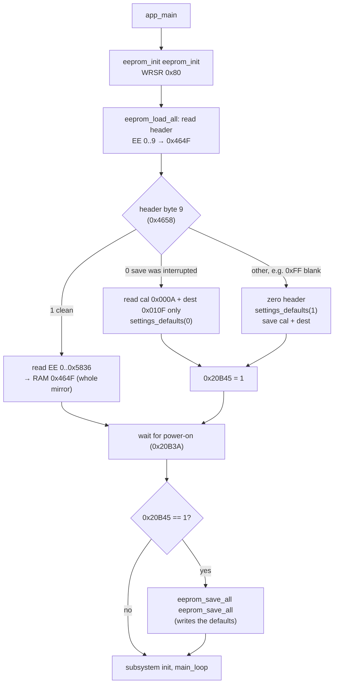
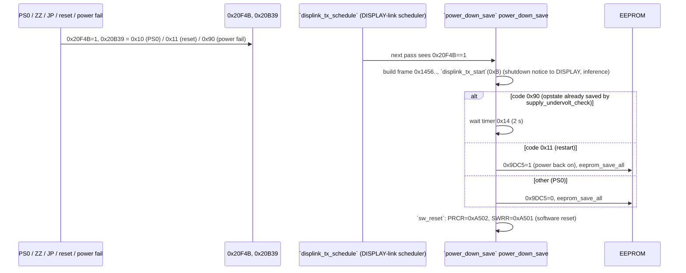

Back to the [MAIN overview](README.md)

# MAIN — EEPROM, settings persistence and resets

Sub-task T10e. The page covers the EEPROM driver, the address map, the boot load, what triggers a save, and the reset paths.
Names are the current Ghidra names in `ghidra/FT710_MAIN`. Function names are the names applied in Ghidra (`tools/ghidra/names_main.tsv`, merged by T17) and match `decomp/main/`; a name still in *italics* is a description that was not applied as a Ghidra name. Tags follow AGENTS.md: **[fact]** means seen in code or data at the address given.

## Summary

- **One chip, bit-banged.** All settings live in one SPI EEPROM, the BR25G256 from the service manual (32 KB, 64-byte pages). The chip hangs on port E GPIOs, and the CPU clocks it in software, so no RSPI or SCI is involved. **[fact]** for the driver, **[inference]** for the part number.
- **No data flash.** The R5F56514 has no E2 data flash at all (datasheet Table 1.3, T18), and MAIN never touches 0x00100000 or the flash sequencer. **[fact, scalar-reference search]**
- **RAM mirror.** RAM **0x464F..0x9E85** is a byte-for-byte mirror of EEPROM **0x0000..0x5836** (22,583 bytes): `RAM = 0x464F + EEPROM address`. Every save call passes the pair (EEPROM `a`, RAM `0x464F + a`, `n`). Code reaches the mirror through the base 0x464F plus an offset (about 3,650 references to 0x464F). EEPROM 0x5837..0x7FFF is never read or written, except by `SPR`/`SPW`. **[fact]**
- **No checksum.** The image has no checksum. Its only integrity guard is a "write in progress" flag in the 10-byte header, together with a 32-bit save counter. **[fact]**
- **No timed autosave.** The firmware writes small blocks when a record changes (memory channel, band stack, QMB, keyer text, tuner memory). It writes the whole image only when the radio is going down: a restart or power-off request, the power switch, or a power fail. **[fact]**

## EEPROM driver **[fact]**

| Signal | Pin | Register |
|---|---|---|
| /CS | PE0 | PORTE.PODR 0x8C02E bit 0 (low = selected) |
| SCK | PE5 | PORTE.PODR bit 5 (idle low; data is set up, then SCK goes high then low; mode 0) |
| MOSI (SI) | PE6 | PORTE.PODR bit 6 |
| MISO (SO) | PE7 | PORTE.PIDR 0x8C04E bit 7 |
| /WP | P65 **[inference]** | PORT6.PODR 0x8C026 bit 5. It is driven high only around the status-register write in `eeprom_init` |

- **Bit order.** Bytes are shifted MSB first, with no delays. The bit rate is set by the code speed alone.
- **Instructions used** (the standard 25-series set): `0x03` READ, `0x02` WRITE, `0x05` RDSR, `0x06` WREN, `0x01` WRSR.
- **`eeprom_read`.** It sends `03 aH aL` and then clocks in n bytes. It does **not** poll WIP first. Only boot and `SPR` read, so this does not matter in practice. **[inference]**
- **`eeprom_write`.** It splits the data at 64-byte page boundaries. For each chunk it polls RDSR until WIP = 0, then sends WREN, then `02 aH aL` + data. It does not wait after the last page: the next write's RDSR poll covers that. **[fact]**
- **Addresses are 16 bit.** The decompile drops the middle `eeprom_spi_tx()` argument, which is the address high byte (`MOVU.W 0xa[SP],R1; SHLR #8,R1` at 0xFFFB14BA and 0xFFFB1566). It also types the address as a byte. **[fact, disassembly]**
- **Boot init `eeprom_init`** (`eeprom_init`), called from `app_main` before the load:
  1. /CS high, SCK low, P65 high.
  2. WRSR with the value **0x80**: SRWD = 1, BP1:0 = 00, so no array protection.
  3. P65 low.

  If P65 is /WP, the status register is then locked while the whole array stays writable. **[inference]**

| Address | Ghidra name | Inferred name | Purpose |
|---|---|---|---|
| 0xFFFB15AA | `eeprom_spi_tx` | | Shift one byte out on PE6 **[fact]** |
| 0xFFFB15EF | `eeprom_spi_rx` | | Shift one byte in from PE7 **[fact]** |
| 0xFFFB14A4 | `eeprom_read` | | `READ` + 16-bit address, n bytes **[fact]** |
| 0xFFFB14ED | `eeprom_write` | | Page-split write with WIP poll and WREN **[fact]** |
| 0xFFFB01F3 | `eeprom_init` | `eeprom_init` | Port setup and WRSR 0x80 **[fact]** |
| 0xFFFB063E / 0xFFFB0651 | `eeprom_read_raw` / `eeprom_write_raw` | `eeprom_read_raw` / `eeprom_write_raw` | Plain wrappers used only by `cat_SP_eeprom_byte` (SPR/SPW) **[fact]** |

## EEPROM address map **[fact unless marked]**

Derived from every `eeprom_read`/`eeprom_write` call (19 call sites). The blocks tile 0x0000..0x5836 with no gaps.

| EEPROM | RAM | Size | Block | Written by |
|---|---|---|---|---|
| 0x0000 | 0x464F | 10 | **Header**. Bytes 0..4: a 5-byte date/time stamp (0x20BB1..5 from `DT`, BCD yy mm dd hh mm), copied in by `JP` set; the tested radio holds 23 06 26 08 56 (`JP0710;` read, 2026-10-28) **[fact, radio]**. Bytes 5..8: a big-endian save counter. Byte 9: state flag (0 = write in progress, 1 = clean) | `eeprom_hdr_update` (twice per save) |
| 0x000A | 0x4659 | 0x105 | `cfg105`: the **factory alignment table**, 261 one-byte items that the firmware's own alignment menu names (`001 [GN] VDD MTR` … `261 [TX] IDD MTR`, ROM 0xFFF817C3) **[fact]**. Full map in [cfg105: the alignment table](#cfg105-the-alignment-table-fact). ROM defaults at `cfg105_defaults` 0xFFF8074F | `eeprom_save_cfg105`: SPAWE, ZZ99, first-boot init, a key in ZZ00 mode (0xFFFBFD76) |
| 0x010F | 0x475E | 3 | **Destination code** (u16 BE 0x475E, default 0x8043) + flag 0x4760, which DISPLAY startup code 5 toggles | `eeprom_save_dest`: JP, ZZ99, `dest_code_set`, first boot |
| 0x0112 | 0x4761 | 3×0x438 | **Band stack, VFO-A**: 3 slots × 12 bands × 90-byte VFO record. Address = 0x0112 + slot·0x438 + band·0x5A | `eeprom_save_bandstack` `eeprom_save_bandstack` |
| 0x0DBA | 0x5409 | 3×0x438 | **Band stack, VFO-B**, same layout | same |
| 0x1A62 | 0x60B1 | 0x18 | Band-stack slot index per band: 12 for A (0x60B1), 12 for B (0x60BD) | `eeprom_save_opstate` |
| 0x1A7A | 0x60C9 | 0x87 | **Memory header**: 0x60C9 = VFO-A channel, 0x60CA = VFO-B channel, 0x60CB..0x614F = 133 "channel valid" bytes | `eeprom_save_memch`, `eeprom_save_image` |
| 0x1B01 | 0x6150 | 133×0x5A | **Memory channels**, 90 bytes each: index 0..98 = 001..099, 99..116 = P1L..P9U, 117..131 = 501..515 (60 m), 132 = EMG | `eeprom_save_memch(ch)`: EEPROM 0x1B01 + ch·0x5A |
| 0x49C3 | 0x9012 | 0x11 + 10×0x5A | **QMB** (quick memory bank) **[inference]**: header 0x9012..0x9022 (count 0x9014, order 0x9015[10], A/B pointers 0x901F..0x9022), then 10 records at 0x9023 (5 or 10 used, set by 0x9AC0) | `eeprom_save_qmb` / `eeprom_save_qmb_slot` |
| 0x4D58 | 0x93A7 | 5×0x98 | **Message memory type 0**: u16 length + 150 bytes = a **CW keying bitstream** (#148). `keyer_task` loads it into the keyer's element buffer 0x120BC (a 1,200-bit ring; `FUN_fffbb024` appends 1 bit per mark unit, 3 for a dash, 0 for a space; position 0x1FA38) **[fact]**; that the stored messages are recorded from the paddle is **[inference]** | `eeprom_save_msg`(0,n)` |
| 0x5050 | 0x969F | 5×0x33 | **Keyer memory text** (`KM`): length + 50 characters | `eeprom_save_msg`(1,n)`: `cat_KM`, the menu editor `FUN_fffe481d` |
| 0x514F | 0x979E | 5×0x32 | **Text slots** (`EM`). Never saved on their own, only by the full save | `eeprom_save_msg`(2,n)` (no caller) |
| 0x5249 | 0x9898 | 0x192 | **Tuner memory** **[fact]** (#148): write index 0x9898, count 0x9899, 100 × {u16 frequency key, 0x1B3AF, 0x1B3AD}. The key is the top four BCD digits of the frequency in Hz (`FUN_fffb4135`), i.e. 10 kHz steps: 0x1420 = 14.20 MHz. 0x1B3AD/0x1B3AF are two of the three internal-tuner relay bytes that `atu_relay_update` sends on /SST6 (getters `FUN_fffec500`/`FUN_fffec50f`); a successful tune copies the search values 0x1B3AE/0x1B3B0 into them (`FUN_fffed12f`), and `atu_mem_store` keeps them per frequency so a later tune can start from them. **Both stored bytes are capacitor banks; the third byte is the L bank** (#166): see [Internal tuner relay bytes](#internal-tuner-relay-bytes-166) | `eeprom_save_atu_mem` from `atu_mem_store` |
| 0x53DB | 0x9A2A | 0x45C | **Operating state**: menu values (0x9A2A.., defaults from ROM 0xFFF80E4A.. at the same offset), PE parameters 0x9ADA, APO 0x9B0F, band memories 0x9C69/0x9C99, VFO-A record 0x9D09, VFO-B record 0x9D63, active VFO 0x9DBD, VFO states 0x9DBE/0x9DBF, bands 0x9DC3/0x9DC4, auto-power-on flag 0x9DC5, memory backups 0x9DCE/0x9E28. The block ends at 0x9E85 | `eeprom_save_opstate` `eeprom_save_opstate` |

Sizes check: 0x0112 + 2·0xCA8 = 0x1A62; 0x1B01 + 133·0x5A = 0x49C3; 0x49C3 + 0x395 = 0x4D58; … 0x53DB + 0x45C = 0x5837. **[fact]**

### The E8/E9 image (RAM 0x60C9, 10,665 bytes) **[fact]**

`E8` dumps **0x60C9..0x8A71**. A dump from a radio (2026-10-28) had exactly this length, signature and a correct sum, and it is byte for byte the same as EEPROM 0x1A7A.. read with `SPR` on the same radio, which confirms the mirror mapping **[fact, radio]** ([cat-commands.md](../../cat-commands.md#radio-checks)). That is the 0x87-byte memory header plus **117 channel records** (001–099 and P1L–P9U): 0x87 + 117·0x5A = 0x29A9.

`E9` copies the same 10,665 bytes back and calls `eeprom_save_image`. That function writes **0x2F49** bytes (0x60C9..0x9011), so it also rewrites the 16 records of the 60 m/EMG channels (0x8A72..0x9011) from RAM. Those records are not part of the transfer and are left as they were.

The E8/E9 clone therefore carries memories only. Menus, band stacks, calibration and the destination code are not included.

### 90-byte VFO / memory record

VFO-A (0x9D09), VFO-B (0x9D63), memory channels, band-stack slots and QMB slots all share one 90-byte layout. Known offsets **[fact from the CAT handlers, T09]**:

| Offset | Field |
|---|---|
| +0x00 | Low nibble = mode (index into `cat_mode_codes`) |
| +0x01 | Bits 3/4: clarifier RX/TX flags |
| +0x02 | Bits 2–3: repeater shift |
| +0x03 | Bits 3–5: tone/CTCSS mode |
| +0x05 | Bit 7: name-tag on |
| +0x0B, +0x15, +0x1F, +0x29, +0x33, +0x3D | Six per-mode-class blocks of 10 bytes. Byte 0 is a 5-state per-mode selector, and bytes +7/+8 are a signed 16-bit value (`IS`); see cat-commands-primary.md |
| +0x48 | s16 clarifier offset |
| +0x4A | u32 frequency in Hz (big-endian) |
| +0x4E | 12-character name |

More fields **[fact]** (#73):

| Offset | Field |
|---|---|
| +0x04 | NARROW flags per mode class (`cat_NA`, `key_nar_short`): bit 7 SSB (modes 0/1), bit 5 CW (2/3), bit 3 RTTY (0xC/0xD), bit 2 DATA (8/9/0xE). AM and FM have no flag: NAR switches the mode itself (AM ↔ AM-N, FM ↔ FM-N, DATA-FM ↔ D-FM-N, `FUN_fffc4bd5`). `align_load_preset` also sets bit 4 from preset flag 0x08 (meaning not traced) |
| +0x06 | bits 0–3 = DNR level 1..15 (`RL`, `cat_RL` 0xFFFADA46), bit 4 = DNR on (`NR`, `key_dnr_short`); bits 5–7 unused (#161) |
| +0x07..+0x09, +0x47 | no users in MAIN (#161). The defaults write 0, except that the band-stack defaults (`FUN_fffb0779`, a u16 store of 1 at record +0x08 of band 10) give the **50 MHz** band-stack records **+0x08 = 1**. The owner's dump shows exactly that in the four untouched 50 MHz slots (A and B, levels 1 and 2) **[fact: code + dump]** |
| +0x3C..+0x45 | the FM / DATA-FM per-mode block, same layout as the others (#161) |

Defaults (`defaults_memch`) write the first 8 bytes as `0x80040040`, `0x00010200`, `0x0000`. The 20 bytes from +0x46 come from ROM 0xFFF80947, or from 0xFFF80B4F.. for the dest-specific 60 m channels. The full field map, the per-mode block layout and its defaults are in [radio-control.md](radio-control.md#the-0x5a-byte-channel-record).

### Menu block 0x9A2A..0x9C34 (EEPROM 0x53DB..0x55E5) **[fact]** (#73)

`tools/main_menu_table.py` gives the RAM address of all 314 menu items; they cover 362 of the block's 523 bytes. The rest:

- **Menu cursors.** The 2-byte holes after each group (0x9A3D, 0x9A50, 0x9A65, 0x9A7C, 0x9A8F, 0x9AA5, 0x9AB3, 0x9ACF, 0x9AD7, 0x9AEC,
  0x9AF7, 0x9AFF, 0x9B12, 0x9B18, 0x9B1E, 0x9B22..0x9B2D, 0x9B4B, 0x9B6A, 0x9B89, 0x9BA8, 0x9BC7) hold the `{top, row}` cursor of each P2
  group. The menu works on a RAM copy at 0x12238.. (`menu_cursor_of` returns the group's pair). `FUN_fffd405e` copies the block into it
  in `menu_subsys_init`, and `FUN_fffd3d03` copies it back before the power-off save (`io_task`, `supply_undervolt_check`). So the menu
  reopens where it was left. 0x9AF2 is the only byte nothing references.
- **0x9BC9..0x9C34**, after the last preset: the front-panel values that are not menu items. Each is used by the CAT command named:

| RAM | CAT / users | Value |
|---|---|---|
| 0x9BC9 | `menu_defaults_presets`, `FUN_fffc4d93` (per-port refresh) | preset selection **[inference]** |
| 0x9BCA, 0x9BD8 | `FUN_fff9c6ab`, `FUN_fffb13e2` | not traced |
| 0x9BE6..0x9BE8 | `SS` | scope settings |
| 0x9BE9, 0x9BEA | `DA` | dimmer / display |
| 0x9BEC..0x9BEF | `MG`, `tx_mod_gain` | MIC GAIN, 4 values (per mode class) |
| 0x9BF0, 0x9BF1 | `PR`, `PL`, `dsp_set_peq_*`, `dsp_set_proc` | processor on/level, parametric EQ |
| 0x9BF2 | `AO`, `dsp_set_amc_level` | AMC output level |
| 0x9BF3 | `VG`, `dsp_set_vox_gain` | VOX gain |
| 0x9BF4, 0x9BF5 | `VD`, `ptt_arbiter` | VOX delay (u16) |
| 0x9BF6, 0x9BF7 | `AV`, `dsp_set_antivox` | anti-VOX |
| 0x9BF8..0x9BFB | `PC`, the MAX POWER `on_draw` callbacks (EX030401..04) | RF power, 4 values (per band group) |
| 0x9BFC..0x9C00 | `ML` | monitor level / on |
| 0x9C02 | `KR`, `keyer_task` | keyer on |
| 0x9C03 | `KS`, `keyer_task` | key speed |
| 0x9C04 | `KP`, `dsp_set_cw_pitch`, `beep_task`, `sdr_upd_r08/r18` | CW pitch |
| 0x9C05 | `SD`, `FUN_fffbaa81` (keyer TX) | CW break-in delay |
| 0x9C06, 0x9C09..0x9C0F | `AS1` (`FUN_fffb54a0` returns the pointer for the current mode), `dsp_set_aess`, `speaker_route`, `sdr_upd_r16_filter` | **AESS level** per mode: SSB 0x9C06, CW 0x9C09, DATA 0x9C0A, RTTY 0x9C0B, DATA-FM 0x9C0C, PSK 0x9C0D, AM 0x9C0E, FM 0x9C0F; `AS1` = byte × 5 **[fact, #157]** |
| 0x9C07, 0x9C10..0x9C16 | `AS2` (`FUN_fffb552c`), `dsp_set_aess` | **AESS centre** per mode (0 = 700 Hz, 1 = 1000 Hz), same mode order **[fact, #157]** |
| 0x9C08 | `SF`, `displink_build_37` | sub-dial (FUNC knob) function |
| 0x9C17..0x9C34 | `menu_defaults_load` | 30 bytes copied from ROM 0xFFF80FD6, which are all 0 (the "0x1E" in the old reading of this row is the copy length). No other reference **[fact]**; all 0 in the owner's dump |

The "Value" column comes from the CAT command's meaning in [cat-commands.md](../../cat-commands.md) **[inference for the per-byte split
of multi-byte entries]**. The AESS bytes 0x9C06..0x9C16 are reached only through the pointers that `FUN_fffb54a0`/`FUN_fffb552c`
return, so a search for direct references misses them; that is why this page used to say 0x9C09..0x9C34 had no users.

## cfg105: the alignment table **[fact]**

(#203.) The 261 bytes at RAM 0x4659 (EEPROM 0x000A..0x010E) are the items of the factory **alignment mode**, one byte per item.
MAIN holds the menu labels itself: a table of 261 × 25 characters at **ROM 0xFFF817C3** (`" 001 [GN] VDD MTR        "` …
`" 261 [TX] IDD MTR        "`), which `displink_build_62` sends to the DISPLAY nine lines at a time, each with its value
(`FUN_fff9c555`) **[fact]**. Item *n* is byte 0x4659 + *n* − 1, `SPN` index *n* and the label "*nnn*"; the store handler is
0xFFF89910[*n* − 1] and the set-up preset is 0xFFF88CD4[*n* − 1] (`align_load_preset`). The service manual's alignment chapter
(FT-710 Technical Supplement, "ALIGNMENT-1..9") uses the same labels and numbers, and enters the mode by holding **[BAND] + [QMB] +
[NAR]** at power-on **[fact: manual]** — the DISPLAY boot code 0x02 in [display-link.md](display-link.md#f0-boot-codes)
**[inference]**. `tools/eeprom_decode.py` prints the table from a dump, with the ROM default next to each value (`--main`).

| Items (RAM) | Label | Read by | ROM default | Owner's radio (dump 2026-10-28) |
|---|---|---|---|---|
| 001 (0x4659) | `[GN] VDD MTR` | `vdd_scale_calc`; stored from AN003 `PA_VDD` >> 4 (`align_store_ui4`, manual: 13.8 V supply, press the DSP knob) | 200 | 193 |
| 002 (0x465A) | `[GN] FAN` | `pa_dac_update`: fan DAC on while the `PA_HF_TH` reading is below it, off above it + 10 | 180 | 195 |
| 003 (0x465B) | `[GN] REF FREQ` | `main_dac_update`: Q1005 ch3 `FADJ` = (item − REF FREQ menu 0x9AC6) × 4; `cal_adjust` clamps it to 25..230 (manual: 250.000000 MHz ± 20 Hz at TP1005) | 128 | 96 |
| 004 (0x465C) | `[GN] TX INH` | `tx_freq_allowed`: TX refused when non-zero | 0 | 0 |
| 005..007 | `[GN] --RESERVED--` | none | 0xFF | 0xFF |
| 008 (0x4660) | `[GN] DBG MODE ENABLE` | `displink_build_60`, `menu_m4_18_0_draw` | 0 | 0 |
| 009..013 (0x4661..) | `[MT] PO MTR 100W/50W/20W/10W/5W POS` | no reader found in MAIN | 197 139 89 63 46 | same |
| 014..016 (0x4666..) | `[MT] ALC / VDD / IDD MTR POS` | `meter_alc`, `vdd_scale_calc`, `meter_idd`; 014 also scales the `ALC MTR` store (245) | 146 210 175 | same |
| 017..019 (0x4669..) | `[MT] SWR 1.5 / 2.0 / 3.0 MTR POS` | `swr_meter_protect` | 60 90 128 | same |
| 020..022 | `[MT] --RESERVED--` | none | 0xFF | 0xFF |
| 023..027 (0x466F..) | `[RX] RF-AGC 7 / 14 / 21 / 28 / 50` | `main_dac_update`: Q1005 ch5 by RX band (manual: set to 255) | 255 | 255 × 5 |
| 028..032 (0x4674..) | `[RX] IF-AGC 7 / 14 / 21 / 28 / 50` | `dsp_set_freq_range_param` → IFDSP reg 0x63, the IF AGC gain ceiling ([dsp-chains.md](../ifdsp/dsp-chains.md)); manual: −2.0 dB ± 0.5 dB of AF at 10 dBµV | **0** | 190 190 189 188 199 |
| 033..043 (0x4679..) | `[RX] S-MTR 0, 2, 5, 7, 9, +10 … +60` | only 041 (`S-MTR +40`, 0x4681) is read: `meter_s` and `FUN_fffb7e61`; all 11 are stored from `dsp_signal_level` | 8 33 74 101 125 140 158 177 198 216 255 | 255 247 74 101 125 140 158 177 **127** 216 87 |
| 044, 045 | `[RX] --RESERVED--` | none | 0xFF | 0xFF |
| 046..048 (0x4686..) | `[RX] FM SQL THW / THN / TI` | `FUN_fffb7cec` (FM squelch); stored from a DSP status read (`align_store_dsp_async`) | 127 37 46 | 126 34 80 |
| 049 (0x4689) | `[RX] SCOPE SDR REF` | `sdr_upd_r27_scope_level` | 170 | 170 |
| 050..058 (0x468A..) | `[TX] MF / HF / VHF PREDR, DRIVE, FINAL BIAS` | `pa_dac_update`: PA DAC Q4041 ch5 `PBIAS` / ch4 `DBIAS` / ch3 `FBIAS`, by band group (`FUN_fffb3337`: 0 = MF, 1..5 = HF, else VHF) | **0** | 168 197 187 / 169 196 196 / 170 196 195 |
| 059..069 (0x4693..) | `[TX] I-ALC 1.8 … 50, 70` | `pa_dac_update`: Q4041 ch10 `IALC` by TX band (manual: 110 W, 60 W on 70 MHz) | 80 | 181 166 169 170 161 171 168 163 156 179 167 |
| 070..219 (0x469E..0x4733) | `[TX] 100W/50W/20W/10W/5W FALC / MTR / TXG <band>`, 15 items per band for 1.8, 3.5, 7, 10, 14, 18, 21, 24, 28, 50 MHz | **FALC** (+0, +3, …): `FUN_fffb667a` interpolates it by power → Q4041 ch2 `FALC`. **TXG** (+2, +5, …): `sdr_upd_r25_tx_drive` interpolates it → SDR reg 0x25. **MTR**: only the 100 W one is read (`FUN_fffb667a` → 0x20B1E, the PO-meter scale of `meter_get_po`); it is stored from AN002 `MCUP_FOR` >> 4 (`align_store_ui2`) | FALC 175 115 62 37 19, MTR 193 140 94 70 52, TXG 192 136 86 61 43 | 14 MHz: FALC 194 131 72 41 22, MTR 82 140 94 70 52, TXG 88 56 37 27 20. Across the ten bands: 100 W FALC 167..196, 100 W MTR 72..82, 100 W TXG 87..164 (1.8 and 50 MHz highest) |
| 220..222 | `[TX] --RESERVED--` (no 100 W on 70 MHz) | none | 0xFF | 0xFF |
| 223..234 (0x4737..0x4742) | `[TX] 50W/20W/10W/5W FALC / MTR / TXG 70` | as above for band index ≥ 10 (pointer table 0xFFF8861C entry 10); `50W MTR 70` is the PO scale there | as the HF defaults | aligned values (not the defaults) |
| 235..245 (0x4743..) | `[TX] REV ALC 1.8 … 50, 70` | `pa_dac_update`: Q4041 ch1 `RALC` by TX band (manual: 50 W into 16.6 Ω) | 50 | 38 43 45 37 45 43 49 42 42 45 7 |
| 246 (0x474E) | `[TX] ALC MTR` | `meter_alc` divisor; stored as AN005 `ALCM` × item 014 / 137 (`align_store_ui8_scaled`) | 128 | 27 |
| 247..260 | `[TX] --RESERVED--` | none | 0xFF | 0xFF |
| 261 (0x475D) | `[TX] IDD MTR` | `meter_idd` divisor | 60 | 60 |

Notes **[fact unless marked]**:

- **The power points are 100, 50, 20, 10 and 5 W.** `FUN_fffb667a` interpolates between them with spans 50, 30, 10, 5; the span 30
  (20 → 50 W) was misread on this page as a "30 W" point. `align_load_preset` sets 100/50/20/10/5 W for items 070..219 and 50/20/10/5 W
  for 223..234, and the labels agree.
- **Only the 100 W `MTR` items are aligned.** The manual's procedure stores `100W MTR` and then adjusts `FALC` and `TXG` at each power;
  the owner's 50/20/10/5 W `MTR` values are exactly the ROM defaults, as are `PO MTR … POS`, the meter positions 014..019, `SCOPE SDR
  REF` and `IDD MTR`. Of the `S-MTR` points only 033, 034, 041 and 043 differ from the defaults, and only 041 is read.
- **Items that must be aligned have a ROM default of 0**: `IF-AGC` 028..032 and the nine bias items. A radio that falls back to
  `cfg105_defaults` (blank EEPROM, `ZZPE071099`) loses its bias and IF-AGC settings **[inference: the PA would run without bias until
  realigned]**.
- 162 of the 261 bytes in the owner's dump differ from the ROM defaults.
- The alignment item numbers of this table replace the earlier readings "per-band TX power calibration" (sdr-link.md, cat.md) and
  "per-band DSP calibration" (dsp-link.md) with their names.

## Internal tuner relay bytes (#166)

`atu_relay_update` shifts 24 bits MSB first on /SST6 as `[0x1B3AF][0x1B3AD][0x1B3B1]` (`shreg_write24`(5, …)) **[fact]**. The PA
schematic (Technical Supplement p47, PA unit) shows where they go **[fact: schematic]**:

- /SST6 strobes **Q4030 BU2152FS**, a 24-bit serial-in parallel-out driver (SDAT0/SCLK0 shared). Its outputs P1..P8 are `LX0..LX7`,
  P9..P16 `AC0..AC7`, P17..P24 `TC0..TC7`. Each drives a DTC114EU transistor and one FTR-F3AA012E relay:
  - `LX0..LX7` → relays `L0..L7` (RL4017, RL4021, RL4024, RL4028, RL4031, RL4034, RL4037, RL4040), each across one inductor of the
    series string L4052..L4060: the **L bank**.
  - `AC0..AC7` → relays `C0..C7` (RL4041 … RL4018) and `TC0..TC7` → relays `C8..CF` (RL4042 … RL4019): two **capacitor banks**, each
    switching binary-weighted pairs of 3 kV SL capacitors (C7 and CF: 2 × 150 pF; the smallest steps are about 10 pF).
- **Bit order.** The /SST4 register Q4040 (same part, same bus) shows the mapping: `pa_relay_update` bit 7 (internal ATU in line),
  bit 8 (AM), bit 9 (RX line) and bit 10 land on Q4040 P8 `TNRON`, P9 `TAM`, P10 `RX` and P11 `4m`, so word bit *n* drives output
  P(*n* + 1) **[fact: code bits vs. schematic labels]**. Applied to /SST6: **0x1B3B1 (bits 0–7) = `LX` = L bank, 0x1B3AD (bits 8–15)
  = `AC` = C0..C7, 0x1B3AF (bits 16–23) = `TC` = C8..CF** **[inference, strong: same part and bus]**.
- **The L bank is not searched.** `FUN_fffed12f` sets 0x1B3B1 from ROM **0xFFF87BF1**[0x1B3BB]. 0x1B3BB is `FUN_fffb3371`(TX
  frequency), the 11 TX ranges of the power table (upper limits at 0xFFF8870C: 2.1, 4.7, 7.5, 11.5, 14.5, 20.9, 22, 25.5, 41.5, 60,
  75 MHz, i.e. 1.8, 3.5, 5–7, 10, 14, 18, 21, 24, 28, 50, 70 MHz). The bytes are 00, 80, C0, E0, F0, F8, FC, FC, FE, FF, FF **[fact]**.
  One more relay closes per range step, shorting one more inductor, so the inductance falls with frequency **[inference]**. The tune
  search steps only the two capacitor bytes (0x1B3AE → 0x1B3AD, 0x1B3B0 → 0x1B3AF), from the per-range table at 0xFFF87BFC ({max,
  start, step, fine step}; max 239, 174, 88, 71, 54, 53, 36, 36, 28, 28, 28) **[fact]**.
- So the tuner memory stores **the two C banks**, and the old question "which byte is L and which is C" has the answer: neither
  stored byte is L. That `TC` is the transmitter-side and `AC` the antenna-side bank is **[guess, from the net names]**.
- **Dump check.** The owner's tuner memory is full (count 100, write index 24, so the ring has wrapped). Both bytes use the whole
  range their band allows (TC 0..126, AC 0..86; both fall roughly as 1/f, correlation 0.96 and 0.93) and every stored value is
  below its band's search maximum; 15 entries are (0, 0), i.e. no capacitor needed. No byte behaves like a smaller bank, which fits
  two 8-relay capacitor banks **[fact: dump]**.

## Check against the owner's dump (2026-10-28)

(#203.) The owner's dump (`tools/cat_backup.py --eeprom`, two identical reads; the `E8` image equals EEPROM 0x1A7A.. byte for
byte) was decoded with `tools/eeprom_decode.py`. Only structure and calibration/settings values are given here; frequencies,
memory tags and messages are personal data and stay out of the repository.

**Agrees with this page [fact: dump]:**

- Header: stamp 23 06 26 08 56, save counter 312,810, state flag 1 (clean). Destination 0x50E2 (the `JP` reply), flag 0x4760 = 0
  (TTBF unlock off).
- All 261 `cfg105` bytes are in range; every `--RESERVED--` item is 0xFF; `TX INH` and `DBG MODE ENABLE` are 0.
- Band stacks: 72 records, every mode nibble valid, every frequency inside its band, tone numbers ≤ 49, clarifier 0, tags blank;
  +0x06 bits 5–7, +0x07, +0x09 and +0x47 are 0 everywhere. Current levels 0x60B1/0x60BD are all 0.
- Memory header: the 133 valid flags are 0/1 only (1 regular channel and the 15 destination 60 m channels are valid; the other
  records hold the defaults). QMB: header and all ten records zero (never used). CW message memories: length 0.
- Keyer texts (`KM`): a length byte ≤ 50 and space padding. Text slots (`EM`): 50 bytes, the text ends with **0xFE**, then spaces;
  an empty slot starts with 0xFE **[fact: dump; new detail]**.
- Operating state: active VFO A, both VFO states 1 (VFO), 0x9DC5 = 0 (the last power-off was a normal one), the AESS centre bytes are
  0 (700 Hz) and the AESS levels ≤ 20; 0x9C17..0x9C34 all 0.

**Disagreed, and fixed on this page:**

- The band-stack defaults do not leave +0x08 at 0 in every record: the 50 MHz records get +0x08 = 1 (code and dump, above).
- 0x9C17 is not a single byte with default 0x1E; 0x9C09..0x9C16 are not unused (the AESS bytes).
- The TX power points are 100/50/20/10/5 W, not 100/50/30/10/5 W.
- The `IF-AGC` items 028..032 really do default to 0 in ROM (`cfg105_defaults` 0xFFF8074F + 0x1B..0x1F); the owner's values are
  190/190/189/188/199.

**New [fact: dump, meaning inference/guess as marked]:**

- **Mode byte +0x00, bits 4–7.** The defaults write 0x40 (0xC1 in the USB band-stack defaults). In the dump, the band-stack records
  that differ from their default have bit 7 clear; bit 6 is clear in 21 of the 23 and still set in 2 whose mode was changed (for
  example a default USB record now in DATA-U with high nibble 4). No reader is known; the meaning is open.
- **+0x01, +0x02, +0x05** in used records: +0x01 = 0x05 (bit 2, the ATU flag read by `AC`, and bit 0), +0x02 bit 1 set in some
  bands, +0x05 bits 0–1 = 2 or 3 (the bits `align_load_preset` sets from its preset). Their meaning is open **[fact for the values]**.
- AESS: the owner's levels are SSB 15, CW 14, DATA 15, AM 10, FM 17 (`AS1` 75/70/75/50/85), RTTY/DATA-FM/PSK 0. The ROM defaults
  (0xFFF80F6D + 0x3C.., the table `FUN_fffb13e2` copies to 0x9BCA..0x9C16) are SSB/AM/FM 10, the rest 0. Where the level acts:
  [peripherals.md](peripherals.md#speaker-routing-speaker_route-0x20fcc-fact).

## Boot load **[fact]**

`app_main` calls `eeprom_init` and then `eeprom_load_all` before any other subsystem starts.

- **Interrupted save.** A save cut off by a power loss leaves flag 0. The next boot then throws away all user settings and keeps only the calibration table and the destination code. **[fact]**
- **Blank EEPROM.** A blank or foreign EEPROM gets a full factory init: ROM calibration defaults and destination 0x8043. **[fact]** A blank part on a repaired board therefore loses its alignment data, and 0x8043 becomes the default region. **[inference]**
- **Save counter.** `eeprom_hdr_update(f)` increments the counter in header bytes 5..8, stores f in byte 9 and writes the 10-byte header. Every block save calls it twice, f = 0 before the block and f = 1 after it, so the counter grows by 2 per save. **[fact]**

## Save triggers **[fact unless marked]**

The per-record savers (`eeprom_save_memch`, `eeprom_save_bandstack`, `eeprom_save_qmb_slot`, `eeprom_save_msg`, `eeprom_save_atu_mem`) first call `supply_undervolt_check`, and they skip the write when it returns 1. The block savers (`eeprom_save_cfg105`, `eeprom_save_dest`, `eeprom_save_image`, `eeprom_save_all`, `eeprom_save_opstate`, `eeprom_save_qmb`) do not check it.

| Saver | EEPROM | Callers / trigger |
|---|---|---|
| `eeprom_save_all` `eeprom_save_all` | 0x0112..0x5836 | `app_main` after defaults were loaded (0x20B45). `power_down_save` `power_down_save`, run by `displink_tx_schedule` when the restart/power-off request 0x20F4B = 1 is set: `PS0`, ZZ, JP, `dest_code_set`, power fail and menu reset all set it |
| `eeprom_save_opstate` `eeprom_save_opstate` | 0x53DB + 0x1A62 | `io_task` (main loop) when 0x20B30 == 2, i.e. the power switch is off **[inference]**, **unless ZZ00 mode is on** (0x20BBE). Also `supply_undervolt_check` on a power fail |
| `eeprom_save_image` | 0x1A7A, 0x2F49 | `cat_ext_E9` only |
| `eeprom_save_memch(ch)` | 0x1A7A (0x87) + channel | CAT `AM BM MC MT MW CH`, and UI paths `FUN_fffc54cc` (channel step), `FUN_fffc71c7`, `FUN_fffc6ac4/6b34/6b86`, `FUN_fffc1fb6`, `FUN_fffc2b94`, `FUN_fffc4064`, `FUN_fffe273a` |
| `eeprom_save_bandstack` `eeprom_save_bandstack` | band-stack record | `bandstack_save` `bandstack_save`. It compares the active VFO record with its slot (`FUN_fffede1d`, 90-byte memcmp) and writes only on a change. Called from `FUN_fffc17df`/`FUN_fffc184f` (band change) **[inference]** |
| `eeprom_save_qmb` / `eeprom_save_qmb_slot` | QMB | Boot `qmb_boot_init`, `FUN_fff9513c` (pending slot 0x20F83), `qmb_enter`, `FUN_fffc506b`..`FUN_fffc515d` (QMB record flag edits) |
| `eeprom_save_msg` `eeprom_save_msg` | message/keyer text | `cat_KM`, the menu text editor `FUN_fffe481d`, the message recorder in `keyer_task` (main loop) |
| `eeprom_save_atu_mem` `eeprom_save_atu_mem` | 0x5249 | `atu_mem_store` `atu_mem_store`, called by the tuning loop `FUN_fffec8a1`/`FUN_fffecde6` when the SWR is ≤ 1.1 **[inference]** |
| `eeprom_save_cfg105` | 0x000A | `SPAWE`, ZZ99, first boot, and a key in ZZ00 mode (0xFFFBFD76, not inside a defined function) |
| `eeprom_save_dest` | 0x010F | `dest_code_set` (JP, DISPLAY startup code 7, `dest_jumper_apply`), ZZ99, first boot |
| raw byte | any | `SPW` (`cat_SP_eeprom_byte`) |

### Power-down, restart and power fail

- **Restart is a CPU reset.** "Power off" and "restart" are both an RX651 **software reset** (`sw_reset` writes SWRR = 0xA501). After the reset, `app_main` waits for power-on, as on a cold boot. 0x9DC5, which is saved in the opstate block, tells the DISPLAY-link startup (`displink_rx_F0_hello` case 0x10) whether to power straight back on. **[fact]** for the reset, **[inference]** for the meaning of 0x9DC5.
- **Power fail** (`supply_undervolt_check`, `supply_undervolt_check`):
  - It fires when ADC result 0x20B08 drops below **0x7DD**. 0x20B08 is **AN003 `PA_VDD`**, the 13.8 V supply: `adc0_store` 0xFFFB27FB stores `R_S12AD0_Get_ValueResult(3, 0x20B08)` **[fact]**, and the p17 schematic names AN003 `PA_VDD` ([peripherals.md](peripherals.md#adc-s12ad-unit-0-at-0x89000-unit-1-at-0x89100)). (Corrected by T19h: this line used to say "AN002 in the `SPIR` order"; AN002 is `MCUP_FOR` at 0x20B06, and 0x20B08 is SPIR field 4.)
  - It acts only once, latched by 0x20B43.
  - It calls `power_off_io`, sets 0x9DC5 = 1, calls `FUN_fffd3d03` and saves the opstate block. The save runs only if soft timer 0x13 has expired; `trx_init` starts that timer with 2.5 s at power-on.
  - Then it requests the reset with code 0x90.
  - From then on, `supply_undervolt_check` returns 1, and every per-record save is skipped. **[fact]**

## Defaults and factory reset **[fact unless marked]**

`settings_defaults(full)` 0xFFFB0558. With `full == 1` it first copies `cfg105_defaults` → 0x4659, sets 0x4760 = 0 and sets destination 0x475E = 0x8043. Then, in both cases:

| Step | Function | Effect |
|---|---|---|
| 1 | `defaults_vfo` `defaults_vfo` | VFO-A/B records 0x9D09/0x9D63 and 0x9DBD = 0. For dest 0x020B/0x4380/0x60E6, byte +0x46 = 8 |
| 2 | `defaults_bandstack` `defaults_bandstack` | Clears 0x4761..0x60C8 and fills the 6 band-stack sets (`FUN_fffb0779`, dest-dependent) |
| 3 | `defaults_qmb` `defaults_qmb` | Clears 0x9012..0x93A6 |
| 4 | `defaults_memch` `defaults_memch` | Clears 0x60C9..0x9011. Channel 1 is marked valid. Sets default records for 117 channels and dest-specific 60 m channels (e.g. dest 0xD950) |
| 5 | `defaults_msg` `defaults_msg` | Clears 0x93A7..0x9897 and loads the keyer texts from ROM 0xFFF80C53/0xFFF80C86/0xFFF80CB9 |
| 6 | (inline) | Clears the tuner memory 0x9898 (0x192). Copies ROM 0xFFF80D82 → 0x9C69 (0xA0) and 0xFFF80E22 → 0x9C35 (0x28) |
| 7 | `menu_defaults_load` `menu_defaults_load` | Menu values 0x9A2A..0x9C16 from ROM 0xFFF80E4A.. (`menu_defaults_mode`..`FUN_fffb13e2`, piecewise: the cursor bytes are skipped, the presets get their names, and 0x9BCA..0x9C16 come from a separate 0x4D-byte table), and 0x9C17..0x9C34 ← 30 zero bytes from 0xFFF80FD6 |
| 8 | (inline) | 0x9C5D..0x9C65, then clears 0x9DBE..0x9E85 and copies 0xFFF80FC6 → 0x9DBE (0x10) |

`settings_defaults` changes RAM only. The EEPROM is updated by the full save in the restart that follows, or by the first-boot save. **[fact]**

| Path | Code | What is reset | EEPROM write |
|---|---|---|---|
| CAT `ZZPE071099;` | `cat_ext_ZZ` 0xFFFA58A1 | **Everything**, including the calibration table and the destination code (→ 0x8043) | cal + dest at once; the rest by the restart save |
| CAT `ZZPE071001;` | same | All settings except calibration and destination | restart save |
| CAT `ZZPE071000;` | same | Nothing. It sets 0x20BBE = 1, which is **alignment (service-adjust) mode** **[inference]**: key codes < 8 and 0x16..0x19 are blocked, a key saves `cfg105` (0xFFFBFD76), `cal_adjust` edits `cfg105[0x20CE2]`, and the power-switch opstate save is suppressed. `EO` clears it | cfg105 on key |
| CAT `SPN R/W/S`, `SPAWE` | `cat_SP_table`, `cat_ext_SP` | `SPN R` selects calibration item idx (0x20CE2) and tunes to its ROM test frequency (`FUN_fffbb567`, 12-byte records at 0xFFF88CD4). `W` sets the value in RAM. `SPAWE` commits the table | cfg105 |
| CAT `JP0710…` | `cat_ext_JP` → `dest_code_set` | Destination code, then `settings_defaults(0)` and a restart. It also stamps the date/time 0x20BB1..5 into header bytes 0..4 | dest at once; the rest and the header by the restart save |
| Menu reset | `menu_reset_exec` → `reset_select` `reset_select`(0x20BC0) | 0 = memory channels (`defaults_memch`, then channel 1 → VFO), 1 = menus (`menu_defaults_load`), 2 = `settings_defaults(0)`. Then 0x20B39 = 0x11 | restart save |
| Power-on key combination | DISPLAY-link `displink_rx_F0_hello` (startup code at frame +7, T10b) | 0x01: `settings_defaults(0)` + 0x20B45 = 1 (all reset). 0x07: swaps paired destination codes (0xA983/0xB5A7 → 0xD950, 0xD950/0xA4C5 → 0xA983). 0x05: toggles flag 0x4760 | first-boot style save after power-on |
| Interrupted save | `eeprom_load_all` | Like ZZ01 | after power-on |
| Blank EEPROM | `eeprom_load_all` | Like ZZ99 | at once + after power-on |

## Other functions

| Address | Ghidra name | Inferred name | Purpose |
|---|---|---|---|
| 0xFFFB142B | `eeprom_hdr_update` | | Counter++, state flag, 10-byte header write **[fact]** |
| 0xFFFB0229 | `eeprom_load_all` | `eeprom_load_all` | Boot load (figure above) **[fact]** |
| 0xFFFB02AF | `eeprom_save_all` | `eeprom_save_all` | EE 0x0112..0x5836 **[fact]** |
| 0xFFFB02CF | `eeprom_save_opstate` | `eeprom_save_opstate` | EE 0x53DB (0x45C) + 0x1A62 (0x18) **[fact]** |
| 0xFFFB0303 | `eeprom_save_bandstack` | `eeprom_save_bandstack` | `(vfoB, band, slot, rec)` **[fact]** |
| 0xFFFB0356 | `eeprom_save_image` | | EE 0x1A7A, 0x2F49 bytes **[fact]** |
| 0xFFFB0376 | `eeprom_save_memch` | | Header 0x87 + channel ch **[fact]** |
| 0xFFFB03C1 / 0xFFFB03E1 | `eeprom_save_qmb` / `eeprom_save_qmb_slot` | `eeprom_save_qmb` / `eeprom_save_qmb_slot` | QMB block / header + one record **[fact]** |
| 0xFFFB0450 | `eeprom_save_msg` | `eeprom_save_msg` | `(type 0..2, n 1..5)` **[fact]** |
| 0xFFFB0509 | `eeprom_save_atu_mem` | `eeprom_save_atu_mem` | EE 0x5249 **[fact]** |
| 0xFFFB0532 / 0xFFFB0544 | `eeprom_save_cfg105` / `eeprom_save_dest` | | No header update and no power-fail check **[fact]** |
| 0xFFFB0558 | `settings_defaults` | | See above |
| 0xFFFB4B28 | `supply_undervolt_check` | `supply_undervolt_check` | See above **[fact]** |
| 0xFFF98797 | `power_down_save` | `power_down_save` | Shutdown message, full save, reset **[fact]** |
| 0xFFFB3E55 | `sw_reset` | `sw_reset` | SWRR = 0xA501 **[fact]** |
| 0xFFFB237A / 0xFFFB23F3 | `swtimer_start` / `swtimer_expired` | `swtimer_start` / `swtimer_expired` | Soft timers (index ≤ 0x4A; flags 0x11FED[n]) **[fact]** |
| 0xFFFC1927 | `bandstack_save` | `bandstack_save` | **[fact]** |
| 0xFFFECEA5 | `atu_mem_store` | `atu_mem_store` | **[fact]** for the data movement, **[inference]** that it is the tuner |
| 0xFFFBBC0A | `cal_adjust` | `cal_adjust` | Pointer table 0x25D50 = 0x4659 and 0x25D4C = 0x20B04 (the DTBL init data at 0xFFF8EADC) give `cfg105[0x20CE2]` **[fact]** |
| 0xFFFB3BA6 | `dest_jumper_apply` | `dest_jumper_apply` | Swaps between paired destination codes by `jp_p51_get`()` (a hardware option?) **[guess]** |
| 0xFFF94CAB | `qmb_boot_init` | `qmb_boot_init` | **[fact]** |
| 0xFFFD0288 | `reset_select` | `reset_select` | **[fact]** |

## Globals

| Address | Size | Meaning |
|---|---|---|
| 0x464F | 10 | EEPROM header mirror |
| 0x4658 | u8 | Header state flag (0 = save in progress, 1 = clean) |
| 0x4659 | 0x105 | `cfg105` calibration table; `PTR_DAT_00025d50` points here |
| 0x475E / 0x4760 | u16 + u8 | Destination code + flag |
| 0x60C9 / 0x60CA | u8 | VFO-A / VFO-B memory channel index |
| 0x60CB | 133 | Channel valid flags |
| 0x9DC5 | u8 | Auto power-on after a reset **[inference]** |
| 0x20B04 | struct | System state base (`PTR_DAT_00025d38`, `…4c`, `…54`..`…7c` all = 0x20B04 **[fact, DTBL]**). +0x35 = 0x20B39 restart code, +0x447 = 0x20F4B restart request, +0xBA = 0x20BBE ZZ00 mode, +0x1DE = 0x20CE2 alignment item |
| 0x20B43 | u8 | Power-fail latch |
| 0x20B45 | u8 | "Defaults loaded, save after power-on" |
| 0x20B08 | u16 | ADC result watched for power fail |
| 0x11FED[n] | u8 | Soft-timer expired flags |

## Decoder artifact found here (affects the whole MAIN decompile) **[fact]**

The RX SLEIGH module decodes **`MOVU.B/W Rs,Rd`** (opcode 0x5B/0x5F, ld = 11, register zero-extend) as a memory load `MOVU.x [Rs],Rd`. The module's own comment says "when ld=3 it should be [Rs]". Per the RX instruction set, ld = 11 means register direct.

- **Here.** The decompile shows `eeprom_write(*(u16*)(0x1B01 + ch*0x5A), …)`, but the code really computes `(u16)(0x1B01 + ch*0x5A)`: the bytes at 0xFFFB03B0 are `5F 11`.
- **Size.** `tools/ghidra/T10eMovuRegCount.java` finds **107** such instructions in 49 functions.
- **SP checksum.** At 0xFFFA3867, 0xFFFA38C4, 0xFFFA39BB and 0xFFFA510A (`60 22 5F 22` = `SUB #2,R2; MOVU.W R2,R2`), the checksum length is simply **`len − 2`**. **The "binary SP checksum bug" in [cat.md](cat.md) is this decoder artifact, so SPR/SPW/SPM/SPN/SPA work normally.**
