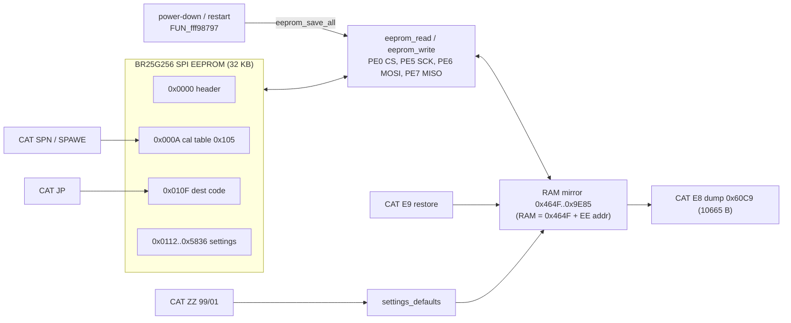
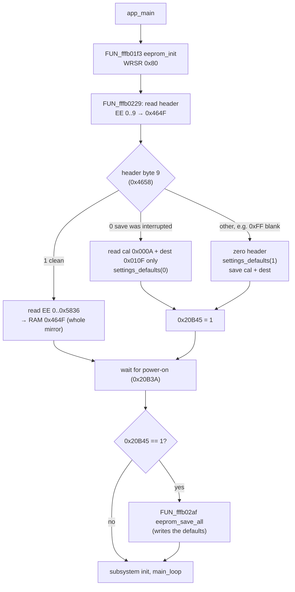
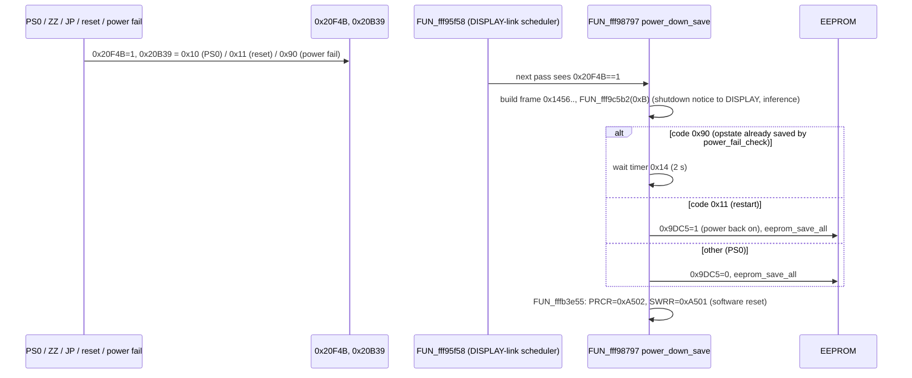

Back to the [MAIN overview](README.md)

# MAIN — EEPROM, settings persistence and resets

Sub-task T10e. The page covers the EEPROM driver, the address map, the boot load, what triggers a save, and the reset paths.
Names are the current Ghidra names in `ghidra/FT710_MAIN`. Names proposed by T10e (`tools/ghidra/names_main.T10e.tsv`)
are shown in *italics* next to the `FUN_` name. Tags follow AGENTS.md: **[fact]** means seen in code or data at the address given.

## Summary

- **One chip, bit-banged.** All settings live in one SPI EEPROM, the BR25G256 from the service manual (32 KB, 64-byte pages). The chip hangs on port E GPIOs, and the CPU clocks it in software, so no RSPI or SCI is involved. **[fact]** for the driver, **[inference]** for the part number.
- **Data flash is unused.** MAIN never touches the RX651 E2 data flash (0x00100000) or the flash sequencer. **[fact, scalar-reference search]**
- **RAM mirror.** RAM **0x464F..0x9E85** is a byte-for-byte mirror of EEPROM **0x0000..0x5836** (22,583 bytes): `RAM = 0x464F + EEPROM address`. Every save call passes the pair (EEPROM `a`, RAM `0x464F + a`, `n`). Code reaches the mirror through the base 0x464F plus an offset (about 3,650 references to 0x464F). EEPROM 0x5837..0x7FFF is never read or written, except by `SPR`/`SPW`. **[fact]**
- **No checksum.** The image has no checksum. Its only integrity guard is a "write in progress" flag in the 10-byte header, together with a 32-bit save counter. **[fact]**
- **No timed autosave.** The firmware writes small blocks when a record changes (memory channel, band stack, QMB, keyer text, tuner memory). It writes the whole image only when the radio is going down: a restart or power-off request, the power switch, or a power fail. **[fact]**

## EEPROM driver **[fact]**

| Signal | Pin | Register |
|---|---|---|
| /CS | PE0 | PORTE.PODR 0x8C02E bit 0 (low = selected) |
| SCK | PE5 | PORTE.PODR bit 5 (idle low; data is set up, then SCK goes high then low; mode 0) |
| MOSI (SI) | PE6 | PORTE.PODR bit 6 |
| MISO (SO) | PE7 | PORTE.PIDR 0x8C04E bit 7 |
| /WP | P65 **[inference]** | PORT6.PODR 0x8C026 bit 5. It is driven high only around the status-register write in `FUN_fffb01f3` |

- **Bit order.** Bytes are shifted MSB first, with no delays. The bit rate is set by the code speed alone.
- **Instructions used** (the standard 25-series set): `0x03` READ, `0x02` WRITE, `0x05` RDSR, `0x06` WREN, `0x01` WRSR.
- **`eeprom_read`.** It sends `03 aH aL` and then clocks in n bytes. It does **not** poll WIP first. Only boot and `SPR` read, so this does not matter in practice. **[inference]**
- **`eeprom_write`.** It splits the data at 64-byte page boundaries. For each chunk it polls RDSR until WIP = 0, then sends WREN, then `02 aH aL` + data. It does not wait after the last page: the next write's RDSR poll covers that. **[fact]**
- **Addresses are 16 bit.** The decompile drops the middle `eeprom_spi_tx()` argument, which is the address high byte (`MOVU.W 0xa[SP],R1; SHLR #8,R1` at 0xFFFB14BA and 0xFFFB1566). It also types the address as a byte. **[fact, disassembly]**
- **Boot init `FUN_fffb01f3`** (*eeprom_init*), called from `app_main` before the load:
  1. /CS high, SCK low, P65 high.
  2. WRSR with the value **0x80**: SRWD = 1, BP1:0 = 00, so no array protection.
  3. P65 low.

  If P65 is /WP, the status register is then locked while the whole array stays writable. **[inference]**

| Address | Ghidra name | Inferred name | Purpose |
|---|---|---|---|
| 0xFFFB15AA | `eeprom_spi_tx` | | Shift one byte out on PE6 **[fact]** |
| 0xFFFB15EF | `eeprom_spi_rx` | | Shift one byte in from PE7 **[fact]** |
| 0xFFFB14A4 | `eeprom_read` | | `READ` + 16-bit address, n bytes **[fact]** |
| 0xFFFB14ED | `eeprom_write` | | Page-split write with WIP poll and WREN **[fact]** |
| 0xFFFB01F3 | `FUN_fffb01f3` | *eeprom_init* | Port setup and WRSR 0x80 **[fact]** |
| 0xFFFB063E / 0xFFFB0651 | `FUN_fffb063e` / `FUN_fffb0651` | *eeprom_read_raw* / *eeprom_write_raw* | Plain wrappers used only by `cat_SP_eeprom_byte` (SPR/SPW) **[fact]** |

## EEPROM address map **[fact unless marked]**

Derived from every `eeprom_read`/`eeprom_write` call (19 call sites). The blocks tile 0x0000..0x5836 with no gaps.

| EEPROM | RAM | Size | Block | Written by |
|---|---|---|---|---|
| 0x0000 | 0x464F | 10 | **Header**. Bytes 0..4: a 5-byte date/time stamp (0x20BB1..5 from `DT`), copied in by `JP` set. Bytes 5..8: a big-endian save counter. Byte 9: state flag (0 = write in progress, 1 = clean) | `eeprom_hdr_update` (twice per save) |
| 0x000A | 0x4659 | 0x105 | `cfg105`: the **factory alignment / calibration table** **[inference]**. Consumers: TX power interpolation at 100/50/30/10/5 W in `FUN_fffb667a` (15-byte records from 0x469E), SWR/meter maths in `FUN_fffb742b`..`FUN_fffb7cec`. ROM defaults at `cfg105_defaults` 0xFFF8074F | `eeprom_save_cfg105`: SPAWE, ZZ99, first-boot init, a key in ZZ00 mode (0xFFFBFD76) |
| 0x010F | 0x475E | 3 | **Destination code** (u16 BE 0x475E, default 0x8043) + flag 0x4760, which DISPLAY startup code 5 toggles | `eeprom_save_dest`: JP, ZZ99, `dest_code_set`, first boot |
| 0x0112 | 0x4761 | 3×0x438 | **Band stack, VFO-A**: 3 slots × 12 bands × 90-byte VFO record. Address = 0x0112 + slot·0x438 + band·0x5A | `FUN_fffb0303` *eeprom_save_bandstack* |
| 0x0DBA | 0x5409 | 3×0x438 | **Band stack, VFO-B**, same layout | same |
| 0x1A62 | 0x60B1 | 0x18 | Band-stack slot index per band: 12 for A (0x60B1), 12 for B (0x60BD) | `FUN_fffb02cf` |
| 0x1A7A | 0x60C9 | 0x87 | **Memory header**: 0x60C9 = VFO-A channel, 0x60CA = VFO-B channel, 0x60CB..0x614F = 133 "channel valid" bytes | `eeprom_save_memch`, `eeprom_save_image` |
| 0x1B01 | 0x6150 | 133×0x5A | **Memory channels**, 90 bytes each: index 0..98 = 001..099, 99..116 = P1L..P9U, 117..131 = 501..515 (60 m), 132 = EMG | `eeprom_save_memch(ch)`: EEPROM 0x1B01 + ch·0x5A |
| 0x49C3 | 0x9012 | 0x11 + 10×0x5A | **QMB** (quick memory bank) **[inference]**: header 0x9012..0x9022 (count 0x9014, order 0x9015[10], A/B pointers 0x901F..0x9022), then 10 records at 0x9023 (5 or 10 used, set by 0x9AC0) | `FUN_fffb03c1` / `FUN_fffb03e1` |
| 0x4D58 | 0x93A7 | 5×0x98 | **Message memory type 0**: u16 length + 150 bytes (copied from 0x120BC by `FUN_fffb98e9`). A paddle-recorded CW message is **[guess]** | `FUN_fffb0450(0,n)` |
| 0x5050 | 0x969F | 5×0x33 | **Keyer memory text** (`KM`): length + 50 characters | `FUN_fffb0450(1,n)`: `cat_KM`, the menu editor `FUN_fffe481d` |
| 0x514F | 0x979E | 5×0x32 | **Text slots** (`EM`). Never saved on their own, only by the full save | `FUN_fffb0450(2,n)` (no caller) |
| 0x5249 | 0x9898 | 0x192 | **Tuner memory** **[inference]**: write index 0x9898, count 0x9899, 100 × {u16 frequency key, 0x1B3AF, 0x1B3AD} | `FUN_fffb0509` from `FUN_fffecea5` |
| 0x53DB | 0x9A2A | 0x45C | **Operating state**: menu values (0x9A2A.., defaults from ROM 0xFFF80E4A.. at the same offset), PE parameters 0x9ADA, APO 0x9B0F, band memories 0x9C69/0x9C99, VFO-A record 0x9D09, VFO-B record 0x9D63, active VFO 0x9DBD, VFO states 0x9DBE/0x9DBF, bands 0x9DC3/0x9DC4, auto-power-on flag 0x9DC5, memory backups 0x9DCE/0x9E28. The block ends at 0x9E85 | `FUN_fffb02cf` *eeprom_save_opstate* |

Sizes check: 0x0112 + 2·0xCA8 = 0x1A62; 0x1B01 + 133·0x5A = 0x49C3; 0x49C3 + 0x395 = 0x4D58; … 0x53DB + 0x45C = 0x5837. **[fact]**

### The E8/E9 image (RAM 0x60C9, 10,665 bytes) **[fact]**

`E8` dumps **0x60C9..0x8A71**. That is the 0x87-byte memory header plus **117 channel records** (001–099 and P1L–P9U): 0x87 + 117·0x5A = 0x29A9.

`E9` copies the same 10,665 bytes back and calls `eeprom_save_image`. That function writes **0x2F49** bytes (0x60C9..0x9011), so it also rewrites the 16 records of the 60 m/EMG channels (0x8A72..0x9011) from RAM. Those records are not part of the transfer and are left as they were.

The E8/E9 clone therefore carries memories only. Menus, band stacks, calibration and the destination code are not included.

### 90-byte VFO / memory record

VFO-A (0x9D09), VFO-B (0x9D63), memory channels, band-stack slots and QMB slots all share one 90-byte layout. Known offsets **[fact from the CAT handlers, T09]**:

| Offset | Field |
|---|---|
| +0x00 | Low nibble = mode (index into `cat_mode_codes`) |
| +0x01 | Bits 3/4: clarifier RX/TX flags |
| +0x02 | Bits 2–3: repeater shift |
| +0x03 | Bits 3–5: tone/CTCSS mode |
| +0x05 | Bit 7: name-tag on |
| +0x0B, +0x15, +0x1F, +0x29, +0x33, +0x3D | Six per-mode-class blocks of 10 bytes. Byte 0 is a 5-state per-mode selector, and bytes +7/+8 are a signed 16-bit value (`IS`); see cat-commands-primary.md |
| +0x48 | s16 clarifier offset |
| +0x4A | u32 frequency in Hz (big-endian) |
| +0x4E | 12-character name |

Defaults (`FUN_fffb0a8f`) write the first 8 bytes as `0x80040040`, `0x00010200`, `0x0000`. The 20 bytes from +0x46 come from ROM 0xFFF80947, or from 0xFFF80B4F.. for the dest-specific 60 m channels. T10g owns the full field map.

## Boot load **[fact]**

`app_main` calls `FUN_fffb01f3` (*eeprom_init*) and then `FUN_fffb0229` (*eeprom_load_all*) before any other subsystem starts.

- **Interrupted save.** A save cut off by a power loss leaves flag 0. The next boot then throws away all user settings and keeps only the calibration table and the destination code. **[fact]**
- **Blank EEPROM.** A blank or foreign EEPROM gets a full factory init: ROM calibration defaults and destination 0x8043. **[fact]** A blank part on a repaired board therefore loses its alignment data, and 0x8043 becomes the default region. **[inference]**
- **Save counter.** `eeprom_hdr_update(f)` increments the counter in header bytes 5..8, stores f in byte 9 and writes the 10-byte header. Every block save calls it twice, f = 0 before the block and f = 1 after it, so the counter grows by 2 per save. **[fact]**

## Save triggers **[fact unless marked]**

The per-record savers (`eeprom_save_memch`, `FUN_fffb0303`, `FUN_fffb03e1`, `FUN_fffb0450`, `FUN_fffb0509`) first call `FUN_fffb4b28` (*power_fail_check*), and they skip the write when it returns 1. The block savers (`eeprom_save_cfg105`, `eeprom_save_dest`, `eeprom_save_image`, `FUN_fffb02af`, `FUN_fffb02cf`, `FUN_fffb03c1`) do not check it.

| Saver | EEPROM | Callers / trigger |
|---|---|---|
| `FUN_fffb02af` *eeprom_save_all* | 0x0112..0x5836 | `app_main` after defaults were loaded (0x20B45). `FUN_fff98797` *power_down_save*, run by `FUN_fff95f58` when the restart/power-off request 0x20F4B = 1 is set: `PS0`, ZZ, JP, `dest_code_set`, power fail and menu reset all set it |
| `FUN_fffb02cf` *eeprom_save_opstate* | 0x53DB + 0x1A62 | `FUN_fffb6d56` (main loop) when 0x20B30 == 2, i.e. the power switch is off **[inference]**, **unless ZZ00 mode is on** (0x20BBE). Also `FUN_fffb4b28` on a power fail |
| `eeprom_save_image` | 0x1A7A, 0x2F49 | `cat_ext_E9` only |
| `eeprom_save_memch(ch)` | 0x1A7A (0x87) + channel | CAT `AM BM MC MT MW CH`, and UI paths `FUN_fffc54cc` (channel step), `FUN_fffc71c7`, `FUN_fffc6ac4/6b34/6b86`, `FUN_fffc1fb6`, `FUN_fffc2b94`, `FUN_fffc4064`, `FUN_fffe273a` |
| `FUN_fffb0303` *eeprom_save_bandstack* | band-stack record | `FUN_fffc1927` *bandstack_store*. It compares the active VFO record with its slot (`FUN_fffede1d`, 90-byte memcmp) and writes only on a change. Called from `FUN_fffc17df`/`FUN_fffc184f` (band change) **[inference]** |
| `FUN_fffb03c1` / `FUN_fffb03e1` | QMB | Boot `FUN_fff94cab`, `FUN_fff9513c` (pending slot 0x20F83), `FUN_fffc316c`, `FUN_fffc506b`..`FUN_fffc515d` (QMB record flag edits) |
| `FUN_fffb0450` *eeprom_save_msg* | message/keyer text | `cat_KM`, the menu text editor `FUN_fffe481d`, the message recorder in `FUN_fffb98e9` (main loop) |
| `FUN_fffb0509` *eeprom_save_atu_mem* | 0x5249 | `FUN_fffecea5` *atu_mem_store*, called by the tuning loop `FUN_fffec8a1`/`FUN_fffecde6` when the SWR is ≤ 1.1 **[inference]** |
| `eeprom_save_cfg105` | 0x000A | `SPAWE`, ZZ99, first boot, and a key in ZZ00 mode (0xFFFBFD76, not inside a defined function) |
| `eeprom_save_dest` | 0x010F | `dest_code_set` (JP, DISPLAY startup code 7, `FUN_fffb3ba6`), ZZ99, first boot |
| raw byte | any | `SPW` (`cat_SP_eeprom_byte`) |

### Power-down, restart and power fail

- **Restart is a CPU reset.** "Power off" and "restart" are both an RX651 **software reset** (`FUN_fffb3e55` writes SWRR = 0xA501). After the reset, `app_main` waits for power-on, as on a cold boot. 0x9DC5, which is saved in the opstate block, tells the DISPLAY-link startup (`FUN_fff9546a` case 0x10) whether to power straight back on. **[fact]** for the reset, **[inference]** for the meaning of 0x9DC5.
- **Power fail** (`FUN_fffb4b28`, *power_fail_check*):
  - It fires when ADC result 0x20B08 (AN002 in the `SPIR` order) drops below **0x7DD**. That channel is most likely the supply voltage **[inference]**.
  - It acts only once, latched by 0x20B43.
  - It calls `power_off_io`, sets 0x9DC5 = 1, calls `FUN_fffd3d03` and saves the opstate block. The save runs only if soft timer 0x13 has expired; `FUN_fffb6cde` starts that timer with 2.5 s at power-on.
  - Then it requests the reset with code 0x90.
  - From then on, `FUN_fffb4b28` returns 1, and every per-record save is skipped. **[fact]**

## Defaults and factory reset **[fact unless marked]**

`settings_defaults(full)` 0xFFFB0558. With `full == 1` it first copies `cfg105_defaults` → 0x4659, sets 0x4760 = 0 and sets destination 0x475E = 0x8043. Then, in both cases:

| Step | Function | Effect |
|---|---|---|
| 1 | `FUN_fffb06e5` *defaults_vfo* | VFO-A/B records 0x9D09/0x9D63 and 0x9DBD = 0. For dest 0x020B/0x4380/0x60E6, byte +0x46 = 8 |
| 2 | `FUN_fffb0a28` *defaults_bandstack* | Clears 0x4761..0x60C8 and fills the 6 band-stack sets (`FUN_fffb0779`, dest-dependent) |
| 3 | `FUN_fffb0a7c` *defaults_qmb* | Clears 0x9012..0x93A6 |
| 4 | `FUN_fffb0a8f` *defaults_memch* | Clears 0x60C9..0x9011. Channel 1 is marked valid. Sets default records for 117 channels and dest-specific 60 m channels (e.g. dest 0xD950) |
| 5 | `FUN_fffb10a4` *defaults_msg* | Clears 0x93A7..0x9897 and loads the keyer texts from ROM 0xFFF80C53/0xFFF80C86/0xFFF80CB9 |
| 6 | (inline) | Clears the tuner memory 0x9898 (0x192). Copies ROM 0xFFF80D82 → 0x9C69 (0xA0) and 0xFFF80E22 → 0x9C35 (0x28) |
| 7 | `FUN_fffb1168` *defaults_menu* | Menu values 0x9A2A..0x9C16 from ROM 0xFFF80E4A.. (`FUN_fffb1193`..`FUN_fffb13e2`), and 0x9C17 ← 0xFFF80FD6 (0x1E) |
| 8 | (inline) | 0x9C5D..0x9C65, then clears 0x9DBE..0x9E85 and copies 0xFFF80FC6 → 0x9DBE (0x10) |

`settings_defaults` changes RAM only. The EEPROM is updated by the full save in the restart that follows, or by the first-boot save. **[fact]**

| Path | Code | What is reset | EEPROM write |
|---|---|---|---|
| CAT `ZZPE071099;` | `cat_ext_ZZ` 0xFFFA58A1 | **Everything**, including the calibration table and the destination code (→ 0x8043) | cal + dest at once; the rest by the restart save |
| CAT `ZZPE071001;` | same | All settings except calibration and destination | restart save |
| CAT `ZZPE071000;` | same | Nothing. It sets 0x20BBE = 1, which is **alignment (service-adjust) mode** **[inference]**: key codes < 8 and 0x16..0x19 are blocked, a key saves `cfg105` (0xFFFBFD76), `cal_adjust` edits `cfg105[0x20CE2]`, and the power-switch opstate save is suppressed. `EO` clears it | cfg105 on key |
| CAT `SPN R/W/S`, `SPAWE` | `cat_SP_table`, `cat_ext_SP` | `SPN R` selects calibration item idx (0x20CE2) and tunes to its ROM test frequency (`FUN_fffbb567`, 12-byte records at 0xFFF88CD4). `W` sets the value in RAM. `SPAWE` commits the table | cfg105 |
| CAT `JP0710…` | `cat_ext_JP` → `dest_code_set` | Destination code, then `settings_defaults(0)` and a restart. It also stamps the date/time 0x20BB1..5 into header bytes 0..4 | dest at once; the rest and the header by the restart save |
| Menu reset | `FUN_fffd0279` → `FUN_fffd0288` *reset_select*(0x20BC0) | 0 = memory channels (`FUN_fffb0a8f`, then channel 1 → VFO), 1 = menus (`FUN_fffb1168`), 2 = `settings_defaults(0)`. Then 0x20B39 = 0x11 | restart save |
| Power-on key combination | DISPLAY-link `FUN_fff9546a` (startup code at frame +7, T10b) | 0x01: `settings_defaults(0)` + 0x20B45 = 1 (all reset). 0x07: swaps paired destination codes (0xA983/0xB5A7 → 0xD950, 0xD950/0xA4C5 → 0xA983). 0x05: toggles flag 0x4760 | first-boot style save after power-on |
| Interrupted save | `FUN_fffb0229` | Like ZZ01 | after power-on |
| Blank EEPROM | `FUN_fffb0229` | Like ZZ99 | at once + after power-on |

## Other functions

| Address | Ghidra name | Inferred name | Purpose |
|---|---|---|---|
| 0xFFFB142B | `eeprom_hdr_update` | | Counter++, state flag, 10-byte header write **[fact]** |
| 0xFFFB0229 | `FUN_fffb0229` | *eeprom_load_all* | Boot load (figure above) **[fact]** |
| 0xFFFB02AF | `FUN_fffb02af` | *eeprom_save_all* | EE 0x0112..0x5836 **[fact]** |
| 0xFFFB02CF | `FUN_fffb02cf` | *eeprom_save_opstate* | EE 0x53DB (0x45C) + 0x1A62 (0x18) **[fact]** |
| 0xFFFB0303 | `FUN_fffb0303` | *eeprom_save_bandstack* | `(vfoB, band, slot, rec)` **[fact]** |
| 0xFFFB0356 | `eeprom_save_image` | | EE 0x1A7A, 0x2F49 bytes **[fact]** |
| 0xFFFB0376 | `eeprom_save_memch` | | Header 0x87 + channel ch **[fact]** |
| 0xFFFB03C1 / 0xFFFB03E1 | `FUN_fffb03c1` / `FUN_fffb03e1` | *eeprom_save_qmb* / *eeprom_save_qmb_slot* | QMB block / header + one record **[fact]** |
| 0xFFFB0450 | `FUN_fffb0450` | *eeprom_save_msg* | `(type 0..2, n 1..5)` **[fact]** |
| 0xFFFB0509 | `FUN_fffb0509` | *eeprom_save_atu_mem* | EE 0x5249 **[fact]** |
| 0xFFFB0532 / 0xFFFB0544 | `eeprom_save_cfg105` / `eeprom_save_dest` | | No header update and no power-fail check **[fact]** |
| 0xFFFB0558 | `settings_defaults` | | See above |
| 0xFFFB4B28 | `FUN_fffb4b28` | *power_fail_check* | See above **[fact]** |
| 0xFFF98797 | `FUN_fff98797` | *power_down_save* | Shutdown message, full save, reset **[fact]** |
| 0xFFFB3E55 | `FUN_fffb3e55` | *mcu_software_reset* | SWRR = 0xA501 **[fact]** |
| 0xFFFB237A / 0xFFFB23F3 | `FUN_fffb237a` / `FUN_fffb23f3` | *timer_start* / *timer_expired* | Soft timers (index ≤ 0x4A; flags 0x11FED[n]) **[fact]** |
| 0xFFFC1927 | `FUN_fffc1927` | *bandstack_store* | **[fact]** |
| 0xFFFECEA5 | `FUN_fffecea5` | *atu_mem_store* | **[fact]** for the data movement, **[inference]** that it is the tuner |
| 0xFFFBBC0A | `FUN_fffbbc0a` | *cal_adjust* | Pointer table 0x25D50 = 0x4659 and 0x25D4C = 0x20B04 (the DTBL init data at 0xFFF8EADC) give `cfg105[0x20CE2]` **[fact]** |
| 0xFFFB3BA6 | `FUN_fffb3ba6` | *dest_code_fixup* | Swaps between paired destination codes by `FUN_fffb6f2a()` (a hardware option?) **[guess]** |
| 0xFFF94CAB | `FUN_fff94cab` | *qmb_boot_init* | **[fact]** |
| 0xFFFD0288 | `FUN_fffd0288` | *reset_select* | **[fact]** |

## Globals

| Address | Size | Meaning |
|---|---|---|
| 0x464F | 10 | EEPROM header mirror |
| 0x4658 | u8 | Header state flag (0 = save in progress, 1 = clean) |
| 0x4659 | 0x105 | `cfg105` calibration table; `PTR_DAT_00025d50` points here |
| 0x475E / 0x4760 | u16 + u8 | Destination code + flag |
| 0x60C9 / 0x60CA | u8 | VFO-A / VFO-B memory channel index |
| 0x60CB | 133 | Channel valid flags |
| 0x9DC5 | u8 | Auto power-on after a reset **[inference]** |
| 0x20B04 | struct | System state base (`PTR_DAT_00025d38`, `…4c`, `…54`..`…7c` all = 0x20B04 **[fact, DTBL]**). +0x35 = 0x20B39 restart code, +0x447 = 0x20F4B restart request, +0xBA = 0x20BBE ZZ00 mode, +0x1DE = 0x20CE2 alignment item |
| 0x20B43 | u8 | Power-fail latch |
| 0x20B45 | u8 | "Defaults loaded, save after power-on" |
| 0x20B08 | u16 | ADC result watched for power fail |
| 0x11FED[n] | u8 | Soft-timer expired flags |

## Decoder artifact found here (affects the whole MAIN decompile) **[fact]**

The RX SLEIGH module decodes **`MOVU.B/W Rs,Rd`** (opcode 0x5B/0x5F, ld = 11, register zero-extend) as a memory load `MOVU.x [Rs],Rd`. The module's own comment says "when ld=3 it should be [Rs]". Per the RX instruction set, ld = 11 means register direct.

- **Here.** The decompile shows `eeprom_write(*(u16*)(0x1B01 + ch*0x5A), …)`, but the code really computes `(u16)(0x1B01 + ch*0x5A)`: the bytes at 0xFFFB03B0 are `5F 11`.
- **Size.** `tools/ghidra/T10eMovuRegCount.java` finds **107** such instructions in 49 functions.
- **SP checksum.** At 0xFFFA3867, 0xFFFA38C4, 0xFFFA39BB and 0xFFFA510A (`60 22 5F 22` = `SUB #2,R2; MOVU.W R2,R2`), the checksum length is simply **`len − 2`**. **The "binary SP checksum bug" in [cat.md](cat.md) is this decoder artifact, so SPR/SPW/SPM/SPN/SPA work normally.**
