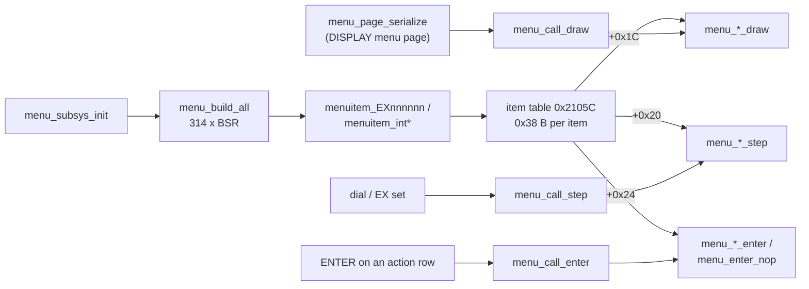

# MAIN — menu item builders and callbacks (catalogue)

The per-item code of the setup menu, one row per function: the 314 `menuitem_*` builders that `menu_build_all` calls to fill the
item table, and the `on_draw` / `on_step` / `on_enter` callbacks stored in the item descriptors. How the engine uses them (the
0x38-byte descriptor, the EX command, value propagation) is on [menu.md](menu.md); this page is the catalogue that the engine page
points to.

Sources: `decomp/main/` (callbacks from 0xFFFC9B6B, builders 0xFFFD5373..0xFFFDD72A), the plate comments in `tools/ghidra/names_main.tsv` (sections "menu item callbacks
on_draw/on_step/on_enter (#74)", generated by `python3 -I tools/main_menu_table.py --names`, and the `menuitem_*` names from T10f).
Claims are tagged **[fact]** (seen in code or data), **[inference]** or **[guess]**.

## Overview

- **Builders.** `menu_build_all` 0xFFFD4C30 is a straight list of 314 `BSR menuitem_*`; the call order is the table index **[fact]**.
  Each `menuitem_*` (108 to 110 bytes; 99 bytes for 21 of them) writes one 0x38-byte descriptor: P1/P2/P3 position, the 21-character
  name, the three callback pointers, min/max, the store address and the format flags **[fact]** ([descriptor](menu.md#item-descriptor-0x38-bytes)).
  The row purpose below is the item's path in the menu ("Menu item 0.0.11 RADIO SETTING / MODE SSB / REAR OUT LEVEL" = P1 0, P2 0,
  P3 11).
- **Callbacks.** The descriptors hold 626 distinct callbacks; since #74 they are Ghidra functions named `menu_<item>_<role>` after the
  first item that uses them (`menu_ex010113_step`, `menu_m4_17_0_enter`) **[fact]**. Items without an EX number use `m<P1>_<P2>_<P3>`.
  `on_draw` formats the value for the DISPLAY menu page (`menu_call_draw`), `on_step` steps the value from the dial and is also the apply
  hook after an EX set (`menu_call_step`, 0x15DFC = 1), `on_enter` runs the action of an action item (`menu_call_enter`) **[fact]**.
  The shared bare-`RTS` callbacks `menu_enter_nop` (296 items) and `menu_step_nop` (18 items) and the shared draw/step helpers
  (`menu_draw_*`, `menu_step_*`) are on [menu.md](menu.md).
- **Where the values live.** Most callbacks wrap `menu_step_s8` / `menu_step_u8` and `menu_draw_flags` plus a ROM label table; the few
  non-trivial steppers are listed in [menu.md](menu.md#non-trivial-steppers-74-fact) **[fact]**.

## Functions

| Address | Ghidra name | Inferred name | Purpose |
|---|---|---|---|
| 0xFFFC9B6B | `menu_ex010101_draw` |  | Menu item ex010101 AF TREBLE GAIN: on_draw (#74) **[inference]** |
| 0xFFFC9BE2 | `menu_ex010102_draw` |  | Menu item ex010102 AF MIDDLE TONE GAIN: on_draw (#74) **[inference]** |
| 0xFFFC9BFA | `menu_ex010103_draw` |  | Menu item ex010103 AF BASS GAIN: on_draw (#74) **[inference]** |
| 0xFFFC9C12 | `menu_ex010104_draw` |  | Menu item ex010104 AGC FAST DELAY: on_draw (#74) **[inference]** |
| 0xFFFC9CAB | `menu_ex010105_draw` |  | Menu item ex010105 AGC MID DELAY: on_draw (#74) **[inference]** |
| 0xFFFC9CC2 | `menu_ex010106_draw` |  | Menu item ex010106 AGC SLOW DELY: on_draw (#74) **[inference]** |
| 0xFFFC9CD9 | `menu_ex010107_draw` |  | Menu item ex010107 LCUT FREQ: on_draw (#74) **[inference]** |
| 0xFFFC9D85 | `menu_ex010108_draw` |  | Menu item ex010108 LCUT SLOPE: on_draw (#74) **[inference]** |
| 0xFFFC9E11 | `menu_ex010109_draw` |  | Menu item ex010109 HCUT FREQ: on_draw (#74) **[inference]** |
| 0xFFFC9EBF | `menu_ex010110_draw` |  | Menu item ex010110 HCUT SLOPE: on_draw (#74) **[inference]** |
| 0xFFFC9F4B | `menu_ex010111_draw` |  | Menu item ex010111 USB OUT LEVEL: on_draw (#74) **[inference]** |
| 0xFFFC9FC3 | `menu_ex010112_draw` |  | Menu item ex010112 REAR OUT LEVEL: on_draw (#74) **[inference]** |
| 0xFFFC9FD9 | `menu_ex010113_draw` |  | Menu item ex010113 TX BPF SEL: on_draw (#74) **[inference]** |
| 0xFFFCA110 | `menu_ex010114_draw` |  | Menu item ex010114 MOD SOURCE: on_draw (#74) **[inference]** |
| 0xFFFCA19C | `menu_ex010115_draw` |  | Menu item ex010115 USB MOD GAIN: on_draw (#74) **[inference]** |
| 0xFFFCA214 | `menu_ex010116_draw` |  | Menu item ex010116 REAR MOD GAIN: on_draw (#74) **[inference]** |
| 0xFFFCA28C | `menu_ex010117_draw` |  | Menu item ex010117 RPTT SELECT: on_draw (#74) **[inference]** |
| 0xFFFCA318 | `menu_ex010118_draw` |  | Menu item ex010118 NAR WIDTH: on_draw (#74) **[inference]** |
| 0xFFFCA396 | `menu_ex010119_draw` |  | Menu item ex010119 CW AUTO MODE: on_draw (#74) **[inference]** |
| 0xFFFCA422 | `menu_ex010201_draw` |  | Menu item ex010201 AF TREBLE GAIN: on_draw (#74) **[inference]** |
| 0xFFFCA43A | `menu_ex010202_draw` |  | Menu item ex010202 AF MIDDLE TONE GAIN: on_draw (#74) **[inference]** |
| 0xFFFCA452 | `menu_ex010203_draw` |  | Menu item ex010203 AF BASS GAIN: on_draw (#74) **[inference]** |
| 0xFFFCA46A | `menu_ex010204_draw` |  | Menu item ex010204 AGC FAST DELAY: on_draw (#74) **[inference]** |
| 0xFFFCA481 | `menu_ex010205_draw` |  | Menu item ex010205 AGC MID DELAY: on_draw (#74) **[inference]** |
| 0xFFFCA498 | `menu_ex010206_draw` |  | Menu item ex010206 AGC SLOW DELAY: on_draw (#74) **[inference]** |
| 0xFFFCA4AF | `menu_ex010207_draw` |  | Menu item ex010207 LCUT FREQ: on_draw (#74) **[inference]** |
| 0xFFFCA4C4 | `menu_ex010208_draw` |  | Menu item ex010208 LCUT SLOPE: on_draw (#74) **[inference]** |
| 0xFFFCA4D9 | `menu_ex010209_draw` |  | Menu item ex010209 HCUT FREQ: on_draw (#74) **[inference]** |
| 0xFFFCA4EE | `menu_ex010210_draw` |  | Menu item ex010210 HCUT SLOPE: on_draw (#74) **[inference]** |
| 0xFFFCA503 | `menu_ex010211_draw` |  | Menu item ex010211 USB OUT LEVEL: on_draw (#74) **[inference]** |
| 0xFFFCA519 | `menu_ex010212_draw` |  | Menu item ex010212 REAR OUT LEVEL: on_draw (#74) **[inference]** |
| 0xFFFCA52F | `menu_ex010213_draw` |  | Menu item ex010213 TX BPF SEL: on_draw (#74) **[inference]** |
| 0xFFFCA544 | `menu_ex010214_draw` |  | Menu item ex010214 MOD SOURCE: on_draw (#74) **[inference]** |
| 0xFFFCA559 | `menu_ex010215_draw` |  | Menu item ex010215 USB MOD GAIN: on_draw (#74) **[inference]** |
| 0xFFFCA56F | `menu_ex010216_draw` |  | Menu item ex010216 REAR MOD GAIN: on_draw (#74) **[inference]** |
| 0xFFFCA585 | `menu_ex010217_draw` |  | Menu item ex010217 RPTT SELECT: on_draw (#74) **[inference]** |
| 0xFFFCA59A | `menu_ex010301_draw` |  | Menu item ex010301 AF TREBLE GAIN: on_draw (#74) **[inference]** |
| 0xFFFCA5B2 | `menu_ex010302_draw` |  | Menu item ex010302 AF MIDDLE TONE GAIN: on_draw (#74) **[inference]** |
| 0xFFFCA5CA | `menu_ex010303_draw` |  | Menu item ex010303 AF BASS GAIN: on_draw (#74) **[inference]** |
| 0xFFFCA5E2 | `menu_ex010304_draw` |  | Menu item ex010304 AGC FAST DELAY: on_draw (#74) **[inference]** |
| 0xFFFCA5F8 | `menu_ex010305_draw` |  | Menu item ex010305 AGC MID DELAY: on_draw (#74) **[inference]** |
| 0xFFFCA60F | `menu_ex010306_draw` |  | Menu item ex010306 AGC SLOW DELAY: on_draw (#74) **[inference]** |
| 0xFFFCA626 | `menu_ex010307_draw` |  | Menu item ex010307 LCUT FREQ: on_draw (#74) **[inference]** |
| 0xFFFCA63B | `menu_ex010308_draw` |  | Menu item ex010308 LCUT SLOPE: on_draw (#74) **[inference]** |
| 0xFFFCA650 | `menu_ex010309_draw` |  | Menu item ex010309 HCUT FREQ: on_draw (#74) **[inference]** |
| 0xFFFCA666 | `menu_ex010310_draw` |  | Menu item ex010310 HCUT SLOPE: on_draw (#74) **[inference]** |
| 0xFFFCA67B | `menu_ex010311_draw` |  | Menu item ex010311 USB OUT LEVEL: on_draw (#74) **[inference]** |
| 0xFFFCA691 | `menu_ex010312_draw` |  | Menu item ex010312 REAR OUT LEVEL: on_draw (#74) **[inference]** |
| 0xFFFCA6A7 | `menu_ex010313_draw` |  | Menu item ex010313 MOD SOURCE: on_draw (#74) **[inference]** |
| 0xFFFCA6BC | `menu_ex010314_draw` |  | Menu item ex010314 USB MOD GAIN: on_draw (#74) **[inference]** |
| 0xFFFCA6D2 | `menu_ex010315_draw` |  | Menu item ex010315 REAR MOD GAIN: on_draw (#74) **[inference]** |
| 0xFFFCA6E8 | `menu_ex010316_draw` |  | Menu item ex010316 RPTT SELECT: on_draw (#74) **[inference]** |
| 0xFFFCA6FD | `menu_ex010317_draw` |  | Menu item ex010317 RPT SHIFT: on_draw (#74) **[inference]** |
| 0xFFFCA79D | `menu_ex010318_draw` |  | Menu item ex010318 RPT SHIFT(28MHz): on_draw (#74) **[inference]** |
| 0xFFFCA821 | `menu_ex010319_draw` |  | Menu item ex010319 RPT SHIFT(50MHz): on_draw (#74) **[inference]** |
| 0xFFFCA8B6 | `menu_ex010320_draw` |  | Menu item ex010320 ENC/DEC: on_draw (#74) **[inference]** |
| 0xFFFCA956 | `menu_ex010321_draw` |  | Menu item ex010321 TONE FREQ: on_draw (#74) **[inference]** |
| 0xFFFCAA35 | `menu_ex010401_draw` |  | Menu item ex010401 AF TREBLE GAIN: on_draw (#74) **[inference]** |
| 0xFFFCAA4D | `menu_ex010402_draw` |  | Menu item ex010402 AF MIDDLE TONE GAIN: on_draw (#74) **[inference]** |
| 0xFFFCAA65 | `menu_ex010403_draw` |  | Menu item ex010403 AF BASS GAIN: on_draw (#74) **[inference]** |
| 0xFFFCAA7D | `menu_ex010404_draw` |  | Menu item ex010404 AGC FAST DELAY: on_draw (#74) **[inference]** |
| 0xFFFCAA93 | `menu_ex010405_draw` |  | Menu item ex010405 AGC MID DELAY: on_draw (#74) **[inference]** |
| 0xFFFCAAAA | `menu_ex010406_draw` |  | Menu item ex010406 AGC SLOW DELAY: on_draw (#74) **[inference]** |
| 0xFFFCAAC1 | `menu_ex010407_draw` |  | Menu item ex010407 LCUT FREQ: on_draw (#74) **[inference]** |
| 0xFFFCAAD6 | `menu_ex010408_draw` |  | Menu item ex010408 LCUT SLOPE: on_draw (#74) **[inference]** |
| 0xFFFCAAEB | `menu_ex010409_draw` |  | Menu item ex010409 HCUT FREQ: on_draw (#74) **[inference]** |
| 0xFFFCAB01 | `menu_ex010410_draw` |  | Menu item ex010410 HCUT SLOPE: on_draw (#74) **[inference]** |
| 0xFFFCAB16 | `menu_ex010411_draw` |  | Menu item ex010411 USB OUT LEVEL: on_draw (#74) **[inference]** |
| 0xFFFCAB2C | `menu_ex010412_draw` |  | Menu item ex010412 REAR OUT LEVEL: on_draw (#74) **[inference]** |
| 0xFFFCAB42 | `menu_ex010413_draw` |  | Menu item ex010413 TX BPF SEL: on_draw (#74) **[inference]** |
| 0xFFFCAB57 | `menu_ex010414_draw` |  | Menu item ex010414 MOD SOURCE: on_draw (#74) **[inference]** |
| 0xFFFCAB6C | `menu_ex010415_draw` |  | Menu item ex010415 USB MOD GAIN: on_draw (#74) **[inference]** |
| 0xFFFCAB82 | `menu_ex010416_draw` |  | Menu item ex010416 REAR MOD GAIN: on_draw (#74) **[inference]** |
| 0xFFFCAB98 | `menu_ex010417_draw` |  | Menu item ex010417 RPTT SELECT: on_draw (#74) **[inference]** |
| 0xFFFCABAD | `menu_ex010418_draw` |  | Menu item ex010418 NAR WIDTH: on_draw (#74) **[inference]** |
| 0xFFFCAC3A | `menu_ex010419_draw` |  | Menu item ex010419 PSK TONE: on_draw (#74) **[inference]** |
| 0xFFFCACB7 | `menu_ex010420_draw` |  | Menu item ex010420 DATA SHIFT (SSB): on_draw (#74) **[inference]** |
| 0xFFFCAD49 | `menu_ex010501_draw` |  | Menu item ex010501 AF TREBLE GAIN: on_draw (#74) **[inference]** |
| 0xFFFCAD61 | `menu_ex010502_draw` |  | Menu item ex010502 AF MIDDLE TONE GAIN: on_draw (#74) **[inference]** |
| 0xFFFCAD79 | `menu_ex010503_draw` |  | Menu item ex010503 AF BASS GAIN: on_draw (#74) **[inference]** |
| 0xFFFCAD91 | `menu_ex010504_draw` |  | Menu item ex010504 AGC FAST DELAY: on_draw (#74) **[inference]** |
| 0xFFFCADA7 | `menu_ex010505_draw` |  | Menu item ex010505 AGC MID DELAY: on_draw (#74) **[inference]** |
| 0xFFFCADBE | `menu_ex010506_draw` |  | Menu item ex010506 AGC SLOW DELAY: on_draw (#74) **[inference]** |
| 0xFFFCADD5 | `menu_ex010507_draw` |  | Menu item ex010507 LCUT FREQ: on_draw (#74) **[inference]** |
| 0xFFFCADEA | `menu_ex010508_draw` |  | Menu item ex010508 LCUT SLOPE: on_draw (#74) **[inference]** |
| 0xFFFCADFF | `menu_ex010509_draw` |  | Menu item ex010509 HCUT FREQ: on_draw (#74) **[inference]** |
| 0xFFFCAE15 | `menu_ex010510_draw` |  | Menu item ex010510 HCUT SLOPE: on_draw (#74) **[inference]** |
| 0xFFFCAE2A | `menu_ex010511_draw` |  | Menu item ex010511 USB OUT LEVEL: on_draw (#74) **[inference]** |
| 0xFFFCAE40 | `menu_ex010512_draw` |  | Menu item ex010512 REAR OUT LEVEL: on_draw (#74) **[inference]** |
| 0xFFFCAE56 | `menu_ex010513_draw` |  | Menu item ex010513 RPTT SELECT: on_draw (#74) **[inference]** |
| 0xFFFCAE6B | `menu_ex010514_draw` |  | Menu item ex010514 NAR WIDTH: on_draw (#74) **[inference]** |
| 0xFFFCAE80 | `menu_ex010515_draw` |  | Menu item ex010515 MARK FREQUENCY: on_draw (#74) **[inference]** |
| 0xFFFCAEFD | `menu_ex010516_draw` |  | Menu item ex010516 SHIFT FREQUENCY: on_draw (#74) **[inference]** |
| 0xFFFCAF7A | `menu_ex010517_draw` |  | Menu item ex010517 POLARITY TX: on_draw (#74) **[inference]** |
| 0xFFFCAFF7 | `menu_ex020101_draw` |  | Menu item ex020101 AF TREBLE GAIN: on_draw (#74) **[inference]** |
| 0xFFFCB00F | `menu_ex020102_draw` |  | Menu item ex020102 AF MIDDLE TONE GAIN: on_draw (#74) **[inference]** |
| 0xFFFCB027 | `menu_ex020103_draw` |  | Menu item ex020103 AF BASS GAIN: on_draw (#74) **[inference]** |
| 0xFFFCB03F | `menu_ex020104_draw` |  | Menu item ex020104 AGC FAST DELAY: on_draw (#74) **[inference]** |
| 0xFFFCB055 | `menu_ex020105_draw` |  | Menu item ex020105 AGC MID DELAY: on_draw (#74) **[inference]** |
| 0xFFFCB06C | `menu_ex020106_draw` |  | Menu item ex020106 AGC SLOW DELAY: on_draw (#74) **[inference]** |
| 0xFFFCB083 | `menu_ex020107_draw` |  | Menu item ex020107 LCUT FREQ: on_draw (#74) **[inference]** |
| 0xFFFCB098 | `menu_ex020108_draw` |  | Menu item ex020108 LCUT SLOPE: on_draw (#74) **[inference]** |
| 0xFFFCB0AD | `menu_ex020109_draw` |  | Menu item ex020109 HCUT FREQ: on_draw (#74) **[inference]** |
| 0xFFFCB0C2 | `menu_ex020110_draw` |  | Menu item ex020110 HCUT SLOPE: on_draw (#74) **[inference]** |
| 0xFFFCB0D7 | `menu_ex020111_draw` |  | Menu item ex020111 USB OUT LEVEL: on_draw (#74) **[inference]** |
| 0xFFFCB0ED | `menu_ex020112_draw` |  | Menu item ex020112 REAR OUT LEVEL: on_draw (#74) **[inference]** |
| 0xFFFCB103 | `menu_ex020113_draw` |  | Menu item ex020113 RPTT SELECT: on_draw (#74) **[inference]** |
| 0xFFFCB118 | `menu_ex020114_draw` |  | Menu item ex020114 NAR WIDTH: on_draw (#74) **[inference]** |
| 0xFFFCB12D | `menu_ex020115_draw` |  | Menu item ex020115 PC KEYING: on_draw (#74) **[inference]** |
| 0xFFFCB142 | `menu_ex020116_draw` |  | Menu item ex020116 CW BK-IN TYPE: on_draw (#74) **[inference]** |
| 0xFFFCB1BF | `menu_ex020117_draw` |  | Menu item ex020117 CW WAVE SHAPE: on_draw (#74) **[inference]** |
| 0xFFFCB23C | `menu_ex020118_draw` |  | Menu item ex020118 CW FREQ DISPLAY: on_draw (#74) **[inference]** |
| 0xFFFCB2B9 | `menu_ex020119_draw` |  | Menu item ex020119 QSK DELAY TIME: on_draw (#74) **[inference]** |
| 0xFFFCB336 | `menu_ex020120_draw` |  | Menu item ex020120 CW INDICATOR: on_draw (#74) **[inference]** |
| 0xFFFCB3C2 | `menu_ex020201_draw` |  | Menu item ex020201 KEYER TYPE: on_draw (#74) **[inference]** |
| 0xFFFCB43F | `menu_ex020202_draw` |  | Menu item ex020202 KEYER DOT/DASH: on_draw (#74) **[inference]** |
| 0xFFFCB4BC | `menu_ex020203_draw` |  | Menu item ex020203 CW WEIGHT: on_draw (#74) **[inference]** |
| 0xFFFCB57A | `menu_ex020204_draw` |  | Menu item ex020204 NUMBER STYLE: on_draw (#74) **[inference]** |
| 0xFFFCB5F7 | `menu_ex020205_draw` |  | Menu item ex020205 CONTEST NUMBER: on_draw (#74) **[inference]** |
| 0xFFFCB65D | `menu_ex020206_draw` |  | Menu item ex020206 CW MEMORY 1: on_draw (#74) **[inference]** |
| 0xFFFCB6E9 | `menu_ex020207_draw` |  | Menu item ex020207 CW MEMORY 2: on_draw (#74) **[inference]** |
| 0xFFFCB6FE | `menu_ex020208_draw` |  | Menu item ex020208 CW MEMORY 3: on_draw (#74) **[inference]** |
| 0xFFFCB713 | `menu_ex020209_draw` |  | Menu item ex020209 CW MEMORY 4: on_draw (#74) **[inference]** |
| 0xFFFCB728 | `menu_ex020210_draw` |  | Menu item ex020210 CW MEMORY 5: on_draw (#74) **[inference]** |
| 0xFFFCB73D | `menu_ex020211_draw` |  | Menu item ex020211 REPEAT INTERVAL: on_draw (#74) **[inference]** |
| 0xFFFCB7B9 | `menu_ex030101_draw` |  | Menu item ex030101 BEEP LEVEL: on_draw (#74) **[inference]** |
| 0xFFFCB825 | `menu_ex030102_draw` |  | Menu item ex030102 RF/SQL VR: on_draw (#74) **[inference]** |
| 0xFFFCB8A5 | `menu_ex030103_draw` |  | Menu item ex030103 TUN/LIN PORT SELECT: on_draw (#74) **[inference]** |
| 0xFFFCB925 | `menu_ex030104_draw` |  | Menu item ex030104 TUNER TYPE SELECT: on_draw (#74) **[inference]** |
| 0xFFFCB9A5 | `menu_ex030105_draw` |  | Menu item ex030105 CAT-1 RATE: on_draw (#74) **[inference]** |
| 0xFFFCBA31 | `menu_ex030106_draw` |  | Menu item ex030106 CAT-1 TIME OUT TIMER: on_draw (#74) **[inference]** |
| 0xFFFCBABD | `menu_ex030107_draw` |  | Menu item ex030107 CAT-1 CAT-3 STOP BIT: on_draw (#74) **[inference]** |
| 0xFFFCBB3D | `menu_ex030108_draw` |  | Menu item ex030108 CAT-2 RATE: on_draw (#74) **[inference]** |
| 0xFFFCBB52 | `menu_ex030109_draw` |  | Menu item ex030109 CAT-2 TIME OUT TIMER: on_draw (#74) **[inference]** |
| 0xFFFCBB67 | `menu_ex030110_draw` |  | Menu item ex030110 CAT-3 RATE: on_draw (#74) **[inference]** |
| 0xFFFCBB7C | `menu_ex030111_draw` |  | Menu item ex030111 CAT-3 TIME OUT TIMER: on_draw (#74) **[inference]** |
| 0xFFFCBB91 | `menu_ex030112_draw` |  | Menu item ex030112 QMB CH: on_draw (#74) **[inference]** |
| 0xFFFCBC11 | `menu_ex030113_draw` |  | Menu item ex030113 BAND STACK: on_draw (#74) **[inference]** |
| 0xFFFCBC91 | `menu_ex030114_draw` |  | Menu item ex030114 MEM GROUP: on_draw (#74) **[inference]** |
| 0xFFFCBD11 | `menu_ex030115_draw` |  | Menu item ex030115 TX TIME OUT TIMER: on_draw (#74) **[inference]** |
| 0xFFFCBDEB | `menu_ex030116_draw` |  | Menu item ex030116 MIC SCAN: on_draw (#74) **[inference]** |
| 0xFFFCBE6B | `menu_ex030117_draw` |  | Menu item ex030117 MIC SCAN RESUME: on_draw (#74) **[inference]** |
| 0xFFFCBEEB | `menu_ex030118_draw` |  | Menu item ex030118 REF FREQ FINE ADJ: on_draw (#74) **[inference]** |
| 0xFFFCBF56 | `menu_ex030119_draw` |  | Menu item ex030119 KEYBOARD LANGUAGE: on_draw (#74) **[inference]** |
| 0xFFFCC035 | `menu_ex030120_draw` |  | Menu item ex030120 MIC P1: on_draw (#74) **[inference]** |
| 0xFFFCC0C2 | `menu_ex030121_draw` |  | Menu item ex030121 MIC P2: on_draw (#74) **[inference]** |
| 0xFFFCC0D7 | `menu_ex030122_draw` |  | Menu item ex030122 MIC P3: on_draw (#74) **[inference]** |
| 0xFFFCC0EC | `menu_ex030123_draw` |  | Menu item ex030123 MIC P4: on_draw (#74) **[inference]** |
| 0xFFFCC101 | `menu_ex030124_draw` |  | Menu item ex030124 MIC UP: on_draw (#74) **[inference]** |
| 0xFFFCC116 | `menu_ex030125_draw` |  | Menu item ex030125 MIC DOWN: on_draw (#74) **[inference]** |
| 0xFFFCC12B | `menu_ex030126_draw` |  | Menu item ex030126 SCU-LAN10: on_draw (#74) **[inference]** |
| 0xFFFCC140 | `menu_ex030201_draw` |  | Menu item ex030201 IF NOTCH WIDTH: on_draw (#74) **[inference]** |
| 0xFFFCC1C0 | `menu_ex030202_draw` |  | Menu item ex030202 NB REJECTION: on_draw (#74) **[inference]** |
| 0xFFFCC240 | `menu_ex030203_draw` |  | Menu item ex030203 NB WIDTH: on_draw (#74) **[inference]** |
| 0xFFFCC2C0 | `menu_ex030204_draw` |  | Menu item ex030204 APF WIDTH: on_draw (#74) **[inference]** |
| 0xFFFCC340 | `menu_ex030205_draw` |  | Menu item ex030205 CONTOUR LEVEL: on_draw (#74) **[inference]** |
| 0xFFFCC3AC | `menu_ex030206_draw` |  | Menu item ex030206 CONTOUR WIDTH: on_draw (#74) **[inference]** |
| 0xFFFCC417 | `menu_ex030301_draw` |  | Menu item ex030301 AMC RELEASE TIME: on_draw (#74) **[inference]** |
| 0xFFFCC497 | `menu_ex030302_draw` |  | Menu item ex030302 PRMTRC EQ1 FREQ: on_draw (#74) **[inference]** |
| 0xFFFCC556 | `menu_ex030303_draw` |  | Menu item ex030303 PRMTRC EQ1 LEVEL: on_draw (#74) **[inference]** |
| 0xFFFCC5CE | `menu_ex030304_draw` |  | Menu item ex030304 PRMTRC EQ1 BWTH: on_draw (#74) **[inference]** |
| 0xFFFCC645 | `menu_ex030305_draw` |  | Menu item ex030305 PRMTRC EQ2 FREQ: on_draw (#74) **[inference]** |
| 0xFFFCC65E | `menu_ex030306_draw` |  | Menu item ex030306 PRMTRC EQ2 LEVEL: on_draw (#74) **[inference]** |
| 0xFFFCC673 | `menu_ex030307_draw` |  | Menu item ex030307 PRMTRC EQ2 BWTH: on_draw (#74) **[inference]** |
| 0xFFFCC688 | `menu_ex030308_draw` |  | Menu item ex030308 PRMTRC EQ3 FREQ: on_draw (#74) **[inference]** |
| 0xFFFCC6A1 | `menu_ex030309_draw` |  | Menu item ex030309 PRMTRC EQ3 LEVEL: on_draw (#74) **[inference]** |
| 0xFFFCC6B6 | `menu_ex030310_draw` |  | Menu item ex030310 PRMTRC EQ3 BWTH: on_draw (#74) **[inference]** |
| 0xFFFCC6CB | `menu_ex030311_draw` |  | Menu item ex030311 P PRMTRC EQ1 FREQ: on_draw (#74) **[inference]** |
| 0xFFFCC6E3 | `menu_ex030312_draw` |  | Menu item ex030312 P PRMTRC EQ1 LEVEL: on_draw (#74) **[inference]** |
| 0xFFFCC6F8 | `menu_ex030313_draw` |  | Menu item ex030313 P PRMTRC EQ1 BWTH: on_draw (#74) **[inference]** |
| 0xFFFCC70D | `menu_ex030314_draw` |  | Menu item ex030314 P PRMTRC EQ2 FREQ: on_draw (#74) **[inference]** |
| 0xFFFCC726 | `menu_ex030315_draw` |  | Menu item ex030315 P PRMTRC EQ2 LEVEL: on_draw (#74) **[inference]** |
| 0xFFFCC73B | `menu_ex030316_draw` |  | Menu item ex030316 P PRMTRC EQ2 BWTH: on_draw (#74) **[inference]** |
| 0xFFFCC750 | `menu_ex030317_draw` |  | Menu item ex030317 P PRMTRC EQ3 FREQ: on_draw (#74) **[inference]** |
| 0xFFFCC769 | `menu_ex030318_draw` |  | Menu item ex030318 P PRMTRC EQ3 LEVEL: on_draw (#74) **[inference]** |
| 0xFFFCC77E | `menu_ex030319_draw` |  | Menu item ex030319 P PRMTRC EQ3 BWTH: on_draw (#74) **[inference]** |
| 0xFFFCC793 | `menu_ex030401_draw` |  | Menu item ex030401 HF MAX POWER: on_draw (#74) **[inference]** |
| 0xFFFCC850 | `menu_ex030402_draw` |  | Menu item ex030402 50M MAX POWER: on_draw (#74) **[inference]** |
| 0xFFFCC899 | `menu_ex030403_draw` |  | Menu item ex030403 70M MAX POWER: on_draw (#74) **[inference]** |
| 0xFFFCC8E2 | `menu_ex030404_draw` |  | Menu item ex030404 AM MAX POWER: on_draw (#74) **[inference]** |
| 0xFFFCC93C | `menu_ex030405_draw` |  | Menu item ex030405 VOX SELECT: on_draw (#74) **[inference]** |
| 0xFFFCC9BC | `menu_ex030406_draw` |  | Menu item ex030406 EMERGENCY FREQ TX: on_draw (#74) **[inference]** |
| 0xFFFCC9D1 | `menu_ex030407_draw` |  | Menu item ex030407 TX INHITBIT: on_draw (#74) **[inference]** |
| 0xFFFCC9E6 | `menu_ex030408_draw` |  | Menu item ex030408 METER DETECTOR: on_draw (#74) **[inference]** |
| 0xFFFCCA66 | `menu_ex030501_draw` |  | Menu item ex030501 SSB/CW DIAL STEP: on_draw (#74) **[inference]** |
| 0xFFFCCAE6 | `menu_ex030502_draw` |  | Menu item ex030502 RTTY/PSK DIAL STEP: on_draw (#74) **[inference]** |
| 0xFFFCCB66 | `menu_ex030503_draw` |  | Menu item ex030503 CH STEP: on_draw (#74) **[inference]** |
| 0xFFFCCBE6 | `menu_ex030504_draw` |  | Menu item ex030504 AM CH STEP: on_draw (#74) **[inference]** |
| 0xFFFCCC66 | `menu_ex030505_draw` |  | Menu item ex030505 FM CH STEP: on_draw (#74) **[inference]** |
| 0xFFFCCCE6 | `menu_ex030506_draw` |  | Menu item ex030506 MAIN STEPS PER REV.: on_draw (#74) **[inference]** |
| 0xFFFCCD66 | `menu_ex040101_draw` |  | Menu item ex040101 MY CALL: on_draw (#74) **[inference]** |
| 0xFFFCCDCD | `menu_ex040102_draw` |  | Menu item ex040102 MY CALL TIME: on_draw (#74) **[inference]** |
| 0xFFFCCE4D | `menu_ex040103_draw` |  | Menu item ex040103 POP-UP TIME: on_draw (#74) **[inference]** |
| 0xFFFCCECD | `menu_ex040104_draw` |  | Menu item ex040104 SCREEN SAVER: on_draw (#74) **[inference]** |
| 0xFFFCCF4D | `menu_ex040105_draw` |  | Menu item ex040105 LED DIMMER: on_draw (#74) **[inference]** |
| 0xFFFCCFCE | `menu_ex040106_draw` |  | Menu item ex040106 MOUSE POINTER SPEED: on_draw (#74) **[inference]** |
| 0xFFFCD039 | `menu_ex040201_draw` |  | Menu item ex040201 RBW: on_draw (#74) **[inference]** |
| 0xFFFCD0B9 | `menu_ex040202_draw` |  | Menu item ex040202 SCOPE CTR: on_draw (#74) **[inference]** |
| 0xFFFCD139 | `menu_ex040203_draw` |  | Menu item ex040203 2D DISP SENSITIVITY: on_draw (#74) **[inference]** |
| 0xFFFCD1B9 | `menu_ex040204_draw` |  | Menu item ex040204 3DSS DISP SENSITIVITY: on_draw (#74) **[inference]** |
| 0xFFFCD239 | `menu_ex040301_draw` |  | Menu item ex040301 VMI COLOR VFO-A: on_draw (#74) **[inference]** |
| 0xFFFCD2B9 | `menu_ex040302_draw` |  | Menu item ex040302 VMI COLOR VFO-B: on_draw (#74) **[inference]** |
| 0xFFFCD339 | `menu_ex040303_draw` |  | Menu item ex040303 VMI COLOR MEMORY: on_draw (#74) **[inference]** |
| 0xFFFCD3B9 | `menu_ex040304_draw` |  | Menu item ex040304 VMI COLOR CLAR: on_draw (#74) **[inference]** |
| 0xFFFCD439 | `menu_ex040401_draw` |  | Menu item ex040401 EXT DISPLAY: on_draw (#74) **[inference]** |
| 0xFFFCD44E | `menu_ex040402_draw` |  | Menu item ex040402 PIXEL: on_draw (#74) **[inference]** |
| 0xFFFCD4CE | `menu_m4_16_0_draw` |  | Menu item m4_16_0 DAY: on_draw (#74) **[inference]** |
| 0xFFFCD5D5 | `menu_m4_16_1_draw` |  | Menu item m4_16_1 MONTH: on_draw (#74) **[inference]** |
| 0xFFFCD65D | `menu_m4_16_2_draw` |  | Menu item m4_16_2 YEAR: on_draw (#74) **[inference]** |
| 0xFFFCD6FC | `menu_m4_16_3_draw` |  | Menu item m4_16_3 HOUR: on_draw (#74) **[inference]** |
| 0xFFFCD77B | `menu_m4_16_4_draw` |  | Menu item m4_16_4 MINUTE: on_draw (#74) **[inference]** |
| 0xFFFCD7FA | `menu_m4_17_0_draw` |  | Menu item m4_17_0 MEM LIST LOAD: on_draw (#74) **[inference]** |
| 0xFFFCD865 | `menu_m4_17_1_draw` |  | Menu item m4_17_1 MEM LIST SAVE: on_draw (#74) **[inference]** |
| 0xFFFCD86E | `menu_m4_17_2_draw` |  | Menu item m4_17_2 MENU LOAD: on_draw (#74) **[inference]** |
| 0xFFFCD877 | `menu_m4_17_3_draw` |  | Menu item m4_17_3 MENU SAVE: on_draw (#74) **[inference]** |
| 0xFFFCD880 | `menu_m4_17_4_draw` |  | Menu item m4_17_4 INFORMATIONS: on_draw (#74) **[inference]** |
| 0xFFFCD889 | `menu_m4_17_5_draw` |  | Menu item m4_17_5 FIRMWARE UPDATE: on_draw (#74) **[inference]** |
| 0xFFFCD892 | `menu_m4_17_6_draw` |  | Menu item m4_17_6 FORMAT: on_draw (#74) **[inference]** |
| 0xFFFCD89B | `menu_m4_18_0_draw` |  | Menu item m4_18_0 SOFTVERSION: on_draw (#74) **[inference]** |
| 0xFFFCD96C | `menu_m4_19_0_draw` |  | Menu item m4_19_0 CALIBRATION: on_draw (#74) **[inference]** |
| 0xFFFCD975 | `menu_m4_20_0_draw` |  | Menu item m4_20_0 MEMORY CLEAR: on_draw (#74) **[inference]** |
| 0xFFFCD97E | `menu_m4_20_1_draw` |  | Menu item m4_20_1 MENU CLEAR: on_draw (#74) **[inference]** |
| 0xFFFCD987 | `menu_m4_20_2_draw` |  | Menu item m4_20_2 ALL RESET: on_draw (#74) **[inference]** |
| 0xFFFCD990 | `menu_m4_21_0_draw` |  | Menu item m4_21_0 CERTIFICATION: on_draw (#74) **[inference]** |
| 0xFFFCDE05 | `menu_ex010101_step` |  | Menu item ex010101 AF TREBLE GAIN: on_step (#74) **[inference]** |
| 0xFFFCDE62 | `menu_ex010102_step` |  | Menu item ex010102 AF MIDDLE TONE GAIN: on_step (#74) **[inference]** |
| 0xFFFCDE75 | `menu_ex010103_step` |  | Menu item ex010103 AF BASS GAIN: on_step (#74) **[inference]** |
| 0xFFFCDE88 | `menu_ex010104_step` |  | Menu item ex010104 AGC FAST DELAY: on_step (#74) **[inference]** |
| 0xFFFCDE9B | `menu_ex010105_step` |  | Menu item ex010105 AGC MID DELAY: on_step (#74) **[inference]** |
| 0xFFFCDEAE | `menu_ex010106_step` |  | Menu item ex010106 AGC SLOW DELY: on_step (#74) **[inference]** |
| 0xFFFCDEC1 | `menu_ex010107_step` |  | Menu item ex010107 LCUT FREQ: on_step (#74) **[inference]** |
| 0xFFFCDF17 | `menu_ex010108_step` |  | Menu item ex010108 LCUT SLOPE: on_step (#74) **[inference]** |
| 0xFFFCDF29 | `menu_ex010109_step` |  | Menu item ex010109 HCUT FREQ: on_step (#74) **[inference]** |
| 0xFFFCDF93 | `menu_ex010110_step` |  | Menu item ex010110 HCUT SLOPE: on_step (#74) **[inference]** |
| 0xFFFCDFA5 | `menu_ex010111_step` |  | Menu item ex010111 USB OUT LEVEL: on_step (#74) **[inference]** |
| 0xFFFCE000 | `menu_ex010112_step` |  | Menu item ex010112 REAR OUT LEVEL: on_step (#74) **[inference]** |
| 0xFFFCE013 | `menu_ex010113_step` |  | Menu item ex010113 TX BPF SEL: on_step (#74) **[inference]** |
| 0xFFFCE0CA | `menu_ex010114_step` |  | Menu item ex010114 MOD SOURCE: on_step (#74) **[inference]** |
| 0xFFFCE0DC | `menu_ex010115_step` |  | Menu item ex010115 USB MOD GAIN: on_step (#74) **[inference]** |
| 0xFFFCE0EF | `menu_ex010116_step` |  | Menu item ex010116 REAR MOD GAIN: on_step (#74) **[inference]** |
| 0xFFFCE102 | `menu_ex010117_step` |  | Menu item ex010117 RPTT SELECT: on_step (#74) **[inference]** |
| 0xFFFCE114 | `menu_ex010118_step` |  | Menu item ex010118 NAR WIDTH: on_step (#74) **[inference]** |
| 0xFFFCE127 | `menu_ex010119_step` |  | Menu item ex010119 CW AUTO MODE: on_step (#74) **[inference]** |
| 0xFFFCE139 | `menu_ex010201_step` |  | Menu item ex010201 AF TREBLE GAIN: on_step (#74) **[inference]** |
| 0xFFFCE14C | `menu_ex010202_step` |  | Menu item ex010202 AF MIDDLE TONE GAIN: on_step (#74) **[inference]** |
| 0xFFFCE15F | `menu_ex010203_step` |  | Menu item ex010203 AF BASS GAIN: on_step (#74) **[inference]** |
| 0xFFFCE172 | `menu_ex010204_step` |  | Menu item ex010204 AGC FAST DELAY: on_step (#74) **[inference]** |
| 0xFFFCE185 | `menu_ex010205_step` |  | Menu item ex010205 AGC MID DELAY: on_step (#74) **[inference]** |
| 0xFFFCE198 | `menu_ex010206_step` |  | Menu item ex010206 AGC SLOW DELAY: on_step (#74) **[inference]** |
| 0xFFFCE1AB | `menu_ex010207_step` |  | Menu item ex010207 LCUT FREQ: on_step (#74) **[inference]** |
| 0xFFFCE1B9 | `menu_ex010208_step` |  | Menu item ex010208 LCUT SLOPE: on_step (#74) **[inference]** |
| 0xFFFCE1CB | `menu_ex010209_step` |  | Menu item ex010209 HCUT FREQ: on_step (#74) **[inference]** |
| 0xFFFCE1D9 | `menu_ex010210_step` |  | Menu item ex010210 HCUT SLOPE: on_step (#74) **[inference]** |
| 0xFFFCE1EB | `menu_ex010211_step` |  | Menu item ex010211 USB OUT LEVEL: on_step (#74) **[inference]** |
| 0xFFFCE1FE | `menu_ex010212_step` |  | Menu item ex010212 REAR OUT LEVEL: on_step (#74) **[inference]** |
| 0xFFFCE211 | `menu_ex010213_step` |  | Menu item ex010213 TX BPF SEL: on_step (#74) **[inference]** |
| 0xFFFCE223 | `menu_ex010214_step` |  | Menu item ex010214 MOD SOURCE: on_step (#74) **[inference]** |
| 0xFFFCE235 | `menu_ex010215_step` |  | Menu item ex010215 USB MOD GAIN: on_step (#74) **[inference]** |
| 0xFFFCE248 | `menu_ex010216_step` |  | Menu item ex010216 REAR MOD GAIN: on_step (#74) **[inference]** |
| 0xFFFCE25B | `menu_ex010217_step` |  | Menu item ex010217 RPTT SELECT: on_step (#74) **[inference]** |
| 0xFFFCE26D | `menu_ex010301_step` |  | Menu item ex010301 AF TREBLE GAIN: on_step (#74) **[inference]** |
| 0xFFFCE280 | `menu_ex010302_step` |  | Menu item ex010302 AF MIDDLE TONE GAIN: on_step (#74) **[inference]** |
| 0xFFFCE293 | `menu_ex010303_step` |  | Menu item ex010303 AF BASS GAIN: on_step (#74) **[inference]** |
| 0xFFFCE2A6 | `menu_ex010304_step` |  | Menu item ex010304 AGC FAST DELAY: on_step (#74) **[inference]** |
| 0xFFFCE2B9 | `menu_ex010305_step` |  | Menu item ex010305 AGC MID DELAY: on_step (#74) **[inference]** |
| 0xFFFCE2CC | `menu_ex010306_step` |  | Menu item ex010306 AGC SLOW DELAY: on_step (#74) **[inference]** |
| 0xFFFCE2DF | `menu_ex010307_step` |  | Menu item ex010307 LCUT FREQ: on_step (#74) **[inference]** |
| 0xFFFCE2ED | `menu_ex010308_step` |  | Menu item ex010308 LCUT SLOPE: on_step (#74) **[inference]** |
| 0xFFFCE2FF | `menu_ex010309_step` |  | Menu item ex010309 HCUT FREQ: on_step (#74) **[inference]** |
| 0xFFFCE30D | `menu_ex010310_step` |  | Menu item ex010310 HCUT SLOPE: on_step (#74) **[inference]** |
| 0xFFFCE31F | `menu_ex010311_step` |  | Menu item ex010311 USB OUT LEVEL: on_step (#74) **[inference]** |
| 0xFFFCE332 | `menu_ex010312_step` |  | Menu item ex010312 REAR OUT LEVEL: on_step (#74) **[inference]** |
| 0xFFFCE345 | `menu_ex010313_step` |  | Menu item ex010313 MOD SOURCE: on_step (#74) **[inference]** |
| 0xFFFCE357 | `menu_ex010314_step` |  | Menu item ex010314 USB MOD GAIN: on_step (#74) **[inference]** |
| 0xFFFCE36A | `menu_ex010315_step` |  | Menu item ex010315 REAR MOD GAIN: on_step (#74) **[inference]** |
| 0xFFFCE37D | `menu_ex010316_step` |  | Menu item ex010316 RPTT SELECT: on_step (#74) **[inference]** |
| 0xFFFCE38F | `menu_ex010317_step` |  | Menu item ex010317 RPT SHIFT: on_step (#74) **[inference]** |
| 0xFFFCE436 | `menu_ex010318_step` |  | Menu item ex010318 RPT SHIFT(28MHz): on_step (#74) **[inference]** |
| 0xFFFCE450 | `menu_ex010319_step` |  | Menu item ex010319 RPT SHIFT(50MHz): on_step (#74) **[inference]** |
| 0xFFFCE4DF | `menu_ex010320_step` |  | Menu item ex010320 ENC/DEC: on_step (#74) **[inference]** |
| 0xFFFCE588 | `menu_ex010321_step` |  | Menu item ex010321 TONE FREQ: on_step (#74) **[inference]** |
| 0xFFFCE629 | `menu_ex010401_step` |  | Menu item ex010401 AF TREBLE GAIN: on_step (#74) **[inference]** |
| 0xFFFCE63C | `menu_ex010402_step` |  | Menu item ex010402 AF MIDDLE TONE GAIN: on_step (#74) **[inference]** |
| 0xFFFCE64F | `menu_ex010403_step` |  | Menu item ex010403 AF BASS GAIN: on_step (#74) **[inference]** |
| 0xFFFCE662 | `menu_ex010404_step` |  | Menu item ex010404 AGC FAST DELAY: on_step (#74) **[inference]** |
| 0xFFFCE675 | `menu_ex010405_step` |  | Menu item ex010405 AGC MID DELAY: on_step (#74) **[inference]** |
| 0xFFFCE688 | `menu_ex010406_step` |  | Menu item ex010406 AGC SLOW DELAY: on_step (#74) **[inference]** |
| 0xFFFCE69B | `menu_ex010407_step` |  | Menu item ex010407 LCUT FREQ: on_step (#74) **[inference]** |
| 0xFFFCE6A9 | `menu_ex010408_step` |  | Menu item ex010408 LCUT SLOPE: on_step (#74) **[inference]** |
| 0xFFFCE6BB | `menu_ex010409_step` |  | Menu item ex010409 HCUT FREQ: on_step (#74) **[inference]** |
| 0xFFFCE6C9 | `menu_ex010410_step` |  | Menu item ex010410 HCUT SLOPE: on_step (#74) **[inference]** |
| 0xFFFCE6DB | `menu_ex010411_step` |  | Menu item ex010411 USB OUT LEVEL: on_step (#74) **[inference]** |
| 0xFFFCE6EE | `menu_ex010412_step` |  | Menu item ex010412 REAR OUT LEVEL: on_step (#74) **[inference]** |
| 0xFFFCE701 | `menu_ex010413_step` |  | Menu item ex010413 TX BPF SEL: on_step (#74) **[inference]** |
| 0xFFFCE713 | `menu_ex010414_step` |  | Menu item ex010414 MOD SOURCE: on_step (#74) **[inference]** |
| 0xFFFCE725 | `menu_ex010415_step` |  | Menu item ex010415 USB MOD GAIN: on_step (#74) **[inference]** |
| 0xFFFCE738 | `menu_ex010416_step` |  | Menu item ex010416 REAR MOD GAIN: on_step (#74) **[inference]** |
| 0xFFFCE74B | `menu_ex010417_step` |  | Menu item ex010417 RPTT SELECT: on_step (#74) **[inference]** |
| 0xFFFCE75D | `menu_ex010418_step` |  | Menu item ex010418 NAR WIDTH: on_step (#74) **[inference]** |
| 0xFFFCE770 | `menu_ex010419_step` |  | Menu item ex010419 PSK TONE: on_step (#74) **[inference]** |
| 0xFFFCE782 | `menu_ex010420_step` |  | Menu item ex010420 DATA SHIFT (SSB): on_step (#74) **[inference]** |
| 0xFFFCE7C7 | `menu_ex010501_step` |  | Menu item ex010501 AF TREBLE GAIN: on_step (#74) **[inference]** |
| 0xFFFCE7DA | `menu_ex010502_step` |  | Menu item ex010502 AF MIDDLE TONE GAIN: on_step (#74) **[inference]** |
| 0xFFFCE7ED | `menu_ex010503_step` |  | Menu item ex010503 AF BASS GAIN: on_step (#74) **[inference]** |
| 0xFFFCE800 | `menu_ex010504_step` |  | Menu item ex010504 AGC FAST DELAY: on_step (#74) **[inference]** |
| 0xFFFCE813 | `menu_ex010505_step` |  | Menu item ex010505 AGC MID DELAY: on_step (#74) **[inference]** |
| 0xFFFCE826 | `menu_ex010506_step` |  | Menu item ex010506 AGC SLOW DELAY: on_step (#74) **[inference]** |
| 0xFFFCE839 | `menu_ex010507_step` |  | Menu item ex010507 LCUT FREQ: on_step (#74) **[inference]** |
| 0xFFFCE847 | `menu_ex010508_step` |  | Menu item ex010508 LCUT SLOPE: on_step (#74) **[inference]** |
| 0xFFFCE859 | `menu_ex010509_step` |  | Menu item ex010509 HCUT FREQ: on_step (#74) **[inference]** |
| 0xFFFCE867 | `menu_ex010510_step` |  | Menu item ex010510 HCUT SLOPE: on_step (#74) **[inference]** |
| 0xFFFCE879 | `menu_ex010511_step` |  | Menu item ex010511 USB OUT LEVEL: on_step (#74) **[inference]** |
| 0xFFFCE88C | `menu_ex010512_step` |  | Menu item ex010512 REAR OUT LEVEL: on_step (#74) **[inference]** |
| 0xFFFCE89F | `menu_ex010513_step` |  | Menu item ex010513 RPTT SELECT: on_step (#74) **[inference]** |
| 0xFFFCE8B1 | `menu_ex010514_step` |  | Menu item ex010514 NAR WIDTH: on_step (#74) **[inference]** |
| 0xFFFCE8C4 | `menu_ex010515_step` |  | Menu item ex010515 MARK FREQUENCY: on_step (#74) **[inference]** |
| 0xFFFCE8D6 | `menu_ex010516_step` |  | Menu item ex010516 SHIFT FREQUENCY: on_step (#74) **[inference]** |
| 0xFFFCE8E8 | `menu_ex010517_step` |  | Menu item ex010517 POLARITY TX: on_step (#74) **[inference]** |
| 0xFFFCE8FA | `menu_ex020101_step` |  | Menu item ex020101 AF TREBLE GAIN: on_step (#74) **[inference]** |
| 0xFFFCE90D | `menu_ex020102_step` |  | Menu item ex020102 AF MIDDLE TONE GAIN: on_step (#74) **[inference]** |
| 0xFFFCE920 | `menu_ex020103_step` |  | Menu item ex020103 AF BASS GAIN: on_step (#74) **[inference]** |
| 0xFFFCE933 | `menu_ex020104_step` |  | Menu item ex020104 AGC FAST DELAY: on_step (#74) **[inference]** |
| 0xFFFCE946 | `menu_ex020105_step` |  | Menu item ex020105 AGC MID DELAY: on_step (#74) **[inference]** |
| 0xFFFCE959 | `menu_ex020106_step` |  | Menu item ex020106 AGC SLOW DELAY: on_step (#74) **[inference]** |
| 0xFFFCE96C | `menu_ex020107_step` |  | Menu item ex020107 LCUT FREQ: on_step (#74) **[inference]** |
| 0xFFFCE97A | `menu_ex020108_step` |  | Menu item ex020108 LCUT SLOPE: on_step (#74) **[inference]** |
| 0xFFFCE98C | `menu_ex020109_step` |  | Menu item ex020109 HCUT FREQ: on_step (#74) **[inference]** |
| 0xFFFCE99A | `menu_ex020110_step` |  | Menu item ex020110 HCUT SLOPE: on_step (#74) **[inference]** |
| 0xFFFCE9AC | `menu_ex020111_step` |  | Menu item ex020111 USB OUT LEVEL: on_step (#74) **[inference]** |
| 0xFFFCE9BF | `menu_ex020112_step` |  | Menu item ex020112 REAR OUT LEVEL: on_step (#74) **[inference]** |
| 0xFFFCE9D2 | `menu_ex020113_step` |  | Menu item ex020113 RPTT SELECT: on_step (#74) **[inference]** |
| 0xFFFCE9E4 | `menu_ex020114_step` |  | Menu item ex020114 NAR WIDTH: on_step (#74) **[inference]** |
| 0xFFFCE9F7 | `menu_ex020115_step` |  | Menu item ex020115 PC KEYING: on_step (#74) **[inference]** |
| 0xFFFCEA09 | `menu_ex020116_step` |  | Menu item ex020116 CW BK-IN TYPE: on_step (#74) **[inference]** |
| 0xFFFCEA1B | `menu_ex020117_step` |  | Menu item ex020117 CW WAVE SHAPE: on_step (#74) **[inference]** |
| 0xFFFCEA2D | `menu_ex020118_step` |  | Menu item ex020118 CW FREQ DISPLAY: on_step (#74) **[inference]** |
| 0xFFFCEA3F | `menu_ex020119_step` |  | Menu item ex020119 QSK DELAY TIME: on_step (#74) **[inference]** |
| 0xFFFCEA51 | `menu_ex020120_step` |  | Menu item ex020120 CW INDICATOR: on_step (#74) **[inference]** |
| 0xFFFCEA63 | `menu_ex020201_step` |  | Menu item ex020201 KEYER TYPE: on_step (#74) **[inference]** |
| 0xFFFCEA79 | `menu_ex020202_step` |  | Menu item ex020202 KEYER DOT/DASH: on_step (#74) **[inference]** |
| 0xFFFCEA8B | `menu_ex020203_step` |  | Menu item ex020203 CW WEIGHT: on_step (#74) **[inference]** |
| 0xFFFCEA9E | `menu_ex020204_step` |  | Menu item ex020204 NUMBER STYLE: on_step (#74) **[inference]** |
| 0xFFFCEAB0 | `menu_ex020205_step` |  | Menu item ex020205 CONTEST NUMBER: on_step (#74) **[inference]** |
| 0xFFFCEACC | `menu_ex020206_step` |  | Menu item ex020206 CW MEMORY 1: on_step (#74) **[inference]** |
| 0xFFFCEADE | `menu_ex020207_step` |  | Menu item ex020207 CW MEMORY 2: on_step (#74) **[inference]** |
| 0xFFFCEAF0 | `menu_ex020208_step` |  | Menu item ex020208 CW MEMORY 3: on_step (#74) **[inference]** |
| 0xFFFCEB02 | `menu_ex020209_step` |  | Menu item ex020209 CW MEMORY 4: on_step (#74) **[inference]** |
| 0xFFFCEB14 | `menu_ex020210_step` |  | Menu item ex020210 CW MEMORY 5: on_step (#74) **[inference]** |
| 0xFFFCEB26 | `menu_ex020211_step` |  | Menu item ex020211 REPEAT INTERVAL: on_step (#74) **[inference]** |
| 0xFFFCEB39 | `menu_ex030101_step` |  | Menu item ex030101 BEEP LEVEL: on_step (#74) **[inference]** |
| 0xFFFCEB4C | `menu_ex030102_step` |  | Menu item ex030102 RF/SQL VR: on_step (#74) **[inference]** |
| 0xFFFCEB5E | `menu_ex030103_step` |  | Menu item ex030103 TUN/LIN PORT SELECT: on_step (#74) **[inference]** |
| 0xFFFCEB74 | `menu_ex030104_step` |  | Menu item ex030104 TUNER TYPE SELECT: on_step (#74) **[inference]** |
| 0xFFFCEBB8 | `menu_ex030105_step` |  | Menu item ex030105 CAT-1 RATE: on_step (#74) **[inference]** |
| 0xFFFCEBCE | `menu_ex030106_step` |  | Menu item ex030106 CAT-1 TIME OUT TIMER: on_step (#74) **[inference]** |
| 0xFFFCEBE0 | `menu_ex030107_step` |  | Menu item ex030107 CAT-1 CAT-3 STOP BIT: on_step (#74) **[inference]** |
| 0xFFFCEBFA | `menu_ex030108_step` |  | Menu item ex030108 CAT-2 RATE: on_step (#74) **[inference]** |
| 0xFFFCEC10 | `menu_ex030109_step` |  | Menu item ex030109 CAT-2 TIME OUT TIMER: on_step (#74) **[inference]** |
| 0xFFFCEC22 | `menu_ex030110_step` |  | Menu item ex030110 CAT-3 RATE: on_step (#74) **[inference]** |
| 0xFFFCEC38 | `menu_ex030111_step` |  | Menu item ex030111 CAT-3 TIME OUT TIMER: on_step (#74) **[inference]** |
| 0xFFFCEC4A | `menu_ex030112_step` |  | Menu item ex030112 QMB CH: on_step (#74) **[inference]** |
| 0xFFFCEC60 | `menu_ex030113_step` |  | Menu item ex030113 BAND STACK: on_step (#74) **[inference]** |
| 0xFFFCEC72 | `menu_ex030114_step` |  | Menu item ex030114 MEM GROUP: on_step (#74) **[inference]** |
| 0xFFFCEC84 | `menu_ex030115_step` |  | Menu item ex030115 TX TIME OUT TIMER: on_step (#74) **[inference]** |
| 0xFFFCEC97 | `menu_ex030116_step` |  | Menu item ex030116 MIC SCAN: on_step (#74) **[inference]** |
| 0xFFFCECA9 | `menu_ex030117_step` |  | Menu item ex030117 MIC SCAN RESUME: on_step (#74) **[inference]** |
| 0xFFFCECBB | `menu_ex030118_step` |  | Menu item ex030118 REF FREQ FINE ADJ: on_step (#74) **[inference]** |
| 0xFFFCECCF | `menu_ex030119_step` |  | Menu item ex030119 KEYBOARD LANGUAGE: on_step (#74) **[inference]** |
| 0xFFFCED1D | `menu_ex030120_step` |  | Menu item ex030120 MIC P1: on_step (#74) **[inference]** |
| 0xFFFCED30 | `menu_ex030121_step` |  | Menu item ex030121 MIC P2: on_step (#74) **[inference]** |
| 0xFFFCED43 | `menu_ex030122_step` |  | Menu item ex030122 MIC P3: on_step (#74) **[inference]** |
| 0xFFFCED56 | `menu_ex030123_step` |  | Menu item ex030123 MIC P4: on_step (#74) **[inference]** |
| 0xFFFCED69 | `menu_ex030124_step` |  | Menu item ex030124 MIC UP: on_step (#74) **[inference]** |
| 0xFFFCED7C | `menu_ex030125_step` |  | Menu item ex030125 MIC DOWN: on_step (#74) **[inference]** |
| 0xFFFCED8F | `menu_ex030126_step` |  | Menu item ex030126 SCU-LAN10: on_step (#74) **[inference]** |
| 0xFFFCEDDD | `menu_ex030201_step` |  | Menu item ex030201 IF NOTCH WIDTH: on_step (#74) **[inference]** |
| 0xFFFCEDEF | `menu_ex030202_step` |  | Menu item ex030202 NB REJECTION: on_step (#74) **[inference]** |
| 0xFFFCEE01 | `menu_ex030203_step` |  | Menu item ex030203 NB WIDTH: on_step (#74) **[inference]** |
| 0xFFFCEE13 | `menu_ex030204_step` |  | Menu item ex030204 APF WIDTH: on_step (#74) **[inference]** |
| 0xFFFCEE25 | `menu_ex030205_step` |  | Menu item ex030205 CONTOUR LEVEL: on_step (#74) **[inference]** |
| 0xFFFCEE39 | `menu_ex030206_step` |  | Menu item ex030206 CONTOUR WIDTH: on_step (#74) **[inference]** |
| 0xFFFCEE4B | `menu_ex030301_step` |  | Menu item ex030301 AMC RELEASE TIME: on_step (#74) **[inference]** |
| 0xFFFCEE5D | `menu_ex030302_step` |  | Menu item ex030302 PRMTRC EQ1 FREQ: on_step (#74) **[inference]** |
| 0xFFFCEE6F | `menu_ex030303_step` |  | Menu item ex030303 PRMTRC EQ1 LEVEL: on_step (#74) **[inference]** |
| 0xFFFCEE82 | `menu_ex030304_step` |  | Menu item ex030304 PRMTRC EQ1 BWTH: on_step (#74) **[inference]** |
| 0xFFFCEE94 | `menu_ex030305_step` |  | Menu item ex030305 PRMTRC EQ2 FREQ: on_step (#74) **[inference]** |
| 0xFFFCEEA6 | `menu_ex030306_step` |  | Menu item ex030306 PRMTRC EQ2 LEVEL: on_step (#74) **[inference]** |
| 0xFFFCEEB9 | `menu_ex030307_step` |  | Menu item ex030307 PRMTRC EQ2 BWTH: on_step (#74) **[inference]** |
| 0xFFFCEECB | `menu_ex030308_step` |  | Menu item ex030308 PRMTRC EQ3 FREQ: on_step (#74) **[inference]** |
| 0xFFFCEEDE | `menu_ex030309_step` |  | Menu item ex030309 PRMTRC EQ3 LEVEL: on_step (#74) **[inference]** |
| 0xFFFCEEF1 | `menu_ex030310_step` |  | Menu item ex030310 PRMTRC EQ3 BWTH: on_step (#74) **[inference]** |
| 0xFFFCEF03 | `menu_ex030311_step` |  | Menu item ex030311 P PRMTRC EQ1 FREQ: on_step (#74) **[inference]** |
| 0xFFFCEF15 | `menu_ex030312_step` |  | Menu item ex030312 P PRMTRC EQ1 LEVEL: on_step (#74) **[inference]** |
| 0xFFFCEF28 | `menu_ex030313_step` |  | Menu item ex030313 P PRMTRC EQ1 BWTH: on_step (#74) **[inference]** |
| 0xFFFCEF3A | `menu_ex030314_step` |  | Menu item ex030314 P PRMTRC EQ2 FREQ: on_step (#74) **[inference]** |
| 0xFFFCEF4C | `menu_ex030315_step` |  | Menu item ex030315 P PRMTRC EQ2 LEVEL: on_step (#74) **[inference]** |
| 0xFFFCEF5F | `menu_ex030316_step` |  | Menu item ex030316 P PRMTRC EQ2 BWTH: on_step (#74) **[inference]** |
| 0xFFFCEF71 | `menu_ex030317_step` |  | Menu item ex030317 P PRMTRC EQ3 FREQ: on_step (#74) **[inference]** |
| 0xFFFCEF84 | `menu_ex030318_step` |  | Menu item ex030318 P PRMTRC EQ3 LEVEL: on_step (#74) **[inference]** |
| 0xFFFCEF97 | `menu_ex030319_step` |  | Menu item ex030319 P PRMTRC EQ3 BWTH: on_step (#74) **[inference]** |
| 0xFFFCEFA9 | `menu_ex030401_step` |  | Menu item ex030401 HF MAX POWER: on_step (#74) **[inference]** |
| 0xFFFCEFC1 | `menu_ex030402_step` |  | Menu item ex030402 50M MAX POWER: on_step (#74) **[inference]** |
| 0xFFFCEFD9 | `menu_ex030403_step` |  | Menu item ex030403 70M MAX POWER: on_step (#74) **[inference]** |
| 0xFFFCEFF1 | `menu_ex030404_step` |  | Menu item ex030404 AM MAX POWER: on_step (#74) **[inference]** |
| 0xFFFCF01C | `menu_ex030405_step` |  | Menu item ex030405 VOX SELECT: on_step (#74) **[inference]** |
| 0xFFFCF02E | `menu_ex030406_step` |  | Menu item ex030406 EMERGENCY FREQ TX: on_step (#74) **[inference]** |
| 0xFFFCF06E | `menu_ex030407_step` |  | Menu item ex030407 TX INHITBIT: on_step (#74) **[inference]** |
| 0xFFFCF080 | `menu_ex030408_step` |  | Menu item ex030408 METER DETECTOR: on_step (#74) **[inference]** |
| 0xFFFCF092 | `menu_ex030501_step` |  | Menu item ex030501 SSB/CW DIAL STEP: on_step (#74) **[inference]** |
| 0xFFFCF0A4 | `menu_ex030502_step` |  | Menu item ex030502 RTTY/PSK DIAL STEP: on_step (#74) **[inference]** |
| 0xFFFCF0B6 | `menu_ex030503_step` |  | Menu item ex030503 CH STEP: on_step (#74) **[inference]** |
| 0xFFFCF0C8 | `menu_ex030504_step` |  | Menu item ex030504 AM CH STEP: on_step (#74) **[inference]** |
| 0xFFFCF0DA | `menu_ex030505_step` |  | Menu item ex030505 FM CH STEP: on_step (#74) **[inference]** |
| 0xFFFCF0EC | `menu_ex030506_step` |  | Menu item ex030506 MAIN STEPS PER REV.: on_step (#74) **[inference]** |
| 0xFFFCF0FE | `menu_ex040101_step` |  | Menu item ex040101 MY CALL: on_step (#74) **[inference]** |
| 0xFFFCF0FF | `menu_ex040102_step` |  | Menu item ex040102 MY CALL TIME: on_step (#74) **[inference]** |
| 0xFFFCF111 | `menu_ex040103_step` |  | Menu item ex040103 POP-UP TIME: on_step (#74) **[inference]** |
| 0xFFFCF123 | `menu_ex040104_step` |  | Menu item ex040104 SCREEN SAVER: on_step (#74) **[inference]** |
| 0xFFFCF139 | `menu_ex040105_step` |  | Menu item ex040105 LED DIMMER: on_step (#74) **[inference]** |
| 0xFFFCF188 | `menu_ex040106_step` |  | Menu item ex040106 MOUSE POINTER SPEED: on_step (#74) **[inference]** |
| 0xFFFCF1D7 | `menu_ex040201_step` |  | Menu item ex040201 RBW: on_step (#74) **[inference]** |
| 0xFFFCF1E9 | `menu_ex040202_step` |  | Menu item ex040202 SCOPE CTR: on_step (#74) **[inference]** |
| 0xFFFCF1FB | `menu_ex040203_step` |  | Menu item ex040203 2D DISP SENSITIVITY: on_step (#74) **[inference]** |
| 0xFFFCF20D | `menu_ex040204_step` |  | Menu item ex040204 3DSS DISP SENSITIVITY: on_step (#74) **[inference]** |
| 0xFFFCF21F | `menu_ex040301_step` |  | Menu item ex040301 VMI COLOR VFO-A: on_step (#74) **[inference]** |
| 0xFFFCF231 | `menu_ex040302_step` |  | Menu item ex040302 VMI COLOR VFO-B: on_step (#74) **[inference]** |
| 0xFFFCF243 | `menu_ex040303_step` |  | Menu item ex040303 VMI COLOR MEMORY: on_step (#74) **[inference]** |
| 0xFFFCF255 | `menu_ex040304_step` |  | Menu item ex040304 VMI COLOR CLAR: on_step (#74) **[inference]** |
| 0xFFFCF267 | `menu_ex040401_step` |  | Menu item ex040401 EXT DISPLAY: on_step (#74) **[inference]** |
| 0xFFFCF2B5 | `menu_ex040402_step` |  | Menu item ex040402 PIXEL: on_step (#74) **[inference]** |
| 0xFFFCF303 | `menu_ex040101_enter` |  | Menu item ex040101 MY CALL: on_enter (#74) **[inference]** |
| 0xFFFCF37A | `menu_m4_16_0_step` |  | Menu item m4_16_0 DAY: on_step (#74) **[inference]** |
| 0xFFFCF3FB | `menu_m4_16_1_step` |  | Menu item m4_16_1 MONTH: on_step (#74) **[inference]** |
| 0xFFFCF410 | `menu_m4_16_2_step` |  | Menu item m4_16_2 YEAR: on_step (#74) **[inference]** |
| 0xFFFCF425 | `menu_m4_16_3_step` |  | Menu item m4_16_3 HOUR: on_step (#74) **[inference]** |
| 0xFFFCF43A | `menu_m4_16_4_step` |  | Menu item m4_16_4 MINUTE: on_step (#74) **[inference]** |
| 0xFFFCF44F | `menu_m4_17_0_enter` |  | Menu item m4_17_0 MEM LIST LOAD: on_enter (#74) **[inference]** |
| 0xFFFCF780 | `menu_m4_17_1_enter` |  | Menu item m4_17_1 MEM LIST SAVE: on_enter (#74) **[inference]** |
| 0xFFFCF830 | `menu_m4_17_2_enter` |  | Menu item m4_17_2 MENU LOAD: on_enter (#74) **[inference]** |
| 0xFFFCF857 | `menu_m4_17_3_enter` |  | Menu item m4_17_3 MENU SAVE: on_enter (#74) **[inference]** |
| 0xFFFCF87E | `menu_m4_17_4_enter` |  | Menu item m4_17_4 INFORMATIONS: on_enter (#74) **[inference]** |
| 0xFFFCF921 | `menu_m4_17_5_enter` |  | Menu item m4_17_5 FIRMWARE UPDATE: on_enter (#74) **[inference]** |
| 0xFFFCF944 | `menu_m4_17_6_enter` |  | Menu item m4_17_6 FORMAT: on_enter (#74) **[inference]** |
| 0xFFFCF9E7 | `menu_m4_19_0_enter` |  | Menu item m4_19_0 CALIBRATION: on_enter (#74) **[inference]** |
| 0xFFFCFA17 | `menu_m4_20_0_enter` |  | Menu item m4_20_0 MEMORY CLEAR: on_enter (#74) **[inference]** |
| 0xFFFCFA74 | `menu_m4_20_1_enter` |  | Menu item m4_20_1 MENU CLEAR: on_enter (#74) **[inference]** |
| 0xFFFCFA83 | `menu_m4_20_2_enter` |  | Menu item m4_20_2 ALL RESET: on_enter (#74) **[inference]** |
| 0xFFFD1BE4 | `menu_ex060101_draw` |  | Menu item ex060101 PRESET NAME: on_draw (#74) **[inference]** |
| 0xFFFD1BF1 | `menu_ex060201_draw` |  | Menu item ex060201 PRESET NAME: on_draw (#74) **[inference]** |
| 0xFFFD1BFE | `menu_ex060301_draw` |  | Menu item ex060301 PRESET NAME: on_draw (#74) **[inference]** |
| 0xFFFD1C0B | `menu_ex060401_draw` |  | Menu item ex060401 PRESET NAME: on_draw (#74) **[inference]** |
| 0xFFFD1C18 | `menu_ex060501_draw` |  | Menu item ex060501 PRESET NAME: on_draw (#74) **[inference]** |
| 0xFFFD1D45 | `menu_ex060102_draw` |  | Menu item ex060102 CAT-1 RATE: on_draw (#74) **[inference]** |
| 0xFFFD1D52 | `menu_ex060202_draw` |  | Menu item ex060202 CAT-1 RATE: on_draw (#74) **[inference]** |
| 0xFFFD1D5F | `menu_ex060302_draw` |  | Menu item ex060302 CAT-1 RATE: on_draw (#74) **[inference]** |
| 0xFFFD1D6C | `menu_ex060402_draw` |  | Menu item ex060402 CAT-1 RATE: on_draw (#74) **[inference]** |
| 0xFFFD1D79 | `menu_ex060502_draw` |  | Menu item ex060502 CAT-1 RATE: on_draw (#74) **[inference]** |
| 0xFFFD1E70 | `menu_ex060103_draw` |  | Menu item ex060103 CAT-1 TIME OUT TIMER: on_draw (#74) **[inference]** |
| 0xFFFD1E7D | `menu_ex060203_draw` |  | Menu item ex060203 CAT-1 TIME OUT TIMER: on_draw (#74) **[inference]** |
| 0xFFFD1E8A | `menu_ex060303_draw` |  | Menu item ex060303 CAT-1 TIME OUT TIMER: on_draw (#74) **[inference]** |
| 0xFFFD1E97 | `menu_ex060403_draw` |  | Menu item ex060403 CAT-1 TIME OUT TIMER: on_draw (#74) **[inference]** |
| 0xFFFD1EA4 | `menu_ex060503_draw` |  | Menu item ex060503 CAT-1 TIME OUT TIMER: on_draw (#74) **[inference]** |
| 0xFFFD1F9C | `menu_ex060104_draw` |  | Menu item ex060104 CAT-1 CAT-3 STOP BIT: on_draw (#74) **[inference]** |
| 0xFFFD1FA9 | `menu_ex060204_draw` |  | Menu item ex060204 CAT-1 CAT-3 STOP BIT: on_draw (#74) **[inference]** |
| 0xFFFD1FB6 | `menu_ex060304_draw` |  | Menu item ex060304 CAT-1 CAT-3 STOP BIT: on_draw (#74) **[inference]** |
| 0xFFFD1FC3 | `menu_ex060404_draw` |  | Menu item ex060404 CAT-1 CAT-3 STOP BIT: on_draw (#74) **[inference]** |
| 0xFFFD1FD0 | `menu_ex060504_draw` |  | Menu item ex060504 CAT-1 CAT-3 STOP BIT: on_draw (#74) **[inference]** |
| 0xFFFD20C7 | `menu_ex060105_draw` |  | Menu item ex060105 AGC FAST DELAY: on_draw (#74) **[inference]** |
| 0xFFFD20D4 | `menu_ex060205_draw` |  | Menu item ex060205 AGC FAST DELAY: on_draw (#74) **[inference]** |
| 0xFFFD20E1 | `menu_ex060305_draw` |  | Menu item ex060305 AGC FAST DELAY: on_draw (#74) **[inference]** |
| 0xFFFD20EE | `menu_ex060405_draw` |  | Menu item ex060405 AGC FAST DELAY: on_draw (#74) **[inference]** |
| 0xFFFD20FB | `menu_ex060505_draw` |  | Menu item ex060505 AGC FAST DELAY: on_draw (#74) **[inference]** |
| 0xFFFD21F8 | `menu_ex060106_draw` |  | Menu item ex060106 AGC MID DELAY: on_draw (#74) **[inference]** |
| 0xFFFD2205 | `menu_ex060206_draw` |  | Menu item ex060206 AGC MID DELAY: on_draw (#74) **[inference]** |
| 0xFFFD2212 | `menu_ex060306_draw` |  | Menu item ex060306 AGC MID DELAY: on_draw (#74) **[inference]** |
| 0xFFFD221F | `menu_ex060406_draw` |  | Menu item ex060406 AGC MID DELAY: on_draw (#74) **[inference]** |
| 0xFFFD222C | `menu_ex060506_draw` |  | Menu item ex060506 AGC MID DELAY: on_draw (#74) **[inference]** |
| 0xFFFD232A | `menu_ex060107_draw` |  | Menu item ex060107 AGC SLOW DELAY: on_draw (#74) **[inference]** |
| 0xFFFD2337 | `menu_ex060207_draw` |  | Menu item ex060207 AGC SLOW DELAY: on_draw (#74) **[inference]** |
| 0xFFFD2344 | `menu_ex060307_draw` |  | Menu item ex060307 AGC SLOW DELAY: on_draw (#74) **[inference]** |
| 0xFFFD2351 | `menu_ex060407_draw` |  | Menu item ex060407 AGC SLOW DELAY: on_draw (#74) **[inference]** |
| 0xFFFD235E | `menu_ex060507_draw` |  | Menu item ex060507 AGC SLOW DELAY: on_draw (#74) **[inference]** |
| 0xFFFD245C | `menu_ex060108_draw` |  | Menu item ex060108 LCUT FREQ: on_draw (#74) **[inference]** |
| 0xFFFD2469 | `menu_ex060208_draw` |  | Menu item ex060208 LCUT FREQ: on_draw (#74) **[inference]** |
| 0xFFFD2476 | `menu_ex060308_draw` |  | Menu item ex060308 LCUT FREQ: on_draw (#74) **[inference]** |
| 0xFFFD2483 | `menu_ex060408_draw` |  | Menu item ex060408 LCUT FREQ: on_draw (#74) **[inference]** |
| 0xFFFD2490 | `menu_ex060508_draw` |  | Menu item ex060508 LCUT FREQ: on_draw (#74) **[inference]** |
| 0xFFFD2588 | `menu_ex060109_draw` |  | Menu item ex060109 LCUT SLOPE: on_draw (#74) **[inference]** |
| 0xFFFD2595 | `menu_ex060209_draw` |  | Menu item ex060209 LCUT SLOPE: on_draw (#74) **[inference]** |
| 0xFFFD25A2 | `menu_ex060309_draw` |  | Menu item ex060309 LCUT SLOPE: on_draw (#74) **[inference]** |
| 0xFFFD25AF | `menu_ex060409_draw` |  | Menu item ex060409 LCUT SLOPE: on_draw (#74) **[inference]** |
| 0xFFFD25BC | `menu_ex060509_draw` |  | Menu item ex060509 LCUT SLOPE: on_draw (#74) **[inference]** |
| 0xFFFD26B3 | `menu_ex060110_draw` |  | Menu item ex060110 HCUT FREQ: on_draw (#74) **[inference]** |
| 0xFFFD26C0 | `menu_ex060210_draw` |  | Menu item ex060210 HCUT FREQ: on_draw (#74) **[inference]** |
| 0xFFFD26CD | `menu_ex060310_draw` |  | Menu item ex060310 HCUT FREQ: on_draw (#74) **[inference]** |
| 0xFFFD26DA | `menu_ex060410_draw` |  | Menu item ex060410 HCUT FREQ: on_draw (#74) **[inference]** |
| 0xFFFD26E7 | `menu_ex060510_draw` |  | Menu item ex060510 HCUT FREQ: on_draw (#74) **[inference]** |
| 0xFFFD27E0 | `menu_ex060111_draw` |  | Menu item ex060111 HCUT SLOPE: on_draw (#74) **[inference]** |
| 0xFFFD27ED | `menu_ex060211_draw` |  | Menu item ex060211 HCUT SLOPE: on_draw (#74) **[inference]** |
| 0xFFFD27FA | `menu_ex060311_draw` |  | Menu item ex060311 HCUT SLOPE: on_draw (#74) **[inference]** |
| 0xFFFD2807 | `menu_ex060411_draw` |  | Menu item ex060411 HCUT SLOPE: on_draw (#74) **[inference]** |
| 0xFFFD2814 | `menu_ex060511_draw` |  | Menu item ex060511 HCUT SLOPE: on_draw (#74) **[inference]** |
| 0xFFFD290B | `menu_ex060112_draw` |  | Menu item ex060112 USB OUT LEVEL: on_draw (#74) **[inference]** |
| 0xFFFD2918 | `menu_ex060212_draw` |  | Menu item ex060212 USB OUT LEVEL: on_draw (#74) **[inference]** |
| 0xFFFD2925 | `menu_ex060312_draw` |  | Menu item ex060312 USB OUT LEVEL: on_draw (#74) **[inference]** |
| 0xFFFD2932 | `menu_ex060412_draw` |  | Menu item ex060412 USB OUT LEVEL: on_draw (#74) **[inference]** |
| 0xFFFD293F | `menu_ex060512_draw` |  | Menu item ex060512 USB OUT LEVEL: on_draw (#74) **[inference]** |
| 0xFFFD2A22 | `menu_ex060113_draw` |  | Menu item ex060113 REAR OUT LEVEL: on_draw (#74) **[inference]** |
| 0xFFFD2A2F | `menu_ex060213_draw` |  | Menu item ex060213 REAR OUT LEVEL: on_draw (#74) **[inference]** |
| 0xFFFD2A3C | `menu_ex060313_draw` |  | Menu item ex060313 REAR OUT LEVEL: on_draw (#74) **[inference]** |
| 0xFFFD2A49 | `menu_ex060413_draw` |  | Menu item ex060413 REAR OUT LEVEL: on_draw (#74) **[inference]** |
| 0xFFFD2A56 | `menu_ex060513_draw` |  | Menu item ex060513 REAR OUT LEVEL: on_draw (#74) **[inference]** |
| 0xFFFD2B39 | `menu_ex060114_draw` |  | Menu item ex060114 TX BPF SEL: on_draw (#74) **[inference]** |
| 0xFFFD2B46 | `menu_ex060214_draw` |  | Menu item ex060214 TX BPF SEL: on_draw (#74) **[inference]** |
| 0xFFFD2B53 | `menu_ex060314_draw` |  | Menu item ex060314 TX BPF SEL: on_draw (#74) **[inference]** |
| 0xFFFD2B60 | `menu_ex060414_draw` |  | Menu item ex060414 TX BPF SEL: on_draw (#74) **[inference]** |
| 0xFFFD2B6D | `menu_ex060514_draw` |  | Menu item ex060514 TX BPF SEL: on_draw (#74) **[inference]** |
| 0xFFFD2C64 | `menu_ex060115_draw` |  | Menu item ex060115 MOD SOURCE: on_draw (#74) **[inference]** |
| 0xFFFD2C71 | `menu_ex060215_draw` |  | Menu item ex060215 MOD SOURCE: on_draw (#74) **[inference]** |
| 0xFFFD2C7E | `menu_ex060315_draw` |  | Menu item ex060315 MOD SOURCE: on_draw (#74) **[inference]** |
| 0xFFFD2C8B | `menu_ex060415_draw` |  | Menu item ex060415 MOD SOURCE: on_draw (#74) **[inference]** |
| 0xFFFD2C98 | `menu_ex060515_draw` |  | Menu item ex060515 MOD SOURCE: on_draw (#74) **[inference]** |
| 0xFFFD2D8F | `menu_ex060116_draw` |  | Menu item ex060116 USB MOD GAIN: on_draw (#74) **[inference]** |
| 0xFFFD2D9C | `menu_ex060216_draw` |  | Menu item ex060216 USB MOD GAIN: on_draw (#74) **[inference]** |
| 0xFFFD2DA9 | `menu_ex060316_draw` |  | Menu item ex060316 USB MOD GAIN: on_draw (#74) **[inference]** |
| 0xFFFD2DB6 | `menu_ex060416_draw` |  | Menu item ex060416 USB MOD GAIN: on_draw (#74) **[inference]** |
| 0xFFFD2DC3 | `menu_ex060516_draw` |  | Menu item ex060516 USB MOD GAIN: on_draw (#74) **[inference]** |
| 0xFFFD2EA6 | `menu_ex060117_draw` |  | Menu item ex060117 REAR MOD GAIN: on_draw (#74) **[inference]** |
| 0xFFFD2EB3 | `menu_ex060217_draw` |  | Menu item ex060217 REAR MOD GAIN: on_draw (#74) **[inference]** |
| 0xFFFD2EC0 | `menu_ex060317_draw` |  | Menu item ex060317 REAR MOD GAIN: on_draw (#74) **[inference]** |
| 0xFFFD2ECD | `menu_ex060417_draw` |  | Menu item ex060417 REAR MOD GAIN: on_draw (#74) **[inference]** |
| 0xFFFD2EDA | `menu_ex060517_draw` |  | Menu item ex060517 REAR MOD GAIN: on_draw (#74) **[inference]** |
| 0xFFFD2FBD | `menu_ex060118_draw` |  | Menu item ex060118 RPTT SELECT: on_draw (#74) **[inference]** |
| 0xFFFD2FCA | `menu_ex060218_draw` |  | Menu item ex060218 RPTT SELECT: on_draw (#74) **[inference]** |
| 0xFFFD2FD7 | `menu_ex060318_draw` |  | Menu item ex060318 RPTT SELECT: on_draw (#74) **[inference]** |
| 0xFFFD2FE4 | `menu_ex060418_draw` |  | Menu item ex060418 RPTT SELECT: on_draw (#74) **[inference]** |
| 0xFFFD2FF1 | `menu_ex060518_draw` |  | Menu item ex060518 RPTT SELECT: on_draw (#74) **[inference]** |
| 0xFFFD3172 | `menu_ex060101_enter` |  | Menu item ex060101 PRESET NAME: on_enter; also ex060201, ex060301, ex060401, ex060501 (#74) **[inference]** |
| 0xFFFD31E4 | `menu_ex060102_step` |  | Menu item ex060102 CAT-1 RATE: on_step (#74) **[inference]** |
| 0xFFFD31EA | `menu_ex060202_step` |  | Menu item ex060202 CAT-1 RATE: on_step (#74) **[inference]** |
| 0xFFFD31F0 | `menu_ex060302_step` |  | Menu item ex060302 CAT-1 RATE: on_step (#74) **[inference]** |
| 0xFFFD31F6 | `menu_ex060402_step` |  | Menu item ex060402 CAT-1 RATE: on_step (#74) **[inference]** |
| 0xFFFD31FC | `menu_ex060502_step` |  | Menu item ex060502 CAT-1 RATE: on_step (#74) **[inference]** |
| 0xFFFD3286 | `menu_ex060103_step` |  | Menu item ex060103 CAT-1 TIME OUT TIMER: on_step (#74) **[inference]** |
| 0xFFFD328C | `menu_ex060203_step` |  | Menu item ex060203 CAT-1 TIME OUT TIMER: on_step (#74) **[inference]** |
| 0xFFFD3292 | `menu_ex060303_step` |  | Menu item ex060303 CAT-1 TIME OUT TIMER: on_step (#74) **[inference]** |
| 0xFFFD3298 | `menu_ex060403_step` |  | Menu item ex060403 CAT-1 TIME OUT TIMER: on_step (#74) **[inference]** |
| 0xFFFD329E | `menu_ex060503_step` |  | Menu item ex060503 CAT-1 TIME OUT TIMER: on_step (#74) **[inference]** |
| 0xFFFD3328 | `menu_ex060104_step` |  | Menu item ex060104 CAT-1 CAT-3 STOP BIT: on_step (#74) **[inference]** |
| 0xFFFD332E | `menu_ex060204_step` |  | Menu item ex060204 CAT-1 CAT-3 STOP BIT: on_step (#74) **[inference]** |
| 0xFFFD3334 | `menu_ex060304_step` |  | Menu item ex060304 CAT-1 CAT-3 STOP BIT: on_step (#74) **[inference]** |
| 0xFFFD333A | `menu_ex060404_step` |  | Menu item ex060404 CAT-1 CAT-3 STOP BIT: on_step (#74) **[inference]** |
| 0xFFFD3340 | `menu_ex060504_step` |  | Menu item ex060504 CAT-1 CAT-3 STOP BIT: on_step (#74) **[inference]** |
| 0xFFFD33CA | `menu_ex060105_step` |  | Menu item ex060105 AGC FAST DELAY: on_step (#74) **[inference]** |
| 0xFFFD33D0 | `menu_ex060205_step` |  | Menu item ex060205 AGC FAST DELAY: on_step (#74) **[inference]** |
| 0xFFFD33D6 | `menu_ex060305_step` |  | Menu item ex060305 AGC FAST DELAY: on_step (#74) **[inference]** |
| 0xFFFD33DC | `menu_ex060405_step` |  | Menu item ex060405 AGC FAST DELAY: on_step (#74) **[inference]** |
| 0xFFFD33E2 | `menu_ex060505_step` |  | Menu item ex060505 AGC FAST DELAY: on_step (#74) **[inference]** |
| 0xFFFD346D | `menu_ex060106_step` |  | Menu item ex060106 AGC MID DELAY: on_step (#74) **[inference]** |
| 0xFFFD3473 | `menu_ex060206_step` |  | Menu item ex060206 AGC MID DELAY: on_step (#74) **[inference]** |
| 0xFFFD3479 | `menu_ex060306_step` |  | Menu item ex060306 AGC MID DELAY: on_step (#74) **[inference]** |
| 0xFFFD347F | `menu_ex060406_step` |  | Menu item ex060406 AGC MID DELAY: on_step (#74) **[inference]** |
| 0xFFFD3485 | `menu_ex060506_step` |  | Menu item ex060506 AGC MID DELAY: on_step (#74) **[inference]** |
| 0xFFFD3510 | `menu_ex060107_step` |  | Menu item ex060107 AGC SLOW DELAY: on_step (#74) **[inference]** |
| 0xFFFD3516 | `menu_ex060207_step` |  | Menu item ex060207 AGC SLOW DELAY: on_step (#74) **[inference]** |
| 0xFFFD351C | `menu_ex060307_step` |  | Menu item ex060307 AGC SLOW DELAY: on_step (#74) **[inference]** |
| 0xFFFD3522 | `menu_ex060407_step` |  | Menu item ex060407 AGC SLOW DELAY: on_step (#74) **[inference]** |
| 0xFFFD3528 | `menu_ex060507_step` |  | Menu item ex060507 AGC SLOW DELAY: on_step (#74) **[inference]** |
| 0xFFFD35B3 | `menu_ex060108_step` |  | Menu item ex060108 LCUT FREQ: on_step (#74) **[inference]** |
| 0xFFFD35B9 | `menu_ex060208_step` |  | Menu item ex060208 LCUT FREQ: on_step (#74) **[inference]** |
| 0xFFFD35BF | `menu_ex060308_step` |  | Menu item ex060308 LCUT FREQ: on_step (#74) **[inference]** |
| 0xFFFD35C5 | `menu_ex060408_step` |  | Menu item ex060408 LCUT FREQ: on_step (#74) **[inference]** |
| 0xFFFD35CB | `menu_ex060508_step` |  | Menu item ex060508 LCUT FREQ: on_step (#74) **[inference]** |
| 0xFFFD3656 | `menu_ex060109_step` |  | Menu item ex060109 LCUT SLOPE: on_step (#74) **[inference]** |
| 0xFFFD365C | `menu_ex060209_step` |  | Menu item ex060209 LCUT SLOPE: on_step (#74) **[inference]** |
| 0xFFFD3662 | `menu_ex060309_step` |  | Menu item ex060309 LCUT SLOPE: on_step (#74) **[inference]** |
| 0xFFFD3668 | `menu_ex060409_step` |  | Menu item ex060409 LCUT SLOPE: on_step (#74) **[inference]** |
| 0xFFFD366E | `menu_ex060509_step` |  | Menu item ex060509 LCUT SLOPE: on_step (#74) **[inference]** |
| 0xFFFD36F8 | `menu_ex060110_step` |  | Menu item ex060110 HCUT FREQ: on_step (#74) **[inference]** |
| 0xFFFD36FE | `menu_ex060210_step` |  | Menu item ex060210 HCUT FREQ: on_step (#74) **[inference]** |
| 0xFFFD3704 | `menu_ex060310_step` |  | Menu item ex060310 HCUT FREQ: on_step (#74) **[inference]** |
| 0xFFFD370A | `menu_ex060410_step` |  | Menu item ex060410 HCUT FREQ: on_step (#74) **[inference]** |
| 0xFFFD3710 | `menu_ex060510_step` |  | Menu item ex060510 HCUT FREQ: on_step (#74) **[inference]** |
| 0xFFFD379B | `menu_ex060111_step` |  | Menu item ex060111 HCUT SLOPE: on_step (#74) **[inference]** |
| 0xFFFD37A1 | `menu_ex060211_step` |  | Menu item ex060211 HCUT SLOPE: on_step (#74) **[inference]** |
| 0xFFFD37A7 | `menu_ex060311_step` |  | Menu item ex060311 HCUT SLOPE: on_step (#74) **[inference]** |
| 0xFFFD37AD | `menu_ex060411_step` |  | Menu item ex060411 HCUT SLOPE: on_step (#74) **[inference]** |
| 0xFFFD37B3 | `menu_ex060511_step` |  | Menu item ex060511 HCUT SLOPE: on_step (#74) **[inference]** |
| 0xFFFD383D | `menu_ex060112_step` |  | Menu item ex060112 USB OUT LEVEL: on_step (#74) **[inference]** |
| 0xFFFD3843 | `menu_ex060212_step` |  | Menu item ex060212 USB OUT LEVEL: on_step (#74) **[inference]** |
| 0xFFFD3849 | `menu_ex060312_step` |  | Menu item ex060312 USB OUT LEVEL: on_step (#74) **[inference]** |
| 0xFFFD384F | `menu_ex060412_step` |  | Menu item ex060412 USB OUT LEVEL: on_step (#74) **[inference]** |
| 0xFFFD3855 | `menu_ex060512_step` |  | Menu item ex060512 USB OUT LEVEL: on_step (#74) **[inference]** |
| 0xFFFD38E0 | `menu_ex060113_step` |  | Menu item ex060113 REAR OUT LEVEL: on_step (#74) **[inference]** |
| 0xFFFD38E6 | `menu_ex060213_step` |  | Menu item ex060213 REAR OUT LEVEL: on_step (#74) **[inference]** |
| 0xFFFD38EC | `menu_ex060313_step` |  | Menu item ex060313 REAR OUT LEVEL: on_step (#74) **[inference]** |
| 0xFFFD38F2 | `menu_ex060413_step` |  | Menu item ex060413 REAR OUT LEVEL: on_step (#74) **[inference]** |
| 0xFFFD38F8 | `menu_ex060513_step` |  | Menu item ex060513 REAR OUT LEVEL: on_step (#74) **[inference]** |
| 0xFFFD3983 | `menu_ex060114_step` |  | Menu item ex060114 TX BPF SEL: on_step (#74) **[inference]** |
| 0xFFFD3989 | `menu_ex060214_step` |  | Menu item ex060214 TX BPF SEL: on_step (#74) **[inference]** |
| 0xFFFD398F | `menu_ex060314_step` |  | Menu item ex060314 TX BPF SEL: on_step (#74) **[inference]** |
| 0xFFFD3995 | `menu_ex060414_step` |  | Menu item ex060414 TX BPF SEL: on_step (#74) **[inference]** |
| 0xFFFD399B | `menu_ex060514_step` |  | Menu item ex060514 TX BPF SEL: on_step (#74) **[inference]** |
| 0xFFFD3A25 | `menu_ex060115_step` |  | Menu item ex060115 MOD SOURCE: on_step (#74) **[inference]** |
| 0xFFFD3A2B | `menu_ex060215_step` |  | Menu item ex060215 MOD SOURCE: on_step (#74) **[inference]** |
| 0xFFFD3A31 | `menu_ex060315_step` |  | Menu item ex060315 MOD SOURCE: on_step (#74) **[inference]** |
| 0xFFFD3A37 | `menu_ex060415_step` |  | Menu item ex060415 MOD SOURCE: on_step (#74) **[inference]** |
| 0xFFFD3A3D | `menu_ex060515_step` |  | Menu item ex060515 MOD SOURCE: on_step (#74) **[inference]** |
| 0xFFFD3AC7 | `menu_ex060116_step` |  | Menu item ex060116 USB MOD GAIN: on_step (#74) **[inference]** |
| 0xFFFD3ACD | `menu_ex060216_step` |  | Menu item ex060216 USB MOD GAIN: on_step (#74) **[inference]** |
| 0xFFFD3AD3 | `menu_ex060316_step` |  | Menu item ex060316 USB MOD GAIN: on_step (#74) **[inference]** |
| 0xFFFD3AD9 | `menu_ex060416_step` |  | Menu item ex060416 USB MOD GAIN: on_step (#74) **[inference]** |
| 0xFFFD3ADF | `menu_ex060516_step` |  | Menu item ex060516 USB MOD GAIN: on_step (#74) **[inference]** |
| 0xFFFD3B6A | `menu_ex060117_step` |  | Menu item ex060117 REAR MOD GAIN: on_step (#74) **[inference]** |
| 0xFFFD3B70 | `menu_ex060217_step` |  | Menu item ex060217 REAR MOD GAIN: on_step (#74) **[inference]** |
| 0xFFFD3B76 | `menu_ex060317_step` |  | Menu item ex060317 REAR MOD GAIN: on_step (#74) **[inference]** |
| 0xFFFD3B7C | `menu_ex060417_step` |  | Menu item ex060417 REAR MOD GAIN: on_step (#74) **[inference]** |
| 0xFFFD3B82 | `menu_ex060517_step` |  | Menu item ex060517 REAR MOD GAIN: on_step (#74) **[inference]** |
| 0xFFFD3C0D | `menu_ex060118_step` |  | Menu item ex060118 RPTT SELECT: on_step (#74) **[inference]** |
| 0xFFFD3C13 | `menu_ex060218_step` |  | Menu item ex060218 RPTT SELECT: on_step (#74) **[inference]** |
| 0xFFFD3C19 | `menu_ex060318_step` |  | Menu item ex060318 RPTT SELECT: on_step (#74) **[inference]** |
| 0xFFFD3C1F | `menu_ex060418_step` |  | Menu item ex060418 RPTT SELECT: on_step (#74) **[inference]** |
| 0xFFFD3C25 | `menu_ex060518_step` |  | Menu item ex060518 RPTT SELECT: on_step (#74) **[inference]** |
| 0xFFFD3CD5 | `menu_m4_21_0_enter` |  | Menu item m4_21_0 CERTIFICATION: on_enter (#74) **[inference]** |
| 0xFFFD5373 | `menuitem_EX010101` |  | Menu item 0.0.0 RADIO SETTING / MODE SSB / AF TREBLE GAIN **[inference]** |
| 0xFFFD53E1 | `menuitem_EX010102` |  | Menu item 0.0.1 RADIO SETTING / MODE SSB / AF MIDDLE TONE GAIN **[inference]** |
| 0xFFFD544F | `menuitem_EX010103` |  | Menu item 0.0.2 RADIO SETTING / MODE SSB / AF BASS GAIN **[inference]** |
| 0xFFFD54BD | `menuitem_EX010104` |  | Menu item 0.0.3 RADIO SETTING / MODE SSB / AGC FAST DELAY **[inference]** |
| 0xFFFD5529 | `menuitem_EX010105` |  | Menu item 0.0.4 RADIO SETTING / MODE SSB / AGC MID DELAY **[inference]** |
| 0xFFFD5595 | `menuitem_EX010106` |  | Menu item 0.0.5 RADIO SETTING / MODE SSB / AGC SLOW DELY **[inference]** |
| 0xFFFD5601 | `menuitem_EX010107` |  | Menu item 0.0.6 RADIO SETTING / MODE SSB / LCUT FREQ **[inference]** |
| 0xFFFD566D | `menuitem_EX010108` |  | Menu item 0.0.7 RADIO SETTING / MODE SSB / LCUT SLOPE **[inference]** |
| 0xFFFD56D9 | `menuitem_EX010109` |  | Menu item 0.0.8 RADIO SETTING / MODE SSB / HCUT FREQ **[inference]** |
| 0xFFFD5745 | `menuitem_EX010110` |  | Menu item 0.0.9 RADIO SETTING / MODE SSB / HCUT SLOPE **[inference]** |
| 0xFFFD57B1 | `menuitem_EX010111` |  | Menu item 0.0.10 RADIO SETTING / MODE SSB / USB OUT LEVEL **[inference]** |
| 0xFFFD581D | `menuitem_EX010112` |  | Menu item 0.0.11 RADIO SETTING / MODE SSB / REAR OUT LEVEL **[inference]** |
| 0xFFFD5889 | `menuitem_EX010113` |  | Menu item 0.0.12 RADIO SETTING / MODE SSB / TX BPF SEL **[inference]** |
| 0xFFFD58F5 | `menuitem_EX010114` |  | Menu item 0.0.13 RADIO SETTING / MODE SSB / MOD SOURCE **[inference]** |
| 0xFFFD5961 | `menuitem_EX010115` |  | Menu item 0.0.14 RADIO SETTING / MODE SSB / USB MOD GAIN **[inference]** |
| 0xFFFD59CD | `menuitem_EX010116` |  | Menu item 0.0.15 RADIO SETTING / MODE SSB / REAR MOD GAIN **[inference]** |
| 0xFFFD5A39 | `menuitem_EX010117` |  | Menu item 0.0.16 RADIO SETTING / MODE SSB / RPTT SELECT **[inference]** |
| 0xFFFD5AA5 | `menuitem_EX010118` |  | Menu item 0.0.17 RADIO SETTING / MODE SSB / NAR WIDTH **[inference]** |
| 0xFFFD5B11 | `menuitem_EX010119` |  | Menu item 0.0.18 RADIO SETTING / MODE SSB / CW AUTO MODE **[inference]** |
| 0xFFFD5B7D | `menuitem_EX010201` |  | Menu item 0.1.0 RADIO SETTING / MODE AM / AF TREBLE GAIN **[inference]** |
| 0xFFFD5BEB | `menuitem_EX010202` |  | Menu item 0.1.1 RADIO SETTING / MODE AM / AF MIDDLE TONE GAIN **[inference]** |
| 0xFFFD5C59 | `menuitem_EX010203` |  | Menu item 0.1.2 RADIO SETTING / MODE AM / AF BASS GAIN **[inference]** |
| 0xFFFD5CC7 | `menuitem_EX010204` |  | Menu item 0.1.3 RADIO SETTING / MODE AM / AGC FAST DELAY **[inference]** |
| 0xFFFD5D33 | `menuitem_EX010205` |  | Menu item 0.1.4 RADIO SETTING / MODE AM / AGC MID DELAY **[inference]** |
| 0xFFFD5D9F | `menuitem_EX010206` |  | Menu item 0.1.5 RADIO SETTING / MODE AM / AGC SLOW DELAY **[inference]** |
| 0xFFFD5E0B | `menuitem_EX010207` |  | Menu item 0.1.6 RADIO SETTING / MODE AM / LCUT FREQ **[inference]** |
| 0xFFFD5E77 | `menuitem_EX010208` |  | Menu item 0.1.7 RADIO SETTING / MODE AM / LCUT SLOPE **[inference]** |
| 0xFFFD5EE3 | `menuitem_EX010209` |  | Menu item 0.1.8 RADIO SETTING / MODE AM / HCUT FREQ **[inference]** |
| 0xFFFD5F4F | `menuitem_EX010210` |  | Menu item 0.1.9 RADIO SETTING / MODE AM / HCUT SLOPE **[inference]** |
| 0xFFFD5FBB | `menuitem_EX010211` |  | Menu item 0.1.10 RADIO SETTING / MODE AM / USB OUT LEVEL **[inference]** |
| 0xFFFD6027 | `menuitem_EX010212` |  | Menu item 0.1.11 RADIO SETTING / MODE AM / REAR OUT LEVEL **[inference]** |
| 0xFFFD6093 | `menuitem_EX010213` |  | Menu item 0.1.12 RADIO SETTING / MODE AM / TX BPF SEL **[inference]** |
| 0xFFFD60FF | `menuitem_EX010214` |  | Menu item 0.1.13 RADIO SETTING / MODE AM / MOD SOURCE **[inference]** |
| 0xFFFD616B | `menuitem_EX010215` |  | Menu item 0.1.14 RADIO SETTING / MODE AM / USB MOD GAIN **[inference]** |
| 0xFFFD61D7 | `menuitem_EX010216` |  | Menu item 0.1.15 RADIO SETTING / MODE AM / REAR MOD GAIN **[inference]** |
| 0xFFFD6243 | `menuitem_EX010217` |  | Menu item 0.1.16 RADIO SETTING / MODE AM / RPTT SELECT **[inference]** |
| 0xFFFD62AF | `menuitem_EX010301` |  | Menu item 0.2.0 RADIO SETTING / MODE FM / AF TREBLE GAIN **[inference]** |
| 0xFFFD631D | `menuitem_EX010302` |  | Menu item 0.2.1 RADIO SETTING / MODE FM / AF MIDDLE TONE GAIN **[inference]** |
| 0xFFFD638B | `menuitem_EX010303` |  | Menu item 0.2.2 RADIO SETTING / MODE FM / AF BASS GAIN **[inference]** |
| 0xFFFD63F9 | `menuitem_EX010304` |  | Menu item 0.2.3 RADIO SETTING / MODE FM / AGC FAST DELAY **[inference]** |
| 0xFFFD6465 | `menuitem_EX010305` |  | Menu item 0.2.4 RADIO SETTING / MODE FM / AGC MID DELAY **[inference]** |
| 0xFFFD64D1 | `menuitem_EX010306` |  | Menu item 0.2.5 RADIO SETTING / MODE FM / AGC SLOW DELAY **[inference]** |
| 0xFFFD653D | `menuitem_EX010307` |  | Menu item 0.2.6 RADIO SETTING / MODE FM / LCUT FREQ **[inference]** |
| 0xFFFD65A9 | `menuitem_EX010308` |  | Menu item 0.2.7 RADIO SETTING / MODE FM / LCUT SLOPE **[inference]** |
| 0xFFFD6615 | `menuitem_EX010309` |  | Menu item 0.2.8 RADIO SETTING / MODE FM / HCUT FREQ **[inference]** |
| 0xFFFD6681 | `menuitem_EX010310` |  | Menu item 0.2.9 RADIO SETTING / MODE FM / HCUT SLOPE **[inference]** |
| 0xFFFD66ED | `menuitem_EX010311` |  | Menu item 0.2.10 RADIO SETTING / MODE FM / USB OUT LEVEL **[inference]** |
| 0xFFFD6759 | `menuitem_EX010312` |  | Menu item 0.2.11 RADIO SETTING / MODE FM / REAR OUT LEVEL **[inference]** |
| 0xFFFD67C5 | `menuitem_EX010313` |  | Menu item 0.2.12 RADIO SETTING / MODE FM / MOD SOURCE **[inference]** |
| 0xFFFD6831 | `menuitem_EX010314` |  | Menu item 0.2.13 RADIO SETTING / MODE FM / USB MOD GAIN **[inference]** |
| 0xFFFD689D | `menuitem_EX010315` |  | Menu item 0.2.14 RADIO SETTING / MODE FM / REAR MOD GAIN **[inference]** |
| 0xFFFD6909 | `menuitem_EX010316` |  | Menu item 0.2.15 RADIO SETTING / MODE FM / RPTT SELECT **[inference]** |
| 0xFFFD6975 | `menuitem_EX010317` |  | Menu item 0.2.16 RADIO SETTING / MODE FM / RPT SHIFT **[inference]** |
| 0xFFFD69D8 | `menuitem_EX010318` |  | Menu item 0.2.17 RADIO SETTING / MODE FM / RPT SHIFT(28MHz) **[inference]** |
| 0xFFFD6A44 | `menuitem_EX010319` |  | Menu item 0.2.18 RADIO SETTING / MODE FM / RPT SHIFT(50MHz) **[inference]** |
| 0xFFFD6AB2 | `menuitem_EX010320` |  | Menu item 0.2.19 RADIO SETTING / MODE FM / ENC/DEC **[inference]** |
| 0xFFFD6B15 | `menuitem_EX010321` |  | Menu item 0.2.20 RADIO SETTING / MODE FM / TONE FREQ **[inference]** |
| 0xFFFD6B78 | `menuitem_EX010401` |  | Menu item 0.3.0 RADIO SETTING / MODE PSK/DATA / AF TREBLE GAIN **[inference]** |
| 0xFFFD6BE6 | `menuitem_EX010402` |  | Menu item 0.3.1 RADIO SETTING / MODE PSK/DATA / AF MIDDLE TONE GAIN **[inference]** |
| 0xFFFD6C54 | `menuitem_EX010403` |  | Menu item 0.3.2 RADIO SETTING / MODE PSK/DATA / AF BASS GAIN **[inference]** |
| 0xFFFD6CC2 | `menuitem_EX010404` |  | Menu item 0.3.3 RADIO SETTING / MODE PSK/DATA / AGC FAST DELAY **[inference]** |
| 0xFFFD6D2E | `menuitem_EX010405` |  | Menu item 0.3.4 RADIO SETTING / MODE PSK/DATA / AGC MID DELAY **[inference]** |
| 0xFFFD6D9A | `menuitem_EX010406` |  | Menu item 0.3.5 RADIO SETTING / MODE PSK/DATA / AGC SLOW DELAY **[inference]** |
| 0xFFFD6E06 | `menuitem_EX010407` |  | Menu item 0.3.6 RADIO SETTING / MODE PSK/DATA / LCUT FREQ **[inference]** |
| 0xFFFD6E72 | `menuitem_EX010408` |  | Menu item 0.3.7 RADIO SETTING / MODE PSK/DATA / LCUT SLOPE **[inference]** |
| 0xFFFD6EDE | `menuitem_EX010409` |  | Menu item 0.3.8 RADIO SETTING / MODE PSK/DATA / HCUT FREQ **[inference]** |
| 0xFFFD6F4A | `menuitem_EX010410` |  | Menu item 0.3.9 RADIO SETTING / MODE PSK/DATA / HCUT SLOPE **[inference]** |
| 0xFFFD6FB6 | `menuitem_EX010411` |  | Menu item 0.3.10 RADIO SETTING / MODE PSK/DATA / USB OUT LEVEL **[inference]** |
| 0xFFFD7022 | `menuitem_EX010412` |  | Menu item 0.3.11 RADIO SETTING / MODE PSK/DATA / REAR OUT LEVEL **[inference]** |
| 0xFFFD708E | `menuitem_EX010413` |  | Menu item 0.3.12 RADIO SETTING / MODE PSK/DATA / TX BPF SEL **[inference]** |
| 0xFFFD70FA | `menuitem_EX010414` |  | Menu item 0.3.13 RADIO SETTING / MODE PSK/DATA / MOD SOURCE **[inference]** |
| 0xFFFD7166 | `menuitem_EX010415` |  | Menu item 0.3.14 RADIO SETTING / MODE PSK/DATA / USB MOD GAIN **[inference]** |
| 0xFFFD71D2 | `menuitem_EX010416` |  | Menu item 0.3.15 RADIO SETTING / MODE PSK/DATA / REAR MOD GAIN **[inference]** |
| 0xFFFD723E | `menuitem_EX010417` |  | Menu item 0.3.16 RADIO SETTING / MODE PSK/DATA / RPTT SELECT **[inference]** |
| 0xFFFD72AA | `menuitem_EX010418` |  | Menu item 0.3.17 RADIO SETTING / MODE PSK/DATA / NAR WIDTH **[inference]** |
| 0xFFFD7316 | `menuitem_EX010419` |  | Menu item 0.3.18 RADIO SETTING / MODE PSK/DATA / PSK TONE **[inference]** |
| 0xFFFD7382 | `menuitem_EX010420` |  | Menu item 0.3.19 RADIO SETTING / MODE PSK/DATA / DATA SHIFT (SSB) **[inference]** |
| 0xFFFD73F0 | `menuitem_EX010501` |  | Menu item 0.4.0 RADIO SETTING / MODE RTTY / AF TREBLE GAIN **[inference]** |
| 0xFFFD745E | `menuitem_EX010502` |  | Menu item 0.4.1 RADIO SETTING / MODE RTTY / AF MIDDLE TONE GAIN **[inference]** |
| 0xFFFD74CC | `menuitem_EX010503` |  | Menu item 0.4.2 RADIO SETTING / MODE RTTY / AF BASS GAIN **[inference]** |
| 0xFFFD753A | `menuitem_EX010504` |  | Menu item 0.4.3 RADIO SETTING / MODE RTTY / AGC FAST DELAY **[inference]** |
| 0xFFFD75A6 | `menuitem_EX010505` |  | Menu item 0.4.4 RADIO SETTING / MODE RTTY / AGC MID DELAY **[inference]** |
| 0xFFFD7612 | `menuitem_EX010506` |  | Menu item 0.4.5 RADIO SETTING / MODE RTTY / AGC SLOW DELAY **[inference]** |
| 0xFFFD767E | `menuitem_EX010507` |  | Menu item 0.4.6 RADIO SETTING / MODE RTTY / LCUT FREQ **[inference]** |
| 0xFFFD76EA | `menuitem_EX010508` |  | Menu item 0.4.7 RADIO SETTING / MODE RTTY / LCUT SLOPE **[inference]** |
| 0xFFFD7756 | `menuitem_EX010509` |  | Menu item 0.4.8 RADIO SETTING / MODE RTTY / HCUT FREQ **[inference]** |
| 0xFFFD77C2 | `menuitem_EX010510` |  | Menu item 0.4.9 RADIO SETTING / MODE RTTY / HCUT SLOPE **[inference]** |
| 0xFFFD782E | `menuitem_EX010511` |  | Menu item 0.4.10 RADIO SETTING / MODE RTTY / USB OUT LEVEL **[inference]** |
| 0xFFFD789A | `menuitem_EX010512` |  | Menu item 0.4.11 RADIO SETTING / MODE RTTY / REAR OUT LEVEL **[inference]** |
| 0xFFFD7906 | `menuitem_EX010513` |  | Menu item 0.4.12 RADIO SETTING / MODE RTTY / RPTT SELECT **[inference]** |
| 0xFFFD7972 | `menuitem_EX010514` |  | Menu item 0.4.13 RADIO SETTING / MODE RTTY / NAR WIDTH **[inference]** |
| 0xFFFD79DE | `menuitem_EX010515` |  | Menu item 0.4.14 RADIO SETTING / MODE RTTY / MARK FREQUENCY **[inference]** |
| 0xFFFD7A4A | `menuitem_EX010516` |  | Menu item 0.4.15 RADIO SETTING / MODE RTTY / SHIFT FREQUENCY **[inference]** |
| 0xFFFD7AB6 | `menuitem_EX010517` |  | Menu item 0.4.16 RADIO SETTING / MODE RTTY / POLARITY TX **[inference]** |
| 0xFFFD7B22 | `menuitem_EX020101` |  | Menu item 1.5.0 CW SETTING / MODE CW / AF TREBLE GAIN **[inference]** |
| 0xFFFD7B90 | `menuitem_EX020102` |  | Menu item 1.5.1 CW SETTING / MODE CW / AF MIDDLE TONE GAIN **[inference]** |
| 0xFFFD7BFE | `menuitem_EX020103` |  | Menu item 1.5.2 CW SETTING / MODE CW / AF BASS GAIN **[inference]** |
| 0xFFFD7C6C | `menuitem_EX020104` |  | Menu item 1.5.3 CW SETTING / MODE CW / AGC FAST DELAY **[inference]** |
| 0xFFFD7CD8 | `menuitem_EX020105` |  | Menu item 1.5.4 CW SETTING / MODE CW / AGC MID DELAY **[inference]** |
| 0xFFFD7D44 | `menuitem_EX020106` |  | Menu item 1.5.5 CW SETTING / MODE CW / AGC SLOW DELAY **[inference]** |
| 0xFFFD7DB0 | `menuitem_EX020107` |  | Menu item 1.5.6 CW SETTING / MODE CW / LCUT FREQ **[inference]** |
| 0xFFFD7E1C | `menuitem_EX020108` |  | Menu item 1.5.7 CW SETTING / MODE CW / LCUT SLOPE **[inference]** |
| 0xFFFD7E88 | `menuitem_EX020109` |  | Menu item 1.5.8 CW SETTING / MODE CW / HCUT FREQ **[inference]** |
| 0xFFFD7EF4 | `menuitem_EX020110` |  | Menu item 1.5.9 CW SETTING / MODE CW / HCUT SLOPE **[inference]** |
| 0xFFFD7F60 | `menuitem_EX020111` |  | Menu item 1.5.10 CW SETTING / MODE CW / USB OUT LEVEL **[inference]** |
| 0xFFFD7FCC | `menuitem_EX020112` |  | Menu item 1.5.11 CW SETTING / MODE CW / REAR OUT LEVEL **[inference]** |
| 0xFFFD8038 | `menuitem_EX020113` |  | Menu item 1.5.12 CW SETTING / MODE CW / RPTT SELECT **[inference]** |
| 0xFFFD80A4 | `menuitem_EX020114` |  | Menu item 1.5.13 CW SETTING / MODE CW / NAR WIDTH **[inference]** |
| 0xFFFD8110 | `menuitem_EX020115` |  | Menu item 1.5.14 CW SETTING / MODE CW / PC KEYING **[inference]** |
| 0xFFFD817C | `menuitem_EX020116` |  | Menu item 1.5.15 CW SETTING / MODE CW / CW BK-IN TYPE **[inference]** |
| 0xFFFD81E8 | `menuitem_EX020117` |  | Menu item 1.5.16 CW SETTING / MODE CW / CW WAVE SHAPE **[inference]** |
| 0xFFFD8254 | `menuitem_EX020118` |  | Menu item 1.5.17 CW SETTING / MODE CW / CW FREQ DISPLAY **[inference]** |
| 0xFFFD82C0 | `menuitem_EX020119` |  | Menu item 1.5.18 CW SETTING / MODE CW / QSK DELAY TIME **[inference]** |
| 0xFFFD832C | `menuitem_EX020120` |  | Menu item 1.5.19 CW SETTING / MODE CW / CW INDICATOR **[inference]** |
| 0xFFFD8398 | `menuitem_EX020201` |  | Menu item 1.6.0 CW SETTING / KEYER / KEYER TYPE **[inference]** |
| 0xFFFD8404 | `menuitem_EX020202` |  | Menu item 1.6.1 CW SETTING / KEYER / KEYER DOT/DASH **[inference]** |
| 0xFFFD8470 | `menuitem_EX020203` |  | Menu item 1.6.2 CW SETTING / KEYER / CW WEIGHT **[inference]** |
| 0xFFFD84DC | `menuitem_EX020204` |  | Menu item 1.6.3 CW SETTING / KEYER / NUMBER STYLE **[inference]** |
| 0xFFFD8548 | `menuitem_EX020205` |  | Menu item 1.6.4 CW SETTING / KEYER / CONTEST NUMBER **[inference]** |
| 0xFFFD85B6 | `menuitem_EX020206` |  | Menu item 1.6.5 CW SETTING / KEYER / CW MEMORY 1 **[inference]** |
| 0xFFFD8622 | `menuitem_EX020207` |  | Menu item 1.6.6 CW SETTING / KEYER / CW MEMORY 2 **[inference]** |
| 0xFFFD868E | `menuitem_EX020208` |  | Menu item 1.6.7 CW SETTING / KEYER / CW MEMORY 3 **[inference]** |
| 0xFFFD86FA | `menuitem_EX020209` |  | Menu item 1.6.8 CW SETTING / KEYER / CW MEMORY 4 **[inference]** |
| 0xFFFD8766 | `menuitem_EX020210` |  | Menu item 1.6.9 CW SETTING / KEYER / CW MEMORY 5 **[inference]** |
| 0xFFFD87D2 | `menuitem_EX020211` |  | Menu item 1.6.10 CW SETTING / KEYER / REPEAT INTERVAL **[inference]** |
| 0xFFFD883E | `menuitem_EX030101` |  | Menu item 2.7.0 OPERATION SETTING / GENERAL / BEEP LEVEL **[inference]** |
| 0xFFFD88AA | `menuitem_EX030102` |  | Menu item 2.7.1 OPERATION SETTING / GENERAL / RF/SQL VR **[inference]** |
| 0xFFFD8916 | `menuitem_EX030103` |  | Menu item 2.7.2 OPERATION SETTING / GENERAL / TUN/LIN PORT SELECT **[inference]** |
| 0xFFFD8982 | `menuitem_EX030104` |  | Menu item 2.7.3 OPERATION SETTING / GENERAL / TUNER TYPE SELECT **[inference]** |
| 0xFFFD89EE | `menuitem_EX030105` |  | Menu item 2.7.4 OPERATION SETTING / GENERAL / CAT-1 RATE **[inference]** |
| 0xFFFD8A5A | `menuitem_EX030106` |  | Menu item 2.7.5 OPERATION SETTING / GENERAL / CAT-1 TIME OUT TIMER **[inference]** |
| 0xFFFD8AC6 | `menuitem_EX030107` |  | Menu item 2.7.6 OPERATION SETTING / GENERAL / CAT-1 CAT-3 STOP BIT **[inference]** |
| 0xFFFD8B32 | `menuitem_EX030108` |  | Menu item 2.7.7 OPERATION SETTING / GENERAL / CAT-2 RATE **[inference]** |
| 0xFFFD8B9E | `menuitem_EX030109` |  | Menu item 2.7.8 OPERATION SETTING / GENERAL / CAT-2 TIME OUT TIMER **[inference]** |
| 0xFFFD8C0A | `menuitem_EX030110` |  | Menu item 2.7.9 OPERATION SETTING / GENERAL / CAT-3 RATE **[inference]** |
| 0xFFFD8C76 | `menuitem_EX030111` |  | Menu item 2.7.10 OPERATION SETTING / GENERAL / CAT-3 TIME OUT TIMER **[inference]** |
| 0xFFFD8CE2 | `menuitem_EX030112` |  | Menu item 2.7.11 OPERATION SETTING / GENERAL / QMB CH **[inference]** |
| 0xFFFD8D4E | `menuitem_EX030113` |  | Menu item 2.7.12 OPERATION SETTING / GENERAL / BAND STACK **[inference]** |
| 0xFFFD8DBA | `menuitem_EX030114` |  | Menu item 2.7.13 OPERATION SETTING / GENERAL / MEM GROUP **[inference]** |
| 0xFFFD8E26 | `menuitem_EX030115` |  | Menu item 2.7.14 OPERATION SETTING / GENERAL / TX TIME OUT TIMER **[inference]** |
| 0xFFFD8E92 | `menuitem_EX030116` |  | Menu item 2.7.15 OPERATION SETTING / GENERAL / MIC SCAN **[inference]** |
| 0xFFFD8EFE | `menuitem_EX030117` |  | Menu item 2.7.16 OPERATION SETTING / GENERAL / MIC SCAN RESUME **[inference]** |
| 0xFFFD8F6A | `menuitem_EX030118` |  | Menu item 2.7.17 OPERATION SETTING / GENERAL / REF FREQ FINE ADJ **[inference]** |
| 0xFFFD8FD8 | `menuitem_EX030119` |  | Menu item 2.7.18 OPERATION SETTING / GENERAL / KEYBOARD LANGUAGE **[inference]** |
| 0xFFFD9044 | `menuitem_EX030120` |  | Menu item 2.7.19 OPERATION SETTING / GENERAL / MIC P1 **[inference]** |
| 0xFFFD90B0 | `menuitem_EX030121` |  | Menu item 2.7.20 OPERATION SETTING / GENERAL / MIC P2 **[inference]** |
| 0xFFFD911C | `menuitem_EX030122` |  | Menu item 2.7.21 OPERATION SETTING / GENERAL / MIC P3 **[inference]** |
| 0xFFFD9188 | `menuitem_EX030123` |  | Menu item 2.7.22 OPERATION SETTING / GENERAL / MIC P4 **[inference]** |
| 0xFFFD91F4 | `menuitem_EX030124` |  | Menu item 2.7.23 OPERATION SETTING / GENERAL / MIC UP **[inference]** |
| 0xFFFD9260 | `menuitem_EX030125` |  | Menu item 2.7.24 OPERATION SETTING / GENERAL / MIC DOWN **[inference]** |
| 0xFFFD92CC | `menuitem_EX030126` |  | Menu item 2.7.25 OPERATION SETTING / GENERAL / SCU-LAN10 **[inference]** |
| 0xFFFD9338 | `menuitem_EX030201` |  | Menu item 2.8.0 OPERATION SETTING / RX DSP / IF NOTCH WIDTH **[inference]** |
| 0xFFFD93A4 | `menuitem_EX030202` |  | Menu item 2.8.1 OPERATION SETTING / RX DSP / NB REJECTION **[inference]** |
| 0xFFFD9410 | `menuitem_EX030203` |  | Menu item 2.8.2 OPERATION SETTING / RX DSP / NB WIDTH **[inference]** |
| 0xFFFD947C | `menuitem_EX030204` |  | Menu item 2.8.3 OPERATION SETTING / RX DSP / APF WIDTH **[inference]** |
| 0xFFFD94E8 | `menuitem_EX030205` |  | Menu item 2.8.4 OPERATION SETTING / RX DSP / CONTOUR LEVEL **[inference]** |
| 0xFFFD9556 | `menuitem_EX030206` |  | Menu item 2.8.5 OPERATION SETTING / RX DSP / CONTOUR WIDTH **[inference]** |
| 0xFFFD95C2 | `menuitem_EX030301` |  | Menu item 2.9.0 OPERATION SETTING / TX AUDIO / AMC RELEASE TIME **[inference]** |
| 0xFFFD962E | `menuitem_EX030302` |  | Menu item 2.9.1 OPERATION SETTING / TX AUDIO / PRMTRC EQ1 FREQ **[inference]** |
| 0xFFFD969A | `menuitem_EX030303` |  | Menu item 2.9.2 OPERATION SETTING / TX AUDIO / PRMTRC EQ1 LEVEL **[inference]** |
| 0xFFFD9708 | `menuitem_EX030304` |  | Menu item 2.9.3 OPERATION SETTING / TX AUDIO / PRMTRC EQ1 BWTH **[inference]** |
| 0xFFFD9774 | `menuitem_EX030305` |  | Menu item 2.9.4 OPERATION SETTING / TX AUDIO / PRMTRC EQ2 FREQ **[inference]** |
| 0xFFFD97E0 | `menuitem_EX030306` |  | Menu item 2.9.5 OPERATION SETTING / TX AUDIO / PRMTRC EQ2 LEVEL **[inference]** |
| 0xFFFD984E | `menuitem_EX030307` |  | Menu item 2.9.6 OPERATION SETTING / TX AUDIO / PRMTRC EQ2 BWTH **[inference]** |
| 0xFFFD98BA | `menuitem_EX030308` |  | Menu item 2.9.7 OPERATION SETTING / TX AUDIO / PRMTRC EQ3 FREQ **[inference]** |
| 0xFFFD9926 | `menuitem_EX030309` |  | Menu item 2.9.8 OPERATION SETTING / TX AUDIO / PRMTRC EQ3 LEVEL **[inference]** |
| 0xFFFD9994 | `menuitem_EX030310` |  | Menu item 2.9.9 OPERATION SETTING / TX AUDIO / PRMTRC EQ3 BWTH **[inference]** |
| 0xFFFD9A00 | `menuitem_EX030311` |  | Menu item 2.9.10 OPERATION SETTING / TX AUDIO / P PRMTRC EQ1 FREQ **[inference]** |
| 0xFFFD9A6C | `menuitem_EX030312` |  | Menu item 2.9.11 OPERATION SETTING / TX AUDIO / P PRMTRC EQ1 LEVEL **[inference]** |
| 0xFFFD9ADA | `menuitem_EX030313` |  | Menu item 2.9.12 OPERATION SETTING / TX AUDIO / P PRMTRC EQ1 BWTH **[inference]** |
| 0xFFFD9B46 | `menuitem_EX030314` |  | Menu item 2.9.13 OPERATION SETTING / TX AUDIO / P PRMTRC EQ2 FREQ **[inference]** |
| 0xFFFD9BB2 | `menuitem_EX030315` |  | Menu item 2.9.14 OPERATION SETTING / TX AUDIO / P PRMTRC EQ2 LEVEL **[inference]** |
| 0xFFFD9C20 | `menuitem_EX030316` |  | Menu item 2.9.15 OPERATION SETTING / TX AUDIO / P PRMTRC EQ2 BWTH **[inference]** |
| 0xFFFD9C8C | `menuitem_EX030317` |  | Menu item 2.9.16 OPERATION SETTING / TX AUDIO / P PRMTRC EQ3 FREQ **[inference]** |
| 0xFFFD9CF8 | `menuitem_EX030318` |  | Menu item 2.9.17 OPERATION SETTING / TX AUDIO / P PRMTRC EQ3 LEVEL **[inference]** |
| 0xFFFD9D66 | `menuitem_EX030319` |  | Menu item 2.9.18 OPERATION SETTING / TX AUDIO / P PRMTRC EQ3 BWTH **[inference]** |
| 0xFFFD9DD2 | `menuitem_EX030401` |  | Menu item 2.10.0 OPERATION SETTING / TX GENERAL / HF MAX POWER **[inference]** |
| 0xFFFD9E3E | `menuitem_EX030402` |  | Menu item 2.10.1 OPERATION SETTING / TX GENERAL / 50M MAX POWER **[inference]** |
| 0xFFFD9EAA | `menuitem_EX030403` |  | Menu item 2.10.2 OPERATION SETTING / TX GENERAL / 70M MAX POWER **[inference]** |
| 0xFFFD9F16 | `menuitem_EX030404` |  | Menu item 2.10.3 OPERATION SETTING / TX GENERAL / AM MAX POWER **[inference]** |
| 0xFFFD9F82 | `menuitem_EX030405` |  | Menu item 2.10.4 OPERATION SETTING / TX GENERAL / VOX SELECT **[inference]** |
| 0xFFFD9FEE | `menuitem_EX030406` |  | Menu item 2.10.5 OPERATION SETTING / TX GENERAL / EMERGENCY FREQ TX **[inference]** |
| 0xFFFDA05A | `menuitem_EX030407` |  | Menu item 2.10.6 OPERATION SETTING / TX GENERAL / TX INHITBIT **[inference]** |
| 0xFFFDA0C6 | `menuitem_EX030408` |  | Menu item 2.10.7 OPERATION SETTING / TX GENERAL / METER DETECTOR **[inference]** |
| 0xFFFDA132 | `menuitem_EX030501` |  | Menu item 2.11.0 OPERATION SETTING / TUNING / SSB/CW DIAL STEP **[inference]** |
| 0xFFFDA19E | `menuitem_EX030502` |  | Menu item 2.11.1 OPERATION SETTING / TUNING / RTTY/PSK DIAL STEP **[inference]** |
| 0xFFFDA20A | `menuitem_EX030503` |  | Menu item 2.11.2 OPERATION SETTING / TUNING / CH STEP **[inference]** |
| 0xFFFDA276 | `menuitem_EX030504` |  | Menu item 2.11.3 OPERATION SETTING / TUNING / AM CH STEP **[inference]** |
| 0xFFFDA2E2 | `menuitem_EX030505` |  | Menu item 2.11.4 OPERATION SETTING / TUNING / FM CH STEP **[inference]** |
| 0xFFFDA34E | `menuitem_EX030506` |  | Menu item 2.11.5 OPERATION SETTING / TUNING / MAIN STEPS PER REV. **[inference]** |
| 0xFFFDA3BA | `menuitem_EX040101` |  | Menu item 3.12.0 DISPLAY SETTING / DISPLAY / MY CALL **[inference]** |
| 0xFFFDA426 | `menuitem_EX040102` |  | Menu item 3.12.1 DISPLAY SETTING / DISPLAY / MY CALL TIME **[inference]** |
| 0xFFFDA492 | `menuitem_EX040103` |  | Menu item 3.12.2 DISPLAY SETTING / DISPLAY / POP-UP TIME **[inference]** |
| 0xFFFDA4FE | `menuitem_EX040104` |  | Menu item 3.12.3 DISPLAY SETTING / DISPLAY / SCREEN SAVER **[inference]** |
| 0xFFFDA56A | `menuitem_EX040105` |  | Menu item 3.12.4 DISPLAY SETTING / DISPLAY / LED DIMMER **[inference]** |
| 0xFFFDA5D6 | `menuitem_EX040106` |  | Menu item 3.12.5 DISPLAY SETTING / DISPLAY / MOUSE POINTER SPEED **[inference]** |
| 0xFFFDA642 | `menuitem_EX040201` |  | Menu item 3.13.0 DISPLAY SETTING / SCOPE / RBW **[inference]** |
| 0xFFFDA6AE | `menuitem_EX040202` |  | Menu item 3.13.1 DISPLAY SETTING / SCOPE / SCOPE CTR **[inference]** |
| 0xFFFDA71A | `menuitem_EX040203` |  | Menu item 3.13.2 DISPLAY SETTING / SCOPE / 2D DISP SENSITIVITY **[inference]** |
| 0xFFFDA786 | `menuitem_EX040204` |  | Menu item 3.13.3 DISPLAY SETTING / SCOPE / 3DSS DISP SENSITIVITY **[inference]** |
| 0xFFFDA7F2 | `menuitem_EX040301` |  | Menu item 3.14.0 DISPLAY SETTING / VFO IND COLOR / VMI COLOR VFO-A **[inference]** |
| 0xFFFDA85E | `menuitem_EX040302` |  | Menu item 3.14.1 DISPLAY SETTING / VFO IND COLOR / VMI COLOR VFO-B **[inference]** |
| 0xFFFDA8CA | `menuitem_EX040303` |  | Menu item 3.14.2 DISPLAY SETTING / VFO IND COLOR / VMI COLOR MEMORY **[inference]** |
| 0xFFFDA936 | `menuitem_EX040304` |  | Menu item 3.14.3 DISPLAY SETTING / VFO IND COLOR / VMI COLOR CLAR **[inference]** |
| 0xFFFDA9A2 | `menuitem_EX040401` |  | Menu item 3.15.0 DISPLAY SETTING / EXT MONITOR / EXT DISPLAY **[inference]** |
| 0xFFFDAA0E | `menuitem_EX040402` |  | Menu item 3.15.1 DISPLAY SETTING / EXT MONITOR / PIXEL **[inference]** |
| 0xFFFDAA7A | `menuitem_int4_16_00` |  | Menu item 4.16.0 EXTENSION SETTING / DATE&TIME / DAY **[inference]** |
| 0xFFFDAADD | `menuitem_int4_16_01` |  | Menu item 4.16.1 EXTENSION SETTING / DATE&TIME / MONTH **[inference]** |
| 0xFFFDAB40 | `menuitem_int4_16_02` |  | Menu item 4.16.2 EXTENSION SETTING / DATE&TIME / YEAR **[inference]** |
| 0xFFFDABA3 | `menuitem_int4_16_03` |  | Menu item 4.16.3 EXTENSION SETTING / DATE&TIME / HOUR **[inference]** |
| 0xFFFDAC06 | `menuitem_int4_16_04` |  | Menu item 4.16.4 EXTENSION SETTING / DATE&TIME / MINUTE **[inference]** |
| 0xFFFDAC69 | `menuitem_int4_17_00` |  | Menu item 4.17.0 EXTENSION SETTING / SD CARD / MEM LIST LOAD **[inference]** |
| 0xFFFDACCC | `menuitem_int4_17_01` |  | Menu item 4.17.1 EXTENSION SETTING / SD CARD / MEM LIST SAVE **[inference]** |
| 0xFFFDAD2F | `menuitem_int4_17_02` |  | Menu item 4.17.2 EXTENSION SETTING / SD CARD / MENU LOAD **[inference]** |
| 0xFFFDAD92 | `menuitem_int4_17_03` |  | Menu item 4.17.3 EXTENSION SETTING / SD CARD / MENU SAVE **[inference]** |
| 0xFFFDADF5 | `menuitem_int4_17_04` |  | Menu item 4.17.4 EXTENSION SETTING / SD CARD / INFORMATIONS **[inference]** |
| 0xFFFDAE58 | `menuitem_int4_17_05` |  | Menu item 4.17.5 EXTENSION SETTING / SD CARD / FIRMWARE UPDATE **[inference]** |
| 0xFFFDAEBB | `menuitem_int4_17_06` |  | Menu item 4.17.6 EXTENSION SETTING / SD CARD / FORMAT **[inference]** |
| 0xFFFDAF1E | `menuitem_int4_18_00` |  | Menu item 4.18.0 EXTENSION SETTING / SOFT VERSION / SOFTVERSION **[inference]** |
| 0xFFFDAF81 | `menuitem_int4_19_00` |  | Menu item 4.19.0 EXTENSION SETTING / CALIBRATION / CALIBRATION **[inference]** |
| 0xFFFDAFE4 | `menuitem_int4_20_00` |  | Menu item 4.20.0 EXTENSION SETTING / RESET / MEMORY CLEAR **[inference]** |
| 0xFFFDB047 | `menuitem_int4_20_01` |  | Menu item 4.20.1 EXTENSION SETTING / RESET / MENU CLEAR **[inference]** |
| 0xFFFDB0AA | `menuitem_int4_20_02` |  | Menu item 4.20.2 EXTENSION SETTING / RESET / ALL RESET **[inference]** |
| 0xFFFDB10D | `menuitem_int4_21_00` |  | Menu item 4.21.0 EXTENSION SETTING / CERTIFICATION / CERTIFICATION **[inference]** |
| 0xFFFDB170 | `menuitem_EX060101` |  | Menu item 5.22.0 PRESET / PRESET1 / PRESET NAME **[inference]** |
| 0xFFFDB1DC | `menuitem_EX060102` |  | Menu item 5.22.1 PRESET / PRESET1 / CAT-1 RATE **[inference]** |
| 0xFFFDB248 | `menuitem_EX060103` |  | Menu item 5.22.2 PRESET / PRESET1 / CAT-1 TIME OUT TIMER **[inference]** |
| 0xFFFDB2B4 | `menuitem_EX060104` |  | Menu item 5.22.3 PRESET / PRESET1 / CAT-1 CAT-3 STOP BIT **[inference]** |
| 0xFFFDB320 | `menuitem_EX060105` |  | Menu item 5.22.4 PRESET / PRESET1 / AGC FAST DELAY **[inference]** |
| 0xFFFDB38C | `menuitem_EX060106` |  | Menu item 5.22.5 PRESET / PRESET1 / AGC MID DELAY **[inference]** |
| 0xFFFDB3F8 | `menuitem_EX060107` |  | Menu item 5.22.6 PRESET / PRESET1 / AGC SLOW DELAY **[inference]** |
| 0xFFFDB464 | `menuitem_EX060108` |  | Menu item 5.22.7 PRESET / PRESET1 / LCUT FREQ **[inference]** |
| 0xFFFDB4D0 | `menuitem_EX060109` |  | Menu item 5.22.8 PRESET / PRESET1 / LCUT SLOPE **[inference]** |
| 0xFFFDB53C | `menuitem_EX060110` |  | Menu item 5.22.9 PRESET / PRESET1 / HCUT FREQ **[inference]** |
| 0xFFFDB5A8 | `menuitem_EX060111` |  | Menu item 5.22.10 PRESET / PRESET1 / HCUT SLOPE **[inference]** |
| 0xFFFDB614 | `menuitem_EX060112` |  | Menu item 5.22.11 PRESET / PRESET1 / USB OUT LEVEL **[inference]** |
| 0xFFFDB680 | `menuitem_EX060113` |  | Menu item 5.22.12 PRESET / PRESET1 / REAR OUT LEVEL **[inference]** |
| 0xFFFDB6EC | `menuitem_EX060114` |  | Menu item 5.22.13 PRESET / PRESET1 / TX BPF SEL **[inference]** |
| 0xFFFDB758 | `menuitem_EX060115` |  | Menu item 5.22.14 PRESET / PRESET1 / MOD SOURCE **[inference]** |
| 0xFFFDB7C4 | `menuitem_EX060116` |  | Menu item 5.22.15 PRESET / PRESET1 / USB MOD GAIN **[inference]** |
| 0xFFFDB830 | `menuitem_EX060117` |  | Menu item 5.22.16 PRESET / PRESET1 / REAR MOD GAIN **[inference]** |
| 0xFFFDB89C | `menuitem_EX060118` |  | Menu item 5.22.17 PRESET / PRESET1 / RPTT SELECT **[inference]** |
| 0xFFFDB908 | `menuitem_EX060201` |  | Menu item 5.23.0 PRESET / PRESET2 / PRESET NAME **[inference]** |
| 0xFFFDB974 | `menuitem_EX060202` |  | Menu item 5.23.1 PRESET / PRESET2 / CAT-1 RATE **[inference]** |
| 0xFFFDB9E0 | `menuitem_EX060203` |  | Menu item 5.23.2 PRESET / PRESET2 / CAT-1 TIME OUT TIMER **[inference]** |
| 0xFFFDBA4C | `menuitem_EX060204` |  | Menu item 5.23.3 PRESET / PRESET2 / CAT-1 CAT-3 STOP BIT **[inference]** |
| 0xFFFDBAB8 | `menuitem_EX060205` |  | Menu item 5.23.4 PRESET / PRESET2 / AGC FAST DELAY **[inference]** |
| 0xFFFDBB24 | `menuitem_EX060206` |  | Menu item 5.23.5 PRESET / PRESET2 / AGC MID DELAY **[inference]** |
| 0xFFFDBB90 | `menuitem_EX060207` |  | Menu item 5.23.6 PRESET / PRESET2 / AGC SLOW DELAY **[inference]** |
| 0xFFFDBBFC | `menuitem_EX060208` |  | Menu item 5.23.7 PRESET / PRESET2 / LCUT FREQ **[inference]** |
| 0xFFFDBC68 | `menuitem_EX060209` |  | Menu item 5.23.8 PRESET / PRESET2 / LCUT SLOPE **[inference]** |
| 0xFFFDBCD4 | `menuitem_EX060210` |  | Menu item 5.23.9 PRESET / PRESET2 / HCUT FREQ **[inference]** |
| 0xFFFDBD40 | `menuitem_EX060211` |  | Menu item 5.23.10 PRESET / PRESET2 / HCUT SLOPE **[inference]** |
| 0xFFFDBDAC | `menuitem_EX060212` |  | Menu item 5.23.11 PRESET / PRESET2 / USB OUT LEVEL **[inference]** |
| 0xFFFDBE18 | `menuitem_EX060213` |  | Menu item 5.23.12 PRESET / PRESET2 / REAR OUT LEVEL **[inference]** |
| 0xFFFDBE84 | `menuitem_EX060214` |  | Menu item 5.23.13 PRESET / PRESET2 / TX BPF SEL **[inference]** |
| 0xFFFDBEF0 | `menuitem_EX060215` |  | Menu item 5.23.14 PRESET / PRESET2 / MOD SOURCE **[inference]** |
| 0xFFFDBF5C | `menuitem_EX060216` |  | Menu item 5.23.15 PRESET / PRESET2 / USB MOD GAIN **[inference]** |
| 0xFFFDBFC8 | `menuitem_EX060217` |  | Menu item 5.23.16 PRESET / PRESET2 / REAR MOD GAIN **[inference]** |
| 0xFFFDC034 | `menuitem_EX060218` |  | Menu item 5.23.17 PRESET / PRESET2 / RPTT SELECT **[inference]** |
| 0xFFFDC0A0 | `menuitem_EX060301` |  | Menu item 5.24.0 PRESET / PRESET3 / PRESET NAME **[inference]** |
| 0xFFFDC10C | `menuitem_EX060302` |  | Menu item 5.24.1 PRESET / PRESET3 / CAT-1 RATE **[inference]** |
| 0xFFFDC178 | `menuitem_EX060303` |  | Menu item 5.24.2 PRESET / PRESET3 / CAT-1 TIME OUT TIMER **[inference]** |
| 0xFFFDC1E4 | `menuitem_EX060304` |  | Menu item 5.24.3 PRESET / PRESET3 / CAT-1 CAT-3 STOP BIT **[inference]** |
| 0xFFFDC250 | `menuitem_EX060305` |  | Menu item 5.24.4 PRESET / PRESET3 / AGC FAST DELAY **[inference]** |
| 0xFFFDC2BC | `menuitem_EX060306` |  | Menu item 5.24.5 PRESET / PRESET3 / AGC MID DELAY **[inference]** |
| 0xFFFDC328 | `menuitem_EX060307` |  | Menu item 5.24.6 PRESET / PRESET3 / AGC SLOW DELAY **[inference]** |
| 0xFFFDC394 | `menuitem_EX060308` |  | Menu item 5.24.7 PRESET / PRESET3 / LCUT FREQ **[inference]** |
| 0xFFFDC401 | `menuitem_EX060309` |  | Menu item 5.24.8 PRESET / PRESET3 / LCUT SLOPE **[inference]** |
| 0xFFFDC46E | `menuitem_EX060310` |  | Menu item 5.24.9 PRESET / PRESET3 / HCUT FREQ **[inference]** |
| 0xFFFDC4DB | `menuitem_EX060311` |  | Menu item 5.24.10 PRESET / PRESET3 / HCUT SLOPE **[inference]** |
| 0xFFFDC548 | `menuitem_EX060312` |  | Menu item 5.24.11 PRESET / PRESET3 / USB OUT LEVEL **[inference]** |
| 0xFFFDC5B5 | `menuitem_EX060313` |  | Menu item 5.24.12 PRESET / PRESET3 / REAR OUT LEVEL **[inference]** |
| 0xFFFDC622 | `menuitem_EX060314` |  | Menu item 5.24.13 PRESET / PRESET3 / TX BPF SEL **[inference]** |
| 0xFFFDC68F | `menuitem_EX060315` |  | Menu item 5.24.14 PRESET / PRESET3 / MOD SOURCE **[inference]** |
| 0xFFFDC6FC | `menuitem_EX060316` |  | Menu item 5.24.15 PRESET / PRESET3 / USB MOD GAIN **[inference]** |
| 0xFFFDC769 | `menuitem_EX060317` |  | Menu item 5.24.16 PRESET / PRESET3 / REAR MOD GAIN **[inference]** |
| 0xFFFDC7D6 | `menuitem_EX060318` |  | Menu item 5.24.17 PRESET / PRESET3 / RPTT SELECT **[inference]** |
| 0xFFFDC843 | `menuitem_EX060401` |  | Menu item 5.25.0 PRESET / PRESET4 / PRESET NAME **[inference]** |
| 0xFFFDC8B0 | `menuitem_EX060402` |  | Menu item 5.25.1 PRESET / PRESET4 / CAT-1 RATE **[inference]** |
| 0xFFFDC91D | `menuitem_EX060403` |  | Menu item 5.25.2 PRESET / PRESET4 / CAT-1 TIME OUT TIMER **[inference]** |
| 0xFFFDC98A | `menuitem_EX060404` |  | Menu item 5.25.3 PRESET / PRESET4 / CAT-1 CAT-3 STOP BIT **[inference]** |
| 0xFFFDC9F7 | `menuitem_EX060405` |  | Menu item 5.25.4 PRESET / PRESET4 / AGC FAST DELAY **[inference]** |
| 0xFFFDCA64 | `menuitem_EX060406` |  | Menu item 5.25.5 PRESET / PRESET4 / AGC MID DELAY **[inference]** |
| 0xFFFDCAD1 | `menuitem_EX060407` |  | Menu item 5.25.6 PRESET / PRESET4 / AGC SLOW DELAY **[inference]** |
| 0xFFFDCB3E | `menuitem_EX060408` |  | Menu item 5.25.7 PRESET / PRESET4 / LCUT FREQ **[inference]** |
| 0xFFFDCBAB | `menuitem_EX060409` |  | Menu item 5.25.8 PRESET / PRESET4 / LCUT SLOPE **[inference]** |
| 0xFFFDCC18 | `menuitem_EX060410` |  | Menu item 5.25.9 PRESET / PRESET4 / HCUT FREQ **[inference]** |
| 0xFFFDCC85 | `menuitem_EX060411` |  | Menu item 5.25.10 PRESET / PRESET4 / HCUT SLOPE **[inference]** |
| 0xFFFDCCF2 | `menuitem_EX060412` |  | Menu item 5.25.11 PRESET / PRESET4 / USB OUT LEVEL **[inference]** |
| 0xFFFDCD5F | `menuitem_EX060413` |  | Menu item 5.25.12 PRESET / PRESET4 / REAR OUT LEVEL **[inference]** |
| 0xFFFDCDCC | `menuitem_EX060414` |  | Menu item 5.25.13 PRESET / PRESET4 / TX BPF SEL **[inference]** |
| 0xFFFDCE39 | `menuitem_EX060415` |  | Menu item 5.25.14 PRESET / PRESET4 / MOD SOURCE **[inference]** |
| 0xFFFDCEA6 | `menuitem_EX060416` |  | Menu item 5.25.15 PRESET / PRESET4 / USB MOD GAIN **[inference]** |
| 0xFFFDCF13 | `menuitem_EX060417` |  | Menu item 5.25.16 PRESET / PRESET4 / REAR MOD GAIN **[inference]** |
| 0xFFFDCF80 | `menuitem_EX060418` |  | Menu item 5.25.17 PRESET / PRESET4 / RPTT SELECT **[inference]** |
| 0xFFFDCFED | `menuitem_EX060501` |  | Menu item 5.26.0 PRESET / PRESET5 / PRESET NAME **[inference]** |
| 0xFFFDD05A | `menuitem_EX060502` |  | Menu item 5.26.1 PRESET / PRESET5 / CAT-1 RATE **[inference]** |
| 0xFFFDD0C7 | `menuitem_EX060503` |  | Menu item 5.26.2 PRESET / PRESET5 / CAT-1 TIME OUT TIMER **[inference]** |
| 0xFFFDD134 | `menuitem_EX060504` |  | Menu item 5.26.3 PRESET / PRESET5 / CAT-1 CAT-3 STOP BIT **[inference]** |
| 0xFFFDD1A1 | `menuitem_EX060505` |  | Menu item 5.26.4 PRESET / PRESET5 / AGC FAST DELAY **[inference]** |
| 0xFFFDD20E | `menuitem_EX060506` |  | Menu item 5.26.5 PRESET / PRESET5 / AGC MID DELAY **[inference]** |
| 0xFFFDD27B | `menuitem_EX060507` |  | Menu item 5.26.6 PRESET / PRESET5 / AGC SLOW DELAY **[inference]** |
| 0xFFFDD2E8 | `menuitem_EX060508` |  | Menu item 5.26.7 PRESET / PRESET5 / LCUT FREQ **[inference]** |
| 0xFFFDD355 | `menuitem_EX060509` |  | Menu item 5.26.8 PRESET / PRESET5 / LCUT SLOPE **[inference]** |
| 0xFFFDD3C2 | `menuitem_EX060510` |  | Menu item 5.26.9 PRESET / PRESET5 / HCUT FREQ **[inference]** |
| 0xFFFDD42F | `menuitem_EX060511` |  | Menu item 5.26.10 PRESET / PRESET5 / HCUT SLOPE **[inference]** |
| 0xFFFDD49C | `menuitem_EX060512` |  | Menu item 5.26.11 PRESET / PRESET5 / USB OUT LEVEL **[inference]** |
| 0xFFFDD509 | `menuitem_EX060513` |  | Menu item 5.26.12 PRESET / PRESET5 / REAR OUT LEVEL **[inference]** |
| 0xFFFDD576 | `menuitem_EX060514` |  | Menu item 5.26.13 PRESET / PRESET5 / TX BPF SEL **[inference]** |
| 0xFFFDD5E3 | `menuitem_EX060515` |  | Menu item 5.26.14 PRESET / PRESET5 / MOD SOURCE **[inference]** |
| 0xFFFDD650 | `menuitem_EX060516` |  | Menu item 5.26.15 PRESET / PRESET5 / USB MOD GAIN **[inference]** |
| 0xFFFDD6BD | `menuitem_EX060517` |  | Menu item 5.26.16 PRESET / PRESET5 / REAR MOD GAIN **[inference]** |
| 0xFFFDD72A | `menuitem_EX060518` |  | Menu item 5.26.17 PRESET / PRESET5 / RPTT SELECT **[inference]** |

The engine functions that call these (`menu_build_all`, `menu_call_draw`, `menu_call_step`, `menu_call_enter`), the shared
helpers (`menu_draw_*`, `menu_step_*`, `menu_enter_nop`, `menu_step_nop`) and the SD CARD starters are on [menu.md](menu.md).

## Data structures and globals

The item table (0x2105C, 350 × 0x38 bytes), the item count 0x1FA4E and the per-P1 index lists are described on
[menu.md](menu.md#item-descriptor-0x38-bytes). The values the callbacks read and write are the `store` addresses of the descriptors,
listed per item in the [full item list](menu.md#full-item-list-ex-reachable-296-items).
