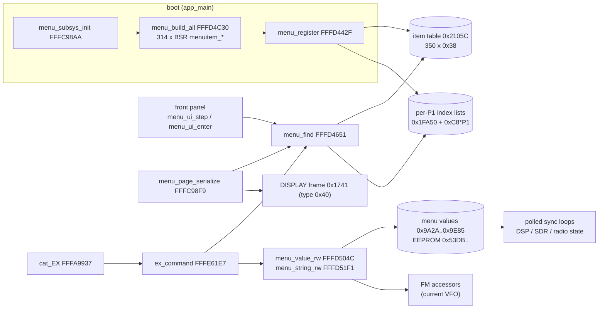
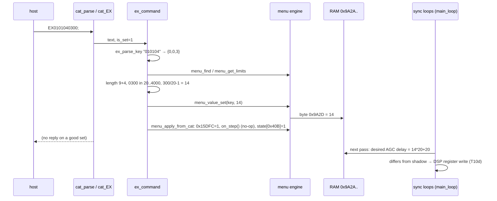
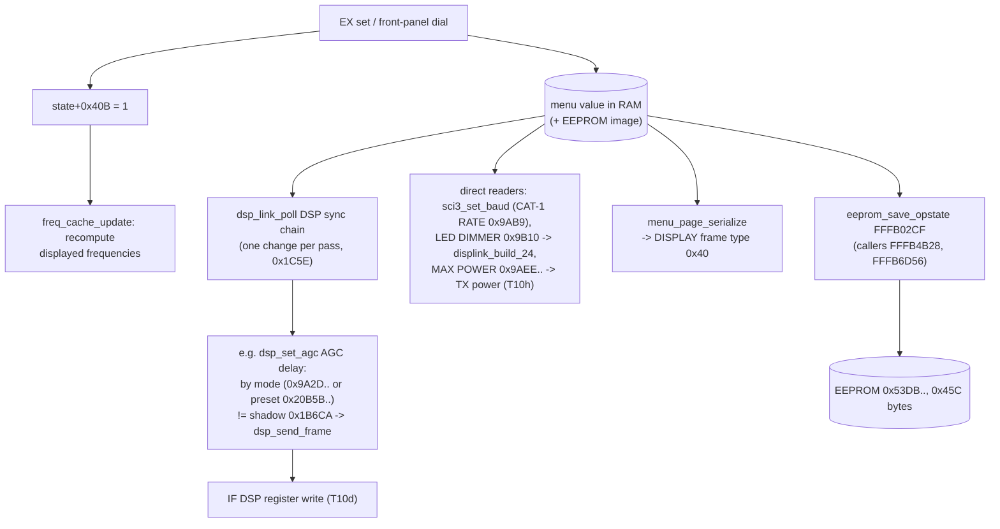

# MAIN — setup menu engine and the EX command

Back to the [MAIN overview](README.md).

Part of the MAIN code documentation (T10f). Related pages: [cat.md](cat.md) (CAT parser, which calls `cat_EX`), the
command reference [docs/cat-commands.md](../../cat-commands.md), and the DSP link page (T10d) for how DSP registers are
written. Function names are the names applied in Ghidra (`tools/ghidra/names_main.tsv`, merged by T17) and match `decomp/main/`; a name still in *italics* is a description that was not applied as a Ghidra name. All addresses are MAIN ROM/RAM addresses. Tags follow
AGENTS.md.

The tool `tools/main_menu_table.py` rebuilds the whole item table from the decoded image and diffs it against the CAT
manual (see [Tool](#tool)). All tables on this page come from its output.

## Summary

- **There is no ROM item table.** The menu is built at boot by `menu_build_all`. That function is a
  straight list of 314 `BSR` calls, one per item. Each callee (`menuitem_*`, 0xFFFD5373..0xFFFDCDxx, 109 or 110 bytes
  each) fills a 0x38-byte descriptor on its stack and passes it to `menu_register`. That function copies
  the descriptor into the RAM table at **0x2105C** (0x15E = 350 slots of 0x38 bytes). **[fact]**
- **Items:** 314 in the firmware. 296 of them are reachable by `EX`, which matches the 296 items in the manual's MENU
  chart one to one. The other 18 are the front-panel **EXTENSION SETTING** group (DATE&TIME, SD CARD, SOFT VERSION,
  CALIBRATION, RESET, CERTIFICATION). `EX` cannot reach them: CAT `P1 = 05` is rejected. **[fact]**
- **Numbering:** internally items are keyed by {P1 0..5, *global* P2 0..26, P3 0..}. EX `P1P1P2P2P3P3` is decimal and
  1-based, and EX P2 is local to its P1. CAT P1 `06` is internal P1 5 (PRESET), and CAT P1 `05` is internal P1 4,
  which is refused. **[fact]** `ex_parse_key` `ex_parse_key`.
- **Values** live in one RAM block at **0x9A2A..0x9E85** (0x45C bytes). It mirrors EEPROM **0x53DB..** (RAM = EEPROM +
  0x464F, the same mapping as the rest of the settings image) and is saved by `eeprom_save_opstate`.
  Defaults come from ROM **0xFFF80E4A..** as a linear copy. **[fact]**
- **Differences from the manual (2306-C):** SSB TX BPF SEL has two extra values (5 = "50-4000Hz", 6 = "TTBF"). EX
  refuses 5 but accepts 6. FM TONE FREQ answers 3 digits, not 2. CW WEIGHT is 00..20 on the wire, not 25..45. There
  are also manual typos (RTTY MARK/SHIFT codes), small name differences, and the P1 06 label. See
  [Manual diff](#diff-against-the-cat-manual-2306-c-table-2). **[fact]**
- **Propagation:** the menu engine only writes the RAM value. DSP, SDR and display state pick it up through polled
  "desired vs. shadow" sync loops in other subsystems (for example `dsp_link_poll` → `dsp_send_frame` for the IF DSP), and
  the DISPLAY sees the menu only as a rendered page. See [Propagation](#how-a-changed-value-propagates).
  **[fact]** for the paths shown; **[inference]** that this covers every item.

## Block diagram

## Item descriptor (0x38 bytes)

The three callbacks are only stored in the descriptors, so analysis did not make them functions. Since #74 the MAIN rebuild creates
all 626 distinct ones (`tools/main_menu_table.py --entries` → `tools/ghidra/entries_main_menu.tsv`) and names them
`menu_<item>_<role>` after the first item that uses them (`menu_ex010113_step`, `menu_m4_17_0_enter`); the shared bare `RTS`
callbacks are `menu_enter_nop` (296 items) and `menu_step_nop` (18 items) **[fact]**.

The descriptor is laid out by the `menuitem_*` functions and read through `menu_get_desc` (`menu_get_desc`, full copy),
`menu_get_limits` (`menu_get_limits`, bytes 0x28..0x37) and `menu_get_name`. **[fact]** for the layout.
Field meanings are **[fact]** where the consumer is cited.

| Off | Size | Field | Meaning / consumer |
|---|---|---|---|
| 0x00 | u8 | `valid` | Always 1. Lookups skip slots that are not 1 (`menu_find`) |
| 0x01 | u8 | `dest_mask` | 0 = all destinations. Otherwise it must AND with `menu_dest_mask()` (`menu_dest_mask`, which maps the destination code to 1/2/4/8/0x10/0x20). Only CERTIFICATION uses it (mask 2 = codes 0x315B, 0x50E2) |
| 0x02 | u8 | — | Always 0 |
| 0x03 | u8 | `p1` | 0..5: RADIO, CW, OPERATION, DISPLAY, EXTENSION, PRESET (titles at ROM 0xFFF83514, 6 × 20 chars) |
| 0x04 | u8 | `p2` | Global group 0..26 (titles at ROM 0xFFF8358C, 27 × 13 chars: MODE SSB … PRESET5) |
| 0x05 | u8 | `p3` | Row in the group, 0-based |
| 0x06 | char[21] | `name` | Space-padded, shown on the menu page |
| 0x1C | code* | `on_draw` | Formats the value for the DISPLAY menu page (`menu_call_draw` `menu_call_draw`). Unique per item. Most call `menu_draw_flags` `menu_draw_flags` plus a label table |
| 0x20 | code* | `on_step` | Called by `menu_call_step` `menu_call_step`: dial step from the front panel, **and** after an EX set, as an apply hook with 0x15DFC = 1 (see below). Most items wrap `menu_step_s8` `menu_step_s8` / `menu_step_u8` `menu_step_u8` (min, max, ptr) |
| 0x24 | code* | `on_enter` | `menu_call_enter` `menu_call_enter`. For 296 items this is a bare `RTS` at 0xFFFCDC78. Only the action items (SD card, calibration, reset, certification, PRESET NAME, MY CALL) have real handlers; the SD CARD ones start `sd_menu_task` ([README.md](README.md), task 13) |
| 0x28 | s16 | `min` | Raw (stored) minimum |
| 0x2A | s16 | `max` | Raw maximum |
| 0x2C | u8* | `store` | RAM address of the value (0 = no slot: an action, or a VFO accessor) |
| 0x30 | u8 | `is_string` | 1 = 12-char text (MY CALL, PRESET NAME). EX uses `ex_read_string` / `ex_write_string` |
| 0x31 | u8 | `is_word` | 1 = u16 stored **big-endian** (CONTEST NUMBER, RPT SHIFT(50MHz), DATA SHIFT) |
| 0x32 | u8 | `signed` | 1 = s8. EX adds a `+`/`-` sign character |
| 0x33 | u8 | `digits` | EX P4 digit count without the sign (1..4) |
| 0x34 | u8 | `scale` | EX value = raw (0), raw × 10 (1), raw × 20 + 20 (2, the AGC delays). A set divides back (`/10`, `/20 − 1`, integer) |
| 0x35 | u8 | `accessor` | 0 = direct `store`. 1/2/3 = FM RPT SHIFT / ENC/DEC / TONE FREQ through `menu_fm_*_get/set` (`menu_fm_rptshift_get` … `menu_fm_tone_set`), which read and write the current VFO (`vfo_rec_ptr`(1)` + 2) |

Other engine state **[fact]**:

| Address | Size | Meaning |
|---|---|---|
| 0x2105C | 350 × 0x38 | Item table |
| 0x1FA4E | u16 | Number of registered items (314) |
| 0x1FA50 + 0xC8 × P1 | 100 × u16 | Per-P1 list of table indices (P1 0..5; the bases are 0x1FA50/FB18/FBE0/FCA8/FD70/FE38) |
| 0x1B4F6..0x1B4FB | u8 × 6 | Per-P1 counts |
| 0x15DFC | u8 | 1 while an EX set runs the item's `on_step` hook, which tells the stepper not to step |
| state+0x41F / +0x420 / +0x421 | u8 | Current menu P1, local P2, step direction (state = `*(0x25D60)`, the 0x20B04 block) |
| state+0x40B (0x20F0F) | u8 | "Radio state changed" flag, set after every menu change. `freq_cache_update` consumes it and recomputes the displayed frequencies |

## Engine functions

| Address | Ghidra name | Inferred name | Purpose |
|---|---|---|---|
| 0xFFFC98AA | `menu_subsys_init` | `menu_subsys_init` | Called from `app_main`: `FUN_fffd405e` (UI state), then `menu_init` **[fact]** |
| 0xFFFD4FF1 | `menu_init` | `menu_init` | → `menu_build_all` **[fact]** |
| 0xFFFD4C30 | `menu_build_all` | `menu_build_all` | 314 `BSR menuitem_*` in order. Registration order = table index **[fact]** |
| 0xFFFD442F | `menu_register` | `menu_register` | Copies the descriptor, appends it to the per-P1 list, count++ (capped at 0x15F) **[fact]** |
| 0xFFFD4651 | `menu_find` | `menu_find` | Key {P1, P2, P3} → index. Scans the 100-entry P1 list, checks `valid` and `dest_mask`. Returns 0xFFFF if not found **[fact]** |
| 0xFFFD4795 | `menu_get_desc` | `menu_get_desc` | Key → 0x38-byte copy **[fact]** |
| 0xFFFD47EA | `menu_get_name` | `menu_get_name` | Key → 21-char name **[fact]** |
| 0xFFFD4FFE | `menu_get_limits` | `menu_get_limits` | Key → descriptor bytes 0x28..0x37 **[fact]** |
| 0xFFFD45A8 | `menu_group_visible` | `menu_group_visible` | (P1, P2) has at least one item for this destination **[fact]** |
| 0xFFFD4841 / 0xFFFD48D1 | `menu_count_items` / `menu_count_groups` | `menu_count_items` / `menu_count_groups` | Rows in a P2 group / groups in a P1 (destination-filtered) **[fact]** |
| 0xFFFD49F4 | `menu_p2_global` | `menu_p2_global` | (P1, local P2) → global P2, using the bases 0/5/7/12/16/22 **[fact]** |
| 0xFFFD52DF | `menu_p1_range` | `menu_p1_range` | P1 → first and last global P2 **[fact]** |
| 0xFFFD4ADA | `menu_cursor_of` | `menu_cursor_of` | Global P2 → pointer to that group's {top, row} cursor (27-case switch) **[fact]** |
| 0xFFFD4A4F | `menu_dest_mask` | `menu_dest_mask` | `dest_code_get()` → item mask bit **[fact]** |
| 0xFFFD49A0 / 0xFFFD49C0 / 0xFFFD49DA | `menu_call_draw` / `menu_call_step` / `menu_call_enter` | `menu_call_draw` / `menu_call_step` / `menu_call_enter` | Fetch the descriptor and `JSR` its +0x1C / +0x20 / +0x24 pointer **[fact]** (disassembly; the decompile loses the call) |
| 0xFFFD504C | `menu_value_rw` | `menu_value_rw` | (key, 0 = read / 1 = write, u16 *). Byte or big-endian word at `store`, or the FM accessors **[fact]** (disassembly; the decompile shows a bogus `uRam00000000 = 1`) |
| 0xFFFD51A3 / 0xFFFD51CA | `menu_value_get` / `menu_value_set` | `menu_value_get` / `menu_value_set` | Wrappers **[fact]** |
| 0xFFFD51F1, 0xFFFD528D, 0xFFFD52B6 | `menu_string_rw`, `menu_string_get`, `menu_string_set` | *menu_string_rw / get / set* | Text items. Set clears 12 bytes, then copies **[fact]** |
| 0xFFFCDE18 / 0xFFFCDFB8 | `menu_step_s8` / `menu_step_u8` | `menu_step_s8` / `menu_step_u8` | (min, max, ptr) ±1 by direction state+0x421. Returns at once when 0x15DFC = 1 **[fact]** for s8; u8 is **[inference]** |
| 0xFFFCDD7E | `menu_ui_step` | `menu_ui_step` | Front-panel dial on the selected row: timer 3000, flag 0x20F0F, `menu_call_step` **[fact]** |
| 0xFFFCDC1F | `menu_ui_enter` | `menu_ui_enter` | Runs the selected row's `on_enter` **[inference]** |
| 0xFFFC98F9 | `menu_page_serialize` | `menu_page_serialize` | Builds the menu page for the DISPLAY into the 0x1741 frame (type byte 0x40) at +0x98: P1 title (20 chars), up to 8 P2 tabs (13 chars each), then up to 5 rows of 45 bytes (name + `on_draw` output). Called by `displink_build_40` **[fact]**. The frame protocol is covered on the DISPLAY link page (T10b) |
| 0xFFFC9B83 | `menu_draw_flags` | `menu_draw_flags` | `on_draw` helper. Row flag byte: bit 7 when its argument is 0, bit 6 when the row is being edited (0x12271) **[fact]**; meaning of bit 7 **[inference]** |
| 0xFFFCE3EB … 0xFFFCE5F5 | `menu_fm_rptshift_get` … | *menu_fm_rptshift/encdec/tone_get/set* | VFO-backed FM items **[fact]** for the call; that the fields belong to the current VFO is **[inference]** |
| 0xFFFB1168 | `menu_defaults_load` | `menu_defaults_load` | Called from `settings_defaults`. Its callees fill 0x9A2A..0x9BC9 (below) **[fact]** |
| 0xFFFB02CF | `eeprom_save_opstate` | `eeprom_save_opstate` | `eeprom_write(0x53DB, 0x9A2A, 0x45C)` plus (0x1A62, 0x60B1, 0x18) **[fact]** |

### EX command functions

| Address | Ghidra name | Inferred name | Purpose |
|---|---|---|---|
| 0xFFFA9937 | `cat_EX` | — | Calls `ex_command(text, is_set, len, 0x1C8E, …)`. Sets error flag 0x464A from the result, and after a set calls `cat_ai_holdoff` when AI is on **[fact]** |
| 0xFFFE61E7 | `ex_command` | `ex_command` | `ex_parse_key` → `ex_read_or_write` → after a set `menu_apply_from_cat` → copies the reply from 0x18878 (length 0x1FF10) **[fact]** |
| 0xFFFE6C27 | `ex_parse_key` | `ex_parse_key` | Requires 6 decimal digits. P1 internal = P1 − 1. P2 internal = P2 + {−1, +4, +6, +11, —, +21}[P1 − 1]. P3 internal = P3 − 1. **P1 05 and P1 > 06 return 0 (`?;`)** **[fact]** |
| 0xFFFE6299 | `ex_read_or_write` | `ex_read_or_write` | String or numeric, read or set **[fact]** |
| 0xFFFE646C / 0xFFFE6550 | `ex_read_value` / `ex_write_value` | `ex_read_value` / `ex_write_value` | Format or parse P4 using `digits`, `signed`, `is_word` and `scale`. The total length must be exactly 9 + digits (+1 with a sign), and the value must lie within [min, max] scaled. Otherwise `?;` **[fact]** |
| 0xFFFE6335 / 0xFFFE63FB | `ex_read_string` / `ex_write_string` | `ex_read_string` / `ex_write_string` | 12-char items **[fact]** |
| 0xFFFE668A | `ex_value_allowed` | `ex_value_allowed` | Refuses key {0,0,12} (EX010113, SSB TX BPF SEL) with value 5 **[fact]** |
| 0xFFFE66E2, 0xFFFE67F5, 0xFFFE6869, 0xFFFE693B | … | *ex_fmt_byte, ex_fmt_4digits, ex_parse_4digits, ex_parse_byte* | Decimal format and parse helpers **[fact]** |
| 0xFFFCDDDB | `menu_apply_from_cat` | `menu_apply_from_cat` | `0x15DFC = 1; menu_call_step(key); 0x15DFC = 0; state[0x40B] = 1` **[fact]** |

## EX set: control flow

(T19h: the set example used to read `EX010104300;`, a 3-digit value that the length check 9 + 4 would reject; the item has 4 digits.)
A read (`EX010104;`) takes the same path up to `menu_get_limits` and answers `EX010104` + `0300;`. **[fact]** The read
reply format and the exact-length check are in `ex_read_value` and `ex_write_value`.

## How a changed value propagates

The menu engine does not send anything itself. **[fact]** For an EX set, the only side effects are the RAM write, the
item's `on_step` hook run with 0x15DFC = 1, and the state+0x40B flag. Almost every hook is a thin wrapper around
`menu_step_s8` or `menu_step_u8`, and those return at once when 0x15DFC = 1. The consumers poll the RAM block:

- **IF DSP.** `dsp_link_poll` runs a chain of per-parameter functions (`dsp_set_contour_level` CONTOUR LEVEL 0x9AD5,
  `dsp_set_lcut` LCUT 0x9A30.., `dsp_set_agc` AGC delays 0x9A2D.., …). Each one picks the value for the current mode
  from the menu block, or from the preset copy at 0x20B5B.. when 0x9DC6 (preset active) is set. It converts the value
  (for example ×20 + 20 ms) and compares it with a shadow (for example 0x1B6CA). If they differ, it queues one register
  write through `dsp_send_frame`. **[fact]** for the functions read. The register map is T10d's subject.
- **SDR (FPGA).** No menu item writes the SDR directly. The SDR gets RX/TX parameters from the radio-control code
  (T10c/T10g). **[inference]**
- **DISPLAY.** The DISPLAY CPU draws the menu from the page built by `menu_page_serialize`. Settings that the DISPLAY
  itself needs (LED DIMMER, colours, scope settings) are read from the menu block by display-link code, for example
  `FUN_fff970b8` and `displink_build_24` reading 0x9B10. **[fact]** for those reads; the full set is T10b's subject.
- **Other.** `sci3_set_baud` reads CAT-1 RATE (0x9AB9), and `cat_PC` reads the MAX POWER bytes (0x9AEE..0x9AF1).
  **[fact]**
- **Persistence.** A menu change does not write the EEPROM immediately. `eeprom_save_opstate` is called from
  `supply_undervolt_check` and `io_task` (likely the power-off and periodic save paths, T10e) **[inference]**.

## Defaults

`settings_defaults` → `menu_defaults_load` → **[fact]**:

| Function | RAM range | Source | Notes |
|---|---|---|---|
| `menu_defaults_mode` `menu_defaults_mode` | 0x9A2A..0x9A90 | ROM 0xFFF80E4A.. | 5 mode groups (copied in 6 chunks) |
| `menu_defaults_cw` `menu_defaults_cw` | 0x9A91..0x9AB4 | ROM 0xFFF80EB1 | |
| `menu_defaults_operation` `menu_defaults_operation` | 0x9AB5..0x9B00 | ROM 0xFFF80ED5 | Then destination-dependent: HF/50M/70M/AM MAX POWER = `max_power_limit(0..4)` (0xFFFB3E6F). KEYBOARD LANGUAGE (0x9AC7) = 0 (JAPANESE) for 0x4380/0x60E6/0x020B, 1 (ENGLISH US) for 0x1CB9/0x306F/0x315B/0x50E2/0x7753/0x9CF7/0xD32D, 2 (ENGLISH UK) + TX TOT 10 min for 0xD950/0xA4C5, else 5 (GERMAN) + TX TOT 10 min |
| `menu_defaults_display` `menu_defaults_display` | 0x9B01..0x9B23 | ROM 0xFFF80F21 | MY CALL default "FT-710" |
| `FUN_fffb1303` | 0x9B24..0x9B2D | ROM 0xFFF80F44 | Unused bytes after EXT MONITOR |
| `menu_defaults_presets` `menu_defaults_presets` | 0x9B2E + 0x1F × n | ROM 0xFFF80F4E (×5) | Names "FT-8", "PRESET2".."PRESET5" patched in |

0x9A2A..0x9BC9 is therefore one linear image of ROM 0xFFF80E4A..0xFFF80FE9, apart from the overrides. The tool prints
these ROM defaults. Each P2 group ends with 2 bytes that hold the group's `{top, row}` menu cursor (saved at power-off, see [eeprom.md](eeprom.md#menu-block-0x9a2a0x9c34-eeprom-0x53db0x55e5-fact-73), #73), and 0x9AF2 (between AM MAX POWER and VOX SELECT) is a single
unused byte, maybe a removed item **[guess]**. No code references 0x9AF2 directly. **[fact]**

## Diff against the CAT manual (2306-C, Table 2)

`python3 -I tools/main_menu_table.py --diff manual.txt`, with `manual.txt` = `pdftotext -layout -f 10 -l 13`. The
tool lines up the 21 EX-reachable P2 groups of the firmware with the chart (the chart prints the PRESET table once for
P2 01..05). Every chart row matches a firmware item at the same P1/P2/P3. **No item is missing on either side** except
the 18 EXTENSION SETTING items, which have no EX key. After removing false positives from multi-line chart cells (NAR
WIDTH and MIC P1..DOWN code lists), the real differences are:

| EX key | Item | Firmware | Manual | Tag |
|---|---|---|---|---|
| `010113` | MODE SSB / TX BPF SEL | Range **0..6**. Labels at ROM 0xFFF83716: 50-3050, 100-2900, 200-2800, 300-2700, 400-2600, **50-4000Hz**, **TTBF**. `ex_value_allowed` refuses 5, so **`EX0101136;` (TTBF) is accepted on every destination**. On the front panel, `on_step` (0xFFFCE013) skips 5 and allows 6 only for destinations 0x315B/0x50E2/0x1CB9 with the hidden flag 0x4760 set; otherwise it clamps to 4. 0x4760 is toggled by a power-on option in `displink_rx_F0_hello` (case 5), which also resets the value to 1 when it is turned off | 0..4 | **[fact]** (code). **TTBF** selects the widest TX voice bandpass (#74): the value goes to DSP register 0x2F as value + 1 (`dsp_set_tx_bpf`), and the HiFi4 (`FUN_002221D0`) runs biquad set 0x236C50[reg − 1], so 0..6 → sets 0..6 and TTBF → 0x237150, about **23–4137 Hz** (−3 dB at 12 kHz; reg 0 would bypass the filter) **[fact]** ([ifdsp/hifi4.md](../ifdsp/hifi4.md)). 0x4760 is toggled by power-on combination 5 (MODE + NB, #75) |
| `010321` | MODE FM / TONE FREQ | 3 digits (`digits` = 3) | 2 digits | **[fact]** |
| `020203` | KEYER / CW WEIGHT | EX P4 = 00..20 (raw, no scale) | "2.5 - 4.5 (P4 = 25 - 45)" | **[fact]** for the wire format. `EX02020325;` would be out of range. The panel shows `(raw + 25) / 10` `.` `(raw + 25) % 10` (`menu_ex020203_draw`), so 2.5..4.5; row flag bit 7 marks the default raw 5 (3.0) **[fact]** (#74) |
| `010515` | MODE RTTY / MARK FREQUENCY | 0..1 | "1: 1275 Hz 2: 2125 Hz" | **[fact]**, manual typo |
| `010516` | MODE RTTY / SHIFT FREQUENCY | 0..3 | "1: 170 1: 200 2: 425 3: 850" | **[fact]**, manual typo |
| `010106` | AGC SLOW DELAY (SSB) | Name "AGC SLOW DELY" | AGC SLOW DELAY | **[fact]**, cosmetic |
| `030118` | REF FREQ ADJ | "REF FREQ FINE ADJ" | REF FREQ ADJ | **[fact]**, cosmetic |
| `030407` | TX INHIBIT | "TX INHITBIT" | TX INHIBIT | **[fact]**, cosmetic |
| `040105` | DIMMER LED | "LED DIMMER" | DIMMER LED | **[fact]**, cosmetic |
| `06xxxx` | P1 06 label | Group title "PRESET". "EXTENSION SETTING" is internal P1 4 | "EXTENSION SETTING" | **[fact]** |
| `05xxxx` | P1 05 | Exists (EXTENSION SETTING, 18 items) but is refused by EX | Not listed ("P1: 01 - 04, 05" is a typo for 06) | **[fact]** |

All other ranges, scalings (AGC 20..4000 step 20, RPT SHIFT ×10 kHz, DATA SHIFT ×10 Hz) and digit counts agree.
**[fact]**

### Items not reachable by EX (internal P1 4, front panel "EXTENSION SETTING")

| P1.P2.P3 | Group / item | `on_enter` | Note |
|---|---|---|---|
| 4.16.0..4 | DATE&TIME: DAY, MONTH, YEAR, HOUR, MINUTE | RTS | No `store`. The clock is edited by the display-side page and set by `DT` over CAT **[inference]** |
| 4.17.0 | SD CARD / MEM LIST LOAD | 0xFFFCF44F | Action |
| 4.17.1 | SD CARD / MEM LIST SAVE | 0xFFFCF780 | Action |
| 4.17.2 | SD CARD / MENU LOAD | 0xFFFCF830 | Action |
| 4.17.3 | SD CARD / MENU SAVE | 0xFFFCF857 | Action |
| 4.17.4 | SD CARD / INFORMATIONS | 0xFFFCF87E | Action |
| 4.17.5 | SD CARD / FIRMWARE UPDATE | 0xFFFCF921 | Action (starts the SD update, see T13 docs) |
| 4.17.6 | SD CARD / FORMAT | 0xFFFCF944 | Action |
| 4.18.0 | SOFT VERSION / SOFTVERSION | RTS | Display only |
| 4.19.0 | CALIBRATION / CALIBRATION | 0xFFFCF9E7 | Action (touch-panel calibration? **[guess]**) |
| 4.20.0..2 | RESET: MEMORY CLEAR, MENU CLEAR, ALL RESET | 0xFFFCFA17 / 0xFFFCFA74 / 0xFFFCFA83 | Action |
| 4.21.0 | CERTIFICATION / CERTIFICATION | 0xFFFD3CD5 | **`dest_mask` 2**: only for destination codes 0x315B and 0x50E2 (the only destination-restricted item). The tested radio is 0x50E2, so it should show this item **[inference]** |

All of these are visible on the front panel in the standard operating manual, so none of them is a "secret" menu. The
only hidden content found is the extra SSB TX BPF values above. **[inference]** No other service or hidden items are
registered. All 314 `menuitem_*` calls are listed by the tool. **[fact]**

## Non-trivial steppers (#74) **[fact]**

The `on_step` callbacks get the direction from UI-state +0x421 (0 = up) and do nothing while 0x15DFC = 1 (the EX apply hook).

| Item | Stepper | Behaviour |
|---|---|---|
| LCUT FREQ (all modes) | `menu_step_lcut_freq` 0xFFFCDECF (T23e) | 0 = OFF, 1..19; clamps at both ends, no wrap |
| HCUT FREQ (all modes) | `menu_step_hcut_freq` 0xFFFCDF37 (T23e) | 1..67, then 0 = OFF **above** the top: down from OFF goes to 67, up from 67 goes to OFF, up from OFF stays OFF, down stops at 1 |
| CAT-1/2/3 RATE | `menu_step_u8(0, 4)` then `sci3_set_baud` (CAT-1) | the new baud rate applies at once |
| KEYBOARD LANGUAGE | `menu_step_u8(0, 10)` | on a change it also stores the value at 0x1B4FE, starts timer 0x2B (100) and sets +0x401, which sends the layout to the DISPLAY |
| HF / 50M / 70M / AM MAX POWER | `menu_step_u8(5, max_power_limit(0..3))` (`max_power_limit` 0xFFFB3E6F, T23e) | the upper limit is the destination-dependent maximum that also sets the default |
| TX BPF SEL | `menu_ex010113_step` 0xFFFCE013 | skips 5; 6 (TTBF) only with 0x4760 set on destinations 0x315B/0x50E2/0x1CB9 (see the EX table above) |
| SCREEN SAVER | `menu_ex040104_step` 0xFFFCF123: `menu_step_u8(0, 3)` | then `screensaver_timer_restart` 0xFFFB263D (named `cat_apo_reset` in the committed decompile until the next re-export), so the new time applies at once: 0 = OFF, 1/2/3 = 15/30/60 min ([README.md](README.md#screen-saver-timer-slow-timer-0), #208) |

## Tool

`tools/main_menu_table.py` (stdlib, run with `python3 -I`):

- `python3 -I tools/main_menu_table.py --image build/FT-710_MAIN_V0112.bin [--format tsv|md]` prints the 314 items:
  index, internal key, EX key, group titles, name, raw min/max, ROM default, EX range and digits, kind, RAM and EEPROM
  address, `dest_mask`, the three callbacks and the item function.
- `--diff manual.txt` prints the per-row comparison and the list of non-EX items.
- How it works: it walks the BSR list of `menu_build_all` and runs a tiny RX interpreter over each `menuitem_*` (ADD,
  MOV #imm to dsp[R], MOV.L #imm, SMOVF, MOV.L Rs to dsp5[R]) until the `BSR menu_register`. It then decodes the
  0x38-byte descriptor. It stops with an error on any unexpected opcode, so a firmware with a different layout fails
  loudly instead of giving wrong rows.
- Its output is derived from firmware bytes. Keep it in `build/` and do not commit it. The tables below are the derived
  summary.

## Full item list (EX-reachable, 296 items)

Columns: EX key, P2 group title (from the firmware), name (as in the firmware), **EX P4 range** (scaled the way EX sends
it), EX digit count including the sign, **default** (ROM default in EX units; "dest" = depends on the destination
code), RAM address (EEPROM = RAM − 0x464F). Notes mark differences from the manual. **[fact]** for every row (tool
output).

#### EX 01 — RADIO SETTING

| EX key | Group | Name | EX P4 range | Digits | Default | RAM | Note |
|---|---|---|---|---|---|---|---|
| `010101` | MODE SSB | AF TREBLE GAIN | -20..10 | 3 | 0 | 0x9a2a |  |
| `010102` | MODE SSB | AF MIDDLE TONE GAIN | -20..10 | 3 | 0 | 0x9a2b |  |
| `010103` | MODE SSB | AF BASS GAIN | -20..10 | 3 | 0 | 0x9a2c |  |
| `010104` | MODE SSB | AGC FAST DELAY | 20..4000 | 4 | 300 | 0x9a2d |  |
| `010105` | MODE SSB | AGC MID DELAY | 20..4000 | 4 | 1000 | 0x9a2e |  |
| `010106` | MODE SSB | AGC SLOW DELY | 20..4000 | 4 | 3000 | 0x9a2f | firmware spells it "AGC SLOW DELY" |
| `010107` | MODE SSB | LCUT FREQ | 0..19 | 2 | 1 | 0x9a30 |  |
| `010108` | MODE SSB | LCUT SLOPE | 0..1 | 1 | 0 | 0x9a31 |  |
| `010109` | MODE SSB | HCUT FREQ | 0..67 | 2 | 47 | 0x9a32 |  |
| `010110` | MODE SSB | HCUT SLOPE | 0..1 | 1 | 0 | 0x9a33 |  |
| `010111` | MODE SSB | USB OUT LEVEL | 0..100 | 3 | 50 | 0x9a34 |  |
| `010112` | MODE SSB | REAR OUT LEVEL | 0..100 | 3 | 50 | 0x9a35 |  |
| `010113` | MODE SSB | TX BPF SEL | 0..6 | 1 | 1 | 0x9a36 | **0..6 in firmware** (5 = 50-4000Hz, 6 = TTBF); manual 0..4. EX rejects 5, accepts 6 |
| `010114` | MODE SSB | MOD SOURCE | 0..3 | 1 | 3 | 0x9a37 |  |
| `010115` | MODE SSB | USB MOD GAIN | 0..100 | 3 | 50 | 0x9a38 |  |
| `010116` | MODE SSB | REAR MOD GAIN | 0..100 | 3 | 50 | 0x9a39 |  |
| `010117` | MODE SSB | RPTT SELECT | 0..3 | 1 | 0 | 0x9a3a |  |
| `010118` | MODE SSB | NAR WIDTH | 0..22 | 2 | 6 | 0x9a3b |  |
| `010119` | MODE SSB | CW AUTO MODE | 0..2 | 1 | 0 | 0x9a3c |  |
| `010201` | MODE AM | AF TREBLE GAIN | -20..10 | 3 | 0 | 0x9a3f |  |
| `010202` | MODE AM | AF MIDDLE TONE GAIN | -20..10 | 3 | 0 | 0x9a40 |  |
| `010203` | MODE AM | AF BASS GAIN | -20..10 | 3 | 0 | 0x9a41 |  |
| `010204` | MODE AM | AGC FAST DELAY | 20..4000 | 4 | 1000 | 0x9a42 |  |
| `010205` | MODE AM | AGC MID DELAY | 20..4000 | 4 | 2000 | 0x9a43 |  |
| `010206` | MODE AM | AGC SLOW DELAY | 20..4000 | 4 | 4000 | 0x9a44 |  |
| `010207` | MODE AM | LCUT FREQ | 0..19 | 2 | 0 | 0x9a45 |  |
| `010208` | MODE AM | LCUT SLOPE | 0..1 | 1 | 0 | 0x9a46 |  |
| `010209` | MODE AM | HCUT FREQ | 0..67 | 2 | 0 | 0x9a47 |  |
| `010210` | MODE AM | HCUT SLOPE | 0..1 | 1 | 0 | 0x9a48 |  |
| `010211` | MODE AM | USB OUT LEVEL | 0..100 | 3 | 50 | 0x9a49 |  |
| `010212` | MODE AM | REAR OUT LEVEL | 0..100 | 3 | 50 | 0x9a4a |  |
| `010213` | MODE AM | TX BPF SEL | 0..4 | 1 | 0 | 0x9a4b |  |
| `010214` | MODE AM | MOD SOURCE | 0..3 | 1 | 3 | 0x9a4c |  |
| `010215` | MODE AM | USB MOD GAIN | 0..100 | 3 | 50 | 0x9a4d |  |
| `010216` | MODE AM | REAR MOD GAIN | 0..100 | 3 | 50 | 0x9a4e |  |
| `010217` | MODE AM | RPTT SELECT | 0..3 | 1 | 0 | 0x9a4f |  |
| `010301` | MODE FM | AF TREBLE GAIN | -20..10 | 3 | 0 | 0x9a52 |  |
| `010302` | MODE FM | AF MIDDLE TONE GAIN | -20..10 | 3 | 0 | 0x9a53 |  |
| `010303` | MODE FM | AF BASS GAIN | -20..10 | 3 | 0 | 0x9a54 |  |
| `010304` | MODE FM | AGC FAST DELAY | 20..4000 | 4 | 160 | 0x9a55 |  |
| `010305` | MODE FM | AGC MID DELAY | 20..4000 | 4 | 500 | 0x9a56 |  |
| `010306` | MODE FM | AGC SLOW DELAY | 20..4000 | 4 | 1500 | 0x9a57 |  |
| `010307` | MODE FM | LCUT FREQ | 0..19 | 2 | 5 | 0x9a58 |  |
| `010308` | MODE FM | LCUT SLOPE | 0..1 | 1 | 1 | 0x9a59 |  |
| `010309` | MODE FM | HCUT FREQ | 0..67 | 2 | 47 | 0x9a5a |  |
| `010310` | MODE FM | HCUT SLOPE | 0..1 | 1 | 1 | 0x9a5b |  |
| `010311` | MODE FM | USB OUT LEVEL | 0..100 | 3 | 50 | 0x9a5c |  |
| `010312` | MODE FM | REAR OUT LEVEL | 0..100 | 3 | 50 | 0x9a5d |  |
| `010313` | MODE FM | MOD SOURCE | 0..3 | 1 | 3 | 0x9a5e |  |
| `010314` | MODE FM | USB MOD GAIN | 0..100 | 3 | 50 | 0x9a5f |  |
| `010315` | MODE FM | REAR MOD GAIN | 0..100 | 3 | 50 | 0x9a60 |  |
| `010316` | MODE FM | RPTT SELECT | 0..3 | 1 | 0 | 0x9a61 |  |
| `010317` | MODE FM | RPT SHIFT | 0..2 | 1 | - | - | no RAM slot: current VFO (`menu_fm_rptshift_get/set`) |
| `010318` | MODE FM | RPT SHIFT(28MHz) | 0..1000 | 4 | 100 | 0x9a62 |  |
| `010319` | MODE FM | RPT SHIFT(50MHz) | 0..4000 | 4 | 500 | 0x9a63 |  |
| `010320` | MODE FM | ENC/DEC | 0..2 | 1 | - | - | no RAM slot: current VFO (`menu_fm_encdec_get/set`) |
| `010321` | MODE FM | TONE FREQ | 0..49 | 3 | - | - | no RAM slot: current VFO; **3 digits** (manual: 2) |
| `010401` | MODE PSK/DATA | AF TREBLE GAIN | -20..10 | 3 | 0 | 0x9a67 |  |
| `010402` | MODE PSK/DATA | AF MIDDLE TONE GAIN | -20..10 | 3 | 0 | 0x9a68 |  |
| `010403` | MODE PSK/DATA | AF BASS GAIN | -20..10 | 3 | 0 | 0x9a69 |  |
| `010404` | MODE PSK/DATA | AGC FAST DELAY | 20..4000 | 4 | 160 | 0x9a6a |  |
| `010405` | MODE PSK/DATA | AGC MID DELAY | 20..4000 | 4 | 500 | 0x9a6b |  |
| `010406` | MODE PSK/DATA | AGC SLOW DELAY | 20..4000 | 4 | 1500 | 0x9a6c |  |
| `010407` | MODE PSK/DATA | LCUT FREQ | 0..19 | 2 | 1 | 0x9a6d |  |
| `010408` | MODE PSK/DATA | LCUT SLOPE | 0..1 | 1 | 1 | 0x9a6e |  |
| `010409` | MODE PSK/DATA | HCUT FREQ | 0..67 | 2 | 51 | 0x9a6f |  |
| `010410` | MODE PSK/DATA | HCUT SLOPE | 0..1 | 1 | 1 | 0x9a70 |  |
| `010411` | MODE PSK/DATA | USB OUT LEVEL | 0..100 | 3 | 50 | 0x9a71 |  |
| `010412` | MODE PSK/DATA | REAR OUT LEVEL | 0..100 | 3 | 50 | 0x9a72 |  |
| `010413` | MODE PSK/DATA | TX BPF SEL | 0..4 | 1 | 0 | 0x9a73 |  |
| `010414` | MODE PSK/DATA | MOD SOURCE | 0..3 | 1 | 3 | 0x9a74 |  |
| `010415` | MODE PSK/DATA | USB MOD GAIN | 0..100 | 3 | 50 | 0x9a75 |  |
| `010416` | MODE PSK/DATA | REAR MOD GAIN | 0..100 | 3 | 50 | 0x9a76 |  |
| `010417` | MODE PSK/DATA | RPTT SELECT | 0..3 | 1 | 0 | 0x9a77 |  |
| `010418` | MODE PSK/DATA | NAR WIDTH | 0..20 | 2 | 5 | 0x9a78 |  |
| `010419` | MODE PSK/DATA | PSK TONE | 0..2 | 1 | 0 | 0x9a79 |  |
| `010420` | MODE PSK/DATA | DATA SHIFT (SSB) | 0..3000 | 4 | 1500 | 0x9a7a |  |
| `010501` | MODE RTTY | AF TREBLE GAIN | -20..10 | 3 | 0 | 0x9a7e |  |
| `010502` | MODE RTTY | AF MIDDLE TONE GAIN | -20..10 | 3 | 0 | 0x9a7f |  |
| `010503` | MODE RTTY | AF BASS GAIN | -20..10 | 3 | 0 | 0x9a80 |  |
| `010504` | MODE RTTY | AGC FAST DELAY | 20..4000 | 4 | 160 | 0x9a81 |  |
| `010505` | MODE RTTY | AGC MID DELAY | 20..4000 | 4 | 500 | 0x9a82 |  |
| `010506` | MODE RTTY | AGC SLOW DELAY | 20..4000 | 4 | 1500 | 0x9a83 |  |
| `010507` | MODE RTTY | LCUT FREQ | 0..19 | 2 | 5 | 0x9a84 |  |
| `010508` | MODE RTTY | LCUT SLOPE | 0..1 | 1 | 1 | 0x9a85 |  |
| `010509` | MODE RTTY | HCUT FREQ | 0..67 | 2 | 47 | 0x9a86 |  |
| `010510` | MODE RTTY | HCUT SLOPE | 0..1 | 1 | 1 | 0x9a87 |  |
| `010511` | MODE RTTY | USB OUT LEVEL | 0..100 | 3 | 50 | 0x9a88 |  |
| `010512` | MODE RTTY | REAR OUT LEVEL | 0..100 | 3 | 50 | 0x9a89 |  |
| `010513` | MODE RTTY | RPTT SELECT | 0..3 | 1 | 0 | 0x9a8a |  |
| `010514` | MODE RTTY | NAR WIDTH | 0..20 | 2 | 5 | 0x9a8b |  |
| `010515` | MODE RTTY | MARK FREQUENCY | 0..1 | 1 | 1 | 0x9a8c | manual says "1: 1275 2: 2125"; firmware 0..1 |
| `010516` | MODE RTTY | SHIFT FREQUENCY | 0..3 | 1 | 0 | 0x9a8d | manual says "1: 170 1: 200 ..."; firmware 0..3 |
| `010517` | MODE RTTY | POLARITY TX | 0..1 | 1 | 0 | 0x9a8e |  |

#### EX 02 — CW SETTING

| EX key | Group | Name | EX P4 range | Digits | Default | RAM | Note |
|---|---|---|---|---|---|---|---|
| `020101` | MODE CW | AF TREBLE GAIN | -20..10 | 3 | 0 | 0x9a91 |  |
| `020102` | MODE CW | AF MIDDLE TONE GAIN | -20..10 | 3 | 0 | 0x9a92 |  |
| `020103` | MODE CW | AF BASS GAIN | -20..10 | 3 | 0 | 0x9a93 |  |
| `020104` | MODE CW | AGC FAST DELAY | 20..4000 | 4 | 160 | 0x9a94 |  |
| `020105` | MODE CW | AGC MID DELAY | 20..4000 | 4 | 500 | 0x9a95 |  |
| `020106` | MODE CW | AGC SLOW DELAY | 20..4000 | 4 | 1500 | 0x9a96 |  |
| `020107` | MODE CW | LCUT FREQ | 0..19 | 2 | 4 | 0x9a97 |  |
| `020108` | MODE CW | LCUT SLOPE | 0..1 | 1 | 1 | 0x9a98 |  |
| `020109` | MODE CW | HCUT FREQ | 0..67 | 2 | 11 | 0x9a99 |  |
| `020110` | MODE CW | HCUT SLOPE | 0..1 | 1 | 1 | 0x9a9a |  |
| `020111` | MODE CW | USB OUT LEVEL | 0..100 | 3 | 50 | 0x9a9b |  |
| `020112` | MODE CW | REAR OUT LEVEL | 0..100 | 3 | 50 | 0x9a9c |  |
| `020113` | MODE CW | RPTT SELECT | 0..3 | 1 | 0 | 0x9a9d |  |
| `020114` | MODE CW | NAR WIDTH | 0..20 | 2 | 4 | 0x9a9e |  |
| `020115` | MODE CW | PC KEYING | 0..3 | 1 | 0 | 0x9a9f |  |
| `020116` | MODE CW | CW BK-IN TYPE | 0..1 | 1 | 0 | 0x9aa0 |  |
| `020117` | MODE CW | CW WAVE SHAPE | 0..2 | 1 | 2 | 0x9aa1 |  |
| `020118` | MODE CW | CW FREQ DISPLAY | 0..1 | 1 | 1 | 0x9aa2 |  |
| `020119` | MODE CW | QSK DELAY TIME | 0..3 | 1 | 0 | 0x9aa3 |  |
| `020120` | MODE CW | CW INDICATOR | 0..1 | 1 | 1 | 0x9aa4 |  |
| `020201` | KEYER | KEYER TYPE | 0..5 | 1 | 3 | 0x9aa7 |  |
| `020202` | KEYER | KEYER DOT/DASH | 0..1 | 1 | 0 | 0x9aa8 |  |
| `020203` | KEYER | CW WEIGHT | 0..20 | 2 | 5 | 0x9aa9 | **EX P4 = 00..20** (front panel 2.5..4.5); manual P4 = 25..45 |
| `020204` | KEYER | NUMBER STYLE | 0..6 | 1 | 0 | 0x9aaa |  |
| `020205` | KEYER | CONTEST NUMBER | 1..9999 | 4 | 1 | 0x9aab |  |
| `020206` | KEYER | CW MEMORY 1 | 0..1 | 1 | 0 | 0x9aad |  |
| `020207` | KEYER | CW MEMORY 2 | 0..1 | 1 | 0 | 0x9aae |  |
| `020208` | KEYER | CW MEMORY 3 | 0..1 | 1 | 0 | 0x9aaf |  |
| `020209` | KEYER | CW MEMORY 4 | 0..1 | 1 | 0 | 0x9ab0 |  |
| `020210` | KEYER | CW MEMORY 5 | 0..1 | 1 | 0 | 0x9ab1 |  |
| `020211` | KEYER | REPEAT INTERVAL | 1..60 | 2 | 5 | 0x9ab2 |  |

#### EX 03 — OPERATION SETTING

| EX key | Group | Name | EX P4 range | Digits | Default | RAM | Note |
|---|---|---|---|---|---|---|---|
| `030101` | GENERAL | BEEP LEVEL | 0..100 | 3 | 20 | 0x9ab5 |  |
| `030102` | GENERAL | RF/SQL VR | 0..2 | 1 | 0 | 0x9ab6 |  |
| `030103` | GENERAL | TUN/LIN PORT SELECT | 0..3 | 1 | 0 | 0x9ab7 |  |
| `030104` | GENERAL | TUNER TYPE SELECT | 0..3 | 1 | 0 | 0x9ab8 |  |
| `030105` | GENERAL | CAT-1 RATE | 0..4 | 1 | 3 | 0x9ab9 |  |
| `030106` | GENERAL | CAT-1 TIME OUT TIMER | 0..3 | 1 | 0 | 0x9aba |  |
| `030107` | GENERAL | CAT-1 CAT-3 STOP BIT | 0..1 | 1 | 0 | 0x9abb |  |
| `030108` | GENERAL | CAT-2 RATE | 0..4 | 1 | 0 | 0x9abc |  |
| `030109` | GENERAL | CAT-2 TIME OUT TIMER | 0..3 | 1 | 0 | 0x9abd |  |
| `030110` | GENERAL | CAT-3 RATE | 0..4 | 1 | 3 | 0x9abe |  |
| `030111` | GENERAL | CAT-3 TIME OUT TIMER | 0..3 | 1 | 0 | 0x9abf |  |
| `030112` | GENERAL | QMB CH | 0..1 | 1 | 0 | 0x9ac0 |  |
| `030113` | GENERAL | BAND STACK | 0..1 | 1 | 1 | 0x9ac1 |  |
| `030114` | GENERAL | MEM GROUP | 0..1 | 1 | 0 | 0x9ac2 |  |
| `030115` | GENERAL | TX TIME OUT TIMER | 0..30 | 2 | dest | 0x9ac3 | default depends on destination |
| `030116` | GENERAL | MIC SCAN | 0..1 | 1 | 1 | 0x9ac4 |  |
| `030117` | GENERAL | MIC SCAN RESUME | 0..1 | 1 | 1 | 0x9ac5 |  |
| `030118` | GENERAL | REF FREQ FINE ADJ | -25..25 | 3 | 0 | 0x9ac6 | firmware name "REF FREQ FINE ADJ" |
| `030119` | GENERAL | KEYBOARD LANGUAGE | 0..10 | 2 | dest | 0x9ac7 | default depends on destination |
| `030120` | GENERAL | MIC P1 | 0..20 | 2 | 0 | 0x9ac8 |  |
| `030121` | GENERAL | MIC P2 | 0..20 | 2 | 1 | 0x9ac9 |  |
| `030122` | GENERAL | MIC P3 | 0..20 | 2 | 2 | 0x9aca |  |
| `030123` | GENERAL | MIC P4 | 0..20 | 2 | 3 | 0x9acb |  |
| `030124` | GENERAL | MIC UP | 0..20 | 2 | 13 | 0x9acc |  |
| `030125` | GENERAL | MIC DOWN | 0..20 | 2 | 14 | 0x9acd |  |
| `030126` | GENERAL | SCU-LAN10 | 0..1 | 1 | 0 | 0x9ace |  |
| `030201` | RX DSP | IF NOTCH WIDTH | 0..1 | 1 | 1 | 0x9ad1 |  |
| `030202` | RX DSP | NB REJECTION | 0..2 | 1 | 1 | 0x9ad2 |  |
| `030203` | RX DSP | NB WIDTH | 0..2 | 1 | 1 | 0x9ad3 |  |
| `030204` | RX DSP | APF WIDTH | 0..2 | 1 | 1 | 0x9ad4 |  |
| `030205` | RX DSP | CONTOUR LEVEL | -40..20 | 3 | -15 | 0x9ad5 |  |
| `030206` | RX DSP | CONTOUR WIDTH | 1..11 | 2 | 10 | 0x9ad6 |  |
| `030301` | TX AUDIO | AMC RELEASE TIME | 0..2 | 1 | 1 | 0x9ad9 |  |
| `030302` | TX AUDIO | PRMTRC EQ1 FREQ | 0..7 | 2 | 0 | 0x9ada |  |
| `030303` | TX AUDIO | PRMTRC EQ1 LEVEL | -20..10 | 3 | 5 | 0x9adb |  |
| `030304` | TX AUDIO | PRMTRC EQ1 BWTH | 0..10 | 2 | 10 | 0x9adc |  |
| `030305` | TX AUDIO | PRMTRC EQ2 FREQ | 0..9 | 2 | 0 | 0x9add |  |
| `030306` | TX AUDIO | PRMTRC EQ2 LEVEL | -20..10 | 3 | 5 | 0x9ade |  |
| `030307` | TX AUDIO | PRMTRC EQ2 BWTH | 0..10 | 2 | 10 | 0x9adf |  |
| `030308` | TX AUDIO | PRMTRC EQ3 FREQ | 0..18 | 2 | 0 | 0x9ae0 |  |
| `030309` | TX AUDIO | PRMTRC EQ3 LEVEL | -20..10 | 3 | 5 | 0x9ae1 |  |
| `030310` | TX AUDIO | PRMTRC EQ3 BWTH | 0..10 | 2 | 10 | 0x9ae2 |  |
| `030311` | TX AUDIO | P PRMTRC EQ1 FREQ | 0..7 | 2 | 0 | 0x9ae3 |  |
| `030312` | TX AUDIO | P PRMTRC EQ1 LEVEL | -20..10 | 3 | 0 | 0x9ae4 |  |
| `030313` | TX AUDIO | P PRMTRC EQ1 BWTH | 0..10 | 2 | 2 | 0x9ae5 |  |
| `030314` | TX AUDIO | P PRMTRC EQ2 FREQ | 0..9 | 2 | 0 | 0x9ae6 |  |
| `030315` | TX AUDIO | P PRMTRC EQ2 LEVEL | -20..10 | 3 | 0 | 0x9ae7 |  |
| `030316` | TX AUDIO | P PRMTRC EQ2 BWTH | 0..10 | 2 | 1 | 0x9ae8 |  |
| `030317` | TX AUDIO | P PRMTRC EQ3 FREQ | 0..18 | 2 | 0 | 0x9ae9 |  |
| `030318` | TX AUDIO | P PRMTRC EQ3 LEVEL | -20..10 | 3 | 0 | 0x9aea |  |
| `030319` | TX AUDIO | P PRMTRC EQ3 BWTH | 0..10 | 2 | 1 | 0x9aeb |  |
| `030401` | TX GENERAL | HF MAX POWER | 5..100 | 3 | dest | 0x9aee | default depends on destination |
| `030402` | TX GENERAL | 50M MAX POWER | 5..100 | 3 | dest | 0x9aef | default depends on destination |
| `030403` | TX GENERAL | 70M MAX POWER | 5..50 | 3 | dest | 0x9af0 | default depends on destination |
| `030404` | TX GENERAL | AM MAX POWER | 5..25 | 3 | dest | 0x9af1 | default depends on destination |
| `030405` | TX GENERAL | VOX SELECT | 0..2 | 1 | 0 | 0x9af3 |  |
| `030406` | TX GENERAL | EMERGENCY FREQ TX | 0..1 | 1 | 0 | 0x9af4 |  |
| `030407` | TX GENERAL | TX INHITBIT | 0..1 | 1 | 0 | 0x9af5 | firmware spells it "TX INHITBIT" |
| `030408` | TX GENERAL | METER DETECTOR | 0..1 | 1 | 0 | 0x9af6 |  |
| `030501` | TUNING | SSB/CW DIAL STEP | 0..2 | 1 | 2 | 0x9af9 |  |
| `030502` | TUNING | RTTY/PSK DIAL STEP | 0..2 | 1 | 1 | 0x9afa |  |
| `030503` | TUNING | CH STEP | 0..3 | 1 | 2 | 0x9afb |  |
| `030504` | TUNING | AM CH STEP | 0..5 | 1 | 1 | 0x9afc |  |
| `030505` | TUNING | FM CH STEP | 0..5 | 1 | 0 | 0x9afd |  |
| `030506` | TUNING | MAIN STEPS PER REV. | 0..2 | 1 | 2 | 0x9afe |  |

#### EX 04 — DISPLAY SETTING

| EX key | Group | Name | EX P4 range | Digits | Default | RAM | Note |
|---|---|---|---|---|---|---|---|
| `040101` | DISPLAY | MY CALL | text | 12 | - | 0x9b01 | string, 12 chars, default "FT-710" |
| `040102` | DISPLAY | MY CALL TIME | 0..5 | 1 | 1 | 0x9b0d |  |
| `040103` | DISPLAY | POP-UP TIME | 0..2 | 1 | 1 | 0x9b0e |  |
| `040104` | DISPLAY | SCREEN SAVER | 0..3 | 1 | 3 | 0x9b0f | 0 OFF, 1/2/3 = 15/30/60 min (slow timer 0, #208) |
| `040105` | DISPLAY | LED DIMMER | 0..20 | 2 | 20 | 0x9b10 | firmware name "LED DIMMER" |
| `040106` | DISPLAY | MOUSE POINTER SPEED | 0..20 | 2 | 10 | 0x9b11 |  |
| `040201` | SCOPE | RBW | 0..2 | 1 | 0 | 0x9b14 |  |
| `040202` | SCOPE | SCOPE CTR | 0..1 | 1 | 1 | 0x9b15 |  |
| `040203` | SCOPE | 2D DISP SENSITIVITY | 0..1 | 1 | 1 | 0x9b16 |  |
| `040204` | SCOPE | 3DSS DISP SENSITIVITY | 0..1 | 1 | 1 | 0x9b17 |  |
| `040301` | VFO IND COLOR | VMI COLOR VFO-A | 0..3 | 1 | 0 | 0x9b1a |  |
| `040302` | VFO IND COLOR | VMI COLOR VFO-B | 0..3 | 1 | 1 | 0x9b1b |  |
| `040303` | VFO IND COLOR | VMI COLOR MEMORY | 0..3 | 1 | 2 | 0x9b1c |  |
| `040304` | VFO IND COLOR | VMI COLOR CLAR | 0..1 | 1 | 0 | 0x9b1d |  |
| `040401` | EXT MONITOR | EXT DISPLAY | 0..1 | 1 | 0 | 0x9b20 |  |
| `040402` | EXT MONITOR | PIXEL | 0..1 | 1 | 0 | 0x9b21 |  |

#### EX 06 — PRESET (internal P1 5; the manual calls it EXTENSION SETTING), P2 01..05 = PRESET1..5

Same 18 items in each preset. RAM = 0x9B2E + 0x1F × (P2−1) + offset; EEPROM = RAM − 0x464F. Defaults are the same for all five (one ROM block 0xFFF80F4E), except the name: "FT-8" for PRESET1, "PRESET2".."PRESET5". **[fact]**

| EX key (P2=01) | Name | EX P4 range | Digits | Default | RAM (PRESET1) | Note |
|---|---|---|---|---|---|---|
| `060101` | PRESET NAME | text | 12 | - | 0x9b2e | string, 12 chars |
| `060102` | CAT-1 RATE | 0..4 | 1 | 3 | 0x9b3a |  |
| `060103` | CAT-1 TIME OUT TIMER | 0..3 | 1 | 0 | 0x9b3b |  |
| `060104` | CAT-1 CAT-3 STOP BIT | 0..1 | 1 | 0 | 0x9b3c |  |
| `060105` | AGC FAST DELAY | 20..4000 | 4 | 160 | 0x9b3d |  |
| `060106` | AGC MID DELAY | 20..4000 | 4 | 500 | 0x9b3e |  |
| `060107` | AGC SLOW DELAY | 20..4000 | 4 | 1500 | 0x9b3f |  |
| `060108` | LCUT FREQ | 0..19 | 2 | 1 | 0x9b40 |  |
| `060109` | LCUT SLOPE | 0..1 | 1 | 1 | 0x9b41 |  |
| `060110` | HCUT FREQ | 0..67 | 2 | 51 | 0x9b42 |  |
| `060111` | HCUT SLOPE | 0..1 | 1 | 1 | 0x9b43 |  |
| `060112` | USB OUT LEVEL | 0..100 | 3 | 50 | 0x9b44 |  |
| `060113` | REAR OUT LEVEL | 0..100 | 3 | 50 | 0x9b45 |  |
| `060114` | TX BPF SEL | 0..4 | 1 | 0 | 0x9b46 |  |
| `060115` | MOD SOURCE | 0..3 | 1 | 3 | 0x9b47 |  |
| `060116` | USB MOD GAIN | 0..100 | 3 | 50 | 0x9b48 |  |
| `060117` | REAR MOD GAIN | 0..100 | 3 | 50 | 0x9b49 |  |
| `060118` | RPTT SELECT | 0..3 | 1 | 1 | 0x9b4a |  |
