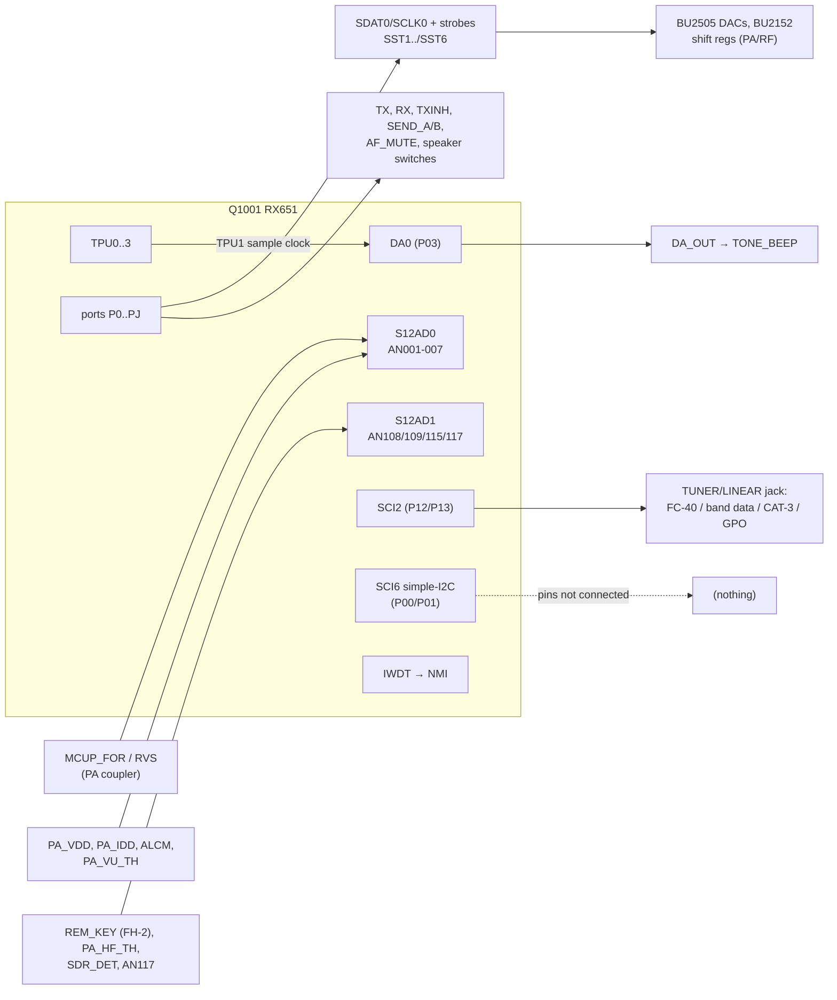
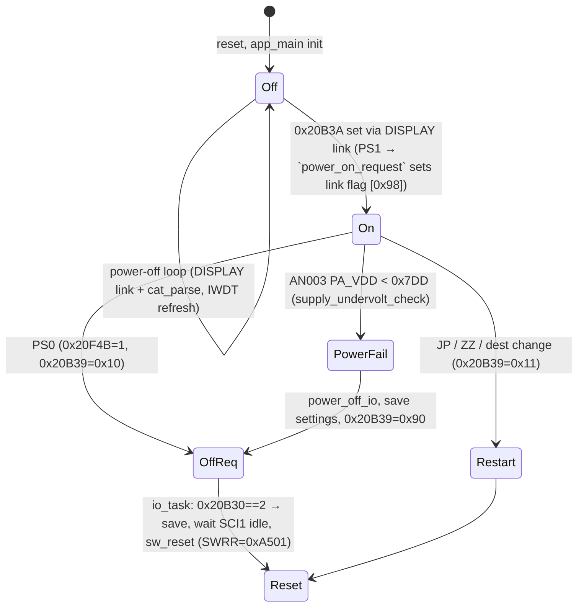

# MAIN — peripherals: GPIO map, ADC, DAC, timers, SCI2, SCI6, power

Back to the [MAIN overview](README.md).

This page covers T10h. It describes the RX651 on-chip peripherals that the MAIN firmware uses, apart from the UART links
(those are on the SCI pages) and the EEPROM. TX sequencing, protection and meters are on [tx-protection.md](tx-protection.md).
Function names are the current Ghidra names. Function names are the names applied in Ghidra (`tools/ghidra/names_main.tsv`, merged by T17) and match `decomp/main/`; a name still in *italics* is a description that was not applied as a Ghidra name.
The tags follow AGENTS.md. The schematic is the service manual p17 ("MAIN Unit/CNTL").

**How the GPIO map was built.** PeriphRefs.java found 261 (function, peripheral range) hits. Each port bit was matched to the pin
label on the p17 schematic and checked against the code. Three checks confirm the reading of the schematic:
- The EEPROM driver uses PE0/PE5/PE6/PE7, which are the `E2P_SS/E2P_CLK/E2P_MOSI/E2P_MISO` pins.
- The SCI pin-function registers (MPC) match the UART nets: SCI4 on PB0/PB1 is `DSP_UMISO/UMOSI`, and SCI7 on P90/P92 is `C4_UMOSI/UMISO`.
- `power_off_io` clears PC0, which is `PA_PON`.

On the top edge of the schematic, each net label is printed to the *left* of its own line.
## Block diagram

## Init sequence (`R_Systeminit` = `R_Systeminit`) [fact]

PRCR unlock, then `R_Pins_Create`, `R_IWDT_Create`, `R_DA_Create`, `R_S12AD0_Create`, `R_S12AD1_Create`, `R_SCI0..5_Create`,
`FUN_fff92e25` (ICU group setup), `R_TPU0_Create`, `R_TPU1_Create`, `R_TPU3_Create`, `R_MTU2_Create`, `R_SCI6_Create_IIC`,
`R_SCI7_Create` and `R_TPU2_Create`. It then registers the group/peripheral vectors with `R_BSP_InterruptWrite` and locks PRCR.
`app_main` later starts the timers (`timers_init`), sets the shift-register bus idle levels (`shreg_bus_init`) and sets up the DAC (`dac_init_idle`).

Clocks: SCKCR = 0x21C21222 (`FUN_fff913db`). `tone_set` hard-codes 60 MHz as the timer clock, which fits PCLKB = 60 MHz
**[fact for the constant, inference for PCLKB]**. The timer periods below assume PCLKB = 60 MHz.

## GPIO map [fact unless tagged]

The "Init dir" column is the PDR value written by `R_Pins_Create` (O = output, I = input) unless an SCI/ADC driver takes the pin over.
"Code" lists the functions that use the pin.

| Port | Pin | Net (p17) | Init dir | Code / meaning |
|---|---|---|---|---|
| P00 / P01 | 8 / 7 | `UART6_MO/MI` (SSDA6/SSCL6) | SCI6 | **Not connected** on the schematic. SCI6 is set up in simple-I2C mode but never used (see [SCI6](#sci6-simple-i2c-unused)) |
| P02 | 6 | `EXT_SP_DET` | I | external speaker plugged in → `speaker_route` |
| P03 | 4 | DA0 → `DA_OUT` | DA | beep tone, see [DAC](#dac-da0-0x88040) |
| P05 | 2 | DA1 → TP1024 | – | unused |
| P12 / P13 | 45 / 44 | `ETUN_UMISO/UMOSI` (RXD2/TXD2) | SCI2 / O | tuner UART, or GP OUT B / A and linear band-data B / A (see [SCI2](#sci2-tunerlinear-port)) |
| P14 | 43 | `ETUN_TXINH_REQ` | I | the external tuner asks for TX inhibit. This forces TXINH and SEND_A/B low (`send_a_set`, `ptt_arbiter`) |
| P15 | 42 | `EXTPA_TXREQ` | I | low = TX request from the external amp/tuner → PTT source 2 (`ptt_inputs_read`) |
| P16 / P17 / P87 | 40 / 38 / 39 | `CKEY_DOT` / `CKEY_DASH` / `CKEY_DET` | I | CW key jack (`ckey_dot`, `ckey_dash`, `ckey_det`) |
| P20 | 37 | `DATA_PTT` | I | DATA jack PTT, low = TX (PTT/PC-keying select = 3 "DAKY") |
| P21 | 36 | `DATA_SHIFT` | I | not read by any port function found **[inference: FSK input, handled elsewhere or by the DSP]** |
| P22 | 35 | `ETUN_RESET` | O | tuner reset, or GP OUT D / band-data D |
| P24 | 33 | `DATA_BUSY` | O | DATA jack busy/squelch output. It is forced high during the RX→TX switch (`trx_sequencer`, `af_mute_update`) **[inference: squelch status]** |
| P27 | 30 | (no net) | MTU | MTIOC2B PWM is set up by `R_MTU2_Create` but never started |
| P31 | 28 | `PWR_SW` | I | never read through PIDR. No IRQ is configured (no IRQCR writes) **[inference: the DISPLAY CPU or hardware handles the power key]** |
| P34 | 25 | `PWM` → Q1015 filter → `TONE_BEEP` | – | Q1015 and its parts are "***" (not fitted). No code drives P34 |
| AN001 / AN002 | 139 / 138 | `MCUP_RVS` / `MCUP_FOR` | ADC | reflected / forward power |
| AN003 | 137 | `PA_VDD` | ADC | supply voltage (13.8 V) |
| AN005 | 135 | `ALCM` | ADC | ALC |
| AN006 | 134 | `PA_VU_TH` | ADC | PA thermistor ("VU") |
| AN007 | 133 | `PA_IDD` | ADC | PA drain current |
| AN000 / AN004 | 141 / 136 | TP1028 / TP1002 | – | not converted |
| P50 | 56 | `ETUN_DET` | I/O | tuner detect, or GP OUT C / band-data C (`sci2_configure` changes the direction) |
| P51 | 55 | `JP_P51` | I | **destination strap**, see [tx-protection.md](tx-protection.md#destination-code-and-tx-coverage) (`jp_p51_get`) |
| P52..P54 | 54..52 | `JP_P52..JP_P54` | I | straps, not read by the code |
| P55 | 51 | `ATAS_DET` | I | ATAS antenna detected (`atas_det`) |
| P56 | 50 | `DAC_RST` | O | – |
| P60..P64 | 117..112 | `C4_SS3/SS2/SS1/RQST/BUSY_DSP` | mixed | "C4" bus to the DSP (T10d) |
| P65 | 100 | `E2P_WP` | O | EEPROM write protect (`eeprom_init`) |
| P66 | 99 | `SST1` | O | strobe of the MAIN BU2505 DAC Q1005 (`bu2505_write` dev 0) |
| P67 | 98 | `/SST2` | O | 12-bit shift register (`sst2_write12`). Cleared by `power_off_io` |
| P70 | 104 | `INT_SP_SW` | O | internal speaker on |
| P71 / P72 | 86 / 85 | `DSP_RESET` / `DSP_UPDATE` | O | `dsp_reset_set` / `dsp_update_set` |
| P73 | 77 | `TX` | O | TX line → Q1014/Q1020 → **TX8** rail |
| P74 | 72 | `AF_RESET` | O | `af_reset_set` |
| P75 | 71 | `USB_DET` | I | USB connected: RTS/DTR PTT is only honoured when this is high |
| P76 / P77 | 69 / 68 | `SDR_UPDATE` / `SDR_RESET` | O | `sdr_update_set` / `sdr_reset_set` (T10c) |
| P80 | 65 | `EAR_SW` | O | headphone path on |
| P81 / P82 | 64 / 63 | `TX_SEL_A` / `TX_SEL_B` | O | TX audio source select (`tx_audio_select`) |
| P83 | 58 | `TUN_LIN_SEL` | O | selects tuner or linear wiring of the jack (`tun_lin_sel_set`) |
| P86 | 41 | `REM_KEY_SEL` | O | `rem_key_sel_set` (1 in LINEAR/GPO mode) |
| P90 / P92 | 131 / 128 | `C4_UMOSI` / `C4_UMISO` | SCI7 | C4 UART |
| P91 | 129 | `SDR_DET` (AN115) | ADC | SDR-module analog detect. `sdr_upd_r0f_band` turns it into a per-band correction sent to the SDR **[inference]** |
| P93 | 127 | `AN117` | ADC | converted and shown in SPIR, otherwise unused |
| PA0 | 97 | `/SST3` | O | 24-bit register (`shreg_write24` dev 2) |
| PA1 | 96 | `TXINH` | O | TX inhibit output (`ptt_arbiter`) |
| PA2 | 95 | `SEND_A` | O | linear-amp SEND (`send_a_set`) |
| PA4 / PA5 | 92 / 90 | `SDAT0` / `SCLK0` | O | serial data/clock of the PA/RF shift-register bus |
| PA6 | 89 | (label not legible) | O | set in speaker route 2 (internal + external) |
| PA7 | 88 | `/SST6` | O | 24-bit register (dev 5). Cleared by `power_off_io` |
| PB0 / PB1 | 87 / 84 | `DSP_UMISO` / `DSP_UMOSI` | SCI4 | DSP console UART (T10d) |
| PB2 | 83 | `EXT_SP_SW` | O | external speaker on |
| PB3 | 82 | `AF_MUTE` | O | `af_mute_set` |
| PB4 | 81 | `SEND_B` | O | second SEND (`send_b_set`) |
| PB5 | 80 | `/SST4` | O | 24-bit register (dev 3). Cleared by `power_off_io` |
| PB6 | 79 | `SST5` | O | strobe of the PA BU2505 DAC Q4041 (dev 4) |
| PB7 | 78 | `RX` | O | RX line → Q1014/Q1019 → **RX8** rail |
| PC0 | 75 | `PA_PON` | O | PA power on (`pa_pon_set`). Cleared by `power_off_io` |
| PC1 | 73 | `FPTT` | I | not read by the port functions found **[inference: front/mic PTT comes in through the DISPLAY link instead]** |
| PC2 / PC3 | 70 / 67 | `SDR_UMISO/UMOSI` | SCI5 | SDR link |
| PC4 | 66 | `FSK_SHIFT` | O | FSK keying output to the SDR module. Cleared by `power_off_io` |
| PC5 / PC6 | 62 / 61 | `USBSS_DTR` / `USBSS_RTS` | I | CP2105 "Standard" port DTR/RTS: PTT or PC keying |
| PC7 | 60 | `UB` | I | – |
| PD0 | 126 | `REM_KEY` (AN108) | ADC | FH-2 remote keypad ladder (`remote_keypad_scan`) |
| PD1 | 125 | `PA_HF_TH` (AN109) | ADC | HF PA thermistor, which drives the fan DAC channel |
| PD2..PD7 | 124..119 | `C4_PON/BOOT/RESET/TRX/SS5/SS4` | O | C4 bus (T10d) |
| PE0, PE5, PE6, PE7 | 111, 106, 102, 101 | `E2P_SS/CLK/MOSI/MISO` | O/O/O/I | bit-banged EEPROM SPI (T10e) |
| PE1..PE4 | 110..107 | `C4_SPI_CLK/MISO/MOSI`, `C4_BUSY_CPU` | O,O,I,O | C4 SPI (T10d). The PDR directions suggest that the net names are from the other device's view **[inference]** |
| PF5 | 9 | `EAR_DET` | I | headphones plugged in (`ear_det`, low = inserted) |
| PJ3 | 13 | `XTAL_SHIFT` | O | – |

The remaining nets on the CPU sheet (`ATAS_DET`, `ETUN_DET` and the rest) are listed above. MAIN does not drive the RX_UPDATE/RX_RESET
boot pins; the DISPLAY CPU does (see docs/hardware.md).

## ADC (S12AD unit 0 at 0x89000, unit 1 at 0x89100)

- Unit 0 converts AN001, AN002, AN003, AN005, AN006 and AN007 (ADANSA0 = 0xEE). AN003/5/6/7 are averaged 4× (ADADS0 = 0xE8, ADADC = 0x83).
  The scan-end ISR is vec186 (`r_s12ad0_scan_end_isr`) **[fact]**.
- Unit 1 converts AN108, AN109, AN115 and AN117 (ADANSA0 = 0x8300, ADANSA1 = 2). All four are averaged 4×. The scan-end ISR is vec189 **[fact]**.
- Scans are started in software every 5 ms by `meter_task` through `adc_scan_blocking`, which starts both units and busy-waits for both
  done flags (0x1203E/0x1203F). TPU3 is also set up with TTGE (ADC start trigger), but S12AD does not select a hardware trigger **[fact]**.

### The 12 SPIR fields

`SPIR;` (`cat_SP_adc_dump` 0xFFFA4EED) answers `SPIR` + 12 × 3 hex digits (the low 12 bits) + `;`, 41 bytes in all **[fact, disassembly checked]**:

| # | Source | Channel | Net | Meaning |
|---|---|---|---|---|
| 1 | constant 0 | (AN000) | TP1028 | not converted |
| 2 | 0x20B04 | AN001 | `MCUP_RVS` | reflected power |
| 3 | 0x20B06 | AN002 | `MCUP_FOR` | forward power |
| 4 | 0x20B08 | AN003 | `PA_VDD` | supply voltage |
| 5 | constant 0 | (AN004) | TP1002 | not converted |
| 6 | 0x20B0C | AN005 | `ALCM` | ALC voltage |
| 7 | constant 0 | (AN006 slot) | `PA_VU_TH` | AN006 is converted into 0x20B0A, but SPIR does not report it, and no other code reads it |
| 8 | 0x20B0E | AN007 | `PA_IDD` | PA current |
| 9 | 0x20B14 | AN115 | `SDR_DET` | SDR-module detect voltage |
| 10 | 0x20B16 | AN117 | `AN117` | not used elsewhere |
| 11 | 0x20B10 | AN108 | `REM_KEY` | remote keypad ladder |
| 12 | 0x20B12 | AN109 | `PA_HF_TH` | HF PA thermistor |

So fields 1–8 are AN000..AN007 in order, with the unused ones reported as 0, and fields 9–12 are unit 1.

## DAC (DA0 at 0x88040)

- `R_DA_Create` enables DA0 on P03, and `dac0_write` writes DADR0 (12 bits) **[fact]**. On the schematic, `DA_OUT` → R1099/R1027/C1150 →
  `TONE_BEEP`, the beep line into the AF path (p17) **[fact]**.
- It is a **tone generator**. *tone_set(f, ms)* sets the TPU1 period to 60 MHz/(36·f) and plays the 36-sample table at 0x1FF1C
  (ROM .data) through `tone_sample_isr` (TPU1 vec144). It also arms soft timer 0x16 for the duration. f must be 30..20000 Hz **[fact]**.
- `beep_task` (main loop) plays patterns requested by *beep_request(n)*: 880 Hz (0x445C0000) and 1046.5 Hz (0x4482D010) beeps of
  100 ms with gaps **[fact]**. Pattern 7 is requested when the TX time-out timer pre-warns (`ptt_arbiter`). Pattern 4 is the sidetone
  for PC keying (`pc_keying`) **[fact for the calls, inference for the meaning]**.
- The off-chip DACs (BU2505FV Q1005 on MAIN and Q4041 on PA) are written over the shift-register bus. See [tx-protection.md](tx-protection.md#pa-and-rf-control-registers).

## Timers

No CMT channel is used (there are no CMT references) **[fact]**. The timebase is the TPU:

| Timer | Setup (PCLKB 60 MHz) | Vector | Body | Use |
|---|---|---|---|---|
| TPU0 | /16, TGRA 374 → **10 kHz** | 130 | `swtimer_tick` | 75 one-shot soft timers (`swtimer_start(id, ms)` → limit ms×10, done flags 0x11FED[id], tested with `swtimer_expired`) plus 2 blink timers (0x12038, set as 450/250 ms and 1000/1000 ms) |
| TPU1 | /1, TGRA = 60e6/(36f)−1 | 144 | `tone_sample_isr` | beep DAC sample clock. Runs only while a tone plays |
| TPU2 | /4, TGRA 74 → 5 µs | 138 | `spk_softstart_isr` | started by `speaker_route` when it leaves the "all off" route. It pulses the selected speaker switch with a shrinking duty for about 5 ms **[inference: click/pop suppression]** |
| TPU3 | /256, TGRA 23437 → **100 ms** | 142 | `slowtimer_tick` | 4 slow timers (flags 0x1203A): TX time-out timer and pre-warning |
| MTU2 | TGRA 11999, PWM on P27 | – | – | configured but never started; P27 has no net |
| IWDT | IWDTCR 0x3350, underflow → NMI | NMI | `NMI` 0xFFF9061B | refreshed by `wdt_kick` → `iwdt_refresh` in the power-off loop and `app_main` |

Soft-timer ids used on this page: 0x09 (5 ms ADC/SWR), 0x0A (10 ms meters), 0x0C..0x12 (TRX sequencing steps), 0x13 (2.5 s I/O start delay),
0x15/0x1A (PTT hang: VOX delay / CW break-in delay), 0x16 (tone length), 0x2A (AF-mute hold), 0x2C/0x2D (speaker route), 0x2F (VOX holdoff),
0x30 (tuner relay settle) **[fact]**.

## SCI2: TUNER/LINEAR port

`sci2_configure` (0xFFFB177E) is called once from `app_main` (through `sci_start_all`). It stops SCI2 and reconfigures the jack according to
the menu item **TUN/LIN PORT SELECT** (RAM 0x9AB7, read by `tunlin_port_mode`; the CAT manual lists `0 EXT-TUNER, 1 LINEAR, 2 CAT-3, 3 GPO`) **[fact]**:

| 0x9AB7 | SCI2 | P12/P13/P50/P22 | TUN_LIN_SEL / REM_KEY_SEL | Meaning |
|---|---|---|---|---|
| 0 EXT-TUNER | `R_SCI2_Create` (default format), RX/TX on | P50 input (ETUN_DET), P22 = 1 (ETUN_RESET released) | 1 / 0 | external tuner (FC-40 type) serial link |
| 1 LINEAR | module stopped (MSTPCRB.29), pins become GPIO outputs | band data A/B/C/D on P13/P12/P50/P22 from `linear_band_data` (a 4-bit code per TX band) | 0 / 1 | linear amp band data |
| 2 CAT-3 | `R_SCI2_Create`, then SMR/SEMR from `sci_baud_table` 0xFFF80FF4 indexed by CAT-3 RATE (0x9ABE, clamped to 3 if > 4), 2 stop bits if 0x9ABB. Receives into 0xCC70 | – | 1 / 0 | CAT port 3 ([cat.md](cat.md)) |
| 3 GPO | as LINEAR, but all four lines start at 0 | `GP` command: A=P13, B=P12, C=P50, D=P22 (`cat_GP` → `gpo_a_set`..`gpo_d_set`) | 0 / 1 | general-purpose outputs |

## SCI6: simple-I2C (unused)

`R_SCI6_Create_IIC` (0xFFFC91B3) puts SCI6 in simple-I2C mode on P00 (SSDA6) / P01 (SSCL6): SIMR1 = 0xF0, SIMR3 = 0xF4, open-drain (ODR0)
**[fact]**. On the p17 schematic, pins 7 and 8 (`UART6_MI`/`UART6_MO`) have **no connection** **[fact, 900-dpi render]**. In the firmware,
the transfer state variables (0x12235, 0x12236, 0x1FA42/44/46, 0x2104C/0x21050) are touched only by the two ISRs. No function ever
generates a start condition with a slave address. So **there is no I2C device**: this is unused Code Generator output (or a provision
for a board variant) **[fact for code and schematic; inference for the reason]**. None of the I2C parts in the parts list (TSC2003, S-35190A) is on
the MAIN CPU's bus; both are on the DISPLAY unit.

## Power on / off

- `power_off_io` (0xFFFB73A6) runs only from `supply_undervolt_check` **[fact]**. It clears PA_PON (PC0), SDR_UPDATE (P76) and TUN_LIN_SEL (P83).
  It also clears FSK_SHIFT (PC4) and SDR_UMOSI (PC3) and stops SCI5, so that no current flows into the unpowered SDR module **[inference]**.
  Finally it clears the shift-register strobes /SST2 (P67), /SST4 (PB5) and /SST6 (PA7).
- `supply_undervolt_check` also runs at the start of every EEPROM save (`eeprom_save_memch` and others), so a brown-out does not
  corrupt a write **[inference]**.
- 0x20B39 and 0x20F4B are only written in MAIN. They are presumably carried to the DISPLAY CPU by the DISPLAY link status
  block (T10b) **[inference]**. The DISPLAY link handles power-up (`displink_rx_F0_hello`, start-mode byte, see tx-protection.md).
- PA_PON is set to 1 by `shreg_bus_init` when the radio turns on **[fact]**.

## Function table

| Address | Ghidra name | Inferred name | Purpose |
|---|---|---|---|
| 0xFFF8F65E | `R_Systeminit` | `R_Systeminit` | peripheral init chain (see above) |
| 0xFFF92E49 | `R_Pins_Create` | `R_Pins_Create` | PDR/PODR/PCR/DSCR/ODR for every port |
| 0xFFF927A9 / 0xFFF927CE | `R_IWDT_Create` / `iwdt_refresh` | `R_IWDT_Create` / `iwdt_refresh` | watchdog → NMI |
| 0xFFF927E5 / 0xFFF92826 / 0xFFF9283D | `R_DA_Create` / `R_DA0_Start` / `dac0_write` | `R_DA_Create` / `R_DA0_Start` / `dac0_write` | DA0 |
| 0xFFF92851 / 0xFFF929F7 / 0xFFF92A13 / 0xFFF92A31 | `R_S12AD0_Create`… | *R_S12AD0_Create/Start/Stop/Get_ValueResult* | ADC unit 0 |
| 0xFFF92B17 / 0xFFF92C74 / 0xFFF92C90 / 0xFFF92CAE | `R_S12AD1_Create`… | *R_S12AD1_Create/Start/Stop/Get_ValueResult* | ADC unit 1 |
| 0xFFF92B01 / 0xFFF92E0F | `vec186_isr` / `vec189_isr` | *r_s12ad0/1_scan_end_isr* | store results, set done flags |
| 0xFFFB27E0 / 0xFFFB289E / 0xFFFB741E | `adc_scan_start`… | `adc_scan_start` / `adc_scan_done` / `adc_scan_blocking` | software-triggered scan of both units |
| 0xFFFB27FB / 0xFFFB2858 | `adc0_store` / `adc1_store` | `adc0_store` / `adc1_store` | results → 0x20B04..0x20B16 |
| 0xFFF949B4 / 0xFFF94A38 / 0xFFF94A57 | `R_TPU0_Create` / `R_TPU0_Start` / `vec130_isr` | *R_TPU0_Create/Start*, `r_tpu0_tgia_isr` | 10 kHz tick |
| 0xFFF94A65 / 0xFFF94ACD / 0xFFF94ADC / 0xFFF94AEC | … / `vec144_isr` | *R_TPU1_Create/Start/Stop*, `r_tpu1_tgia_isr` | tone clock |
| 0xFFFEDD07 / 0xFFFEDD6D / 0xFFFEDD7C / 0xFFFEDD8C | … / `vec138_isr` | *R_TPU2_Create/Start/Stop*, `r_tpu2_tgia_isr` | speaker soft-start |
| 0xFFFB2734 / 0xFFFB27B2 / 0xFFFB27D1 | … / `vec142_isr` | *R_TPU3_Create/Start*, `r_tpu3_tgia_isr` | 100 ms tick |
| 0xFFFC913B | `R_MTU2_Create` | `R_MTU2_Create` | unused PWM |
| 0xFFFB2228 | `timers_init` | `timers_init` | marks all timers expired, sets blinkers, starts TPU0/TPU3 |
| 0xFFFB2288 / 0xFFFB237A / 0xFFFB23F3 | … | `swtimer_tick` / `swtimer_start` / `swtimer_expired` | soft timers (84 callers each) |
| 0xFFFB2406 / 0xFFFB2419 | … | `blink_phase` / `blink_set` | blink timers |
| 0xFFFB259C | `slowtimer_tick` | `slowtimer_tick` | 100 ms timers |
| 0xFFFB2469 / 0xFFFB24A3 / 0xFFFB2E1E | … | `tone_sample_isr` / `tone_play` / `tone_set` | DAC tone |
| 0xFFFB28E2 / 0xFFFB2DA6 / 0xFFFB2DF4 | … | `beep_task` / `beep_request` / `beep_stop` | beeps |
| 0xFFFB24D8 | `spk_softstart_isr` | `spk_softstart_isr` | TPU2 body |
| 0xFFFB177E | `sci2_configure` | | TUN/LIN port mode switch |
| 0xFFFB1900 | `tunlin_port_mode` | `tunlin_port_mode` | 0x9AB7 clamped to 0..3 |
| 0xFFFB8F7D | `linear_band_data` | `linear_band_data` | band code on the 4 GP lines in LINEAR mode |
| 0xFFFB714D..0xFFFB71FF | `gpo_a_set`… | *gpo_a..d_set/get*, `etun_reset_set` | GP OUT pins |
| 0xFFFB7051..0xFFFB70F7 | `sdr_reset_set`… | `sdr_reset_set`, `sdr_update_set`, `dsp_reset_set`, `dsp_update_set`, `af_reset_set`, `pa_pon_set`, `tun_lin_sel_set`, `rem_key_sel_set` | single-bit outputs |
| 0xFFFB6ED4..0xFFFB6F76, 0xFFFB730A | … | *ckey_det/dot/dash*, `jp_p51_get`, `atas_det`, `ear_det` | single-bit inputs |
| 0xFFFB8A8C / 0xFFFB7322 | … | `speaker_route` / `speaker_switch_set` | speaker routing (below) |
| 0xFFFB73A6 | `power_off_io` | | see power section |
| 0xFFFB3E55 | `sw_reset` | `sw_reset` | SWRR = 0xA501 |
| 0xFFFC91B3 / 0xFFFC9311 / 0xFFFC93A4 / 0xFFFC9467 | `R_SCI6_Create_IIC`… | | unused simple-I2C |

### Speaker routing (`speaker_route`, 0x20FCC) [fact]

The inputs are EXT_SP_DET (P02) and EAR_DET (PF5) plus a setting byte (×5 mask):

| route | INT_SP_SW P70 | EAR_SW P80 | EXT_SP_SW PB2 | PA6 | When |
|---|---|---|---|---|---|
| 0 | 1 | 0 | 0 | 0 | no external speaker, no phones |
| 1 | 0 | 1 | 0 | 0 | phones plugged in (they take priority) |
| 2 | 1 | 0 | 1 | 1 | external speaker, and the setting selects both |
| 3 | 0 | 0 | 1 | 0 | external speaker only |
| 4 | 0 | 0 | 0 | – | all off: CAT disabled (0x20B46), flag 0x1204E or 0x20B3B, or timer 0x2C still running |

During the RX↔TX switch, `trx_sequencer` clears these switches and then restores them (see tx-protection.md).

## Data structures and globals

| Address | Size | Name | Meaning |
|---|---|---|---|
| 0x20B04..0x20B16 | 10 × u16 | `adc_results` | AN001 0x20B04, AN002 0x20B06, AN003 0x20B08, AN006 0x20B0A, AN005 0x20B0C, AN007 0x20B0E, AN108 0x20B10, AN109 0x20B12, AN115 0x20B14, AN117 0x20B16 **[fact]** |
| 0x1203E / 0x1203F | u8 | `adc0_done` / `adc1_done` | **[fact]** |
| 0x11FED[75] | u8 | `swtimer_done` | 1 = expired **[fact]** |
| 0x20890[75] / 0x209BC[75] | u32 | `swtimer_count` / `swtimer_limit` | ticks of 0.1 ms **[fact]** |
| 0x12038[2], 0x20AE8.. | | blink timers | **[fact]** |
| 0x1203A[4], 0x1FA24/0x1FA2C | | slow timers | **[fact]** |
| 0x20B00, 0x1FA34, 0x1FA36 | | tone table pointer / length / index | **[fact]** |
| 0x1FF1C | 36 × u16 | tone sample table (.data) | **[fact]** |
| 0x12040 / 0x12041 | u8 | beep state / pattern | **[fact]** |
| 0x20FCC | u8 | `speaker_route` | 0..4 **[fact]** |
| 0x9AB7 | u8 | TUN/LIN PORT SELECT | **[fact]** |
| 0x9ABE / 0x9ABB | u8 | CAT-3 rate / stop-bit settings | **[fact]** |
| 0x20B39, 0x20F4B | u8 | power/restart request codes 0x10 (PS0), 0x11 (restart), 0x90 (power fail) | **[fact]** for the values |
| 0x20B43 | u8 | power-fail latched | **[fact]** |
