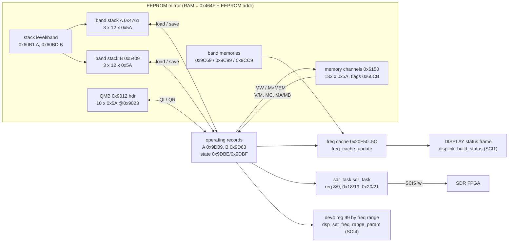
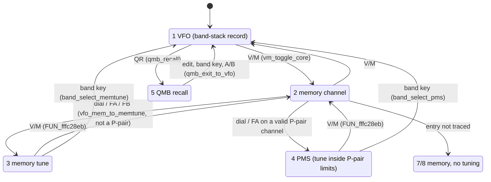
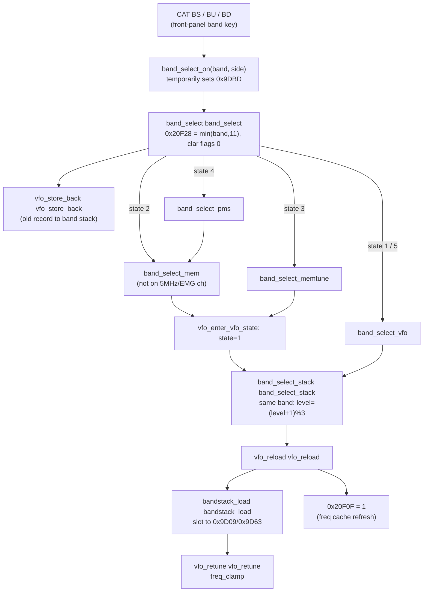
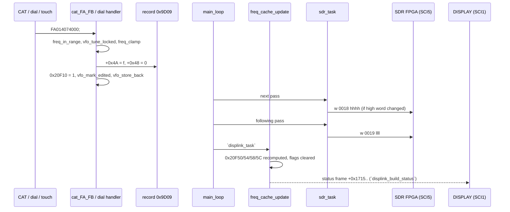

# MAIN — band, VFO, mode, frequency and memory control

Back to the [MAIN overview](README.md)

This page covers T10g: the VFO A/B records, the band table and band stack, modes, the VFO/memory state machine, how a
frequency change reaches the SDR FPGA (SCI5), the DSP (SCI4) and the DISPLAY CPU (SCI1), split, clarifier, memory
channels, PMS, QMB, scan and lock. The CAT side of each command is in [cat.md](cat.md),
[cat-commands.md](../../cat-commands.md) and [cat-commands-primary.md](../../cat-commands-primary.md). This page follows the
handlers into the shared code they call.

Function names are the names applied in Ghidra (`tools/ghidra/names_main.tsv`, merged by T17) and match `decomp/main/`; a name still in *italics* is a description that was not applied as a Ghidra name. Tags follow AGENTS.md. **[fact]** means seen in the code at the address given.

## Overview

- **Two working records.** Each VFO has one 0x5A-byte (90-byte) **operating record**: VFO-A at **0x9D09**, VFO-B at
  **0x9D63**. This record holds the mode, flags, per-mode parameters, tone, clarifier, frequency and tag. Everything that
  tunes, transmits or displays reads one of these two records. **[fact]** (`vfo_rec_ptr`, `vfo_freq`)
- **One layout everywhere.** Memory channels (0x6150 + ch×0x5A), band-stack entries, QMB slots (0x9023 + n×0x5A) and the
  memory-tune backups (0x9DCE/0x9E28) all use the same 0x5A-byte layout. Recalling something means copying 0x5A bytes into
  the operating record. Storing means copying the record back out. **[fact]** (`bandstack_load`, `memch_load_to_vfo`,
  `qmb_store`, `bandstack_save`)
- **The VFO frequency lives in the band stack.** In VFO mode the operating record is a copy of a band-stack entry: 2 VFOs ×
  3 stack levels × 12 bands. The firmware writes the record back to its band-stack slot (and to EEPROM) when it has
  changed. **[fact]** (`bandstack_save` → `eeprom_save_bandstack`)
- **State per VFO.** 0x9DBD is the active VFO (0 = A, 1 = B). 0x9DBE/0x9DBF are the VFO/memory states of A/B: 1 VFO,
  2 memory, 3 memory tune, 4 PMS, 5 QMB, 7/8 locked memory. The split flag is 0x9C5E. **[fact]** for the variables. The
  state meanings are **[inference]**, from the CAT `IF`/`VM` code tables and the transitions below.
- **Frequency output is polled.** Nothing pushes a new frequency to the hardware. Every `main_loop` pass:
  - `displink_task` → `freq_cache_update` recomputes the TX, VFO-A, VFO-B and dial frequencies (0x20F50..0x20F5C) when
    a refresh flag is set.
  - `sdr_task` → `sdr_task` compares the derived SDR register values with shadow copies and writes any that
    changed over SCI5 (`'w'` frame). RX frequency is register 0x18/0x19, TX is 8/9 and the scope centre is 0x20/0x21.
  - The DISPLAY status frame copies the cached frequencies.

  **[fact]**

## The 0x5A-byte channel record

The layout is shared by the operating records, band-stack entries, memory channels, QMB slots and memory-tune backups.
Multi-byte values are **big-endian**. Offsets are from the start of the record.

| Offset | Size | Field | Evidence |
|---|---|---|---|
| +0x00 | u8 | bits 0–3 = **mode index** (table below). Bits 4–7 are not yet known. | `vfo_mode` (`AND #0xF`), IF/MD/MR via `cat_mode_codes` 0xFFF806D0 **[fact]** |
| +0x01 | u8 | bit 4 = RX clarifier on, bit 3 = TX clarifier on (both cleared with `& 0xE7` on memory recall and by `MW`). bit 2 is read by `AC` (`FUN_fffec55a`), probably the ATU on/off **[inference]** | `memch_load_to_vfo`, `vm_toggle_core`, `cat_CF`, `cat_MR` **[fact]** |
| +0x02 | u8 | bits 2–3 = **repeater shift**: 0 = minus, 1 = simplex, 2 = plus | `tx_freq_repeater_shift` (TX shift), `cat_MW` (`'2'`→0, `'0'`→1, `'1'`→2) **[fact]** |
| +0x03 | u8 | bits 3–5 = **tone mode** (CT: 0 off, 1 = CTCSS ENC/DEC, 2 = CTCSS ENC, 3 = DCS **[inference]**). bit 3 alone is tested by the scan engine (`FUN_fffe600f`) | `cat_CT`, `cat_IF_OI`, `cat_MW` **[fact]** |
| +0x04 | u8 | NARROW flags per mode class (bit 7 SSB, 5 CW, 3 RTTY, 2 DATA); see [eeprom.md](eeprom.md#90-byte-vfo--memory-record) | `cat_NA`, `key_nar_short` **[fact]** (#73) |
| +0x05 | u8 | bit 7 = memory tag shown (MT P2) | `cat_MT` **[fact]**; `vfo_clear_tag` clears it |
| +0x06 | u8 | bits 0–3 = **DNR level** 1..15 (`RL`), bit 4 = **DNR on** (`NR`). The DSP setters `dsp_set_dnr_*` (0xFFF9E750, 0xFFF9FCD0..0xFFF9FFB1) index their coefficient tables with the level and send 0 when bit 4 is clear or the mode is FM/DATA-FM (6/7, 10/11). Bits 5–7: no reader or writer found; the defaults write 0 | `cat_RL` 0xFFFADA46 (`& 0xF0 \| level`), `cat_NR`, `key_dnr_short`/`key_dnr_long`, `FUN_fffc7d41` (DNR knob, clamps 1..15), the AI reporters `FUN_fffdff9c` (`NR`) / `FUN_fffe0839` (`RL`) **[fact]** |
| +0x07..+0x09 | 3 | **unused** in V01-12: no field access anywhere in MAIN; only copied with the whole record. The defaults write 0 | see [below](#record-bytes-without-users) **[fact for the absence of users]**; reserved **[inference]** |
| +0x0A..+0x13 | 10 | **per-mode block, SSB** (modes 0/1). +0x0B bit 7 is the BC flag. +0x12/+0x13 (s16) is the SSB offset; SDR RX adds +1500 Hz to it | `cat_BC`, `sdr_upd_r18_rx_freq`, `vfo_display_offset` **[fact]** |
| +0x14..+0x1D | 10 | **per-mode block, CW** (2/3). +0x14 bit 1 = BI. +0x15 bit 7 = BC. +0x1C/+0x1D (s16) is the CW offset, combined with the CW pitch (0x9C04×10 + 300 Hz) | `cat_BI`, `cat_BC`, `sdr_upd_r18_rx_freq` **[fact]** |
| +0x1E..+0x27 | 10 | **per-mode block, RTTY** (12/13). +0x1F bit 7 = BC. +0x26/+0x27 is the RTTY offset; the base comes from setting 0x9A8D (85/105/215/425 Hz) | `cat_BC`, `sdr_upd_r18_rx_freq` **[fact]** |
| +0x28..+0x31 | 10 | **per-mode block, DATA and PSK** (8/9, 14). +0x29 bit 7 = BC. +0x30/+0x31 (s16) is the DATA/PSK offset. DATA adds setting 0x9A7A:0x9A7B × 10 Hz | `cat_BC`, `sdr_upd_r18_rx_freq`, `vfo_display_offset` **[fact]** |
| +0x32..+0x3B | 10 | **per-mode block, AM** (4/5). +0x32 bit 1 and +0x33 bit 7 are used by BI/BC | `cat_BI`, `cat_BC` **[fact]** |
| +0x3C..+0x45 | 10 | **per-mode block, FM and DATA-FM** (6/7, 10/11). Same layout as the other blocks ([below](#per-mode-block-layout)); in FM only the AGC byte and the BI bit have an effect | `cat_BP`/`cat_BI`/`cat_CO`/`cat_GT`/`cat_IS` map modes 6/7 and 10/11 to +0x3C **[fact]** |
| +0x46 | u8 | CTCSS/DCS tone number (`CN`, 0..49) | `cat_CN` **[fact]** |
| +0x47 | u8 | **unused** in V01-12: no field access; the default (ROM 0xFFF80948) is 0 | **[fact for the absence of users]**; reserved, perhaps for a DCS code the FT-710 does not offer **[guess]** |
| +0x48..+0x49 | s16 | **clarifier offset** in Hz, two's complement (CF: ±9999) | `vfo_freq_clar`, `cat_CF` **[fact]** |
| +0x4A..+0x4D | u32 | **frequency in Hz** (dial frequency, without clarifier) | `vfo_freq`, `cat_FA_FB` **[fact]** |
| +0x4E..+0x59 | 12 | memory tag, ASCII 0x20..0x7D, padded with spaces | `cat_MT`, `vfo_clear_tag` **[fact]** |

**Mode index** (+0x00 bits 0–3) → CAT `MD` code, from `cat_mode_codes` 0xFFF806D0 **[fact]**:

| idx | 0 | 1 | 2 | 3 | 4 | 5 | 6 | 7 | 8 | 9 | 10 | 11 | 12 | 13 | 14 | 15 |
|---|---|---|---|---|---|---|---|---|---|---|---|---|---|---|---|---|
| CAT | 1 | 2 | 7 | 3 | 5 | D | 4 | B | 8 | C | A | F | 6 | 9 | E | F |
| mode | LSB | USB | CW-L | CW-U | AM | AM-N | FM | FM-N | DATA-L | DATA-U | DATA-FM | DATA-FM-N | RTTY-L | RTTY-U | PSK | (DATA-FM-N) |

The modes come in pairs: SSB 0/1, CW 2/3, AM 4/5, FM 6/7, DATA 8/9, DATA-FM 10/11, RTTY 12/13, PSK 14. The per-mode
menu settings use the same groups, through `FUN_fffb54a0`/`FUN_fffb552c` (base 0x9BCA). **[fact]**
`vfo_mode` returns mode 2 (CW-L) while a tuner cycle or tune carrier is active (0x20F0C = 1/2,
0x20B40/0x20B41 = 2, 0x20B25 = 1). **[fact]** That this is the CW tune carrier is **[inference]**.

### Per-mode block layout

Six 10-byte blocks, one per mode class: SSB +0x0A, CW +0x14, RTTY +0x1E, DATA/PSK +0x28, AM +0x32, FM/DATA-FM +0x3C
(the mode → block map is the same in `cat_BP` 0xFFFA7A71, `cat_CO`, `cat_BI`, `cat_GT` and `cat_IS`) **[fact]**. Offsets are from the
block start; 16-bit values are big-endian.

| Block offset | Field | Evidence |
|---|---|---|
| +0 bit 7 | manual NOTCH on (`BP` P2=0) | `cat_BP`, `sdr_upd_r1d_notch` 0xFFFA20F7, `dsp_set_am_notch` (AM) **[fact]** |
| +0 bit 6 | CONTOUR on (`CO` P2=0) | `cat_CO`, `dsp_set_contour` 0xFFF9E871 (`\| 0x1000` on reg 0x42) **[fact]** |
| +0 bit 5 | APF on (`CO` P2=2; CW block only) | `cat_CO`, `dsp_set_apf`, `FUN_fffbde58` **[fact]** |
| +0 bit 1 | `BI` flag; set and cleared by `keyer_task` in the CW block, toggled by `FUN_fffc79b8` (a knob step; SSB, CW, AM, FM blocks), read for the TX side by `FUN_fffb521a` | **[fact]**; break-in (CW) / VOX (voice) per mode **[inference]** |
| +0 bits 0, 2 | defaults set bit 2 (bit 0 in the FM block); no reader found | `FUN_fffb0664` **[fact]** |
| +1 bit 7 | `BC` flag (not in the FM block: `BC` rejects modes 6/7, 10/11) | `cat_BC` **[fact]** |
| +1 bits 4–6 | AGC (`GT`): bit 6 = set, bits 4–5 = speed 1..3; field 0 reads back as 4/5/6 by mode class (AUTO **[inference]**) | `cat_GT`, `dsp_set_agc` 0xFFF9F681 **[fact]** |
| +2..+3 | CONTOUR frequency / 10 Hz (`CO` P2=1) | `cat_CO`, `dsp_set_contour` **[fact]** |
| +4..+5 | NOTCH frequency / 10 Hz (`BP` P2=1, 1..320) | `cat_BP`, `sdr_upd_r1d_notch` **[fact]** |
| +6..+7 | WIDTH in Hz (`SH`) | `cat_SH` 0xFFFAE2CA, `FUN_fffc3582` **[fact]** |
| +8..+9 | s16 IF SHIFT in Hz (`IS`) | `cat_IS`, `sdr_upd_r18_rx_freq` **[fact]** |

**Defaults** (`FUN_fffb0664` 0xFFFB0664, called by `defaults_vfo` and `defaults_memch` for every record; the stores are little-endian
u32s, so the bytes below are in record order) **[fact]**:

| Block | +0 | +1 | +2..+3 contour | +4..+5 notch | +6..+7 width | +8..+9 shift |
|---|---|---|---|---|---|---|
| SSB +0x0A | 0x04 | 0x40 | 150 (1500 Hz) | 150 (1500 Hz) | 3000 | 0 |
| CW +0x14 | 0x05 | 0x40 | 150 | 150 | 500 | 0 |
| RTTY +0x1E | 0x04 | 0x40 | 150 | 150 | 500 | 0 |
| DATA +0x28 | 0x04 | 0x40 | 150 | 150 | 3200 | 0 |
| AM +0x32 | 0x04 | 0x70 | 150 | 150 | 9000 | 0 |
| FM +0x3C | 0x01 | 0x40 | 150 | 150 | 16000 | 0 |

**The FM block in use** **[fact]**: `dsp_set_agc` reads +0x3D, and the BI bit (+0x3C bit 1) is toggled and read as for the other voice
modes. Nothing applies the other FM fields: `dsp_set_contour` sends 0 for modes 6/7 and 10/11, `sdr_upd_r1d_notch` handles only CW,
RTTY, DATA/PSK and SSB, `SH` is fixed for FM (the width at +0x42 has no reader), and the shift at +0x44 is read only by `cat_IS` and its
AI reporter `FUN_fffdf66f`. `CO`/`BP`/`IS` still store values there in FM. DNR is also off in FM and DATA-FM (record +0x06 above).

### Record bytes without users

A scan of the whole MAIN decompile (every pointer that comes from `vfo_rec_ptr` or the working records 0x9D09/0x9D63, and every
pointer that is also indexed at the frequency/tag offsets) finds **no field access** to +0x07, +0x08, +0x09 or +0x47, and none to
bits 5–7 of +0x06 **[fact]**. They are written only by the defaults (`defaults_vfo` 0xFFFB06E5, `defaults_memch` 0xFFFB0A8F):

- `+0x00..+0x03` = `40 00 04 80`, `+0x04..+0x07` = `00 02 01 00`, `+0x08..+0x09` = `00 00` for the VFOs and memories 001–P9U (LSB,
  simplex, DNR level 1); the dest-specific 60 m channels get `01 01 04 80`, `00 02 03 00`, `00 00` (USB, DNR level 3).
- `+0x46..+0x59` = 20 bytes from ROM 0xFFF80947 (`0C 00 0000 006ACFC0` + 12 spaces: tone 12, +0x47 = 0, no clarifier, 7.000 MHz,
  empty tag), or 0xFFF80B4F + n·0x14 for the 60 m channels. Some destinations (codes 0x020B, 0x4380, 0x60E6) then set the VFO tone to 8.

The bytes are otherwise moved with the whole record (EEPROM save/load, band stack, QMB, A↔B copies, the E8/E9 clone), so they survive a
clone. That they are reserved space is **[inference]**.

## VFO and memory states

`0x9DBE` (VFO-A) and `0x9DBF` (VFO-B) hold the operating state of each side. The CAT tables map it as follows **[fact]**:

- `cat_vfo_state_codes` (0xFFF806DF + state; the IF/OI/MR P7 field) gives state 1 → `0`, 2 → `1`, 3 → `2`, 4 → `5`,
  5 → `3`, 7/8 → `1`, and 0/6/9 → `F`.
- `cat_VM` gives state 2 → `11`/`21`/`51`/`91` (normal, PMS, 5 MHz or EMG channel), 3 → `10`, 4 → `20`, and anything
  else → `00`.

The transitions are taken from the code at the addresses shown **[fact]**. The names of the states are **[inference]**.

- **Locked states.** `vfo_tune_locked` returns 1, and `FA`/`FB`/`CF`/`AB`/`BA` then answer `?;`,
  when the side is in state 7/8, or in state 2 on channel 117..132 (the 5 MHz channels and EMG). **[fact]**
- **Memory states.** `vfo_is_memory` is true for states 2, 7 and 8. **[fact]**
- **Memory tune entry.** On entry, the operating record is copied to a backup (`memtune_backup_a`/`memtune_backup_b`: 0x9D09 →
  0x9DCE, 0x9D63 → 0x9E28). On exit it is copied back (`memtune_restore_a`/`memtune_restore_b`). **[fact]** for the copies.
  The trigger is through `FUN_fffc18c3`/`FUN_fffc18e1`.

## Bands

### Band table

`band_of_freq` 0xFFFB33E5 scans 12 `{lo, hi}` pairs at **0xFFF8876C** (u32 Hz, lo ≤ f < hi). The first match wins, so
GEN catches everything outside the amateur bands. **[fact]**

| idx | lo | hi | band (`BS`) |
|---|---|---|---|
| 0 | 1,800,000 | 2,000,000 | 1.8 MHz |
| 1 | 3,500,000 | 4,000,000 | 3.5 MHz |
| 2 | 5,000,000 | 5,500,000 | 5 MHz |
| 3 | 7,000,000 | 7,500,000 | 7 MHz |
| 4 | 10,000,000 | 10,500,000 | 10 MHz |
| 5 | 14,000,000 | 14,500,000 | 14 MHz |
| 6 | 18,000,000 | 18,500,000 | 18 MHz |
| 7 | 21,000,000 | 21,500,000 | 21 MHz |
| 8 | 24,500,000 | 25,000,000 | 24.5 MHz |
| 9 | 28,000,000 | 30,000,000 | 28 MHz |
| 10 | 50,000,000 | 54,000,000 | 50 MHz |
| 11 | 30,000 | 75,000,001 | GEN (70 MHz/GEN in the manual) |

Related ROM tables **[fact]**:

| Address | Content | Used by |
|---|---|---|
| 0xFFF89D4C | `{30000, 75000000}`: the tuning limits | `freq_clamp` |
| (code) | `29999 < f < 75000001` | `freq_in_range` `freq_in_range`, used by FA/FB/FD/MW/ZI and touch-tune |
| 0xFFF887CC | 18 ascending u32 boundaries: 1.7, 2.1, 4.1, 6.9, 8.2, 11.8, 15.0, 15.8, 17.8, 20.0, 20.9, 25.0, 30, 48, 56, 69, 75.000001, 108.000001 MHz | `gen_subband_of_freq` `gen_subband_of_freq`. It returns the first i with f < table[i], clamped to 15. This is the GEN sub-slot for the FIX band memory |
| 0xFFF88814 | 14 boundaries: 1.7, 3.0, 4.5, 6.0, 9.0, 13.0 MHz, … | `freq_range_index`, a frequency → range index. This may be a filter-bank index **[guess]** |
| 0xFFF88598 | 7.5, 14.5, 21.5, 41.5, 75 MHz | `dsp_set_freq_range_param`: picks one of the cfg105 bytes 0x4674..0x4678 and writes it to SCI4 device register 99 when it changes **[fact]**. That it is a per-range DSP calibration is **[inference]** |
| 0xFFF89D24 | 10 × u32: 1k, 2k, 5k, 10k, 20k, 50k, 100k, 200k, 500k, 1M | scope span in Hz, indexed by `scope_span_index`(side)` |

### Band stack

- **Layout.** The VFO record of each band is kept in a 3-level band stack per VFO **[fact]**:
  - A: `0x4761 + level×0x438 + band×0x5A`.
  - B: `0x5409 + level×0x438 + band×0x5A`.
  - Each level holds 12 bands (0x438 = 12×0x5A). The current level per band is in `0x60B1[band]` (A) and `0x60BD[band]` (B).
  - The current band index is in 0x9DC3 (A) and 0x9DC4 (B).
  - The band of the active side, clamped to 11, is also in 0x20F28. **[fact]** (`band_select`)
- **Save.** `bandstack_save` `bandstack_save`:
  - It recomputes the band of the record's frequency (`band_of_freq`) and stores it in 0x9DC3/0x9DC4.
  - It compares the operating record with the band-stack slot (`FUN_fffede1d` compares 0x5A bytes).
  - If they differ, it copies the record into the slot and writes that one 0x5A entry to EEPROM through `eeprom_save_bandstack`
    `eeprom_save_bandstack`. The EEPROM address is `0x112` (A) or `0xDBA` (B) `+ level×0x438 + band×0x5A`. **[fact]**
  - So the band stack follows the VFO automatically. Tuning into another band moves the record to the slot of that band. **[fact]**
- **Recall.** `band_select_stack` `band_select_stack`(side, band)`:
  - If `band` is already the current band and setting 0x9AC1 is on, it steps the stack level: `level = (level+1) mod 3`. **[fact]**
    0x9AC1 is probably the BAND STACK menu item **[inference]**.
  - It then sets 0x9DC3/0x9DC4 = band and calls `vfo_reload` `vfo_reload`. **[fact]**
  - `vfo_reload` calls `bandstack_load` `bandstack_load`, which copies the slot into the operating record, then calls
    `vfo_retune` `vfo_retune`, which runs `freq_clamp` on the frequency and stores it back. **[fact]**
  - Split is cleared (0x9C5E = 0). **[fact]**

Notes:
- **`BU`/`BD`.** These compute `band_of_freq(vfo_freq)` ± 1, wrapping 0 ↔ 11, and use the same path. **[fact]**
- **`BS` accepts 00..12, but the manual lists only 00..11.** With 12, `band_select_stack` stores 12 in 0x9DC3/0x9DC4 and
  indexes `0x60B1[12]` (= `0x60BD[0]`). It then indexes a 0x5A slot one past the end of a 12-band row, which is band 0 of
  the next level. This looks like an unchecked index **[inference]** and needs testing before relying on it.
- **Tuner re-check.** `band_select_on` ends with `FUN_fffec578`, which re-arms the antenna tuner state (0x20B3F) after a
  band change **[fact]**. See the TX/peripherals page (T10h).

### Band memories and the `FD` command (scope start frequencies)

Three tables of u32 (big-endian) follow the band stack in RAM **[fact]** (`bandmem_set` *`bandmem_set(kind, f)`*,
`bandmem_get` *`bandmem_get(kind)`*):

| Address | Index | kind | Meaning |
|---|---|---|---|
| 0x9C69 + 4×band | band 0..11 | 1 | Scope start frequency in **CURSOR** mode, per band. `scope_cursor_follow`/`scope_cursor_center` keep it so that the dial frequency stays inside `[start, start+span]` and mirror it in 0x20F60 / 0x9E82 |
| 0x9C99 + 4×band | band 0..10 | 2 | Scope start frequency in **FIX** mode, per amateur band |
| 0x9CC9 + 4×sub | GEN sub-slot 0..15 | 2 | FIX start for band 11 (GEN), per `gen_subband_of_freq` |

- **Scope mode.** 0x9C35 holds the scope mode: 0 = CENTER, 1 = CURSOR, 2 = FIX **[inference]**, from how
  `sdr_upd_r20_scope_freq`, `disp_put_scope_start` and the touch-tune code at 0xFFFBD0xx use it:
  - mode 0: centre = dial;
  - mode 1: start = 0x20F60;
  - mode 2: start = `bandmem_get(2)`.

  The scope span is `0xFFF89D24[`scope_span_index`(side)]` **[fact]**.
- **Touch-tune.** The scope touch handler sets `f = start + span × x / 790` (x < 0x317) and writes it into the operating
  record **[fact]** (`fffb98c8_fffbd249.c` around the `bandmem_get`(2)` call).
- **`FD` decoded.**
  - `FD000;` reads 0x20F5C, the dial frequency of the active VFO plus `vfo_display_offset`.
  - `FD001;` reads 0x20F60, the CURSOR start.
  - `FD002;` reads, and `FD002ddddddddd;` sets, the FIX-mode start of the band that contains the active VFO frequency.
  - The AI frame `FD00n` uses n = 0x9C35, so it reports the start for the scope mode in use.
  - That FD = "scope edge frequency" is **[inference]** (strong). The range check (30 kHz..75 MHz) is **[fact]**.
  - On the radio (2026-10-28, 20 m): `FD000` 14.037000, `FD001` 13.937000, `FD002` 14.000000 MHz **[fact, radio]**: the FIX start
    is the band edge and the CURSOR start sits below the dial, as the reading predicts.

## Frequency path

### Accessors

| Address | Ghidra name | Proposed name | Purpose |
|---|---|---|---|
| 0xFFFB324C | `vfo_rec_ptr` | *`vfo_rec_ptr(which)`* | `which` = 0: record of the active VFO (0x9DBD). `which` ≠ 0: the TX record, which is the *other* VFO while split (0x9C5E) is on. Returns 0x9D09 or 0x9D63 in R1. The decompile loses the return **[fact]** (disassembly) |
| 0xFFFB357C | `vfo_freq` | *`vfo_freq(which, side)`* | side 0 = A, 1 = B, 2 = `vfo_rec_ptr(which)`. Returns BE u32 at +0x4A **[fact]** (disassembly) |
| 0xFFFB35D7 | `vfo_freq_clar` | *`vfo_freq_clar(which, side)`* | `vfo_freq` plus the clarifier offset +0x48 (s16). RX (`which`=0) adds it if bit 0 of the clarifier flags is set, TX if bit 1 is set. The flags are 0x20F29 for A and 0x20F2A for B, chosen by side or by `vfo_rec_ptr` **[fact]** (disassembly) |
| 0xFFFB3196 | `vfo_mode` | *`vfo_mode(which)`* | Mode nibble of `vfo_rec_ptr(which)`. Forced to 2 during a tune cycle **[fact]** |
| 0xFFFB4C45 | `vfo_display_offset` | `vfo_display_offset` | Mode-dependent signed offset (SSB ±(+0x12 + 1500), DATA/PSK +0x30 (+ 0x9A7A×10), RTTY, CW). It is 0 when setting 0x9B15 ≠ 0. Added to give 0x20F5C **[fact]**; that it is the carrier-point display offset is **[inference]** |
| 0xFFFB4F52 | `tx_freq_repeater_shift` | *`tx_freq_repeater_shift(f)`* | FM/DATA-FM only: ± shift according to +0x02 bits 2–3. The shift is setting 0x9A62 × 10 kHz on 28 MHz and a 16-bit setting × 10 kHz on 50 MHz. No shift if the result leaves the band **[fact]** for the structure |
| 0xFFFB3AA1 | `freq_in_range` | *`freq_in_range(f)`* | 29999 < f < 75000001 **[fact]** |
| 0xFFFC10C3 | `freq_clamp` | *`freq_clamp(side, f)`* | Out-of-range handling against 0xFFF89D4C, or against the PMS limits 0x20F74/0x20F78 in state 4. Below the limit it gives the lower limit, or wraps to the upper one while scanning (0x20F1C). Above the limit it is the mirror image (`freq_fix_below`/`freq_fix_above`/`freq_clamp_pms`). Sets 0x20F6D when it rejects **[fact]** for the structure; the decompile hides the return value |

### Frequency cache (0x20F50..0x20F64)

These globals belong to a large runtime block at **0x20B04**. The compiler reaches it through the pointer literals
`PTR_DAT_00025d38`/`25d54`/`25d58`/`25d7c` (all = 0x20B04). In the decompile, `PTR_DAT_00025d54[0x44c]` therefore means
0x20F50. **[fact]** (the disassembly resolves `#0x20b04` + offset)

| Address | rt offset | Meaning | Writer |
|---|---|---|---|
| 0x20F50 | +0x44C | **TX frequency**: `tx_freq_repeater_shift(vfo_freq_clar(1, 2))` | `freq_cache_update` `freq_cache_update` |
| 0x20F54 | +0x450 | VFO-A frequency including RX clarifier. `FA;` reads it | same |
| 0x20F58 | +0x454 | VFO-B frequency including RX clarifier. `FB;` reads it | same |
| 0x20F5C | +0x458 | dial frequency of the active VFO + `vfo_display_offset`. Only updated while 0x20B6B = 0 (RX). `FD000;` reads it | same |
| 0x20F60 | +0x45C | scope start in CURSOR mode | `scope_cursor_follow`, `scope_cursor_center` |
| 0x20F64 | +0x460 | inhibit flag. When it is 1, the PMS path of `freq_clamp` rejects the change (sets 0x20F6D) | `FUN_fffe1dd7` |
| 0x20F68 | +0x464 | result of `freq_clamp` (FA/FB) | `cat_FA_FB` |
| 0x20F6D | +0x469 | `freq_clamp` rejected / clamped | `freq_clamp`/`freq_clamp_pms` |
| 0x20F74 / 0x20F78 | +0x470 / +0x474 | PMS lower / upper limit | `pms_load_limits` `pms_load_limits` |
| 0x20F0F / 0x20F10 | +0x40B / +0x40C | refresh requests. When either is set, `freq_cache_update` recomputes the cache and clears both. 0x20F10 is set by about 90 functions, including every CAT setter | **[fact]** |
| 0x20B6B | +0x67 | transmitting. `FA`/`FB` then report 0x20F50 for the active side | **[fact]** for the use |

- **`FA` while transmitting.** While 0x20B6B = 1, `FA;` (or `FB;`, on the active side) answers the **TX** frequency
  (0x20F50), which includes the TX clarifier and the repeater shift. **[fact]** (`cat_FA_FB`)

### SDR (SCI5) programming

- **The poll.** `sdr_task` `sdr_task` runs from `main_loop` and from `sdr_reg_access`.
  - Each `FUN_fffa1xxx`/`FUN_fffa2xxx` "setter" computes a 16-bit value, compares it with a shadow in 0x1B6xx/0x1B7xx,
    and if it differs, writes register `0x1B784` = value `0x1B786` through `sdr_send_frame`('w')`.
  - The frame is the `sdr_reg_access` protocol: `w` + 4 hex address + 4 hex value + sum + CR.
  - The chain stops as soon as `0x1C8B` (a write in flight) is set, so at most one register goes out per pass. **[fact]**
  - The register map as a whole is documented in `sdr-link.md` (T10c). The frequency registers are below.

| Reg | Setter | Value **[fact]** |
|---|---|---|
| 0x18 / 0x19 | `sdr_upd_r18_rx_freq` `sdr_upd_r18_rx_freq` | high / low 16 bits of the RX NCO frequency: `vfo_freq_clar(0, 2)` plus a mode offset. SSB: ∓(+0x12 + 1500). CW: from +0x1C and the pitch. DATA: ±(0x9A7A×10 + +0x30). RTTY: ±(0x9A8D base + +0x26). PSK: + +0x30. The low word is resent only when the high word is unchanged. RX-only: skipped while 0x20B6B = 1 |
| 0x08 / 0x09 | `sdr_upd_r08_tx_freq` `sdr_upd_r08_tx_freq` | high / low 16 of 0x20F50. PSK: −1500/2000/1000 Hz by setting 0x9A79. When `FUN_fffba192()` == 3: −(pitch×10 + 300) in LSB, + in USB (perhaps CW keying in an SSB mode **[guess]**) |
| 0x20 / 0x21 | `sdr_upd_r20_scope_freq` `sdr_upd_r20_scope_freq` | scope centre. CENTER: dial + `vfo_display_offset`. CURSOR/FIX: start + span/2. While TX: a value derived from 62.5 MHz − `tx_freq_repeater_shift(f)` |

### DISPLAY and DSP

- **DISPLAY.** The DISPLAY status frame built by `displink_build_status` (0x98 bytes) carries four BE u32 frequencies **[fact]**:
  - 0x1715 (`disp_put_op_freq`): the operating frequency, which is the TX frequency (0x20F5C path) while transmitting, else
    VFO-A or VFO-B.
  - 0x1719 (`disp_put_tx_freq`): the TX frequency 0x20F50.
  - 0x171D (`disp_put_dial_freq`): the dial frequency.
  - 0x1721 (`disp_put_scope_start`): the scope start, from 0x20F60 or the FIX band memory.

  The frame itself is documented with the DISPLAY link (T10b).
- **DSP / SCI4.** No frequency is sent to the SCI4 device. The only frequency-dependent write found is `dsp_set_freq_range_param`:
  register 99 gets one of five cfg105 bytes, chosen by the frequency range at 0xFFF88598 **[fact]**.

## Split, clarifier, A/B

- **Split (0x9C5E).**
  - `FT` and `ST` toggle it through `split_toggle` `split_toggle`. **[fact]** That FT/ST are the same flag is a
    **[fact]**; the manual describes them as "FUNCTION TX" and "SPLIT".
  - On entry it saves both states (0x9DBE/0x9DBF → rt+0x484/0x485 and 0x9DC7/0x9DC8), leaves memory/QMB through
    `vm_toggle_core`, and forces state 4 → 1. On exit it restores the states. **[fact]**
  - While split is on, *`vfo_rec_ptr(1)`* selects the other VFO, so TX frequency, TX mode and TX clarifier come from it. **[fact]**
- **Clarifier.**
  - The offset is per record (+0x48, s16 Hz). The on/off flags are per VFO in RAM: 0x20F29 (A) and 0x20F2A (B), bit 0 RX,
    bit 1 TX. They are mirrored into the record's +0x01 bits 4/3 for memories. **[fact]**
  - `CF` sets them, and `band_select` clears 0x20F29/0x20F2A on every band change. **[fact]**
  - The clarifier enters the frequency only through `vfo_freq_clar`. Every consumer (SDR, cache, display) goes through it. **[fact]**
  - The CAT `RC`/`RD`/`RU`/`XT` commands are not implemented in V01-12 (cat.md).
- **A/B and copies.**
  - `SV` and `VS` call `vfo_ab_toggle` `vfo_ab_toggle`. In state 1 it flips 0x9DBD. In other states it first steps the
    state back toward VFO (via `vm_toggle` / `vfo_reload`). Split is cleared. **[fact]**
  - `AB`/`BA` copy 0x5A bytes between 0x9D09 and 0x9D63, set the target state to 1, and apply it with
    `vfo_mark_edited`/`vfo_store_back`. **[fact]**

## Memory channels

**Index space** (one byte, used in 0x60C9/0x60CA, `MC`, `MR`, `MW`, `MT`) **[fact]**:

| Index | Channel | CAT text |
|---|---|---|
| 0..98 | M-001..M-099 | `001`..`099` |
| 99..116 (0x63..0x74) | PMS P1L, P1U … P9L, P9U (odd = L, even = U) | `cat_pms_names` 0xFFF806E9 |
| 117..131 (0x75..0x83) | 5 MHz channels 501..515 | `cat_5mhz_names` 0xFFF8071B |
| 132 (0x84) | EMG | `EMG` |
| 133 (0x85) | always "valid". Probably "no channel" **[guess]** | |

**Layout.** The settings image at 0x60C9 (EEPROM 0x1A7A, 0x2F49 bytes = 0x87 + 133×0x5A) holds **[fact]**:

| Address | Size | Content |
|---|---|---|
| 0x60C9 / 0x60CA | u8 | current memory channel of VFO-A / VFO-B |
| 0x60CB + ch | 117 × u8 | channel-used flag (1 = written), for ch < 117 (`memch_valid`) |
| 0x6140..0x614F | 16 | unknown (rest of the 0x87-byte header) |
| 0x6150 + ch×0x5A | 133 × 0x5A | channel records (layout above) |

Validity is checked by `memch_valid` `memch_valid`(ch)`:
- ch < 117: the used flag.
- ch ≥ 117: valid unless `memch_dest_blocked` `memch_dest_blocked`. That function blocks 5 MHz channels 508..515 and EMG
  (ch − 117 > 6) when the destination code (`dest_code_get`) is 0xA4C5, 0xA983, 0xB5A7 or 0xD950. **[fact]** That these
  are the region variants with fewer 60 m channels is **[inference]**.

Operations **[fact]**:
- **Recall (V/M into memory).** `memch_load_to_vfo` `memch_load_to_vfo`(side)` copies `0x6150 + ch×0x5A` into the operating
  record. It clears the clarifier bits (+0x01 &= 0xE7) and the offset (+0x48/+0x49 = 0), and clears rt+0x425/0x426.
- **`MC`.** Sets 0x60C9/0x60CA, then reloads.
- **`MA`/`MB`.** Copy the current channel of A/B into the record (memory → VFO).
- **`MW` / `AM` (VFO → memory).** Write `0x6150 + ch×0x5A`, set the used flag, and save with `eeprom_save_memch(ch)`:
  the 0x87-byte header plus that one record.
- **PMS.** On a P-pair channel, a tuning attempt from memory goes to state 4. `pms_load_limits` `pms_load_limits` reads the
  frequencies of P*n*L/P*n*U (odd/even pair, sorted) into 0x20F74/0x20F78, and `freq_clamp` then keeps the dial inside them.
  Otherwise the state goes to 3 (memory tune). This is `vfo_mem_to_memtune` `vfo_mem_to_memtune`.
- **Tags.** `MT` writes the 12-byte tag (+0x4E) and the show flag (+0x05 bit 7). `vfo_clear_tag` `vfo_clear_tag`
  blanks the tag of the operating record when a memory is converted back to VFO.

## QMB (quick memory bank)

The QMB block is at 0x9012 (EEPROM 0x49C3, 0x395 bytes = 0x11 header + 10 × 0x5A) **[fact]**:

| Address | Content |
|---|---|
| 0x9012..0x9013 | occupancy bitmask, 10 bits, BE (`& 0x3FF`) |
| 0x9014 | number of stored slots (≤ 10) |
| 0x9015..0x901E | most-recent-first slot order. On store, the list is shifted down and the new slot goes in 0x9015 |
| 0x901F..0x9022 | per-VFO recall depth (0x901F for A, 0x9021 for B; `qmb_set_depth`) |
| 0x9023 + n×0x5A | slot records |

- `qmb_store` `qmb_store` (`QI`) **[fact]**:
  - It picks the first free slot, or the oldest (0x901E) when all 10 are used.
  - It copies the operating record into the slot and sets the bit.
  - It saves the slot (`eeprom_save_qmb_slot`: header + one slot) and beeps (`beep_request`(5)`).
  - It refuses (beep 3) while the side is on a 5 MHz/EMG memory.
- `qmb_recall` `qmb_recall` (`QR`) **[fact]**:
  - It leaves split and sets the recall depth 0x901F/0x9021 (`qmb_set_depth`: the stored count, capped at 5 when setting
    0x9AC0 == 0).
  - It then enters state 5 and loads the slot (`qmb_enter` → `FUN_fffc31a7`/`FUN_fffc334c`).
  - If no slot is used, it beeps 3.
  - Editing a QMB record (any `vfo_mark_edited`) drops state 5 back to 1 (`qmb_exit_to_vfo` `qmb_exit_to_vfo`).

## Scan

- **Engine.** `scan_task` `scan_task` is a `main_loop` task. Its state machine is in 0x18877 (0..7) **[fact]**:
  - The run flag is rt+0x418 = **0x20F1C**, which `SC;` reads. The pause flag is rt+0x419 = 0x20F1D. The direction is
    0x18876 (0 up, 1 down).
  - Each step calls `scan_step` `scan_step` (up `FUN_fffe5d8f`, down `FUN_fffe5dd5`) and re-arms timer 0x33. The
    step time is 250 ms in memory scan and 5 or 50 ms in VFO scan (`FUN_fffe5e67`).
  - Squelch is tested with `af_mute_get`. A busy signal pauses the scan, and setting 0x9AC5 selects the resume rule:
    timer 0x34 = 1500 ms (states 4/5), or carrier-drop (states 6/7, timer 0x35).
  - In FM modes, scanning also checks the tone bit (+0x03 bit 3) before stopping (`FUN_fffe5fdd`/`FUN_fffe600f`).
- **Start / stop.**
  - `SC1` → `scan_start_up` `scan_start_up` and `SC2` → `scan_start_down` `scan_start_down`, if `scan_allowed`
    `scan_allowed` passes. That check needs setting 0x9AC4 ≠ 0 and, in memory mode, `FUN_fffe5b51`.
  - `SC0` → `scan_stop` `scan_stop` (beep 6, refresh).
  - While scanning, `freq_clamp` wraps at the band edges instead of clamping. **[fact]**

## Lock

- **The flag.** `LK` sets 0x9C62 **[fact]**. The flag is read by `key_event_filter` (0xFFFB44F7), `FUN_fff98526` (the
  DISPLAY frame), `enc3_step` and `FUN_fffdf981` **[fact]**.
- **What it blocks.** The lock therefore acts at the key/dial event filter level. It does not stop CAT frequency setting:
  `cat_FA_FB` does not test it. **[fact]**
- **Popup.** If setting 0x9ACE == 0, a LOCK ON/OFF popup is requested (0x20CC6 = 0x47/0x48). **[fact]**

## Function table

| Address | Ghidra name | Proposed name | Purpose |
|---|---|---|---|
| 0xFFFB324C | `vfo_rec_ptr` | `vfo_rec_ptr` | active or TX record pointer (see above) |
| 0xFFFB3196 | `vfo_mode` | `vfo_mode` | mode nibble of the active/TX record |
| 0xFFFB357C | `vfo_freq` | `vfo_freq` | record frequency (+0x4A) |
| 0xFFFB35D7 | `vfo_freq_clar` | `vfo_freq_clar` | frequency + clarifier for RX/TX |
| 0xFFFB3AA1 | `freq_in_range` | `freq_in_range` | 30 kHz..75 MHz test |
| 0xFFFB33E5 | `band_of_freq` | (kept) | band index 0..11 |
| 0xFFFB3445 | `gen_subband_of_freq` | `gen_subband_of_freq` | GEN sub-slot 0..15 (table 0xFFF887CC) |
| 0xFFFB3480 | `freq_range_index` | `freq_range_index` | index in table 0xFFF88814 |
| 0xFFFB4BBA | `vfo_tune_locked` | `vfo_tune_locked` | 1 if the side may not be retuned (5 MHz/EMG memory, state 7/8) |
| 0xFFFB4C45 | `vfo_display_offset` | `vfo_display_offset` | mode offset for the dial frequency 0x20F5C |
| 0xFFFB4E18 | `bandmem_set` | `bandmem_set` | store a scope start in the kind 1/2 band memory |
| 0xFFFB4EBE | `bandmem_get` | `bandmem_get` | read the kind 1/2 band memory for the current band |
| 0xFFFB4F52 | `tx_freq_repeater_shift` | `tx_freq_repeater_shift` | FM repeater offset on 28/50 MHz |
| 0xFFF97784 | `range_cmp3` | `range_cmp3` | 0 below, 1 above, 2 inside `{lo,hi}` |
| 0xFFFC10C3 | `freq_clamp` | `freq_clamp` | tuning-limit handling (band/PMS/scan wrap) |
| 0xFFFC11A8 | `freq_clamp_pms` | `freq_clamp_pms` | PMS-limit variant |
| 0xFFFC130B / 0xFFFC1378 | `freq_fix_below` / `freq_fix_above` | `freq_fix_below` / `freq_fix_above` | clamp or wrap |
| 0xFFF9CEE1 | `freq_cache_update` | `freq_cache_update` | recompute 0x20F50..0x20F5C on refresh flags |
| 0xFFFC2FDE | `vfo_mark_edited` | `vfo_mark_edited` | rt+0x443/0x445 = 1, QMB → VFO |
| 0xFFFC125A | `vfo_mark_tuned` | `vfo_mark_tuned` | rt+0x444/0x446 = 1, QMB → VFO (dial path) |
| 0xFFFC127B | `qmb_exit_to_vfo` | `qmb_exit_to_vfo` | state 5 → 1 |
| 0xFFFC16F6 | `vfo_store_back` | `vfo_store_back` | write the record back to band stack or memory-tune backup, by state |
| 0xFFFC1927 | `bandstack_save` | `bandstack_save` | record → band-stack slot (+EEPROM) if changed |
| 0xFFFC1CD9 | `bandstack_load` | `bandstack_load` | band-stack slot → record (QMB in state 5) |
| 0xFFFC1B2F | `band_select_stack` | `band_select_stack` | set the band, step the stack level, reload |
| 0xFFFC1C04 | `vfo_reload` | `vfo_reload` | reload the record by state (band stack / memory / memory tune) |
| 0xFFFC1CBE | `vfo_reload_bandstack` | `vfo_reload_bandstack` | `bandstack_load` + `vfo_retune`, split off |
| 0xFFFC1DFF | `vfo_reload_memory` | `vfo_reload_memory` | `memch_load_to_vfo` + `vfo_retune` |
| 0xFFFC3287 | `vfo_retune` | `vfo_retune` | `freq_clamp` the record frequency, apply |
| 0xFFFC1663 | `band_select` | `band_select` | band key on the active side, dispatched by state |
| 0xFFFC4C4E | `band_select_on` | `band_select_on` | `band_select` for a given side (BS/BU/BD) |
| 0xFFFC1AE6 / 0xFFFC1AA8 / 0xFFFC1ACF / 0xFFFC1A5F | `FUN_…` | `band_select_vfo` / *`_mem`* / *`_memtune`* / *`_pms`* | per-state band key |
| 0xFFFC3081 | `vfo_enter_vfo_state` | `vfo_enter_vfo_state` | state = 1 (via memory flags reset) |
| 0xFFFC28FB | `vfo_enter_mem_state` | `vfo_enter_mem_state` | state = 2 |
| 0xFFFC273E | `vfo_clear_tag` | `vfo_clear_tag` | blank the tag of the operating record |
| 0xFFFC2681 | `memch_load_to_vfo` | `memch_load_to_vfo` | memory record → operating record |
| 0xFFFC2E65 | `memch_current` | `memch_current` | 0x60C9 / 0x60CA |
| 0xFFFC2E01 | `memch_valid` | `memch_valid` | channel exists |
| 0xFFFC2DE9 | `memch_current_valid` | `memch_current_valid` | |
| 0xFFFC2E8D | `memch_dest_blocked` | `memch_dest_blocked` | 5 MHz/EMG blocked by destination |
| 0xFFFC2EE1 | `memch_is_special` | `memch_is_special` | ch ≥ 117 |
| 0xFFFC2ECB | `memch_current_is_special` | `memch_current_is_special` | |
| 0xFFFC2D93 | `vfo_is_memory` | `vfo_is_memory` | state 2/7/8 |
| 0xFFFC5CE0 | `vfo_mem_to_memtune` | `vfo_mem_to_memtune` | state 2 → 3 or 4 |
| 0xFFFC5D13 | `pms_load_limits` | `pms_load_limits` | P-pair → 0x20F74/0x20F78 |
| 0xFFFC18FF / 0xFFFC1913 | `FUN_…` | `memtune_backup_a` / *`_b`* | record → 0x9DCE / 0x9E28 |
| 0xFFFC1E0F / 0xFFFC1E23 | `FUN_…` | `memtune_restore_a` / *`_b`* | 0x9DCE / 0x9E28 → record |
| 0xFFFBECA5 | `split_toggle` | `split_toggle` | FT/ST |
| 0xFFFBF41F | `vm_toggle` | `vm_toggle` | V/M key (VM) |
| 0xFFFC27AD | `vm_toggle_core` | `vm_toggle_core` | state change VFO ↔ memory |
| 0xFFFBF4BB | `vfo_ab_toggle` | `vfo_ab_toggle` | SV/VS |
| 0xFFFBFAC4 | `qmb_store` | `qmb_store` | QI |
| 0xFFFBF924 | `qmb_recall` | `qmb_recall` | QR |
| 0xFFFE587F | `scan_task` | `scan_task` | scan state machine (main loop) |
| 0xFFFE5AFF | `scan_allowed` | `scan_allowed` | |
| 0xFFFE5C7E / 0xFFFE5CAF | `FUN_…` | `scan_start_up` / `scan_start_down` | SC1/SC2 |
| 0xFFFE5CE0 | `scan_stop` | `scan_stop` | SC0 |
| 0xFFFE5D7C | `scan_step` | `scan_step` | one step in the current direction |
| 0xFFFA11ED | `sdr_task` | `sdr_task` | SDR register refresh chain (shared with T10c) |
| 0xFFFA1C69 | `sdr_upd_r18_rx_freq` | `sdr_upd_r18_rx_freq` | reg 0x18/0x19 |
| 0xFFFA162C | `sdr_upd_r08_tx_freq` | `sdr_upd_r08_tx_freq` | reg 8/9 |
| 0xFFFA2758 | `sdr_upd_r20_scope_freq` | `sdr_upd_r20_scope_freq` | reg 0x20/0x21 |
| 0xFFFA30F9 | `sdr_send_frame` | `sdr_send_frame` | send `r`/`w` frame for 0x1B784/0x1B786 |
| 0xFFFBC29F / 0xFFFBC6E9 | `FUN_…` | `scope_cursor_follow` / `scope_cursor_center` | keep the dial inside the CURSOR window |
| 0xFFF9772F | `scope_span_index` | `scope_span_index` | index into 0xFFF89D24 |
| 0xFFF98566 / 0xFFF985C5 / 0xFFF985F5 / 0xFFF98691 | `FUN_…` | `disp_put_op_freq` / *`_tx_freq`* / *`_dial_freq`* / *`_scope_start`* | DISPLAY frame fields (T10b) |
| 0xFFF9FB6E | `dsp_set_freq_range_param` | `dsp_set_freq_range_param` | SCI4 reg 99 by frequency range |
| 0xFFFB0303 | `eeprom_save_bandstack` | `eeprom_save_bandstack` | one band-stack entry |
| 0xFFFB02CF | `eeprom_save_opstate` | `eeprom_save_opstate` | 0x9A2A (0x45C) + 0x60B1 (0x18) |
| 0xFFFB03C1 / 0xFFFB03E1 | `FUN_…` | `eeprom_save_qmb` / `eeprom_save_qmb_slot` | QMB block / header + one slot |

## Globals

| Address | Size | Name (proposed) | Meaning |
|---|---|---|---|
| 0x4761 | 3×0x438 | `bandstack_a` | VFO-A band stack (EEPROM 0x0112) **[fact]** |
| 0x5409 | 3×0x438 | `bandstack_b` | VFO-B band stack (EEPROM 0x0DBA) **[fact]** |
| 0x60B1 / 0x60BD | 12 each | `bandstack_level_a/b` | current stack level per band (EEPROM 0x1A62, 0x18 bytes) **[fact]** |
| 0x60C9 / 0x60CA | u8 | `memch_cur_a/b` | current memory channel **[fact]** |
| 0x60CB | 117 | `memch_used` | channel written flags **[fact]** |
| 0x6150 | 133×0x5A | `memch` | memory channels **[fact]** |
| 0x9012 | 0x395 | `qmb` | QMB header + 10 slots (EEPROM 0x49C3) **[fact]** |
| 0x9A2A..0x9E85 | 0x45C | settings + VFO block | EEPROM 0x53DB. Holds the menu settings, the band memories and both operating records **[fact]** |
| 0x9C04 | u8 | `cw_pitch` | (×10 + 300 Hz), KP **[fact]** for the formula |
| 0x9C35 | u8 | `scope_mode` | 0 CENTER, 1 CURSOR, 2 FIX **[inference]** |
| 0x9C5E | u8 | `split_on` | split / TX on the other VFO **[fact]** for the effect |
| 0x9C62 | u8 | `dial_lock` | LK **[fact]** |
| 0x9C69 / 0x9C99 / 0x9CC9 | 12/11/16 × u32 | `bandmem_cursor` / `bandmem_fix` / `bandmem_fix_gen` | scope start memories **[fact]** for storage |
| 0x9D09 / 0x9D63 | 0x5A each | `vfo_rec_a/b` | operating records **[fact]** |
| 0x9DBD | u8 | `vfo_active` | 0 A, 1 B **[fact]** |
| 0x9DBE / 0x9DBF | u8 | `vfo_state_a/b` | VFO/memory state (table above) |
| 0x9DC3 / 0x9DC4 | u8 | `vfo_band_a/b` | current band index **[fact]** |
| 0x9DC7 / 0x9DC8 | u8 | `split_saved_state_a/b` | states saved at split entry **[fact]** |
| 0x9DCE / 0x9E28 | 0x5A each | `memtune_backup_a/b` | records saved on memory-tune entry **[fact]** |
| 0x9E82 | u32 BE | | copy of the CURSOR scope start **[fact]** |
| 0x9AC1 | u8 | | band-stack stepping enable **[inference]** |
| 0x9AC4 / 0x9AC5 | u8 | | scan enable / scan resume mode **[inference]** |
| 0x18873..0x18877 | u8 | `scan_*` | scan timers' running flags, direction, state **[fact]** |
| 0x20B04 | ~0x480 | `rt` | runtime block. The offsets used here are listed under the frequency cache **[fact]** |
| 0x20F1C / 0x20F1D | u8 | `scan_run` / `scan_paused` | **[fact]** |
| 0x20F28 | u8 | `band_cur` | band index of the active side, ≤ 11 **[fact]** |
| 0x20F29 / 0x20F2A | u8 | `clar_flags_a/b` | bit 0 RX clarifier, bit 1 TX clarifier **[fact]** |
| 0x1B784 / 0x1B786 | u16 | `sdr_wr_reg` / `sdr_wr_val` | SDR register frame argument **[fact]** |

## Open questions

- Decoder caveat. The RX SLEIGH module decodes `MOVU.B/W Rs,Rd` (opcode 0x5B/0x5F, ld=11) as a load from `[Rs]` (found by T10e).
  The odd low-RAM stores in the `sdr_upd_r18_rx_freq` decompile (`_DAT_0000464f = 1`, `*puVar8 = 1`) are probably this artifact.
  The offsets on this page do not depend on them. For `vfo_rec_ptr`/`vfo_freq`/`vfo_freq_clar`/`vfo_mode`, the
  disassembly was used instead of the decompile.

- The high nibble of +0x00, bit 4 of +0x04 (set by `align_load_preset`), bits 0/2 of each per-mode block's first byte and the bits of
  +0x01/+0x02/+0x03/+0x05 not listed above have no known meaning. +0x07..+0x09 and +0x47 have no users at all (#161).
- States 0, 6 and 9 (IF P7 = `F`), and when states 7/8 are entered.
- `BS12;`: does the out-of-row band-stack index have a visible effect? Test this on the radio only with the owner's
  approval.
- The front-panel paths (dial encoder `FUN_fffc5e0a` → `FUN_fffc5ec4`/`FUN_fffc6073`, keys through the 0xFFF89D94
  table) were only followed as far as the shared helpers.
- The meaning of SDR reg 0x20/0x21 while transmitting (the 62.5 MHz term).
