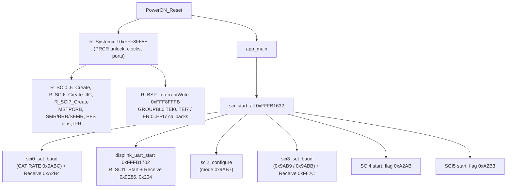

# MAIN — SCI (UART / simple-I2C) driver layer

Back to the [MAIN overview](README.md).

Part of T10b. The protocol on SCI1 (DISPLAY link) is on [display-link.md](display-link.md), the key events it carries are on
[ui-keys.md](ui-keys.md), and CAT on SCI0/SCI2/SCI3 is on [cat.md](cat.md). Function names are the names applied in Ghidra (`tools/ghidra/names_main.tsv`, merged by T17) and match `decomp/main/`; a name still in *italics* is a description that was not applied as a Ghidra name. Tags follow AGENTS.md.

## Overview

- **Code style.** The drivers are Renesas Code Generator (`r_cg_sci`) output, one copy per channel: `R_SCIn_Create`, `R_SCIn_Start`, `R_SCIn_Stop`,
  `R_SCIn_Serial_Send(buf, len)`, `R_SCIn_Serial_Receive(buf, len)`, the RXI/TXI ISRs on their own vectors, and the TEI/ERI handlers on group
  interrupt **GROUPBL0** (vector 110), registered through `R_BSP_InterruptWrite` 0xFFF8FFFB. **[fact]**
- **One buffer per call, no ring.** `Serial_Receive` arms a byte count and a pointer. The RXI ISR stores one byte, calls a per-channel
  *rx byte hook*, then counts it. When the count reaches the length, it disables RIE/RE and calls the *receive-end callback*. `Serial_Send` works the
  same way on TXI, and TEI ends the transfer. Return codes: 0 OK, 0x80 busy (TXI already enabled), 0x81 length 0. **[fact]**
- **Variable-length frames from a fixed-size receive.** Each upper layer arms a large receive (0x29BC for CAT, 0x204 for DISPLAY) and the
  **rx byte hook rewrites the expected length** once it has seen the frame header. The hook also resynchronises: if a soft timer expires between two
  bytes it moves the byte just received to the start of the buffer and restarts the frame, and an unknown first byte is dropped (count set to 0xFFFF so
  the ISR's `++` makes it 0). **[fact]** (`r_sci0_rx_byte_hook` path → `cat_rx_byte_hook` 0xFFFB1DAD, `displink_rx_frame_len` 0xFFF9384C).
- **Errors.** ERI only clears ORER/FER/PER (SSR `&0xC7 | 0xC0`) and calls an empty error callback. A reception in progress is not reset, so a corrupted
  frame ends by the inter-byte timeout or by the checksum check of the upper layer. **[fact]**
- **TXD pin handling.** `Serial_Send` sets the TXD pin's PMR bit (peripheral function), and TEI clears it again, so between frames TXD is a GPIO
  output driven high (PODR set in `Create`). **[fact]**
- **Clock.** The baud values below assume **PCLKB = 60 MHz**. That is the only clock for which every entry of the CAT baud table gives a
  standard rate (4800…115200), so it is **[inference, high]**; the SCKCR value itself was not decoded here.

## Channels

Register values are from each `R_SCIn_Create` **[fact]**. Baud = PCLKB / (64 · 2^(2n−1) / (ABCS ? 2 : 1) / (BGDM ? 2 : 1) · (BRR+1)).

| SCI | Base | Pins (MPC PFS) | SMR / BRR / SEMR at create | Baud at create | Role (see docs/hardware.md) | Upper layer |
|---|---|---|---|---|---|---|
| SCI0 | 0x8A000 | P33 RXD0, P32 TXD0 | 0x01 / 0xC2 / 0x10 | 4800 8N1 | CP2105 "Standard" USB COM: CAT port id 2 | `sci0_set_baud`, `cat_rx_complete` |
| SCI1 | 0x8A020 | P30 RXD1, P26 TXD1 | 0x08 / 0x0A / 0x10 | **≈ 340.9 kbit/s, 8N2** | DISPLAY CPU (and RX boot-mode SCI) | [display-link.md](display-link.md) |
| SCI2 | 0x8A040 | P12 RXD2, P13 TXD2 | 0x01 / 0xC2 / 0x10 | 4800 8N1 | TUNER/LINEAR jack: CAT port 3 or tuner protocol | `sci2_configure` |
| SCI3 | 0x8A060 | P25 RXD3, P23 TXD3 | 0x00 / 0xC2 / 0x50 | 38400 8N1 | CP2105 "Enhanced" USB COM: CAT port id 1 | `sci3_set_baud` |
| SCI4 | 0x8A080 | PB0 RXD4, PB1 TXD4 | 0x00 / 0x40 / 0x50 | 115200 8N1 | RT685 IF-DSP UART (FC0) | T10d (`dsp_reg_access`, DSP ISP tunnel) |
| SCI5 | 0x8A0A0 | PC2 RXD5, PC3 TXD5 | 0x00 / 0x40 / 0x50 | 115200 8N1 | SDR module FPGA | T10c (`sdr_send_cmd`, `sdr_reg_access`) |
| SCI6 | 0x8A0C0 | P01 SSCL6, P00 SSDA6 | simple-I2C: BRR 0x12, SIMR3 0xF0, SCR 0xF4 | ≈ 98.7 kHz I2C | unknown I2C device | T10h |
| SCI7 | 0x8A0E0 | P92 RXD7, P90 TXD7 | 0x00 / 0xC2 / 0x00 | 9600 8N1 | "C4" port | **unused**: no Start/Send/Receive caller |

- SCI1: SMR bit 3 (STOP) = 1 means two stop bits, CKS = 0, SEMR.ABCS = 1, so 60 MHz / (16 · 11) = 340,909 bit/s **[fact for the registers,
  inference for the rate]**. This is not a standard rate. The DISPLAY's SCIF5 setting has to match; that is a cross-check for T11b.
- SCI7 is created (MSTP released, pins set, interrupts registered) but nothing enables TE/RE: there is no `R_SCI7_Start` and no caller of the
  RX/TX ISR buffers outside the ISRs. **[fact: no other code writes 0x8A0E2 except the driver]**, so the "C4" UART is unused in V01-12 **[inference]**.
- SCI2 pin/function choice depends on setting 0x9AB7 (`tunlin_port_mode` 0..3, >3 → 0): mode 2 = CAT (baud from setting 0x9ABE, stop bits from
  0x9ABB), mode 0 = tuner protocol, modes 1/3 = SCI2 off, pins as GPIO. **[fact]** The tuner protocol itself is for T10h.

### Startup

The two init roots are **[fact]**; the name `R_Systeminit` is proposed (it is the Code Generator `R_Systeminit` equivalent, **[inference]**).

### Interrupt wiring

| Vector | Source | Handler | Notes |
|---|---|---|---|
| 58 / 59 | RXI0 / TXI0 | `r_sci0_receive_interrupt` 0xFFF9347F / `r_sci0_transmit_interrupt` 0xFFF9340E | |
| 60 / 61 | RXI1 / TXI1 | `r_sci1_receive_interrupt` 0xFFF937AC / `r_sci1_transmit_interrupt` 0xFFF9373B | |
| 62 / 63 | RXI2 / TXI2 | 0xFFF93CED / 0xFFF93C7C | |
| 80 / 81 | RXI3 / TXI3 | 0xFFF9416D / 0xFFF940FC | |
| 82 / 83 | RXI4 / TXI4 | 0xFFF9449C / 0xFFF9442B | |
| 84 / 85 | RXI5 / TXI5 | 0xFFF948C2 / 0xFFF94851 | |
| 86 / 87 | RXI6 / TXI6 | `r_sci6_iic_rxi` 0xFFFC9467 / `r_sci6_iic_txi` 0xFFFC93A4 | simple-I2C |
| 98 / 99 | RXI7 / TXI7 | 0xFFFC9811 / 0xFFFC97A0 | |
| 110 | GROUPBL0 | `vec110_GROUPBL0` 0xFFF9174A | tests GRPBL0 (0x87630) bit by bit and calls the registered callback; bit 2n = TEIn, bit 2n+1 = ERIn |

GROUPBL0 callbacks registered in `R_Systeminit` (callback index → handler). None of these was a function in the T05 project; they are code
labels right after each ISR **[fact]**:

| Index | Source | Handler | Index | Source | Handler |
|---|---|---|---|---|---|
| 0x14 | TEI0 | `r_sci0_transmitend_interrupt` 0xFFF9345A | 0x15 | ERI0 | `r_sci0_receiveerror_interrupt` 0xFFF934F1 |
| 0x16 | TEI1 | `r_sci1_transmitend_interrupt` 0xFFF93787 | 0x17 | ERI1 | `r_sci1_receiveerror_interrupt` 0xFFF9381E |
| 0x18 | TEI2 | `r_sci2_transmitend_interrupt` 0xFFF93CC8 | 0x19 | ERI2 | `r_sci2_receiveerror_interrupt` 0xFFF93D5F |
| 0x1A | TEI3 | `r_sci3_transmitend_interrupt` 0xFFF94148 | 0x1B | ERI3 | `r_sci3_receiveerror_interrupt` 0xFFF941DF |
| 0x1C | TEI4 | `r_sci4_transmitend_interrupt` 0xFFF94477 | 0x1D | ERI4 | `r_sci4_receiveerror_interrupt` 0xFFF9450E |
| 0x1E | TEI5 | `r_sci5_transmitend_interrupt` 0xFFF9489D | 0x1F | ERI5 | `r_sci5_receiveerror_interrupt` 0xFFF94934 |
| 0x20 | TEI6 | `r_sci6_iic_tei` 0xFFFC93EF | 0x22 / 0x23 | TEI7 / ERI7 | `r_sci7_transmitend_interrupt` 0xFFFC97EC / `r_sci7_receiveerror_interrupt` 0xFFFC9880 |

Also registered there: index 10 → 0xFFF8F65D and index 7 → 0xFFF927E0 (not SCI) **[fact]**.

## Per-channel callbacks and hooks

| SCI | rx byte hook | receive-end callback | transmit-end callback | Driver state (count / len / ptr) |
|---|---|---|---|---|
| SCI0 | `r_sci0_rx_byte_hook` 0xFFF9352D → `cat_rx_byte_hook` (timer 5) | `r_sci0_callback_receiveend` → `cat_rx_complete(2, len)` | 0xFFF93518 → `cat_tx_done_sci0` (0x11FE8 = 0) | rx 0x1B606 / 0x1B608 / 0x207F8, tx 0x1B604 / 0x207F4 |
| SCI1 | `displink_rx_frame_len` 0xFFF9384C (timer 1, 10) | 0xFFF93846 → `displink_rx_done` (0xA08A = 1) | 0xFFF93845 (empty) | rx 0x1B60C / 0x1B60E / 0x20800, tx 0x1B60A / 0x207FC |
| SCI2 | `sci2_rx_byte_hook` 0xFFF93DB4: CAT → `cat_rx_byte_hook` (timer 6); tuner → first byte 0xA0..0xAF sets the length (timer 8, 10) | 0xFFF93D97: CAT → `cat_rx_complete(3, len)`, tuner → flag 0xA0A9 | 0xFFF93D86: CAT → 0x11FE9 = 0, tuner → 0xFFFB1976 | rx 0x1B612 / 0x1B614 / 0x20808, tx 0x1B610 / 0x20804 |
| SCI3 | `sci3_rx_byte_hook` 0xFFF9421B → `cat_rx_byte_hook` (timer 4) | 0xFFF9420B → `cat_rx_complete(1, len)` | 0xFFF94206 → 0x11FEA = 0 | rx 0x1B618 / 0x1B61A / 0x20810 |
| SCI4 | `sci4_rx_frame_len` 0xFFF94548: NXP ISP framing (`0x5A`, type, len16, crc16) + `0x06`/`?`/`r` replies | 0xFFF94536 → 0xA2AB = 1, length 0x1B78A | 0xFFF94535 (empty) | rx 0x1B61E / 0x1B620 / 0x20818 |
| SCI5 | `sci5_rx_byte_hook` 0xFFF94962: `0x06`/`?` = 1 byte, `r` = 7 bytes | 0xFFF9495C → 0xA2B3 = 1 | 0xFFF9495B (empty) | rx 0x1B624 / 0x1B626 / 0x20820 |
| SCI7 | none | 0xFFFC98A8 (empty) | 0xFFFC98A7 (empty) | rx 0x1FA4A / 0x1FA4C / 0x21058 |

- `cat_rx_byte_hook` 0xFFFB1DAD (proposed name; it is T09's CAT framing): ends a frame on `;`, special-cases `SPR`/`SPW`/`SPNW` (fixed binary
  lengths) and `E9` (10 kB restore), and sets the inter-byte timeout from the CAT TOT setting (100 / 1000 / 3000 …) **[fact]**.
- SCI4 framing: `0x5A 0xA1/0xA2/0xA3/0xA6` → 2 bytes, `0x5A 0xA7` → 10 bytes, other `0x5A` types → length at bytes 2..3 + 6. These are the NXP
  MCU-boot ("blhost") UART packet types ACK / NAK / ACK-abort / ping / ping-response / command / data **[fact for the code, inference for the
  protocol name]**. This is the RT685 ISP path used by the DISPLAY-driven DSP update tunnel (see [display-link.md](display-link.md#tunnel-modes)).

## Functions

| Address | Ghidra name | Inferred name | Purpose |
|---|---|---|---|
| 0xFFF8F65E | `R_Systeminit` | `R_Systeminit` | Peripheral init: PRCR unlock, port/MPC setup, all `R_SCIn_Create`, GROUPBL0 callback registration, PRCR lock **[fact]** |
| 0xFFF8FFFB | `R_BSP_InterruptWrite` | `R_BSP_InterruptWrite` | Registers a group-interrupt callback by index **[inference from the calls]** |
| 0xFFF9321F | `R_SCI0_Create` | | SCI0 4800 8N1, P32/P33, IPR 8 **[fact]** |
| 0xFFF932C2 / 0xFFF93302 | `R_SCI0_Start` / `R_SCI0_Stop` | | IR clear, IER/GENBL0 enable; Stop also clears SCR TE/RE/TIE/RIE |
| 0xFFF9336A / 0xFFF933AE | `R_SCI0_Serial_Receive` / `R_SCI0_Serial_Send` | | arm a receive / start a send |
| 0xFFF9340D | `R_SCI0_Create_UserInit` | `R_SCI0_Create_UserInit` | empty (same for SCI1..7: 0xFFF9373A, 0xFFF93C7B, 0xFFF940FB, 0xFFF9442A, 0xFFF94850, 0xFFFC93A3, 0xFFFC979F) |
| 0xFFF9352D | `r_sci0_rx_byte_hook` | `r_sci0_rx_byte_hook` | calls `cat_rx_byte_hook(&cnt, &len, ptr, 5)` |
| 0xFFF93518 / 0xFFF9352C | `r_sci0_callback_transmitend` / `r_sci0_callback_receiveerror` | `r_sci0_callback_transmitend` / `r_sci0_callback_receiveerror` | |
| 0xFFF9354E | `R_SCI1_Create` | | SCI1 ≈340.9k 8N2, P26/P30, IPR 10 **[fact]** |
| 0xFFF935EF | `R_SCI1_Start` | `R_SCI1_Start` | |
| 0xFFF93697 / 0xFFF936DB | `R_SCI1_Serial_Receive` / `R_SCI1_Serial_Send` | | |
| 0xFFF9373B / 0xFFF937AC | `r_sci1_transmit_interrupt` / `r_sci1_receive_interrupt` | | |
| 0xFFF9384C | `displink_rx_frame_len` | `displink_rx_frame_len` | rx byte hook: frame length by first byte, resync on timeout (see [display-link.md](display-link.md#framing)) |
| 0xFFF93845 / 0xFFF93846 / 0xFFF9384B | `r_sci1_callback_transmitend` / `r_sci1_callback_receiveend` / `r_sci1_callback_receiveerror` | `r_sci1_callback_transmitend` / `r_sci1_callback_receiveend` / `r_sci1_callback_receiveerror` | |
| 0xFFF93A86 / 0xFFF93B29 / 0xFFF93B69 | `R_SCI2_Create` / `R_SCI2_Start` / `R_SCI2_Stop` | / `R_SCI2_Start` / | |
| 0xFFF93DB4 / 0xFFF93D97 / 0xFFF93D86 | `sci2_rx_byte_hook` / `r_sci2_callback_receiveend` / `r_sci2_callback_transmitend` | `sci2_rx_byte_hook` / `r_sci2_callback_receiveend` / `r_sci2_callback_transmitend` | CAT or tuner, by `tunlin_port_mode` |
| 0xFFF93F0D / 0xFFF93FB0 / 0xFFF93FF0 | `R_SCI3_Create` / `R_SCI3_Start` / `R_SCI3_Stop` | / `R_SCI3_Start` / | |
| 0xFFF9421B / 0xFFF9420B / 0xFFF94206 | `sci3_rx_byte_hook` / `r_sci3_callback_receiveend` / `r_sci3_callback_transmitend` | `sci3_rx_byte_hook` / `r_sci3_callback_receiveend` / `r_sci3_callback_transmitend` | |
| 0xFFF9423C / 0xFFF942DF | `R_SCI4_Create` / `R_SCI4_Start` | / `R_SCI4_Start` | |
| 0xFFF94548 / 0xFFF94536 | `sci4_rx_frame_len` / `sci4_rx_frame_done` | `sci4_rx_frame_len` / `sci4_rx_frame_done` | NXP ISP / register-reply framing |
| 0xFFF94662 / 0xFFF94705 / 0xFFF94745 | `R_SCI5_Create` / `R_SCI5_Start` / `R_SCI5_Stop` | / `R_SCI5_Start` / | |
| 0xFFF94962 / 0xFFF9495C | `sci5_rx_byte_hook` / `r_sci5_callback_receiveend` | `sci5_rx_byte_hook` / `r_sci5_callback_receiveend` | |
| 0xFFFC91B3 | `R_SCI6_Create_IIC` | | simple-I2C, ≈100 kHz |
| 0xFFFC95B1 | `R_SCI7_Create` | | 9600 8N1, never started |
| 0xFFFB1632 | `sci_start_all` | `sci_start_all` | called once from `app_main`: SCI0 baud, SCI1 start, SCI2 configure, SCI3 baud, SCI4/SCI5 start |
| 0xFFFB1645 | `sci0_set_baud` | | waits for SCI0 idle (0x11FE8), Stop, applies table entry 0x9ABC (>4 → 0), Start, Receive |
| 0xFFFB177E | `sci2_configure` | | see above |
| 0xFFFB1900 | `tunlin_port_mode` | `tunlin_port_mode` | setting 0x9AB7 clamped to 0..3 |
| 0xFFFB198F | `sci3_set_baud` | | as SCI0, from 0x9AB9 (or 0x20B58 when 0x9DC6 set), stop bits from 0x9ABB |
| 0xFFFB1DAD | `cat_rx_byte_hook` | `cat_rx_byte_hook` | CAT framing, see above |
| 0xFFFB1D5B / 0xFFFB1D65 / 0xFFFB1D6F | `cat_tx_done_sci0` / `cat_tx_done_sci2` / `cat_tx_done_sci3` | `cat_tx_done_sci0` / `cat_tx_done_sci2` / `cat_tx_done_sci3` | clear the per-port busy flag set by `cat_send_reply` (0x11FE8 / 0x11FE9 / 0x11FEA) |
| 0xFFFB237A / 0xFFFB23F3 | `swtimer_start` / `swtimer_expired` | `swtimer_start` / `swtimer_expired` | 75 software timers (id 0..0x4A): `start(id, n)` stores n·10 at 0x209BC+4·id and clears the expired flag 0x11FED+id **[fact]**; the unit is 1 ms per the CAT timings in cat.md **[inference]** |

## Data structures and globals

| Address | Type | Name (proposed) | Meaning |
|---|---|---|---|
| 0xFFF80FF4 | 5 × 4 B | `sci_baud_table` | **{SEMR.BGDM, SEMR.ABCS, SMR.CKS, BRR}** (the T05 comment had the first two swapped): 4800, 9600, 19200, 38400, 115200 at 60 MHz **[fact for the order: `sci0_set_baud` puts byte 0 in bit 6 and byte 1 in bit 4]** |
| 0x9ABC / 0x9AB9 / 0x9ABE | u8 | CAT RATE settings | index into the table for SCI0 / SCI3 / SCI2 **[fact]** |
| 0x9AB7 | u8 | SCI2 port mode | 0..3 **[fact]** |
| 0x9ABB | u8 | stop-bit option | ORs SMR.STOP for SCI2/SCI3 **[fact]** |
| 0x11FE8..0x11FEA | u8 | CAT TX busy | per port; `*_set_baud` spin on it before reprogramming **[fact]** |
| 0x9E86 | 0x204 B | DISPLAY rx buffer | **[fact]** |
| 0xA08A | u8 | DISPLAY rx-complete flag | **[fact]** |
| 0x209BC / 0x20890 / 0x11FED | u32[75] / u32[75] / u8[75] | soft timers | reload, elapsed, expired flag **[fact]** |
