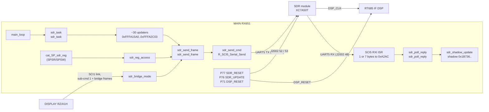
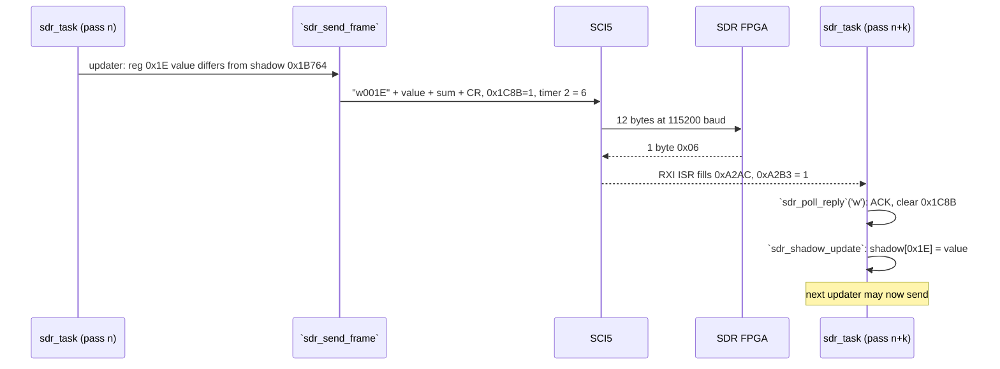
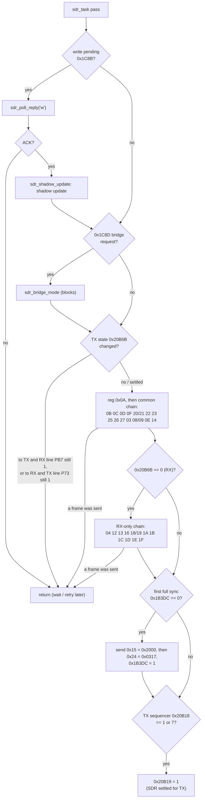
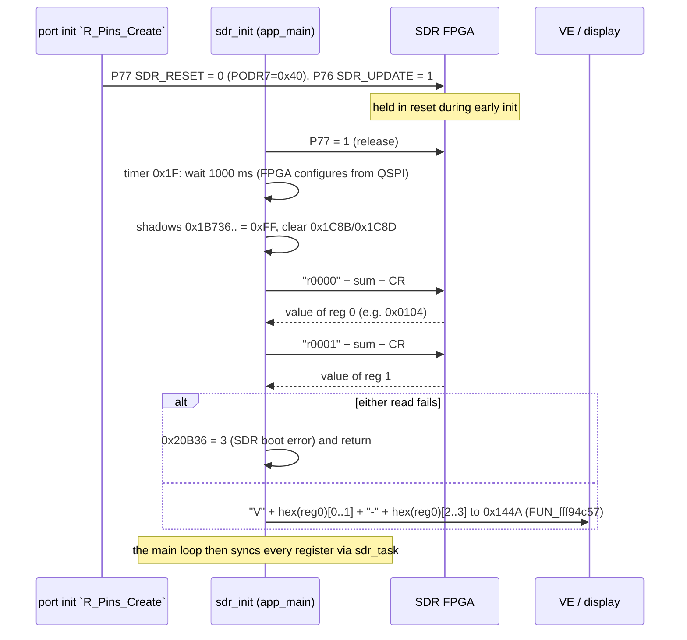
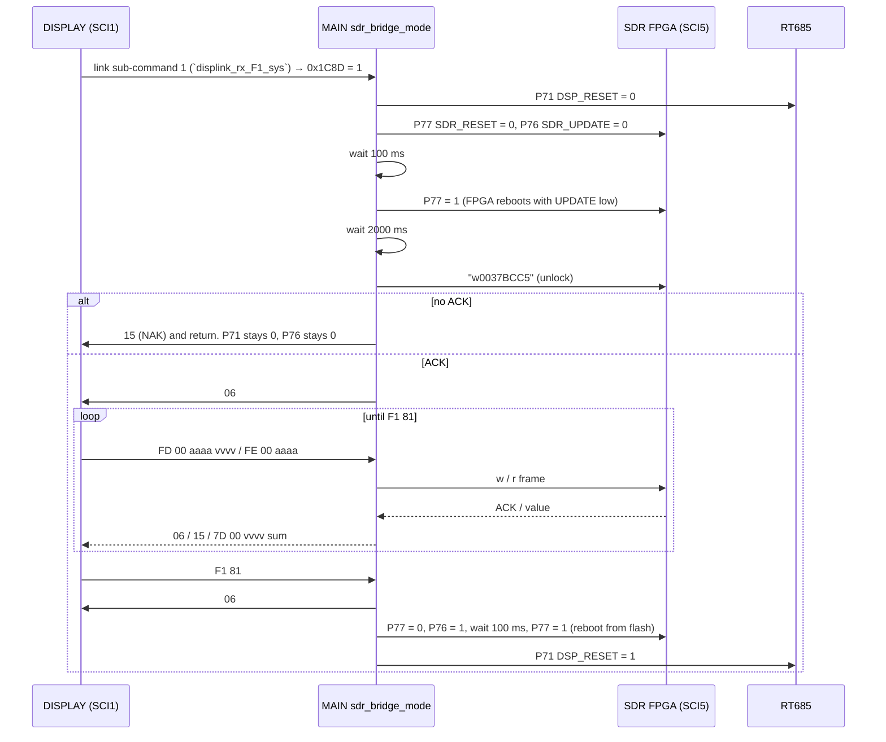

# MAIN — SDR link (SCI5) and SDR control GPIOs

Back to the [MAIN overview](README.md).

This page covers how the MAIN CPU (RX651) drives the SDR module (XC7A50T FPGA, image SR): the SCI5 command/reply
protocol, the polled task that keeps about 35 FPGA registers in sync with the radio state, the boot and reset
sequence, the `SDR_UPDATE`/`SDR_RESET` lines, and the maintenance bridge the DISPLAY CPU uses for an SDR update.
The FPGA side is in [../sdr/README.md](../sdr/README.md) and [../sdr/interfaces.md](../sdr/interfaces.md) (T13). The
CAT service commands `SPSR`/`SPSW` that reach the same registers are in [cat.md](cat.md) and
[cat-commands.md](../../cat-commands.md#extended-table).

Names are the current Ghidra names in `ghidra/FT710_MAIN`. Function names are the names applied in Ghidra (`tools/ghidra/names_main.tsv`, merged by T17) and match `decomp/main/`; a name still in *italics* is a description that was not applied as a Ghidra name. Tags follow AGENTS.md: **[fact]** means seen in code,
data or the schematic at the address or page given.

## Overview

- **Physical link.** SCI5 runs as an 8N1 UART. TXD5 (pin 67, `SDR_UMOSI`, R1057 470 Ω) goes to J2002 pin 46
  (`UART_RX`), and pin 70 (`SDR_UMISO`) comes from J2002 pin 48 (`UART_TX`) **[fact: p17, p19]**.
- **Baud rate.** `R_SCI5_Create` (0xFFF94662) sets SMR=0x00, BRR=0x40 and SEMR=0x50 (BGDM=1, ABCS=1), giving PCLKB/(8·65)
  (divider 16·2^(2n−1) = 8 with n = 0 and both bits set; the earlier "4·65" was wrong) **[fact: RX651 HWM r01uh0590 §37.2.13 Table 37.11, §37.2.15]**.
  PCLKB is 60 MHz (PLLCR 0x1300: 24 MHz × 10, SCKCR 0x21C21222: PCKB ×1/4) **[fact: `hw_init_clock` + RX651 HWM §9.2.1, §9.2.5]**, which also fits
  the SCI0 CAT baud table at 0xFFF80FF4. So the SDR link runs at **115 385 baud, i.e. 115200 (+0.16 %)** **[fact]**.
- **Protocol.** The protocol is ASCII and strictly one request at a time, always started by MAIN. A request is `r` + 4 hex
  digits of register (8 bytes) or `w` + register + 4 hex digits of value (12 bytes), followed by a 2-hex-digit additive
  checksum and CR. The FPGA answers a write with **one byte**, ACK 0x06, and a read with **7 bytes** `r` + 4 hex digits of value +
  2-hex checksum, received into 0xA2AC; MAIN's `sci5_rx_byte_hook` 0xFFF94962 sets the receive length from the first byte
  (0x06 or `?` → 1, `r` → 7) **[fact, T19h; agrees with the T15e simulation]**, see [Frame format](#frame-format).
  (Superseded: this bullet used to say the FPGA "always answers with 7 bytes".)
- **Register model.** The register space is 16 bits wide, and every value is a 16-bit word. MAIN keeps a **shadow copy of
  every register it writes** (0x1B736..0x1B780). A register is written only when the value computed from the radio state
  differs from its shadow, and the shadow is updated only after the FPGA ACKs **[fact]** (`sdr_shadow_update`).
- **Scheduling.** `sdr_task` runs once per `main_loop` pass. It walks about 30 updaters in a fixed order
  and stops at the first one that sends a frame, so **at most one write is in flight per pass**. The reply is collected
  on a later pass **[fact]**. RX-only registers are skipped while transmitting (0x20B6B=1).
- **GPIOs.** P77 = `SDR_RESET` (low = module held in reset), P76 = `SDR_UPDATE` (J2002 pin 53, labelled `WP`; normally
  high, low only during an SDR update). P71 = `DSP_RESET` is held low during an SDR update, probably because the
  RT685 is clocked by the FPGA's `DSP_CLK` **[fact: p17 for the nets, code for the levels; inference for the reason]**.
- **Update bridge.** When the DISPLAY sends link sub-command 1, MAIN resets the FPGA with `SDR_UPDATE` low, writes the
  magic value 0xBCC5 to register 0x37, and then relays binary register-write and register-read requests from the DISPLAY
  (SCI1) to the FPGA (SCI5), until the DISPLAY sends `F1 81` **[fact]** (`sdr_bridge_mode` 0xFFFA3226). So the SDR
  update traffic passes through **MAIN's UART**, at least for its control part **[fact]**; see
  [SDR update bridge](#sdr-update-bridge).

## Block diagram

## GPIOs

Port output bits are written through the small helpers below (PODR = 0x8C020 + port number). The pin nets were read
from the CPU symbol on service manual p17 **[fact]**. At boot, the port-init function `R_Pins_Create` writes
PODR7=0x40 and PDR7=0xDF **[fact]**. So after port init P76 is high, P77 is low (the FPGA is held in reset until
`sdr_init`), P71 is low (the DSP is held in reset until `dsp_link_init`), and P75 is an input.

| Helper | Proposed name | Port (pin) | Net (p17) | Destination | Use in code |
|---|---|---|---|---|---|
| `sdr_reset_set` | `sdr_reset_set` | P77 (68), R1142 470 Ω, pull resistor R1133 10 kΩ | `SDR_RESET` | J2002 pin 52 `RST_IN` (via D2001) | Set to 1 by `sdr_init` (boot); pulsed 0→1 at bridge entry and exit **[fact]** |
| `sdr_update_set` | `sdr_update_set` | P76 (69), R1141 4.7 kΩ | `SDR_UPDATE` | J2002 pin 53 `WP` | 1 from port init. 0 at bridge entry, back to 1 at bridge exit, and cleared by `power_off_io` **[fact]** |
| `dsp_reset_set` | `dsp_reset_set` | P71 (86), R1152 4.7 kΩ | `DSP_RESET` | RT685 | 0 at bridge entry, 1 at exit. Also used by DSP init `dsp_link_init` and the DSP update routine `dsp_isp_bridge` **[fact]** |
| `dsp_update_set` | `dsp_update_set` | P72 (85), R1041 4.7 kΩ | `DSP_UPDATE` | RT685 boot select | DSP update routine `dsp_isp_bridge` only **[fact]** |
| `af_reset_set` | `af_reset_set` | P74 (72), R1122 4.7 kΩ | `AF_RESET` | AF unit | Set by `shreg_bus_init` (boot, `app_main`) **[fact]**; not SDR |
| `pa_pon_set` | `pa_pon_set` | PC0 (75) | `PA_PON` | PA unit power | Cleared by `power_off_io` **[fact]**; not SDR |
| `tx_line_get` | `tx_line_get` | P73 (77), reads PODR | `TX` | TX switching | `sdr_task` waits for it to drop before RX updates resume **[fact]** |
| `rx_line_get` | `rx_line_get` | PB7 (78), reads PODR | `RX` | RX switching | `sdr_task` waits for it to drop before TX updates start **[fact]** |
| `tun_lin_sel_set` / `rem_key_sel_set` | | P83 (58) / P86 | P83: `TUN_LIN_SEL`? | tuner / linear | Not SDR; P83 is cleared by `power_off_io` |
| `gpo_c_dir`, `gpo_a_set`/`7165`, `gpo_c_set`, `gpo_d_set`, `gpo_a_get`..71e2`, `gpo_a_dir_out`/`711c` | | PDR5.0, P13/P12, P50, P22, PDR1.3/1.2 | not traced | | Not SDR (tuner and other ports); left to the owning T10 pages |

`power_off_io` (0xFFFB73A6) clears PC0 (`PA_PON`), P76 (`SDR_UPDATE`), P83, PC4 (`FSK_SHIFT`), PC3 (TXD5 pin function), P67, PB5
and PA7, and calls `R_SCI5_Stop` **[fact]**. It does **not** touch P77 (`SDR_RESET`) **[fact]**.

**Polarity of `SDR_UPDATE` against the `WP` label.** The module pin is labelled `WP`. A plain active-low flash `WP#`
would be write-protected while P76 is low, but P76 is low exactly while an update is running. So the line is either
inverted on the module, or it is an FPGA input that selects the update path ("write program") rather than the flash
pin itself **[inference]**. This revises T13's reading that MAIN "lifts WP" during an update.

## Frame format

### Request (MAIN → FPGA) [fact: `sdr_send_frame` 0xFFFA30F9]

Built at 0x1C7F, register number from 0x1B784, value from 0x1B786. The checksum is the 8-bit sum (`sdr_sum8`) of all
bytes before it, including the command letter, written as 2 upper-case hex digits (`byte2hex`).

| Kind | Bytes | Example (computed) |
|---|---|---|
| Read | `r` a a a a s s CR (8 bytes) | `r000032` CR |
| Write | `w` a a a a v v v v s s CR (12 bytes) | `w0037BCC5` + sum + CR |

Example: for `r0000` the sum is 0x72 + 4×0x30 = 0x132, so the low byte 0x32 gives `r000032\r`. The checksum is the low
byte of the sum **[fact: u8 accumulator]**.

After sending, `sdr_send_cmd` (0xFFFB1B2B) clears the ready flag 0xA2B3 and arms `R_SCI5_Serial_Receive(0xA2AC, 7)`.
`sdr_send_frame` sets the pending flag (0x1C8C for a read, 0x1C8B for a write) and starts **timer 2 with 6** (6 ms, using
the same units as `cat_ai_holdoff`'s 200 = 200 ms) **[fact for the call; inference for the unit]**.

### Reply (FPGA → MAIN): 1 byte for a write, 7 bytes for a read [fact: `sci5_rx_byte_hook`, `sdr_poll_reply`, `sdr_wait_reply`]

`sdr_send_cmd` arms a receive of up to 7 bytes, but `sci5_rx_byte_hook` 0xFFF94962 (called by the SCI5 RXI ISR for each byte) looks at the
first byte: 0x06 or `?` sets the length to 1, `r` keeps 7, and any other first byte is dropped **[fact]**. (Corrected by T19h: this section
used to say "always 7 bytes" and guessed byte 0 was an echo; T15e's simulation and this code agree.)

| Request | Reply layout | Check |
|---|---|---|
| read | byte 0 = `r`, bytes 1..4 = value in hex, bytes 5..6 = hex of sum8(bytes 0..4), no CR (e.g. `r010437`) | `sdr_check_hex_sum`(buf,5)`; value = `hex2word(buf+1)` (disassembly 0xFFFA301B) |
| write | one byte **0x06 ACK** (or `?` 0x3F if the FPGA rejected the frame) | any byte other than 0x06 = failure |

`sdr_poll_reply` returns 1 for a good reply. When the reply is in (0xA2B3=1), both pending flags are
cleared whatever the result. If no reply arrives before timer 2 runs out, the flags are cleared and the frame counts as
failed **[fact]**. There is no retry counter: a failed write leaves the shadow unchanged, so the updater sends the same
write again on a later pass **[inference from the structure]**.

## The SDR task (`sdr_task`, proposed `sdr_task`)

Called from `main_loop` (0xFFF94B8B) on every pass, right after `io_task` **[fact]**. One pass does the following:

Notes **[fact unless marked]**:
- Each updater compares its value with the shadow and calls `sdr_send_frame`('w')` only on a difference. After each call
  the chain checks 0x1C8B and stops if a frame went out. So a change that affects several registers takes several
  passes to apply.
- **32-bit values** (registers 0x08/0x09, 0x18/0x19, 0x20/0x21) are sent high word first. When the high word is
  written, the updater sets the low word's shadow to 0xFFFF, which forces the low word out on the next pass.
- **TX/RX hand-over.** 0x20B6B is the TX flag of the TX sequencer (0x20B18 is its state) **[inference]**. The task
  remembers the last state in 0x1B3DD and does not update across a change until the opposite switching line (PB7 `RX`
  or P73 `TX`) has dropped. It then sets 0x20B19=1 when the sequencer is in state 1 or 7, which reads as the SDR's
  "ready" handshake for the TX sequence **[inference]**.
- The mode and frequency helpers it uses (`vfo_mode`(side)` = mode index of the RX (0) or TX (1) side,
  `vfo_freq`(side,2)` = that side's frequency, `FUN_fffc4e4f` = selected filter width in Hz, `gen_subband_of_freq` = band
  index from the edge table 0xFFF887CC) belong to the band/VFO page (T10) **[inference from use]**. The mode index is
  the internal order behind `cat_mode_codes`: 0 LSB, 1 USB, 2 CW-L, 3 CW-U, 4 AM, 5 AM-N, 6 FM, 7 FM-N, 8 DATA-L,
  9 DATA-U, 10 DATA-FM, 11 DATA-FM-N, 12 RTTY-L, 13 RTTY-U, 14 PSK **[inference: cat.md table + the mode cases below]**.

## SDR register map (as seen from MAIN)

These are the same register numbers that CAT `SPSRaaaa;` / `SPSWaaaavvvv;` reach (`aaaa` = register below, 4 hex
digits). "Writer" is the updater function. "When": **all** = every pass in RX and TX, **RX** = only while 0x20B6B=0,
**once** = once after the first complete sync. The value columns are **[fact]** (code and ROM tables). The meaning
column is tagged per row.

| Reg | Shadow | Writer (proposed name) | When | Value written | Meaning |
|---|---|---|---|---|---|
| 0x00 | 0x1B736 | read by `sdr_init` | boot | read only | SDR firmware version, BCD: 0x0104 → `V01-04` (stored at 0x144A, returned by `VE2;`) **[inference: matches SR V01-04]** |
| 0x01 | 0x1B738 | read by `sdr_init` | boot | read only | Unknown. It is read and must answer, otherwise boot error 0x20B36=3 **[fact]** |
| 0x03 | 0x1B73A | `sdr_upd_r03` | all | 0xE63D if TX-side frequency ≤ 62 500 000 Hz, else 0xE61D | Control word. Bit 5 changes at 62.5 MHz: fs/2 of a 125 MSPS converter, or fs/4 at 250 MSPS; since it follows the TX frequency it may concern the DAC **[inference; ADC rate open, [system.md O7](../system.md#8-contradictions-and-open-questions)]** |
| 0x04 | 0x1B73C | `sdr_upd_r04` | RX | 0xE519 | constant **[meaning unknown]** |
| 0x08 / 0x09 | 0x1B73E / 0x1B740 | `sdr_upd_r08_tx_freq` | all | high/low word of 0x20F50 (Hz). PSK: −1000/1500/2000 (0x9A79). CW keying in an SSB mode (`FUN_fffba192`==3): ∓(300 + 10·KP 0x9C04) | **TX NCO frequency** **[inference]** |
| 0x0A | 0x1B742 | `sdr_upd_r0a_demod` | all, only while 0x1204D≠0 | 0 = CW (modes 2,3, or CW in SSB), 1 = AM (4,5), 2 = FM (6,7,10,11), 3 = LSB/DATA-L (0,8), 4 = USB/DATA-U/PSK (1,9,14), 5 = RTTY (12,13) | **Modulation class** of the active side **[inference]** |
| 0x0B | 0x1B744 | `sdr_upd_r0b_band` | all | per-band word, table 0xFFF87FFA (RX: 105…117) / 0xFFF87FFE (TX: 96…128), 8-byte rows | Per-band gain/level calibration **[guess]** |
| 0x0C | 0x1B746 | `sdr_upd_r0c_rtty_shift` | all | `(shift/5) << 8 | 3`, shift = 170/200/425/850 Hz from 0x9A8D | **RTTY shift** **[inference]** |
| 0x0D | 0x1B748 | `sdr_upd_r0d` | all | 9 / 14 / 19 for 0x9AA1 = 0 / 1 / 2 | 0x9AA1 is **CW WAVE SHAPE** (`EX020117`, #74), so reg 0x0D is the CW envelope rise/fall. 0x9AA1 also sets a TX-sequencer delay (2·v+4) **[fact]**; envelope meaning **[inference]** |
| 0x0E | 0x1B74A | `sdr_upd_r0e` | all | 0x1200 | constant |
| 0x0F | 0x1B74C | `sdr_upd_r0f_band` | all | per-band word 0xFFF87FFC (RX 0x1800) / 0xFFF88000 (TX 0x0A00). 0 when ADC 0x20B14 (`adc_results[8]`) ≥ 0xE8B, unchanged while it is 0x9B3…0xE8A (hysteresis) | Unknown; disabled by an analog condition **[guess]** |
| 0x12, 0x13 | 0x1B74E, 0x1B750 | `sdr_upd_r12`, `sdr_upd_r13` | RX | 0x8000 each | **Gains of ADC channel A (0x12) and B (0x13)**: 16-bit B operands of DSP48_X1Y26 / DSP48_X0Y17 after the DC removal; 0x8000 is also their reset value ([sdr/netlist.md 3.7](../sdr/netlist.md), #172) **[fact, simulation]** |
| 0x14 | 0x1B752 | `sdr_upd_r14_mode` | all | 0x2000 default, 0x3200 AM/AM-N, 0x7800 FM/DATA-FM, 0x3C00 FM-N/DATA-FM-N | Mode-dependent level (FM deviation scale?) **[guess]** |
| 0x15 | 0x1B754 | `sdr_init_r15` | once | 0x2000 | constant |
| 0x16 | 0x1B756 | `sdr_upd_r16_filter` | RX | CW: 0/1/2 for width <251/<800/≥800 Hz; SSB, DATA, RTTY, PSK: 0x10/0x11/0x12 for <1101/<2000/≥2000 Hz; AM 0x21, AM-N 0x20, FM-N 0x30, FM and DATA-FM 0x31 | **Filter (FIR) class selection** **[inference]**. It also sets 0x20B4A, the TX→RX AF-unmute delay in ms that `trx_sequencer` adds to timer 0x0D (#205): CW 74/39/23 (narrow → wide), SSB/DATA/RTTY/PSK 31/23/21, AM/FM 30; +10 when the mode's AESS level is non-zero (not for AM/FM) **[fact]**. That it covers the filter's group delay is **[inference]** |
| 0x18 / 0x19 | 0x1B758 / 0x1B75A | `sdr_upd_r18_rx_freq` | RX | high/low word of the RX-side frequency (Hz) plus a mode offset: SSB ±(1500 + shift), CW pitch, RTTY mark/shift (0x9A8C/0x9A8D), DATA offset 10·0x9A7A, PSK | **RX NCO frequency** **[inference]** |
| 0x1A | 0x1B75C | `sdr_upd_r1a_nb_level` | RX | 0 if NB is off (VFO flag byte +2 bit 1). Else NB level `NL` (0x9DC0, 0…10) through 0xFFF8808A (AM: 16128…9728) or 0xFFF880A0 (others: 16128…7040) | **Noise-blanker threshold** **[inference: NL]** |
| 0x1B | 0x1B75E | `sdr_upd_r1b` | RX | 0x9AD3 index → 0xFFF880B6 (AM: 6, 352, 720) / 0xFFF880BC (6, 12, 36) | **NB WIDTH** (0x9AD3 = `EX030203`, #74) **[fact for the setting]** |
| 0x1C | 0x1B760 | `sdr_upd_r1c` | RX | 2 / 5 / 10 for 0x9AD2 = 0 / 1 / 2 | **NB REJECTION** (0x9AD2 = `EX030202`, #74) **[fact for the setting]** |
| 0x1D | 0x1B762 | `sdr_upd_r1d_notch` | RX | 0 when off (per-mode enable bit 0x80). Else (centre − 10·setting)/5, sign-flipped for USB-side modes, 12 bits, `| 0x2000` (0x9AD1=0) or `| 0x1000` | **Manual notch** frequency and width **[inference]** |
| 0x1E | 0x1B764 | `sdr_upd_r1e_passband` | RX | signed passband centre / 5 Hz (1500 + shift for SSB, CW pitch, RTTY tones, …), negated for modes 1, 3, 9, 13, 14 | **Passband centre / IF shift** **[inference]** |
| 0x1F | 0x1B766 | `sdr_upd_r1f_width` | RX | AM 9000, AM-N 6000, FM/DATA-FM 16000, FM-N/DATA-FM-N 9000, otherwise the selected width (`FUN_fffc4e4f`) | **Filter bandwidth in Hz** **[inference]** |
| 0x20 / 0x21 | 0x1B768 / 0x1B76A | `sdr_upd_r20_scope_freq` | all | RX, scope mode 0x9C35=0 (centre): RX frequency + offset (`vfo_display_offset`). Fixed/cursor: start (0x20F60 or `bandmem_get`(2)`) + half span (500…500 000). TX: frequency mirrored about 62.5 MHz | **Scope centre frequency** **[inference]** |
| 0x22 | 0x1B76C | `sdr_upd_r22_scope_span` | all | span index → 1, 2, 5, 10, 20, 50, 100, 200, 500, default 1000 | **Scope span in kHz** **[inference]** |
| 0x23 | 0x1B76E | `sdr_upd_r23` | all | 0x8000 / 0x7000 / 0x5000 for 0x9B14 = 0 / 1 / 2 | 0x9B14 is the scope **RBW** (`EX040201`, #74), so reg 0x23 is a scope resolution-bandwidth parameter **[fact for the setting, inference for the register]** |
| 0x24 | 0x1B770 | `sdr_init_r24` | once | 0x0317 | constant |
| 0x25 | 0x1B772 | `sdr_upd_r25_tx_drive` | all | linear interpolation of the power setting (`FUN_fffb4062`) between the 5/10/20/50/100 W points of the per-band record (pointer table 0xFFF8861C → 0x469E…0x4734, 15 bytes per band, inside the `SPN` table 0x4659), × 16 | **TX drive level** **[inference]**. The bytes it uses (record +2, +5, +8, +11, +14) are the alignment items `[TX] 100W…5W TXG <band>` (`SPN` 072, 075, …; 50/20/10/5 W only for the 70 MHz record), named by MAIN's alignment menu **[fact, #203]** ([eeprom.md](eeprom.md#cfg105-the-alignment-table-fact)) |
| 0x26 | 0x1B774 | `sdr_upd_r26` | all | RX 0x0610. TX: 0x9C36=0 → 0x0140 if 0x9B16 else 0x0610; 0x9C36≠0 → 0xFF00 if 0x9B17 else 0x0200. 0x9B16/0x9B17 are the scope's **2D / 3DSS DISP SENSITIVITY** (`EX040203`/`EX040204`, #74) | Unknown. TX-only value tied to the scope settings (TX monitor?) **[guess]** |
| 0x27 | 0x1B776 | `sdr_upd_r27_scope_level` | all | `0x8000 | (−(L) + 0/2/4)`. RX: L = scope ref-level byte (SS sel 4) + 0x4689 + 0x44; TX: L = byte − 0x37 | **Scope reference level** **[inference]** |
| 0x30, 0x31 | 0x1B778, 0x1B77A | no updater | | written only by the bridge or `SPSW` | update data path? **[guess]** |
| 0x32, 0x33 | 0x1B77C, 0x1B77E | no updater | bridge | the only registers the bridge lets the DISPLAY read | update status words **[inference]** |
| 0x37 | 0x1B780 | `sdr_bridge_mode` | bridge entry | 0xBCC5 | **Update unlock key** **[inference]** |
| 0xFFFF | 0x1B782 | (pseudo) | CAT | | Result slot for `SPSR`/`SPSW`. `sdr_wait_reply(…,1)` forces register 0xFFFF before the shadow update, so CAT frames never touch the real shadows **[fact]** |

Registers 0x02, 0x05–0x07, 0x10, 0x11, 0x17, 0x28–0x2F and 0x34–0x36 never appear in MAIN **[fact: no updater, no
shadow slot]**. What they do in the FPGA is unknown.

**`SPSW` persistence [inference from the shadow logic].** A value written with `SPSW` is not copied into the shadow. It
therefore stays in the FPGA until the radio's own computed value for that register changes (then the updater overwrites
it), or until a register that the firmware never writes is involved, in which case it stays until the module is reset.
`sdr_reg_access` first waits for any pending task frame, calling `sdr_task` in a loop, so CAT and task frames do not
interleave **[fact]**.

## Boot sequence (`sdr_init`, proposed `sdr_init`)

Called once from `app_main` after power-on, between `trx_init` and the DSP init `dsp_link_init` **[fact]**.

The version string comes from the template `V**-**` at 0xFFF8F3D8 **[fact]**. `VE2;` returns the 4 characters read from
0x144A **[fact: cat-commands.md]**. The DSP init uses the same pattern with error code 2 **[fact]**.

## SDR update bridge

`sdr_bridge_mode` (0xFFFA3226) runs inside `sdr_task` when 0x1C8D=1. `sdr_bridge_request` sets that flag,
called from the DISPLAY-link message handler `displink_rx_F1_sys` for sub-command 1 **[fact]**. The bridge blocks the main
loop: CAT, the UI and every other polled task stop until it returns **[fact: it loops on the SCI1 receive flag and only
calls `wdt_kick`]**.

DISPLAY → MAIN frames are read from the DISPLAY link receive buffer (0x9E86, flag 0xA08A, via `displink_rx_ready`/174f/172d`).
The first 11 bytes are copied (to SP+0xD) **[fact: disassembly 0xFFFA32B7..0xFFFA32C8]**:

| DISPLAY frame (binary) | MAIN action | Answer to DISPLAY (SCI1) |
|---|---|---|
| `06 …` | ignored (an ACK echo) | none |
| `FD 00` a a a a v v v v … (addr, value as 4 hex each at bytes 2..5 and 6..9) | `w` frame to the FPGA | `06` if the FPGA ACKs, else `15` (NAK) |
| `FE 00` a a a a … | `06`, then an `r` frame to the FPGA | for reg 0x32/0x33: `7D 00` + 4 hex value + sum8 of the 6 bytes (7 bytes). Any other register or a failed read: `15` |
| `F1 81` | leave the bridge | `06` |
| anything else | | `15` |

What the bridge tells us about the update **[inference unless marked]**:
- The FPGA design itself handles the update. It answers on the UART right after the reset with `SDR_UPDATE` low, and it
  takes the unlock write. So the update is done by the running SDR design, which writes its own QSPI flash, and not by
  a separate loader or by JTAG.
- The DISPLAY sees only register writes and the status registers 0x32/0x33. Either the whole image is streamed as
  register writes (registers 0x30/0x31 are the candidates: they have shadow slots but no updater), or the bulk data goes
  over the DISPLAY's SPI link to the module's FFT port, and the bridge carries only the control and status traffic.
  At 115200 baud with 12-byte frames for 2 data bytes, the 2.19 MB image would need about 20 minutes on the UART alone
  **[guess: arithmetic]**, so the SPI path for the bulk data is plausible. The DISPLAY side (T11c, `sdr_flash_write`)
  must settle this.
- If the unlock fails, the bridge returns without releasing `DSP_RESET` and without raising `SDR_UPDATE` **[fact]**.
  The radio then has no IF DSP until it is power-cycled **[inference]**.
- After the update the DSP is held in reset until the FPGA has rebooted. The reason is most likely that `DSP_CLK` comes
  from the FPGA (J2002 pin 22) **[inference]**.

## Function table

| Address | Ghidra name | Inferred name | Purpose |
|---|---|---|---|
| 0xFFF94662 | `R_SCI5_Create` | | SCI5 8N1, BRR=0x40, SEMR=0x50 (115200 baud at 60 MHz PCLKB); PC3 = TXD5 pin function **[fact]** |
| 0xFFF94705 | `R_SCI5_Start` | `R_SCI5_Start` | Enables the SCI5 interrupts (IR/IER and group bits) **[fact]** |
| 0xFFF94745 | `R_SCI5_Stop` | | Called by `power_off_io` **[fact]** |
| 0xFFF947AD / 0xFFF947F1 | `R_SCI5_Serial_Receive` / `R_SCI5_Serial_Send` | | Code Generator driver **[fact]** |
| 0xFFF948C2 | `r_sci5_receive_interrupt` | | Stores bytes and calls the receive-end callback after n bytes **[fact]** |
| 0xFFF9495C | `r_sci5_callback_receiveend` | `r_sci5_callback_receiveend` | → `sdr_rx_done_cb` **[fact]** |
| 0xFFFB1AF8 | `sdr_link_start` | `sdr_link_start` | Clears 0xA2B3 and starts SCI5. Part of the SCI start-up chain `sci_start_all` **[fact]** |
| 0xFFFB1B06 | `sdr_rx_ready` | `sdr_rx_ready` | Returns 0xA2B3 **[fact]** |
| 0xFFFB1B15 | `sdr_rx_done_cb` | `sdr_rx_done_cb` | 0xA2B3 = 1 **[fact]** |
| 0xFFFB1B1F | `sdr_rx_buf` | `sdr_rx_buf` | Returns 0xA2AC (`MOV.L #0xA2AC,R1`; the decompile lost the return) **[fact]** |
| 0xFFFB1B2B | `sdr_send_cmd` | | Send, then arm a receive of up to 7 bytes into 0xA2AC; `sci5_rx_byte_hook` 0xFFF94962 trims it to 1 byte for 0x06/`?` **[fact]** |
| 0xFFFA30F9 | `sdr_send_frame` | `sdr_send_frame` | Builds and sends an `r`/`w` frame; sets a pending flag; timer 2 = 6 **[fact]** |
| 0xFFFA3083 | `sdr_poll_reply` | `sdr_poll_reply` | Non-blocking reply check with timeout **[fact]** |
| 0xFFFA2FF7 | `sdr_wait_reply` | `sdr_wait_reply` | Blocking reply wait, used by boot, CAT and the bridge **[fact]** |
| 0xFFFA31AE | `sdr_sum8` | `sdr_sum8` | Frame checksum **[fact]** |
| 0xFFFA31DB | `sdr_check_hex_sum` | `sdr_check_hex_sum` | Reply checksum test **[fact]** |
| 0xFFFA2C9F | `sdr_shadow_update` | `sdr_shadow_update` | Register → shadow slot (compare chain) **[fact]** |
| 0xFFFA1132 | `sdr_init` | `sdr_init` | Boot sequence above **[fact]** |
| 0xFFFA11ED | `sdr_task` | `sdr_task` | Main-loop task above **[fact]** |
| 0xFFFA1485 | `sdr_reg_access` | | CAT `SPS` back end: waits for idle, sends, blocking wait; result in 0x1B782 **[fact]** |
| 0xFFFA1576 | `sdr_bridge_request` | `sdr_bridge_request` | 0x1C8D = 1 **[fact]** |
| 0xFFFA1580 / 0xFFFA1590 | `sdr_req_reg0` / `sdr_req_reg1` | `sdr_req_reg0` / `sdr_req_reg1` | Version reads **[fact]** |
| 0xFFFA150C / 0xFFFA1541 | `scope_level_ptr` / `scope_span_ptr` | `scope_level_ptr` / `scope_span_ptr` | Per-band scope setting pointers (also used by `cat_SS`) **[inference]** |
| 0xFFFA15A0 … 0xFFFA2C03 | `sdr_upd_r03` … | *sdr_upd_rXX_…* | 29 register updaters, see the register map; one name per function in `names_main.T10c.tsv` |
| 0xFFFA3226 | `sdr_bridge_mode` | | Update bridge above **[fact]** |
| 0xFFFA4E31 | `cat_SP_sdr_reg` | | CAT `SPSR`/`SPSW` ([cat.md](cat.md)) |
| 0xFFFB7051 / 0xFFFB7067 | `sdr_reset_set` / `sdr_update_set` | `sdr_reset_set` / `sdr_update_set` | P77 / P76 **[fact]** |
| 0xFFFB7080 / 0xFFFB7098 | `dsp_reset_set` / `dsp_update_set` | `dsp_reset_set` / `dsp_update_set` | P71 / P72 **[fact]** |
| 0xFFFB73A6 | `power_off_io` | | Power-down port bits, stops SCI5 (see GPIOs) **[fact]** |

The DSP link has the same design over SCI4: `dsp_reg_access` (0xFFF9D8A4), boot `dsp_link_init`, a twin task with the
same TX/RX hand-over test (`dsp_link_poll`, 0xFFF9C2F9 file), and shadows at 0x1B634 **[fact for the structure]**. It is
documented on the DSP-link page.

## Globals

| Address | Size | Proposed name | Meaning |
|---|---|---|---|
| 0x1C7F | 12 | `sdr_tx_frame` | Outgoing ASCII frame **[fact]** |
| 0x1C8B | u8 | `sdr_wr_pending` | A write frame is waiting for its ACK **[fact]** |
| 0x1C8C | u8 | `sdr_rd_pending` | A read frame is waiting for its answer **[fact]** |
| 0x1C8D | u8 | `sdr_bridge_req` | Set by DISPLAY sub-command 1, cleared on bridge entry **[fact]** |
| 0xA2AC | 7 | `sdr_rx_buf` | Reply buffer **[fact]** |
| 0xA2B3 | u8 | `sdr_rx_ready` | Reply complete **[fact]** |
| 0x1B736..0x1B780 | 37 × u16 | `sdr_shadow` | Last ACKed value per register (map above); set to 0xFF bytes at boot **[fact]** |
| 0x1B782 | u16 | `sdr_cat_value` | Result of `SPSR` / scratch for 0xFFFF frames **[fact]** |
| 0x1B784 | u16 | `sdr_reg` | Register number of the current frame **[fact]** |
| 0x1B786 | u16 | `sdr_value` | Value of the current frame / last read value **[fact]** |
| 0x1B3DC | u8 | `sdr_init_done` | One-shot registers 0x15/0x24 sent **[fact]** |
| 0x1B3DD | u8 | `sdr_last_tx` | Last TX flag seen by the task **[fact]** |
| 0x1B3DE | u8 | | CW-in-SSB offset active (register 0x08 path) **[fact]** |
| 0x144A | 6 | `sdr_version` | `Vxx-yy` from register 0, read by `VE2;` **[fact]** |
| 0x20B36 | u8 | `boot_error` | 3 = SDR not answering at boot, 2 = DSP **[fact for the values]**. It is the low byte of the u16 UI-state field +0x32 (0x20B04 + 0x32), sent in frame `0x60` bytes 13..14; the DISPLAY then shows `ERROR CODE : 003` / `002` ([display-link.md](display-link.md#boot-error-report), #60) **[fact]** |
| 0x20B19 | u8 | | SDR settled for the TX sequencer **[inference]** |
| 0x20B4A | u8 | | Filter-dependent value set with register 0x16 **[fact]**; use not traced |
| timer 2 / 0x1E / 0x1F | | | SDR reply timeout (6) / bridge delays (100, 2000) / boot wait (1000) **[fact]** |

## Consistency with the SDR pages (T13)

- [interfaces.md](../sdr/interfaces.md) J2002 map: UART5 on pins 46/48, `SDR_RESET` on 52 (`RST_IN`), `SDR_UPDATE` on 53 (`WP`).
  This matches the MAIN side (p17 pins 67/70, P77, P76) **[fact]**.
- Corrections to the T13 update sequence, proposed in the T10c task file:
  - MAIN does take part in the update: it runs the bridge.
  - `SDR_UPDATE` goes **low**, not high, during the update.
  - The version comes from reading register 0, not from a message the FPGA sends by itself.
  - The UART carries at least the control and status part of the update.

## Decompiler caveat

The RX SLEIGH module decodes `MOVU.B/W Rs,Rd` (0x5B/0x5F, ld=11) as a memory load (T10e). In this subsystem the stray
low-RAM accesses in `sdr_upd_r18_rx_freq` (`_DAT_0000464f = 1`, `*puVar8 = 1`) and in `vfo_mode`/`vfo_rec_ptr`
(`in_R14 = &DAT_0000464f`) look like such artifacts and were **not** used for any claim on this page. The frame and
bridge offsets above were checked in the disassembly.

## Open questions

1. The DISPLAY side of the bridge (T11c): which `mainlink` command is sub-command 1, whether the image data goes
   through registers 0x30/0x31 or over SPI, and how 0x32/0x33 are interpreted.
2. The FPGA meaning of registers 0x03, 0x04, 0x0D, 0x0F, 0x12–0x15, 0x1B, 0x1C, 0x23, 0x24 and 0x26. Reading them
   back with `SPSR` would be safe (read only), but that needs the owner's approval because it talks to the radio.
3. ~~The settings at 0x9AA1, 0x9AD2, 0x9AD3 and 0x9B14 need their EX-menu names.~~ CW WAVE SHAPE, NB REJECTION, NB WIDTH, RBW; 0x9B16/0x9B17 (reg 0x26) are 2D / 3DSS DISP SENSITIVITY (#74).
4. ~~How `boot_error` 0x20B36 is shown to the user.~~ Answered (#60): `ERROR CODE : 003` on the DISPLAY, see [display-link.md](display-link.md#boot-error-report).

## Note from the FPGA side (T15e)

The FPGA answers a write with **one byte** (ACK 0x06), not 7, and answers a rejected frame with one byte `?` (0x3F). MAIN's 7-byte receive therefore completes only for reads. For writes, the SCI5 reply handling must be reading byte 0 before the receive count is reached. **Checked by T19h:** `sci5_rx_byte_hook` 0xFFF94962 sets the count to 1 when the first byte is 0x06 or `?` and to 7 when it is `r` **[fact]**, so both sides agree. Register 0 reads 0x0104 and register 1 reads 0x000F after reset. **[fact for the FPGA side, from the T15e netlist simulation, see [netlist.md §5](../sdr/netlist.md)]**
