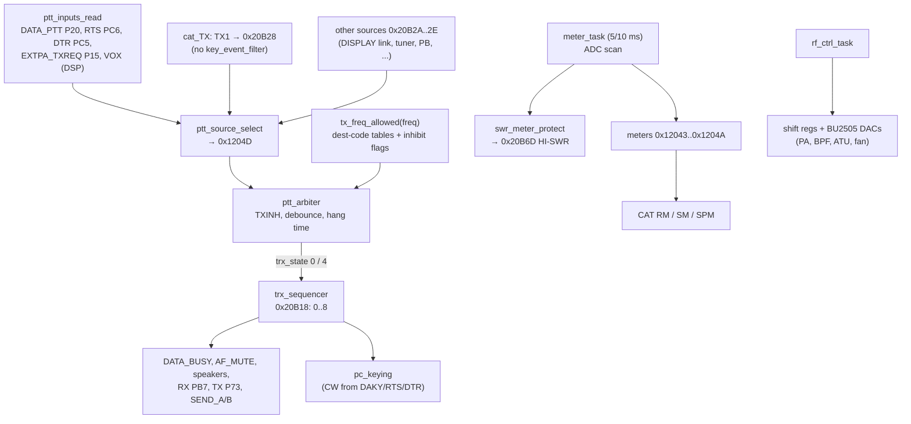
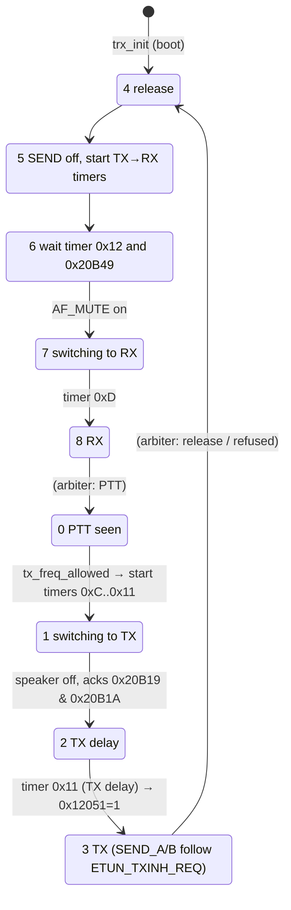

# MAIN — PTT, TX sequencing, protection, meters and TX coverage

Back to the [MAIN overview](README.md).

This page covers T10h: how MAIN decides to transmit and how it switches the hardware between RX and TX. It also covers what can
inhibit TX, how the meters are computed, and how the destination code limits TX frequencies. Pins and peripherals are on
[peripherals.md](peripherals.md). Function names are the current Ghidra names. Function names are the names applied in Ghidra (`tools/ghidra/names_main.tsv`, merged by T17) and match `decomp/main/`; a name still in *italics* is a description that was not applied as a Ghidra name. The tags follow AGENTS.md.

> Decompiler caveat: the RX SLEIGH module decodes `MOVU.B/W Rs,Rd` as a memory load (found in T10e). Odd low-address reads in the
> decompile (for example `*(byte *)(0x465B - 0x9AC6)` in `main_dac_update`, or the TX→RX timer table in `trx_sequencer`) are
> probably this bug. They are marked **[decoder?]** below.

## Overview

`main_loop` → `io_task` → `meter_task` plus `io_poll`. `io_poll` does nothing until soft timer 0x13 has run out, which
is 2.5 s after power-on (`trx_init`). Each pass it then runs `ptt_inputs_read`, `trx_sequencer` (which calls `ptt_arbiter` first),
`tx_audio_select`, `speaker_route`, `af_mute_update`, `linear_band_data` and `FUN_fffb915e` (PC-keying in RTTY) **[fact]**.
`main_loop` → `rf_ctrl_task` writes the PA/RF registers.

## PTT sources [fact]

`ptt_inputs_read` (0xFFFB7F6F) samples the ports into one flag per source. `ptt_source_select` (0xFFFB85A2) then picks the first active flag in
priority order and returns its number. The result is stored in `ptt_source` 0x1204D. If 0x20B97 is set (from `cat_ext_EO` and
`FUN_fffbf6c8`), every source is ignored.

| Priority | Flag | Source no. | Origin |
|---|---|---|---|
| 1 | 0x20B28 | **5** | **CAT `TX1;`**. `cat_TX` sets it, and `TX0;` clears it |
| 2 | 0x20B25 | 2 | `EXTPA_TXREQ` (P15) low |
| 3 | 0x20B24 | 1 | `DATA_PTT` (P20) low, when PTT select = 3 (DAKY) |
| 4 | 0x20B26 | 3 | USB "Standard" port **RTS** (PC6) low and USB_DET, when select = 1 |
| 5 | 0x20B27 | 4 | USB **DTR** (PC5) low and USB_DET, when select = 2 |
| 6–10 | 0x20B2A..0x20B2E | 7, 8, 9, 10, 11 | set by other subsystems: 0x20B2A by the key/DISPLAY handlers (`FUN_fffba377`, `FUN_fffbaa81` and others); 0x20B2E by `cat_PB` (voice-memory playback) and others; 0x20B2D by tuner code (`FUN_fffec7f9`..) **[inference for the owners]** |
| 11 | 0x20B29 | 6 | **VOX**: setting 0x9C5D on, DSP status bit 0x10 (`dsp_status1_raw`), and VOX holdoff timer 0x2F expired |

- The "PTT select" value is setting 0x9A9F, or a per-mode value from `FUN_fffb50d7`. The code values 1 = RTS, 2 = DTR and 3 = DAKY match the CAT
  manual's `PC KEYING 0 OFF 1 RTS 2 DTR 3 DAKY` **[fact]**.
- Any active source restarts the APO timer (`cat_apo_reset`). Any source except VOX arms timer 0x2F for 200 ms, which keeps VOX from
  re-triggering **[fact]**.
- 0x12050 (`pc_keying_active`) is 1 when the source is DAKY, RTS, DTR, 8 or 9 and the mode group (`FUN_fffba192`) is CW (1 or 3). The
  line is then a CW key, not a PTT, and `pc_keying` keys SEND and plays a sidetone **[fact for the logic, inference for the naming]**.

### The CAT TX1 path bypasses the key-event filter [fact]

`cat_TX` (0xFFFAF7B8) does not call `key_event_filter` (unlike `cat_KY`, `cat_VS` and others; see [cat.md](cat.md)). It writes the request flag 0x20B28
directly. It refuses (`?;`) only while 0x20F1C == 1 or 0x20F70 == 1. The read form `TX;` answers from `ptt_source_get`: `TX0` when no
source is active, `TX1` when the source is CAT, and `TX2` for any other source. The **only** gates between `TX1;` and the RF are therefore
`ptt_arbiter` and `tx_freq_allowed` (below). This is why CAT TX also works in UI states where front-panel keys are locked.

## TX allow / inhibit (`ptt_arbiter` 0xFFFB86E8, `tx_freq_allowed` 0xFFFB37FE) [fact]

*tx_freq_allowed(freq)* is called with the TX frequency 0x20F50:
1. If `zz_mode0` (0x20BBE, set by `ZZPE071000`) is set, it returns **1 at once, with no band check**.
2. It returns 0 if any of these is set: 0x465C (`cfg105[3]`), 0x9AF5 (a setting, also used by `menuitem_EX030407`), 0x20B46 (`cat_disabled`,
   set from the DISPLAY link), 0x20B47 (TX time-out tripped, see below).
3. It looks up the range table for the destination code (`dest_code_get`, 0x475E/0x475F). It returns 1 if `lo <= freq < hi` for
   some row ([table below](#destination-code-and-tx-coverage)).
4. If tuning (0x20B8C) or 0x20B9E is active, it clears all PTT request flags.

`ptt_arbiter`:
- **TX refused:** TXINH (PA1) = 1. If the radio was transmitting (0x20B6B), it starts TX→RX (trx_state = 4).
- **TX allowed:** TXINH follows `ETUN_TXINH_REQ` (P14), so an external tuner can still inhibit TX.
- **PTT on:** a source must be seen on 2 consecutive passes before trx_state = 0 (start TX). It also sets `tx_active` 0x20B6B and starts the
  TX time-out timer (`tot_start`: setting 0x9AC3 in minutes; 0 = off).
- **While TX:** if the TOT has expired (`tot_expired`), 0x20B47 = 1, which inhibits TX until PTT is released. A pre-warning
  (`tot_prewarn`) gives beep pattern 7.
- **PTT off:** source-dependent hang. VOX (source 6) waits for timer 0x15 (delay from the ROM table 0xFFF8833C, indexed by 0x9BF4 or 0x9BF5).
  CAT, EXTPA and DATA sources in CW-type modes wait for the break-in delay timer 0x1A (`FUN_fffba35c`, unless 0x9AA0). The arbiter then
  sets trx_state = 4.

## RX↔TX sequencer (`trx_sequencer` 0xFFFB80F9, `trx_state` 0x20B18) [fact]

RX→TX (state 1). The ms values are soft-timer settings started in state 0:

| Step | Timer | Action |
|---|---|---|
| 1 ms | 0x0C | `DATA_BUSY` (P24) = 1 |
| 1 ms | 0x0D | AF_MUTE on (*af_mute_set(1)*) |
| 5 ms | 0x0E | speaker switches P70/PB2/P80 off (except in CW-type modes 1/3). Once both acknowledgements 0x20B19/0x20B1A are set (by `dsp_link_poll`/`sdr_task`, the SDR/DSP links **[inference]**), the speaker route is restored (unless EAR_DET), AF_MUTE is released and the state goes to 2 |
| 1 ms | 0x0F | **RX (PB7) = 0** → the RX8 rail turns off |
| 3 ms | 0x10 | **TX (P73) = 1** → the TX8 rail turns on |
| *tx delay* | 0x11 | value from `FUN_fffb548a` (forced to 0 for source 7, and for 8/9 with the CW key inserted outside CW). Then state 3, and SEND_A (PA2) / SEND_B (PB4) are keyed |

SEND keying (`send_a_set`/`send_b_set`) is forced low whenever `ETUN_TXINH_REQ` (P14) is high or the TX line (P73) is low. SEND
therefore never leads TX **[fact]**. While the internal tuner relays switch (`atu_relay_update`), SEND is dropped for 15 ms (timer 0x30).

TX→RX (states 5..7) runs in the reverse order: SEND off, then AF_MUTE, then TX = 0 (timer 0x10), RX = 1 (timer 0x0F), DATA_BUSY = 0 (0x0C),
speakers back (0x0E), and AF_MUTE released (0x0D). The delays are read from a table indexed by setting 0x9AA1. The decompile lost
the table base **[decoder?]**.

Other TX-related outputs:
- `tx_audio_select` (0xFFFB8A02) sets `TX_SEL_A/B` (P81/P82) from `FUN_fffb3d11(mode)` (0..3). It is forced to 3 in modes 2/3 (CW) and 12/13
  (RTTY) **[fact]**. That it selects the modulation audio source (MIC/DATA/USB) is **[inference]**.
- `FSK_SHIFT` (PC4) goes to the SDR module. `FUN_fffb915e` handles RTTY keying from DAKY/RTS/DTR **[inference]**.

## Protection [fact unless tagged]

| Protection | Input | Where | Action |
|---|---|---|---|
| **High SWR** | AN001 `MCUP_RVS`, AN002 `MCUP_FOR` | `swr_meter_protect` 0xFFFB7545, every 5 ms | SWR = (1+ρ)/(1−ρ), ρ = REV/FWD. While transmitting, an SWR outside [1, 5) for 9 consecutive samples sets **0x20B6D** to 1 or 2 (it alternates with the 1 s blink timer). 9 good samples clear it. If REV or FWD ≤ 10 counts or ρ ≥ 1, the meter is pinned (255 if 0x20B41 == 2, else 1) and the flag is cleared. 0x20B6D is read by `cat_RI` and by the AI detector `FUN_fffe057b`. It does **not** drop TX in MAIN. **[inference]** the power fold-back is done by the display/DSP side, or through the ALC |
| **TX inhibit line** | `ETUN_TXINH_REQ` P14 | `ptt_arbiter`, `send_a_set` | TXINH = 1, SEND off |
| **Band / region** | TX frequency | `tx_freq_allowed` | TX refused, TXINH = 1 |
| **TX time-out** | setting 0x9AC3 | *tot_start/expired/prewarn* | 0x20B47 = 1 → TX refused until PTT is released; pre-warning beep |
| **Supply under-voltage** | AN003 `PA_VDD` < 0x7DD | `supply_undervolt_check` 0xFFFB4B28 | `power_off_io`, save settings, shutdown request (0x20B39 = 0x90) |
| **PA temperature / fan** | AN109 `PA_HF_TH` | `pa_dac_update` 0xFFFB5976 | PA DAC channel 6 = 0xAD×4 while the reading is below calibration 0x465A (hot, NTC), 0 above 0x465A+10, unchanged in between (hysteresis). That this channel drives the **fan** is **[inference]** |
| PA "VU" thermistor | AN006 `PA_VU_TH` | – | converted, but no code reads it **[fact]** |
| Current | AN007 `PA_IDD` | `meter_idd` | meter only. No trip threshold was found in MAIN |
| ALC | AN005 `ALCM` | `meter_alc` | meter only. The ALC loop is analog/DSP **[inference]** |

## Meters [fact]

`meter_task` (0xFFFB73DD): timer 0x09 (5 ms) runs the ADC scan and the SWR meter. Timer 0x0A (10 ms) runs VDD, IDD, ALC, PO, COMP, S and the remote keypad.
The raw 12-bit values are shifted right by 4, scaled with factory calibration bytes from the `cfg105` block (RAM 0x4659, EEPROM 0x000A,
CAT `SPN`), clamped to 0..255 and smoothed (`FUN_fffb92e7`, `FUN_fffb9350`, … **[inference: peak hold / smoothing]**).

| Meter byte | Getter | Source | Calibration | CAT RM index |
|---|---|---|---|---|
| 0x1204A S | `meter_get_s` | DSP level (`dsp_signal_level`) vs 0x4681, piecewise table 0xFFF88BFC. 0 while 0x20B3D (TX) | 0x4681 | RM1, SM0 |
| 0x12049 COMP | `meter_get_comp` | DSP value (`dsp_comp_level`), 3-segment line | – | RM3 |
| 0x12045 ALC | `meter_get_alc` | AN005 | 0x474E | RM4 |
| 0x12048 / 0x1204B PO | `meter_get_po` (0x1204B if 0x9AF6) | AN002 squared-law fit; full scale 50 (band 10) or 100 W; table 0xFFF88C74 | 0x20B1E | RM5 |
| 0x12046 SWR (0x12047 raw) | `meter_get_swr` | SWR; points SWR 1.5/2.0/3.0 → 0x4669/0x466A/0x466B | 0x4669..0x466B | RM6 |
| 0x12044 IDD | `meter_get_idd` | AN007 | 0x475D | RM7 |
| 0x12043 VDD | `meter_get_vdd` | AN003 × (0x4659/192)·(0.0718/(13.8/0x4667)) | 0x4659, 0x4667 | RM8 |
| 0x1204C | `remote_key_get` | AN108 ladder → FH-2 key 1..12 (0xF0 bit = long press after 100 passes) | table 0xFFF815AB | – |

- **`RM`** (`cat_RM` 0xFFFADB7D): `RMn;` answers `RMn` + 3 decimal digits + `000;`. `RM0` picks the meter that the panel shows: in TX
  (0x20B3D = 1) it follows setting 0x9C5B (1 COMP, 2 ALC, 3 VDD, 4 ID, 5 SWR, else PO), and in RX it is S. In RX only RM1 and RM8 return
  values (the others read 0). In TX, RM1 reads 0. RM2 and any other index give `?;`.
- **`SM0`** (`cat_SM`) returns the S byte. **`SPM`** (`cat_SP_meters`) returns S, 0, PO, SWR, COMP, ALC, VDD, IDD as binary bytes (see the
  checksum caveat in [cat.md](cat.md)).

## Destination code and TX coverage

The destination code is the 16-bit word at 0x475E:0x475F (EEPROM 0x010F; CAT `JP`). It selects the TX range table in `tx_freq_allowed`.
Codes not listed get **no** rows, so they never transmit (except in `zz_mode0`) **[fact]**. The rows are `[lo, hi)` in Hz, decoded from ROM:

| Code(s) | Table | Rows | TX ranges (kHz) | Region **[inference]** |
|---|---|---|---|---|
| 0x315B | 0xFFF888A4 | 21 | 1800–2000, 3500–4000, 7000–7300, 10100–10150, 14000–14350, 18068–18168, 21000–21450, 24890–24990, 28000–29700, 50000–54000, plus 11 single points 5167.5, 5332, 5348, 5358.5, 5373, 5405, 5330.5, 5346.5, 5357, 5371.5, 5403.5 | USA (60 m channels) |
| 0xA983 | 0xFFF889B4 | 11 | 1800–2000, 3500–3800, **5351.5–5366.5**, 7000–7200, 10100–10150, 14000–14350, 18068–18168, 21000–21450, 24890–24990, 28000–29700, 50000–52000 | Europe |
| 0xD950 | 0xFFF88A0C | 12 | as Europe but **5250–5406.5** and **70000–70500** | UK |
| 0x4380, 0x60E6, 0x020B | 0xFFF8884C | 11 | US-style 1.8–54 MHz ham bands without 60 m, plus a single point 4630 | ? |
| 0x7753, 0xD32D | 0xFFF88964 | 10 | US-style ham bands, no 60 m | general / Asia |
| 0x306F, 0x50E2, 0x9CF7, 0xA4C5, 0xB5A7 | 0xFFF8894C | 3 | **1800–30000, 50000–54000, 70000–70500** | "wide" (TX-expanded) |
| 0x1CB9 | 0xFFF88A6C | 1 | **30–75000** (all frequencies) | fully open (service?) |

**Single-point rows never match [fact].** The compare at 0xFFFB3950..0xFFFB395C is `BGTU` (lo > f → no) followed by `BGEU` (f ≥ hi → no).
A row with lo == hi can therefore never allow TX. For 0x315B the code also requires, for rows ≥ 10, that the active memory channel be in group 2
with a number in 0x75..0x84 (the 60 m channel memories). That test is only reached after a match, and a match never happens. As written,
**60 m TX in the US table and the 4630 kHz point appear never to be allowed** **[inference; needs an on-air check, which must not be done
without the owner's approval]**.

**The owner's radio** answers `JP0710;` with code **0x50E2** (2026-10-28) **[fact, radio]**: the wide table (1.8–30, 50–54,
70–70.5 MHz), the strap partner of the US code 0x315B. So the 60 m single-point question above cannot be tested on this radio as it is;
it would need a US-code (0x315B) radio. Its EEPROM header stamp (2023-06-26 08:56) dates the last `JP` set, and `JP` cannot store
0x50E2 (it remaps it to 0x315B), so the wide code most likely came from the strap swap below on a later reset **[inference]**.

### The JP_P51 strap toggles restricted ↔ wide (`dest_jumper_apply` 0xFFFB3BA6) [fact]

| P51 low (strap fitted **[inference]**) | P51 high |
|---|---|
| 0x315B → 0x50E2 | 0x50E2 → 0x315B |
| 0xA983 → 0xB5A7 | 0xB5A7 → 0xA983 |
| 0xD950 → 0xA4C5 | 0xA4C5 → 0xD950 |
| 0xD32D → 0x306F | 0x306F → 0xD32D |
| 0x7753 → 0x9CF7 | 0x9CF7 → 0x7753 |

`dest_code_set` writes EEPROM, reloads defaults and requests a restart. `dest_jumper_apply` runs only from the DISPLAY-link power-up handler
`displink_rx_F0_hello`, and only when the start-mode byte (message +7) is **1** (reset: `settings_defaults(0)` first) or **7**. Mode 7 first swaps
Europe and UK (0xA983/0xB5A7 → 0xD950, 0xD950/0xA4C5 → 0xA983). These start modes come from power-on key combinations on the DISPLAY
side **[inference]**. P52..P54 are never read. So the classic "TX expansion" works by fitting the P51 strap and doing a reset. The wide
tables still exclude 30–50 MHz and 54–70 MHz, except under 0x1CB9 **[inference for the procedure]**.

## PA and RF control registers

`rf_ctrl_task` (0xFFFB55C2, main loop) rewrites a register only when its value changes. Flag 0x12042 forces a full write on the first pass.
The bus is `SDAT0` PA4 / `SCLK0` PA5 with one strobe per device **[fact for the bit-banging; inference for the device roles]**:

| Function | Strobe | Format | Contents |
|---|---|---|---|
| `bu2505_write`(0, ch, v) | SST1 P66 (high pulse) | 4-bit ch + 10-bit value, LSB first | Q1005 BU2505FV on MAIN. ch3 = **FADJ** (reference-oscillator trim, schematic A3 → `FADJ`) from cal 0x465B plus a user offset **[decoder?]**; ch5 from cal 0x466F..0x4673 by RX band (`main_dac_update`) |
| `bu2505_write`(4, ch, v) | SST5 PB6 | same | PA-unit BU2505FV Q4041 (`pa_dac_update`): ch1/ch10 per-band cal 0x4743../0x4693.., ch2 drive level (`FUN_fffb667a`(band, power) × table 0xFFF88A68), ch3..5 cal 0x468A..0x4692 by band group, **ch6 fan**, ch7 from 0x20B3C (0x60/0x51/0xFF) when 0x9AB8 == 3 |
| `sst2_write12`(band, v) | /SST2 P67 | 12 bits MSB first, high nibble = band code | from `FUN_fffb5d68` (not analysed) |
| `shreg_write24`(2, v) | /SST3 PA0 | 24 bits MSB first | `rf_bpf_update`: one-hot BPF band, preamp bits 0x8000/0x10000/0x18000, ATT bits 0x20000/0x40000, 0x200000 always set |
| `shreg_write24`(3, v) | /SST4 PB5 | 24 bits | `pa_relay_update`: one-hot TX band (LPF), 0x80 internal ATU in line, 0x100 AM, 0x200 RX line, 0x400 band 10 |
| `shreg_write24`(5, v) | /SST6 PA7 | 24 bits | `atu_relay_update`: three internal-tuner relay bytes (`FUN_fffec50f/500/51e`) |

## Function table

| Address | Ghidra name | Inferred name | Purpose |
|---|---|---|---|
| 0xFFFAF7B8 | `cat_TX` | | TX0/TX1 set (flag 0x20B28), read TX0/1/2 |
| 0xFFFADB7D / 0xFFFAE64B | `cat_RM` / `cat_SM` | | meter reads |
| 0xFFFB6CDE | `trx_init` | `trx_init` | trx_state = 4, timer 0x13 = 2.5 s, AF_MUTE on |
| 0xFFFB6D56 | `io_task` | `io_task` | main-loop task: AF mute, meters, I/O, power-fail, restart |
| 0xFFFB7B43 | `io_poll` | `io_poll` | runs the I/O subtasks once timer 0x13 expires |
| 0xFFFB7F6F | `ptt_inputs_read` | `ptt_inputs_read` | ports → 0x20B24..0x20B29 |
| 0xFFFB85A2 | `ptt_source_select` | `ptt_source_select` | priority → 0x1204D, 0x12050 |
| 0xFFFB86E8 | `ptt_arbiter` | `ptt_arbiter` | TXINH, debounce, hang, TOT |
| 0xFFFB80F9 | `trx_sequencer` | `trx_sequencer` | state machine above |
| 0xFFFB9774 | `pc_keying` | `pc_keying` | CW from DAKY/RTS/DTR: SEND + sidetone |
| 0xFFFB37FE | `tx_freq_allowed` | `tx_freq_allowed` | inhibit flags + region tables |
| 0xFFFB3BA6 | `dest_jumper_apply` | `dest_jumper_apply` | P51 strap |
| 0xFFFB3B33 / 0xFFFB3B5D | `dest_code_get` / `dest_code_set` | | 0x475E |
| 0xFFFB6EC5 | `ptt_source_get` | `ptt_source_get` | 0x1204D |
| 0xFFFB8A02 | `tx_audio_select` | `tx_audio_select` | TX_SEL_A/B |
| 0xFFFB7243 / 0xFFFB7B65 / 0xFFFB722B | … | `af_mute_set` / `af_mute_update` / `af_mute_get` | AF_MUTE PB3 |
| 0xFFFB6FD2 / 0xFFFB7011 | … | `send_a_set` / `send_b_set` | SEND_A PA2 / SEND_B PB4 with inhibit gating |
| 0xFFFB6FAC / 0xFFFB721A | … | `tx_line_get` / `rx_line_get` | P73 / PB7 |
| 0xFFFB268E / 0xFFFB26BF / 0xFFFB26E5 | … | `tot_start` / `tot_expired` / `tot_prewarn` | TX time-out |
| 0xFFFB73DD | `meter_task` | `meter_task` | 5 / 10 ms scheduler |
| 0xFFFB7545 | `swr_meter_protect` | `swr_meter_protect` | SWR meter + HI-SWR flag |
| 0xFFFB742B / 0xFFFB747C | … | `vdd_scale_calc` / `meter_vdd` | |
| 0xFFFB74B8 / 0xFFFB74FF / 0xFFFB7772 / 0xFFFB7869 / 0xFFFB7959 | … | `meter_idd` / `meter_alc` / `meter_po` / `meter_comp` / `meter_s` | |
| 0xFFFB7A40 | `remote_keypad_scan` | `remote_keypad_scan` | FH-2 keypad |
| 0xFFFB6E03..0xFFFB6EB6 | … | *meter_get_vdd/idd/alc/swr/swr_raw/po/comp/s*, `remote_key_get` | getters |
| 0xFFFB4B28 | `supply_undervolt_check` | `supply_undervolt_check` | power-fail |
| 0xFFFB55C2 | `rf_ctrl_task` | `rf_ctrl_task` | |
| 0xFFFB55EB / 0xFFFB56A5 / 0xFFFB5786 | … | `pa_relay_update` / `rf_bpf_update` / `atu_relay_update` | 24-bit registers |
| 0xFFFB5874 / 0xFFFB5976 | … | `main_dac_update` / `pa_dac_update` | BU2505 DACs |
| 0xFFFB1F83 / 0xFFFB1FEF / 0xFFFB208D / 0xFFFB214C | … | `shreg_bus_init` / `bu2505_write` / `sst2_write12` / `shreg_write24` | bus primitives |

## Data structures and globals

| Address | Size | Name | Meaning |
|---|---|---|---|
| 0x20B18 | u8 | `trx_state` | 0..8 as above; 8 = RX idle **[fact]** |
| 0x20B19 / 0x20B1A | u8 | TX acks | both must be 1 to leave state 1 **[fact]**. Set by the SDR/DSP links **[inference]** |
| 0x20B24..0x20B2E | u8 | `ptt_req[]` | per-source request flags **[fact]** |
| 0x20B28 | u8 | `cat_tx_req` | CAT TX1 **[fact]** |
| 0x1204D | u8 | `ptt_source` | 0 = none, 1..11 **[fact]** |
| 0x12050 / 0x12051 | u8 | PC-keying active / last P14 level | **[fact]** |
| 0x20B6B | u8 | `tx_active` | set by the arbiter at PTT **[fact]** |
| 0x20B3D | u8 | TX flag used by meters, `key_event_filter` and many CAT handlers | **[fact]** for its uses; who sets it: `FUN_fffb8d77` |
| 0x20B47 | u8 | TOT tripped | **[fact]** |
| 0x20B6D | u8 | HI-SWR flag (0/1/2 blinking) | **[fact]** |
| 0x20F50 | u32 | TX frequency (Hz) passed to `tx_freq_allowed` | **[inference: Hz, from the table units]** |
| 0x475E | 2 (+1) | destination code | **[fact]** |
| 0x465C | u8 | `cfg105[3]`: TX disabled when non-zero | **[fact]** for the effect |
| 0x9AF5 | u8 | setting: TX disabled when non-zero | **[fact]** for the effect |
| 0x9A9F, 0x9AA0, 0x9AA1, 0x9AC3, 0x9C5B, 0x9C5D | u8 | settings: PTT select, break-in, TX→RX delay set, TOT minutes, meter select, VOX | **[fact]** for the use, **[inference]** for the menu names |
| 0x12043..0x1204C | u8 | meter bytes | see the meter table **[fact]** |
| 0x4659..0x475D | 0x105 | `cfg105` (CAT `SPN`) = **factory calibration** (meters, PA DAC per band, fan threshold 0x465A, FADJ 0x465B) | **[fact]** for the reads, **[inference]** that it is the calibration block |
| 0x20F98..0x20FB6 | | shadow copies of every shift-register / DAC value | **[fact]** |
