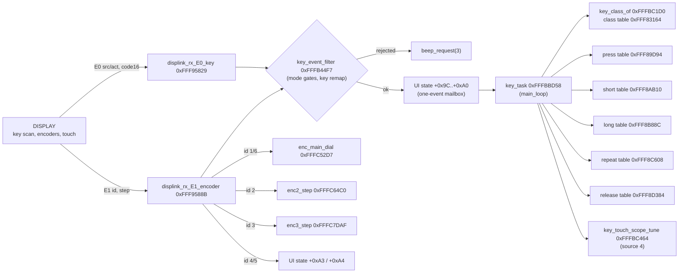
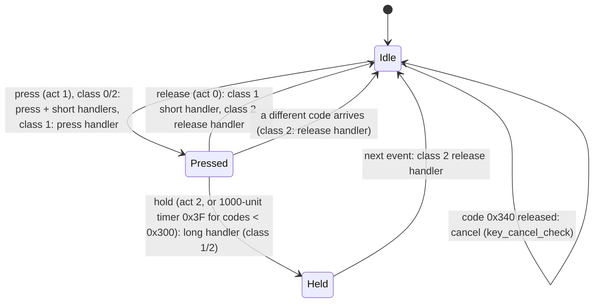

# MAIN — front-panel keys, encoders and touch events

Back to the [MAIN overview](README.md).

Part of T10b. MAIN has no key or encoder hardware of its own: the DISPLAY CPU scans the keys, encoders and touch panel and sends events over the
SCI1 link ([display-link.md](display-link.md)). This page follows those events from the received frame to the handler that changes the radio. The
DISPLAY side (scan, debouncing, code assignment) is `docs/code/display/input.md` (T11f). Function names are the names applied in Ghidra (`tools/ghidra/names_main.tsv`, merged by T17) and match `decomp/main/`; a name still in *italics* is a description that was not applied as a Ghidra name. Tags follow AGENTS.md.

## Overview

All boxes are code paths seen in the decomp **[fact]**.

## Key events (`E0`)

Frame `E0 b1 code_hi code_lo b4 sum` (6 bytes). `displink_rx_E0_key` always ACKs, calls `key_event_filter(code, b1)` and, if that returns 1, stores
the event in the one-slot mailbox in the UI state struct (0x20B04) **[fact]**:

| Field | Value | Meaning |
|---|---|---|
| +0x9C | b1 >> 4 | **event source**. 4 = touch on the scope/tuning area (handled by `key_touch_scope_tune`, see below) **[inference]**; the other values are not distinguished on MAIN except by `key_event_filter` |
| +0x9D | b1 & 0xF | **action**: 1 = press, 0 = release, 2 = hold **[fact for the values: `key_task` branches on them; names are inference]** |
| +0x9E | u16 | key code (big-endian on the wire) |
| +0xA0 | u8 | event pending |

A second event that arrives before `key_task` runs overwrites the first; there is no queue **[fact]**.

### `key_event_filter` 0xFFFB44F7

Returns 1 if the event may run. It is also called by the CAT handlers (T09) with pseudo key codes 0xFF0..0xFF2 for the encoders **[fact]**.

- `FUN_fffc4cc5(code, b1)` = 1 blocks every code except 0xFF0..0xFF2 **[fact]**.
- **Key assignment.** Codes 0x348, 0x34E, 0x35B, 0x35C, 0x35D, 0x35E look up a slot from settings 0x9ACC, 0x9ACD, 0x9AC8, 0x9AC9, 0x9ACA, 0x9ACB and are
  replaced by `key_assign_map` 0xFFF88312[slot] (15 entries: 0x300, 0x30E, 0x30A, 0x309, 0x301, 0x302, 0x30C, 0x307, 0x305, 0x311, 0x30D, 0x303,
  0x304, 0x348, 0x34E). So these six codes are **user-assignable keys/knob pushes** that act as one of the fixed keys **[fact for the remap,
  inference for "user-assignable"]**. `key_assign_slot` 0xFFFBC225 does the same lookup for `key_task`.
- Code 0x300 with action 2 (hold) sets 0x20B30 = 2 and is not passed on **[fact]**.
- Mode gates (each rejects with `beep_request(3)` on a press) **[fact]**:
  - 0x20BBE = 1: rejects source 4 and codes < 8 and 0x16..0x19.
  - 0x20B8A = 1: rejects everything except 0xFE, 0xFF, 0xFF1, 0x302, 0x30F, 0x340 (0x300 is rejected silently).
  - 0x20B98 ≠ 0: allows only 0x200..0x288, 0x87..0x90, 0xE6, 0x300..0x30E, 0x310..0x311, 0x340 and 0xFF0..0xFF1.
  - 0x20B7C = 2: further restrictions on 0x87..0x8B and 0x8D..0x90 (rest of the function not analysed here).
  The meaning of each mode flag is for the pages that own them (TX/protection: T10h, menu: T10f).

### `key_task` 0xFFFBBD58

Runs once per `main_loop` pass **[fact]**. State in 0x1216B (0 idle, 1 pressed, 2 held), current code 0x1FA40, class 0x1216C, source 0x1216A.

- Each handler call is `JSR` through a 863-entry (codes 0..0x35E) table of code pointers, after `FUN_fffc519d(code, 0)` allows it **[fact: `7F 1E`
  JSR R14 at 0xFFFBC388 in `key_call_press`]**. The decompiler shows these helpers as `return table[code]`; they really call it.
- **Long press** for codes below 0x300 is synthesised by MAIN: 1000 timer units (≈1 s, **[inference]** on the unit) after the press it fakes an
  action-2 event. Codes 0x300 and up get their hold event from the DISPLAY **[fact for the branch, inference for the DISPLAY part]**.
- **Repeat** (table 0xFFF8C608) runs when 0x1B4DC is set and timer 0x40 expires; the code that sets 0x1B4DC is in the handlers **[fact]**.
- The handler flag +0x409 suppresses the short handler after a press handler that consumed the key **[fact]**.
- Code 0x340 released with source ≠ 4: `key_cancel_check` 0xFFFBC103 clears +0x78 (and 0x20CCC, 0x20B2E), and the event is dropped **[fact]**.

### Key classes and handler tables

| Table | Address | Distinct handlers | Codes with a handler | Role |
|---|---|---|---|---|
| `key_class_table` | 0xFFF83164 (863 B) | — | class 0: 798, 1: 33, 2: 32 | 0 = act on press, 1 = short/long, 2 = press-and-hold with release **[inference from `key_task`]** |
| `key_press_table` | 0xFFF89D94 | 84 | 83 | called on press |
| `key_short_table` | 0xFFF8AB10 | 361 | 360 | class 0: on press; class 1: on release before hold |
| `key_long_table` | 0xFFF8B88C | 46 | 45 | on hold |
| `key_repeat_table` | 0xFFF8C608 | 14 | 13 | auto-repeat |
| `key_release_table` | 0xFFF8D384 | 35 | 34 | class 2: on release |

The empty slot handler is `key_nop` 0xFFFC4A8D (a single `RTS`) **[fact]**. The five tables are the "large code-pointer table at 0xFFF89D94" in
the T05 index; it continues at 0xFFF8E100 with a different 360-entry table that is not part of the key system (T10f) **[fact for the boundary]**.
**507 of the 536 distinct handler addresses are not function entries in the T05 project**, so their code is folded into neighbours or not
disassembled. They should be created as functions before the handlers can be documented one by one (follow-up). `tools/main_key_tables.py`
writes the full code → handler list.

Code ranges (codes with at least one handler) **[fact]**:

| Codes | Count | Classes | Notes |
|---|---|---|---|
| 0x000..0x03F | 51 | 28 × 0, 3 × 1, 20 × 2 | 20 press-and-hold codes; `key_event_filter` mode 0x20BBE blocks 0..7 and 0x16..0x19 |
| 0x040..0x13F | 183 | mostly 0 | soft keys (short handler only); 0x100..0x13F has 22 press handlers and 4 repeat handlers |
| 0x140..0x1BF | 26 | 0 | press handlers only (0x140..0x17F) |
| 0x200..0x288 | 106 | mostly 0 | the set allowed in mode 0x20B98, likely an on-screen keypad/list **[guess]** |
| 0x300..0x312 | 19 | 15 × 1, 2 × 0, 2 × 2 | **physical front-panel keys** (the targets of `key_assign_map`) **[inference]** |
| 0x340..0x35E | 9 | mixed | 0x340 cancel, 0x341, 0x348/0x34E (assignable; also targets of the map, so probably knob pushes **[guess]**), 0x35A, 0x35B..0x35E assignable |

Codes below 0x300 are most likely GUI touch keys, since the DISPLAY draws the soft keys and MAIN times their long press itself **[inference]**.

Physical-key handlers (press / short / long / release; `-` = `key_nop`) **[fact]**:

| Code | Class | Press | Short | Long | Release |
|---|---|---|---|---|---|
| 0x300 | 1 | 0xFFFBE582 | 0xFFFBE593 | 0xFFFBE63D | - |
| 0x301 | 1 | 0xFFFBE680 | 0xFFFBE6BC | 0xFFFBE794 | - |
| 0x302 | 1 | 0xFFFBE7E7 | 0xFFFBE83F | 0xFFFBE8D2 | - |
| 0x303 | 1 | 0xFFFBE92F | 0xFFFBE96B | 0xFFFBE9D6 | - |
| 0x304 | 1 | 0xFFFBEA9C | 0xFFFBEB2C | 0xFFFBEBA3 | - |
| 0x305 | 1 | 0xFFFBEC6C | 0xFFFBECA5 | 0xFFFBEE05 | - |
| 0x306 | 1 | 0xFFFBEE52 | 0xFFFBEEA9 | 0xFFFBEFA0 | - |
| 0x307 | 1 | 0xFFFBF00D | 0xFFFBF0B6 | 0xFFFBF1D4 | - |
| 0x308 | 1 | 0xFFFBF20B | 0xFFFBF234 | 0xFFFBF24E | - |
| 0x309 | 1 | 0xFFFBF3F6 | 0xFFFBF41F | 0xFFFBF43B | - |
| 0x30A | 1 | 0xFFFBF482 | 0xFFFBF4BB | 0xFFFBF5D6 | - |
| 0x30B | 0 | 0xFFFBF600 | 0xFFFBF62F | - | - |
| 0x30C | 1 | 0xFFFBF6C1 | 0xFFFBF6C8 | 0xFFFBF7A7 | - |
| 0x30D | 0 | 0xFFFBF7D7 | 0xFFFBF807 | - | - |
| 0x30E | 1 | 0xFFFBF8EE | 0xFFFBF924 | 0xFFFBFAC4 | - |
| 0x30F | 2 | 0xFFFBFC37 | 0xFFFBFD17 | 0xFFFBFD21 | 0xFFFBFD7E |
| 0x310 | 1 | 0xFFFBFE14 | 0xFFFBFE5E | 0xFFFBFE8E | - |
| 0x311 | 1 | 0xFFFBFEE9 | 0xFFFBFF22 | 0xFFFBFF57 | - |
| 0x312 | 2 | 0xFFFBFF93 | 0xFFFC0003 | 0xFFFC0047 | 0xFFFC008F |

Callees of the few handlers that are already functions **[fact]**: 0x302 short → `FUN_fffc2794`, `vfo_mode`, `beep_request`, `swtimer_start`;
0x307 short → `freq_clamp`, `FUN_fffc2efb`, `vfo_store_back` (the same call that follows the VFO write in touch tuning); 0x30E short/long →
`FUN_fffc34d8`, `vfo_is_memory` (also called after the VFO write in touch tuning). Naming each key needs the handler bodies and the DISPLAY's
key-code table (T11f).

### Touch tuning (source 4)

`key_touch_scope_tune` 0xFFFBC464 handles source-4 presses. If a special screen is active (`FUN_fffc8ca8`, `FUN_fffc90ed`) it goes there; otherwise for
a code below 0x317 it computes **f = start + span · code / 0x316** (span from the table 0xFFF89D24 indexed by the scope span setting, start from the
VFO record +0x4A..+0x4D minus half the span, or from 0x20F60 / `bandmem_get`(2)` depending on 0x9C35), checks it with `freq_in_range`, writes it to the
active VFO (0x9D09 or 0x9D63) and calls `vfo_store_back`. Then `beep_request(1)`, or `beep_request(3)` if out of range **[fact]**. So the code is the
x pixel on a 790-pixel-wide scope (0x316 = 790) and **touching the spectrum tunes the VFO** there **[inference, high]**. The scope modes 0/1/2 in
0x9C35 are likely CENTER / FIX / CURSOR **[guess]**.

## Encoders (`E1`)

Frame `E1 id step 0 0 0 sum` (7 bytes; the DISPLAY builds it in `FUN_20115c74`). `displink_rx_E1_encoder` ignores it while +0x80 = 1, stores the id
in +0xA1 and dispatches **[fact]**:

| id | Pseudo code for `key_event_filter` | Normal action | In numeric-entry mode (+0x437) |
|---|---|---|---|
| 1 | 0xFF0 | `enc_main_dial` 0xFFFC52D7(step): accumulates in 0x1FF6A and tunes (`FUN_fffc53dc` or `FUN_fffc5a84` by `FUN_fffc538b`) | `ui_numentry_step` |
| 6 | 0xFF0 (or as id 3) | as id 1 (×4 when +0x415 = 1); when +0x70 = 1 it is handled as id 3, and the step is negated if +0x74 = 0 | as id 1 |
| 2 | 0xFF1 | `enc2_step` 0xFFFC64C0: dispatches by screen (+0x95, +0xBA, +0x93/+0x94, +0x96, else `FUN_fffc6c20`) | `FUN_fffc670d` |
| 3 | 0xFF2 | `enc3_step` 0xFFFC7DAF: when +0x70 = 1 selects one of 0x1D..0x21 in +0x7A, else other screens | `FUN_fffc82b7` |
| 4 | — | if `FUN_fffc519d(0, 1)` allows: +0xA3 = step (ignored on some +0x3FD screens) | `FUN_fffc89ef` |
| 5 | — | +0xA4 = step | `FUN_fffc8a90` |

So id 1 is the main tuning dial **[fact: it tunes]**. Id 6 looks like the main dial in a high-resolution or alternate mode, and ids 2/3 the
multi-function knobs **[inference]**; matching them to the FUNC and MULTI knobs of the front panel needs the DISPLAY side (T11f).

## Other input-related frames

- `E6 n` → `beep_request(n + 1)`: touch-panel click sounds produced by MAIN **[inference]**.
- `E2`, `E7`, `E8` are status reports from the DISPLAY UI, see [display-link.md](display-link.md#display--main-frames).

## Functions

| Address | Ghidra name | Inferred name | Purpose |
|---|---|---|---|
| 0xFFF95829 | `displink_rx_E0_key` | `displink_rx_E0_key` | E0 → filter → mailbox |
| 0xFFF9588B | `displink_rx_E1_encoder` | `displink_rx_E1_encoder` | E1 → encoder dispatch |
| 0xFFFB44F7 | `key_event_filter` | | mode gates and key remap |
| 0xFFFBBD58 | `key_task` | `key_task` | key state machine (`main_loop`) |
| 0xFFFBBD53 | `key_task_init` | `key_task_init` | called in `app_main` (→ `FUN_fffc4d93`) **[inference]** |
| 0xFFFBC103 | `key_cancel_check` | `key_cancel_check` | 0x340 release handling |
| 0xFFFBC1D0 | `key_class_of` | `key_class_of` | class from 0xFFF83164, or by assigned slot |
| 0xFFFBC225 | `key_assign_slot` | `key_assign_slot` | assignable code → slot (0xFF if none) |
| 0xFFFBC35F / 0xFFFBC38E / 0xFFFBC3BD / 0xFFFBC406 / 0xFFFBC435 | `key_call_press` … | `key_call_press` / `key_call_short` / `key_call_long` / `key_call_repeat` / `key_call_release` | JSR through the five tables |
| 0xFFFBC464 | `key_touch_scope_tune` | `key_touch_scope_tune` | touch → frequency |
| 0xFFFC4A8D | `key_nop` | `key_nop` | empty handler |
| 0xFFFC52D7 | `enc_main_dial` | `enc_main_dial` | main dial steps |
| 0xFFFC64C0 / 0xFFFC7DAF | `enc2_step` / `enc3_step` | `enc2_step` / `enc3_step` | knob steps by screen |
| 0xFFFB2DA6 | `beep_request` | `beep_request` | **[inference]** |

## Data

| Address | Size | Name (proposed) | Meaning |
|---|---|---|---|
| 0xFFF83164 | 863 B | `@key_class_table` | class per code |
| 0xFFF88312 | 15 × u16 | `@key_assign_map` | slot → key code (assignable keys) |
| 0xFFF88534 | 13 × u16 | `@key_assign_codes` | same first 13 codes, used by `key_class_of` for slots < 13 |
| 0xFFF834B6 | u8[] | | class for slots ≥ 13 |
| 0xFFF89D94 / 0xFFF8AB10 / 0xFFF8B88C / 0xFFF8C608 / 0xFFF8D384 | 863 × u32 each | `@key_press_table` … `@key_release_table` | handler tables |
| 0xFFF89D24 | u32[] | `@scope_span_table` | span per scope-span setting (touch tuning, also `scope_cursor_follow`) **[inference]** |
| 0x20B04 + 0x9C..0xA0 | | | key mailbox (source, action, code, pending) |
| 0x20B04 + 0xA1..0xA4 | | | last encoder id, main-dial step, encoder 4 / 5 values |
| 0x1216A / 0x1216B / 0x1216C / 0x1FA40 | u8 / u8 / u8 / u16 | | `key_task` source, state, class, code |
| 0x1B4DB / 0x1B4DC | u8 | | long-press timer armed (timer 0x3F) / repeat armed (timer 0x40) |
| 0x9AC8..0x9ACD | u8 × 6 | | assignable-key settings |
