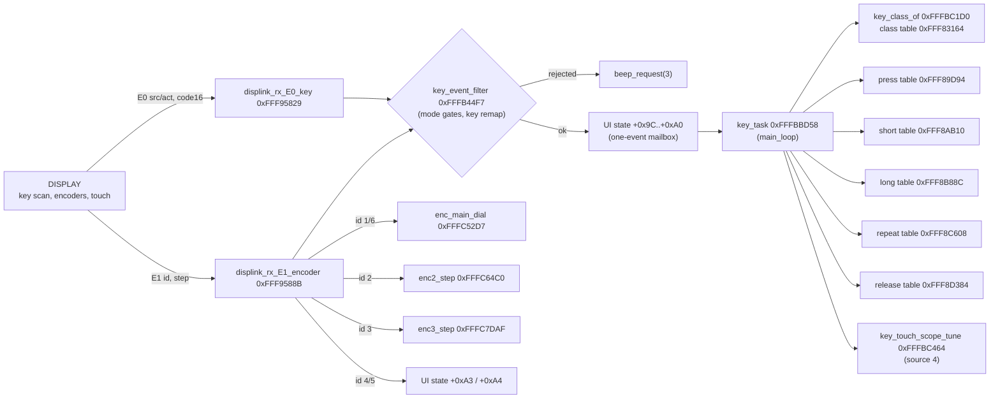

# MAIN — front-panel keys, encoders and touch events

Back to the [MAIN overview](README.md).

Part of T10b. MAIN has no key or encoder hardware of its own: the DISPLAY CPU scans the keys, encoders and touch panel and sends events over the
SCI1 link ([display-link.md](display-link.md)). This page follows those events from the received frame to the handler that changes the radio. The
DISPLAY side (scan, debouncing, code assignment) is `docs/code/display/input.md` (T11f). Function names are the names applied in Ghidra (`tools/ghidra/names_main.tsv`, merged by T17) and match `decomp/main/`; a name still in *italics* is a description that was not applied as a Ghidra name. Tags follow AGENTS.md.

## Overview

All boxes are code paths seen in the decomp **[fact]**.

## Key events (`E0`)

Frame `E0 b1 code_hi code_lo b4 sum` (6 bytes). `displink_rx_E0_key` always ACKs, calls `key_event_filter(code, b1)` and, if that returns 1, stores
the event in the one-slot mailbox in the UI state struct (0x20B04) **[fact]**:

| Field | Value | Meaning |
|---|---|---|
| +0x9C | b1 >> 4 | **event source**. 4 = touch on the scope/tuning area (handled by `key_touch_scope_tune`, see below) **[inference]**; the other values are not distinguished on MAIN except by `key_event_filter` |
| +0x9D | b1 & 0xF | **action**: 1 = press, 0 = release, 2 = hold **[fact for the values: `key_task` branches on them; names are inference]** |
| +0x9E | u16 | key code (big-endian on the wire) |
| +0xA0 | u8 | event pending |

A second event that arrives before `key_task` runs overwrites the first; there is no queue **[fact]**.

### `key_event_filter` 0xFFFB44F7

Returns 1 if the event may run. It is also called by the CAT handlers (T09) with pseudo key codes 0xFF0..0xFF2 for the encoders **[fact]**.

- `FUN_fffc4cc5(code, b1)` = 1 blocks every code except 0xFF0..0xFF2 **[fact]**.
- **Key assignment.** Codes 0x348, 0x34E, 0x35B, 0x35C, 0x35D, 0x35E look up a slot from settings 0x9ACC, 0x9ACD, 0x9AC8, 0x9AC9, 0x9ACA, 0x9ACB and are
  replaced by `key_assign_map` 0xFFF88312[slot] (15 entries: 0x300, 0x30E, 0x30A, 0x309, 0x301, 0x302, 0x30C, 0x307, 0x305, 0x311, 0x30D, 0x303,
  0x304, 0x348, 0x34E). So these six codes are **user-assignable keys/knob pushes** that act as one of the fixed keys **[fact for the remap,
  inference for "user-assignable"]**. `key_assign_slot` 0xFFFBC225 does the same lookup for `key_task`.
- Code 0x300 with action 2 (hold) sets 0x20B30 = 2 and is not passed on **[fact]**.
- Mode gates (each rejects with `beep_request(3)` on a press) **[fact]**:
  - 0x20BBE = 1: rejects source 4 and codes < 8 and 0x16..0x19.
  - 0x20B8A = 1: rejects everything except 0xFE, 0xFF, 0xFF1, 0x302, 0x30F, 0x340 (0x300 is rejected silently).
  - 0x20B98 ≠ 0: allows only 0x200..0x288, 0x87..0x90, 0xE6, 0x300..0x30E, 0x310..0x311, 0x340 and 0xFF0..0xFF1.
  - 0x20B7C = 2: further restrictions on 0x87..0x8B and 0x8D..0x90 (rest of the function not analysed here).
  The meaning of each mode flag is for the pages that own them (TX/protection: T10h, menu: T10f).

### `key_task` 0xFFFBBD58

Runs once per `main_loop` pass **[fact]**. State in 0x1216B (0 idle, 1 pressed, 2 held), current code 0x1FA40, class 0x1216C, source 0x1216A.

- Each handler call is `JSR` through a 863-entry (codes 0..0x35E) table of code pointers, after `FUN_fffc519d(code, 0)` allows it **[fact: `7F 1E`
  JSR R14 at 0xFFFBC388 in `key_call_press`]**. The decompiler shows these helpers as `return table[code]`; they really call it.
- **Long press** for codes below 0x300 is synthesised by MAIN: 1000 timer units (≈1 s, **[inference]** on the unit) after the press it fakes an
  action-2 event. Codes 0x300 and up get their hold event from the DISPLAY **[fact for the branch, inference for the DISPLAY part]**.
- **Repeat** (table 0xFFF8C608) runs when 0x1B4DC is set and timer 0x40 expires; the code that sets 0x1B4DC is in the handlers **[fact]**.
- The handler flag +0x409 suppresses the short handler after a press handler that consumed the key **[fact]**.
- Code 0x340 is the **MIC PTT** (DISPLAY P10_5, [display/input.md](../display/input.md)). Its press handler sets PTT source 0x20B2B ([tx-protection.md](tx-protection.md), #75). Released with source ≠ 4, `key_cancel_check` 0xFFFBC103 clears that source and +0x78 (and 0x20CCC, 0x20B2E: a voice message on the air stops), and the event is dropped **[fact]**.

### Key classes and handler tables

| Table | Address | Distinct handlers | Codes with a handler | Role |
|---|---|---|---|---|
| `key_class_table` | 0xFFF83164 (863 B) | — | class 0: 798, 1: 33, 2: 32 | 0 = act on press, 1 = short/long, 2 = press-and-hold with release **[inference from `key_task`]** |
| `key_press_table` | 0xFFF89D94 | 84 | 83 | called on press |
| `key_short_table` | 0xFFF8AB10 | 361 | 360 | class 0: on press; class 1: on release before hold |
| `key_long_table` | 0xFFF8B88C | 46 | 45 | on hold |
| `key_repeat_table` | 0xFFF8C608 | 14 | 13 | auto-repeat |
| `key_release_table` | 0xFFF8D384 | 35 | 34 | class 2: on release |

The empty slot handler is `key_nop` 0xFFFC4A8D (a single `RTS`) **[fact]**. The five tables are the "large code-pointer table at 0xFFF89D94"
(4651 entries) in the T05 index (#71): the index is the key code 0..0x35E, one table per handler role. Two more `JSR` tables follow
**[fact]** (#70):

- **0xFFF8E100..0xFFF8E19F**, five 8-entry tables, one per role (press, short, long, repeat, release in that order, 0x20 apart). Five
  helpers 0xFFFC40D7 / 0xFFFC410A / 0xFFFC413D / 0xFFFC4170 / 0xFFFC41A3 (`key_slot_press` / `_short` / `_long` / `_repeat` / `_release`, T23e; one per role) take a slot number: slots 0..0xC are mapped to a key
  code through the u16 list at 0xFFF88534 and call the 863-entry table; slots 0xD..0x14 call these small tables. 31 distinct handlers.
  The callers pass the **microphone button assignments** MIC UP 0x9ACC, MIC DOWN 0x9ACD and MIC P1..P4 0x9AC8..0x9ACB (`EX030120`..`EX030125`,
  values 0..20; the SSM-75E keys 0x348/0x34E/0x35B..0x35E). Values 0..12 act as LOCK, QMB, A/B, V/M, TUNER, VOX/MOX, MODE, ZIN/SPOT, SPLIT,
  FINE, NAR, NB, DNR; 13..20 are FREQ UP, FREQ DOWN, BAND UP, BAND DOWN, ATT, IPO, DNF, AGC, which have no front-panel key and use these small
  tables (labels: menu text at 0xFFF84753) **[fact]** (#69; this paragraph used to guess "eight functions with no key").
- **0xFFF8E1A0..0xFFF8E63F**, 296 entries: the **CAT auto-information change detectors for the EX menu**, not a key table. Entry *i* belongs to
  the *i*-th ID of the 296 × 8-character list at 0xFFF872B1 (`EX010101` … `EX060518`); `cat_ai_ex_scan` 0xFFFE6D7A calls them in turn
  ([cat.md](../cat.md)).

Before #70, 506 of the 535 key handlers, 31 of the 32 slot handlers and all 296 detectors were not function entries; 0xFFFE6E3A..0xFFFEA639
(14 KB) had no function at all. `tools/main_key_tables.py out.tsv entries.tsv` lists them, and `FixFuncEntries.java
tools/ghidra/entries_main.tsv nolate` creates all 862 in the MAIN rebuild (2,834 → 3,161 functions, 0 failures) **[fact]**. The handlers of the
physical keys 0x300..0x312 are named `key_<key>_<role>` after the DISPLAY key-code table ([display/input.md](../display/input.md)), except the
five that T10 had named already.

Code ranges (codes with at least one handler) **[fact]**:

| Codes | Count | Classes | Notes |
|---|---|---|---|
| 0x000..0x03F | 51 | 28 × 0, 3 × 1, 20 × 2 | 20 press-and-hold codes; `key_event_filter` mode 0x20BBE blocks 0..7 and 0x16..0x19 |
| 0x040..0x13F | 183 | mostly 0 | soft keys (short handler only); 0x100..0x13F has 22 press handlers and 4 repeat handlers |
| 0x140..0x1BF | 26 | 0 | press handlers only (0x140..0x17F) |
| 0x200..0x288 | 106 | mostly 0 | the set allowed in mode 0x20B98, likely an on-screen keypad/list **[guess]** |
| 0x300..0x312 | 19 | 15 × 1, 2 × 0, 2 × 2 | **physical front-panel keys** (the targets of `key_assign_map`) **[inference]** |
| 0x340..0x35E | 9 | mixed | 0x340 MIC PTT, 0x341, 0x348/0x34E (assignable; also targets of the map, so probably knob pushes **[guess]**), 0x35A, 0x35B..0x35E assignable |

Codes below 0x300 are most likely GUI touch keys, since the DISPLAY draws the soft keys and MAIN times their long press itself **[inference]**.

Physical-key handlers (press / short / long / release; `-` = `key_nop`) **[fact]**:

| Code | Key (DISPLAY) | Class | Press | Short | Long | Release |
|---|---|---|---|---|---|---|
| 0x300 | LOCK/PWR | 1 | 0xFFFBE582 | 0xFFFBE593 | 0xFFFBE63D | - |
| 0x301 | TUNE | 1 | 0xFFFBE680 | 0xFFFBE6BC | 0xFFFBE794 | - |
| 0x302 | MOX/VOX | 1 | 0xFFFBE7E7 | 0xFFFBE83F | 0xFFFBE8D2 | - |
| 0x303 | NB | 1 | 0xFFFBE92F | 0xFFFBE96B | 0xFFFBE9D6 | - |
| 0x304 | DNR | 1 | 0xFFFBEA9C | 0xFFFBEB2C | 0xFFFBEBA3 | - |
| 0x305 | SPLIT | 1 | 0xFFFBEC6C | 0xFFFBECA5 | 0xFFFBEE05 | - |
| 0x306 | CLAR | 1 | 0xFFFBEE52 | 0xFFFBEEA9 | 0xFFFBEFA0 | - |
| 0x307 | ZIN/SPOT | 1 | 0xFFFBF00D | 0xFFFBF0B6 | 0xFFFBF1D4 | - |
| 0x308 | M>V | 1 | 0xFFFBF20B | 0xFFFBF234 | 0xFFFBF24E | - |
| 0x309 | V/M W | 1 | 0xFFFBF3F6 | 0xFFFBF41F | 0xFFFBF43B | - |
| 0x30A | A/B | 1 | 0xFFFBF482 | 0xFFFBF4BB | 0xFFFBF5D6 | - |
| 0x30B | BAND | 0 | 0xFFFBF600 | 0xFFFBF62F | - | - |
| 0x30C | MODE | 1 | 0xFFFBF6C1 | 0xFFFBF6C8 | 0xFFFBF7A7 | - |
| 0x30D | NAR | 0 | 0xFFFBF7D7 | 0xFFFBF807 | - | - |
| 0x30E | QMB | 1 | 0xFFFBF8EE | 0xFFFBF924 | 0xFFFBFAC4 | - |
| 0x30F | FUNC | 2 | 0xFFFBFC37 | 0xFFFBFD17 | 0xFFFBFD21 | 0xFFFBFD7E |
| 0x310 | STEP/MCH | 1 | 0xFFFBFE14 | 0xFFFBFE5E | 0xFFFBFE8E | - |
| 0x311 | FINE/FAST | 1 | 0xFFFBFEE9 | 0xFFFBFF22 | 0xFFFBFF57 | - |
| 0x312 | DSP | 2 | 0xFFFBFF93 | 0xFFFC0003 | 0xFFFC0047 | 0xFFFC008F |

Callees of the few handlers that are already functions **[fact]**: 0x302 short → `FUN_fffc2794`, `vfo_mode`, `beep_request`, `swtimer_start`;
0x307 short → `freq_clamp`, `FUN_fffc2efb`, `vfo_store_back` (the same call that follows the VFO write in touch tuning); 0x30E short/long →
`FUN_fffc34d8`, `vfo_is_memory` (also called after the VFO write in touch tuning). The key names come from the DISPLAY's key-code table (#70).

### Touch tuning (source 4)

`key_touch_scope_tune` 0xFFFBC464 handles source-4 presses. If a special screen is active (`FUN_fffc8ca8`, `FUN_fffc90ed`) it goes there; otherwise for
a code below 0x317 it computes **f = start + span · code / 0x316** (span from the table 0xFFF89D24 indexed by the scope span setting, start from the
VFO record +0x4A..+0x4D minus half the span, or from 0x20F60 / `bandmem_get`(2)` depending on 0x9C35), checks it with `freq_in_range`, writes it to the
active VFO (0x9D09 or 0x9D63) and calls `vfo_store_back`. Then `beep_request(1)`, or `beep_request(3)` if out of range **[fact]**. So the code is the
x pixel on a 790-pixel-wide scope (0x316 = 790) and **touching the spectrum tunes the VFO** there **[inference, high]**. The scope modes 0/1/2 in
0x9C35 are likely CENTER / FIX / CURSOR **[guess]**.

## Encoders (`E1`)

Frame `E1 id step 0 0 0 sum` (7 bytes; the DISPLAY builds it in `FUN_20115c74`). `displink_rx_E1_encoder` ignores it while +0x80 = 1, stores the id
in +0xA1 and dispatches **[fact]**:

| id | Pseudo code for `key_event_filter` | Normal action | In numeric-entry mode (+0x437) |
|---|---|---|---|
| 1 | 0xFF0 | `enc_main_dial` 0xFFFC52D7(step): accumulates in 0x1FF6A and tunes (`FUN_fffc53dc` or `FUN_fffc5a84` by `FUN_fffc538b`) | `ui_numentry_step` |
| 6 | 0xFF0 (or as id 3) | as id 1 (×4 when +0x415 = 1); when +0x70 = 1 it is handled as id 3, and the step is negated if +0x74 = 0 | as id 1 |
| 2 | 0xFF1 | `enc2_step` 0xFFFC64C0: dispatches by screen (+0x95, +0xBA, +0x93/+0x94, +0x96, else `FUN_fffc6c20`) | `FUN_fffc670d` |
| 3 | 0xFF2 | `enc3_step` 0xFFFC7DAF: when +0x70 = 1 selects one of 0x1D..0x21 in +0x7A, else other screens | `FUN_fffc82b7` |
| 4 | — | if `FUN_fffc519d(0, 1)` allows: +0xA3 = step (ignored on some +0x3FD screens) | `FUN_fffc89ef` |
| 5 | — | +0xA4 = step | `FUN_fffc8a90` |

So id 1 is the main tuning dial **[fact: it tunes]**. Id 6 is the **USB mouse wheel on the main screen**: the DISPLAY's `mouse_wheel_event`
0x2015FAC4 sends id 6 only when its screen id is 0x20 **[fact, DISPLAY code; see [display/input.md](../display/input.md#rotary-encoders-and-pots)]**, and MAIN
tunes with it like the main dial. (Corrected by T19h: this page used to guess "the main dial in a high-resolution or alternate mode".) Ids 2/3 are the
multi-function knobs **[inference]**; matching them to the FUNC and MULTI knobs of the front panel needs the DISPLAY side (T11f).

## Other input-related frames

- `E6 n` → `beep_request(n + 1)`: touch-panel click sounds produced by MAIN **[inference]**.
- `E2`, `E7`, `E8` are status reports from the DISPLAY UI, see [display-link.md](display-link.md#display--main-frames).

## Functions

| Address | Ghidra name | Inferred name | Purpose |
|---|---|---|---|
| 0xFFF95829 | `displink_rx_E0_key` | `displink_rx_E0_key` | E0 → filter → mailbox |
| 0xFFF9588B | `displink_rx_E1_encoder` | `displink_rx_E1_encoder` | E1 → encoder dispatch |
| 0xFFFB44F7 | `key_event_filter` | | mode gates and key remap |
| 0xFFFBBD58 | `key_task` | `key_task` | key state machine (`main_loop`) |
| 0xFFFBBD53 | `key_task_init` | `key_task_init` | called in `app_main` (→ `FUN_fffc4d93`) **[inference]** |
| 0xFFFBC103 | `key_cancel_check` | `key_cancel_check` | 0x340 (MIC PTT) release handling |
| 0xFFFBC1D0 | `key_class_of` | `key_class_of` | class from 0xFFF83164, or by assigned slot |
| 0xFFFBC225 | `key_assign_slot` | `key_assign_slot` | assignable code → slot (0xFF if none) |
| 0xFFFBC35F / 0xFFFBC38E / 0xFFFBC3BD / 0xFFFBC406 / 0xFFFBC435 | `key_call_press` … | `key_call_press` / `key_call_short` / `key_call_long` / `key_call_repeat` / `key_call_release` | JSR through the five tables |
| 0xFFFBC464 | `key_touch_scope_tune` | `key_touch_scope_tune` | touch → frequency |
| 0xFFFC4A8D | `key_nop` | `key_nop` | empty handler |
| 0xFFFC52D7 | `enc_main_dial` | `enc_main_dial` | main dial steps |
| 0xFFFC64C0 / 0xFFFC7DAF | `enc2_step` / `enc3_step` | `enc2_step` / `enc3_step` | knob steps by screen |
| 0xFFFB2DA6 | `beep_request` | `beep_request` | **[inference]** |

## Data

| Address | Size | Name (proposed) | Meaning |
|---|---|---|---|
| 0xFFF83164 | 863 B | `@key_class_table` | class per code |
| 0xFFF88312 | 15 × u16 | `@key_assign_map` | slot → key code (assignable keys) |
| 0xFFF88534 | 13 × u16 | `@key_assign_codes` | same first 13 codes, used by `key_class_of` for slots < 13 |
| 0xFFF834B6 | u8[] | | class for slots ≥ 13 |
| 0xFFF89D94 / 0xFFF8AB10 / 0xFFF8B88C / 0xFFF8C608 / 0xFFF8D384 | 863 × u32 each | `@key_press_table` … `@key_release_table` | handler tables |
| 0xFFF89D24 | u32[] | `@scope_span_table` | span per scope-span setting (touch tuning, also `scope_cursor_follow`) **[inference]** |
| 0x20B04 + 0x9C..0xA0 | | | key mailbox (source, action, code, pending) |
| 0x20B04 + 0xA1..0xA4 | | | last encoder id, main-dial step, encoder 4 / 5 values |
| 0x1216A / 0x1216B / 0x1216C / 0x1FA40 | u8 / u8 / u8 / u16 | | `key_task` source, state, class, code |
| 0x1B4DB / 0x1B4DC | u8 | | long-press timer armed (timer 0x3F) / repeat armed (timer 0x40) |
| 0x9AC8..0x9ACD | u8 × 6 | | assignable-key settings |

## Further functions (T23g)

Named functions of this subsystem that the tables above did not list yet, one row each (T23g, found with `tools/doc_table_gaps.py`). The purpose is the plate comment of the name in `tools/ghidra/names_*.tsv` (or the `Ifdsp*Names.java` / `*.lib.tsv` entry); rows marked *code shape* have no comment there and give what the decompile shows: the direct callees, the first string, the size and the caller count. Tags as in the names files; a comment without a tag is an inference from the code.

| Address | Ghidra name | Inferred name | Purpose |
|---|---|---|---|
| 0xFFFBBD52 | `align_store_nop` |  | Empty store handler (191 of the 261 items) **[inference]** |
| 0xFFFBE582 | `key_lock_pwr_press` |  | Front-panel key 0x300 LOCK/PWR, press handler (key tables, display/input.md key codes) (#70) **[inference]** |
| 0xFFFBE593 | `key_lock_pwr_short` |  | Front-panel key 0x300 LOCK/PWR, short handler (key tables, display/input.md key codes) (#70) **[inference]** |
| 0xFFFBE63D | `key_lock_pwr_long` |  | Front-panel key 0x300 LOCK/PWR, long handler (key tables, display/input.md key codes) (#70) **[inference]** |
| 0xFFFBE680 | `key_tune_press` |  | Front-panel key 0x301 TUNE, press handler (key tables, display/input.md key codes) (#70) **[inference]** |
| 0xFFFBE6BC | `key_tune_short` |  | Front-panel key 0x301 TUNE, short handler (key tables, display/input.md key codes) (#70) **[inference]** |
| 0xFFFBE794 | `key_tune_long` |  | Front-panel key 0x301 TUNE, long handler (key tables, display/input.md key codes) (#70) **[inference]** |
| 0xFFFBE7E7 | `key_mox_vox_press` |  | Front-panel key 0x302 MOX/VOX, press handler (key tables, display/input.md key codes) (#70) **[inference]** |
| 0xFFFBE83F | `key_mox_vox_short` |  | Front-panel key 0x302 MOX/VOX, short handler (key tables, display/input.md key codes) (#70) **[inference]** |
| 0xFFFBE8D2 | `key_mox_vox_long` |  | Front-panel key 0x302 MOX/VOX, long handler (key tables, display/input.md key codes) (#70) **[inference]** |
| 0xFFFBE92F | `key_nb_press` |  | Front-panel key 0x303 NB, press handler (key tables, display/input.md key codes) (#70) **[inference]** |
| 0xFFFBE96B | `key_nb_short` |  | Front-panel key 0x303 NB, short handler (key tables, display/input.md key codes) (#70) **[inference]** |
| 0xFFFBE9D6 | `key_nb_long` |  | Front-panel key 0x303 NB, long handler (key tables, display/input.md key codes) (#70) **[inference]** |
| 0xFFFBEA9C | `key_dnr_press` |  | Front-panel key 0x304 DNR, press handler (key tables, display/input.md key codes) (#70) **[inference]** |
| 0xFFFBEB2C | `key_dnr_short` |  | Front-panel key 0x304 DNR, short handler (key tables, display/input.md key codes) (#70) **[inference]** |
| 0xFFFBEBA3 | `key_dnr_long` |  | Front-panel key 0x304 DNR, long handler (key tables, display/input.md key codes) (#70) **[inference]** |
| 0xFFFBEC6C | `key_split_press` |  | Front-panel key 0x305 SPLIT, press handler (key tables, display/input.md key codes) (#70) **[inference]** |
| 0xFFFBEE05 | `key_split_long` |  | Front-panel key 0x305 SPLIT, long handler (key tables, display/input.md key codes) (#70) **[inference]** |
| 0xFFFBEE52 | `key_clar_press` |  | Front-panel key 0x306 CLAR, press handler (key tables, display/input.md key codes) (#70) **[inference]** |
| 0xFFFBEEA9 | `key_clar_short` |  | Front-panel key 0x306 CLAR, short handler (key tables, display/input.md key codes) (#70) **[inference]** |
| 0xFFFBEFA0 | `key_clar_long` |  | Front-panel key 0x306 CLAR, long handler (key tables, display/input.md key codes) (#70) **[inference]** |
| 0xFFFBF00D | `key_zin_spot_press` |  | Front-panel key 0x307 ZIN/SPOT, press handler (key tables, display/input.md key codes) (#70) **[inference]** |
| 0xFFFBF0B6 | `key_zin_spot_short` |  | Front-panel key 0x307 ZIN/SPOT, short handler (key tables, display/input.md key codes) (#70) **[inference]** |
| 0xFFFBF1D4 | `key_zin_spot_long` |  | Front-panel key 0x307 ZIN/SPOT, long handler (key tables, display/input.md key codes) (#70) **[inference]** |
| 0xFFFBF20B | `key_m_to_v_press` |  | Front-panel key 0x308 M>V, press handler (key tables, display/input.md key codes) (#70) **[inference]** |
| 0xFFFBF234 | `key_m_to_v_short` |  | Front-panel key 0x308 M>V, short handler (key tables, display/input.md key codes) (#70) **[inference]** |
| 0xFFFBF24E | `key_m_to_v_long` |  | Front-panel key 0x308 M>V, long handler (key tables, display/input.md key codes) (#70) **[inference]** |
| 0xFFFBF3F6 | `key_vm_mw_press` |  | Front-panel key 0x309 V/M W, press handler (key tables, display/input.md key codes) (#70) **[inference]** |
| 0xFFFBF43B | `key_vm_mw_long` |  | Front-panel key 0x309 V/M W, long handler (key tables, display/input.md key codes) (#70) **[inference]** |
| 0xFFFBF482 | `key_a_b_press` |  | Front-panel key 0x30A A/B, press handler (key tables, display/input.md key codes) (#70) **[inference]** |
| 0xFFFBF5D6 | `key_a_b_long` |  | Front-panel key 0x30A A/B, long handler (key tables, display/input.md key codes) (#70) **[inference]** |
| 0xFFFBF600 | `key_band_press` |  | Front-panel key 0x30B BAND, press handler (key tables, display/input.md key codes) (#70) **[inference]** |
| 0xFFFBF62F | `key_band_short` |  | Front-panel key 0x30B BAND, short handler (key tables, display/input.md key codes) (#70) **[inference]** |
| 0xFFFBF6C1 | `key_mode_press` |  | Front-panel key 0x30C MODE, press handler (key tables, display/input.md key codes) (#70) **[inference]** |
| 0xFFFBF6C8 | `key_mode_short` |  | Front-panel key 0x30C MODE, short handler (key tables, display/input.md key codes) (#70) **[inference]** |
| 0xFFFBF7A7 | `key_mode_long` |  | Front-panel key 0x30C MODE, long handler (key tables, display/input.md key codes) (#70) **[inference]** |
| 0xFFFBF7D7 | `key_nar_press` |  | Front-panel key 0x30D NAR, press handler (key tables, display/input.md key codes) (#70) **[inference]** |
| 0xFFFBF807 | `key_nar_short` |  | Front-panel key 0x30D NAR, short handler (key tables, display/input.md key codes) (#70) **[inference]** |
| 0xFFFBF8EE | `key_qmb_press` |  | Front-panel key 0x30E QMB, press handler (key tables, display/input.md key codes) (#70) **[inference]** |
| 0xFFFBFC37 | `key_func_press` |  | Front-panel key 0x30F FUNC, press handler (key tables, display/input.md key codes) (#70) **[inference]** |
| 0xFFFBFD17 | `key_func_short` |  | Front-panel key 0x30F FUNC, short handler (key tables, display/input.md key codes) (#70) **[inference]** |
| 0xFFFBFD21 | `key_func_long` |  | Front-panel key 0x30F FUNC, long handler (key tables, display/input.md key codes) (#70) **[inference]** |
| 0xFFFBFD7E | `key_func_release` |  | Front-panel key 0x30F FUNC, release handler (key tables, display/input.md key codes) (#70) **[inference]** |
| 0xFFFBFE14 | `key_step_mch_press` |  | Front-panel key 0x310 STEP/MCH, press handler (key tables, display/input.md key codes) (#70) **[inference]** |
| 0xFFFBFE5E | `key_step_mch_short` |  | Front-panel key 0x310 STEP/MCH, short handler (key tables, display/input.md key codes) (#70) **[inference]** |
| 0xFFFBFE8E | `key_step_mch_long` |  | Front-panel key 0x310 STEP/MCH, long handler (key tables, display/input.md key codes) (#70) **[inference]** |
| 0xFFFBFEE9 | `key_fine_fast_press` |  | Front-panel key 0x311 FINE/FAST, press handler (key tables, display/input.md key codes) (#70) **[inference]** |
| 0xFFFBFF22 | `key_fine_fast_short` |  | Front-panel key 0x311 FINE/FAST, short handler (key tables, display/input.md key codes) (#70) **[inference]** |
| 0xFFFBFF57 | `key_fine_fast_long` |  | Front-panel key 0x311 FINE/FAST, long handler (key tables, display/input.md key codes) (#70) **[inference]** |
| 0xFFFBFF93 | `key_dsp_press` |  | Front-panel key 0x312 DSP, press handler (key tables, display/input.md key codes) (#70) **[inference]** |
| 0xFFFC0003 | `key_dsp_short` |  | Front-panel key 0x312 DSP, short handler (key tables, display/input.md key codes) (#70) **[inference]** |
| 0xFFFC0047 | `key_dsp_long` |  | Front-panel key 0x312 DSP, long handler (key tables, display/input.md key codes) (#70) **[inference]** |
| 0xFFFC008F | `key_dsp_release` |  | Front-panel key 0x312 DSP, release handler (key tables, display/input.md key codes) (#70) **[inference]** |
| 0xFFFC1EDE | `func_knob_assign_key` |  | (key 0xD0..0xF3): 0x9C08 (FUNC knob function) = ROM table[key - 0xD0] unless -1, then the FUNC item action FUN_fffc3b22 **[fact]** |
| 0xFFFC1FB6 | `memlist_key` |  | (key 4..9): MEMORY CH LIST (+0x97) keys: cursor and select (+0x1D9..+0x1DB, +0x43A..+0x43C), stores with eeprom_save_memch, 9 closes **[fact]** |
| 0xFFFC3B22 | `func_menu_select` |  | FUNC menu: runs the item at cursor 0x9C08 (func_knob_assign(n) for adjustable items, one-shot actions otherwise) **[inference]** |
| 0xFFFC3C23 | `func_knob_assign` |  | (n): 0x9DC9 = n (FUNC-knob function), UI +0x490 = 1, +0x1C5 = 1, beep **[inference]** |
| 0xFFFC40D7 | `key_slot_press` |  | Mic/slot key, press role: slots 0..0xC via the code list 0xFFF88534 into key_press_table, 0xD..0x14 via 0xFFF8E0CC (ui-keys.md) **[fact]** |
| 0xFFFC410A | `key_slot_short` |  | Same for the short role (key_short_table, 0xFFF8E0EC) **[fact]** |
| 0xFFFC413D | `key_slot_long` |  | Same for the long role (key_long_table, 0xFFF8E10C) **[fact]** |
| 0xFFFC4170 | `key_slot_repeat` |  | Same for the repeat role (key_repeat_table, 0xFFF8E12C) **[fact]** |
| 0xFFFC41A3 | `key_slot_release` |  | Same for the release role (key_release_table) **[fact]** |
| 0xFFFC4CAA | `ui_clear_415_423` |  | UI +0x415 = 0 (dial x4, ui-keys.md) and +0x423 = 0; purpose of +0x423 [unknown] **[fact]** |
| 0xFFFC519D | `key_dest_allowed` |  | (code, flag): on destinations 0x315B/0x50E2 with UI +0x9A set, refuses every key when flag != 0, else the front-panel keys 0x300..0x30E and 0x310..0x312; true elsewhere; the gate before each key handler call (ui-keys.md) **[fact]** |
| 0xFFFC6C20 | `func_knob_turn` |  | (step): FUNC knob rotation -> FUN_fffc6f11(0x9DC9, step) unless a +0x1C1 pop-up owns the knob **[inference]** |
| 0xFFFC7C55 | `func_menu_cursor_step` |  | (step): FUNC-menu cursor 0x9C08 over 0..0x21, skipping 0x19, while UI +0x490 != 1 **[inference]** |
| 0xFFFC89B0 | `func_display_open` |  | Opens the FUNC-knob function display: closes pop-up, menu and FUNC panel, UI +0x70 = 1, +0x74 = 0, 5 s timer 0x44 (cat-commands-primary.md SF) **[fact]** |
| 0xFFFE1A00 | `freq_keypad_key` |  | (key): direct frequency entry: digits 0..9 into BCD UI +0x40F..+0x413 (count +0x468), 0x0A..0x0E edit / enter / cancel; enter converts with bcd_to_bin and stores the VFO (vfo_store_back) **[fact]** |
| 0xFFFE207F | `keypad_2digit_key` |  | (key): two-digit BCD entry in UI +0x411/+0x412 (count +0x468); enter accepts 0..20 (bcd_to_bin), else FUN_fffe2299; what the value selects [unknown] **[fact]** |
| 0xFFFE2622 | `kbd_key_dispatch` |  | (key): on-screen keyboard key, dispatched on the keyboard target UI +0xBE (0 MY CALL.. 6 PRESET NAME, display-link.md frame 0x50) to seven editors **[fact]** |
| 0xFFFE4211 | `msg_slot_key` |  | (ch 1..5): message-memory key: in voice modes plays or stops voice message ch (+0x78 = 1, +0x79 = ch - 1, PTT source 0x20B2E), during a recording FUN_fffe4e6e; in CW +0x1C7 = 1 **[fact]** |
| 0xFFFE4378 | `msg_cw_slot_key` |  | (ch): stops a latched send (+0x1D1) or msg_cw_send_start(ch) **[fact]** |
| 0xFFFE4711 | `msg_cw_slot_key_latched` |  | (ch): like msg_cw_slot_key but sets +0x1D1 = 1 after a start; a repeating send **[fact]** |

<!-- T23e3:begin -->

### More functions (T23e round 3)

Named in the T23e round-3 batch for MAIN (`tools/ghidra/names_main.T23e3.tsv`); they show in `decomp/main` after the next Ghidra apply and re-export.

| Address | Ghidra name | Inferred name | Purpose |
|---|---|---|---|
| 0xFFF99669 | `moni_level_ptr` |  | Returns the address of the MONI LEVEL byte for the TX mode: 0x9BFC SSB, 0x9BFD CW, 0x9BFE RTTY, 0x9BFF DATA/PSK, 0x9C00 AM, 0 for FM **[fact: fff99669]**; callers popup_fmt_moni_level, funcknob_moni_level_step, displink frame code |
| 0xFFF99877 | `mic_gain_ptr` |  | Returns the address of the MIC GAIN byte for the TX mode: 0x9BEC (LSB/USB), 0x9BED (DATA-L/U, PSK), 0x9BEE (AM), 0x9BEF (FM, DATA-FM), 0 for CW and RTTY **[fact: fff99877]**; callers popup_fmt_mic_gain, funcknob_mic_gain_step |
| 0xFFF9C6AB | `scope_level_cur_ptr` |  | Returns the scope level byte for the RX dial frequency: 0x9BCA (RX) or 0x9BD8 (while transmitting) + freq_range_index **[fact: fff9c6ab]**; the same tables as scope_level_ptr |
| 0xFFFBDA47 | `dsp_knob_shift_toggle` |  | DSP key short press with knob function 0 (SHIFT): toggles g_ui.dsp_knob_edit, FUNC item 0x1D **[fact: fffbda47]**; caller key_dsp_release (structs_main.h dsp_knob_func 0 SHIFT) |
| 0xFFFBDAD5 | `dsp_knob_width_toggle` |  | DSP key short press with knob function 1 (WIDTH): toggles dsp_knob_edit, FUNC item 0x1E **[fact: fffbdad5]**; caller key_dsp_release |
| 0xFFFBDB63 | `dsp_knob_notch_toggle` |  | DSP key short press with knob function 2 (NOTCH): toggles dsp_knob_edit, FUNC item 0x1F, and in edit mode bit 0x80 of the active VFO mode-block flags **[fact: fffbdb63]**; caller key_dsp_release |
| 0xFFFBDCB0 | `dsp_knob_contour_toggle` |  | DSP key short press with knob function 3 and APF off: toggles dsp_knob_edit, FUNC item 0x20 (CONTOUR), changes bit 0x40 of the active VFO mode-block flags **[fact: fffbdcb0]**; caller key_dsp_release |
| 0xFFFBDE58 | `dsp_knob_apf_toggle` |  | DSP key short press with knob function 3 and dsp_knob_apf set: toggles dsp_knob_edit, FUNC item 0x21 (APF) **[fact: fffbde58]**; caller key_dsp_release |
| 0xFFFC20DD | `memlist_btn_press` |  | Memory-list button by g_ui.memlist_group: 0 NAME (FUN_fffc2137), 1 MODE, 2 SCAN, 3 TYPE, 4 memlist_btn_valid_toggle, 5 close (memlist_flag = 0) **[fact: fffc20dd]**; callers memlist_key, FUN_fffc38fa (display gui.md button order) |
| 0xFFFC2137 | `memlist_btn_name` |  | Memory-list button 0 NAME: for a valid channel opens the text keyboard (kbd_open, kbd_target 1) preloaded with the channel's 12-char tag **[fact: fffc2137]** |
| 0xFFFC21E8 | `memlist_btn_mode` |  | Memory-list button 1: for a valid channel < 0x75 opens the MODE pop-up 0x55 (memlist_popup55 = 1), else ui_key_reject **[fact: fffc21e8]** |
| 0xFFFC224E | `memlist_btn_scan` |  | Memory-list button 2: opens the memory SCAN pop-up 0x44 **[fact: display gui.md popup table, slot 38]** |
| 0xFFFC2296 | `memlist_btn_type` |  | Memory-list button 3: opens the memory TYPE (FREQ/NAME) pop-up 0x45 **[fact: display gui.md popup table, slot 39]** |
| 0xFFFC22DE | `memlist_btn_valid_toggle` |  | Memory-list button 4: for channels 1..0x74 flips the channel's valid byte (memch_valid), beep; else ui_key_reject **[fact: fffc22de]** |
| 0xFFFC2426 | `m_to_v_exec` |  | M>V: from the open memory list copies its channel (memch_current_set), else leaves split / QMB state first; refuses channels 0x75..0x83 for region 0x315B; then memch_to_vfo_copy **[fact: fffc2426]**; only caller key_m_to_v_short |
| 0xFFFC260C | `memch_to_vfo_copy` |  | (side): if memch_current_valid, leaves QMB, qmb_set_depth, memch_load_to_vfo, vfo_clear_tag, vfo_enter_vfo_state, memlist_close, VFO refresh; returns 1, else 0 **[fact: fffc260c]** |
| 0xFFFC33EF | `qmb_popup_open` |  | Opens the QMB pop-up: popup_duration_get(0x43), popup_open_timed, popup_code = 0x43 **[fact: fffc33ef]**; callers qmb_store, qmb_enter |
| 0xFFFC616E | `dial_step_hz` |  | (side): tuning step of the VFO in Hz: 1 MHz / 1 kHz in digit-step mode, 100 kHz / .. with the fast-step request, else the mode's step (dial_step_mode_hz) or the AM/FM channel step (ch_step_hz) **[fact: fffc616e]** |
| 0xFFFC62AE | `dial_step_mode_hz` |  | (mode): dial step in Hz by g_opstate.fn_select (1 = fine, 2 = x10): SSB/CW 1 or EX030501 SSB/CW DIAL STEP 5/10/20 Hz; RTTY/PSK/DATA 1 or EX030502 5/10/20 Hz; AM 10/100/1000; FM 10/100/1000 **[fact: fffc62ae]**; only caller dial_step_hz |
| 0xFFFC63E6 | `ch_step_hz` |  | (mode): AM / FM channel step from EX030504 AM CH STEP / EX030505 FM CH STEP via table 0xFFF88514 **[fact: fffc63e6]**; only caller dial_step_hz |
| 0xFFFC6800 | `memlist_knob_turn` |  | (steps): knob turn in the memory list: moves the row (memlist_row_step) or the button (memlist_group_step), or with a pop-up open steps MODE / SCAN / TYPE of the channel **[fact: fffc6800]**; caller FUN_fffc7eeb (enc3_step) |
| 0xFFFC686F | `memlist_row_step` |  | (dir): moves the memory-list cursor row 0..3, scrolling the page at the ends, then memlist_cursor_channel **[fact: fffc686f]** |
| 0xFFFC68C2 | `memlist_page_down` |  | Scrolls the memory list down one channel (memlist_first + 1) up to 0x74 or the region's special channels (dest 0x4380 / 0x020B) **[fact: fffc68c2]**; caller memlist_row_step |
| 0xFFFC6A0A | `memlist_page_up` |  | Scrolls the memory list up one channel (memlist_first - 1), wrapping by region (dest 0x315B / 0x50E2 to 0x83) **[fact: fffc6a0a]**; caller memlist_row_step |
| 0xFFFC6AC4 | `memlist_mode_step` |  | (dir): pop-up 0x55: steps the memory channel's mode (low nibble, 0..14), eeprom_save_memch **[fact: fffc6ac4]** |
| 0xFFFC6B34 | `memlist_scan_bit_step` |  | (dir): pop-up 0x56: sets (dir > 0) or clears bit 7 of memch[memlist_ch].flags1 (SCAN/SKIP), eeprom_save_memch **[fact: fffc6b34]** |
| 0xFFFC6B86 | `memlist_type_bit_step` |  | (dir): pop-up 0x57: steps the memory TYPE bit (FREQ/NAME), eeprom_save_memch **[fact: fffc6b86 and display gui.md]** |
| 0xFFFC6BD8 | `memlist_group_step` |  | (dir): moves the selected memory-list button g_ui.memlist_group 0..5 **[fact: fffc6bd8]** |
| 0xFFFC6CA4 | `funcknob_list_popup_step` |  | (steps): knob turn while a list pop-up (code < 0x1E) is open: code 0xC, 0xB or 5 -> its own step function **[fact: fffc6ca4]**; caller func_knob_turn |
| 0xFFFC6DDD | `funcknob_popup_step` |  | (popup id, steps): while a value pop-up owns the knob, steps the setting of popup id 0x1F..0x58 (funcknob_*_step) **[fact: fffc6ddd]**; caller func_knob_turn |
| 0xFFFC6F11 | `funcknob_step` |  | (func, steps): FUNC-knob turn by the assigned function g_opstate.func_knob: 1 PEAK, 3 opens popup 0xB, 4 CONTRAST, 5 DIMMER, 6 M-GROUP, 7 MIC GAIN, 9 PROC LEVEL, 10 AMC, 11 VOX GAIN, 12 VOX DELAY, 13 ANTI VOX, 14 RF POWER, 15 MONI, 0x12 CW SPEED, 0x13 PITCH, 0x14 BK-DELAY, 0x15 AESS, 0x3A AESS-CF, else SCOPE LEVEL **[fact: fffc6f11]**; caller func_knob_turn |
| 0xFFFC6FFE | `funcknob_scope_level` |  | FUNC-knob function for SCOPE LEVEL: sets popup_code = 0x1E and calls funcknob_scope_level_step **[fact: fffc6ffe]**; called from funcknob_step |
| 0xFFFC7016 | `funcknob_scope_level_step` |  | (steps): SCOPE LEVEL pop-up (id 0x1E): popup_duration_get(0x1E) + popup_open_timed, then steps and clamps the setting **[fact: fffc7016]**; setting per display gui.md popup-slot table (#178) **[fact]** |
| 0xFFFC7053 | `funcknob_peak` |  | FUNC-knob function for PEAK: sets popup_code = 0x1F and calls funcknob_peak_step **[fact: fffc7053]**; called from funcknob_step |
| 0xFFFC706B | `funcknob_peak_step` |  | (steps): PEAK pop-up (id 0x1F): popup_duration_get(0x1F) + popup_open_timed, then steps and clamps the setting **[fact: fffc706b]**; setting per display gui.md popup-slot table (#178) **[fact]** |
| 0xFFFC70AF | `funcknob_ss03_popup` |  | FUNC-knob function 3: opens pop-up 0xB (popup_duration_get(0xB), popup_open_timed), popup_code = 0xB, cursor = g_opstate.ss03_value **[fact: fffc70af]** |
| 0xFFFC70DB | `funcknob_contrast` |  | FUNC-knob function for CONTRAST: sets popup_code = 0x22 and calls funcknob_contrast_step **[fact: fffc70db]**; called from funcknob_step |
| 0xFFFC70F3 | `funcknob_contrast_step` |  | (steps): CONTRAST pop-up (id 0x22): popup_duration_get(0x22) + popup_open_timed, then steps and clamps the setting **[fact: fffc70f3]**; setting per display gui.md popup-slot table (#178) **[fact]** |
| 0xFFFC7145 | `funcknob_dimmer` |  | FUNC-knob function for DIMMER: sets popup_code = 0x23 and calls funcknob_dimmer_step **[fact: fffc7145]**; called from funcknob_step |
| 0xFFFC715D | `funcknob_dimmer_step` |  | (steps): DIMMER pop-up (id 0x23): popup_duration_get(0x23) + popup_open_timed, then steps and clamps the setting **[fact: fffc715d]**; setting per display gui.md popup-slot table (#178) **[fact]** |
| 0xFFFC71AF | `funcknob_mgroup` |  | FUNC-knob function for M GROUP: sets popup_code = 0x24 and calls funcknob_mgroup_step **[fact: fffc71af]**; called from funcknob_step |
| 0xFFFC71C7 | `funcknob_mgroup_step` |  | (steps): M GROUP pop-up (id 0x24): popup_duration_get(0x24) + popup_open_timed, then steps and clamps the setting **[fact: fffc71c7]**; setting per display gui.md popup-slot table (#178) **[fact]** |
| 0xFFFC74EE | `funcknob_mic_gain` |  | FUNC-knob function for MIC GAIN: sets popup_code = 0x25 and calls funcknob_mic_gain_step **[fact: fffc74ee]**; called from funcknob_step |
| 0xFFFC7506 | `funcknob_mic_gain_step` |  | (steps): MIC GAIN pop-up (id 0x25): popup_duration_get(0x25) + popup_open_timed, then steps and clamps the setting **[fact: fffc7506]**; setting per display gui.md popup-slot table (#178) **[fact]** |
| 0xFFFC754B | `funcknob_mic_eq_step` |  | (steps): MIC EQ pop-up (id 0x26): popup_duration_get(0x26) + popup_open_timed, then steps and clamps the setting **[fact: fffc754b]**; setting per display gui.md popup-slot table (#178) **[fact]** |
| 0xFFFC75BC | `funcknob_proc_level` |  | FUNC-knob function for PROC LEVEL: sets popup_code = 0x27 and calls funcknob_proc_level_step **[fact: fffc75bc]**; called from funcknob_step |
| 0xFFFC75D4 | `funcknob_proc_level_step` |  | (steps): PROC LEVEL pop-up (id 0x27): popup_duration_get(0x27) + popup_open_timed, then steps and clamps the setting **[fact: fffc75d4]**; setting per display gui.md popup-slot table (#178) **[fact]** |
| 0xFFFC7619 | `funcknob_amc_level` |  | FUNC-knob function for AMC LEVEL: sets popup_code = 0x28 and calls funcknob_amc_level_step **[fact: fffc7619]**; called from funcknob_step |
| 0xFFFC7631 | `funcknob_amc_level_step` |  | (steps): AMC LEVEL pop-up (id 0x28): popup_duration_get(0x28) + popup_open_timed, then steps and clamps the setting **[fact: fffc7631]**; setting per display gui.md popup-slot table (#178) **[fact]** |
| 0xFFFC7674 | `funcknob_vox_gain` |  | FUNC-knob function for VOX GAIN: sets popup_code = 0x29 and calls funcknob_vox_gain_step **[fact: fffc7674]**; called from funcknob_step |
| 0xFFFC768C | `funcknob_vox_gain_step` |  | (steps): VOX GAIN pop-up (id 0x29): popup_duration_get(0x29) + popup_open_timed, then steps and clamps the setting **[fact: fffc768c]**; setting per display gui.md popup-slot table (#178) **[fact]** |
| 0xFFFC76D1 | `funcknob_vox_delay` |  | FUNC-knob function for VOX DELAY: sets popup_code = 0x2A and calls funcknob_vox_delay_step **[fact: fffc76d1]**; called from funcknob_step |
| 0xFFFC76E9 | `funcknob_vox_delay_step` |  | (steps): VOX DELAY pop-up (id 0x2A): popup_duration_get(0x2A) + popup_open_timed, then steps and clamps the setting **[fact: fffc76e9]**; setting per display gui.md popup-slot table (#178) **[fact]** |
| 0xFFFC774C | `funcknob_anti_vox` |  | FUNC-knob function for ANTI VOX: sets popup_code = 0x2B and calls funcknob_anti_vox_step **[fact: fffc774c]**; called from funcknob_step |
| 0xFFFC7764 | `funcknob_anti_vox_step` |  | (steps): ANTI VOX pop-up (id 0x2B): popup_duration_get(0x2B) + popup_open_timed, then steps and clamps the setting **[fact: fffc7764]**; setting per display gui.md popup-slot table (#178) **[fact]** |
| 0xFFFC77C7 | `funcknob_rf_power` |  | FUNC-knob function for RF POWER: sets popup_code = 0x2C and calls funcknob_rf_power_step **[fact: fffc77c7]**; called from funcknob_step |
| 0xFFFC77DF | `funcknob_rf_power_step` |  | (steps): RF POWER pop-up (id 0x2C): popup_duration_get(0x2C) + popup_open_timed, then steps and clamps the setting **[fact: fffc77df]**; setting per display gui.md popup-slot table (#178) **[fact]** |
| 0xFFFC7827 | `rf_power_ptr` |  | (*min, *max): returns &g_opstate.rf_power[i] for the TX band (0 HF, 1 50 MHz, 2 70 MHz, 3 AM) with the band's MAX POWER (EX030401..030404, AM capped by max_power_limit) in *max and the minimum from FUN_fffb3f0b **[fact: fffc7827]**; callers align_load_preset, funcknob_rf_power_step |
| 0xFFFC790B | `funcknob_moni_level` |  | FUNC-knob function for MONI LEVEL: sets popup_code = 0x2D and calls funcknob_moni_level_step **[fact: fffc790b]**; called from funcknob_step |
| 0xFFFC7923 | `funcknob_moni_level_step` |  | (steps): MONI LEVEL pop-up (id 0x2D): popup_duration_get(0x2D) + popup_open_timed, then steps and clamps the setting **[fact: fffc7923]**; setting per display gui.md popup-slot table (#178) **[fact]** |
| 0xFFFC7975 | `funcknob_keyer_step` |  | (steps): KEYER pop-up (id 0x46): popup_duration_get(0x46) + popup_open_timed, then steps and clamps the setting **[fact: fffc7975]**; setting per display gui.md popup-slot table (#178) **[fact]** |
| 0xFFFC79B8 | `funcknob_bk_in_step` |  | (steps): BK IN pop-up (id 0x2F): popup_duration_get(0x2F) + popup_open_timed, then steps and clamps the setting **[fact: fffc79b8]**; setting per display gui.md popup-slot table (#178) **[fact]** |
| 0xFFFC7A8F | `funcknob_cw_speed` |  | FUNC-knob function for CW SPEED: sets popup_code = 0x30 and calls funcknob_cw_speed_step **[fact: fffc7a8f]**; called from funcknob_step |
| 0xFFFC7AA7 | `funcknob_cw_speed_step` |  | (steps): CW SPEED pop-up (id 0x30): popup_duration_get(0x30) + popup_open_timed, then steps and clamps the setting **[fact: fffc7aa7]**; setting per display gui.md popup-slot table (#178) **[fact]** |
| 0xFFFC7AEA | `funcknob_cw_pitch` |  | FUNC-knob function for CW PITCH: sets popup_code = 0x31 and calls funcknob_cw_pitch_step **[fact: fffc7aea]**; called from funcknob_step |
| 0xFFFC7B02 | `funcknob_cw_pitch_step` |  | (steps): CW PITCH pop-up (id 0x31): popup_duration_get(0x31) + popup_open_timed, then steps and clamps the setting **[fact: fffc7b02]**; setting per display gui.md popup-slot table (#178) **[fact]** |
| 0xFFFC7B47 | `funcknob_bk_delay` |  | FUNC-knob function for BK DELAY: sets popup_code = 0x32 and calls funcknob_bk_delay_step **[fact: fffc7b47]**; called from funcknob_step |
| 0xFFFC7B5F | `funcknob_bk_delay_step` |  | (steps): BK DELAY pop-up (id 0x32): popup_duration_get(0x32) + popup_open_timed, then steps and clamps the setting **[fact: fffc7b5f]**; setting per display gui.md popup-slot table (#178) **[fact]** |
| 0xFFFC7BA4 | `funcknob_aess_level` |  | FUNC-knob function for AESS: sets popup_code = 0x33 and calls funcknob_aess_level_step **[fact: fffc7ba4]**; called from funcknob_step |
| 0xFFFC7BBC | `funcknob_aess_level_step` |  | (steps): AESS pop-up (id 0x33): popup_duration_get(0x33) + popup_open_timed, then steps and clamps the setting **[fact: fffc7bbc]**; setting per display gui.md popup-slot table (#178) **[fact]** |
| 0xFFFC7BFD | `funcknob_aess_cf` |  | FUNC-knob function for AESS CF: sets popup_code = 0x58 and calls funcknob_aess_cf_step **[fact: fffc7bfd]**; called from funcknob_step |
| 0xFFFC7C15 | `funcknob_aess_cf_step` |  | (steps): AESS CF pop-up (id 0x58): popup_duration_get(0x58) + popup_open_timed, then steps and clamps the setting **[fact: fffc7c15]**; setting per display gui.md popup-slot table (#178) **[fact]** |
| 0xFFFC7CFD | `funcknob_nb_level_step` |  | (steps): NB LEVEL pop-up (id 0x38): popup_duration_get(0x38) + popup_open_timed, then steps and clamps the setting **[fact: fffc7cfd]**; setting per display gui.md popup-slot table (#178) **[fact]** |
| 0xFFFC7D41 | `funcknob_dnr_level_step` |  | (steps): DNR LEVEL pop-up (id 0x39): popup_duration_get(0x39) + popup_open_timed, then steps and clamps the setting **[fact: fffc7d41]**; setting per display gui.md popup-slot table (#178) **[fact]** |
| 0xFFFC836A | `dsp_knob_turn` |  | (steps): FUNC-panel knob turn for the DSP items: FUNC item 0x1D -> dsp_knob_shift_step (dsp_knob_func 0), 0x1E width, 0x1F notch, 0x20 contour, 0x21 APF (func 3), then func_display_open **[fact: fffc836a]**; only caller enc3_step |
| 0xFFFC8431 | `dsp_knob_shift_step` |  | (steps): steps the IF SHIFT (shift_be) of the active VFO's mode block **[fact: fffc8431]**; called by dsp_knob_turn for FUNC item 0x1D |
| 0xFFFC84F9 | `dsp_knob_width_step` |  | (steps): steps the filter WIDTH (width_be) of the active VFO's mode block, first restoring the width from vfo_filter_width_hz when NAR is on **[fact: fffc84f9]**; dsp_knob_turn item 0x1E |
| 0xFFFC8685 | `dsp_knob_notch_step` |  | (steps): steps the manual NOTCH frequency (notch_be) of the active VFO's mode block **[fact: fffc8685]**; dsp_knob_turn item 0x1F |
| 0xFFFC87AB | `dsp_knob_contour_step` |  | (steps): steps the CONTOUR frequency (contour_be) of the active VFO's mode block **[fact: fffc87ab]**; dsp_knob_turn item 0x20 |
| 0xFFFC8930 | `dsp_knob_apf_step` |  | (steps): steps g_opstate.apf_freq **[fact: fffc8930]**; dsp_knob_turn item 0x21 |
| 0xFFFE3979 | `func_message_open` |  | FUNC menu item 0x15 (case 0x15 of func_menu_select): stops a scan, refuses while DVS / keyer send / recording / PlayList run; otherwise opens the message-memory screen (g_ui.msgmem_open = 1, msgmem_type 0 voice by msg_voice_mode_ok or 1 CW with the contest number) and closes the FUNC panel; beep 3 when neither **[fact: fffe3979]** |

<!-- T23e3:end -->
