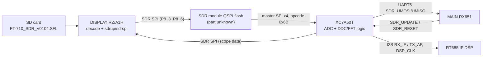

# SDR module image (SR) — code documentation

**The SDR image holds no CPU code.** It is an Artix-7 **XC7A50T** bitstream (uncompressed, unencrypted, master-SPI x4 boot)
behind a 4 KiB header whose first word is a CRC-32/BZIP2 of the bitstream. So there are no subsystems or functions to
document, and no soft CPU is evident. The full analysis, with the packet stream, the leading word, the BRAM evidence and the
config path figure, is in [`decomp/sdr/README.md`](../../../decomp/sdr/README.md). The image layout is in
[`docs/memory-maps.md`](../../memory-maps.md#sdr-sr-image-ft-710_sdr_v0104sfl--t08). The findings come from task T08.

The DISPLAY flash-write path is **[inference]**, and the scope-data use of the SDR SPI comes from docs/hardware.md **[inference]**.
