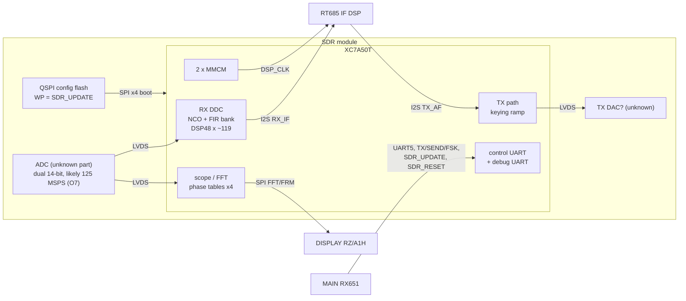
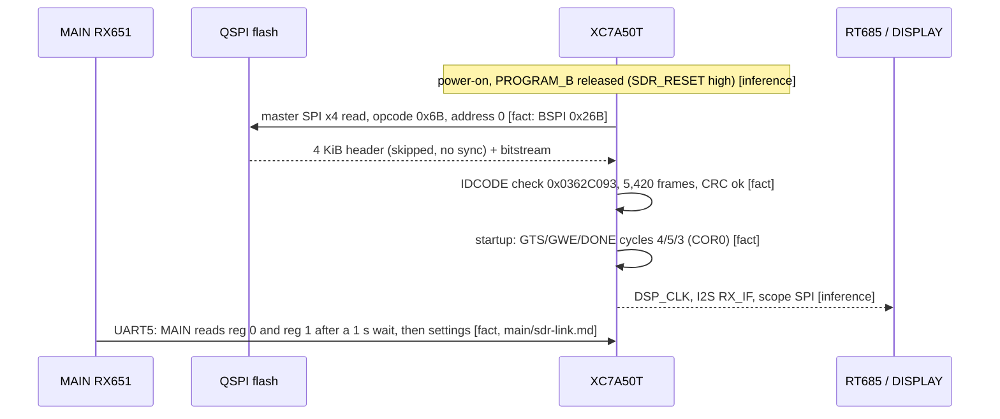

# SDR module image (SR) — code documentation

**Image:** `FT-710_SDR_V0104.SFL` (tag SR, V01-04, 2023-03-24), decoded to `build/FT-710_SDR_V0104.bin`.
**What it is:** a Xilinx Artix-7 **XC7A50T** configuration bitstream (uncompressed, unencrypted, master-SPI x4 boot)
behind a 4 KiB header whose first word is a CRC-32/BZIP2 of the bitstream **[fact]** (T08). **There is no CPU code and
no soft CPU** **[inference, high]**, so there are no functions to name and `decomp/sdr/` holds only a summary.
The "code" documented here is the FPGA design, at the level of placed resources, configured features and block-RAM
contents (T13).

**Key findings from T15 ([netlist.md](netlist.md)):** one 125 MHz fabric clock from the ADC; two identical 115,200-baud UARTs with an ASCII command parser (M18/L18, V12/U12); a QSPI master on the configuration-flash pins; 14 LVDS DDR ADC data pairs and 17 LVDS DDR outputs. **[fact, T15]** The whole recovered netlist runs in Verilator: UART B is MAIN's link (`r`/`w` window protocol) and UART A is a debug console with the prompt `[IF]>`. **[fact, T15e]**

## Pages

| Page | Contents |
|---|---|
| [bitstream.md](bitstream.md) | Image layout, FAR/frame map verified against prjxray (5,420 frames), bit addressing |
| [bram-tables.md](bram-tables.md) | BRAM modes, RAMB36 bit order, catalogue of all 35 initialized memories, MicroBlaze verdict |
| [resources.md](resources.md) | LUT/FF/DSP/BRAM use, 2 MMCMs and their dividers, LVDS/single-ended I/O counts, special blocks |
| [interfaces.md](interfaces.md) | J2002 60-pin map (service manual p19), data-path figure, config/update sequence, open questions |
| [netlist.md](netlist.md) | T15: FASM decode, cell/net netlist, recognized blocks (clocks, ADC capture, DSP chains, UART, scope SPI); Verilog RTL in [`hdl/sdr/`](../../../hdl/sdr/README.md) |
| [`decomp/sdr/README.md`](../../../decomp/sdr/README.md) | T08: packet stream, leading CRC word, first BRAM evidence |
| [`decomp/sdr/progress.tsv`](../../../decomp/sdr/progress.tsv) | T23: netlist cells per documented block (recognized / re-implemented in verified RTL), generated by `tools/sdr_progress.py` from the block map `tools/sdr_blocks.tsv`; the README progress block shows the totals |

**Progress [fact for the counts, inference for block boundaries].** Of the 63,648 netlist cells, **29.9 %** are attributed
to a documented block (27 blocks: clocks and reset, ADC capture, DC removal and gain, mixers, NCO, FIRs, BRAM tables, DAC
output, UARTs, scope serializer and writer, flash QSPI, the two power-up SPI masters, I2S port, register bank, pads) and
**3.1 %** are re-implemented in RTL verified against the netlist (UART A receiver, UART B link, console, scope serializer).
A block is its seed cells from [netlist.md](netlist.md) grown by fan-in/fan-out cones of a few register stages, so the
boundaries between neighbouring blocks are approximate; RTL blocks use the exact slices they were verified against.
76 of the 119 DSPs and 56 of the 137 block-RAM halves are in no documented block yet.

Tools: `tools/xbit_parse.py` (packets, CRCs), `tools/xc7_db.py` (prjxray mapping: `frames`, `bram`, `bramcfg`,
`usage`, `sites`, `config`, `tilebits`), `tools/xc7_bram_tables.py` (logical BRAM tables, `selftest`), and from T15 `tools/xc7_fasm.py`, `tools/xc7_netlist.py`, `tools/xc7_blocks.py`, `tools/xc7_netlist_verilog.py`, and from T15e `tools/sdr_uart_sim.py`, `tools/xc7_probe_netlist.py`, `tools/sdr_cosim_check.py` and the simulation harness `hdl/sdr/sim/`. They need the
prjxray-db checkout described in [`docs/tooling.md`](../../tooling.md).

## Key findings

- The FPGA is nearly full: about 26,600 LUTs (82 %), 31,400 FFs (48 %), **119 of 120 DSP48E1** (register use varies, 12 use the pre-adder; T13's "all fully pipelined" was inverted, corrected by T15b, see [netlist.md §3.5](netlist.md#35-dsp-and-block-ram-structure)),
  70 of 75 RAMB36 sites, 2 MMCMs **[fact for counts]**. ([resources.md](resources.md))
- Block RAM holds **DSP tables only**: an exact 0.5-degree cosine (720 per cycle, 16-bit), an exact 720-step
  raised-cosine ramp, six symmetric low-pass FIRs with 36-bit coefficients, a 1024-tap symmetric filter, quadratic
  ("chirp") and product ("twiddle") phase tables, four of them replicated x4 **[fact for the shapes]**.
  ([bram-tables.md](bram-tables.md))
- I/O: about 9 LVDS input pairs (ADC) and 9 LVDS output pairs (DAC?) plus ~66 single-ended pins **[inference]**.
- J2002: the DISPLAY's SDR SPI goes to the module's **FFT/scope data port**, and MAIN's `SDR_UPDATE` drives the module
  pin labelled **WP** **[fact, p19]**. MAIN holds it **low** during an update ([main/sdr-link.md](../main/sdr-link.md#gpios)), so it acts as an
  update-mode input to the FPGA rather than a plain flash write-protect, and the FPGA most likely reprograms its own config flash
  **[inference]**. ([interfaces.md](interfaces.md))

## Block diagram

Blocks inside the FPGA are **[inference]** from BRAM contents, DSP/IO counts and the J2002 signal names; routing is not
decoded. Connector signals are **[fact]** (service manual p19, [interfaces.md](interfaces.md)).

## Boot / configuration flow

For the update sequence (SD card to flash) see [interfaces.md](interfaces.md#configuration-and-update-sequence).

## Subsystems

| Subsystem | Evidence | Page |
|---|---|---|
| Configuration / boot | packet stream, BSPI, header CRC | [bitstream.md](bitstream.md), T08 |
| RX down-conversion (NCO + filters) | cosine table, FIR bank, 119 DSP48 | [bram-tables.md](bram-tables.md), [resources.md](resources.md) |
| Scope / FFT | x4 phase tables, twiddle table, FFT SPI port | [bram-tables.md](bram-tables.md), [interfaces.md](interfaces.md) |
| TX path | raised-cosine ramp, TX_AF I2S, LVDS outputs | [bram-tables.md](bram-tables.md), [interfaces.md](interfaces.md) |
| Control / debug | UART5 to MAIN, UART_DBG, JTAG J2001 | [interfaces.md](interfaces.md) |
| Clocking | 2 MMCMs, 125 MHz fabric (p6) | [resources.md](resources.md#clocking) |
