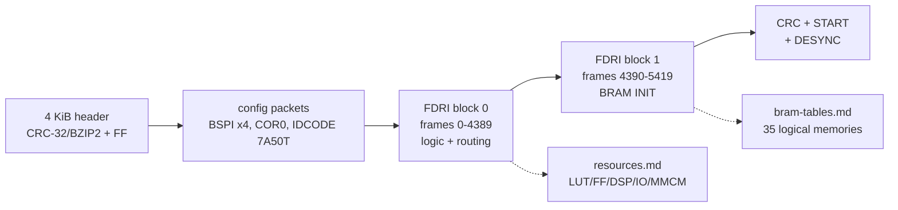

# SDR bitstream layout and frame map (T13)

Image: `build/FT-710_SDR_V0104.bin` (decoded from `FT-710_SDR_V0104.SFL`, tag SR, V01-04). The packet stream itself
(sync, COR0/CTL0, CRC, startup) is documented in [`decomp/sdr/README.md`](../../../decomp/sdr/README.md) (T08); this
page adds the **frame address (FAR) map** checked against the Project X-Ray database.

Tools: `python3 -I tools/xbit_parse.py IMAGE` (packets), `python3 -I tools/xc7_db.py IMAGE frames` (this page).
Database: prjxray-db `artix7/xc7a50tcpg236-1/part.json` and `artix7/xc7a50t/tilegrid.json` (see
[`docs/tooling.md`](../../tooling.md#project-x-ray-t13-xilinx-7-series-bitstream-database)).

## Image layout

| File offset | Size | Content | Tag |
|---|---|---|---|
| 0x000000 | 4 | `0x993966C2` = CRC-32/BZIP2 of file[0x1000:EOF] | [fact] (T08) |
| 0x000004 | 4092 | 0xFF fill to one 4 KiB flash sector | [fact] |
| 0x001000 | 2,192,012 | Vivado `.bin`: bus-width pattern, sync `AA995566`, config packets | [fact] |
| 0x0010FC | 547,420 words | single type-2 FDRI write = 5,420 frames x 101 words | [fact] |
| 0x217A70 | ... | CRC, GRESTORE, DGHIGH, START, trailer, DESYNC | [fact] |

## Who checks the header CRC-32/BZIP2? (#84)

Nobody in the firmware we have **[fact for each check below]**:
- **CPU images.** Neither CRC-32 polynomial word (0x04C11DB7 MSB-first, 0xEDB88320 LSB-first, either byte order) occurs in MAIN or IFDSP;
  in DISPLAY only 0xEDB88320 does (0x20100A94, inside the table-driven LSB-first CRC-32 of `sfl_crc`, which checks the *salted* CRC
  of the `.SFL` file). No fragment of 0x04C11DB7 appears in any decompiled C. The DISPLAY's `sdr_flash_write` reads the file's
  4 KiB header and writes it unchanged to SDR flash 0x480000 after the bitstream; the only checksum on that path is the CRC-16/0xA001
  of each 0x2000-byte SPI block (`crc16_a001_table_init`, FPGA reg 0x33). MAIN only bridges the link (`sdr_bridge_mode`). The
  `sdrchk1`/`sdrchk2` console commands set bits in an event flag that no task waits on ([display/update.md](../display/update.md)).
- **Running FPGA design.** `tools/xc7_crc_search.py`: none of the 54 initialised RAMB18 halves holds a CRC-32 or CRC-16 table or a
  CRC-32 polynomial at any bit offset, and the most XOR-linear register groups of the netlist are adders (cone sizes growing in
  steps of 4 through CARRY4 chains), not a 32-bit CRC register.
- **FPGA configuration logic.** The 7-series loader looks for the sync word and does not read a vendor header word.

What is left is a loader ("golden") bitstream at SDR flash address 0 that would check 0x480000 before a MultiBoot jump to 0x240000;
no file we have contains one ([interfaces.md](interfaces.md)), so only reading the SDR configuration flash can settle it (#101)
**[inference]**. The `.SFL` header CRC that the DISPLAY does check is a different one ([sfl-format.md](../../sfl-format.md)).

## FAR sequence (step 2)

`xc7_db.py` rebuilds the FAR auto-increment order from `part.json`: for each block type (0 = CLB/IO/CLK, 1 = BRAM
content), the top-half rows then the bottom-half rows, every configuration column with its `frame_count` minor frames,
and **two pad frames after each row** (UG470). The rebuilt sequence has 5,408 real frames + 12 pad frames = **5,420,
exactly the FDRI frame count**, and all 12 pad frames are zero **[fact]**. This replaces T08's empirical layout and
confirms it.

| FDRI frame | Block type | Half / row | Clock-region row [inference] |
|---|---|---|---|
| 0 - 1533 | 0 (CLB_IO_CLK) | top, row 0 | Y1 (middle) |
| 1534 - 2855 | 0 | top, row 1 | Y2 (top) |
| 2856 - 4389 | 0 | bottom, row 0 | Y0 (bottom) |
| 4390 - 4775 | 1 (BLOCK_RAM) | top, row 0 | 3 BRAM columns x 128 + 2 pad |
| 4776 - 5033 | 1 | top, row 1 | 2 BRAM columns x 128 + 2 pad (column BRAM_R_X37 has no tiles in region Y2 and BRAM_L_X30 only 5, beside the PCIe/GTP corner) [fact from tilegrid] |
| 5034 - 5419 | 1 | bottom, row 0 | 3 BRAM columns x 128 + 2 pad |

Total device: 75 RAMB36 sites (150 RAMB18 halves) in three BRAM columns (tiles `BRAM_L_X6Y*`, `BRAM_L_X30Y*`, `BRAM_R_X37Y*`; 30 + 25 + 20 RAMB36), 120
DSP48E1 sites, 8,150 slices (all [fact] from tilegrid.json).

## Bit addressing used by the tools [fact, prjxray convention]

A tile owns `frames` consecutive FARs from `baseaddr` and `words` 32-bit words from `offset` inside each frame
(`tilegrid.json`). A segbits bit `FF_BB` is frame `baseaddr+FF`, word `offset + BB//32`, bit `BB%32` (LSB = bit 0).
`xc7_db.py tilebits TILE` lists a tile's set bits in this notation; `config TYPE...` prints the matching non-routing
features; `bramcfg` and `sites` summarize them (see [resources.md](resources.md)).

## Limits

- Routing (PIPs) is not decoded into a netlist. The design is described at the level of placed resources, configured
  features and BRAM contents only. *(True for T13; superseded by T15, which decoded the routing into a full netlist,
  see [netlist.md](netlist.md).)*
- The package (cpg236/csg324/ftg256/fgg484) is not in the bitstream; IOB tile positions are the same for every
  XC7A50T package, but the package pin (and so the J2002 pin) behind each used IOB is unknown. *(T15: the used IOBs are
  bonded only in CSG324 and FGG484 [fact]; which of the two is fitted is open and is settled by the FPGA's package marking; [netlist.md §3.1](netlist.md#31-package).
  The J2002 pin behind each FPGA pin is still unknown, apart from the two UARTs.)*
