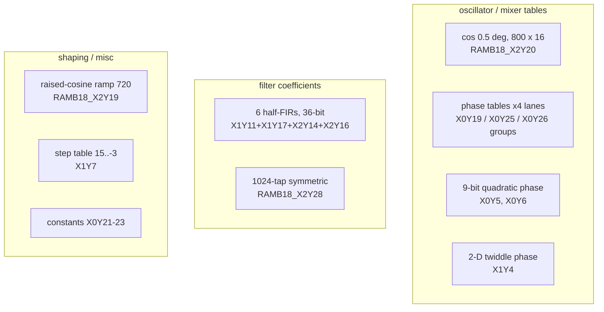

# SDR FPGA block-RAM contents (T13)

What the XC7A50T's initialized block RAMs hold, decoded from the bitstream with the prjxray BRAM INIT/INITP bit map.
No table contents are committed; this page has summaries and fitted formulas only.

Reproduce (needs the decoded image and the prjxray-db checkout, see [`docs/tooling.md`](../../tooling.md)):

```sh
python3 -I tools/xc7_db.py         build/FT-710_SDR_V0104.bin bramcfg     # per-site port widths / modes
python3 -I tools/xc7_db.py         build/FT-710_SDR_V0104.bin bram OUTDIR # raw RAMB18 INIT/INITP dumps (scratch only)
python3 -I tools/xc7_bram_tables.py build/FT-710_SDR_V0104.bin tables     # logical memories + classes
python3 -I tools/xc7_bram_tables.py build/FT-710_SDR_V0104.bin show RAMB18_X2Y20 64
python3 -I tools/xc7_bram_tables.py build/FT-710_SDR_V0104.bin lanes RAMB18_X2Y14 RAMB18_X2Y16 RAMB18_X1Y11 RAMB18_X1Y17
python3 -I tools/xc7_bram_tables.py selftest
```

## Summary

- **70 of 75 RAMB36 sites are configured** (`bramcfg`: IN_USE on at least one half) **[fact]**, but most are
  uninitialized RAM (delay lines, FIFOs, buffers). **54 RAMB18 halves carry non-zero INIT/INITP data, 33 distinct**
  **[fact]**. Read as logical memories (RAMB36 pairs joined, see below) that is **35 initialized memories with 25
  distinct contents** **[fact for the counts, inference for the pairing]**.
- Every initialized memory decodes as a **numeric DSP table**: an exact cosine, an exact raised-cosine ramp, a bank of
  six symmetric FIR low-pass filters with 36-bit coefficients, a 1024-tap symmetric filter, phase tables with
  quadratic (chirp-like) or product (twiddle-like) structure, step tables, and constants **[fact for the shapes]**.
- **No soft CPU (MicroBlaze) image.** See [the verdict](#microblaze-question) **[inference, high]**.

## Port widths and the RAMB36 bit order

`bramcfg` decodes `READ_WIDTH_A/B`, `WRITE_WIDTH_A/B` (3-bit codes 1/2/4/9/18), `SDP_*_WIDTH_36`, `DOA/DOB_REG`,
`RAMB36.BRAM36_*_WIDTH_1` and the cascade flag per tile **[fact]**. Seen in this design:

| Half config | Sites (RAMB36) | Reading |
|---|---|---|
| both halves `4` + `BRAM36_*_WIDTH_1` | 31 | RAMB36 x9 (4096 x 9). Most have no INIT (RAM). [inference] |
| both halves `9` | 24 | RAMB36 x18 (2048 x 18), or two RAMB18 x9 [inference] |
| `18` + SDP_READ/WRITE_WIDTH_36 on a half | 8 | x36 simple-dual-port buffers, no INIT [fact for flags] |
| both halves `18` (true dual port) | 3 | two RAMB18 x18 [inference] |
| mixed single halves (`9`, `18`, `4`) | 4 | independent RAMB18s |

The `BRAM36_*_WIDTH_1` bit always appears with half width code `4`, never with code `1`, so in hardware it is not
simply "x1"; the prjxray fuzzer (027) only exercised widths 1 and 2 **[fact for the co-occurrence, inference for the
meaning]**.

**RAMB36 bit order [inference, high].** RAMB36 INIT bit *j* is bit *j*/2 of half Y(*j* mod 2): the two RAMB18 halves
are bit-interleaved. Evidence: joined this way, pairs that look like noise per half become smooth (X0Y19: total
variation 32/step interleaved vs 482 concatenated; X1Y4: 4.7 vs 17.1; X0Y5 starts 40, 40, 39, 37, 34, 31, 26 ...).
Two halves with the same width can also be two independent RAMB18s. For the odd widths a configuration bit does separate
them (#92): `RAMB36.BRAM36_{READ,WRITE}_WIDTH_{A,B}_1` exists only on a true RAMB36E1 in x1 mode (halves x1) or x9 mode
(halves x4) (prjxray fuzzer `027-bram36-config`) **[fact]**. 31 tiles of this image carry it, all with x4 halves, so they are
**RAMB36 x9**; `xc7_bram_tables.py` now takes them as certain. For other widths no bit separates the cases, and the tool
still keeps whichever reading is smoother (separate halves for X2Y12, X2Y14). This bit order is also what makes X0Y5's
flagged pair a smooth quadratic table, which strengthens the interleave rule. #164 extends the check to the parity
bits and the routing (the parity input goes to both halves, the parity output comes from the lower half only) and
writes these 31 pairs as RAMB36E1 in the Verilog netlist ([netlist.md 4.4](netlist.md#44-true-ramb36e1-and-a-working-block-ram-model-164)).
Inside a RAMB18 at width W, entry *i* is INIT bits [*i*d, *i*d+d) (d = 1/2/4/8/16) with INITP bits as the MSBs
(x9: 1, x18: 2) **[fact, UG473 + prjxray]**.

## Table catalogue

Width "x18 (16)" means an 18-bit port whose parity bits are all zero (16-bit data). "x4" means used by N replicas
with identical contents. Sites are prjxray names (`RAMB36_X*Y*` / `RAMB18_X*Y*`).

| Memory (replicas) | Port | Used | Content | Tag |
|---|---|---|---|---|
| RAMB18_X2Y20 | x18 (16) | 800 / 1024 | `v[n] = round(32760 cos(2 pi n / 720))`, n = 0..799: **cosine in 0.5 degree steps**, 400 degrees long. Max error 0. | [fact] |
| RAMB18_X2Y19 | x18 (16) | 1024 | `v[n] = round(65535 * 0.5 (1 - cos(pi n / 720)))` for n < 720, then 65535: a **raised-cosine ramp** over 720 steps. Max error 1. | [fact] |
| RAMB18_X1Y11 + RAMB18_X1Y17 + RAMB18_X2Y14 + RAMB18_X2Y16 | 4 x9 lanes | 2006 / 2048 | **FIR coefficient bank**, 36-bit words (lane order X2Y14, X2Y16, X1Y11, X1Y17 = LSB to MSB). Six runs at entries 0, 768, 1152, 1408, 1664, 1920 with lengths 543, 274, 133, 195, 102, 86; each run rises to its largest tap at its last entry, i.e. the first half of a symmetric low-pass FIR. Each half sums to about 2^34 (1.70-1.72e10), so full-filter DC gain is about 2^35, unity at 36-bit full scale. Peak tap / DC is 0.166-0.173 for all six (similar cutoff, about 0.08 of the filter's input rate) with different lengths (about 1086, 548, 266, 390, 204, 172 taps). | [fact for runs/sums, inference for the FIR reading] |
| RAMB18_X2Y28 | x18 | 1024 | 18-bit signed, symmetric about entries 511/512 (centre pair 94721, 94721), alternating-sign side lobes of about 68,000, entries sum to 65506 (about 2^16): a **1024-tap symmetric filter** with unity DC gain at 2^16 | [fact for symmetry/sum, inference for "filter"] |
| RAMB36_X0Y19 (x4: X0Y19, X0Y29, X1Y28, X2Y16) | x18 | 2048 | Each 16-bit word holds two 6-bit fields (bits 6, 7, 14, 15 always 0). Read as `hi*64+lo` it is a smooth 12-bit sequence 3..4094 starting and ending at 2047 and symmetric about the middle, with a wrap at 4096: a 12-bit **phase table with quadratic (chirp-like) shape** | [fact for fields, inference for phase] |
| RAMB36_X0Y25 (x4: X0Y25, X1Y27, X1Y29, X2Y19) | x18 | 2048 | Low 16 bits step by a slowly decreasing increment (13807, 13807, 13806, 13805 ...) modulo 2^16: a 16-bit **phase accumulator / chirp phase table**; the two parity bits carry extra flags | [fact for the steps, inference for phase] |
| RAMB36_X0Y26 (x4: X0Y26, X0Y27, X0Y28, X2Y18) | x18 | 2048 | 16-bit values whose first differences change by about -3000 per step modulo 2^16: another **quadratic phase table** | [inference, medium] |
| RAMB36_X0Y5 (RAMB18_X0Y10 + X0Y11) | **x9** (BRAM36 width flag, #92) | 4096 | Second differences modulo 512 are 0 or -1 for 83 % of entries: `phase(n) ~ 40 - 0.216 n^2 (mod 512)`, a 9-bit **quadratic phase table**. Earlier the tool's smoothness rule kept the halves separate; the configuration flag now settles x9 **[fact for the mode]**. | [inference, medium] for the meaning |
| RAMB36_X0Y6 | x9 | 4096 | Second differences modulo 512 cluster at 107-113: a 9-bit **quadratic phase table** with a larger rate | [inference, medium] |
| RAMB36_X1Y4 | x9 | 4096 | 16 rows of 256: each row is a straight line modulo 512 whose slope grows with the row number (about -0.37 x row per step): `phase(r, c) ~ p0(r) - k r c`, a 2-D **twiddle-style phase table** | [inference, medium] |
| RAMB36_X1Y9 | x18 | 1527 / 2048 | Piecewise-smooth 18-bit signed values (-66097..98095) with steps in blocks | [fact], purpose unknown |
| RAMB18_X2Y29 | x18 (16) | 1024 | Two 6-bit fields like X0Y19; smooth hump peaking at entry 711 | [fact], purpose unknown |
| RAMB36_X1Y7 | x9 (5-bit used) | 4096 | Stepped table: 15 for entries 0-749, then 14, 13 ... 0 with step widths shrinking from 366 to about 145, then 31, 30, 29 (= -1, -2, -3 as 5-bit): a **quantizer / level-threshold table** | [fact for steps], [guess] for use |
| RAMB18_X2Y24, RAMB18_X2Y25 | x18 | 1024, 789 | X2Y24 contains a rising segment 0, 1019, 1782, 2800 ... from entry 512 and 18-bit values elsewhere; X2Y25 holds values only at even entries, slowly decaying (362, 346, 331 ... at 512) | [fact], purpose unknown |
| RAMB18_X1Y16 | x18 | 868 | Sparse 18-bit values at even entries (odd entries 0 / -1), repeating 128-entry blocks | [fact], coefficient-like |
| RAMB18_X0Y16 | x18 (16) | 1024 | Word pairs; bytes stay <= 0x3F (6-bit fields), e.g. pairs (0x3E,0x00), (0x3C,0x02), (0x3A,0x04), (0x38,0x08) ... | [fact], purpose unknown |
| RAMB18_X2Y18 | x4 | 2482 / 4096 | 4-bit signed values with the same zero blocks as the FIR bank (entries 640-767 and 1792-1919 at x9 addressing) | [inference] belongs to the FIR bank |
| RAMB18_X2Y10 | x18 (16) | 202 | Mostly zero; a short block at entries 128-201 | [fact] |
| RAMB36_X0Y21, RAMB36_X0Y22 | x9 | 4096 | all 0x1FF | [fact] |
| RAMB36_X0Y23 | x9 | 4096 | all 0x1F | [fact] |

The x4 replication of three phase tables and one 12-bit phase table (always on different BRAM columns / regions)
fits **four identical processing lanes** (for example four receive or scope channels), each with its own copy of the
table **[inference]**.



Readings of the purposes **[guess]**: the 720-step raised-cosine ramp is the classic shape for a **CW keying / TX
envelope** edge; the 0.5-degree cosine fits a phase-to-amplitude stage (NCO or display); the six symmetric low-pass
filters of different lengths fit **selectable IF filter widths** or decimation stages; the quadratic phase tables fit
a chirp-based transform (for example a zoomable spectrum scope) and the 2-D product phase table fits FFT twiddles.
#146 traced the routing from every table to the multiplier it feeds and to what drives its address
([netlist.md 3.6](netlist.md#36-routing-ties-adcdac-pins-and-block-ram-tables-to-their-logic-146)): the four phase-table
lanes each feed their own DSP pair, the cosine table sits between a phase-accumulator DSP and a mixer DSP, and the
raised-cosine ramp feeds a multiplier's B input. The purposes above remain readings, not proofs.

## MicroBlaze question

Verdict: **no MicroBlaze (or other soft CPU) program is stored in block RAM [inference, high].**

- A MicroBlaze LMB memory is 32 bits wide: four x9 byte lanes or x36/x18 RAMB36s, with code-like statistics. The only
  4-lane x9 set in the design (X2Y14, X2Y16, X1Y11, X1Y17) decodes as **six smooth symmetric half-FIRs with unity
  DC gain** when joined, which code cannot do **[fact for the decode]**.
- Every other initialized memory is a smooth curve, a modular phase table, a step table or a constant. The
  "high-entropy" ones are explained by modular wrap (phase tables) or by being the low lanes of wide coefficients
  **[fact for the shapes]**.
- Three tables are replicated four times. Replication fits per-channel DSP tables, not a CPU image **[inference]**.
- The x36/x72 SDP BRAMs have no INIT, so no code or data is preloaded there. A soft CPU that copies code in from
  flash at run time cannot be excluded by the bitstream alone, but nothing in the design points to one, and the
  FPGA has no CPU-style memory left over **[inference]**.

So the `SDR_DBG_IN/OUT` ("UART DBG") pins on J2002 most likely go to a hardware register/debug UART in fabric
logic **[inference]**.
