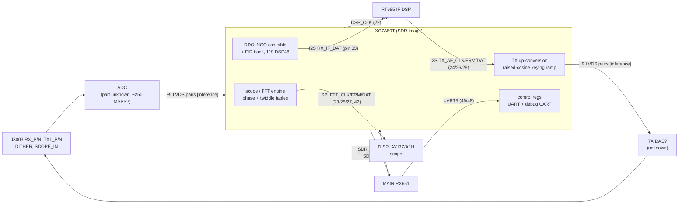
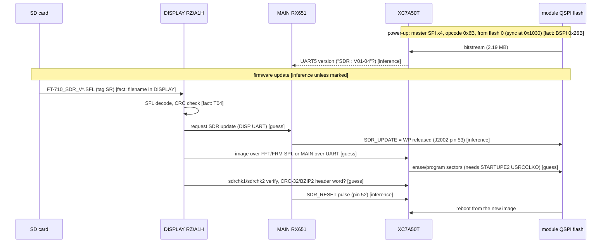

# SDR module interfaces (T13)

The SDR module (ADC + XC7A50T FPGA + QSPI config flash) plugs into the MAIN unit through **J2002**, a 60-pin
Panasonic AXK6S60647YG board-to-board connector, and takes RF from J3003 (`docs/hardware.md`). The module itself is
not in the service manual, so everything inside it is inferred from the bitstream.

## J2002 pin map

Read from the schematic "Circuit Diagram (MAIN Unit/DSP)", sheet `MAIN-UNIT/SDR-DSP`, service manual PDF page 19
(printed "MAIN-3") **[fact]**. "Module label" is the text printed inside the connector symbol; "MAIN net" is the net
drawn on the MAIN side. `x` marks a line drawn crossed (not connected) on MAIN.

| Pin | Module label | MAIN net | | Pin | Module label | MAIN net |
|---|---|---|---|---|---|---|
| 1, 3, 5 | RF_+5V | (+5 V, C2112/C2115/C2121) | | 2, 4, 6, 8, 10 | DIG_+5V | (+5 V) |
| 7 | GND | | | 12 | GND | |
| 9 | MISO | (none) | | 14 | FRM? (unclear) | (none) |
| 11 | MOSI | (none) | | 16 | TDO | SDR_TDO |
| 13 | SCLK | (none) | | 18 | TDI | SDR_TDI |
| 15 | TMS | SDR_TMS | | 20 | GND | |
| 17 | TCK | SDR_TCK | | 22 | DSP_CLK | DSP_CLK (to RT685 CLKIN) |
| 19 | DIG_+3.3V | SDR_VDD | | 24 | TX_CLKA | TX_AF_CLK |
| 21 | GND | | | 26 | TX_FRMA | TX_AF_FRM |
| 23 | FFT_CLK | SDR_SCLK (RB2008) | | 28 | TX_DATA | TX_AF_DAT |
| 25 | FFT_FRM | SDR_SS | | 30 | FW_S | SDR_DET2 |
| 27 | FFT_DAT | SDR_MOSI | | 32 | FW_H | SDR_DET |
| 29 | RX_CLKA | TX_AF_CLK (crossed, "N/A") | | 34 | ADC0 | FADC0 |
| 31 | RX_FRMA | RX_IF_FRM (R2085 33 ohm, "N/A") | | 36 | GND | |
| 33 | RX_DATA | RX_IF_DAT (R2086 33 ohm) | | 38 | FRM_CLK | x ("N/A") |
| 35 | GND | | | 40 | FRM_FRM | x ("N/A") |
| 37 | BITTY? (FSK) | FSK_SHIFT | | 42 | FRM_DAT | SDR_MISO ("N/A" in the legend) |
| 39 | CW_KEY | SEND_A | | 44 | ADC1 | FADC1 |
| 41 | OFLW | SDR_OVF | | 46 | UART_RX | SDR_UMOSI (R2087 470 ohm) |
| 43 | TRX | TX | | 48 | UART_TX | SDR_UMISO |
| 45 | UART_DBG_RX | SDR_DBG_IN | | 50 | GND | |
| 47 | UART_DBG_TX | SDR_DBG_OUT (R2088 470 ohm) | | 52 | RST_IN | SDR_RESET (via D2001 BAS316) |
| 49 | GND | | | 54 | PWR_OUT | SDR_PGD |
| 51 | NC | | | 56, 58, 60 | GND | |
| 53 | **WP** | **SDR_UPDATE** | | | | |
| 55, 57, 59 | GND | | | | | |

The legend printed next to the connector says: "Pin24 CLK, Pin26 FRAME, Pin28 TX DATA, Pin29 N/A, Pin31 N/A, Pin33 RX
DATA; Pin23 FFT/FRM CLK, Pin25 FFT/FRM FRAME, Pin27 FFT/FRM DATA, Pin38 N/A, Pin40 N/A, Pin42 N/A" **[fact]**. Labels
marked "?" were hard to read at the scan resolution.

### What the pin map changes [inference]

- **TX and RX audio share one clock/frame pair.** RX I2S uses pins 24/26 (`TX_AF_CLK/FRM`) with RX data on pin 33;
  the module's own RX clock/frame pins (29/31) are "N/A".
- **The DISPLAY's "SDR SPI" is the FFT/scope data port, not the flash.** `SDR_SCLK/SS/MOSI` land on the module's
  `FFT_CLK/FFT_FRM/FFT_DAT` (23/25/27), i.e. on FPGA fabric pins. The module's `MISO/MOSI/SCLK` pins 9/11/13 (which by
  name could reach the config flash) have no MAIN net.
- **`SDR_UPDATE` drives the module pin labelled `WP`** (pin 53). That reads as the **write-protect of the QSPI config
  flash**, controlled by MAIN. T08's hypothesis that the DISPLAY writes the flash directly over its SPI bus is
  therefore unlikely; more likely the **FPGA (or a module-side path) writes its own config flash**, with MAIN lifting
  WP during an update and pulsing `SDR_RESET` afterwards so the FPGA reboots from the new image.
- The FPGA receives the image either over the FFT/FRM SPI port from DISPLAY or over the MAIN UART (pins 46/48)
  **[guess, open]**. Fabric logic that writes flash needs user access to the flash clock (STARTUPE2 `USRCCLKO`); its use
  could not be read from the bitstream (see [resources.md](resources.md#special-blocks)).
- `SDR_DBG_IN/OUT` is a second UART ("UART_DBG"), and JTAG (`SDR_TDI/TDO/TMS/TCK`) also goes to header J2001.

## Data paths

All block names inside the FPGA are **[inference]** from BRAM contents and resource counts; the routing is not decoded.
The connector signals are **[fact]** (p19). The ADC/DAC and their LVDS widths are **[inference]** from the IOB
features. `FADC0/1` go to MAIN analog inputs per their names (`ADC0/ADC1` on the module) **[inference]**.

## Configuration and update sequence

### To confirm

1. DISPLAY (T06): the `sdrup`/`sdr1up`/`sdr2up`/`sdrspi`/`sdrchk1/2` handlers: which bus carries the image, what
   commands/framing are used, and who computes the CRC-32/BZIP2 in the 4 KiB header.
2. MAIN (T05/T11): the GPIOs for `SDR_UPDATE`/`SDR_RESET`, the UART5 protocol (version query, register writes), and
   whether MAIN takes part in the update.
3. Readable labels on J2002 pins 14 and 37 at a higher scan resolution.
4. Whether the module's `MISO/MOSI/SCLK` pins (9/11/13) are a factory flash-programming port.
5. The FPGA side of these signals is now partly known from the netlist ([netlist.md](netlist.md#33-pin-map-by-bank)):
   two identical UARTs (M18/L18 and V12/U12, 115,200 8N1), a QSPI master on the configuration-flash pins, the LVDS
   ADC input (bank 35) and an LVDS DDR output bus (bank 34). Which UART is UART5 and which is UART_DBG, and the
   other control lines, still need the module-side pin path, which the service manual does not show.
