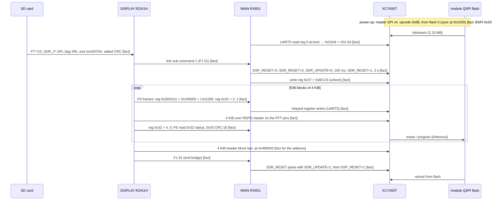

# SDR module interfaces (T13)

The SDR module (ADC + XC7A50T FPGA + QSPI config flash) plugs into the MAIN unit through **J2002**, a 60-pin
Panasonic AXK6S60647YG board-to-board connector, and takes RF from J3003 (`docs/hardware.md`). The module itself is
not in the service manual, so everything inside it is inferred from the bitstream.

## J2002 pin map

Read from the schematic "Circuit Diagram (MAIN Unit/DSP)", sheet `MAIN-UNIT/SDR-DSP`, service manual PDF page 19
(printed "MAIN-3") **[fact]**. "Module label" is the text printed inside the connector symbol; "MAIN net" is the net
drawn on the MAIN side. `x` marks a line drawn crossed (not connected) on MAIN.

| Pin | Module label | MAIN net | | Pin | Module label | MAIN net |
|---|---|---|---|---|---|---|
| 1, 3, 5 | RF_+5V | (+5 V, C2112/C2115/C2121) | | 2, 4, 6, 8, 10 | DIG_+5V | (+5 V) |
| 7 | GND | | | 12 | GND | |
| 9 | MISO | (none) | | 14 | FRM? (unclear) | (none) |
| 11 | MOSI | (none) | | 16 | TDO | SDR_TDO |
| 13 | SCLK | (none) | | 18 | TDI | SDR_TDI |
| 15 | TMS | SDR_TMS | | 20 | GND | |
| 17 | TCK | SDR_TCK | | 22 | DSP_CLK | DSP_CLK (to RT685 CLKIN) |
| 19 | DIG_+3.3V | SDR_VDD | | 24 | TX_CLKA | TX_AF_CLK |
| 21 | GND | | | 26 | TX_FRMA | TX_AF_FRM |
| 23 | FFT_CLK | SDR_SCLK (RB2008) | | 28 | TX_DATA | TX_AF_DAT |
| 25 | FFT_FRM | SDR_SS | | 30 | FW_S | SDR_DET2 |
| 27 | FFT_DAT | SDR_MOSI | | 32 | FW_H | SDR_DET |
| 29 | RX_CLKA | TX_AF_CLK (crossed, "N/A") | | 34 | ADC0 | FADC0 |
| 31 | RX_FRMA | RX_IF_FRM (R2085 33 ohm, "N/A") | | 36 | GND | |
| 33 | RX_DATA | RX_IF_DAT (R2086 33 ohm) | | 38 | FRM_CLK | x ("N/A") |
| 35 | GND | | | 40 | FRM_FRM | x ("N/A") |
| 37 | BITTY? (FSK) | FSK_SHIFT | | 42 | FRM_DAT | SDR_MISO ("N/A" in the legend) |
| 39 | CW_KEY | SEND_A | | 44 | ADC1 | FADC1 |
| 41 | OFLW | SDR_OVF | | 46 | UART_RX | SDR_UMOSI (R2087 470 ohm) |
| 43 | TRX | TX | | 48 | UART_TX | SDR_UMISO |
| 45 | UART_DBG_RX | SDR_DBG_IN | | 50 | GND | |
| 47 | UART_DBG_TX | SDR_DBG_OUT (R2088 470 ohm) | | 52 | RST_IN | SDR_RESET (via D2001 BAS316) |
| 49 | GND | | | 54 | PWR_OUT | SDR_PGD |
| 51 | NC | | | 56, 58, 60 | GND | |
| 53 | **WP** | **SDR_UPDATE** | | | | |
| 55, 57, 59 | GND | | | | | |

The legend printed next to the connector says: "Pin24 CLK, Pin26 FRAME, Pin28 TX DATA, Pin29 N/A, Pin31 N/A, Pin33 RX
DATA; Pin23 FFT/FRM CLK, Pin25 FFT/FRM FRAME, Pin27 FFT/FRM DATA, Pin38 N/A, Pin40 N/A, Pin42 N/A" **[fact]**. Labels
marked "?" were hard to read at the scan resolution.

### What the pin map changes [inference]

- **TX and RX audio share one clock/frame pair.** RX I2S uses pins 24/26 (`TX_AF_CLK/FRM`) with RX data on pin 33;
  the module's own RX clock/frame pins (29/31) are "N/A".
- **The DISPLAY's "SDR SPI" is the FFT/scope data port, not the flash.** `SDR_SCLK/SS/MOSI` land on the module's
  `FFT_CLK/FFT_FRM/FFT_DAT` (23/25/27), i.e. on FPGA fabric pins. The module's `MISO/MOSI/SCLK` pins 9/11/13 (which by
  name could reach the config flash) have no MAIN net.
- **`SDR_UPDATE` drives the module pin labelled `WP`** (pin 53), but it is an **update-mode input**, not a plain
  write-protect. MAIN holds it **low** for the whole update and raises it again for the reboot, so an active-low flash
  `WP#` would be protected exactly while the image is written (T10c [../main/sdr-link.md](../main/sdr-link.md), T11c
  [../display/update.md](../display/update.md) §8). The fabric writes the config flash itself; whether the pin also reaches the
  flash's /WP cannot be told from the code. (T13 first read it as "MAIN lifts WP".)
- **The image goes over the FFT/FRM SPI port** **[fact for DISPLAY]**: the DISPLAY switches RSPI2 to master (about 2 MHz) on
  the `SDR_SCLK/SS/MOSI` pins (`sdr_spi_master_write` 0x201107C0) and sends 4 KiB blocks, while MAIN bridges the register
  commands over its UART5. Fabric logic that writes flash needs user access to the flash clock (STARTUPE2 `USRCCLKO`);
  the QSPI pins D00/FCS_B are driven and D01–D03 are user inputs, so STARTUPE2 is likely used
  ([resources.md](resources.md#io)) **[inference]**.
- A volatile JTAG test bitstream (SRAM only) is planned in [docs/patches/fpga-jtag-hello.md](../../patches/fpga-jtag-hello.md) (T16).
- `SDR_DBG_IN/OUT` is a second UART ("UART_DBG"), and JTAG (`SDR_TDI/TDO/TMS/TCK`) also goes to header J2001.

## Data paths

All block names inside the FPGA are **[inference]** from BRAM contents and resource counts; the routing is not decoded.
The connector signals are **[fact]** (p19). The ADC/DAC and their LVDS widths are **[inference]** from the IOB
features. `FADC0/1` go to MAIN analog inputs per their names (`ADC0/ADC1` on the module) **[inference]**.

## Configuration and update sequence

Details: MAIN side [../main/sdr-link.md](../main/sdr-link.md) (`sdr_bridge_mode` 0xFFFA3226), DISPLAY side
[../display/update.md](../display/update.md) §8 (`sdr_flash_write` 0x20110AB8). The bitstream proper (file binary 0x1000..) goes to
flash 0x240000 and the header with the CRC-32/BZIP2 word last to 0x480000, so an interrupted update leaves no valid header
**[inference]**. Whether the FPGA boots 0x240000 directly or through a golden/multiboot image at 0: the shipped image answers half of it (#58). Its
configuration packets (`tools/xbit_parse.py`) write **WBSTAR = 0**, contain **no IPROG**, and set **CTL0 ConfigFallback** (0x501) **[fact]**. So this image
never jumps anywhere itself, and if it fails its CRC after a warm boot the FPGA falls back to the image at flash 0. A plain power-up
(master SPI) always starts at address 0, so for the 0x240000 copy to run there must be a **golden/loader image at 0** that writes
WBSTAR = 0x240000 and issues IPROG, the standard 7-series MultiBoot layout (UG470) **[inference, strong]**. The fabric drives the flash
clock itself through STARTUPE2 (#93), which is how the update writes the slot. Reading flash 0 over J2001 (#101, needs the radio)
would confirm the golden image.

### To confirm

1. ~~Which bus carries the image~~ **answered (T11c/T11d)**: RSPI2 master on the FFT pins, control through MAIN
   ([update.md](../display/update.md) §8). Still open: the meaning of reg 0x32 commands 3/1/4/5 and the 0x240000 / 0x480000
   slot layout (T15).
2. ~~MAIN GPIOs and UART5 protocol~~ **answered (T10c)**: P76 `SDR_UPDATE`, P77 `SDR_RESET`, SCI5 115200 8N1, MAIN bridges
   the update ([sdr-link.md](../main/sdr-link.md)).
3. Readable labels on J2002 pins 14 and 37 at a higher scan resolution.
4. Whether the module's `MISO/MOSI/SCLK` pins (9/11/13) are a factory flash-programming port.
5. The FPGA side of these signals is now partly known from the netlist ([netlist.md](netlist.md#33-pin-map-by-bank)):
   two identical UARTs (M18/L18 and V12/U12, 115,200 8N1), a QSPI master on the configuration-flash pins, the LVDS
   ADC input (bank 35) and an LVDS DDR output bus (bank 34). Which UART is UART5 and which is UART_DBG, and the
   other control lines, still need the module-side pin path, which the service manual does not show.

**Answered (T15e):** UART B (V12/U12) is UART5, MAIN's link; UART A (M18/L18) is UART_DBG, a debug console with the prompt `[IF]>`. Shown by simulating the recovered netlist ([netlist.md §5](netlist.md)). **[fact, from behaviour]**
