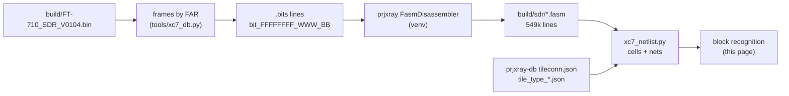

# SDR FPGA netlist recovery (T15)

Back to the [SDR overview](README.md).

This page takes the XC7A50T design from configuration bits ([bitstream.md](bitstream.md)) to FASM features, then to a
cell-level netlist, and then to recognized blocks. Everything derived (FASM, netlist JSON) stays in `build/sdr/` and
is not committed. Tools: `tools/xc7_fasm.py` (T15a), `tools/xc7_netlist.py` (T15b), `tools/xc7_blocks.py` (T15c).



## 1. Bitstream to FASM (T15a)

```sh
python3 -I tools/xc7_fasm.py selftest     # .bits format + segbits round trip through prjxray (5 hand-built features)
python3 -I tools/xc7_fasm.py fasm build/FT-710_SDR_V0104.bin build/sdr/FT-710_SDR_V0104.fasm --unknown build/sdr/unknown_bits.txt
python3 -I tools/xc7_fasm.py summary build/sdr/FT-710_SDR_V0104.fasm
```

`fasm` re-runs itself under `~/.local/share/ft710-tools/venv` when prjxray's Python dependencies are missing. It takes
about 18 s and under 1 GB.

**Coverage [fact].** Of 2,360,912 set configuration bits, prjxray's segbits explain all but 24,631. Of those, 24,224
are the per-frame ECC (word 50, bits 0-12, UG470), which belongs to no feature. Only **407 bits (0.017 %) are
unexplained**: DSP_L 100, DSP_R 98, MONITOR_BOT (XADC) 95, RIOB33 86, a few in HCLK/CFG/INT. So the FASM is an almost
complete description of the design.

**FASM lines per tile type [fact].** A merged multi-bit value (for example `ALUT.INIT[63:0]`) counts as one line.

| Tile type | Tiles | PIPs | LUT INIT | BRAM INIT | Other site features |
|---|---|---|---|---|---|
| INT_R / INT_L | 2,750 / 2,737 | 180,500 / 177,756 | | | 65 / 58 (long-line `LV`/`LH` features) |
| CLBLM_R / CLBLM_L | 1,456 / 884 | | 9,509 / 5,944 | | 55,197 / 32,628 |
| CLBLL_L / CLBLL_R | 1,026 / 600 | | 6,983 / 4,172 | | 35,935 / 21,295 |
| BRAM_L / BRAM_R | 51 / 20 | 3,060 / 1,200 | | 2,513 / 940 | 2,318 / 866 |
| DSP_L / DSP_R | 30 / 30 | 2,301 / 2,108 | | | 893 / 783 |
| LIOI3 (+TBYTE*) / RIOI3 (+TBYTE*) | 28 / 34 | 0 / 62 | | | 396 / 595 |
| LIOB33 (+_SING) / RIOB33 | 47 / 35 | | | | 393 / 316 |
| CMT_TOP_R_LOWER_B (MMCM) | 2 | 6 | | | 84 |
| CLK_BUFG_TOP_R / BOT_R / REBUF | 1 / 1 / 6 | 36 / 35 / 0 | | | 16 / 12 / 62 |
| CLK_HROW_TOP_R / BOT_R | 2 / 1 | 15 / 9 | | | 29 / 22 |
| HCLK_L / HCLK_CMT* / HCLK_IOI3 | 52 / 5 / 2 | 129 / 9 / 2 | | | 69 / 19 / 12 |
| **total** | **9,801** | **367,229** | **26,608** | **3,453** | **152,064** |

Notes **[fact for features, inference for meaning]**:
- The 26,608 LUT INIT lines match T13's LUT count exactly ([resources.md](resources.md)).
- IOI tiles: 94 ILOGIC sites carry the `ISERDES.MODE.MASTER` / `IDELAY_TYPE_FIXED` pair (Vivado's default attributes of
  a used input path, not proof of an ISERDES), **10 `IDDR`** and **12 `ODDR`** sites, all in the right I/O bank (RIOI3),
  and 23 `OMUX.D1`/`OQUSED` plain outputs in the left bank (LIOI3). DDR input and output flops on the right bank fit an
  **LVDS DDR ADC capture and a DDR output bus** **[inference]**.
- Per-tile features with no PIP name in `tile_type_*.json` in INT tiles are the bidirectional long lines (`LVx.LVy`,
  `LHx.LHy`); the netlist step treats them as PIPs.
