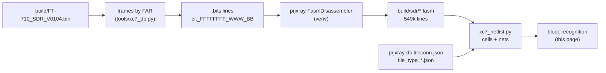

# SDR FPGA netlist recovery (T15)

Back to the [SDR overview](README.md).

This page takes the XC7A50T design from configuration bits ([bitstream.md](bitstream.md)) to FASM features, then to a
cell-level netlist, and then to recognized blocks. Everything derived (FASM, netlist JSON) stays in `build/sdr/` and
is not committed. Tools: `tools/xc7_fasm.py` (T15a), `tools/xc7_netlist.py` (T15b), `tools/xc7_blocks.py` (T15c).



## 1. Bitstream to FASM (T15a)

```sh
python3 -I tools/xc7_fasm.py selftest     # .bits format + segbits round trip through prjxray (5 hand-built features)
python3 -I tools/xc7_fasm.py fasm build/FT-710_SDR_V0104.bin build/sdr/FT-710_SDR_V0104.fasm --unknown build/sdr/unknown_bits.txt
python3 -I tools/xc7_fasm.py summary build/sdr/FT-710_SDR_V0104.fasm
```

`fasm` re-runs itself under `~/.local/share/ft710-tools/venv` when prjxray's Python dependencies are missing. It takes
about 18 s and under 1 GB.

**Coverage [fact].** Of 2,360,912 set configuration bits, prjxray's segbits explain all but 24,631. Of those, 24,224
are the per-frame ECC (word 50, bits 0-12, UG470), which belongs to no feature. Only **407 bits (0.017 %) are
unexplained**: DSP_L 100, DSP_R 98, MONITOR_BOT (XADC) 95, RIOB33 86, a few in HCLK/CFG/INT. So the FASM is an almost
complete description of the design.

**FASM lines per tile type [fact].** A merged multi-bit value (for example `ALUT.INIT[63:0]`) counts as one line.

| Tile type | Tiles | PIPs | LUT INIT | BRAM INIT | Other site features |
|---|---|---|---|---|---|
| INT_R / INT_L | 2,750 / 2,737 | 180,500 / 177,756 | | | 65 / 58 (long-line `LV`/`LH` features) |
| CLBLM_R / CLBLM_L | 1,456 / 884 | | 9,509 / 5,944 | | 55,197 / 32,628 |
| CLBLL_L / CLBLL_R | 1,026 / 600 | | 6,983 / 4,172 | | 35,935 / 21,295 |
| BRAM_L / BRAM_R | 51 / 20 | 3,060 / 1,200 | | 2,513 / 940 | 2,318 / 866 |
| DSP_L / DSP_R | 30 / 30 | 2,301 / 2,108 | | | 893 / 783 |
| LIOI3 (+TBYTE*) / RIOI3 (+TBYTE*) | 28 / 34 | 0 / 62 | | | 396 / 595 |
| LIOB33 (+_SING) / RIOB33 | 47 / 35 | | | | 393 / 316 |
| CMT_TOP_R_LOWER_B (MMCM) | 2 | 6 | | | 84 |
| CLK_BUFG_TOP_R / BOT_R / REBUF | 1 / 1 / 6 | 36 / 35 / 0 | | | 16 / 12 / 62 |
| CLK_HROW_TOP_R / BOT_R | 2 / 1 | 15 / 9 | | | 29 / 22 |
| HCLK_L / HCLK_CMT* / HCLK_IOI3 | 52 / 5 / 2 | 129 / 9 / 2 | | | 69 / 19 / 12 |
| **total** | **9,801** | **367,229** | **26,608** | **3,453** | **152,064** |

Notes **[fact for features, inference for meaning]**:
- The 26,608 LUT INIT lines match T13's LUT count exactly ([resources.md](resources.md)).
- IOI tiles: 94 ILOGIC sites carry the `ISERDES.MODE.MASTER` / `IDELAY_TYPE_FIXED` pair (Vivado's default attributes of
  a used input path, not proof of an ISERDES), **10 `IDDR`** and **12 `ODDR`** sites, all in the right I/O bank (RIOI3),
  and 23 `OMUX.D1`/`OQUSED` plain outputs in the left bank (LIOI3). DDR input and output flops on the right bank fit an
  **LVDS DDR ADC capture and a DDR output bus** **[inference]**.
- Per-tile features with no PIP name in `tile_type_*.json` in INT tiles are the bidirectional long lines (`LVx.LVy`,
  `LHx.LHy`); the netlist step treats them as PIPs.

## 2. FASM to cell-level netlist (T15b)

```sh
python3 -I tools/xc7_netlist.py selftest    # hand-built toggle flop routed through an INT tile + FASM value merge
python3 -I tools/xc7_netlist.py build build/sdr/FT-710_SDR_V0104.fasm build/sdr/netlist.json   # ~27 s, < 1.5 GB
python3 -I tools/xc7_netlist.py stats build/sdr/netlist.json
python3 -I tools/xc7_netlist.py net build/sdr/netlist.json SLICE_X12Y43/A5FF   # one cell or one net
```

**Method.** A prjxray *node* is a set of tile wires joined by `tileconn.json`; the tool builds nodes lazily (1.25 M
wires in 0.74 M nodes are touched) and joins them into nets with the 367,368 FASM PIPs plus the `always` pseudo-PIPs
of `ppips_*.db`. Two refinements were needed **[fact, found while testing]**:
- `always` pseudo-PIPs whose two ends are both site-pin wires are paths *through* a site (for example BUFHCE I to O);
  following them merged every clock buffer output into one net, so they are skipped.
- An INT `IMUX`/`BYP_ALT`/`FAN_ALT` wire with no driving PIP is VCC (prjxray `default` pseudo-PIP), and a LUT with no
  INIT bits has INIT = 0, so its O6/O5 are constant 0. Vivado writes `PRECYINIT.C0` into slices without a carry chain,
  so CARRY4s are emitted for every slice and dropped (iteratively, along chains) when no output is used.

**SLICE model** (UG474 + prjxray fuzzer READMEs 011-019): LUT6, or LUT6_2 when O5 is used; FF type from
`FFSYNC`/`LATCH`/`ZRST` (FDRE/FDSE sync, FDCE/FDPE async, LDCE/LDPE latch) and INIT from `ZINI` (Z = inverted);
D muxes `xFFMUX` / `x5FFMUX` (IN_A = O5, IN_B = X bypass); CE/SR from `CEUSEDMUX`/`SRUSEDMUX`; clock inversion from
`NOCLKINV`; CARRY4 with `PRECYINIT` (CIN / AX / 0 / 1) and `xCY0` (DI = O5 or X); MUXF7/MUXF8; output muxes; SLICEM
LUT RAM (RAMD64E, and RAMD32 for the O5 half in `SMALL` mode) and SRLs (SRLC32E, pairs in `SMALL` mode). Hard blocks
keep all routed site pins and their FASM features.

**Result [fact for counts].**

| Cell | Count | Cross-check |
|---|---|---|
| LUT6 / LUT6_2 | 19,431 / 7,177 | 26,608 = T13 LUT count |
| FDRE / FDCE / FDSE / FDPE | 22,044 / 8,784 / 498 / 58 | 31,384 = T13 FF count; no latches |
| CARRY4 (outputs used) | 3,692 | T13 lower bound 3,398 |
| MUXF7 / MUXF8 | 251 / 30 | |
| RAMD64E + RAMD32 (LUT RAM, all `SMALL` = RAM32M-style pairs) | 336 + 336 | 336 `xLUT.RAM` |
| SRLC32E (221 SRL LUTs, 220 of them SRL16 pairs) | 441 | 221 `xLUT.SRL` |
| DSP48E1 | 119 | |
| RAMB18E1 halves in use | 137 | 70 RAMB36 sites |
| IOB / IDDR / ODDR / IDELAYE2 | 162 / 14 / 17 / 124 | 110 ILOGIC and 30 OLOGIC are plain pass-through |
| MMCME2_ADV / BUFGCTRL / BUFHCE / BUFR | 2 / 7 / 16 / 8 | |

134,639 nets: 126,393 with exactly one driver, **none with two or more**, 8,246 without a driver. The undriven ones
are unused hard-block inputs (ILOGIC clocks, DSP cascade inputs at the bottom of a column, unused IOB O/T, BRAM
cascade pins); only 3 fabric pins (2 SRL data inputs in a `DI_DMC31` chain, 1 FF D) are left unexplained
**[fact]**. The flip-flop clocks come from 6 BUFHCE outputs (4,000-7,300 FFs each) and one BUFR (83 FFs) **[fact]**,
see [section 3](#3-recognized-blocks-t15c).

**Corrections to T13 [fact].** prjxray's DSP fuzzer (`100-dsp-mskpat`) writes `Z<reg>` when the register value is
**0**, so the earlier reading "all 119 DSPs fully pipelined" in [resources.md](resources.md) was inverted: `ZMREG` is
set in 55 DSPs (MREG = 0), `ZPREG` in 9 (PREG = 0), `ZOPMODEREG` in 36, `ZCREG` in 107; `USE_DPORT` (pre-adder) is set
in 12. `USE_MULT` has no segbits in prjxray-db (it is probably among the 198 unexplained DSP bits).

**Approximations** (marked `approx` on the cells): the O5 halves of SRL16/RAM32 pairs take their data from the X
bypass pin; LUT RAM wider than 64 is not merged into RAM128/256 cells; IDELAY taps and ISERDES modes beyond
pass-through are not decoded; the MUXF7 input order (I1 = A/C LUT) follows UG474 but was not verified on silicon.
